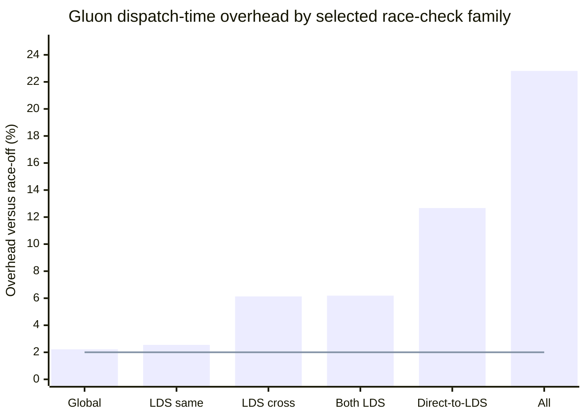
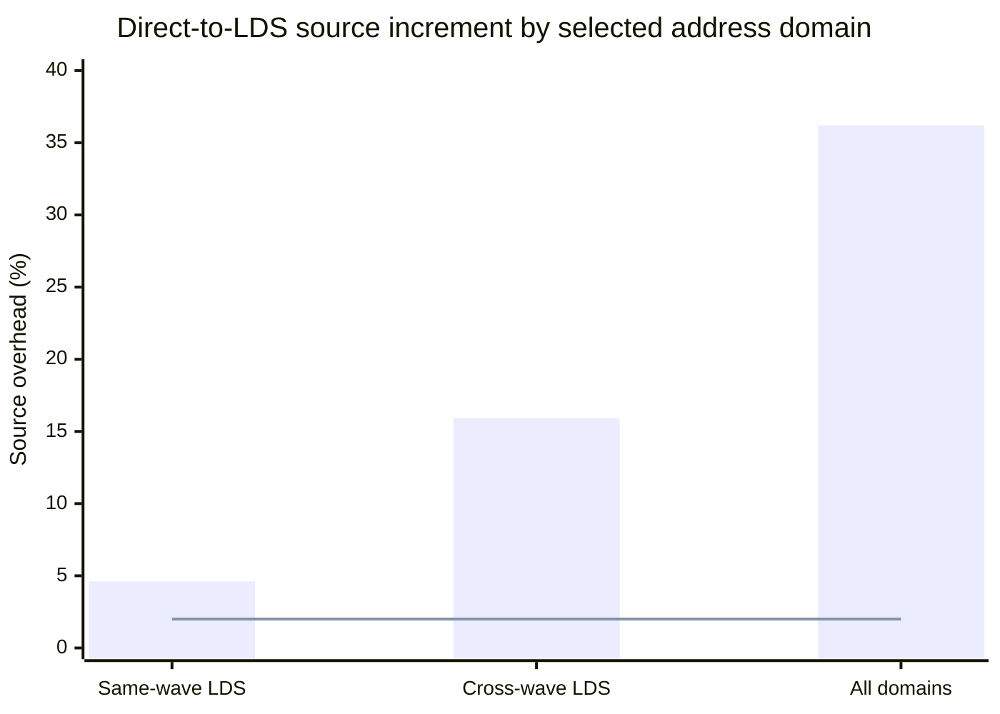
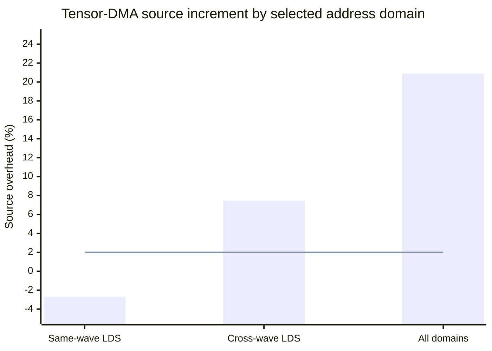

# Address-race checks: the 2% decision

Selectable-family Release build, 20 October 2026. All measurements used full
coverage and produced no report.

> **Decision: no active standalone family meets the 2% bound.**
>
> Global and same-wave LDS are closest, but both point estimates and 95% upper
> bounds exceed 2%. Cross-wave LDS and direct-to-LDS are materially over
> budget. Tensor DMA appears below 2% only on gfx950, where its path cannot
> execute.

For the full phase history, hotspot analysis, and methodology, see
[Address race checker performance analysis](address-race-checking-performance-analysis.md).

## Summary

- **All checks, Gluon geomean:** +22.81%
- **Direct-to-LDS increment:** +12.67%
- **Closest active family:** global at +2.22%
- **Active families qualified for default-on:** 0

## Representative per-family overhead

The following chart shows the geomean overhead versus race-off across 20 gfx950
Gluon kernels at full coverage. The line marks the 2% default-on budget. The
x-axis is the selected family or bundle; the y-axis is dispatch-time overhead
in percent. Confidence intervals are in the table below.

Source: 800 sequential processes, five rotating repetitions, four timed
dispatches per process, and a 4 GiB global shadow. All outputs matched; no
finding or coverage degradation occurred.

## What each added check costs

| Selectable family | Gluon overhead | Large synthetic | Focused active path | 2% assessment |
|---|---:|---:|---:|---|
| Global cross-workgroup RAW/WAR/WAW | +2.22% [1.14%, 3.02%] | +33.59% [30.87%, 38.76%] | +72.06% focused global path | Fails |
| Same-wave pending LDS | +2.55% [1.43%, 3.47%] | +11.59% [9.58%, 18.69%] | +17.90% focused LDS path | Fails |
| Cross-wave LDS plus barrier ordering | +6.13% [5.01%, 7.15%] | +19.88% [18.10%, 22.47%] | +38.20% focused LDS path | Fails |
| Direct-to-LDS source increment | +12.67% [11.55%, 13.72%] | Not present in generic synthetics | +36.21% all-domain source stress | Fails |
| Tensor-DMA source increment | +0.80% [0.13%, 1.46%], dormant | Not available on gfx950 | +20.89% active gfx1250 all-domain | Dormant result does not qualify |
| Same-wave added after cross-wave | +0.05% [-0.86%, 1.07%] | Combined LDS: +20.32% large | Combined Gluon bundle: +6.19% | Increment passes; bundle fails |

RAW, WAR, and WAW are classifications produced by the same overlap traversal,
not three separately timed passes. Source increments compare `all` with the
same address domains minus that source. Percentages interact and are not
additive.

## Transfer-source stress

These measurements isolate the increment from enabling a source on a workload
that actively executes it. Each chart uses the selected address domains on the
x-axis and source overhead in percent on the y-axis. The line marks the 2%
default-on budget.

### Direct-to-LDS on gfx950

### Tensor DMA on gfx1250

Source: 210 sequential processes, 15 rotating repetitions, and 1,024 transfers
per thread or workgroup configuration. Tensor same-wave is unresolved with a
95% interval of -5.59% to +3.97%, so it does not establish a sub-2% result.

## Reproducibility

- The committed
  [address-race performance workloads](../tests/memory-diagnostics/performance/README.md)
  preserve the general synthetic, focused path, direct-to-LDS, and tensor-DMA
  programs together with their exact shapes and build instructions.
- Release executable SHA-256:
  `fd85c7e8a3d8a399fa53f09dfdf74fdb5ea65c8c15c71402dc47895a31d69462`
- 2,126 performance processes: 800 Gluon, 576 general synthetic, 540 focused
  path, and 210 transfer-source runs.
- 174 core race/wait tests, 250 combined race tests, both mutation architecture
  matrices, and the selector CLI test passed.

## Optimization order required for a credible 2% attempt

1. **Batch direct-to-LDS effects.** Prepare provenance once, then consume the
   global read and deferred LDS write in bulk. This source alone adds 12.67% to
   the realistic geomean.
2. **Stop retaining one detailed record per clean dword.** Add a compressed
   first-owner/run representation for global and LDS memory, then promote to
   exact byte/provenance records only when another owner overlaps. Focused
   global and LDS paths remain far over budget.
3. **Consume affine runs in bulk.** Batch page/shard lookup, exact-site
   interning, record insertion, and dense LDS heads instead of calling the
   scalar shadow once per dword.
4. **Reduce cross-wave LDS history.** Cross-wave LDS is +6.13% on Gluon and
   +38.20% on its focused path. Index pending overlap and evaluate epoch or
   compact-owner history.
5. **Track touched shards and active history.** Skip untouched cleanup shards
   and barriers before any LDS history or pending operation exists; reuse fixed
   barrier scratch.
6. **Do not lead with another mutex-only pass.** The lock-scope audit was
   statistically flat; dominant per-dword traversal and mutation still run
   inside the necessary shared-state sections.

## Decision guidance

Keep full address-race checking opt-in. The controls isolate cost, but none of
the active standalone families qualifies for default-on. After shadow and
transfer batching, rerun the Gluon, mutation, synthetic, and finding-producing
suites with the same retained coverage.
