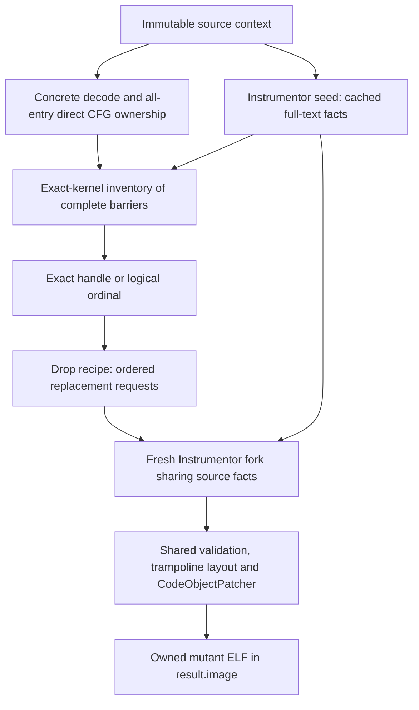

# Fault injection

The fault-injection library creates deliberately modified AMDGPU code objects
for experiments with synchronization and LDS address failures. It runs offline
on the host: callers supply an image, select a qualified operation, and receive a mutant
image or a typed error. It neither initializes HSA nor dispatches GPU work.

The internal C++ library and `rj_code_mutate` CLI perform the same mutation.
ConSan is an optional consumer of the output; both the library and CLI build
and run host tests with the ConSan compiler, runtime, and analyzer disabled.
There is no persistent selection, manifest, or replay-bundle format.

## Architecture and lifetime

This flow shows the complete-barrier Drop path and its shared DBI transaction
boundary. The LDS recipe uses the same source facts and a fresh Instrumentor
fork, with its own instruction qualification and address replacement:



[`FaultMutationContext`](../lib/rocjitsu/src/rocjitsu/code/patch/fault_injection/fault_mutation_context.h)
owns one immutable copy of the input. Retain it in the input/session owner until
all discovery, selection, and apply operations finish. One context can serve
many requests for that original image; each apply produces an independent
mutant. A session handling several inputs keeps a separate context for each.
To analyze or mutate an emitted image, create a new context from its bytes.

The context supplies target, section, and owner facts independently of any
barrier. It caches the fixed all-entry ownership analysis; Drop separately
caches per-kernel barrier qualification. Full-text
structural facts belong to a retained `Instrumentor` seed: references in
unreachable code still matter to byte editing. Each apply forks a fresh request
batch that shares those immutable facts and repeats request-specific validation.
The batches have independent queues and patch attempts; they do not inherit
previous mutations. Facts are reusable for the same immutable source and analysis
profile, not arbitrary new roots or broader helper ownership.
Selections expire with their source context and cannot be replayed in another
context, even if its input bytes are identical. Drop selections expose kind,
owner, and barrier snapshots; LDS selections expose kind and site snapshots.
Those snapshots remain readable after expiry but cannot authorize a mutation.
The in-process API does not require callers to supply a target or content digest.

The common source context and admission live in `fault_mutation_context.{h,cpp}`.
The Drop and LDS recipes live in `drop_barrier.{h,cpp}` and
`lds_wrong_address.{h,cpp}`, respectively. Each recipe includes the common
context header; LDS callers include `lds_wrong_address.h`.

The library reuses the ISA registry and concrete decoder, `BasicBlock` and
`KernelScopeSpec`, descriptor scanning, instruction builders, and
[`CodeObjectPatcher`](../lib/rocjitsu/src/rocjitsu/code/patch/code_object_patcher.h).
Concrete identity is preserved, including the differing gfx1250/gfx1251 decoder
features. The host-only tests link the existing static-analysis composition and
model ISA providers; simulator execution support is not an admission condition.
See [ISA target providers](isa-target-providers.md) and the
[test target wiring](../tests/CMakeLists.txt).

Generic mechanics and recipe semantics have separate responsibilities:

- [`InstrumentationKind::ReplaceWithInst`](../lib/rocjitsu/src/rocjitsu/code/patch/instrumentor.h)
  accepts owned expected and replacement bytes at each original-text anchor.
  Its shared backend checks source structure, complete instruction extents,
  expected bytes, references, clauses, and replacement encoding before changing
  a private image through `CodeObjectPatcher`. It does not decide which barrier
  should be removed or prove recipe ownership. Generic transaction tests belong
  to the [DBI replacement suite](../tests/patch/checked_text_edits_test.cpp).
- [`qualify_static_barriers`](../lib/rocjitsu/src/rocjitsu/code/analysis/static_barriers.h)
  and the [Drop frontend](../lib/rocjitsu/src/rocjitsu/code/patch/fault_injection/drop_barrier.cpp)
  establish admitted logical members and choose the corresponding NOP bodies.
  Qualification uses the same full-text instruction boundaries and clause facts
  as the checked-edit transaction, including facts from unreachable text.
  Recipe tests verify output semantics; emission does not run a second
  FI domain validator.
- The LDS frontend checks a supported instruction and register allocation,
  then uses a target-specific ISA helper, such as the
  [RDNA4 source-preserving helper](../lib/rocjitsu/src/rocjitsu/isa/arch/amdgpu/rdna4/encoded_fields.h)
  to change only its encoded address field. It sends the complete replacement
  through the same transaction; the helper does not choose a fault or a register.
- [`Instrumentor`](../lib/rocjitsu/src/rocjitsu/code/patch/instrumentor.cpp)
  owns both replacement transactions and observational instrumentation. Each
  selected barrier member becomes a branch to an appended cave containing
  `s_nop 0` and a branch back to the next original instruction. The original
  barrier is never replayed. Drop supplies no probes and requires no additional
  registers or spill storage. The shared writer grows `.text` and updates ELF
  layout and descriptor entry displacements as needed; original file offsets
  and whole-image byte identity are therefore not preserved. Unselected guest
  instructions retain their text-relative offsets and encodings, and descriptor
  wave and resource fields retain their values. Generic replacement can compose
  with observations, but this recipe queues only replacement requests. See the
  [DBI design](dbi-design.md) for the shared contract and site-range meanings.

## Features and status

| Feature | Status and main boundary | References |
| --- | --- | --- |
| Complete barrier Drop | Implemented for the target/wave forms below. Removes one logical barrier: an ordered two-member signal/wait pair or one true full-barrier instruction. A half-pair is never a singleton. | [`StaticBarrier` / family policy](../lib/rocjitsu/src/rocjitsu/code/analysis/static_barriers.h), [qualification](../lib/rocjitsu/src/rocjitsu/code/analysis/static_barriers.cpp), [analysis regressions](../tests/analysis/static_barriers_test.cpp), [Drop regressions](../tests/patch/fault_injection/drop_barrier_test.cpp) |
| LDS wrong address | Implements scalar b32/b64/b96/b128 loads and stores on gfx1200/gfx1201 wave32/wave64, gfx942/gfx950 wave64, and gfx1250 wave32. Also admits b32/b64 two-address and stride64 families on gfx1200/gfx1201/gfx942/gfx950. Replaces only the address VGPR with an explicitly supplied, distinct, allocated VGPR in the direct, independently owned CFG profile. Adds the target-specific subword, D16, and transpose profiles in the exact LDS matrices below. Other forms and targets remain follow-up work. | [LDS API](../lib/rocjitsu/src/rocjitsu/code/patch/fault_injection/lds_wrong_address.h), [library tests](../tests/patch/fault_injection/lds_wrong_address_test.cpp), [CLI tests](../tests/patch/fault_injection/lds_cli_test.cpp) |
| Exact and logical-ordinal selection | An exact kernel name chooses one inventory; an exact context-bound handle takes precedence over the zero-based logical ordinal. Invalid exact requests fail without fallback. Ordinal zero chooses the first barrier by first-member offset, or the first LDS instruction by source offset. There is no race ranking or legacy physical-index adapter. | [`DropBarrierSelector`](../lib/rocjitsu/src/rocjitsu/code/patch/fault_injection/drop_barrier.h), [`select_drop_barrier`](../lib/rocjitsu/src/rocjitsu/code/patch/fault_injection/drop_barrier.cpp), [`LdsSelector`](../lib/rocjitsu/src/rocjitsu/code/patch/fault_injection/lds_wrong_address.h) and [`select_lds_wrong_address`](../lib/rocjitsu/src/rocjitsu/code/patch/fault_injection/lds_wrong_address.cpp), [selection regressions](../tests/patch/fault_injection/drop_barrier_test.cpp) |
| Multiple kernels in one text section | Limited support for independent sibling kernels. Discovery checks all entries before exposing one exact kernel's inventory; shared blocks, calls, aliased entries, and unresolved owners are rejected. | [`FaultMutationContext`](../lib/rocjitsu/src/rocjitsu/code/patch/fault_injection/fault_mutation_context.h), [ownership analysis](../lib/rocjitsu/src/rocjitsu/code/patch/fault_injection/fault_mutation_context.cpp), [sibling preservation tests](../tests/patch/fault_injection/drop_barrier_test.cpp) |
| Shared DBI instruction replacement | Consumed through `InstrumentationKind::ReplaceWithInst`. One transaction replaces complete source instructions through trampolines. Drop supplies one 4-byte NOP body for each qualified 4-byte barrier member. This does not widen observational trampoline-anchor admission. | [Instrumentor contract](../lib/rocjitsu/src/rocjitsu/code/patch/instrumentor.h), [DBI design](dbi-design.md), [transaction tests](../tests/patch/checked_text_edits_test.cpp), [replacement tests](../tests/patch/instrumentor_replacement_test.cpp) |
| Offline CLI | Lists current-input sites and emits one complete Drop or one supported LDS address mutation using the same library. | [usage](#command-line-usage), [frontend](../tools/rj_code_mutate.cpp), [integration tests](../tests/patch/fault_injection/mutation_cli_test.cpp) |
| Persistent selection files and replay bundles | Not provided; no durable replay format is committed. | — |
| Helper, indirect-flow and firmware-preload ownership | Planned extensions; these inputs are not admitted by the current ownership profile. | — |
| Other mutation recipes and composition | Planned. Barrier movement, other address/order/scope changes, grouped or destructive partial Drop, and multi-mutation composition are not implemented here. | — |
| Multiple text sections or dynamic occurrence selection | Unsupported. | — |

A caller uses `discover_drop_barriers` with an exact kernel name to obtain an
inventory, `select_drop_barrier` to choose a complete logical barrier, and
`apply_drop_barrier` to emit it. Each operation returns `FailureOr` and a typed
`FaultMutationError`; the [API header](../lib/rocjitsu/src/rocjitsu/code/patch/fault_injection/drop_barrier.h)
defines the arguments, lifetime contract, and result fields. `DropBarrierResult::image`
owns the emitted ELF; `selection.barrier().members` retains the ordered original
members and `selection.owner()` retains pristine owner offsets. Rescan the
emitted image for its section and descriptor file locations. Fresh CFG block
boundaries can differ because of the added branches. FI does not expose a
second generic edit plan, validator, or writer.

## Target coverage and qualification

`fault_mutation_capabilities()` lists transformation admission from the linked
default ISA registry and family policy used by discovery and apply. The current
bindings cover seven concrete
targets and ten target/wave combinations:

| Family | Concrete target | Wave size | Complete logical barrier |
| --- | --- | --- | --- |
| RDNA3 | gfx1100 | 32 | Full `s_barrier` singleton, workgroup |
| RDNA3 | gfx1100 | 64 | Full `s_barrier` singleton, workgroup |
| RDNA4 | gfx1200 | 32 | Builtin signal/wait pair, workgroup ID -1 |
| RDNA4 | gfx1200 | 64 | Builtin signal/wait pair, workgroup ID -1 |
| RDNA4 | gfx1201 | 32 | Builtin signal/wait pair, workgroup ID -1 |
| RDNA4 | gfx1201 | 64 | Builtin signal/wait pair, workgroup ID -1 |
| CDNA5 | gfx1250 | 32 | Builtin signal/wait pair, ID -1 workgroup or -3 cluster |
| CDNA5 | gfx1251 | 32 | Builtin signal/wait pair, ID -1 workgroup or -3 cluster |
| CDNA3 | gfx942 | 64 | Full `s_barrier` singleton, workgroup |
| CDNA4 | gfx950 | 64 | Full `s_barrier` singleton, workgroup |

The table above describes Drop only. `lds_wrong_address_capabilities()` separately
reports the exact LDS matrix below: scalar b32/b64/b96/b128 loads and stores on
all five concrete targets, plus b32/b64 two-address and stride64 families on
gfx1200/gfx1201/gfx942/gfx950 and the target-specific subword/transpose
profiles below, restricted to independently owned direct CFGs.
CDNA GDS encodings are excluded; the ACC data selector is preserved.
A target is omitted if its decoder or binding is not linked. Other targets,
waves, and DS forms are not advertised by this recipe; the Drop table does not
imply LDS support.

The [host regression matrix](../tests/patch/fault_injection/drop_barrier_test.cpp) covers
discovery, exact/ordinal selection, emission, concrete decoding, and preservation
for these rows. RDNA3 has its own instruction encodings and descriptor-selected
wave modes; the shared singleton representation does not imply CDNA encodings
or wave64-only admission. CDNA1/CDNA2 and unregistered targets are not admitted.
A different provider composition may expose fewer bindings.

Trap-handler IDs -2 (RDNA4/CDNA5) and -4 (CDNA5) are rejected, including when
they appear before an otherwise admitted user barrier. Their operations are
inert outside privileged mode and must not consume a user barrier's logical
ordinal. See the [RDNA4 ISA, section 5.6 and Table 24](https://docs.amd.com/api/khub/documents/uQpkEvk3pv~kfAb2x~j4uw/content)
and [CDNA5 ISA, section 5.6 and Table 21](https://www.amd.com/content/dam/amd/en/documents/instinct-tech-docs/instruction-set-architectures/amd-instinct-cdna5-instruction-set-architecture.pdf).
CDNA5 ID -3 is admitted as a static cluster barrier, but its operations are
inert for nonclustered dispatches and single-workgroup clusters.
A Drop experiment also assumes a valid pristine protocol: exactly one cluster
signal per workgroup, issued by one wave after workgroup synchronization, with
every wave waiting for the cluster barrier. Cluster membership alone does not
establish that protocol. See [CDNA5 ISA, section 5.6.6, page 51](https://www.amd.com/content/dam/amd/en/documents/instinct-tech-docs/instruction-set-architectures/amd-instinct-cdna5-instruction-set-architecture.pdf#page=60).
Selecting -3 records these preconditions in `DropBarrierResult`; offline
qualification verifies neither workgroup size nor this protocol.

Compiler output must still fit the admitted instruction shape. In
[LLVM's barrier lowering](https://github.com/llvm/llvm-project/blob/f14f34f217a99d77628d547b1b3ba9fa47fbd06b/llvm/lib/Target/AMDGPU/AMDGPULowerIntrinsics.cpp#L128-L175),
optimization with a known single-wave workgroup can produce the admitted
same-block cluster signal/wait pair. Otherwise, including for multi-wave
workgroups, lowering uses workgroup `s_barrier_signal_isfirst` and a conditional
cluster signal in a different block from the cluster wait. Both `signal_isfirst`
and cross-block pairs are outside this profile. This compiler-shape limitation
comes from source inspection; it does not qualify physical GPU execution.

These are host transformation capabilities. Neither the listing nor a successful
mutation establishes GPU execution or detector qualification.
`DropBarrierResult` leaves those evidence states `Unverified`; `LdsResult` does
not itself contain execution or detector evidence fields. A removed barrier
may be redundant, unreachable in a particular run, or insufficient to cause a
race; successful execution alone also does not establish a detector finding.

## Current limits

Inputs must be little-endian AMDHSA ET_DYN ELF64 images with one executable
`.text`. ABI admission follows the [shared ELF reader](../lib/rocjitsu/src/rocjitsu/code/amdgpu_code_object.cpp)
and [DBI patcher](../lib/rocjitsu/src/rocjitsu/code/patch/code_object_patcher.cpp).
Text and descriptors require unambiguous file-backed load mappings. Additional
`PT_LOAD` mappings that overlap any of their file bytes are rejected, including
partial aliases at different virtual addresses: changing one file word would
otherwise change bytes at an unanalyzed loaded address too. File ranges that
only touch these boundaries and zero-file-size segments at disjoint addresses
do not create file aliases. This is FI's loaded-ownership admission, not a new
requirement for generic Instrumentor replacement.

Every admitted 64-byte kernel descriptor must also remain immutable under the
supported ROCr dynamic relocations. FI rejects their 4-byte or 8-byte writes
when any byte overlaps a descriptor, including a write beginning in preceding
loaded padding or a write into an unselected sibling's descriptor. Protecting
the complete descriptor keeps entry, wave, preload, and other descriptor facts
bound to the same file snapshot. Explicit-target static relocation metadata
and dynamic writes outside descriptors retain the existing shared admission.
This check does not resolve relocation values or add ABI qualification.

The ownership profile admits closed direct CFGs with independent kernel entries. It rejects
shared helpers/calls, indirect or unresolved flow,
firmware-preload entries, and declared executable owners outside the analyzed
text. Non-aliasing unselected sections are preserved; their executable flag alone
does not imply another text section. Additional allocated executable sections
must decode completely and satisfy the shared source checks before discovery
can return an inventory. Detailed admission and diagnostics are in
the [source context](../lib/rocjitsu/src/rocjitsu/code/patch/fault_injection/fault_mutation_context.cpp)
and [shared Instrumentor contract](../lib/rocjitsu/src/rocjitsu/code/patch/instrumentor.h).

The LDS address profiles cover these exact instruction families:

| Concrete target | Waves | Scalar forms | Two-address forms |
| --- | --- | --- | --- |
| gfx1200, gfx1201 | 32, 64 | `ds_load_b32/b64/b96/b128`, `ds_store_b32/b64/b96/b128` | `ds_load_2addr_b32/b64`, `ds_store_2addr_b32/b64`, `ds_load_2addr_stride64_b32/b64`, `ds_store_2addr_stride64_b32/b64` |
| gfx942, gfx950 | 64 | `ds_read_b32/b64/b96/b128`, `ds_write_b32/b64/b96/b128` | `ds_read2_b32/b64`, `ds_write2_b32/b64`, `ds_read2st64_b32/b64`, `ds_write2st64_b32/b64` |
| gfx1250 | 32 | `ds_load_b32/b64/b96/b128`, `ds_store_b32/b64/b96/b128` | None; these forms require split relocation outside this profile. |

Additional subword and transpose forms are admitted only on their listed targets:

| Concrete target | Subword forms | Transpose forms |
| --- | --- | --- |
| gfx1200, gfx1201 | `ds_load_i8/u8/i16/u16`, `ds_load_u8_d16`, `ds_load_i8_d16`, `ds_load_u16_d16` and their `_hi` variants; `ds_store_b8/b16` and their `_d16_hi` variants | None |
| gfx942 | `ds_read_i8/u8/i16/u16`, `ds_read_u8_d16`, `ds_read_i8_d16`, `ds_read_u16_d16` and their `_hi` variants; `ds_write_b8/b16` and their `_d16_hi` variants | None |
| gfx950 | Same subword families as gfx942 | `ds_read_b64_tr_b16` |
| gfx1250 | Same subword families as gfx1200/gfx1201 | `ds_load_tr8_b64`, `ds_load_tr16_b128` |

All admitted gfx1200/gfx1201 forms support both descriptor-selected waves.
Wave32 allocation uses the descriptor granularity of eight VGPRs. The gfx1250
two-address exclusion also applies when other transpose forms are admitted.

A slash-separated width suffix denotes each named form, for example
`ds_load_b32/b64` denotes `ds_load_b32` and `ds_load_b64`; similarly,
`ds_load_i8/u8` denotes `ds_load_i8` and `ds_load_u8`. The two matrices cover
145 concrete target/form profiles, expanded to 205 target/wave/form capabilities. Only the
address VGPR selector changes; the two offsets, stride semantics, data and
destination tuples, and CDNA ACC bit are preserved. CDNA3/4 GDS instructions
remain excluded. gfx1250 requires a statically proven address bank and checks
the replacement selector against that bank's allocated register window.

The LDS inventory contains complete, reachable instructions of the admitted forms in
the kernel; clause members are not advertised. It does not require a
barrier or successful Drop qualification. The replacement register must be
explicit, representable in the eight-bit encoded address field, different from
the original, and inside the entry descriptor's allocated ordinary VGPR window.
For CDNA3/4 this window ends at the accumulator allocation base when that base
is below the total allocation. These checks do not prove that the register has
been initialized or holds a valid LDS address at runtime: the caller must arrange
both. Static mutation affects every
execution of the selected instruction. Other target/wave/form and shared-owner
profiles remain follow-up work.

Barrier qualification is all-or-nothing for a kernel's analyzed reachable
scope: an unsupported form or incomplete barrier rejects that kernel's entire
inventory, even when other complete barriers are present. This is the current
Drop admission policy. Per-kernel wave or barrier qualification failures leave
independent sibling kernels available. Failures in the shared structural or
ownership checks reject the whole image profile, including unknown flow in an
unselected owner.

A split pair must complete in the same basic block, although ordinary
instructions may separate its members. Partial, interleaved, cross-block,
named/dynamic/lifecycle and `signal_isfirst` forms, as well as barriers inside
clauses, are rejected. A direct loop can contain a qualified static barrier;
removal affects **every executed occurrence** of that position. There is no
selection of the Nth dynamic occurrence or proof of convergence.

Each member's outgoing and return branches must fit the shared trampoline
pipeline's signed 16-bit dword displacement. Discovery can succeed while apply
fails because an appended cave is out of reach, including for a large text
section. No partial mutant is returned and the source context remains unchanged.
Drop introduces extra branches and NOPs, so it does not preserve instruction
counts or timing. Host transformation tests do not establish physical execution.

Apply also rejects retained `s_getpc_b64` / `s_get_pc_i64` when text growth
moves allocated storage or consumes a loaded file or zero-fill tail. This
shared replacement guard checks the whole image, including sibling kernels:
unchanged instruction bytes alone cannot preserve linked PC-relative data
addresses. The restriction is conservative and can reject a safe target when
unrelated allocated metadata moves. Complete address-builder relocation is not
implemented; see [replacement validation](dbi-design.md#instruction-replacement).

Retained direct branches also reject when growth moves their source and
destination differently, including later allocated sections and loaded tails.
Full-text source facts include unreachable references, so discovery may succeed
while apply rejects the complete Drop batch.

For ConSan use, follow the [fresh-prepare integration contract](consan.md#fault-injection).
Fresh prepare currently requires a single-kernel image. Sibling-preserving
multi-kernel mutants cannot use this path; any remaining barriers must satisfy
ConSan's qualified gfx1250 wave32 workgroup-barrier profile.
The mutant must also satisfy ConSan's other input restrictions; fresh preparation
does not establish detector qualification. Mutation admission and detector
admission are separate decisions.

## Optional compiled corpus regression

`RJ_FAULT_INJECTION_CORPUS_OBJECT` is empty by default. Without it, the
`FaultDropBarrier.CompiledCorpusCompleteDrop` test is not registered; the
synthetic host regressions remain available. Supplying an existing device ELF
enables the corpus test, but CMake does not verify its provenance or digest.
The test expects the compiled `fa_barrier_epoch` kernel and checks complete
Drop, emitted instructions, and preservation. It does not run the GPU kernel.

To reproduce the historical reference fixture, use `fa_barrier_epoch.hip` and `utils.hpp`
from [rocjitsu-test-corpus revision c5e3c38464d7440ef7dc977ed95419d7544afe50](https://github.com/ROCm/rocjitsu-test-corpus/tree/c5e3c38464d7440ef7dc977ed95419d7544afe50/corpus/race/kernels).
The recorded build used TheRock SDK `10.1.0a20260812`, AMD clang `23.0.0git`
(LLVM revision `a01cdbd92d1f931738a4897502747a68ae36eccf`). Prepare this
version in a per-worktree SDK environment, then run from the monorepo root.
See [building](building.md) for general build prerequisites.

```bash
source .venv-therock/bin/activate
fi_corpus_dir="${PWD}/artifacts/fi-corpus"
mkdir -p "${fi_corpus_dir}"
fi_corpus_source=https://raw.githubusercontent.com/ROCm/rocjitsu-test-corpus/c5e3c38464d7440ef7dc977ed95419d7544afe50/corpus/race/kernels
curl --fail --location "${fi_corpus_source}/fa_barrier_epoch.hip" --output "${fi_corpus_dir}/fa_barrier_epoch.hip"
curl --fail --location "${fi_corpus_source}/utils.hpp" --output "${fi_corpus_dir}/utils.hpp"
rocjitsu_rocm_root=$(rocm-sdk path --root)
"${rocjitsu_rocm_root}/bin/amdclang++" -x hip --offload-arch=gfx1250 --cuda-device-only -O2 -mcode-object-version=5 -c "${fi_corpus_dir}/fa_barrier_epoch.hip" -o "${fi_corpus_dir}/fa_barrier_epoch.bundle"
"${rocjitsu_rocm_root}/lib/llvm/bin/clang-offload-bundler" --unbundle --type=o --targets=hipv4-amdgcn-amd-amdhsa--gfx1250 --input="${fi_corpus_dir}/fa_barrier_epoch.bundle" --output="${fi_corpus_dir}/fa_barrier_epoch.hsaco"
sha256sum "${fi_corpus_dir}/fa_barrier_epoch.hip" "${fi_corpus_dir}/utils.hpp" "${fi_corpus_dir}/fa_barrier_epoch.hsaco"
```

Recorded historical SHA-256 values:

| File | SHA-256 |
| --- | --- |
| `fa_barrier_epoch.hip` | `86f020b8d16279ae950764b2cf377018560ab0082a6e7c9b0ce6063dd9dec5f1` |
| `utils.hpp` | `4c97b572ffaf6da56323be29e408c911c9c7c33f6c6ee454a76aa37175563966` |
| `fa_barrier_epoch.hsaco` | `d6802574e78ebe0acdd68e3c855099949b21cd74a7df361a3d2016d7ee458ef2` |

Add `-DRJ_FAULT_INJECTION_CORPUS_OBJECT="${fi_corpus_dir}/fa_barrier_epoch.hsaco"`
to this checkout's CMake configuration, preserving its compiler, sanitizer,
ROCm, and other options. For an existing build, the corresponding commands are:

```bash
cmake -S emulation/rocjitsu -B emulation/rocjitsu/build -DRJ_FAULT_INJECTION_CORPUS_OBJECT="${fi_corpus_dir}/fa_barrier_epoch.hsaco"
cmake --build emulation/rocjitsu/build --target rocjitsu_fault_injection_tests
ctest --test-dir emulation/rocjitsu/build -R '^FaultDropBarrier\.CompiledCorpusCompleteDrop$' --output-on-failure --no-tests=error
```

These digests document fixture provenance; they are not a production mutation
request requirement or evidence of physical GPU or detector qualification.

## Command-line usage

The mutation library and CLI are included in the normal build. Host integration
tests require `BUILD_TESTING=ON`; the mutation tooling does not require the ConSan
components. From the checkout configured as described in [Building](building.md),
build the executable and host integration tests:

```bash
cmake --build emulation/rocjitsu/build --target rj_code_mutate rocjitsu_fault_mutation_cli_tests
emulation/rocjitsu/build/tools/rj_code_mutate --help
emulation/rocjitsu/build/tools/rj_code_mutate --capabilities
```

List complete logical barriers for one exact kernel entry, then create a new
mutant file. `DropBarrier` is the default kind:

```bash
emulation/rocjitsu/build/tools/rj_code_mutate \
  --input original.hsaco --kernel my_kernel --list
emulation/rocjitsu/build/tools/rj_code_mutate \
  --input original.hsaco --kernel my_kernel --kind DropBarrier \
  --ordinal 0 --output mutant.hsaco
```

The `--address-vgpr` argument is the encoded 8-bit selector, not a physical VGPR
number. Listing reports `address_bank`; for gfx1250, allocation is checked for
`256 * address_bank + address-vgpr`. The caller must initialize that full VGPR
with the intended runtime address: bank 1 with selector 6 reads v262, so initialize
v262. The mutation preserves the bank and does not initialize register values.

To list the supported LDS instructions in a gfx1200 or gfx1201 wave32 or wave64 kernel and mutate one,
choose an address register whose runtime value the caller has initialized. Here
`v6` is an example only: it must differ from the selected instruction's address
register and fall within the kernel descriptor's allocated VGPR window.

```bash
emulation/rocjitsu/build/tools/rj_code_mutate \
  --input original.hsaco --kernel my_kernel --kind LdsWrongAddress --list
emulation/rocjitsu/build/tools/rj_code_mutate \
  --input original.hsaco --kernel my_kernel --kind LdsWrongAddress \
  --ordinal 0 --address-vgpr 6 --output lds-mutant.hsaco
```

Alternatively, copy an `exact` offset from that listing into `lds_exact` and
use it in place of the ordinal. An invalid exact offset never falls back:

```bash
emulation/rocjitsu/build/tools/rj_code_mutate \
  --input original.hsaco --kernel my_kernel --kind LdsWrongAddress \
  --exact "$lds_exact" --address-vgpr 6 --output lds-exact-mutant.hsaco
```

The equivalent library flow retains the context for discovery, selection, and
application. Handle the returned typed error at each failure; on success,
`result.value().image` owns the mutant ELF:

```cpp
#include "rocjitsu/code/patch/fault_injection/lds_wrong_address.h"

using namespace rocjitsu;

void mutate_lds(std::span<const uint8_t> image) {
  FaultMutationContext context(image);
  FaultMutationError error;
  FailureOr<LdsInventory> inventory = discover_lds_wrong_address(context, "my_kernel", error);
  if (inventory.failed())
    return; // Handle error.
  LdsSelector selector = {.exact = std::nullopt, .ordinal = 0};
  FailureOr<LdsSelection> selection = select_lds_wrong_address(inventory.value(), selector, error);
  if (selection.failed())
    return; // Handle error.
  FailureOr<LdsResult> result = apply_lds_wrong_address(context, selection.value(), 6u, error);
  if (result.failed())
    return; // Handle error, including an unallocated or unchanged v6.
  // Consume result.value().image before leaving this example.
}
```

To select an exact library handle instead, put a previously obtained
`LdsSelection` in `LdsSelector::exact` and call `select_lds_wrong_address` on
an inventory from the same context and entry. Exact takes precedence over the
ordinal; a foreign or expired handle fails without fallback.

For a `gfx1250` Drop mutant that meets ConSan's native LDS admission, fresh
preparation consumes `mutant.hsaco` as its new original image:

```bash
emulation/rocjitsu/build/tools/rj_consan_prepare \
  mutant.hsaco gfx1250 my_kernel mutant-artifact
```

Preparation requires `RJ_BUILD_CONSAN_COMPILER=ON`. Use the new artifact when
executing the workload with `mutant.hsaco`, then capture and analyze normally.
See the [ConSan mutation workflow](consan.md#fault-injection) for fresh artifact
and capture bindings and links to the existing execution/analysis steps.

`--kernel` requires the exact descriptor-derived spelling. After shared image
analysis succeeds, an unknown name reports the descriptor entries in its
diagnostic. Those names do not promise that each entry passes the selected
recipe's qualification.

For `DropBarrier`, each listing line includes the zero-based logical `ordinal`,
`exact` first-member byte offset relative to `.text`, concrete target, section
index, form, ID, scope, and ordered `members=offset:size,...`. A singleton has
one member; a split pair has two. `LdsWrongAddress` listing lines contain
`ordinal`, the instruction's `.text`-relative `exact` byte offset, its original
`address_vgpr`, `address_bank`, target, and form. Coordinates describe only this input and exact entry;
they are not reusable handles for another image or legacy physical indices.

Drop emission redirects each selected member through a NOP trampoline. LDS
emission redirects the selected instruction through a trampoline containing the
replacement instruction. The mutant's text and ELF layout can grow, and
descriptor-relative entry fields can change. Reparse the output and list its
sites again before selecting another mutation.

Drop discovery rejects trap-handler forms (-2 on RDNA4/CDNA5 and -4 on CDNA5)
instead of assigning them a logical ordinal, including when an admitted user
barrier follows them. CDNA5 cluster ID -3 remains admitted subject to the
dispatch assumptions described above; listing or mutation does not establish
that cluster semantics are active.

Use `--exact TEXT-OFFSET` to resolve that coordinate into a context-bound library
selection. Exact takes precedence over `--ordinal`, including an out-of-range
ordinal; invalid exact requests fail without fallback. Without either selector,
ordinal zero selects the first complete barrier or supported LDS instruction in
source order. Numbers accept unsigned decimal or `0x` hexadecimal.
`--target gfx1250`, if supplied, asserts the parsed identity and never selects a
different decoder. Input ABI and wave admission are the library's shared DBI
checks, without another CLI version gate.

The input must be a regular extracted code-object file of 1 through 256 MiB.
The CLI refuses host executables, bundles, archives, relocatable objects, and
other inputs rejected by the library. Output creation is exclusive: existing
files, directories, symlinks and hard links (including input aliases) are
refused. There is no overwrite flag. A failed write or close removes the
incomplete new output. This is single-file I/O, without a multi-file publication
protocol or a crash-durability guarantee.

Exit status is 0 for successful listing/mutation/help/capabilities, 2 for
argument, read, admission, selection or mutation errors, and 3 for output I/O
errors. All successful stdout paths flush and check the stream. A completed
mutant file remains if writing its subsequent assumptions or summary fails;
status 3 does not guarantee that no output file exists.
The executable ignores `SIGPIPE` and `SIGXFSZ` where available so closed pipes
and file-size limits reach these I/O checks and incomplete-file cleanup,
regardless of the caller's signal dispositions.

Diagnostics go to stderr. Discovery, selection and mutation failures preserve
the library's typed error as `code=NAME` before the explanatory message.
The code names are `BadIdentity`, `UnsupportedTarget`, `UnsupportedForm`,
`AmbiguousSelection`, `IncompleteSelection`, `InvalidParameters`,
`ValidationFailure`, `NoCandidates` and `OrdinalOutOfRange`. Runners can classify
these errors without matching the English message; argument/read diagnostics
have no typed library code. Library error offsets do not encode whether a
location is present, so those diagnostic prefixes omit the numeric field.
An invalid `--exact` request has an explicitly known coordinate and reports
`code=InvalidParameters offset=N`, including when the requested `.text` byte
coordinate is zero. Such requests never fall back to an ordinal.

Successful mutation prints the kind, concrete target, exact coordinate, logical
count and output byte count to stdout. Drop also reports the member count and
prints returned library assumptions to stderr, prefixed by
`rj_code_mutate: assumption:`. These include convergence and execution limits
and the clustered dispatch requirement when applicable. Failure to write Drop
assumptions returns status 3 before printing a success summary. LDS reports its
replacement `address_vgpr`; its runtime preconditions are described above. The
CLI emits only the mutant file and does not load HSA or a capture plugin.
Mutation success and the capability listing make no execution or detector
qualification claim.

The [Drop CLI tests](../tests/patch/fault_injection/mutation_cli_test.cpp) exercise
all ten Drop rows above using the built executable. The [LDS CLI tests](../tests/patch/fault_injection/lds_cli_test.cpp)
cover the bounded LDS profile. The [b96 library](../tests/patch/fault_injection/b96_lds_test.cpp), [b96 CLI](../tests/patch/fault_injection/b96_lds_cli_test.cpp), [scalar/two-address library](../tests/patch/fault_injection/scalar_two_lds_test.cpp), and [scalar/two-address CLI](../tests/patch/fault_injection/scalar_two_lds_cli_test.cpp) suites exercise the additional widths and forms, including RDNA4 wave32. These tests compare library and CLI bytes, decode
selected instructions, reparse mutants and check preservation and rejection
paths; the Drop tests also cover sibling kernels and I/O paths. The
symbol-boundary test checks the actual executable for runtime and execution
provider dependencies. To run the focused suites:

```bash
ctest --test-dir emulation/rocjitsu/build --show-only \
  -R 'FaultMutationCli|FaultDropBarrier|FaultLds|CheckedTextEdits|B96Lds|ScalarTwoLds|CdnaLds'
ctest --test-dir emulation/rocjitsu/build --output-on-failure --no-tests=error \
  -R 'FaultMutationCli|FaultDropBarrier|FaultLds|CheckedTextEdits|B96Lds|ScalarTwoLds|CdnaLds'
```
