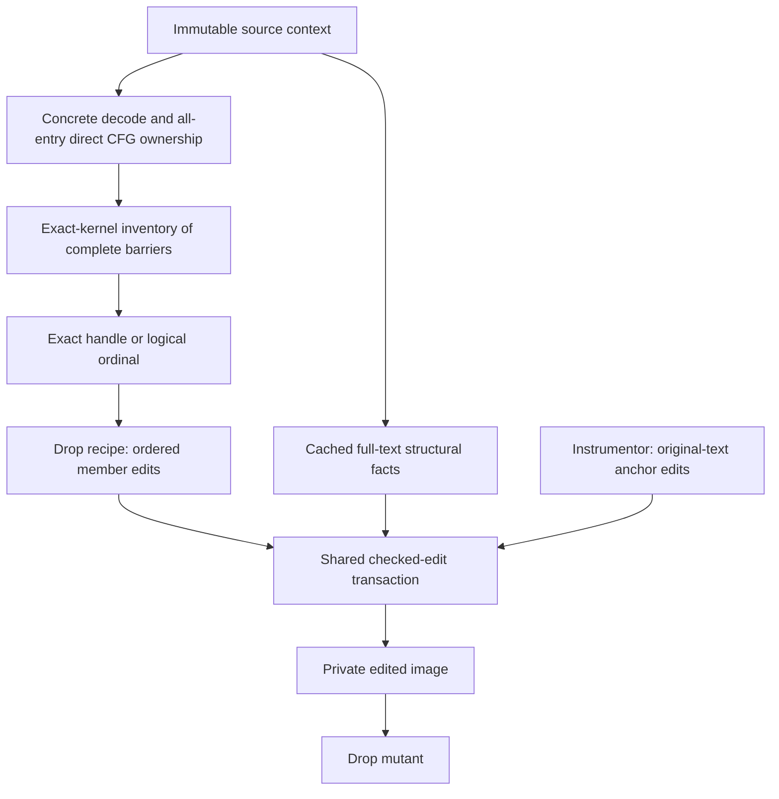

# Fault injection

The fault-injection library creates deliberately modified AMDGPU code objects
for experiments with synchronization failures. It runs offline on the host:
callers supply an image, select a qualified operation, and receive a mutant
image or a typed error. It neither initializes HSA nor dispatches GPU work.

The current interface is an internal C++ library. A mutation CLI, durable
selection files, and replay bundles are planned but not implemented. ConSan is
an optional consumer of the output; the library builds and runs its host tests
with the ConSan compiler, runtime, and analyzer disabled.

## Architecture and lifetime

This flow shows the current complete-barrier Drop path and its shared DBI
transaction boundary:

[`FaultMutationContext`](../lib/rocjitsu/src/rocjitsu/code/patch/fault_injection/drop_barrier.h)
owns one immutable copy of the input. Retain it in the input/session owner until
all discovery, selection, and apply operations finish. One context can serve
many requests for that original image; each apply produces an independent
mutant. A session handling several inputs keeps a separate context for each.
To analyze or mutate an emitted image, create a new context from its bytes.

The context supplies target, section, and owner facts. It caches the fixed
all-entry ownership analysis and per-kernel qualification once. Full-text
structural facts are cached separately: references in unreachable code still
matter to byte editing. These facts are reusable for the same immutable source
and analysis profile, not arbitrary new roots or broader helper ownership.
Selections expire with their source context and cannot be replayed in another
context, even if its input bytes are identical. The in-process API does not
require callers to supply a target or content digest.

The library reuses the ISA registry and concrete decoder, `BasicBlock` and
`KernelScopeSpec`, descriptor scanning, instruction builders, and
[`CodeObjectPatcher`](../lib/rocjitsu/src/rocjitsu/code/patch/code_object_patcher.h).
Concrete identity is preserved, including the differing gfx1250/gfx1251 decoder
features. The host-only tests link the existing static-analysis composition and
model ISA providers; simulator execution support is not an admission condition.
See [ISA target providers](isa-target-providers.md) and the
[test target wiring](../tests/CMakeLists.txt).

Generic mechanics and recipe semantics have separate responsibilities:

- [`CheckedTextEditContext` and `apply_checked_text_edits`](../lib/rocjitsu/src/rocjitsu/code/patch/checked_text_edits.h)
  check source structure, complete instruction extents, expected bytes,
  references, clauses, and replacement encoding before changing a private
  image. They do not decide which barrier should be removed or prove ownership.
- [`qualify_static_barriers`](../lib/rocjitsu/src/rocjitsu/code/analysis/static_barriers.h)
  and the [Drop frontend](../lib/rocjitsu/src/rocjitsu/code/patch/fault_injection/drop_barrier.cpp)
  establish admitted logical members and choose the corresponding NOP edits.
  Recipe tests verify output semantics; emission does not run a second domain
  validator or rebuild the mutant's CFG.
- [`Instrumentor`](../lib/rocjitsu/src/rocjitsu/code/patch/instrumentor.cpp)
  also uses checked edits for original-text anchor splicing, reusing its own
  full-section instruction index. It retains responsibility for appended probe
  bodies, entry stubs, trampolines, and resource metadata. A KernelEntry callback
  that changes only a stub branch does not become an original-text anchor edit.

## Features and status

| Feature | Status and main boundary | References |
| --- | --- | --- |
| Complete barrier Drop | Implemented for the target/wave forms below. Removes one logical barrier: an ordered two-member signal/wait pair or one true full-barrier instruction. A half-pair is never a singleton. | [`StaticBarrier` / family policy](../lib/rocjitsu/src/rocjitsu/code/analysis/static_barriers.h), [qualification](../lib/rocjitsu/src/rocjitsu/code/analysis/static_barriers.cpp), [family and RDNA3 regressions](../tests/patch/fault_drop_barrier_test.cpp) |
| Exact and logical-ordinal selection | Implemented. Exact kernel name chooses one inventory; an exact context-bound handle takes precedence over the zero-based logical ordinal. Invalid exact requests fail without fallback. Default ordinal zero deterministically chooses the first barrier in first-member source order; there is no race ranking or legacy physical-index adapter. | [`DropBarrierSelector`](../lib/rocjitsu/src/rocjitsu/code/patch/fault_injection/drop_barrier.h), [`select_drop_barrier`](../lib/rocjitsu/src/rocjitsu/code/patch/fault_injection/drop_barrier.cpp), [selection regressions](../tests/patch/fault_drop_barrier_test.cpp) |
| Multiple kernels in one text section | Limited support for independent sibling kernels. Discovery checks all entries before exposing one exact kernel's inventory; shared blocks, calls, aliased entries, and unresolved owners are rejected. | [`FaultMutationContext`](../lib/rocjitsu/src/rocjitsu/code/patch/fault_injection/drop_barrier.h), [ownership analysis](../lib/rocjitsu/src/rocjitsu/code/patch/fault_injection/drop_barrier.cpp), [sibling preservation tests](../tests/patch/fault_drop_barrier_test.cpp) |
| Shared checked text edits | Implemented. One transaction handles nonoverlapping, equal-length replacements of complete 4/8/12-byte instructions. This does not widen Instrumentor's trampoline-anchor admission. | [contract](../lib/rocjitsu/src/rocjitsu/code/patch/checked_text_edits.h), [implementation](../lib/rocjitsu/src/rocjitsu/code/patch/checked_text_edits.cpp), [edit tests](../tests/patch/checked_text_edits_test.cpp), [Instrumentor tests](../tests/patch/instrumentor_test.cpp) |
| CLI, durable replay and artifact publication | Planned; no executable, persistent selection format, or cross-context replay is provided by this library. | — |
| Helper, indirect-flow and firmware-preload ownership | Planned extensions; these inputs are not admitted by the current ownership profile. | — |
| Other mutation recipes and composition | Planned. Barrier movement, address/order/scope changes, grouped or destructive partial Drop, and multi-mutation composition are not implemented here. | — |
| Multiple text sections or dynamic occurrence selection | Unsupported. | — |

A caller uses `discover_drop_barriers` with an exact kernel name to obtain an
inventory, `select_drop_barrier` to choose a complete logical barrier, and
`apply_drop_barrier` to emit it. Each operation returns `FailureOr` and a typed
`FaultMutationError`; the [API header](../lib/rocjitsu/src/rocjitsu/code/patch/fault_injection/drop_barrier.h)
defines the arguments, lifetime contract, and result fields.

## Target coverage and qualification

`fault_mutation_capabilities()` lists transformation admission from the linked
ISA registry and family policy. The current bindings cover seven concrete
targets and ten target/wave combinations:

| Family | Concrete target | Wave size | Complete logical barrier |
| --- | --- | --- | --- |
| RDNA3 | gfx1100 | 32 | Full `s_barrier` singleton, workgroup |
| RDNA3 | gfx1100 | 64 | Full `s_barrier` singleton, workgroup |
| RDNA4 | gfx1200 | 32 | Builtin signal/wait pair, workgroup IDs -1/-2 |
| RDNA4 | gfx1200 | 64 | Builtin signal/wait pair, workgroup IDs -1/-2 |
| RDNA4 | gfx1201 | 32 | Builtin signal/wait pair, workgroup IDs -1/-2 |
| RDNA4 | gfx1201 | 64 | Builtin signal/wait pair, workgroup IDs -1/-2 |
| CDNA5 | gfx1250 | 32 | Builtin signal/wait pair, IDs -1/-2 workgroup or -3/-4 cluster |
| CDNA5 | gfx1251 | 32 | Builtin signal/wait pair, IDs -1/-2 workgroup or -3/-4 cluster |
| CDNA3 | gfx942 | 64 | Full `s_barrier` singleton, workgroup |
| CDNA4 | gfx950 | 64 | Full `s_barrier` singleton, workgroup |

The [host regression matrix](../tests/patch/fault_drop_barrier_test.cpp) covers
discovery, exact/ordinal selection, emission, concrete decoding, and preservation
for these rows. RDNA3 has its own instruction encodings and descriptor-selected
wave modes; the shared singleton representation does not imply CDNA encodings
or wave64-only admission. CDNA1/CDNA2 and unregistered targets are not admitted.
A different provider composition may expose fewer bindings.

These are host transformation capabilities. Neither the listing nor a successful
mutation establishes GPU execution or detector qualification.
`DropBarrierResult` leaves those evidence states `Unverified`. A removed barrier
may be redundant, unreachable in a particular run, or insufficient to cause a
race; successful execution alone also does not establish a detector finding.

## Current limits

Inputs must be little-endian AMDHSA ET_DYN ELF64 images with one executable
`.text`. ABI admission follows the [shared ELF reader](../lib/rocjitsu/src/rocjitsu/code/amdgpu_code_object.cpp)
and [DBI patcher](../lib/rocjitsu/src/rocjitsu/code/patch/code_object_patcher.cpp).
Text and descriptors require unambiguous file-backed load mappings. The ownership
profile admits closed direct CFGs with independent kernel entries. It rejects
shared helpers/calls, indirect or unresolved flow,
firmware-preload entries, and declared executable owners outside the analyzed
text. Non-aliasing unselected sections are preserved; their executable flag alone
does not imply another text section. Detailed admission and diagnostics are in
the [frontend](../lib/rocjitsu/src/rocjitsu/code/patch/fault_injection/drop_barrier.cpp)
and [checked-edit contract](../lib/rocjitsu/src/rocjitsu/code/patch/checked_text_edits.h).

A split pair must complete in the same basic block, although ordinary
instructions may separate its members. Partial, interleaved, cross-block,
named/dynamic/lifecycle and `signal_isfirst` forms, as well as barriers inside
clauses, are rejected. A direct loop can contain a qualified static barrier;
removal affects **every executed occurrence** of that position. There is no
selection of the Nth dynamic occurrence or proof of convergence.

For ConSan use, follow the [fresh-prepare integration contract](consan.md#fault-injection).
ConSan applies its own input admission during fresh prepare. Mutation admission
and detector admission are separate decisions.
