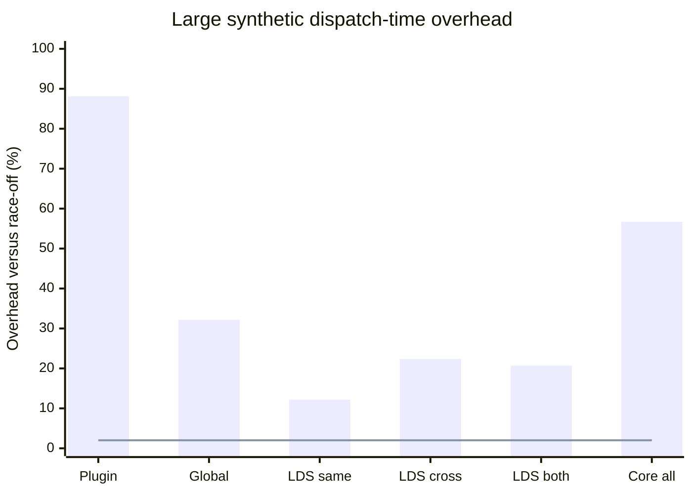
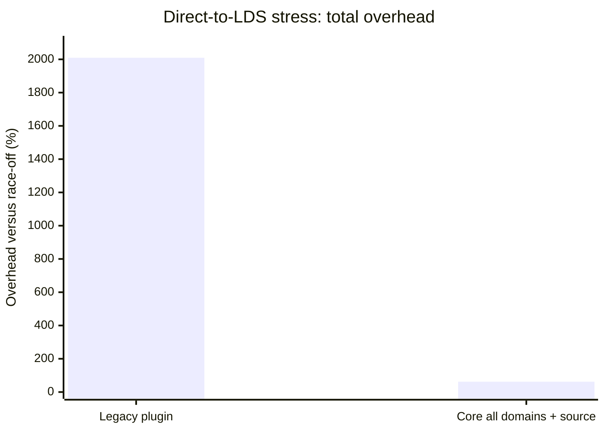
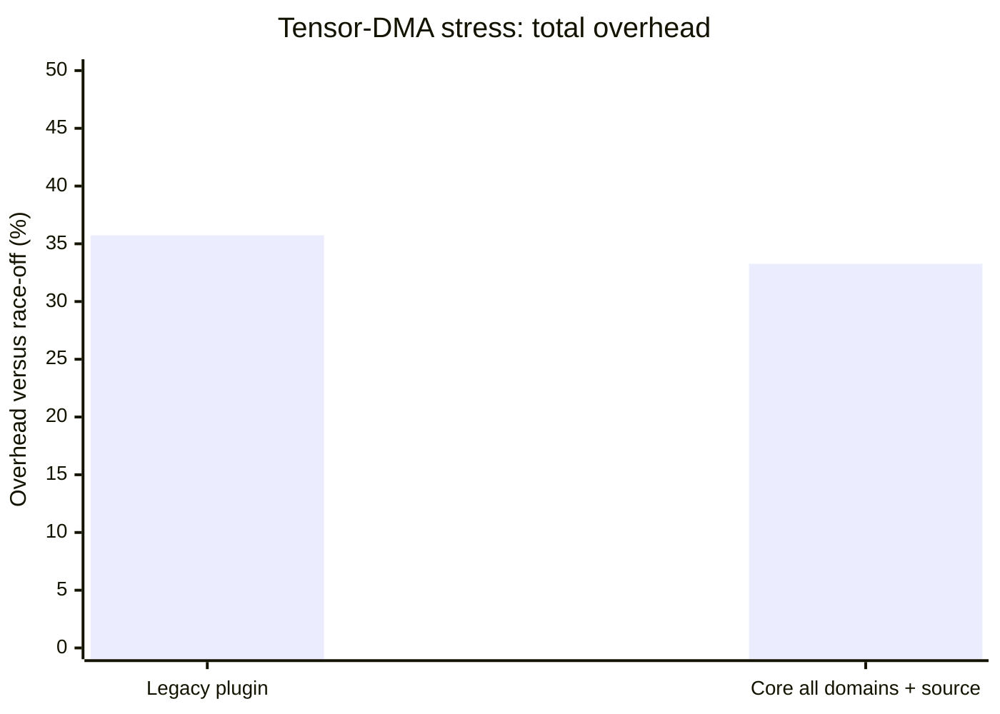

# Core race families versus the legacy plugin

Synthetic rocJITsu timing comparison, 20 October 2026. Measurements use
internal `kernel_ms` from Release launcher
`fd85c7e8a3d8a399fa53f09dfdf74fdb5ea65c8c15c71402dc47895a31d69462`.

> **These implementations are not coverage-equivalent.**
>
> The legacy plugin primarily models in-flight memory/register wait hazards and
> LDS overlap. It does not implement the core global-address shadow and does not
> subscribe to tensor-DMA memory-access observations. These results compare the
> cost of each implementation package, not the cost of equal work.

For the core checker's broader phase and hotspot analysis, see
[Address race checker performance analysis](address-race-checking-performance-analysis.md).
For the default-on decision by family, see
[Address-race checks: the 2% decision](address-race-overhead.md).

## Main result

On the large synthetic set:

- The legacy plugin adds **88.10%** versus race-off.
- Core `all` adds **56.70%**.
- Core `all` is **16.69% faster than the plugin** on total dispatch time, with
  a 95% interval of 14.25% to 18.07% faster.

Validation completed successfully:

- **648/648** general synthetic runs passed.
- **240/240** active-source runs passed.
- **0** findings or coverage warnings were emitted.

The largest separation was the direct-to-LDS stress workload:

- Plugin/race-off total time: **21.09x**
- Core source-all/race-off total time: **1.62x**
- Median times: 10,918.099 ms plugin, 839.593 ms core, and 517.571 ms race-off.

## General synthetic workloads

The aggregate is the geometric mean of per-workload median ratios for stream,
LDS reduce, GEMM, and histogram at the large shapes. The chart's x-axis is the
checker configuration; its y-axis is dispatch-time overhead versus race-off in
percent. The line marks the 2% target. Confidence intervals are in the table.

| Configuration | Overhead | Paired-bootstrap 95% interval | Coverage focus |
|---|---:|---:|---|
| Legacy plugin | +88.10% | +77.48% to +91.47% | All plugin checks |
| Core global | +32.17% | +25.24% to +35.85% | Global address conflicts |
| Core LDS same-wave | +12.17% | +5.51% to +16.32% | Same-wave LDS |
| Core LDS cross-wave | +22.36% | +14.99% to +24.51% | Cross-wave LDS |
| Core LDS both | +20.70% | +14.06% to +23.08% | Both LDS domains |
| Core `all` | +56.70% | +48.04% to +60.95% | All five core families |

## Active-source stress workloads

These workloads use 15 rotating repetitions and 1,024 source operations per
thread or workgroup configuration. Core selects all address domains plus the
named source.

The direct-to-LDS and tensor-DMA values are graphed separately because the
plugin's direct-to-LDS overhead is large enough to hide the tensor-DMA
comparison on one linear axis.

### Direct-to-LDS total overhead

The x-axis is the implementation package; the y-axis is total dispatch-time
overhead versus race-off in percent.

### Tensor-DMA total overhead

| Active source | Plugin overhead | Plugin 95% interval | Core overhead | Core 95% interval |
|---|---:|---:|---:|---:|
| Direct-to-LDS | +2009.49% | +1990.41% to +2032.19% | +62.22% | +61.16% to +64.56% |
| Tensor DMA | +35.73% | +17.59% to +60.13% | +33.26% | +25.45% to +43.70% |

### Tensor result interpretation

The tensor plugin result is generic callback, instruction-trace, and
wait-processing cost without tensor-DMA memory hazard coverage. Its similar
total time to core source-all is therefore not evidence of equivalent
efficiency.

## Method and reproducibility

- General matrix: nine rotating repetitions across eight small/large workloads
  and nine variants, for 648 processes.
- Active-source matrix: 15 rotating repetitions across two workloads and eight
  variants, for 240 processes.
- All runs used CPU affinity `2-3,194-195`.
- Comparisons use ratios of paired-repetition medians and 20,000-sample paired
  bootstrap intervals.

Committed workload sources and reproduction instructions:

- [Address-race performance workloads](../tests/memory-diagnostics/performance/README.md)
- [General stream, LDS reduction, GEMM, and histogram kernels](../tests/memory-diagnostics/performance/race_bench.hip)
- [Focused direct-to-LDS workload](../tests/memory-diagnostics/performance/direct_to_lds_bench.hip)
- [Focused tensor-DMA workload](../tests/memory-diagnostics/performance/tensor_dma_bench.hip)

Raw data:

- `/tmp/rj-perf/bench/plugin_core_synthetic_raw.json`
- `/tmp/rj-perf/bench/plugin_core_source_raw.json`

Computed summaries:

- `/tmp/rj-perf/bench/plugin_core_synthetic_summary.json`
- `/tmp/rj-perf/bench/plugin_core_source_summary.json`
