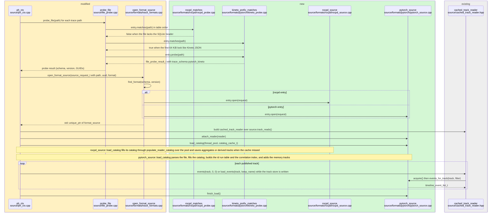
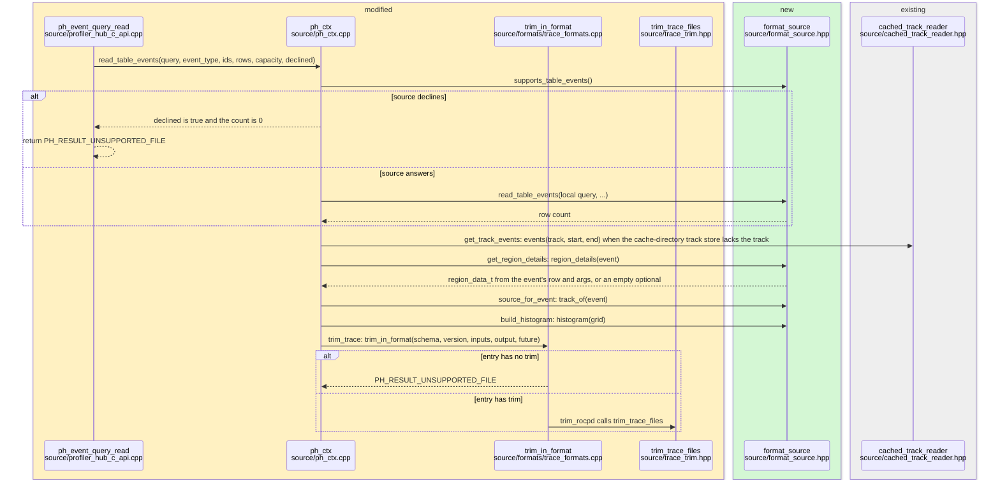

# Code guide: trace format registry

> AI-generated from the diff and the surrounding code.

This guide describes the code added or changed under `profilers/profiler-hub/` by this change: 50 files, 21 new and 29 modified. It says what the code is, where it sits, how data moves through it and which patterns it uses. Code is referred to as a repo-root path (linked) plus a symbol. Mermaid diagram labels carry paths relative to `profilers/profiler-hub/`.

## 1. What this change builds

The trace format registry becomes the one table that defines a readable format. An entry recognises its own files, probes them, opens a per-file source that answers the reader calls, and optionally trims. There are two entries: `rocpd` (SQLite) and `pytorch` (PyTorch Kineto JSON).

**Registry**

- [`profilers/profiler-hub/source/formats/trace_formats.hpp`](../source/formats/trace_formats.hpp) + `format_entry_t`: one entry, with the fields `name`, `schema`, `supports`, `matches`, `probe`, `open`, `make_reader`, `make_trim` and `trim`. The same header declares `trim_source_t`, `format_entries`, `is_supported_format`, `trim_in_format`, `open_format_source` and `make_reader_impl`.
- [`profilers/profiler-hub/source/formats/trace_formats.cpp`](../source/formats/trace_formats.cpp) + `format_entries`: the static table. The `rocpd` entry is always present; the `pytorch` entry is present when `PROFILER_HUB_ENABLE_PYTORCH_KINETO` is on. `find_format`, `rocpd_supports`, `pytorch_supports`, `open_rocpd_source`, `open_pytorch_source` and `trim_rocpd` are the entry callbacks and the lookup.

**Per-file source interface**

- [`profilers/profiler-hub/source/format_source.hpp`](../source/format_source.hpp) + `format_source`: one open trace file as `ph_ctx` sees it. The header also declares `source_request_t` (path, GUID, format) and `catalog_cache_t` (cache root, all paths, this file's index, `stop_requested`).

**rocpd entry**

- [`profilers/profiler-hub/source/formats/rocpd/rocpd_probe.cpp`](../source/formats/rocpd/rocpd_probe.cpp) + `rocpd_matches` and `rocpd_probe`: SQLite-header recognition and metadata-table probing, with the helper types `sqlite_probe_connection` and `sqlite_statement`.
- [`profilers/profiler-hub/source/formats/rocpd/rocpd_source.cpp`](../source/formats/rocpd/rocpd_source.cpp) + `rocpd_source`: the `format_source` for a rocpd file. It owns the catalog, a `connection_pool` of eight connections and a `pooled_connection_source`.

**PyTorch Kineto entry** (built only with `PROFILER_HUB_ENABLE_PYTORCH_KINETO`)

- [`profilers/profiler-hub/source/formats/pytorch/kineto_format.cpp`](../source/formats/pytorch/kineto_format.cpp) + `looks_like_kineto` and `schema_version_in_prefix`: text check on the first bytes of a file, and the integer `schemaVersion` in them.
- [`profilers/profiler-hub/source/formats/pytorch/kineto_probe.cpp`](../source/formats/pytorch/kineto_probe.cpp) + `kineto_prefix_matches` and `probe_kineto`: the entry's `matches` and `probe`; the probe reports the file's `schemaVersion` as the major version.
- [`profilers/profiler-hub/source/formats/pytorch/category_class.cpp`](../source/formats/pytorch/category_class.cpp) + `classify_category` and `event_type_of`: maps a Kineto category name to a `category_class_t` (`gpu`, `launch_site`, `event_type`, and one event name with a type of its own).
- [`profilers/profiler-hub/source/formats/pytorch/kineto_loader.cpp`](../source/formats/pytorch/kineto_loader.cpp) + `load_kineto`: streams a plain or gzip JSON trace into a `loaded_trace_t` (`event_t` rows with their args as JSON text, `memory_sample_t`, `flow_t` and `marker_t` records, name and category tables, thread and process names, `deviceProperties` entries, trace-wide members).
- [`profilers/profiler-hub/source/formats/pytorch/pytorch_store.cpp`](../source/formats/pytorch/pytorch_store.cpp) + `load_store`: groups the events into host-thread and GPU-stream tracks (`pytorch_store_t`, `store_track_t`, `store_row_t`) and binds flow ends to events (`bound_flow_t`).
- [`profilers/profiler-hub/source/formats/pytorch/pytorch_catalog.cpp`](../source/formats/pytorch/pytorch_catalog.cpp) + `fill_catalog`: fills a `reader_catalog_t` from a `pytorch_store_t`: node, processes, threads, agents, streams, stream hardware links and tracks.
- [`profilers/profiler-hub/source/formats/pytorch/pytorch_source.cpp`](../source/formats/pytorch/pytorch_source.cpp) + `pytorch_source`: the `format_source` for a Kineto file. It keeps the parsed events and answers the track reads, `track_of`, the histogram, the per-event reads, the table queries and the summary; it builds the memory tracks. `pytorch_row_reader` and the nested `row_seam` serve the track reads.
- [`profilers/profiler-hub/source/reader_catalog.cpp`](../source/reader_catalog.cpp) + `reader_catalog_t::add_memory_activity_track`: adds a memory-activity track and its points from a format that has no allocation table.
- [`profilers/profiler-hub/source/common/utility.hpp`](../source/common/utility.hpp) + `file_closer`, `elapsed_ms` and `steady_clock_t`.

**Context, probe and C API**

- [`profilers/profiler-hub/source/ph_ctx.cpp`](../source/ph_ctx.cpp) + `ph_ctx::open_sources`, `ph_ctx::read_trace` and `ph_ctx::trim_trace`: the context holds one `format_source` per accepted file and calls it for every per-file operation.
- [`profilers/profiler-hub/source/file_probe.cpp`](../source/file_probe.cpp) + `probe_file`: walks `format_entries` and returns the probe result of the first entry whose `matches` accepts the file.
- [`profilers/profiler-hub/source/profiler_hub_c_api.cpp`](../source/profiler_hub_c_api.cpp) + `copy_probe_result`, `ph_event_query_read` and `ph_event_query_id_span`: maps `trace_schema_t::pytorch_kineto` to `PH_TRACE_SCHEMA_PYTORCH_KINETO` and returns `PH_RESULT_UNSUPPORTED_FILE` when a source declines a table query.
- [`profilers/profiler-hub/source/cache_directory.cpp`](../source/cache_directory.cpp) + `format_label`: takes the cache folder label from the entry's `name`.
- [`profilers/profiler-hub/source/trace_trim.hpp`](../source/trace_trim.hpp) + `trim_trace_files`: the rocpd trim entry point, declared with `trim_source_t` coming from `trace_formats.hpp`.

**Public enumerators**

- [`profilers/profiler-hub/include/cpp/reader_types.hpp`](../include/cpp/reader_types.hpp) + `trace_schema_t`: new value `pytorch_kineto`.
- [`profilers/profiler-hub/include/c/profiler_hub_types.h`](../include/c/profiler_hub_types.h) + `ph_trace_schema_t`: new value `PH_TRACE_SCHEMA_PYTORCH_KINETO`.
- [`profilers/profiler-hub/include/c/profiler_hub.h`](../include/c/profiler_hub.h) + `ph_trace_source_t` and `ph_ctx_create_files`: the path and GUID wording names no format; the cancel and query calls say "the read" where they named a SQLite statement.
- [`profilers/profiler-hub/include/c/profiler_hub_trim.h`](../include/c/profiler_hub_trim.h) + `ph_trim_trace`: the `@return` lists the mixed-format case.
- [`profilers/profiler-hub/examples/clients/ph-c-client/main.c`](../examples/clients/ph-c-client/main.c) + `trace_schema_name`: prints `pytorch_kineto`.

**Build**

- [`profilers/profiler-hub/CMakeLists.txt`](../CMakeLists.txt) + `PROFILER_HUB_ENABLE_PYTORCH_KINETO`: the option, its compile definition, and the `ZLIB::ZLIB` link on `profiler-hub-objects`.
- [`profilers/profiler-hub/cmake/zlib.cmake`](../cmake/zlib.cmake) + `PROFILER_HUB_ZLIB_VERSION`: finds or fetches zlib and provides `ZLIB::ZLIB`.
- [`profilers/profiler-hub/source/CMakeLists.txt`](../source/CMakeLists.txt) + `profiler-hub_sources`: lists the rocpd and `format_source` files, and appends the PyTorch files under the option.

**Tests and documentation**

- [`profilers/profiler-hub/tests/unit/connection_source_test.cpp`](../tests/unit/connection_source_test.cpp) + `rocpd_v3_format`, and the two other changed unit-test files (see the file index): `connection_pool` is constructed with a GUID string and a `trace_format_t`.
- [`profilers/profiler-hub/CHANGELOG.md`](../CHANGELOG.md), [`profilers/profiler-hub/README.md`](../README.md) and the four pages under `profilers/profiler-hub/docs/optiq-integration/` describe the option, the zlib requirement, the registry entries and the source interface.

## 2. Where it fits

The context asks the registry to open one source per file. Each source is a `format_source`; the context builds one `cached_track_reader` over each source's `track_reads()` and keeps reading through the source for everything else.

```mermaid
flowchart LR
  CAPI["ph_probe_file, ph_event_query_read<br/><code>source/profiler_hub_c_api.cpp</code>"]
  CTX["ph_ctx<br/><code>source/ph_ctx.cpp</code>"]
  PROBE["probe_file<br/><code>source/file_probe.cpp</code>"]
  REG["format_entries, open_format_source, trim_in_format<br/><code>source/formats/trace_formats.cpp</code>"]
  ENTRY["format_entry_t<br/><code>source/formats/trace_formats.hpp</code>"]
  RPROBE["rocpd_matches, rocpd_probe<br/><code>source/formats/rocpd/rocpd_probe.cpp</code>"]
  KPROBE["kineto_prefix_matches, probe_kineto<br/><code>source/formats/pytorch/kineto_probe.cpp</code>"]
  FSRC["format_source<br/><code>source/format_source.hpp</code>"]
  RSRC["rocpd_source<br/><code>source/formats/rocpd/rocpd_source.cpp</code>"]
  PSRC["pytorch_source<br/><code>source/formats/pytorch/pytorch_source.cpp</code>"]
  POOL["connection_pool<br/><code>source/common/connection_pool.hpp</code>"]
  PCS["pooled_connection_source<br/><code>source/pooled_connection_source.hpp</code>"]
  CSRC["connection_source<br/><code>source/connection_source.hpp</code>"]
  CTR["cached_track_reader<br/><code>source/cached_track_reader.hpp</code>"]
  CAT["reader_catalog_t<br/><code>source/reader_catalog.hpp</code>"]
  TRIM["trim_trace_files<br/><code>source/trace_trim.hpp</code>"]

  CAPI -->|"ph_ctx methods"| CTX
  CAPI -->|"ph_probe_file"| PROBE
  CTX -->|"accept_traces calls probe_file"| PROBE
  PROBE -->|"walks format_entries"| REG
  REG -->|"holds a table of"| ENTRY
  ENTRY -->|"matches, probe"| RPROBE
  ENTRY -->|"matches, probe"| KPROBE
  CTX -->|"open_format_source"| REG
  CTX -->|"trim_trace calls trim_in_format"| REG
  ENTRY -->|"open"| RSRC
  ENTRY -->|"open"| PSRC
  ENTRY -->|"trim"| TRIM
  RSRC -->|"inherits"| FSRC
  PSRC -->|"inherits"| FSRC
  CTX -->|"owns one per file"| FSRC
  FSRC -->|"catalog returns"| CAT
  RSRC -->|"owns"| POOL
  RSRC -->|"owns"| PCS
  PCS -->|"inherits"| CSRC
  PSRC -->|"row_seam inherits"| CSRC
  PSRC -->|"add_memory_activity_track"| CAT
  CTX -->|"owns, built over track_reads"| CTR
  CTR -->|"acquire"| CSRC

  classDef new      fill:#d4f7d4,stroke:#2e7d32,color:#000;
  classDef modified fill:#fff1c2,stroke:#b8860b,color:#000;
  classDef existing fill:#eeeeee,stroke:#777,color:#000;
  class RPROBE,KPROBE,FSRC,RSRC,PSRC new;
  class CAPI,CTX,PROBE,REG,ENTRY,TRIM,CAT modified;
  class POOL,PCS,CSRC,CTR existing;
```

Legend: green = new file, yellow = modified file, grey = existing file the change connects to. Paths are relative to `profilers/profiler-hub/`.

Walk of the diagram:

- Probing. `ph_probe_file` and `ph_ctx` (through `accept_traces`) both call `probe_file`. It walks the entries held by `format_entries`; the rocpd and Kineto recognisers are the `matches` and `probe` callbacks of their entries.
- Opening. `ph_ctx` calls `open_format_source`, which finds the entry for the probed schema and version and calls its `open`. The rocpd entry returns a `rocpd_source`; the pytorch entry returns a `pytorch_source`. Both inherit `format_source`.
- Reading tracks. The context builds a `cached_track_reader` over `track_reads()`. For rocpd that is the `pooled_connection_source` over the connection pool; for Kineto it is `pytorch_source::row_seam`. Both are `connection_source` implementations.
- Trimming. `ph_ctx::trim_trace` calls `trim_in_format`, which calls the entry's `trim`. The rocpd entry's `trim` calls `trim_trace_files`.

## 3. How the new pieces fit together

**Registration.** A format is one `format_entry_t` in the table in [`profilers/profiler-hub/source/formats/trace_formats.cpp`](../source/formats/trace_formats.cpp) + `format_entries`. `probe_file`, `ph_ctx`, `format_label` and `trim_in_format` reach a format's recogniser, source, label and trim only through the table.

**Ownership.**

- `format_entry_t::open` returns a `std::unique_ptr<format_source>`; [`profilers/profiler-hub/source/ph_ctx.hpp`](../source/ph_ctx.hpp) + `ph_ctx::trace_source_t` owns it next to the `cached_track_reader` built over it and a copy of the source's catalog pointer.
- [`profilers/profiler-hub/source/formats/rocpd/rocpd_source.hpp`](../source/formats/rocpd/rocpd_source.hpp) + `rocpd_source` owns the catalog, the `connection_pool` and the `pooled_connection_source`, in that order.
- [`profilers/profiler-hub/source/formats/pytorch/pytorch_source.hpp`](../source/formats/pytorch/pytorch_source.hpp) + `pytorch_source` holds the catalog, the `row_seam`, the per-track rows (`m_tracks`), the parsed events and their args text (`m_events`, `m_args`), the name and category views (`m_names`, `m_cats`, pointing into the catalog's strings), the run table (`m_runs`), the correlation index (`m_correlations`), the bound flow ends (`m_flows`), the memory samples (`m_memory`) and the per-track stream entries (`m_streams`). `m_reader` is a non-owning pointer set by `attach_reader`.

**Inheritance.**

- `rocpd_source` and `pytorch_source` implement `format_source`. The pure virtual members are `catalog`, `load_catalog`, `track_reads`, `track_of` and `histogram`. `finish_load` and `attach_reader` default to no-ops. The per-event reads (`correlated_events`, `call_stack`, `region_details`, `kernel_dispatch_details`, `memory_copy_details`, `memory_alloc_details`) default to empty results. `summarize_name_durations` and `supports_table_events` default to `false`; `read_table_events` and `table_event_id_span` call `declined`, which throws `std::logic_error`.
- `rocpd_source` overrides every member except `finish_load` and `attach_reader`. `pytorch_source` overrides the pure virtuals, `attach_reader`, the per-event reads, `summarize_name_durations`, `supports_table_events`, `read_table_events` and `table_event_id_span`; `finish_load` stays the default.
- `pytorch_source::row_seam` implements `connection_source`; `pytorch_row_reader` implements `track_row_reader`.

**Call order from the context** ([`profilers/profiler-hub/source/ph_ctx.cpp`](../source/ph_ctx.cpp) + `ph_ctx::read_trace`):

1. `open_sources` opens every source, builds a `cached_track_reader` over its `track_reads()` and calls `attach_reader`.
2. Each source's `load_catalog` runs, in file order, with the shared thread pool and a `catalog_cache_t`.
3. `initialize_track_list` publishes the tracks of each catalog that have events; `prepare_track_store` opens the cache-directory track store when a cache directory was given.
4. `load_all_tracks` reads every track through its `cached_track_reader`.
5. `finish_load` runs on each source, then `attach_track_store` and the node-information initialisers.

**Declined calls.** `ph_ctx` asks `supports_table_events` before `read_table_events` or `table_event_id_span`; when it is `false` the call sets its `declined` out-parameter and the C API returns `PH_RESULT_UNSUPPORTED_FILE`. Both sources return `true`. `trim_in_format` returns `PH_RESULT_UNSUPPORTED_FILE` when the entry has no `trim` (the pytorch entry sets `make_reader`, `make_trim` and `trim` to `nullptr`). `ph_ctx::trim_trace` returns the same code when its accepted files do not all share one schema.

**Compile-time selection.** With `PROFILER_HUB_ENABLE_PYTORCH_KINETO` off, the pytorch sources are not listed in [`profilers/profiler-hub/source/CMakeLists.txt`](../source/CMakeLists.txt), the `pytorch` row of `format_entries` is not compiled, and [`profilers/profiler-hub/cmake/zlib.cmake`](../cmake/zlib.cmake) is not included. The `rocpd` entry is compiled in every configuration; with both rocpd version options off its `rocpd_supports` returns `false` for every version.

## 4. Data flow

### 4.1 Probe, open and load

Legend: box colours follow the flowchart legend (green = new file, yellow = modified file, grey = existing file). Paths are relative to `profilers/profiler-hub/`.

What is passed: `source_request_t` carries the path, GUID and `trace_format_t` into the entry's `open`. `catalog_cache_t` carries the cache root, every path of the context, the file's index and the `stop_requested` callback into `load_catalog`. Whole-track `timeline_event_list_t` values flow from the source to `cached_track_reader`.

### 4.2 Kineto file to catalog and rows

```mermaid
flowchart LR
  IB["input_buf<br/><code>source/formats/pytorch/kineto_loader.cpp</code>"]
  SH["sax_handler<br/><code>source/formats/pytorch/kineto_loader.cpp</code>"]
  LT["loaded_trace_t<br/><code>source/formats/pytorch/kineto_loader.hpp</code>"]
  CLS["classify_category<br/><code>source/formats/pytorch/category_class.cpp</code>"]
  LS["load_store<br/><code>source/formats/pytorch/pytorch_store.cpp</code>"]
  ST["pytorch_store_t<br/><code>source/formats/pytorch/pytorch_store.hpp</code>"]
  FC["fill_catalog<br/><code>source/formats/pytorch/pytorch_catalog.cpp</code>"]
  RC["reader_catalog_t<br/><code>source/reader_catalog.hpp</code>"]
  PS["pytorch_source::load_catalog<br/><code>source/formats/pytorch/pytorch_source.cpp</code>"]
  RR["pytorch_row_reader<br/><code>source/formats/pytorch/pytorch_source.cpp</code>"]
  CTR["cached_track_reader<br/><code>source/cached_track_reader.hpp</code>"]

  IB -->|"inflated or plain bytes, 1 MiB refills"| SH
  SH -->|"X and memory events, args text, flows, markers, metadata"| LT
  SH -->|"category string"| CLS
  CLS -->|"category_class_t"| LT
  LT -->|"events as event_t rows"| LS
  LS -->|"tracks with sorted store_row_t rows"| ST
  ST -->|"names, categories, tracks"| FC
  FC -->|"strings, node, processes, agents, threads, streams, links, tracks"| RC
  PS -->|"add_memory_activity_track"| RC
  ST -->|"rows moved into m_tracks, events and args into m_events and m_args, runs into m_runs"| PS
  PS -->|"track_rows"| RR
  RR -->|"timeline_event_list_t per track"| CTR

  classDef new      fill:#d4f7d4,stroke:#2e7d32,color:#000;
  classDef modified fill:#fff1c2,stroke:#b8860b,color:#000;
  classDef existing fill:#eeeeee,stroke:#777,color:#000;
  class IB,SH,LT,CLS,LS,ST,FC,PS,RR new;
  class CTR existing;
  class RC modified;
```

Legend: green = new file, yellow = modified file, grey = existing file. Paths are relative to `profilers/profiler-hub/`.

Steps:

1. [`profilers/profiler-hub/source/formats/pytorch/kineto_loader.cpp`](../source/formats/pytorch/kineto_loader.cpp) + `load_kineto` wraps the file in `input_buf` (a `std::streambuf` that inflates gzip members with `inflateInit2` and polls the cancel callback on every refill) and runs `nlohmann::json::sax_parse` with `sax_handler`. `json_text_t` re-serialises the SAX events of an event's `args` object, a `deviceProperties` entry or a trace-wide member as compact JSON text.
2. `sax_handler::finish_event` turns each `"ph":"X"` event that has `ts` and `dur` into an `event_t` (interned name id, category id, `pid`, `tid`, `stream`, `device`, nanosecond `ts_ns` and `dur_ns`, the raw `correlation` and `External id`, and the place of its args text in `loaded_trace_t::args`). A text-valued `pid` or `tid` takes the next number counting down from `INT32_MAX`. A `[memory]` instant becomes an `event_t` with phase `memory` and a `memory_sample_t`; other instants become `marker_t` records; flow ends of the linking kinds become `flow_t` records. Phase `M` events fill `thread_names`, `process_names` and the sort indexes. `deviceProperties` entries fill `device_names` and `device_json`; `host_name`, `baseTimeNanoseconds` and `schemaVersion` fill their fields; the other top-level members become `trace_info`.
3. [`profilers/profiler-hub/source/formats/pytorch/pytorch_store.cpp`](../source/formats/pytorch/pytorch_store.cpp) + `load_store` throws `std::runtime_error` when no usable event was read. It places each event of a `gpu` category class on a stream track keyed by (`device`, `stream`), using (`pid`, `tid`) when those arguments are absent, and every other event, memory events included, on a thread track keyed by (`pid`, `tid`). Track ids run from 0, host-thread tracks first, then stream tracks. Rows are ordered by start ascending, then end descending; each row's type is `event_type_of` for its category class and name, or `memory_allocate` for a memory event. `bind_flows` attaches each flow end to the innermost event of its lane that holds its time.
4. [`profilers/profiler-hub/source/formats/pytorch/pytorch_catalog.cpp`](../source/formats/pytorch/pytorch_catalog.cpp) + `fill_catalog` moves the category strings (ids from 1) and name strings (ids from the returned first name id) into `reader_catalog_t::strings_by_id`, and creates the node (with the host name), process, agent, thread, stream, stream hardware link and track entries. Agents are made for every device entry, every device an event is on and, for memory events of device type 0, a CPU agent.
5. [`profilers/profiler-hub/source/formats/pytorch/pytorch_source.cpp`](../source/formats/pytorch/pytorch_source.cpp) + `pytorch_source::load_catalog` keeps the rows per track in `m_tracks` and the events and args text in `m_events` and `m_args`, numbers events per `event_type_t` from 1 in track order, records each (track, type) id range in `m_runs`, indexes events by correlation in `m_correlations`, and calls `add_memory_tracks`, which builds an "ALLOCATED MEMORY" and a "RESERVED MEMORY" track per agent with memory events.
6. `pytorch_row_reader` returns a track's rows as `timeline_event_t` values with those ids and their category, and a memory track's points as counter events. Nothing is released after the load.

### 4.3 Reads after load

Legend: box colours follow the flowchart legend (green = new file, yellow = modified file, grey = existing file). Paths are relative to `profilers/profiler-hub/`.

For a Kineto file the per-event reads, `call_stack`, `correlated_events`, `read_table_events`, `table_event_id_span` and `summarize_name_durations` are answered by `pytorch_source` from `m_events`, `m_correlations` and `m_runs`; a rocpd source answers them through its pool. What is passed: the context rewrites the query's global track ids to the source's local ids before calling the source. The `format_source` participant stands for either `rocpd_source` or `pytorch_source`. Event ids and event types identify an event to `track_of` and to the detail calls. `histogram` receives the context's `histogram_grid_t` and returns a `reader_types::histogram_t` that `ph_ctx::build_histogram` converts to C structures.

## 5. Coding patterns used

| Pattern | Where it appears | Existing use in the surrounding code |
|---|---|---|
| Registry of function-pointer entries | [`profilers/profiler-hub/source/formats/trace_formats.cpp`](../source/formats/trace_formats.cpp) + `format_entries` (a function-local `static const format_entry_t entries[]`) | Factories reached through the same table, e.g. [`profilers/profiler-hub/source/formats/rocpd_v3/rocpd_v3_reader.hpp`](../source/formats/rocpd_v3/rocpd_v3_reader.hpp) + `make_rocpd_v3_reader`, called from `make_rocpd_reader` |
| Abstract interface, non-copyable and non-movable | [`profilers/profiler-hub/source/format_source.hpp`](../source/format_source.hpp) + `format_source` | [`profilers/profiler-hub/source/connection_source.hpp`](../source/connection_source.hpp) + `connection_source`; [`profilers/profiler-hub/source/track_row_reader.hpp`](../source/track_row_reader.hpp) + `track_row_reader` |
| Optional capability with a default decline | `format_source::supports_table_events`, `declined` and the default `summarize_name_durations`; the `declined` out-parameter of `ph_ctx::read_table_events` | [`profilers/profiler-hub/source/reader_impl.hpp`](../source/reader_impl.hpp) + `reader_t::impl::summarize_name_durations`, which may return `false` to decline |
| Adapter over an existing component | [`profilers/profiler-hub/source/formats/rocpd/rocpd_source.cpp`](../source/formats/rocpd/rocpd_source.cpp) + `rocpd_source`, forwarding each call through `m_pool.with_connection` | [`profilers/profiler-hub/source/pooled_connection_source.hpp`](../source/pooled_connection_source.hpp) + `pooled_connection_source`, which adapts `connection_pool` to `connection_source` |
| Nested adapter holding an owner reference | [`profilers/profiler-hub/source/formats/pytorch/pytorch_source.hpp`](../source/formats/pytorch/pytorch_source.hpp) + `pytorch_source::row_seam` (holds `pytorch_source&`) and `friend class pytorch_row_reader` | `friend class connection_pool` in [`profilers/profiler-hub/source/common/connection_pool.hpp`](../source/common/connection_pool.hpp) |
| Compile-time feature switch | `PROFILER_HUB_ENABLE_PYTORCH_KINETO`: the `#if` blocks in `trace_formats.cpp`, the option block in `source/CMakeLists.txt`, the compile definition in `CMakeLists.txt` | The same three places for `PROFILER_HUB_ENABLE_ROCPD_V3` |
| Find-or-fetch dependency module | [`profilers/profiler-hub/cmake/zlib.cmake`](../cmake/zlib.cmake) (`PROFILER_HUB_ZLIB_VERSION`, `find_package`, `FetchContent_Declare` with `FIND_PACKAGE_ARGS`, static PIC build) | [`profilers/profiler-hub/cmake/fmt.cmake`](../cmake/fmt.cmake), with the same structure |
| Callable passed as a template parameter | [`profilers/profiler-hub/source/formats/pytorch/pytorch_source.cpp`](../source/formats/pytorch/pytorch_source.cpp) + `pytorch_source::histogram` passes a lambda to `build_histogram` | [`profilers/profiler-hub/source/formats/rocpd_v2/rocpd_v2_reader.cpp`](../source/formats/rocpd_v2/rocpd_v2_reader.cpp) + `rocpd_v2_reader::get_histogram` passes a lambda to the same `build_histogram` in [`profilers/profiler-hub/source/histogram_grid.hpp`](../source/histogram_grid.hpp) |
| Streaming SAX parse behind a `std::streambuf` | [`profilers/profiler-hub/source/formats/pytorch/kineto_loader.cpp`](../source/formats/pytorch/kineto_loader.cpp) + `input_buf` and `sax_handler` | None found in `source/` |
| Cancellation by polling and exception | `input_buf::underflow` calls the cancel callback and throws `operation_cancelled`; `catalog_cache_t::stop_requested` | [`profilers/profiler-hub/source/sql_cancel.hpp`](../source/sql_cancel.hpp) + `operation_cancelled` and `sql_cancel_scope`, used by `ph_ctx::load_async` |
| Binary search over sorted ranges | [`profilers/profiler-hub/source/formats/pytorch/pytorch_source.cpp`](../source/formats/pytorch/pytorch_source.cpp) + `pytorch_source::track_of` (`std::upper_bound` over `m_runs`) | `std::upper_bound` and `std::lower_bound` in [`profilers/profiler-hub/source/cached_track_reader.cpp`](../source/cached_track_reader.cpp) |
| Layout assertion | [`profilers/profiler-hub/source/formats/pytorch/kineto_loader.hpp`](../source/formats/pytorch/kineto_loader.hpp) + `event_t`, followed by `static_assert(sizeof(event_t) == 88)` | `static_assert(sizeof(event_record_t) == k_event_record_bytes)` in [`profilers/profiler-hub/source/track_file_store.cpp`](../source/track_file_store.cpp) |
| Re-serialising SAX events into text | [`profilers/profiler-hub/source/formats/pytorch/kineto_loader.cpp`](../source/formats/pytorch/kineto_loader.cpp) + `json_text_t`, driven by `sax_handler` | None found in `source/` |
| Sorted index searched by binary search | [`profilers/profiler-hub/source/formats/pytorch/pytorch_source.cpp`](../source/formats/pytorch/pytorch_source.cpp) + `pytorch_source::correlated_events` (`std::lower_bound` over `m_correlations`) and `pytorch_source::extdata_of` (over `m_flows`) | `std::upper_bound` and `std::lower_bound` in [`profilers/profiler-hub/source/cached_track_reader.cpp`](../source/cached_track_reader.cpp) |
| Sweep over time-ordered intervals | [`profilers/profiler-hub/source/formats/pytorch/pytorch_store.cpp`](../source/formats/pytorch/pytorch_store.cpp) + `bind_flows` (an open-interval stack over a track's sorted rows) and `pytorch_source::call_stack` (a list of open regions) | [`profilers/profiler-hub/source/formats/rocpd_v3/rocpd_v3_reader.cpp`](../source/formats/rocpd_v3/rocpd_v3_reader.cpp) + `rocpd_v3_reader::get_call_stack`, the same open-region walk |
| Extension hook on a shared catalog | [`profilers/profiler-hub/source/reader_catalog.cpp`](../source/reader_catalog.cpp) + `reader_catalog_t::add_memory_activity_track`, called by `pytorch_source::add_memory_tracks` | `reader_catalog_t::add_memory_activity_tracks`, which derives the same series from `rocpd_memory_allocate` |
| RAII owner with a custom deleter | [`profilers/profiler-hub/source/common/utility.hpp`](../source/common/utility.hpp) + `file_closer`, used as `std::unique_ptr<std::FILE, common::file_closer>` in `kineto_probe.cpp` | None found in `source/` |

## 6. File index

Every path in `git diff --name-status` for the change appears once.

| Path | Status | Symbols added or changed |
|---|---|---|
| [`profilers/profiler-hub/CHANGELOG.md`](../CHANGELOG.md) | modified | Entries for `PROFILER_HUB_ENABLE_PYTORCH_KINETO`, PyTorch Kineto trace support and what a Kineto file serves, `trace_schema_t::pytorch_kineto`, `PH_TRACE_SCHEMA_PYTORCH_KINETO`, and the trim result for a context of mixed formats; one wording edit ("registering an entry") |
| [`profilers/profiler-hub/CMakeLists.txt`](../CMakeLists.txt) | modified | Option `PROFILER_HUB_ENABLE_PYTORCH_KINETO`; its compile definition; `include(zlib)` and `ZLIB::ZLIB` on `profiler-hub-objects`; `ZLIB` added to the static dependency list `_profiler_hub_static_deps` |
| [`profilers/profiler-hub/README.md`](../README.md) | modified | Option table row; zlib prerequisite and package names in the install commands; text on fetching zlib |
| [`profilers/profiler-hub/cmake/profiler-hub-config.cmake.in`](../cmake/profiler-hub-config.cmake.in) | modified | Comment naming ZLIB among the static target's link requirements |
| [`profilers/profiler-hub/cmake/zlib.cmake`](../cmake/zlib.cmake) | new | `PROFILER_HUB_ZLIB_VERSION`; `find_package(ZLIB)` route with a `FATAL_ERROR`; `FetchContent_Declare(ZLIB ...)` route; `ZLIB::ZLIB` alias to `zlibstatic` |
| [`profilers/profiler-hub/docs/optiq-integration/branch-changes.md`](optiq-integration/branch-changes.md) | modified | New "PyTorch Kineto traces" section (build switch, zlib dependency, parser, store and catalog, source and entry, schema enumerators, source hooks, probe version, served calls, data placement); rows reworded for registry entries |
| [`profilers/profiler-hub/docs/optiq-integration/reader-architecture.md`](optiq-integration/reader-architecture.md) | modified | Format-reader layer, per-file source, probe walk over entries, entry factories, load order with `finish_load`, trim steps |
| [`profilers/profiler-hub/docs/optiq-integration/reader-execution-flow.md`](optiq-integration/reader-execution-flow.md) | modified | Flow charts and sequence diagrams with `format_source`, the registry and `trim_in_format` |
| [`profilers/profiler-hub/docs/optiq-integration/source-layout.md`](optiq-integration/source-layout.md) | modified | Rows for `format_source.hpp`, `formats/rocpd/`, `formats/pytorch/`, `common/utility.hpp` and the registry |
| [`profilers/profiler-hub/examples/clients/ph-c-client/main.c`](../examples/clients/ph-c-client/main.c) | modified | `trace_schema_name` returns `pytorch_kineto` for `PH_TRACE_SCHEMA_PYTORCH_KINETO` |
| [`profilers/profiler-hub/include/c/profiler_hub.h`](../include/c/profiler_hub.h) | modified | Doc comments of `ph_trace_source_t`, `ph_ctx_create_files`, `ph_future_cancel`, `ph_event_query_read`, `ph_event_query_id_span` and `ph_event_query_summarize_durations` name no SQLite statement |
| [`profilers/profiler-hub/include/c/profiler_hub_trim.h`](../include/c/profiler_hub_trim.h) | modified | `@return` of `ph_trim_trace` lists the mixed-format case |
| [`profilers/profiler-hub/include/c/profiler_hub_types.h`](../include/c/profiler_hub_types.h) | modified | `ph_trace_schema_t::PH_TRACE_SCHEMA_PYTORCH_KINETO` |
| [`profilers/profiler-hub/include/cpp/reader.hpp`](../include/cpp/reader.hpp) | modified | Doc comment of the probe: "registering an entry" |
| [`profilers/profiler-hub/include/cpp/reader_types.hpp`](../include/cpp/reader_types.hpp) | modified | `trace_schema_t::pytorch_kineto` |
| [`profilers/profiler-hub/source/CMakeLists.txt`](../source/CMakeLists.txt) | modified | `profiler-hub_sources` gains the rocpd probe and source files and `format_source.hpp`; PyTorch file block under `PROFILER_HUB_ENABLE_PYTORCH_KINETO` |
| [`profilers/profiler-hub/source/cache_directory.cpp`](../source/cache_directory.cpp) | modified | `format_label` reads the entry name from `format_entries`; includes `formats/trace_formats.hpp` |
| [`profilers/profiler-hub/source/common/utility.hpp`](../source/common/utility.hpp) | new | `steady_clock_t`, `file_closer`, `elapsed_ms` |
| [`profilers/profiler-hub/source/file_probe.cpp`](../source/file_probe.cpp) | modified | `probe_file` walks `format_entries` and calls `entry.matches` and `entry.probe`; `LOG_DEBUG` on a match; holds no format-specific recognition code |
| [`profilers/profiler-hub/source/format_source.hpp`](../source/format_source.hpp) | new | `source_request_t`, `catalog_cache_t`, `format_source` |
| [`profilers/profiler-hub/source/formats/pytorch/category_class.cpp`](../source/formats/pytorch/category_class.cpp) | new | `classify_category`, `event_type_of`, the `k_rows` table and the `k_host`, `k_launch_site`, `k_kernel`, `k_copy`, `k_device_other`, `k_mtia_device`, `k_sync` classes |
| [`profilers/profiler-hub/source/formats/pytorch/category_class.hpp`](../source/formats/pytorch/category_class.hpp) | new | `category_class_t`, `classify_category`, `event_type_of` |
| [`profilers/profiler-hub/source/formats/pytorch/kineto_format.cpp`](../source/formats/pytorch/kineto_format.cpp) | new | `looks_like_kineto`, `schema_version_in_prefix`, `has_key`, `skip_space` |
| [`profilers/profiler-hub/source/formats/pytorch/kineto_format.hpp`](../source/formats/pytorch/kineto_format.hpp) | new | `looks_like_kineto`, `schema_version_in_prefix` |
| [`profilers/profiler-hub/source/formats/pytorch/kineto_loader.cpp`](../source/formats/pytorch/kineto_loader.cpp) | new | `input_buf`, `json_text_t`, `sax_handler`, `integer_us_to_ns`, `text_us_to_ns`, `icontains_launch`, `append_json_string`, `load_kineto` |
| [`profilers/profiler-hub/source/formats/pytorch/kineto_loader.hpp`](../source/formats/pytorch/kineto_loader.hpp) | new | `phase_t`, `event_t`, `load_diag_t`, `flow_t`, `marker_t`, `memory_sample_t`, `loaded_trace_t`, `append_json_string`, `load_kineto` |
| [`profilers/profiler-hub/source/formats/pytorch/kineto_probe.cpp`](../source/formats/pytorch/kineto_probe.cpp) | new | `kineto_prefix_matches`, `probe_kineto`, `read_plain_prefix`, `read_gzip_prefix`, `read_prefix` |
| [`profilers/profiler-hub/source/formats/pytorch/kineto_probe.hpp`](../source/formats/pytorch/kineto_probe.hpp) | new | `kineto_prefix_matches`, `probe_kineto` |
| [`profilers/profiler-hub/source/formats/pytorch/pytorch_catalog.cpp`](../source/formats/pytorch/pytorch_catalog.cpp) | new | `fill_catalog` |
| [`profilers/profiler-hub/source/formats/pytorch/pytorch_catalog.hpp`](../source/formats/pytorch/pytorch_catalog.hpp) | new | `fill_catalog` |
| [`profilers/profiler-hub/source/formats/pytorch/pytorch_source.cpp`](../source/formats/pytorch/pytorch_source.cpp) | new | `pytorch_source` members (`load_catalog`, `track_of`, `locate`, `histogram`, `correlated_events`, `call_stack`, the four detail reads, `read_table_events`, `table_event_id_span`, `summarize_name_durations`, `add_memory_tracks`), `pytorch_row_reader`, `pytorch_source::row_seam::acquire` and `try_acquire`, `launch_geometry_of`, `copy_fields_of`, `named_args_of`, `extdata_with_flows`, `require_no_filter` |
| [`profilers/profiler-hub/source/formats/pytorch/pytorch_source.hpp`](../source/formats/pytorch/pytorch_source.hpp) | new | `pytorch_source`, `row_seam`, `type_run_t`, `track_rows_t`, `run_t`, `located_t`, `correlation_t`, `kernel_shape_t` |
| [`profilers/profiler-hub/source/formats/pytorch/pytorch_store.cpp`](../source/formats/pytorch/pytorch_store.cpp) | new | `load_store`, `bind_flows`, `link_of`, `sorted_rows`, `event_order`, `to_ns` |
| [`profilers/profiler-hub/source/formats/pytorch/pytorch_store.hpp`](../source/formats/pytorch/pytorch_store.hpp) | new | `store_row_t`, `bound_flow_t`, `store_track_t`, `pytorch_store_t`, `load_store` |
| [`profilers/profiler-hub/source/formats/rocpd/rocpd_probe.cpp`](../source/formats/rocpd/rocpd_probe.cpp) | new | `rocpd_matches`, `rocpd_probe`, `probe_sqlite`, `probe_one_metadata`, `probe_legacy_metadata`, `probe_metadata_version`, `sqlite_probe_connection`, `sqlite_statement` |
| [`profilers/profiler-hub/source/formats/rocpd/rocpd_probe.hpp`](../source/formats/rocpd/rocpd_probe.hpp) | new | `rocpd_matches`, `rocpd_probe` |
| [`profilers/profiler-hub/source/formats/rocpd/rocpd_source.cpp`](../source/formats/rocpd/rocpd_source.cpp) | new | `rocpd_source` members, `k_read_connections` |
| [`profilers/profiler-hub/source/formats/rocpd/rocpd_source.hpp`](../source/formats/rocpd/rocpd_source.hpp) | new | `rocpd_source` |
| [`profilers/profiler-hub/source/formats/trace_formats.cpp`](../source/formats/trace_formats.cpp) | modified | `format_entries` (rocpd and pytorch rows), `find_format`, `rocpd_supports`, `pytorch_supports`, `open_rocpd_source`, `open_pytorch_source`, `make_rocpd_reader`, `make_rocpd_trim`, `trim_rocpd`, `is_supported_format`, `trim_in_format`, `open_format_source`, `make_reader_impl`, `make_trim_schema` |
| [`profilers/profiler-hub/source/formats/trace_formats.hpp`](../source/formats/trace_formats.hpp) | modified | `trim_source_t`, `format_entry_t` fields, `format_entries`, `is_supported_format`, `trim_in_format`, `open_format_source`, `make_reader_impl` |
| [`profilers/profiler-hub/source/ph_ctx.cpp`](../source/ph_ctx.cpp) | modified | `open_sources`, `read_trace`, `trim_trace`, `source_for_event`, `track_id_of`, `get_correlated_events`, `get_call_stack`, the detail getters, `read_table_events`, `summarize_name_durations`, `table_event_id_span`, `build_histogram`; each calls the context's `format_source` |
| [`profilers/profiler-hub/source/ph_ctx.hpp`](../source/ph_ctx.hpp) | modified | `ph_ctx::trace_source_t` (members `catalog`, `source`, `reader`), `read_table_events` and `table_event_id_span` with a `declined` parameter |
| [`profilers/profiler-hub/source/profiler_hub_c_api.cpp`](../source/profiler_hub_c_api.cpp) | modified | `copy_probe_result` (schema switch), `ph_event_query_read`, `ph_event_query_id_span` |
| [`profilers/profiler-hub/source/reader_catalog.cpp`](../source/reader_catalog.cpp) | modified | `reader_catalog_t::add_memory_activity_track` |
| [`profilers/profiler-hub/source/reader_catalog.hpp`](../source/reader_catalog.hpp) | modified | Declaration of `reader_catalog_t::add_memory_activity_track` |
| [`profilers/profiler-hub/source/reader_impl.hpp`](../source/reader_impl.hpp) | modified | Doc comment of `reader_t::impl` |
| [`profilers/profiler-hub/source/trace_trim.hpp`](../source/trace_trim.hpp) | modified | Includes `formats/trace_formats.hpp` for `trim_source_t`, which is declared there; the `trim_trace_files` declaration is unchanged |
| [`profilers/profiler-hub/tests/unit/connection_pool_test.cpp`](../tests/unit/connection_pool_test.cpp) | modified | `connection_pool` constructed with the GUID and a `trace_format_t` |
| [`profilers/profiler-hub/tests/unit/connection_source_test.cpp`](../tests/unit/connection_source_test.cpp) | modified | `rocpd_v3_format` constant; three `connection_pool` constructions with the GUID and `rocpd_v3_format` |
| [`profilers/profiler-hub/tests/unit/populate_reader_catalog_test.cpp`](../tests/unit/populate_reader_catalog_test.cpp) | modified | `rocpd_v3_format` constant; `connection_pool` constructions with the GUID and `rocpd_v3_format` |
