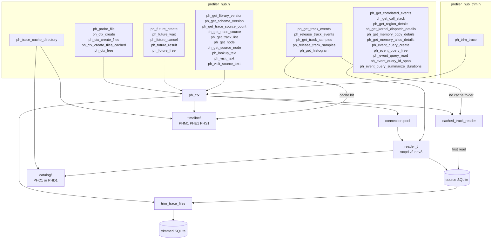

# Profiler Hub Reader Architecture

This document describes how a caller's request travels from the profiler-hub
C interface down to the trace database or to the on-disk cache. It covers the
reader side only. The writer side is described in
[architecture-profiler-hub.md](../architecture-profiler-hub.md).

Related documents:

- [source-layout.md](source-layout.md): what each source file is for.
- [branch-changes.md](branch-changes.md): every change made on this branch,
  with the files affected and the reason.
- [reader-execution-flow.md](reader-execution-flow.md): the detailed
  execution diagrams.

## 1. Overview



The reader is built in five layers. Each layer only calls the one below it.

| Layer | Main files | Job |
|---|---|---|
| C interface | `include/c/profiler_hub.h`, `include/c/profiler_hub_trim.h`, `source/profiler_hub_c_api.cpp` | Checks arguments, runs the call now or on a future, catches exceptions, and maps them to `ph_result_t`. |
| Context | `source/ph_ctx.cpp`, `source/ph_ctx.hpp` | Owns the opened sources, the published track list, the global track ids, the caches, and every result buffer it hands out. |
| Caches | `source/cached_track_reader.cpp`, `source/track_file_store.cpp`, `source/catalog_aggregate_store.cpp`, `source/cache_directory.cpp` | Keep timeline data and catalog aggregates in memory or on disk so a second read or a second open does not query SQLite again. |
| Format reader | `source/reader.cpp`, `source/reader_impl.hpp`, `source/formats/trace_formats.cpp`, `source/formats/rocpd_v2/*`, `source/formats/rocpd_v3/*` | Turns a format-neutral request into SQL for one rocpd schema. |
| Storage | `source/common/connection_pool.cpp`, `source/storage_impl.cpp`, `source/data_storage/backends/*` | Opens SQLite connections and runs prepared statements. |

## 2. Core concepts

### 2.1 Sources and global track ids

A context opens one or more trace files. Each file, or each GUID inside a
schema-3 file, becomes one **source**. Every source has its own connection
pool, its own catalog, and its own `cached_track_reader`.

The visualizer expands a YAML project file into a path list
(`HubYamlFiles` in Optiq). Profiler-hub only ever sees the list.

Tracks have two ids:

- The **local id** is the track id inside that source's catalog.
- The **global id** is `ph_track_t::id`, the id the caller sees. With one
  source it equals the local id. With several sources the ids are numbered in
  order across sources.

`ph_ctx::initialize_track_list` builds `global_of_local` (local to global, per
source) and `m_track_by_id` (global to source and local track). Tracks with no
events are not published.

### 2.2 Format dispatch

`ph_ctx_create*` probes each file first (`source/file_probe.cpp`):

- A table named `rocpd_metadata_<guid>` means schema 3. Every GUID must have
  major version 3 or later, and all versions must match.
- Otherwise an unsuffixed `rocpd_metadata` table with major version 2 means
  schema 2, the legacy `.rpd` layout.

The probed schema and version form a `trace_format_t`. The format registry in
`source/formats/trace_formats.cpp` maps it to two factories: one builds the
`reader_t::impl` subclass (`rocpd_v2_reader` or `rocpd_v3_reader`), and one
builds the trim rules. A file is accepted only when the registry has an entry
for it.

The compile options `PROFILER_HUB_ENABLE_ROCPD_V2` and
`PROFILER_HUB_ENABLE_ROCPD_V3` (both on by default) remove a format's sources
and its registry entry. A file of a removed format probes as
`PH_RESULT_UNSUPPORTED_FILE`.

### 2.3 Synchronous and asynchronous calls

Most functions take an optional `ph_future_t`. `run_operation` in
`source/profiler_hub_c_api.cpp` decides how the call runs:

- **No future:** the work runs on the calling thread. An exception becomes
  `PH_RESULT_INTERNAL_ERROR`.
- **Future:** the future is attached (a future serves one operation only), the
  work is submitted to the context's thread pool, and the call returns
  `PH_RESULT_SUCCESS` immediately. The future finishes with the result the
  call would have returned, or with `PH_FUTURE_CANCELLED`.

Every call except the open and the stateless functions first runs
`wait_until_ready`. It blocks while the trace is still loading, then returns
success, `PH_RESULT_CANCELLED`, or `PH_RESULT_INVALID_CONTEXT`.

### 2.4 Ownership

Result buffers are owned by the context unless stated otherwise. The caller
must not free them. They stay valid until `ph_ctx_free`, with one exception:
windows read from the on-disk timeline cache are freed by
`ph_release_track_events` and `ph_release_track_samples`.

## 3. Caching

All on-disk caches live in one folder per trace:

```text
<cache_root>/<16 hex digits>/
    timeline/     track events, samples, histogram (hub)
    catalog/      catalog aggregates (hub)
    summary.bin   name-duration summaries (written by Optiq, not by the hub)
```

- `cache_root` is the application configuration folder passed to
  `ph_ctx_create_files_cached`. A null or empty root turns the on-disk caches
  off.
- The 16 hex digits are a 64-bit FNV-1a hash, computed in
  `source/cache_directory.cpp`, over each source path's length, path bytes,
  file size, and last-write time, in path order. A changed or replaced trace
  gets a new folder.
- `ph_trace_cache_directory` returns the same folder name so the application
  can find or delete it. Optiq's `ProfilerHub::Cleanup` deletes the whole
  folder.

| Cache | Where | Written | Read | Contents |
|---|---|---|---|---|
| In-memory track cache | `cached_track_reader` | First read of a track when there is no cache folder | Every later read of that track | Whole track, sorted, with nesting depth |
| Timeline files | `timeline/` | First open of a trace | Every later open | `timeline.meta` (PHM1, includes a 500-bucket histogram), `strings.bin` (PHN1), `e<id>.bin` events (PHE1, 40-byte records with checkpoints every 4096 records), `i<id>.bin` depth index sorted by type and id, `s<id>.bin` samples (PHS1, 16-byte records) |
| Schema-2 catalog aggregates | `catalog/aggregates-<source>.bin` (PHC1) | Open, on a miss | Next open | Processes, threads, agents, queues, counters, and tracks |
| Schema-3 derived tracks | `catalog/derived-<source>.bin` (PHD1) | Open, on a miss | Next open | Track list, lookup maps, memory-activity series, stream-to-hardware links |
| Name-duration summaries | `summary.bin` (PHU1) | Optiq, after a SQL summary | Optiq, on the next request with the same query | One record per sub-query |

Each catalog and timeline file stores the source path, size, and
modification time, and is ignored when they no longer match. Info tables and
strings are always read from SQLite.

Opening a schema-2 trace creates indexes inside the `.rpd` file
(`ph_rocpd_v2_api_track`, `ph_rocpd_v2_op_track`,
`ph_rocpd_v2_monitor_track`, `ph_rocpd_v2_api_ops_api`,
`ph_rocpd_v2_api_ops_op`). Schema 3 creates `idx_<table>_<guid>_niptid`. The
index step runs before the cache folder name is computed, so the name sees the
file after the indexes exist.

## 4. Paths from the interface to the database

Table names below use `<g>` for the GUID suffix of a schema-3 table.

### 4.1 Probing a file

`ph_probe_file` runs `probe_file` without creating a context. It checks the
SQLite header, opens the file read-only, and reads `sqlite_master` and the
metadata table (`rocpd_metadata` for schema 2, `rocpd_metadata_<g>` for
schema 3). It returns the schema family and version. No cache is involved.

### 4.2 Opening a trace

`ph_ctx_create` and `ph_ctx_create_files` both call
`ph_ctx_create_files_cached`, the first with one path and no cache, the
second with a path list and no cache.

1. **Accept.** `ph_ctx::accept_traces` probes every path on the calling thread,
   even when a future is passed. A failed probe fails the open with the probe
   status. One accepted source is created per GUID.
2. **Load.** `ph_ctx::read_trace` runs on the calling thread, or on the
   context's thread pool when a future is passed:
   1. `open_sources` builds, per source, a catalog, a connection pool of eight
      `reader_t` connections, and a `cached_track_reader`.
   2. `populate_reader_catalog` creates the topology indexes, reads strings,
      nodes, processes, threads, and agents in order, then reads tracks,
      code objects and kernel symbols, streams, queues, and PMC info in
      parallel. If a catalog cache file matches, the grouped scans that build
      tracks and aggregates are skipped.
   3. On a cache miss, `save_catalog_aggregates` (schema 2) or
      `save_derived_tracks` (schema 3) writes the catalog file.
   4. `initialize_track_list` publishes tracks and assigns global ids.
   5. `prepare_track_store` opens `timeline/`. If `timeline.meta` does not
      match the sources, the folder is cleared for writing.
   6. `load_all_tracks` visits every track:
      - Timeline cache ready: depth and event count come from the cache. SQLite
        is not read.
      - Timeline cache being written: each track is read from SQLite once and
        written to `e<id>.bin` or `s<id>.bin`.
      - No cache folder: each track is read into the in-memory cache.
   7. `attach_track_store` connects the timeline cache to each source's
      `cached_track_reader`, and the node, agent, process, thread, stream,
      queue, and PMC lists are built for the C structs.

Schema-2 tables read on open: `rocpd_string`, `rocpd_api`, `rocpd_op`,
`rocpd_api_ops`, `rocpd_monitor`, and `rocpd_kernelapi` / `rocpd_copyapi`
when present. Schema 2 has no node, process, thread, or agent tables, so the
catalog builds them:

- One node, named after the file.
- One process per pid and one thread per (pid, tid), from `rocpd_api`.
- One agent per `rocpd_op.gpuId` or positive `rocpd_monitor.deviceId`.
- Queues from `rocpd_op`. A queue's process is
  `MIN(rocpd_api.pid)` over its `rocpd_api_ops` links, grouped by
  (gpuId, queueId).

Schema-3 tables read on open: `rocpd_string_<g>` and the
`rocpd_info_{node,process,thread,agent,kernel_symbol,code_object,stream,queue,pmc}_<g>`
tables. Tracks are not stored in a table, so they come from `GROUP BY` scans
of `rocpd_region_<g>`, `rocpd_kernel_dispatch_<g>`,
`rocpd_memory_allocate_<g>`, `rocpd_memory_copy_<g>`, `rocpd_hip_event_<g>`,
`rocpd_sample_<g>`, and `rocpd_pmc_event_<g>`.

`ph_ctx_free` cancels and waits for the load, joins the thread pool, finishes
pending futures as cancelled, and closes every connection.

### 4.3 Information about the loaded trace

These calls read what the open already built. None of them touches SQLite.

| Function | Returns |
|---|---|
| `ph_get_library_version` | The library version macros. |
| `ph_get_schema_version` | Source 0's schema version. |
| `ph_get_trace_source_count`, `ph_get_trace_source` | The number of sources, and each source's path and GUID. |
| `ph_get_track_list` | Every published track. |
| `ph_get_node`, `ph_get_source_node` | Source 0's node, or a given source's node. A node's track list is only that source's tracks. |
| `ph_lookup_text`, `ph_visit_text`, `ph_visit_source_text` | Strings and kernel symbols from the catalog. The first two use source 0. Duplicate schema-2 strings are visited once. |

### 4.4 Timeline: events, samples, histogram

`ph_get_track_events` maps the global id to its source and local track:

- **Timeline cache has the track:** `track_file_store::events` reads the
  window from `e<id>.bin`, starting at the nearest checkpoint. Names come from
  `strings.bin`. The window is held until `ph_release_track_events`.
- **No cache folder:** `cached_track_reader::events` returns the whole track
  from memory, or a copy of the window. The first read loads the track from
  SQLite:
  - Schema 2: `rocpd_api` by (pid, tid) for thread tracks, and `rocpd_op` by
    (gpuId, queueId) and copy or kernel kind for queue tracks.
  - Schema 3: the region, kernel dispatch, memory allocate, and memory copy
    tables joined with `rocpd_event_<g>`, filtered by the track's location.
    Queue and stream tracks use their own statements, and stream tracks
    include `rocpd_hip_event_<g>`.

Threads with one million events or more are read in id ranges on several
connections and merged.

`ph_get_track_samples` follows the same pattern with `s<id>.bin`, or
`rocpd_monitor` (schema 2) and the PMC sample statement (schema 3).

`ph_release_track_events` and `ph_release_track_samples` free a cached
window. For in-memory results they only clear the caller's struct.

`ph_get_histogram` uses the 500-bucket histogram stored in `timeline.meta`
when the requested grid matches it. Any other grid is rebuilt from the
record files. With no cache folder, each source's reader computes the
histogram in SQL.

### 4.5 Event details

`ph_get_region_details`, `ph_get_kernel_dispatch_details`,
`ph_get_memory_copy_details`, and `ph_get_memory_alloc_details` share one
path. The event's track is resolved from `event->track_id`, or by searching
each source when that id is unknown, and written back into
`event->track_id`. The details are then read on that source's connection.

| Detail | Schema 2 | Schema 3 |
|---|---|---|
| Region | `rocpd_api`, with one argument named `args` | `rocpd_region_<g>` and its `rocpd_event_<g>` row |
| Kernel dispatch | `rocpd_op`, its first `rocpd_api_ops` link, `rocpd_api`, `rocpd_kernelapi` | `rocpd_kernel_dispatch_<g>`, kernel symbol, code object, event row |
| Memory copy | Same joins, with `rocpd_copyapi` | `rocpd_memory_copy_<g>` and event row |
| Memory allocation | Not available; returns an empty result | `rocpd_memory_allocate_<g>` and event row |

### 4.6 Correlated events and call stack

`ph_get_correlated_events` and `ph_get_call_stack` identify the event only by
id and type. `source_for_event` returns the only source, or searches each
source for that id. `event->track_id` is not used.

- Correlated events:
  - Schema 2 follows `rocpd_api_ops` from an API call to its operations, or
    from an operation to its API calls.
  - Schema 3 joins `rocpd_event_<g>` with itself on a shared non-zero
    `stack_id`, then joins the target event tables.
  - Each result's nesting depth comes from the timeline depth index
    `i<id>.bin`, or from the in-memory track. A result that cannot be placed
    on a track is left out.
- Call stack:
  - Schema 2 returns the API call and every enclosing call on the same
    (pid, tid).
  - Schema 3 handles regions only: it reloads the regions on the event's
    track and adds file and line from `rocpd_event_<g>.line_info`.

### 4.7 Table queries

The table API serves Optiq's event tables. It always reads SQLite and never
uses the timeline cache. `ph_future_cancel` calls `sqlite3_interrupt` on the
connection reading the page or the summary, so the statement stops instead of
running to the end. The call then returns `PH_RESULT_CANCELLED`.

1. `ph_event_query_create` copies and checks the filter (time window, node,
   agent, process, thread, source, tracks, event types, search strings).
   Search strings are matched against the catalog's strings and kernel symbols
   here, so no SQL runs. `ph_event_query_free` deletes the query.
2. `ph_event_query_read` picks one source: the query's source index, else the
   first track's source, else the only source. It converts global track ids to
   local ids and pages rows with
   `id > after AND id <= last ORDER BY id LIMIT capacity`.
   - Schema 2 reads `rocpd_api` (regions), `rocpd_op` and its API joins
     (kernels and copies), and `rocpd_monitor` (PMC samples).
   - Schema 3 reads the event table for the type joined with `rocpd_event`
     and `rocpd_sample`, plus the PMC tables.
3. `ph_event_query_id_span` returns `MIN(id)` and `MAX(id)` for the type,
   ignoring filters. The caller uses it to plan the pages.
4. `ph_event_query_summarize_durations` runs
   `COUNT`, `MIN`, `MAX`, and `SUM` of `end - start` with `GROUP BY` the event
   name in SQLite, with the same filters as `read`. It returns one callback per
   name. A format without a summary query returns
   `PH_RESULT_UNSUPPORTED_FILE`, and the caller falls back to reading rows.
   - Schema 2 groups regions by API name, and operations by kernel name, then
     description, then operation type.
   - Schema 3 groups by name id, kernel dispatches by kernel symbol, and
     memory allocations by allocation type.

### 4.8 Futures

`ph_future_create` makes a future with optional progress and finish
callbacks. Passing it to one call attaches it. `ph_future_wait` blocks until
the work finishes, `ph_future_cancel` requests a stop, `ph_future_result`
returns the call's result once finished, and `ph_future_free` drops the
caller's reference. A running task keeps the future alive until it ends.

### 4.9 Trimming

Trimming has its own header, `profiler_hub_trim.h`, and does not go through
the reader. `ph_trim_trace` takes an open context so it knows the sources,
their schema, and their time origins.

1. `ph_ctx::trim_trace` converts the requested window to each source's clock,
   using each source's earliest track start, and calls `trim_trace_files`.
2. `trim_trace_files` (`source/trace_trim.cpp`):
   1. Rejects an output that is one of the inputs, and removes any existing
      output file.
   2. Reads each source's `sqlite_master`, and gives every table a role and a
      WHERE clause from the format's trim rules. `sqlite_*` and `roc_optiq_*`
      objects are skipped.
   3. Creates the tables in the output, then copies rows in phases (copy,
      interval, sample, event, event child) with
      `ATTACH DATABASE ... AS oldDb` and
      `INSERT INTO t SELECT * FROM oldDb.t WHERE ...`. Cancellation is
      checked between statements and rolls back the phase.
   4. Recreates views and indexes.

| Schema | Rules |
|---|---|
| 2 (`rocpd_v2_trim_schema.cpp`) | `rocpd_api`, `rocpd_op`, `rocpd_monitor` keep rows that overlap the window. `rocpd_api_ops` keeps links whose API call and operation were both kept. `rocpd_kernelapi` and `rocpd_copyapi` keep rows whose API call was kept. Other tables are copied whole. |
| 3 (`rocpd_v3_trim_schema.cpp`) | Region, kernel dispatch, memory allocate, memory copy, and HIP event tables keep overlapping rows. `rocpd_sample_<g>` keeps samples in the window or at a kept region's start. `rocpd_event_<g>` keeps events referenced by kept rows. `rocpd_arg_<g>` and `rocpd_pmc_event_<g>` follow their events. Info, string, and metadata tables are copied whole. |

## 5. How Optiq uses the reader

Optiq's `ProfilerHub` database class (`src/model/src/database/rocprofvis_db_profiler_hub.cpp`)
is the only caller in this integration.

| Optiq need | Hub path |
|---|---|
| Open a trace or a YAML project | `ph_ctx_create_files_cached` with the configuration folder as cache root |
| Timeline segments | `ph_get_track_events`, then `ph_release_track_events` after each slice |
| Event tables | `ph_event_query_create`, `ph_event_query_id_span`, `ph_event_query_read` |
| Kernel and event summary | `ph_event_query_summarize_durations`, cached by Optiq in `summary.bin` |
| Flow arrows | `ph_get_correlated_events` |
| Call stack and details | `ph_get_call_stack`, `ph_get_*_details` |
| Trim | `ph_trim_trace` |
| Delete cached data | `ph_trace_cache_directory`, then delete that folder |

## 6. Open issues found while documenting

These were found by reading the code and have not been confirmed with a test.

- **Writing to the trace**
  - Reader connections open the trace read-write and create indexes in it.
    The first open can change the file's modification time.
  - Trimmed copies also carry these indexes.
- **Missing data**
  - Schema 2 has no memory allocation details and no HIP events.
- **Naming differs by path.** Examples:
  - A schema-3 memory copy is named by `region_name_id` on the timeline and by
    `name_id` in tables.
  - A schema-2 operation is named by its description on the timeline and by
    its kernel name in the summary.
