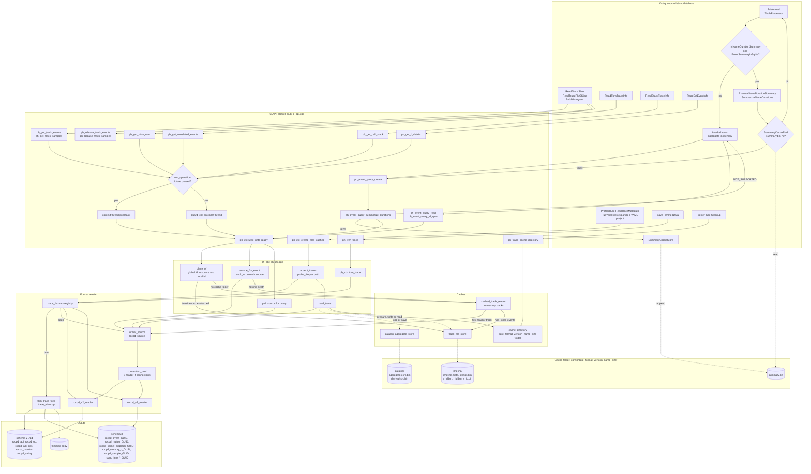
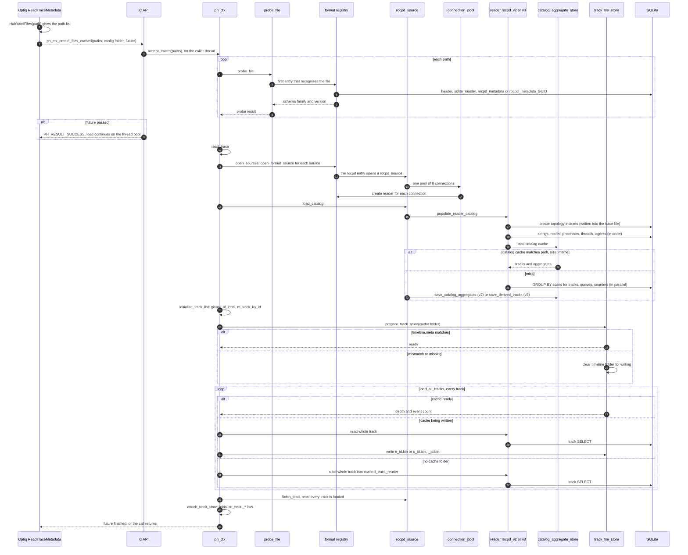
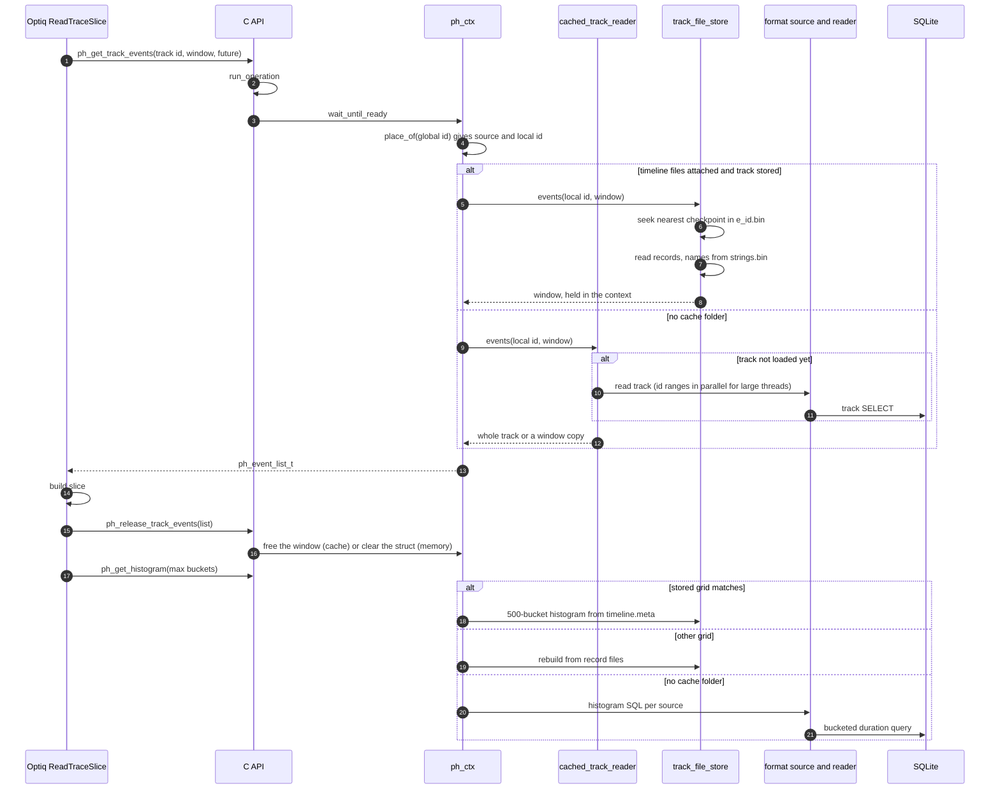
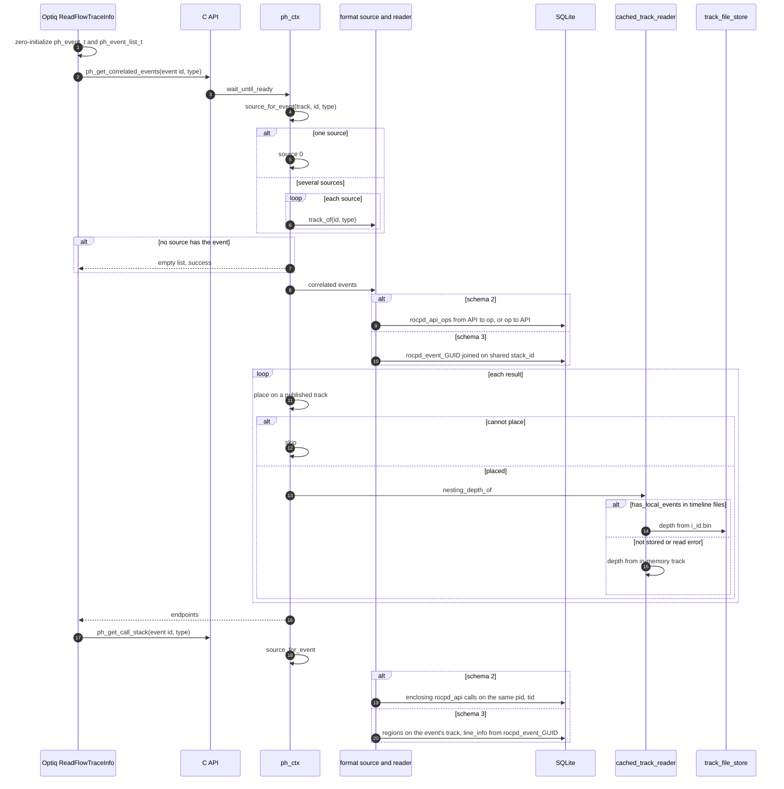
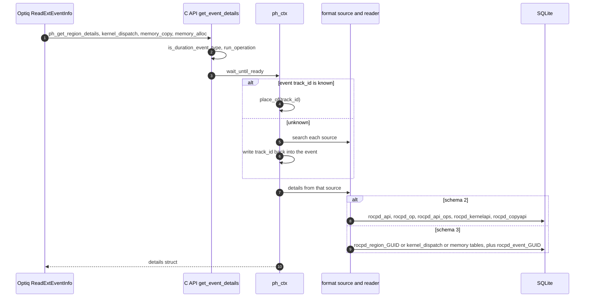
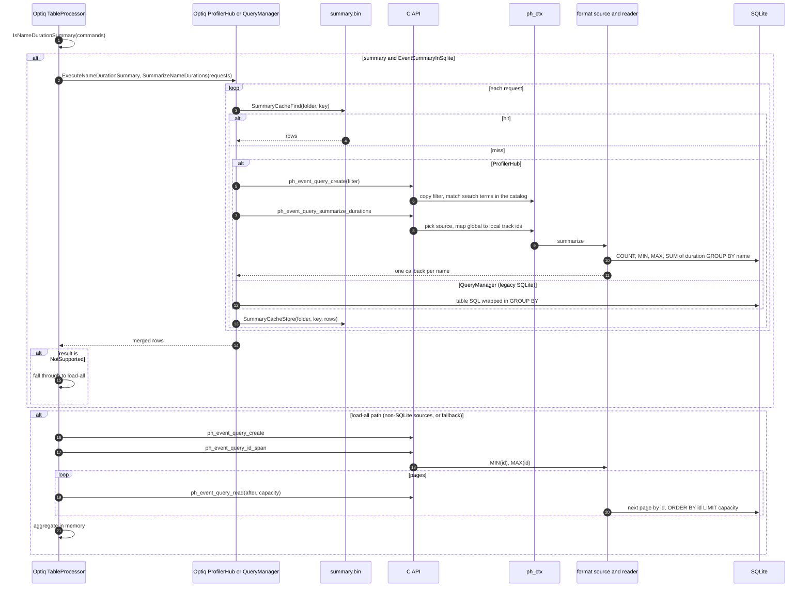
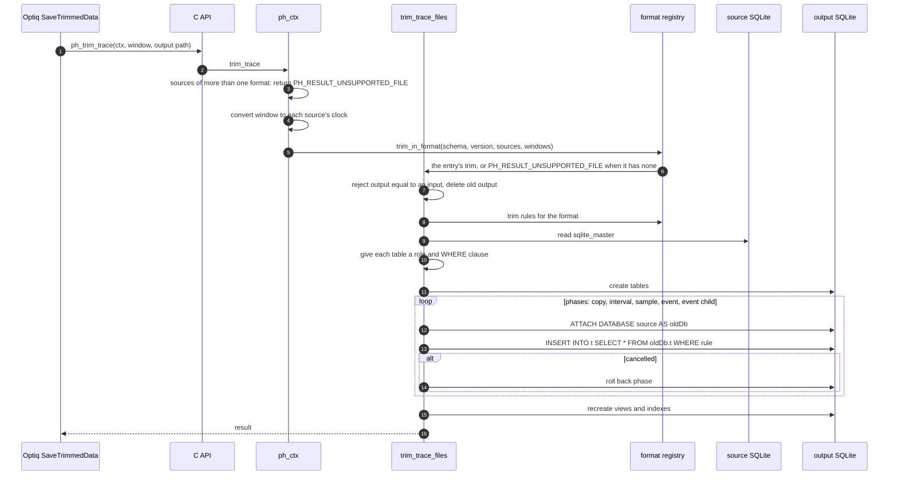
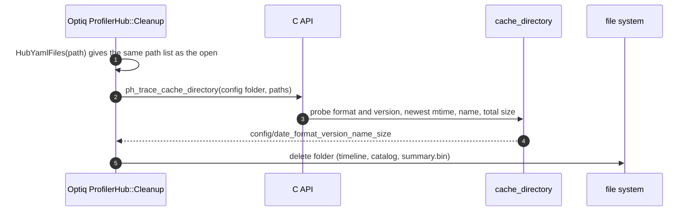

# Profiler Hub Reader Execution Flow

This document shows the execution path of each reader call, from Optiq down
to SQLite or the on-disk cache. The text explanation of the same paths is in
[reader-architecture.md](reader-architecture.md). Function names are the real
names in the code. `_GUID` stands for the GUID suffix of a schema-3 table.

The diagrams are Mermaid. They render on GitHub and in any Mermaid viewer.

## 1. End-to-end flow

This diagram shows every path in one picture. Solid arrows are calls. Dotted
arrows are reads from a cache or writes to it.

## 2. Opening a trace

## 3. Timeline slice and release

Samples (`ReadTracePMCSlice`) follow the same path with `ph_get_track_samples`, `s_id.bin`,
`rocpd_monitor` (schema 2), or the PMC sample statement (schema 3), and are
freed with `ph_release_track_samples`.

## 4. Correlated events and call stack

## 5. Event details

## 6. Table reads and summaries

## 7. Trim

## 8. Cache cleanup

