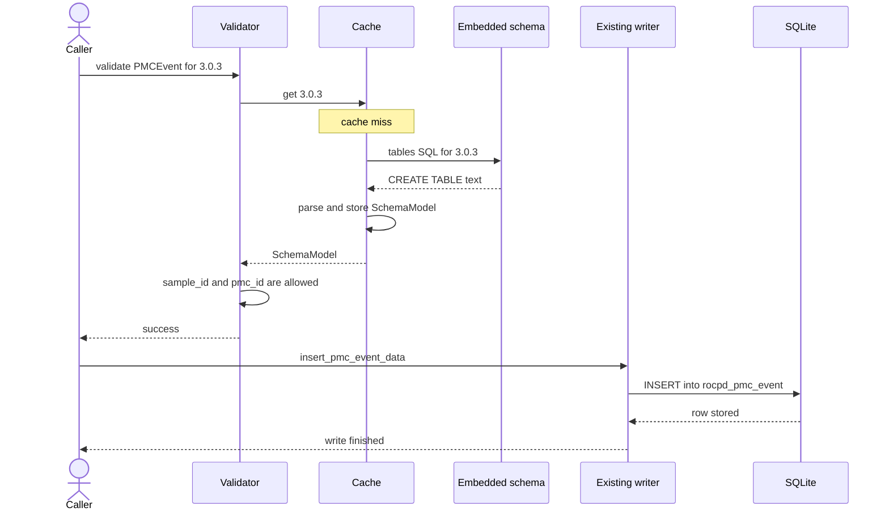
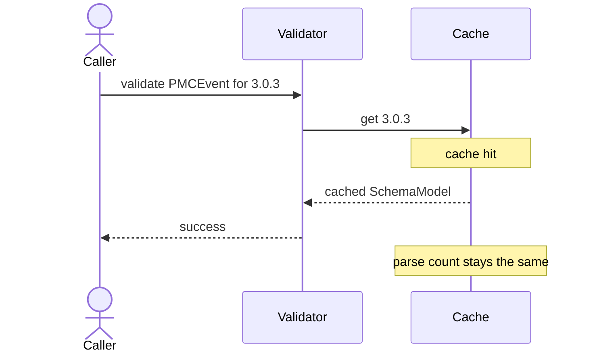
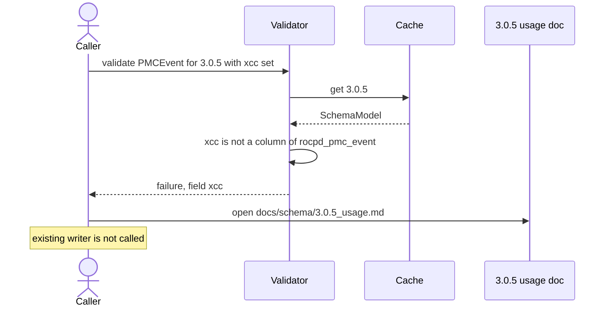
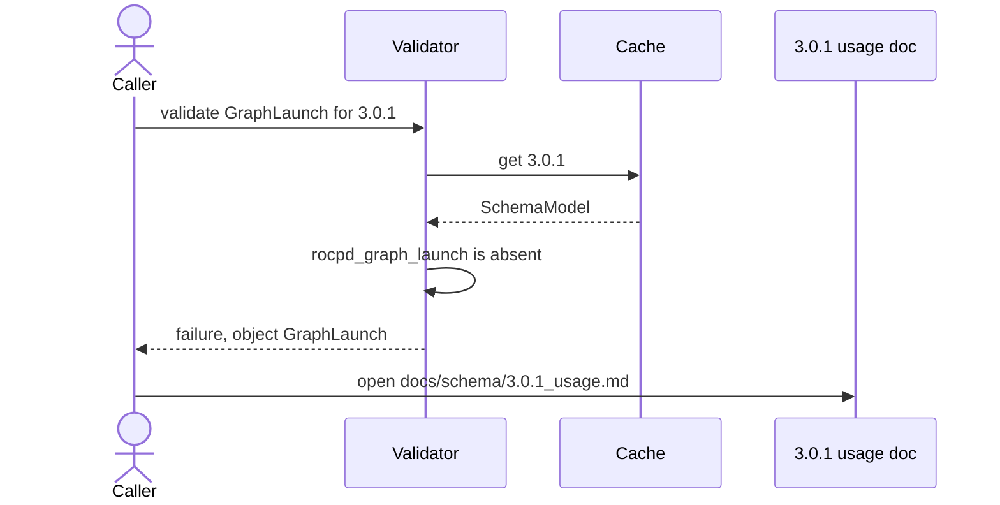
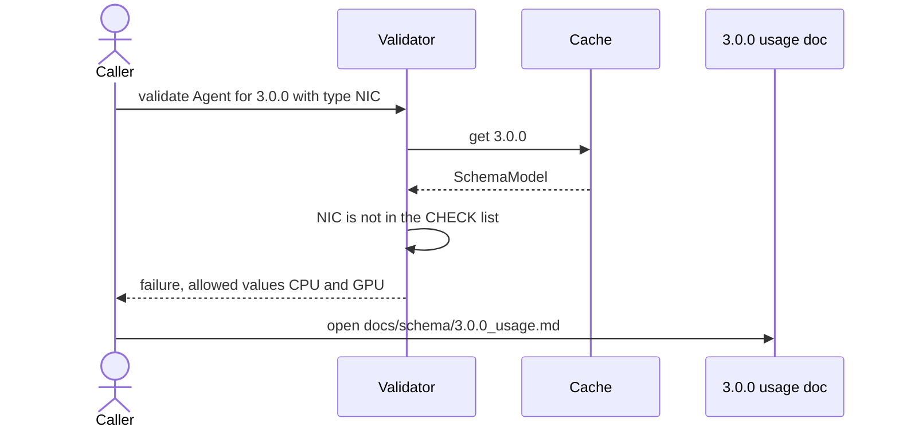
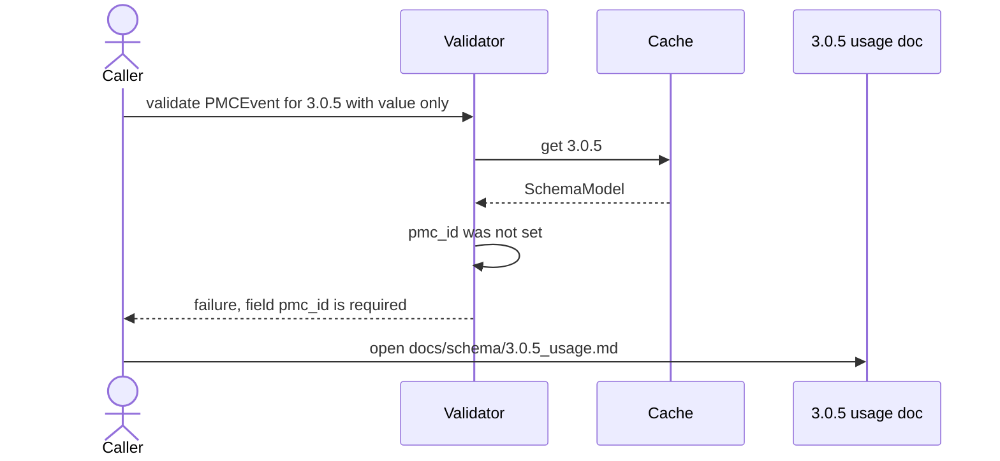

# Design Proposal: Multi-Version Schema Validation Framework for Profiler Hub

## Problem Statement

Profiler Hub needs to support multiple schema versions while providing a stable
user-facing API. Schema versions evolve over time, introducing new tables,
adding and removing columns, changing constraints, and modifying supported enum
values.

## Goals

- Support all schema versions through a common API.
- Validate user inputs before database writes.
- Avoid database creation during validation.
- Reuse parsed schema definitions instead of repeatedly parsing schema files.
- Provide clear and actionable validation errors.
- Provide version-specific documentation to help users correct inputs.

## Proposed Design

### Design Principles

- Define one superset input structure for each table.
- Users select a target schema version.
- Schema SQL files remain the source of truth.
- Schema files are parsed once and cached in memory.
- Validation always occurs before writing data.
- Validation does not require SQLite database creation.
- Validation errors include links to schema-version-specific documentation.
- Documentation contains exact structs, field descriptions, and usage examples.

### High Level Flow

```text
User Creates Input Struct
        │
        ▼
Select Schema Version
        │
        ▼
Schema Cache Manager
        │
        ▼
Schema Already Parsed? ──Yes──► Load Cached Schema
        │                              │
        No                             │
        │                              │
        ▼                              │
Parse SQL Schema                       │
        │                              │
        ▼                              │
Store In Cache                         │
        │                              │
        └──────────────┬───────────────┘
                       ▼
        Validate Input Against Schema
                       │
                       ▼
              Validation Success?
               │              │
              No             Yes
               │              │
               ▼              ▼
      Validation Report   Generate SQL
               │              │
               ▼              ▼
      Documentation       Write DB
      Guidance
```

### Sequence Diagrams

The schema SQL for each version is compiled into the library. The cache parses
that text in memory. Validation does not open SQLite. The existing writer runs
only after validation succeeds.

#### Cache miss, then a successful write

First request for 3.0.3. `sample_id` exists on `rocpd_pmc_event` in that
version, and `pmc_id` is set, so validation passes and the existing writer
inserts the row.



#### Cache hit

A later check for the same version reuses the model. The library SQL is not
parsed again.



#### Unsupported field

Schema 3.0.5. `xcc` is set on `PMCEvent`, but that column moved to
`rocpd_info_pmc`. The writer is not called.



#### Unsupported object

Schema 3.0.1 has no `rocpd_graph_launch` table. `GraphLaunch` fails before any
field is checked.



#### Invalid enum

Schema 3.0.0. `rocpd_info_agent.type` allows `CPU` and `GPU`. `NIC` was added
in 3.0.1.



#### Missing required field

Schema 3.0.5. `pmc_id` is `NOT NULL` and has no default, so an event that only
sets `value` fails. No database write follows.



### Input Model

Each logical object has exactly one structure containing all fields supported
across all schema versions.

```cpp
struct PMCEvent
{
    std::optional<uint64_t> sample_id;

    std::optional<int> xcc;
    std::optional<int> shader_engine;
    std::optional<int> shader_array;
    std::optional<int> wgp;
    std::optional<int> instance;
};
```

```cpp
struct Agent
{
    AgentType type;
};
```

```cpp
struct GraphLaunch
{
    uint64_t graph_exec_id;
    uint64_t graph_node_id;
};
```

This keeps the API stable while allowing schema evolution.

### Schema Version Selection

Users explicitly select a schema version.

```cpp
auto writer = SchemaWriterFactory::Create(SchemaVersion::v3_0_5);
```

```shell
profiler-hub --schema-version=3.0.5
```

### Schema Files

Schema files remain the authoritative source of schema information.

```text
schemas/
├── 3.0.0.sql
├── 3.0.1.sql
├── 3.0.2.sql
├── 3.0.3.sql
├── 3.0.4.sql
└── 3.0.5.sql
```

No duplicate schema-metadata repository is maintained.

### Schema Cache

#### Motivation

Parsing schema files for every validation request would be inefficient.

```text
Validate PMCEvent
    → Parse 3.0.5.sql

Validate Agent
    → Parse 3.0.5.sql again

Validate GraphLaunch
    → Parse 3.0.5.sql again
```

#### Solution

Parse schema files only once and cache the results.

```cpp
class SchemaCache
{
public:
    const SchemaModel& GetSchema(Version version);

private:
    std::unordered_map<Version, SchemaModel> cache_;
};
```

#### First Validation

```text
Schema Version = 3.0.5

Cache Miss
    │
    ▼
Parse 3.0.5.sql
    │
    ▼
Build SchemaModel
    │
    ▼
Save To Cache
    │
    ▼
Validate Input
```

#### Subsequent Validations

```text
Schema Version = 3.0.5

Cache Hit
    │
    ▼
Reuse Cached SchemaModel
    │
    ▼
Validate Input
```

No additional parsing is performed.

### Validation Framework

Validation is performed entirely in memory using the cached schema model.

Validation must not:

- Open SQLite
- Create databases
- Execute SQL
- Create tables
- Insert rows

Validation checks:

- Table existence
- Column existence
- Supported enum values
- Required fields
- Unsupported fields
- Object support within the selected schema

### Validation API

```cpp
auto result = writer->Validate(event);

if (!result.success())
{
    result.Print();
    return;
}

writer->Write(event);
```

Alternatively, `Write()` performs validation before generating SQL:

```cpp
writer->Write(event);
```

### Validation Failure Requirements

When validation fails, the framework provides failure details and documentation
guidance.

**Failure details**

- Schema version
- Object name
- Invalid fields
- Missing required fields
- Invalid enum values
- Failure reason

**Documentation guidance**

- Documentation link for the selected schema
- Expected struct definition
- Supported fields
- Field descriptions
- Example usage

### Documentation Layout

Version-specific documentation is maintained next to the schema docs:

```text
docs/
└── schema/
    ├── 3.0.0_usage.md
    ├── 3.0.1_usage.md
    ├── 3.0.2_usage.md
    ├── 3.0.3_usage.md
    ├── 3.0.4_usage.md
    └── 3.0.5_usage.md
```

Each document contains:

- Supported objects
- Struct definitions
- Supported fields
- Field descriptions
- Example usage

## Example Validation Failures

### Unsupported Fields

Selected schema: `3.0.5`

```cpp
PMCEvent event;

event.sample_id = 100;
event.xcc = 0;
event.shader_engine = 1;
```

```text
Validation Failed

Schema Version:
    3.0.5

Object:
    PMCEvent

Invalid Fields:
    xcc
    shader_engine

Reason:
    These fields are not supported in PMCEvent for schema version 3.0.5.

Documentation:
    docs/schema/3.0.5_usage.md
```

Additional guidance included with the failure:

```text
Expected Structure

struct PMCEvent
{
    std::optional<uint64_t> sample_id;
};
```

Supported fields:

| Field      | Description                    |
|------------|--------------------------------|
| sample_id  | References PMC sample record   |

```cpp
PMCEvent event;

event.sample_id = 100;
```

### Unsupported Object

Selected schema: `3.0.1`

```cpp
GraphLaunch launch;
```

```text
Validation Failed

Schema Version:
    3.0.1

Object:
    GraphLaunch

Reason:
    GraphLaunch is not supported by the selected schema version.

Documentation:
    docs/schema/3.0.1_usage.md
```

### Invalid Enum

Selected schema: `3.0.0`

```cpp
Agent agent;

agent.type = NIC;
```

```text
Validation Failed

Schema Version:
    3.0.0

Object:
    Agent

Field:
    type

Provided Value:
    NIC

Allowed Values:
    CPU
    GPU

Reason:
    NIC is not supported by schema version 3.0.0.

Documentation:
    docs/schema/3.0.0_usage.md
```

## Example Documentation

`docs/schema/3.0.5_usage.md` would look like this:

````markdown
# Schema 3.0.5 Usage Guide

## Supported Objects

- Agent
- PMCInfo
- PMCEvent
- GraphLaunch
- HipEvent

## PMCEvent

### Structure

```cpp
struct PMCEvent
{
    std::optional<uint64_t> sample_id;
};
```

### Fields

| Field     | Required | Description                  |
|-----------|----------|------------------------------|
| sample_id | No       | References PMC sample record |

### Example

```cpp
PMCEvent event;

event.sample_id = 100;
```

## PMCInfo

### Structure

```cpp
struct PMCInfo
{
    std::optional<int> xcc;
    std::optional<int> shader_engine;
    std::optional<int> shader_array;
    std::optional<int> wgp;
    std::optional<int> instance;
};
```

### Fields

| Field          | Required | Description                  |
|----------------|----------|------------------------------|
| xcc            | No       | XCC identifier               |
| shader_engine  | No       | Shader engine identifier     |
| shader_array   | No       | Shader array identifier      |
| wgp            | No       | Workgroup processor identifier |
| instance       | No       | PMC instance identifier      |

### Example

```cpp
PMCInfo info;

info.xcc = 0;
info.shader_engine = 1;
```
````

## Benefits

### Stable API

One structure per object, regardless of schema version.

### Single Source of Truth

Schema SQL files remain authoritative.

### No Schema Duplication

No separate schema metadata database to maintain.

### Fast Validation

The schema is parsed once and reused.

### No SQLite Dependency During Validation

Validation occurs before database creation.

### User-Friendly Errors

Validation failures include:

- The exact problem
- A documentation link
- The expected structure
- Supported fields
- A working example

### Easy Schema Expansion

Adding a new schema version requires:

1. Add the new schema SQL file.
2. Add the corresponding usage document.
3. Register the schema version.

No major framework redesign is required.

## Final Recommendation

Implement the following in phase 1:

- One superset struct per table
- User-selected schema version
- Parse schema SQL files once
- Cache the parsed schema in memory
- Validate against the cached schema model
- Automatic validation before write
- No SQLite dependency during validation
- Version-specific usage documentation
- Documentation links in validation messages
- Struct definitions in documentation
- Field descriptions in documentation
- Code examples in documentation

Final workflow:

```text
Superset Input Struct
        │
        ▼
Schema Version Selection
        │
        ▼
Schema Cache
        │
        ▼
(Parse Once Per Version)
        │
        ▼
Cached Schema Model
        │
        ▼
Validate Input
        │
        ├── Pass ──► Generate SQL ──► Write DB
        │
        └── Fail
              │
              ▼
        Validation Error
              │
              ▼
        docs/schema/<version>_usage.md
              │
              ▼
        Expected Struct
              │
              ▼
        Supported Fields
              │
              ▼
        Field Descriptions
              │
              ▼
        Working Example
```

This approach provides a simple, maintainable, and scalable foundation for
multi-version schema support in Profiler Hub, with a clear path from a failed
validation to the struct, fields, and example that correct it.
