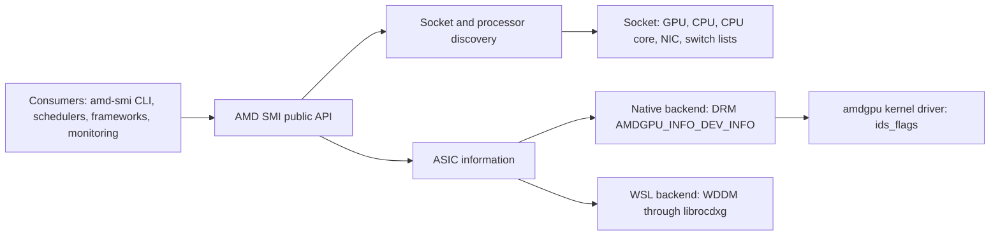
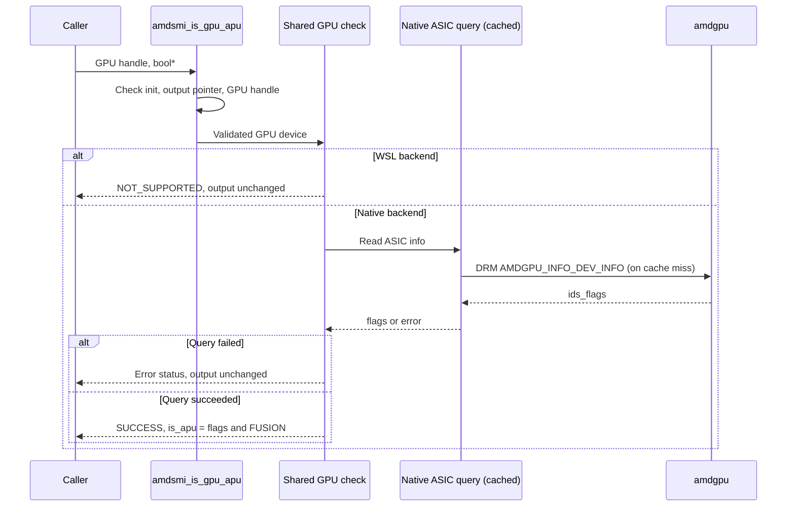

---
myst:
  html_meta:
    "description lang=en": "Design for identifying APU-integrated GPUs and fixing typed processor discovery in AMD SMI."
    "keywords": "apu, integrated gpu, discrete gpu, fusion, processor type, amdsmi_is_gpu_apu, processor discovery"
---

# APU identification and typed processor discovery

| Field | Value |
| --- | --- |
| Owner | Koushik Billakanti |
| Implementation | [ROCm/rocm-systems#11585](https://github.com/ROCm/rocm-systems/pull/11585) |
| Issue | [ROCm/rocm-systems#8476](https://github.com/ROCm/rocm-systems/issues/8476) |
| Related | [#8475](https://github.com/ROCm/rocm-systems/issues/8475) APU VRAM total reports the carveout; [#8419](https://github.com/ROCm/rocm-systems/pull/8419) VRAM total from KFD topology |
| Scope | AMD SMI library, Python and Rust bindings, `amd-smi` CLI, native Linux backend |

## Summary

Before this change, AMD SMI had no supported way to answer one question many
consumers need: is this GPU the integrated GPU of an APU, or a discrete GPU?
Consumers guessed from memory sizes, device-name lists, or by starting a HIP
runtime. The guesses are wrong on real systems, and memory budgets built on them
are wrong too.

This design adds `amdsmi_is_gpu_apu()` in C, Python, and Rust. It returns the
amdgpu driver's own classification (the `AMDGPU_IDS_FLAGS_FUSION` bit), keeps
every GPU handle typed as `AMD_GPU`, and reports `AMDSMI_STATUS_NOT_SUPPORTED`
instead of guessing when the driver answer is unavailable. It also fixes typed
processor discovery, which returned GPU handles for unrelated processor types.

## Terminology

"APU vs GPU" in this document means **APU-integrated GPU vs discrete GPU**. An
APU contains a GPU, so these are not two kinds of processor handle.

| Term | Meaning |
| --- | --- |
| APU | A package that combines CPU cores and an integrated GPU, sharing system memory. |
| APU-integrated GPU | The GPU inside an APU. AMD SMI reports it as an `AMD_GPU` handle. |
| Discrete GPU (dGPU) | A GPU on its own device with dedicated VRAM. |
| Fusion flag | `AMDGPU_IDS_FLAGS_FUSION` (`0x1`), set by amdgpu in the `ids_flags` it returns to user space for APU devices. |
| Carveout | System memory the BIOS reserves for the integrated GPU and reports as VRAM. Its size is a BIOS setting. |
| GTT | System memory the GPU can map. On APUs this is often the larger pool. |

## System context

AMD SMI discovers processors per socket and returns a typed handle for each.
Every GPU API validates that its handle is an `AMD_GPU`. The
`amdsmi_processor_type_t` enum also contains `AMD_APU` ("CPU and GPU on a single
die"), but the native Linux backend never creates such a handle.



Relevant facts before this change:

- The native backend already copies the driver's `ids_flags` into
  `amdsmi_asic_info_t.flags`. Bit 0 is the fusion flag.
- The WSL backend reuses `amdsmi_asic_info_t.flags` for a GPU family ID. Testing
  bit 0 there gives a meaningless answer.
- Internal code already needed the answer: the `amd-smi` CLI picks which memory
  pool to report for an APU, and the UMA carveout get/set path uses fwupd only for
  APUs. Each kept its own copy of a raw bit test.
- Memory reporting is separate from identity. [#8419](https://github.com/ROCm/rocm-systems/pull/8419)
  proposes changing how VRAM total is chosen; it does not depend on this design,
  and this design does not change memory totals.

## Problem statement

The problems below describe AMD SMI before [#11585](https://github.com/ROCm/rocm-systems/pull/11585).

### P1. Consumers cannot tell an APU-integrated GPU from a discrete GPU

The reporter of [#8476](https://github.com/ROCm/rocm-systems/issues/8476)
(Ryzen AI MAX+ 395, Radeon 8060S, gfx1151, ROCm 7.2.4) found no reliable signal:

| Signal the reporter tried | Result | Why it does not identify an APU |
| --- | --- | --- |
| `amdsmi_get_processor_type()` | `AMD_GPU` | Correct by design: the handle is a GPU. Changing it would break GPU validation. |
| `amdsmi_get_gpu_vram_info()['vram_type']` | `31`, shown as `MAX` | 31 is LPDDR5; `MAX` is an alias of the last enum value, not an error. Memory type does not prove integration. |
| `amdsmi_get_gpu_asic_info()` | No APU field | The raw `flags` value carries the answer, but is undocumented for this use and unsafe on WSL. |
| `amdsmi_get_processor_handles_by_type()` | Same GPU handles for every type | A real defect, see P2. |

Consumers fall back to heuristics, and the heuristics fail on real hardware:

| Workaround | Failure observed or expected |
| --- | --- |
| Compare VRAM and GTT totals | Sizes follow BIOS settings. The reporter's gfx1151 showed a 512 MiB carveout; our gfx1151 test system reports 32 GiB VRAM and 25 GiB GTT. A "GTT larger than VRAM" rule classifies that APU as discrete. |
| Match device IDs or marketing names | Needs a maintained list and misses new products. |
| Start HIP and read `hipDeviceProp_t::integrated` | Adds a runtime dependency and context side effects to a monitoring query. |
| Test bit 0 of `asic_info.flags` | Correct on native Linux only; meaningless on WSL, and every consumer must copy the check. |

Impact: tools size memory budgets against a carveout instead of the shared pool,
reject workloads that would fit, or report the wrong memory pool to users.

### P2. Typed discovery returned GPUs for unrelated types

`amdsmi_get_processor_handles_by_type()` fell back to the GPU list for any type
the socket did not handle explicitly. On the gfx1151 test system, requests for
`UNKNOWN`, `NON_AMD_GPU`, `NON_AMD_CPU`, and `AMD_APU` each returned the GPU
handle. A caller could not trust the filter, and a request for `AMD_APU`
appeared to work while returning ordinary GPU handles.

### P3. Duplicate and backend-unsafe checks inside AMD SMI

The CLI and the UMA carveout path each tested the raw flag independently. The CLI
copy had no WSL guard. Neither reported query errors, so a failed ASIC query was
indistinguishable from "not an APU".

## Requirements

### Functional

| ID | Requirement |
| --- | --- |
| FR1 | Identify whether a GPU handle is an APU-integrated GPU, in C, Python, and Rust. |
| FR2 | Use the driver's classification, not memory sizes, device lists, or another runtime. |
| FR3 | Report unavailable identification as an error, never as `false`. |
| FR4 | Keep every GPU handle typed `AMD_GPU` so existing GPU APIs keep working. |
| FR5 | Typed discovery returns only processors of the requested type; unsupported concrete types return an empty list. |
| FR6 | Invalid discovery requests are rejected without writing caller output. |
| FR7 | Internal callers (CLI, UMA carveout) use the same check as external callers. |

### Non-functional

| ID | Requirement |
| --- | --- |
| NFR1 | No ABI break: no struct, enum value, or existing signature changes. |
| NFR2 | No new privileges, sysfs writes, or device state changes. |
| NFR3 | Cost comparable to an ASIC info query, reusing its cache and locking. |
| NFR4 | Python bindings must handle an older native library that lacks the symbol. |
| NFR5 | Behavior must be testable without GPU hardware. |

### Out of scope

- Changing how memory totals are computed (tracked by [#8419](https://github.com/ROCm/rocm-systems/pull/8419) and [#8475](https://github.com/ROCm/rocm-systems/issues/8475)).
- Creating `AMD_APU` processor handles or modelling CPU and GPU co-location.
- APU identification on WSL.

## Design

### Decision

Keep APU-integrated GPUs as `AMD_GPU` handles and add a separate, status-bearing
query backed by the amdgpu fusion flag:

```c
amdsmi_status_t amdsmi_is_gpu_apu(amdsmi_processor_handle processor_handle, bool* is_apu);
```

### Why the fusion flag is the right source

The amdgpu driver decides whether a device is an APU and publishes that decision
to user space. In upstream Linux, `amdgpu_kms.c` sets `AMDGPU_IDS_FLAGS_FUSION`
in `drm_amdgpu_info_device.ids_flags` whenever the device has `AMD_IS_APU`.
The driver sets `AMD_IS_APU` from three sources:

- the PCI ID table for older APUs,
- IP discovery for newer client APUs, and
- the SMUIO package type at runtime for data center APUs such as MI300A.

AMD SMI therefore reports the same classification the kernel driver uses, and
new APUs are covered without changes to AMD SMI.

### Data flow



### API contract

| Condition | Status | `*is_apu` |
| --- | --- | --- |
| Native query succeeds, fusion bit set | `AMDSMI_STATUS_SUCCESS` | `true` |
| Native query succeeds, fusion bit clear | `AMDSMI_STATUS_SUCCESS` | `false` |
| Library not initialized | `AMDSMI_STATUS_NOT_INIT` | Unchanged |
| Null output pointer or null handle | `AMDSMI_STATUS_INVAL` | Unchanged |
| Non-null handle not owned by the library | `AMDSMI_STATUS_NOT_FOUND` | Unchanged |
| Non-GPU handle, or WSL backend | `AMDSMI_STATUS_NOT_SUPPORTED` | Unchanged |
| DRM, device access, or library load failure | Underlying error | Unchanged |

Callers must check the status before reading the boolean. "Unavailable" and
"discrete" are different answers.

| Binding | Success | Failure |
| --- | --- | --- |
| C | Status plus caller-owned `bool` | Non-success status |
| Python `amdsmi_is_gpu_apu(handle)` | `bool` | `AmdSmiLibraryException`; `NOT_SUPPORTED` if the loaded library lacks the symbol |
| Rust `amdsmi_is_gpu_apu(handle)` | `Ok(bool)` | `Err(status)` |

The query creates no HIP context, writes no device state, and needs no special
privileges. It reuses the ASIC info cache (`AMDSMI_ASIC_INFO_CACHE_MS`, default
10 seconds) and its per-device locking.

### Typed discovery

The socket returns the list for the requested type and an empty list for any
type it does not enumerate. The public API validates the type before writing
caller output.

| Requested type | Result |
| --- | --- |
| `AMD_GPU` | All AMD GPU handles, including APU-integrated GPUs |
| `AMD_CPU`, `AMD_CPU_CORE`, `AMD_NIC`, `BRCM_NIC`, `BRCM_SWITCH` | Only that type; empty when none exist |
| `NON_AMD_GPU`, `NON_AMD_CPU`, `AMD_APU` | `SUCCESS` with count 0 |
| `UNKNOWN` or a value outside the enum | `AMDSMI_STATUS_INVAL`; count and buffer unchanged |

Buffer rules are unchanged: a NULL buffer returns the count; a buffer receives
`min(capacity, available)` handles and returns `SUCCESS`.

To find APU-integrated GPUs, request `AMD_GPU` handles and call
`amdsmi_is_gpu_apu()` on each.

### Internal consumers

| Consumer | Before | After |
| --- | --- | --- |
| `amd-smi` APU memory pool selection | Own raw bit test, no WSL guard | Calls the new API; on error keeps the VRAM default |
| UMA carveout get/set (fwupd path) | Own helper; a failed query meant "not an APU" | Shared check; fwupd is used only on a confirmed APU |

The existing `is_apu` key in the GPU metrics dictionary is unchanged. It reports
whether an APU metrics section exists, not hardware identity.

### Related fixes in the same change

- **Processor ownership.** Processors that discovery filters out were not freed.
  Sockets now own and free them, along with AI-NIC processors. System cleanup
  clears lookup registries before deleting sockets and resets NIC state,
  including in sessions with no GPU backend.
- **Python package staging.** Incremental builds did not refresh staged Python
  files after source edits, so an API rename could leave exports and
  implementation out of step. The staging step now depends on every copied file.

## Alternatives considered

| Option | Benefit | Problem | Decision |
| --- | --- | --- | --- |
| Return `AMD_APU` from `amdsmi_get_processor_type()` | Uses an existing enum value | Breaks every GPU API that validates `AMD_GPU`; mixes processor kind with integration | Rejected |
| Add an `is_apu` field to `amdsmi_asic_info_t` | Bundles identity with device data | Uses reserved ABI space; a struct field cannot express "unavailable" separately from `false` | Rejected |
| Document `asic_info.flags & 1` | No new API | Wrong on WSL; every consumer copies the check and its error handling | Rejected |
| Compare VRAM and GTT, or match device IDs | No driver dependency | Wrong on real configurations (see P1); needs constant upkeep | Rejected |
| Infer an APU from CPU and GPU sharing a socket | Uses existing discovery | Socket grouping does not prove physical integration | Rejected |
| Query HIP's `integrated` property | Existing property | Adds a runtime dependency and context side effects to a management query | Rejected |
| **Separate status-bearing query using the fusion flag** | Driver-backed, ABI-safe, explicit errors, one shared check | One new symbol in each binding | **Selected** |

## Compatibility and migration

| Change | Affected callers | Action |
| --- | --- | --- |
| New symbol `amdsmi_is_gpu_apu` | None; additive | Native C and Rust callers need a library that exports it |
| Python wrapper on an older library | Mixed-version installs | Receives `NOT_SUPPORTED`; upgrade the library |
| Unsupported concrete types return an empty list | Callers that relied on receiving GPUs for `AMD_APU` or `NON_AMD_*` | Request `AMD_GPU` and use `amdsmi_is_gpu_apu()` |
| `UNKNOWN` returns `AMDSMI_STATUS_INVAL` | Callers using `UNKNOWN` as a wildcard | Request `AMD_GPU` explicitly |

No struct layouts, enum values, or existing signatures change. Major and minor
ABI compliance checks pass on #11585.

Rollback: revert #11585. Consumers that adopted the API should treat
`NOT_SUPPORTED` as "unknown" and must not fall back to memory-size guesses.

## Implementation phases

| Phase | Content | Status |
| --- | --- | --- |
| 1 | Public API, bindings, typed discovery fix, internal adoption, ownership and staging fixes, tests, release notes | Implemented in PR #11585 |
| 2 | Use the API in VRAM total selection in place of the memory comparison in #8419 | Follow-up, after both PRs merge |
| 3 | WSL support if WDDM exposes an integrated-GPU property | Not planned |

## Validation

### Test coverage

| Area | Tests | Hardware needed |
| --- | --- | --- |
| Fusion bit decoding | `GpuUnit.ApuIdentificationUsesFusionBitOnly`, `GpuUnit.ApuIdentificationRejectsNullOutput` | No |
| Typed discovery through the public API | `SystemUnit.ProcessorType*` (count, partial fill, bounds, invalid types, output preserved) | No |
| Ownership and cleanup | `SystemUnit.ProcessorTypeUnreportedObjectsAreReleased`, `SystemUnit.ProcessorTypeCleanupWithoutGpuBackend` | No |
| Python contract | `unit/gpu/test_gpu_is_apu.py`: boolean results, errors not reported as discrete, missing symbol, handle type checks | No |
| Live identification | `functional/gpu/test_gpu_is_apu.py`: result matches the native flag, invalid handles, non-GPU handles | Yes |
| Live discovery | `functional/system/test_processor_type_filter.py` | Yes |
| Package staging | `test_python_package_staging.py` with real CMake incremental builds | No |

### Results

| Revision of #11585 | Environment | Result |
| --- | --- | --- |
| `da2db0bc0dd` | Native build host, no GPU driver loaded | Build passes; C++ unit tests 242 passed, 18 skipped (root-only NPM tests), 0 failed; Python unit tests 341 passed; staging tests 2 passed; project format checks pass; regenerated Python and Rust bindings match |
| `ca14cc96d13` | Radeon 8060S (gfx1151) | Official integration runner (APU and discovery tests): 6 passed, 2 skipped for hardware the system lacks |

The commits between these two revisions only merge develop; the API
implementation is the same in both.

### Hardware results

| GPU | Target | `ids_flags` | `amdsmi_is_gpu_apu()` |
| --- | --- | --- | --- |
| Radeon 8060S (Ryzen AI MAX+) | gfx1151 | 25 (`0x19`) | `true`, 100 of 100 repeated queries |
| Radeon RX 7900 XTX | gfx1100 | 24 (`0x18`) | `false` |
| Radeon RX 9070 XT | gfx1201 | 16 (`0x10`) | `false` |

On gfx1151, the same system returned the GPU handle for `UNKNOWN`,
`NON_AMD_GPU`, `NON_AMD_CPU`, and `AMD_APU` before the fix. After the fix, the
concrete types return no handles, `UNKNOWN` returns `INVAL`, and `AMD_GPU` still
returns the GPU.

## Security and debuggability

- Read-only: one DRM info query through the existing ASIC path. No new device
  writes, sysfs writes, or privilege requirements.
- Inputs are validated before use, and the output is written only on success,
  so callers never read a stale or partial answer.
- Failures return the underlying status code. The ASIC query already logs DRM
  failures; `amd-smi` logs the chosen memory pool, or why identification failed,
  at debug level.

## Risks and open questions

| Item | Risk or question | Proposed handling |
| --- | --- | --- |
| MI300A | Runtime-detected APU not yet tested with #11585. The CLI already used this flag, so CLI behavior should not change. | Run the live identification test on MI300A before release |
| Callers using `UNKNOWN` as a wildcard | Now receive `INVAL` | Documented in release notes with the migration step |
| Memory sizing | Identity alone does not tell a caller how much memory is usable | Out of scope; see #8419 and #8475 |

## References

- [Issue #8476: APUs are not identifiable through AMD SMI](https://github.com/ROCm/rocm-systems/issues/8476)
- [PR #11585: add `amdsmi_is_gpu_apu` and fix typed processor enumeration](https://github.com/ROCm/rocm-systems/pull/11585)
- [PR #8419: VRAM total from KFD topology](https://github.com/ROCm/rocm-systems/pull/8419)
- [Issue #8475: APU VRAM total reports the BIOS carveout](https://github.com/ROCm/rocm-systems/issues/8475)
- [amdgpu: sets the fusion bit for APU devices (`amdgpu_kms.c`)](https://github.com/torvalds/linux/blob/24a19b953e2a3d0ea5a8c4951a0ab8f32720c907/drivers/gpu/drm/amd/amdgpu/amdgpu_kms.c#L969-L970)
- [amdgpu UAPI: `AMDGPU_IDS_FLAGS_FUSION` (`amdgpu_drm.h`)](https://github.com/torvalds/linux/blob/24a19b953e2a3d0ea5a8c4951a0ab8f32720c907/include/uapi/drm/amdgpu_drm.h#L1092)
- [amdgpu: runtime APU detection from the SMUIO package type (`amdgpu_discovery.c`)](https://github.com/torvalds/linux/blob/24a19b953e2a3d0ea5a8c4951a0ab8f32720c907/drivers/gpu/drm/amd/amdgpu/amdgpu_discovery.c#L3612-L3613)
