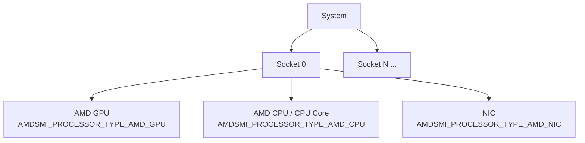
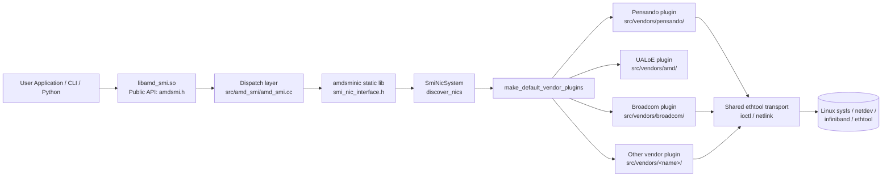

<!--
  Copyright (c) Advanced Micro Devices, Inc. All rights reserved.

  Permission is hereby granted, free of charge, to any person obtaining a copy
  of this software and associated documentation files (the "Software"), to deal
  in the Software without restriction, including without limitation the rights
  to use, copy, modify, merge, publish, distribute, sublicense, and/or sell
  copies of the Software, and to permit persons to whom the Software is
  furnished to do so, subject to the following conditions:

  The above copyright notice and this permission notice shall be included in
  all copies or substantial portions of the Software.

  THE SOFTWARE IS PROVIDED "AS IS", WITHOUT WARRANTY OF ANY KIND, EXPRESS OR
  IMPLIED, INCLUDING BUT NOT LIMITED TO THE WARRANTIES OF MERCHANTABILITY,
  FITNESS FOR A PARTICULAR PURPOSE AND NONINFRINGEMENT. IN NO EVENT SHALL THE
  AUTHORS OR COPYRIGHT HOLDERS BE LIABLE FOR ANY CLAIM, DAMAGES OR OTHER
  LIABILITY, WHETHER IN AN ACTION OF CONTRACT, TORT OR OTHERWISE, ARISING FROM,
  OUT OF OR IN CONNECTION WITH THE SOFTWARE OR THE USE OR OTHER DEALINGS IN
  THE SOFTWARE.
-->

# AMD SMI NIC integration guide

**Purpose**: This is a **contribution guide** for adding NIC device support to
the AMD SMI bare-metal (BM) library. It is *not* an end-user reference for the
``amd-smi`` CLI or Python interface; it is intended for developers extending AMD
SMI with new NIC backends (AMD or third-party). This guide uses the in-tree
Pensando (ionic) plugin throughout as the worked example of the
vendor-integration pattern.

This document describes the AMD SMI public APIs, data structures, interfaces,
and conventions for integrating Network Interface Card (NIC) device support
into the [AMD SMI](https://github.com/ROCm/rocm-systems/tree/develop/projects/amdsmi)
framework.

**Scope**: This guide covers the **bare-metal (BM) AMD SMI** library only.
The Host AMD SMI library is a separate codebase with its own rules,
conventions, build system, and contribution process; the only components it
shares with the BM library are the public AMD SMI header (`amdsmi.h`, common
API subset) and the NIC library sources. Anything outside those two shared
components is BM-specific. For the host library, see:

- Source: [amd/MxGPU-Virtualization (``smi-lib``)](https://github.com/amd/MxGPU-Virtualization/tree/staging/smi-lib)
- User guide: [AMD SMI for virtualization (Instinct docs)](https://instinct.docs.amd.com/projects/amd-smi-virt/en/latest/)

AMD SMI provides a unified management interface for AMD accelerators (GPUs,
CPUs), and is extended to support NIC devices via its public C API. This
document covers:

- [Architecture and device model](#architecture)
- [Public API conventions and naming](#public-api-conventions)
- [Data structures and type definitions](#data-structures)
- [Device discovery and initialization](#public-api-reference)
- [NIC Information APIs](#nic-information-apis) (ASIC, bus, NUMA, ports, driver, firmware, RDMA, statistics, vendor statistics)
- [Sysfs data source mapping](#sysfs-data-source-reference)
- [Code organization and integration points](#code-organization)
- Example usage ([C](#example-querying-nic-information-c) and [Python](#example-querying-nic-information-python))
- [Vendor plugin integration pattern (with Pensando as reference)](#vendor-plugin-architecture)
- [CLI commands for NIC management](#amd-smi-cli-commands-for-nic)
- [Build configuration for NIC support](#build-system)

---

## Architecture

### Device model

AMD SMI uses a hierarchical device model:

```
System
└── Socket(s)
    └── Processor(s)
        ├── GPU    (AMDSMI_PROCESSOR_TYPE_AMD_GPU)
        ├── CPU    (AMDSMI_PROCESSOR_TYPE_AMD_CPU / _AMD_CPU_CORE)
        └── NIC    (AMDSMI_PROCESSOR_TYPE_AMD_NIC)
```

AMD SMI surfaces every discovered NIC, AMD or third-party, through the single
``AMDSMI_PROCESSOR_TYPE_AMD_NIC`` processor type. The public API does not expose a
per-vendor processor type; vendor distinction is an implementation detail of the
NIC library's plugin layer (see
[Vendor plugin architecture](#vendor-plugin-architecture)).

Each NIC is represented as a **processor handle** (`amdsmi_processor_handle`).
You obtain handles from the standard AMD SMI discovery APIs, then pass them to
device-specific query functions.

A socket owns the processors it holds, NICs included. ``amdsmi_shut_down()`` frees
them, so an init, shutdown, init cycle (including a NIC-only one) starts from an
empty device list.



### Processor types

The `amdsmi_processor_type_t` enum defines all device types detectable by AMD SMI.
The value relevant to NIC devices is:

```c
typedef enum {
    AMDSMI_PROCESSOR_TYPE_UNKNOWN = 0,   // Unknown processor type
    AMDSMI_PROCESSOR_TYPE_AMD_GPU,       // AMD GPU
    AMDSMI_PROCESSOR_TYPE_AMD_CPU,       // AMD CPU
    AMDSMI_PROCESSOR_TYPE_NON_AMD_GPU,   // Non-AMD GPU
    AMDSMI_PROCESSOR_TYPE_NON_AMD_CPU,   // Non-AMD CPU
    AMDSMI_PROCESSOR_TYPE_AMD_CPU_CORE,  // AMD CPU Core
    AMDSMI_PROCESSOR_TYPE_AMD_APU,       // AMD APU (GPU + CPU on a single die)
    AMDSMI_PROCESSOR_TYPE_AMD_NIC        // NIC (AMD or third-party)
} amdsmi_processor_type_t;
```

All NIC backends report their devices under ``AMDSMI_PROCESSOR_TYPE_AMD_NIC``. A
new vendor does **not** add a processor-type value; it registers a discovery
plugin instead (see [Vendor plugin architecture](#vendor-plugin-architecture)).

### Initialization flags

To discover NIC devices, pass the ``AMDSMI_INIT_AMD_NICS`` flag during initialization:

```c
#define AMDSMI_INIT_AMD_NICS  (1 << 4)   // Initialize NIC discovery
```

:::{note}
You can also discover NIC devices by passing ``AMDSMI_INIT_ALL_PROCESSORS``, or by
OR-ing ``AMDSMI_INIT_AMD_NICS`` with other initialization flags (for example,
``AMDSMI_INIT_AMD_NICS | AMDSMI_INIT_AMD_GPUS``). All registered vendor plugins
run during discovery regardless of vendor (see
[Vendor plugin architecture](#vendor-plugin-architecture)).
:::

### Vendor plugin architecture

NIC support lives in a self-contained static library, ``amdsminic``, under
``src/nic/ai-nic/amdsmi_unified/``. That library exposes a vendor-neutral C
interface (``smi_nic_interface.h``) to the AMD SMI dispatch layer and, internally,
drives discovery through a set of **vendor plugins**. A plugin is a C++ class
that implements the ``SmiNicSubsystem`` interface and knows how to recognize and
enumerate one vendor's hardware.

**Key design points:**

1. **One registration point.** ``make_default_vendor_plugins()`` (in
   ``src/vendors/vendor_registry.{h,cpp}``) returns one plugin instance per
   supported vendor, in this order: Pensando (AINIC), UALoE endpoint,
   Broadcom. Adding a partner is a new ``src/vendors/<name>/`` subdirectory plus
   one ``push_back`` line in this function; nothing else in the core discovery path
   changes.

2. **Plugins implement ``SmiNicSubsystem``.** The base interface
   (``inc/smi_nic_subsystem.h``) is:

   ```cpp
   class SmiNicSubsystem {
    public:
     virtual void discover(const std::string& pci_path, const std::string& net_path,
                           std::shared_ptr<amd::smi::nic::transport::NicTransport> transport) = 0;
     virtual NicVendor vendor() const = 0;  // descriptive only
     virtual bool driver_loaded(const std::string& bdf, DriverType driver_type) const = 0;
     virtual const std::vector<std::unique_ptr<SmiNic>>& get_nics() const = 0;

    protected:
     std::pair<uint16_t, uint16_t> read_pci_ids(const std::string& sysfs_bus_path) const;
     bool resolve_bdf(const std::string& symlink, std::string& bdf) const;
     bool is_driver_bound_to_bdf(const std::string& driver_dir, const std::string& bdf,
                                 bool is_canonical_match) const;
   };
   ```

   The protected helpers ``read_pci_ids()``, ``resolve_bdf()`` and
   ``is_driver_bound_to_bdf()`` are shared by every plugin so vendors don't
   reimplement sysfs PCI parsing or driver-binding checks. ``DriverType`` names a
   role (``Main`` for the netdev/PCI driver, ``Rdma`` for the RDMA auxiliary
   driver), and each plugin maps it to its own driver path. ``vendor()`` is
   descriptive only: two plugins can report the same vendor (UALoE and Pensando are
   both ``AMD``), so it never routes a query.

3. **Discovery is id-match based.** ``SmiNicSystem::discover_nics()``
   (``src/smi_nic_system.cpp``) walks ``/sys/bus/pci/devices`` and ``/sys/class/net``
   and calls each registered plugin's ``discover()``. A plugin scans the PCI path,
   uses ``read_pci_ids()`` to match its own PCI ids, builds a ``SmiNic`` for each
   match, then associates network ports with it (a UALoE endpoint has none). The system
   aggregates every plugin's ``get_nics()`` into one BDF-sorted list.

4. **Ports reuse the shared ethtool transport.** ``SmiNicSystem`` creates one
   transport with ``create_transport(NicBackend_t::Auto)``
   (``inc/smi_nic_transport.h``) and passes it to every plugin and port. ``Auto``
   tries the netlink backend first (kernel 5.13+ with libnl-3, built only when
   ``HAVE_LIBNL3`` is defined) and falls back to the ioctl backend for pause and
   link settings; driver info, ethtool statistics and the permanent address always
   use ioctl, and FEC statistics exist only on the netlink backend. A plugin that
   builds on ``SmiNic``/``SmiNicPort`` inherits all of these and does not need to
   create a transport of its own. Active FEC and driver info are read by the
   interface layer with a direct ethtool ioctl, not through the transport.

5. **Public surface stays unified.** Plugins are internal to ``amdsminic``. They
   do not add symbols to ``amdsmi.h``; all access is through the standard
   ``amdsmi_get_nic_*`` APIs, which the dispatch layer forwards into the library's
   ``smi_nic_*`` C interface.

6. **Driver statistics are read with a consistency check.** ``ethtool -S`` takes
   three ioctl requests (count, names, values), and a driver's count can change
   between them. ``read_driver_statistics()`` (``inc/smi_nic_driver_stats.h``)
   allocates each buffer with 64 entries of headroom, passes the expected count
   as the input length, and compares the counts the kernel returns. A mismatch
   restarts the sequence, up to 3 attempts, and then fails with ``EAGAIN``.
   Kernels that include commit ``7b07be1ff1cb`` (December 2025) answer 0 when the
   input count no longer matches; older kernels write their current count
   whatever size was allocated, so the headroom narrows that window but cannot
   close it. The three requests are injectable, which is how
   ``tests/amd_smi_test/unit/nic/nic_driver_stats_test.cc`` models both kinds of
   kernel.

7. **Identity VPD is read once per NIC.** ``SmiNic`` reads the NIC's VPD, and its
   first port's for the fields the NIC's own image lacks, on the first call to
   ``product_name()``, ``part_number()``, ``serial_number()`` or ``is_vpd_readable()``.
   The four accessors share that read, and ``add_nic_port()`` drops it because a
   port's VPD fills in missing fields. The cache has no lock of its own: callers
   hold the context mutex, as ``smi_get_nic_asic_info()`` does.

The reference plugin is Pensando/ionic
(``src/vendors/pensando/pensando_subsystem.{h,cpp}``):

```cpp
class SmiNicSubsystemPensando : public SmiNicSubsystem {
  // ...
 private:
  static constexpr uint16_t VENDOR_ID = 0x1dd8;
  static constexpr std::array<uint16_t, 3> BRIDGE_DEVICE_IDS = {0x0008, 0x1008, 0x1478};
  static constexpr uint16_t PORT_ID   = 0x1002;   // downstream port function
  static constexpr uint16_t MID_BRIDGE_ID = 0x1001;  // internal bridge, never a NIC
  static constexpr uint16_t MGMT_ID   = 0x100c;   // pds_core management function
};
```

Its ``discover()`` matches ``VENDOR_ID`` and one of ``BRIDGE_DEVICE_IDS`` for the bridge
(the bridge reports a different id depending on the card), then ``discover_ports()``
walks ``/sys/class/net``, resolves each interface's PCI BDF, matches ``PORT_ID``,
confirms the port is downstream of the bridge, and collects InfiniBand/RDMA info
and statistics on each accepted port. ``discover_mgmt_function()`` finds the
``MGMT_ID`` function under the same bridge. A ``1dd8`` PCI bridge that is neither
listed nor ``MID_BRIDGE_ID`` is logged at debug level and not added.

The other two plugins follow the same interface: UALoE
(``src/vendors/amd/ualoe_subsystem.{h,cpp}``) matches PCI ids ``1022:1747``, has no
ports and no netdev, and reports ``FWCTL`` when an ``ifoe.cmd.*`` entry exists;
Broadcom (``src/vendors/broadcom/broadcom_subsystem.{h,cpp}``) matches netdevs
whose PCI function is bound to ``bnxt_en`` or ``bng_en``.



---

## Public API conventions

### Naming

All public AMD SMI functions follow this pattern:

```
amdsmi_get_<device_type>_<data_category>(processor_handle, output_struct*)
```

Examples:
- `amdsmi_get_nic_asic_info()`
- `amdsmi_get_nic_bus_info()`
- `amdsmi_get_nic_port_info()`
- ``amdsmi_get_nic_telemetry()``
- `amdsmi_get_nic_hwmon_sensors()`
- `amdsmi_get_nic_rdma_port_statistics()`

### Parameter conventions

| Parameter | Convention |
|-----------|-----------|
| `processor_handle` | Always the first parameter. Obtained from discovery APIs. |
| Output structs | Pointer to caller-allocated struct. Must not be `NULL`. |
| Two-call pattern | For variable-length data: first call with `data=NULL` returns count; second call fills the array. |

### Return values

All APIs return `amdsmi_status_t`:

| Status | Meaning |
|--------|---------|
| `AMDSMI_STATUS_SUCCESS` | Operation completed successfully |
| `AMDSMI_STATUS_INVAL` | Invalid argument (for example, `NULL` pointer) |
| `AMDSMI_STATUS_NOT_SUPPORTED` | Feature not supported on this device |
| `AMDSMI_STATUS_FILE_ERROR` | Failed to read sysfs file |
| `AMDSMI_STATUS_NO_PERM` | Insufficient permissions |
| `AMDSMI_STATUS_INIT_ERROR` | Library not initialized |
| `AMDSMI_STATUS_BUSY` | Device mutex could not be acquired |

### Unsupported or unavailable fields

When a device or driver does not provide a value for a particular field within
a larger output struct, AMD SMI uses the following conventions instead of
failing the entire call:

| Field type | Sentinel value for unsupported / unavailable |
|------------|----------------------------------------------|
| Unsigned integers (`uint8_t`, `uint16_t`, `uint32_t`, `uint64_t`) | The maximum value of the type (for example, `UINT32_MAX`, `UINT64_MAX`) |
| Signed integers | `INT32_MIN` / `INT64_MIN` |
| Floating-point | `NaN` |
| Strings (`char[]`) | The literal string `"N/A"`, or an empty string (`""`) when the field is structurally absent |
| Bitmask / flag fields | `0` (no flags set) |

Treat these sentinel values as "not reported" rather than as valid data. The
overall API call still returns `AMDSMI_STATUS_SUCCESS` provided at least one
field in the struct was populated; per-field availability is encoded via the
sentinels above. If *no* field can be populated, the API returns
`AMDSMI_STATUS_NOT_SUPPORTED`. Optional sub-structs are exempt from that last
rule and report emptiness through a count instead; see
[NIC RDMA device information](#nic-rdma-device-information).

---

## Data structures

### Size constants

```c
#define AMDSMI_MAX_STRING_LENGTH       256  // Max string buffer length
#define AMDSMI_MAX_NIC_PORTS            32  // Max NIC ports
#define AMDSMI_MAX_NIC_RDMA_DEV         32  // Max RDMA devices
```

### NIC ASIC information

```c
typedef struct {
    uint16_t vendor_id;
    uint16_t subvendor_id;
    uint16_t device_id;
    uint16_t subsystem_id;
    uint8_t  revision;
    char     permanent_address[AMDSMI_MAX_STRING_LENGTH];
    char     product_name[AMDSMI_MAX_STRING_LENGTH];
    char     part_number[AMDSMI_MAX_STRING_LENGTH];
    char     serial_number[AMDSMI_MAX_STRING_LENGTH];
    char     vendor_name[AMDSMI_MAX_STRING_LENGTH];
} amdsmi_nic_asic_info_t;
```

**Sysfs sources:**
- `vendor_id`: `/sys/bus/pci/devices/<BDF>/vendor`
- `device_id`: `/sys/bus/pci/devices/<BDF>/device`
- `subvendor_id`: `/sys/bus/pci/devices/<BDF>/subsystem_vendor`
- `subsystem_id`: `/sys/bus/pci/devices/<BDF>/subsystem_device`
- `revision`: `/sys/bus/pci/devices/<BDF>/revision`
- ``product_name``, ``part_number``, ``serial_number``: VPD data, parsed from ``/sys/bus/pci/devices/<BDF>/vpd`` when present. When the device exposes no sysfs VPD entry, ``product_name`` and ``part_number`` are reported as unavailable; ``serial_number`` falls back to the devlink board serial (``DEVLINK_ATTR_INFO_BOARD_SERIAL_NUMBER``) and is reported as unavailable only when that is also absent. The devlink ``DEVLINK_ATTR_INFO_SERIAL_NUMBER`` attribute is deliberately *not* used; it is a MAC-derived EUI, not the physical board serial.

The NIC type and the capability bitmask are not fields of this struct, which keeps its previous size. Read them with ``amdsmi_get_nic_type()`` and ``amdsmi_get_nic_capability()``. Both come from the discovered device, not sysfs. The capability is a bitmask of ``amdsmi_nic_capability_bits_t``: ``AMDSMI_NIC_CAP_FWCTL`` (firmware-control management function, e.g. Pensando/POLLARA) and ``AMDSMI_NIC_CAP_NETDEV`` (host network port(s) present).

### NIC type

```c
typedef enum {
    AMDSMI_NIC_TYPE_UNKNOWN = 0,  // the type could not be determined
    AMDSMI_NIC_TYPE_AINIC   = 1,  // AMD Pensando AINIC
    AMDSMI_NIC_TYPE_UALOE   = 2,  // UALoE accelerator-fabric endpoint
    AMDSMI_NIC_TYPE_OTHER   = 3,  // any other vendor
} amdsmi_nic_type_t;
```

``MODE`` is not a reliable way to tell the kinds apart: a Pensando card whose ports were not found is ``fwctl-only`` too. Use the type. For ``AMDSMI_NIC_TYPE_OTHER`` the vendor name identifies the device.

### NIC bus information

```c
typedef struct {
    amdsmi_bdf_t bdf;
    uint8_t  max_pcie_width;
    uint32_t max_pcie_speed;  // in GT/s
    char     pcie_interface_version[AMDSMI_MAX_STRING_LENGTH];
    char     slot_type[AMDSMI_MAX_STRING_LENGTH];
} amdsmi_nic_bus_info_t;
```

**Sysfs sources:**
- `bdf`: Parsed from PCI enumeration
- `max_pcie_width`: `/sys/bus/pci/devices/<BDF>/max_link_width`
- `max_pcie_speed`: `/sys/bus/pci/devices/<BDF>/max_link_speed`

### BDF (Bus-Device-Function)

`amdsmi_bdf_t` is a union that provides three ways to access the BDF:

```c
typedef union {
    struct bdf_ {
        uint64_t function_number : 3;
        uint64_t device_number   : 5;
        uint64_t bus_number      : 8;
        uint64_t domain_number   : 48;
    } bdf;
    struct {  // anonymous access (same layout)
        uint64_t function_number : 3;
        uint64_t device_number   : 5;
        uint64_t bus_number      : 8;
        uint64_t domain_number   : 48;
    };
    uint64_t as_uint;  // raw 64-bit value
} amdsmi_bdf_t;
```

Fields can be accessed directly (for example, `bdf.function_number`) or via the
named struct (for example, `bdf.bdf.function_number`). The `as_uint` member
provides the packed 64-bit representation.

### NIC NUMA information

```c
typedef struct {
    uint8_t node;
    char    affinity[AMDSMI_MAX_STRING_LENGTH];
} amdsmi_nic_numa_info_t;
```

**Sysfs sources:**
- `node`: `/sys/bus/pci/devices/<BDF>/numa_node`
- `affinity`: `/sys/devices/system/node/node<N>/cpulist` (where `<N>` is the value read from `numa_node`)

### NIC port information

```c
typedef struct {
    amdsmi_bdf_t bdf;
    uint32_t port_num;
    char     type[AMDSMI_MAX_STRING_LENGTH];
    char     flavour[AMDSMI_MAX_STRING_LENGTH];
    char     netdev[AMDSMI_MAX_STRING_LENGTH];
    uint8_t  ifindex;      // 0 when unavailable or above 255; see amdsmi_get_nic_port_ifindex()
    char     mac_address[AMDSMI_MAX_STRING_LENGTH];
    uint8_t  carrier;
    uint16_t mtu;
    char     link_state[AMDSMI_MAX_STRING_LENGTH];
    uint32_t link_speed;
    uint32_t active_fec;   // Active FEC modes bitmask
    char     autoneg[AMDSMI_MAX_STRING_LENGTH];
    char     pause_autoneg[AMDSMI_MAX_STRING_LENGTH];
    char     pause_rx[AMDSMI_MAX_STRING_LENGTH];
    char     pause_tx[AMDSMI_MAX_STRING_LENGTH];
} amdsmi_nic_port_t;

typedef struct {
    uint32_t        num_ports;
    amdsmi_nic_port_t ports[AMDSMI_MAX_NIC_PORTS];
} amdsmi_nic_port_info_t;
```

The port fields sourced from ethtool (``active_fec``, the ``pause_*`` fields, and
``link_speed``) are populated through the shared transport layer described in
[Vendor plugin architecture](#vendor-plugin-architecture).

**Active FEC bitmask values** (example mapping from `ethtool_fecparam`):

:::{note}
The values below are a representative example. The exact bit values and the set
of supported modes may differ between Linux kernel and `ethtool` versions. Refer
to the `ethtool_fecparam` definitions in the kernel UAPI headers
(`<linux/ethtool.h>`) of the target system rather than treating the table below
as a fixed contract.
:::

| Value | Mode |
|-------|------|
| 0x01 | `ETHTOOL_FEC_NONE` |
| 0x02 | `ETHTOOL_FEC_AUTO` |
| 0x04 | `ETHTOOL_FEC_RS` |
| 0x08 | `ETHTOOL_FEC_BASER` |
| 0x10 | `ETHTOOL_FEC_LLRS` |
| 0x20 | `ETHTOOL_FEC_OFF` |

### NIC driver information

```c
typedef struct {
    char name[AMDSMI_MAX_STRING_LENGTH];
    char version[AMDSMI_MAX_STRING_LENGTH];
} amdsmi_nic_driver_info_t;
```

### NIC firmware information

```c
typedef enum {
    AMDSMI_NIC_FW_VERSION_TYPE_FIXED,    // fixed (hardware) version
    AMDSMI_NIC_FW_VERSION_TYPE_RUNNING,  // currently running version
    AMDSMI_NIC_FW_VERSION_TYPE_STORED    // stored (pending) version
} amdsmi_nic_fw_version_type_t;

typedef struct {
    char name[AMDSMI_MAX_STRING_LENGTH];
    char version[AMDSMI_MAX_STRING_LENGTH];
} amdsmi_nic_fw_t;

typedef struct {
    amdsmi_nic_fw_version_type_t type;
    amdsmi_nic_fw_t              fw;
} amdsmi_nic_fw_entry_t;

typedef struct {
    uint32_t              num_fw;
    amdsmi_nic_fw_entry_t fw[AMDSMI_MAX_NIC_FW];   // AMDSMI_MAX_NIC_FW is 64
} amdsmi_nic_fw_info_t;
```

The entry holds the name and version in ``fw``, so read ``entry.fw.name`` and
``entry.fw.version``. The version types and the entry layout are the ones
``amdsmi_unified`` uses.

### NIC telemetry

Live temperature, health, and port-split state. Temperature is read via
sysfs/hwmon; health and port-split come over devlink (libnl3). A metric the NIC
does not expose is reported through a width-max reserved value in its sub-struct
(``UINT16_MAX``, ``UINT32_MAX``, or ``UINT8_MAX``), not a failed call.

```c
typedef enum {
    AMDSMI_NIC_HEALTH_UNKNOWN = 0,      // reserved: reporter present, state indeterminate
    AMDSMI_NIC_HEALTH_HEALTHY = 1,
    AMDSMI_NIC_HEALTH_WARNING = 2,      // reserved: no producing path yet
    AMDSMI_NIC_HEALTH_ERROR = 3,
    AMDSMI_NIC_HEALTH_UNSUPPORTED = 4,  // no health reporter exposed
} amdsmi_nic_health_state_t;

typedef struct {
    uint16_t asic_temp_c;
    uint16_t transceiver_temp_c;
    uint16_t board_temp_c;
} amdsmi_nic_temperature_t;

typedef struct {
    uint8_t  state;          // an amdsmi_nic_health_state_t value
    uint8_t  reserved[3];
    uint32_t error_count;    // UINT32_MAX when unavailable; real counts saturate to UINT32_MAX-1
    char     reporter[64];   // devlink reporter name; "" if none
} amdsmi_nic_health_t;

typedef struct {
    uint8_t splittable;
    uint8_t split_count;
} amdsmi_nic_port_split_t;

typedef struct {
    amdsmi_nic_temperature_t temperature;
    amdsmi_nic_health_t      health;
    amdsmi_nic_port_split_t  port_split;
} amdsmi_nic_telemetry_t;
```

### NIC RDMA device information

```c
typedef struct {
    char    netdev[AMDSMI_MAX_STRING_LENGTH];
    char    state[AMDSMI_MAX_STRING_LENGTH];
    uint8_t rdma_port;
    uint16_t max_mtu;
    uint16_t active_mtu;
} amdsmi_nic_rdma_port_info_t;

typedef struct {
    char    rdma_dev[AMDSMI_MAX_STRING_LENGTH];
    char    node_guid[AMDSMI_MAX_STRING_LENGTH];
    char    node_type[AMDSMI_MAX_STRING_LENGTH];
    char    sys_image_guid[AMDSMI_MAX_STRING_LENGTH];
    char    fw_ver[AMDSMI_MAX_STRING_LENGTH];
    uint8_t num_rdma_ports;
    amdsmi_nic_rdma_port_info_t rdma_port_info[AMDSMI_MAX_NIC_PORTS];
} amdsmi_nic_rdma_dev_info_t;

typedef struct {
    uint8_t num_rdma_dev;
    amdsmi_nic_rdma_dev_info_t rdma_dev_info[AMDSMI_MAX_NIC_RDMA_DEV];
} amdsmi_nic_rdma_devices_info_t;
```

RDMA information is optional. A NIC whose RDMA driver is unavailable (for
example, `ionic_rdma` blacklisted) is still enumerated, and
`amdsmi_get_nic_rdma_dev_info()` returns `AMDSMI_STATUS_SUCCESS` with
`num_rdma_dev` set to 0. Check `num_rdma_dev` rather than the return value to
tell whether any RDMA device was reported.

`max_mtu` and `active_mtu` come from libibverbs, with the sysfs ``max_mtu`` and
``active_mtu`` files as the fallback; they read ``N/A`` when neither answers
(some drivers, such as ``bng_re``, expose no MTU files). The query opens the RDMA
device in a short-lived child process, because opening it loads the vendor's
user-space provider, which can crash or hang. The child is stopped after two
seconds and handles fatal signals itself, so a failing provider costs the MTU and
nothing else.

### NIC statistics

```c
typedef struct {
    char     name[AMDSMI_MAX_STRING_LENGTH];
    uint64_t value;
} amdsmi_nic_stat_t;
```

Used by ``amdsmi_get_nic_rdma_port_statistics()``,
``amdsmi_get_nic_port_statistics()``, and ``amdsmi_get_nic_vendor_statistics()``.

---

## Public API reference

The canonical reference for every AMD SMI public API is the header
[`projects/amdsmi/include/amd_smi/amdsmi.h`](../../include/amd_smi/amdsmi.h)
and the rendered Sphinx documentation at the
[AMD SMI documentation](https://rocm.docs.amd.com/projects/amdsmi/en/latest/).
For an end-to-end usage example, see
[``amd_smi_nic.cc``](../../example/amd_smi_nic.cc). The summaries below provide a
NIC-focused subset of that reference; use the header and the in-tree example as
the source of truth.

:::{note}
The signatures listed in this section reflect the **bare-metal (BM) AMD SMI**
library. The host AMD SMI library is a separate codebase with its own user
guide; see
[amd/MxGPU-Virtualization (``smi-lib``)](https://github.com/amd/MxGPU-Virtualization/tree/staging/smi-lib)
and the
[AMD SMI for virtualization user guide](https://instinct.docs.amd.com/projects/amd-smi-virt/en/latest/).
:::

### Initialization and shutdown

```c
// Initialize AMD SMI with NIC support
amdsmi_status_t amdsmi_init(uint64_t init_flags);
// Use: amdsmi_init(AMDSMI_INIT_AMD_NICS);

// Shutdown AMD SMI
amdsmi_status_t amdsmi_shut_down(void);
```

### Device discovery

```c
// Get socket handles
amdsmi_status_t amdsmi_get_socket_handles(uint32_t *socket_count,
                                          amdsmi_socket_handle *socket_handles);

// Get processor handles filtered by type
amdsmi_status_t amdsmi_get_processor_handles_by_type(
    amdsmi_socket_handle socket_handle,
    amdsmi_processor_type_t processor_type,
    amdsmi_processor_handle *processor_handles,
    uint32_t *processor_count);
```

NIC handles are requested with ``processor_type = AMDSMI_PROCESSOR_TYPE_AMD_NIC``.

**Two-call pattern for discovery:**

1. Call with `processor_handles = NULL` to get `processor_count`.
2. Allocate an array of `processor_count` handles.
3. Call again with the allocated array.

### NIC information APIs

The following APIs are implemented and available in the current AMD SMI release:

```c
// NIC ASIC Information
amdsmi_status_t amdsmi_get_nic_asic_info(
    amdsmi_processor_handle processor_handle,
    amdsmi_nic_asic_info_t *info);

// NIC Type
amdsmi_status_t amdsmi_get_nic_type(
    amdsmi_processor_handle processor_handle,
    amdsmi_nic_type_t *type);

// NIC Capability (bitmask of amdsmi_nic_capability_bits_t)
amdsmi_status_t amdsmi_get_nic_capability(
    amdsmi_processor_handle processor_handle,
    uint32_t *capability);

// Full interface index of a NIC port (amdsmi_nic_port_t::ifindex holds one byte)
amdsmi_status_t amdsmi_get_nic_port_ifindex(
    amdsmi_processor_handle processor_handle,
    uint32_t port_index,
    uint32_t *ifindex);

// NIC Bus Information
amdsmi_status_t amdsmi_get_nic_bus_info(
    amdsmi_processor_handle processor_handle,
    amdsmi_nic_bus_info_t *info);

// NIC NUMA Information
amdsmi_status_t amdsmi_get_nic_numa_info(
    amdsmi_processor_handle processor_handle,
    amdsmi_nic_numa_info_t *info);

// NIC Driver Information
amdsmi_status_t amdsmi_get_nic_driver_info(
    amdsmi_processor_handle processor_handle,
    amdsmi_nic_driver_info_t *info);

// NIC Firmware Information (firmware versions read over devlink/libnl3)
amdsmi_status_t amdsmi_get_nic_fw_info(
    amdsmi_processor_handle processor_handle,
    amdsmi_nic_fw_info_t *info);

// NIC Telemetry (temperature, health, port-split)
amdsmi_status_t amdsmi_get_nic_telemetry(
    amdsmi_processor_handle processor_handle,
    amdsmi_nic_telemetry_t *info);

// NIC hwmon sensors (temperature, voltage, power and their thresholds)
amdsmi_status_t amdsmi_get_nic_hwmon_sensors(
    amdsmi_processor_handle processor_handle,
    uint32_t *num_sensors,
    amdsmi_nic_sensor_t *sensors);

// NIC Port Information
amdsmi_status_t amdsmi_get_nic_port_info(
    amdsmi_processor_handle processor_handle,
    amdsmi_nic_port_info_t *info);

// NIC RDMA Device Information
amdsmi_status_t amdsmi_get_nic_rdma_dev_info(
    amdsmi_processor_handle processor_handle,
    amdsmi_nic_rdma_devices_info_t *info);
```

### NIC link type

```c
amdsmi_status_t amdsmi_topo_get_link_type(
    amdsmi_processor_handle processor_handle_src,
    amdsmi_processor_handle processor_handle_dst,
    uint64_t *hops,
    amdsmi_link_type_t *type);
```

``amdsmi_topo_get_link_type()`` accepts a NIC handle for either argument (NIC to GPU
or NIC to NIC). The link type is computed from sysfs and needs no loaded driver:

| Type | Meaning |
|------|---------|
| ``AMDSMI_LINK_TYPE_PCIE`` | Both devices sit behind the same PCIe switch |
| ``AMDSMI_LINK_TYPE_NUMA`` | Same NUMA node, different PCIe switch (two functions of one card read ``NUMA``) |
| ``AMDSMI_LINK_TYPE_XNUMA`` | Different NUMA nodes |
| ``AMDSMI_LINK_TYPE_UNKNOWN`` | A BDF is invalid or a NUMA node cannot be read |

``hops`` may be ``NULL``. For NIC pairs it is not meaningful and reads ``UINT64_MAX``.
A GPU compute partition reports its partition number as the PCI function, so on a
platform where that function is also a real device (a UALoE endpoint), the two
share one BDF string; the result is still correct because both are on the same
NUMA node.

### NIC RDMA port statistics

This API uses a **two-call pattern**:

```c
amdsmi_status_t amdsmi_get_nic_rdma_port_statistics(
    amdsmi_processor_handle processor_handle,
    uint32_t rdma_port_index,
    uint32_t *num_stats,
    amdsmi_nic_stat_t *stats);
```

**Usage:**

1. Call with `stats = NULL` to get `num_stats` (count of available statistics).
2. Allocate an array of `num_stats` elements.
3. Call again with the allocated array. If there are more statistics than the array holds, the
   first ones are filled, ``num_stats`` is set to the count needed, and the call returns
   ``AMDSMI_STATUS_INSUFFICIENT_SIZE``.

The statistics are the driver's RDMA hardware counters, the same set as
``rdma statistic show link DEV/PORT``, and are read on every call.
``rdma_port_index`` counts RDMA ports from 0 across the NIC's RDMA devices, in the
order of ``amdsmi_nic_rdma_devices_info_t`` (each device's ports in turn). On an
AI-NIC with one RDMA device and one port, the only valid index is 0. An index past
the last RDMA port, or a NIC without an RDMA device, returns
``AMDSMI_STATUS_NOT_SUPPORTED``.

Not supported: ``rdma statistic show mr``, ``rdma statistic mode supported``, and
setting optional counters with ``rdma statistic set link DEV/PORT optional-counters``.

The Python binding is ``amdsmi_get_nic_rdma_port_statistics(processor_handle,
rdma_port_index)``. It returns a dictionary of counter name to value.

### NIC port statistics and vendor statistics

Both APIs use a **two-call pattern** and return per-port counters. Port
statistics are the standard driver counters for a NIC port; vendor statistics
are the driver-defined counters exposed via ``ethtool -S``, in two tiers. The default call
returns the default tier; ``amdsmi_get_nic_vendor_statistics_with_scope()`` takes the tier
as a parameter.

```c
amdsmi_status_t amdsmi_get_nic_port_statistics(
    amdsmi_processor_handle processor_handle,
    uint32_t port_index,
    uint32_t *num_stats,
    amdsmi_nic_stat_t *stats);

amdsmi_status_t amdsmi_get_nic_vendor_statistics(
    amdsmi_processor_handle processor_handle,
    uint32_t port_index,
    uint32_t *num_stats,
    amdsmi_nic_stat_t *stats);

// Same as amdsmi_get_nic_vendor_statistics(), with the tier given in the call:
// AMDSMI_NIC_STAT_SCOPE_DEFAULT, or AMDSMI_NIC_STAT_SCOPE_EXTENDED (a superset).
// Any other value returns AMDSMI_STATUS_INVAL.
amdsmi_status_t amdsmi_get_nic_vendor_statistics_with_scope(
    amdsmi_processor_handle processor_handle,
    uint32_t port_index,
    amdsmi_nic_stat_scope_t scope,
    uint32_t *num_stats,
    amdsmi_nic_stat_t *stats);
```

**Usage:**

1. Call with `stats = NULL` to get `num_stats` (count of available statistics for the port).
2. Allocate an array of `num_stats` elements.
3. Call again with the allocated array. If there are more statistics than the array holds, the
   first ones are filled, ``num_stats`` is set to the count needed, and the call returns
   ``AMDSMI_STATUS_INSUFFICIENT_SIZE``.

---

## Vendor plugin implementation

This section is for contributors working on the NIC library itself. Public
consumers should use the ``amdsmi_*`` API described above; they never see the
internal C interface or the C++ plugin classes discussed here.

### Internal C interface (``smi_nic_interface.h``)

The ``amdsminic`` static library exposes a vendor-neutral C interface,
``include/amd_smi/impl/nic/amdsmi_unified/interface/smi_nic_interface.h``, that the
AMD SMI dispatch layer (``src/amd_smi/amd_smi.cc``) calls. It is context-based:

```c
smi_nic_status_t smi_nic_create_context(smi_nic_ctx_t* ctx, bool is_ainic_only);
smi_nic_status_t smi_nic_destroy_context(smi_nic_ctx_t ctx);
smi_nic_status_t smi_discover_nics(smi_nic_ctx_t ctx, smi_nic_discovery_t* discovery);

smi_nic_status_t smi_get_nic_asic_info(smi_nic_ctx_t ctx, uint64_t device,
                                       smi_nic_asic_info_t* info);
smi_nic_status_t smi_get_nic_bus_info(smi_nic_ctx_t ctx, uint64_t device,
                                      smi_nic_bus_info_t* info);
// ...and the remaining smi_get_nic_* queries.
```

This header is shared with ``amdsmi_unified``: it has the same functions, types and
macros, and the same struct layout, as the copy there, and it is plain C. What only
the bare-metal library has (the NIC kind and capability, the port interface index,
telemetry, hwmon sensors and the scoped vendor statistics) is declared in
``include/amd_smi/impl/nic/amd_smi_nic_interface.h``, which includes the shared header.
Change the shared header only together with ``amdsmi_unified``.

``smi_nic_status_t`` and the ``smi_nic_*`` structures are **internal to the NIC
library**. The dispatch layer converts them to ``amdsmi_status_t`` and the
``amdsmi_nic_*`` structures at the public boundary; none of the ``smi_nic_*`` types
appear in ``amdsmi.h``.

### C++ plugin layer

Behind the C interface, ``SmiNicSystem`` (``src/smi_nic_system.cpp``) drives
discovery through the vendor plugins:

- Its constructor calls ``make_default_vendor_plugins()`` and registers each
  returned ``SmiNicSubsystem``.
- ``discover_nics()`` iterates the registered plugins, calling
  ``discover("/sys/bus/pci/devices", "/sys/class/net", transport)`` on each and collecting
  their ``get_nics()`` into one BDF-sorted list.
- ``driver_loaded()`` finds the plugin that owns the NIC (by object identity over
  each plugin's ``get_nics()``, not by ``vendor()``) and asks it. The BDF passed in is a
  port BDF.

The Pensando plugin (``src/vendors/pensando/``) is the reference implementation.
It matches its PCI IDs during ``discover()``, walks ``/sys/class/net`` in
``discover_ports()`` to associate ports with the device, and implements
``driver_loaded()`` for the ``ionic`` and ``ionic_rdma`` drivers.

### Device discovery details (Pensando reference)

| Step | Mechanism |
|------|-----------|
| Bridge match | Scan ``/sys/bus/pci/devices``; ``read_pci_ids()`` must equal ``VENDOR_ID`` and one of ``BRIDGE_DEVICE_IDS``. |
| Port match | Walk ``/sys/class/net``; ``resolve_bdf()`` on each ``<iface>/device``; ``read_pci_ids()`` must equal ``VENDOR_ID``/``PORT_ID``. |
| Downstream check | Confirm the resolved path of the port function contains ``/<bridge_bdf>/``. |
| Management function | Find ``VENDOR_ID``/``MGMT_ID`` (``pds_core``) under the same bridge; it enables the ``FWCTL`` capability. |
| Driver presence | ``driver_loaded(bdf, Main)`` checks ``/sys/bus/pci/drivers/ionic``; ``driver_loaded(bdf, Rdma)`` checks that a link under ``/sys/bus/auxiliary/drivers/ionic_rdma.rdma`` resolves through the port BDF. |

The vendor's kernel driver must be loaded for its ports to appear under
``/sys/class/net``; without it, no ports are discovered for that device.

---

## AMD SMI CLI commands for NIC

The ``amd-smi`` CLI enumerates every NIC the library discovers through the same
public discovery path used above. There is no per-vendor CLI code. NIC-capable
subcommands accept a device selector:

```
-N, --nic <ID | BDF | UUID> ...
```

A bare ``--nic`` with no value selects every NIC.

The Broadcom-specific options of earlier builds are gone: ``--brcm_nic``, ``--brcm_switch``,
``--switch``, ``topology --nic_topo`` and ``topology --nic_switch``. Broadcom NICs are listed and
queried through ``--nic`` like every other NIC.

``amd-smi list`` includes discovered NICs alongside GPUs, and ``amd-smi static``
reports NIC identity details (BDF, product name, part/serial number, vendor)
when a NIC is selected with ``-N/--nic``. ``amd-smi metric --nic`` reports NIC
telemetry (temperature, health, port-split) and ``amd-smi firmware --nic`` reports
NIC firmware versions. The selector works only when you initialize NIC discovery
(see [Initialization flags](#initialization-flags)).

``amd-smi list --nic`` and ``amd-smi metric --nic`` print a ``TYPE`` line for each NIC: ``AINIC``,
``UALoE``, or the vendor name for any other NIC (``N/A`` if the type is unknown). In ``metric --nic``
it is the first field of each block, so the all-``N/A`` block of a UALoE endpoint, which has no
telemetry source, is not mistaken for a failure.

### Per-port NIC statistics with ``metric --nic --port``

The ``metric --nic`` command supports per-port statistics collection via the
``--port`` flag:

```
amd-smi metric --nic <ID | BDF | UUID> --port [PORT_NUM] [--extended] [--json]
```

**Flags:**

- ``--port`` (bare, no argument): Report statistics for all ports on the NIC.
- ``--port PORT_NUM``: Report statistics for a single port (by numeric index).
- ``--extended``: Include extended (vendor-specific) counters. Requires ``--port`` to be specified. Text output only; JSON output always includes extended counters.
- ``--json``: Output as JSON. When combined with ``--port --extended``, the output still contains the full extended set.

**Scopes:**

- ``DEFAULT``: The vendor-tier subset of ``VENDOR_STATISTICS`` (e.g. ``frames_rx_ok`` for ionic, ``rx_pfc_frames`` for bnxt).
- ``EXTENDED``: The full vendor-specific counter set from the driver (via ``ethtool -S`` plus, for ionic, netlink FEC stats). A superset of ``DEFAULT``. Text output requires ``--extended`` to display the extra counters; JSON always returns the full set.

``STATISTICS`` (the standard driver counters, e.g. ``RX_PACKETS``, ``TX_PACKETS``,
``RX_BYTES``) is a separate, untiered block; it isn't affected by scope.

**Output structure:**

```
PORTS:
  PORT_<N>:
    NETDEV: <interface name>
    VENDOR_STATISTICS:
      <COUNTER_NAME>: <value>  # DEFAULT scope, or EXTENDED with --extended
      ...
    STATISTICS:
      <COUNTER_NAME>: <value>
      ...
```

``VENDOR_STATISTICS`` is always present; only its scope (``DEFAULT`` or
``EXTENDED``) varies with ``--extended``.

**Examples:**

```bash
# All ports on NIC 0, DEFAULT scope
sudo amd-smi metric --nic 0 --port

# Port 0 on NIC 0, EXTENDED scope (text)
sudo amd-smi metric --nic 0 --port 0 --extended

# All ports on NIC 0, EXTENDED scope (JSON)
sudo amd-smi metric --nic 0 --port --json
```

### RDMA port statistics with ``metric --nic --rdma``

The ``metric --nic`` command reports RDMA hardware counters per RDMA port with the
``--rdma`` flag:

```
amd-smi metric --nic <ID | BDF | UUID> --rdma [RDMA_PORT_NUM] [--json]
```

**Flags:**

- ``--rdma`` (bare, no argument): Report counters for every RDMA port on the NIC.
- ``--rdma RDMA_PORT_NUM``: Report one RDMA port. The number counts the NIC's RDMA
  ports from 0, across its RDMA devices. It is not a netdev port index (``--port``)
  and not a BDF. To find the valid numbers, run ``amd-smi static --nic <ID>``, which
  lists each RDMA device and its ports. It numbers ports per device (each device
  restarts at ``PORT_0``), so on a NIC with several RDMA devices or ports the number
  to pass is the position across all of them, not the ``static`` label. On an
  AI-NIC with one device and one port, the only valid number is 0.
- ``--rdma`` does not need ``--port``, and the two can be combined. ``--extended``
  still requires ``--port``: RDMA counters have no default and extended sets.

**Output structure:**

```
RDMA_PORTS:
  PORT_<N>:
    RDMA_DEVICE: <RDMA device name, for example ionic_0>
    PORT_NUM: <port number on that device>
    NETDEV: <interface name>
    STATISTICS:
      <COUNTER_NAME>: <value>
      ...
```

``RDMA_DEVICE`` and ``PORT_NUM`` map an index to ``rdma statistic show link DEV/PORT``.
A NIC without RDMA ports prints ``RDMA_PORTS: No RDMA ports found for this NIC`` in text
and ``{}`` in JSON. That is the case for a UALoE endpoint, which has no RDMA device.

**Examples:**

```bash
# Every RDMA port on NIC 0
sudo amd-smi metric --nic 0 --rdma

# The first RDMA port on a NIC selected by BDF, as JSON
sudo amd-smi metric --nic 0001:01:00.0 --rdma 0 --json
```

Only AI-NIC (ionic) RDMA devices are reported. Broadcom RDMA devices are not part of
the NIC list. ``rdma statistic show mr``, ``rdma statistic mode supported``, and
setting optional counters are not supported.

### Hardware-monitor sensors with ``metric --nic --sensors``

The ``metric --nic`` command reports the NIC's hwmon sensors (temperature, voltage, and power,
with their thresholds) with the ``--sensors`` flag:

```
amd-smi metric --nic <ID | BDF | UUID> --sensors [--json]
```

**Flags:**

- ``--sensors``: Add a ``SENSORS`` block to the NIC output. Without it the output is unchanged
  and no sensor is read.
- ``--json``: Output as JSON. Each reading is ``{"value": <number>, "unit": "<C|V|W>"}``.

**Output structure:**

```
SENSORS:
  SENSOR_<N>:
    LABEL: <driver label, or N/A>
    CATEGORY: <TEMPERATURE | POWER | VOLTAGE>
    INSTANCE: <hwmon instance number>
    CHANNEL: <channel number within the category>
    VALUE: <reading>
    <THRESHOLD>: <reading>  # MIN, MAX, LCRIT, CRIT, EMERGENCY, SHUTDOWN, CAP, when the driver exposes them
```

Each ``SENSOR_<N>`` block is one sensor, numbered from 0 in the order the library returns them
(by hwmon instance, then category in the order ``TEMPERATURE``, ``POWER``, ``VOLTAGE``, then
channel number). ``LABEL`` is the driver label, or ``N/A`` when the driver
gives none. Text output shows units as ``C``, ``V``, and ``W``. CSV flattens the blocks into
keys such as ``SENSOR_0_LABEL`` and ``SENSOR_0_VALUE``, with plain numbers for the readings.
A NIC without hwmon sensors prints ``SENSORS: No sensors found for this NIC`` in text and
``{}`` in JSON.

**Example** (labels and readings as ``sensors`` reports them on an ionic NIC; the instance and
channel numbers are illustrative):

```
SENSORS:
  SENSOR_0:
    LABEL: board temperature
    CATEGORY: TEMPERATURE
    INSTANCE: 3
    CHANNEL: 1
    VALUE: 37.0 °C
    CRIT: 80.0 °C
  SENSOR_1:
    LABEL: die temperature
    CATEGORY: TEMPERATURE
    INSTANCE: 3
    CHANNEL: 2
    VALUE: 53.0 °C
    CRIT: 105.0 °C
  SENSOR_2:
    LABEL: total power
    CATEGORY: POWER
    INSTANCE: 3
    CHANNEL: 1
    VALUE: 35.34 W
    MAX: 40.0 W
  SENSOR_3:
    LABEL: core power
    CATEGORY: POWER
    INSTANCE: 3
    CHANNEL: 2
    VALUE: 10.0 W
  SENSOR_4:
    LABEL: input voltage
    CATEGORY: VOLTAGE
    INSTANCE: 3
    CHANNEL: 1
    VALUE: 12.03 V
  SENSOR_5:
    LABEL: core voltage
    CATEGORY: VOLTAGE
    INSTANCE: 3
    CHANNEL: 2
    VALUE: 0.748 V
```

```bash
# Sensors of NIC 0
sudo amd-smi metric --nic 0 --sensors

# The same, as JSON
sudo amd-smi metric --nic 0 --sensors --json
```

---

## Sysfs data source reference

### Base paths

| Type | Base Path |
|------|-----------|
| PCI device | `/sys/bus/pci/devices/<BDF>/` |
| Network interface | `/sys/class/net/<iface>/device/` |
| InfiniBand / RDMA | ``/sys/class/infiniband/<dev>/ports/<N>/`` |
| PCI power runtime | `/sys/bus/pci/devices/<BDF>/power/` |

### NIC sysfs mapping

| Data Category | Sysfs Files |
|--------------|-------------|
| PCI Device Info | `vendor`, `device`, `subsystem_vendor`, `subsystem_device`, `revision`, `class`, `modalias`, `reset_method` |
| PCIe Link | `current_link_speed`, `max_link_speed`, `current_link_width`, `max_link_width` |
| DMA | `dma_mask_bits`, `consistent_dma_mask_bits` |
| Interrupt | `irq`, `msi_bus` |
| AER Errors | `aer_dev_correctable`, `aer_dev_fatal`, `aer_dev_nonfatal` |
| SR-IOV | `sriov_numvfs`, `sriov_totalvfs`, `sriov_offset`, `sriov_stride`, `sriov_vf_device`, `sriov_vf_total_msix`, `sriov_drivers_autoprobe` |
| ARI | `ari_enabled` |
| PCI Power State | `power_state`, `d3cold_allowed`, `broken_parity_status` |
| Power Runtime | ``power/control``, ``power/runtime_status``, ``power/runtime_active_time``, ``power/runtime_suspended_time``, ``power/runtime_usage``, ``power/runtime_enabled`` |
| NUMA | `numa_node` |
| CPU Affinity | `/sys/devices/system/node/node<N>/cpulist` |
| Network port | ``/sys/class/net/<iface>/`` (``address``, ``mtu``, ``carrier``, ``operstate``, ``speed``, ``dev_port``, ``ifindex``, ``type``) |
| RDMA | ``/sys/class/infiniband/<dev>/`` (``node_guid``, ``node_type``, ``sys_image_guid``, ``fw_ver``, ``ports/<N>/state``, ``ports/<N>/counters/*``) |
| VPD Data | ``/sys/bus/pci/devices/<BDF>/vpd`` when present (product name, part number, serial number) |
| Board serial (fallback) | devlink ``DEVLINK_ATTR_INFO_BOARD_SERIAL_NUMBER``, the serial-number source when VPD is absent |

---

## Code organization

**Scope**: The directory layout below describes the **bare-metal (BM) AMD SMI**
build under ROCm, which is the focus of this contribution guide. The Host AMD
SMI library is a **separate codebase** with its own rules, conventions, and
build system (see
[amd/MxGPU-Virtualization (``smi-lib``)](https://github.com/amd/MxGPU-Virtualization/tree/staging/smi-lib)
and the
[AMD SMI for virtualization user guide](https://instinct.docs.amd.com/projects/amd-smi-virt/en/latest/)).
The only components shared between the two are:

- the **public header** `include/amd_smi/amdsmi.h` (the common API subset), and
- the **NIC library** sources under ``src/nic/`` (and its interface headers under
  ``include/amd_smi/impl/nic/``).

When modifying the NIC library or the public header, keep in mind that those
changes are consumed by both the BM build and the host build and must remain
compatible across them. Anything outside the two shared components above is
BM-specific.

The AMD SMI NIC implementation (BM build) follows this directory structure:

```
projects/amdsmi/
├── include/amd_smi/
│   ├── amdsmi.h                              # Public API header (structs + function declarations)
│   └── impl/
│       ├── amd_smi_common.h                  # Internal common definitions
│       ├── amd_smi_utils.h                   # Utility functions (sysfs readers, helpers)
│       ├── amd_smi_rdma_port.h               # was_rdma_port_resolved(): flat RDMA index to (port, IB device, RDMA port)
│       ├── amd_smi_nic_stats.h               # copy_nic_stats() and was_nic_stat_scope_resolved(): the statistics getters' array and scope rules
│       └── nic/
│           ├── amd_smi_ainic_device.h        # AMDSmiAINICDevice and the AINICInfo snapshot
│           ├── amd_smi_nic_interface.h       # C shim calls only the bare-metal library has (kind, capability, telemetry, sensors, scoped statistics)
│           └── amdsmi_unified/interface/
│               └── smi_nic_interface.h       # Internal C interface consumed by the dispatch layer
├── src/
│   ├── amd_smi/
│   │   ├── amd_smi.cc                        # Public API implementation (dispatch layer)
│   │   ├── amd_smi_system.cc                 # System-level init, device discovery
│   │   └── amd_smi_utils.cc                  # Sysfs reading utilities
│   └── nic/ai-nic/amdsmi_unified/            # amdsminic static library
│       ├── CMakeLists.txt                    # Explicit CPP_SRCS list; add new sources here (no globbing)
│       ├── inc/                              # Internal headers
│       │   ├── smi_nic.h                     # SmiNic / SmiNicPort / SmiInfiniBand
│       │   ├── smi_nic_subsystem.h           # SmiNicSubsystem base interface + shared helpers
│       │   ├── smi_nic_system.h              # SmiNicSystem
│       │   ├── smi_nic_transport.h           # NicTransport + create_transport() factory
│       │   ├── smi_nic_stats.h               # StatTier_t and StatTable_t (per-vendor counter tables)
│       │   ├── smi_nic_telemetry.h           # NicTelemetry: temperature (hwmon), health and port split (devlink)
│       │   ├── smi_nic_hwmon.h               # hwmon sensor scan: scan_sensors(), find_temperature_input()
│       │   ├── smi_nic_log.h                 # Debug-log sink used by the library (RSMI_LOGGING)
│       │   ├── smi_pci_topology.h            # PCI link type: same switch, same NUMA node or different NUMA nodes
│       │   ├── smi_ibverbs.h                 # libibverbs MTU query, run in an isolated child process
│       │   ├── smi_nic_vpd.h                  # PCI VPD (Vital Product Data) TLV parser interface
│       │   ├── smi_ethtool_ioctl.h           # ethtool ioctl helpers (ioctl transport)
│       │   ├── smi_nic_driver_stats.h        # read_driver_statistics(): the ethtool -S read, with injectable requests (not installed)
│       │   ├── smi_devlink_netlink.h         # devlink-over-netlink helpers
│       │   ├── netlink_wrapper.h             # NLSocket / NLMessage (libnl-3 RAII wrappers)
│       │   ├── netlink_generic.h             # GenericNetlinkClient (generic netlink)
│       │   ├── netlink_ethtool.h             # EthtoolNetlinkClient (ethtool over netlink)
│       │   └── smi_sysfs.h                   # Sysfs readers
│       └── src/
│           ├── smi_nic.cpp                   # SmiNic / SmiNicPort (owns the Auto transport)
│           ├── smi_nic_system.cpp            # SmiNicSystem::discover_nics()
│           ├── smi_nic_subsystem.cpp         # read_pci_ids() / resolve_bdf() / is_driver_bound_to_bdf() helpers
│           ├── smi_nic_interface.cpp         # C interface implementation
│           ├── smi_nic_transport_ioctl.cpp   # ioctl transport backend + create_transport() factory
│           ├── smi_nic_transport_netlink.cpp # netlink transport backend and AutoBackend (built when HAVE_LIBNL3)
│           ├── smi_nic_transport_log.cpp     # debug-log decorator applied to every transport backend
│           ├── smi_nic_telemetry.cpp         # NicTelemetry implementation
│           ├── smi_nic_hwmon.cpp             # hwmon scan: per-attribute records, label-based ASIC and BOARD lookup
│           ├── smi_nic_log.cpp               # debug-log sink and value masking
│           ├── smi_pci_topology.cpp          # sysfs PCI topology and link type
│           ├── smi_ibverbs.cpp               # dlopen of libibverbs, MTU query and the child-process isolation
│           ├── smi_ethtool_ioctl.cpp         # ethtool ioctl backend
│           ├── smi_nic_vpd.cpp               # PCI VPD TLV parser (product/part/serial)
│           ├── smi_devlink_netlink.cpp       # devlink-over-netlink backend
│           ├── netlink_wrapper.cpp           # libnl-3 socket/message wrappers
│           ├── netlink_generic.cpp           # generic netlink (genl) client
│           ├── netlink_ethtool.cpp           # ethtool-over-netlink client
│           ├── smi_sysfs.cpp
│           └── vendors/
│               ├── vendor_registry.{h,cpp}   # make_default_vendor_plugins()
│               ├── pensando/
│               │   ├── pensando_subsystem.{h,cpp}  # Reference vendor plugin (registered)
│               │   └── pensando_stats.{h,cpp}      # kPensandoStatTable: counter names by tier
│               ├── amd/
│               │   └── ualoe_subsystem.{h,cpp}     # UALoE endpoint plugin (registered)
│               └── broadcom/
│                   ├── broadcom_subsystem.{h,cpp}  # Broadcom plugin (compiled and registered)
│                   └── broadcom_stats.{h,cpp}      # kBroadcomStatTable
├── py-interface/
│   ├── amdsmi_interface.py                   # Python wrapper (high-level, public AMD SMI API only)
│   └── amdsmi_wrapper.py                     # Python ctypes bindings to amdsmi.h (auto-generated)
├── amdsmi_cli/
│   ├── amdsmi_commands.py                    # Unified CLI command implementations
│   ├── amdsmi_parser.py                      # CLI argument parsing (--nic, --port, --extended, --rdma)
│   └── subcommands/                          # list_devices.py, metric.py, static.py, firmware.py, version.py serve --nic
└── example/
    └── amd_smi_nic.cc                        # NIC C++ example (public AMD SMI API)
```

### Key integration points

1. **Public header** (``include/amd_smi/amdsmi.h``): All public NIC structs and
   API declarations. New NIC functionality is exposed here through unified
   ``amdsmi_get_nic_*`` APIs. Vendor plugins do **not** add symbols here.

2. **Dispatch layer** (``src/amd_smi/amd_smi.cc``): Routes public ``amdsmi_get_nic_*``
   calls into the ``amdsminic`` library's ``smi_nic_*`` C interface and converts the
   library's status codes and structures to their ``amdsmi_*`` equivalents at the
   boundary.

3. **NIC library C interface**
   (``include/amd_smi/impl/nic/amdsmi_unified/interface/smi_nic_interface.h``):
   The vendor-neutral, context-based C API that the dispatch layer consumes.

4. **Discovery and plugins** (``src/nic/ai-nic/amdsmi_unified/``): ``SmiNicSystem``
   drives discovery via ``make_default_vendor_plugins()``; each plugin implements
   ``SmiNicSubsystem``. This is where a new vendor is added.

5. **Shared transport** (``inc/smi_nic_transport.h``,
   ``src/smi_nic_transport_{ioctl,netlink}.cpp``): The ethtool transport used by
   ``SmiNicPort``. ``create_transport()`` selects the backend
   (``NicBackend_t::{Auto, Ioctl, Netlink}``) and wraps it in the debug-log
   decorator (``src/smi_nic_transport_log.cpp``).

6. **Python interface** (``py-interface/amdsmi_interface.py``,
   ``py-interface/amdsmi_wrapper.py``): Bindings to the public ``amdsmi.h`` only. A
   new backend is reachable from Python as soon as it is reachable from C; no
   per-vendor Python module is needed.

7. **CLI** (``amdsmi_cli/amdsmi_commands.py``): Enumerates every NIC through the
   public discovery API; no per-vendor delegation class.

8. **Example** (``example/amd_smi_nic.cc``): Uses the public AMD SMI API and
   exercises every NIC backend.

### Tests

| Suite | Path | Run with | Covers |
|-------|------|----------|--------|
| C++ unit (``NicUnit``) | ``tests/amd_smi_test/unit/nic/`` | ``amdsmitst --gtest_filter='NicUnit.*'`` | transport parsing, NIC type layout, RDMA status, socket ownership, driver-statistics retry |
| Standalone C++ suites | ``tests/nic/test_nic_*_suite.cpp`` | ``ctest -R nic``; installed beside ``amdsmitst`` | telemetry, discovery, statistics, statistics copy, RDMA resolver, log, VPD; no hardware |
| Python unit | ``tests/python/unit/system/`` | ``unit_tests.py -k nic`` | CLI and interface behavior against stubs |
| Hardware | ``tests/amd_smi_test/functional/nic/``, ``tests/python/functional/`` | ``amdsmitst``, ``integration_test.py`` | need a NIC |

Tools that need a live interface (``test_nic_transport_suite``,
``benchmark_nic_transport``, ``probe_devlink_*``) are run by hand.

---

(example-querying-nic-information-c)=
## Example: Querying NIC information \(C)

A complete, build-tested C/C++ example for querying NIC ASIC, bus, NUMA,
port, and RDMA statistics is maintained in the repository at
[projects/amdsmi/example/amd_smi_nic.cc](../../example/amd_smi_nic.cc). It is
compiled as part of the `BUILD_EXAMPLES=ON` CMake target.

The abbreviated snippet below illustrates the canonical init → discover →
query → shutdown flow. See that file for the full implementation, including
error handling and all supported queries.

```c
#include <amd_smi/amdsmi.h>
#include <stdio.h>
#include <stdlib.h>
#include <inttypes.h>

int main() {
    amdsmi_status_t status;

    // Initialize with NIC support (use AMDSMI_INIT_ALL_PROCESSORS to also
    // include GPUs and CPUs in the same process).
    status = amdsmi_init(AMDSMI_INIT_AMD_NICS);
    if (status != AMDSMI_STATUS_SUCCESS) {
        fprintf(stderr, "Failed to initialize AMD SMI: %d\n", status);
        return 1;
    }

    // Discover sockets
    uint32_t socket_count = 0;
    status = amdsmi_get_socket_handles(&socket_count, NULL);
    amdsmi_socket_handle *sockets = malloc(socket_count * sizeof(amdsmi_socket_handle));
    status = amdsmi_get_socket_handles(&socket_count, sockets);

    // Discover NIC processors
    for (uint32_t s = 0; s < socket_count; s++) {
        uint32_t nic_count = 0;
        status = amdsmi_get_processor_handles_by_type(
            sockets[s], AMDSMI_PROCESSOR_TYPE_AMD_NIC, NULL, &nic_count);

        amdsmi_processor_handle *nic_handles = malloc(nic_count * sizeof(amdsmi_processor_handle));
        status = amdsmi_get_processor_handles_by_type(
            sockets[s], AMDSMI_PROCESSOR_TYPE_AMD_NIC, nic_handles, &nic_count);

        for (uint32_t n = 0; n < nic_count; n++) {
            // Query ASIC info
            amdsmi_nic_asic_info_t asic = {0};
            status = amdsmi_get_nic_asic_info(nic_handles[n], &asic);
            if (status == AMDSMI_STATUS_SUCCESS) {
                printf("NIC %u:\n", n);
                printf("  Vendor ID:    0x%04x\n", asic.vendor_id);
                printf("  Device ID:    0x%04x\n", asic.device_id);
                printf("  Product:      %s\n", asic.product_name);
                printf("  Part Number:  %s\n", asic.part_number);
                printf("  Serial:       %s\n", asic.serial_number);

                uint32_t capability = 0;
                if (amdsmi_get_nic_capability(nic_handles[n], &capability) == AMDSMI_STATUS_SUCCESS) {
                    printf("  Capability:   0x%08x\n", capability);
                }
            }

            // Query Bus info
            amdsmi_nic_bus_info_t bus = {0};
            status = amdsmi_get_nic_bus_info(nic_handles[n], &bus);
            if (status == AMDSMI_STATUS_SUCCESS) {
                printf("  BDF:          %04lx:%02x:%02x.%lx\n",
                    (unsigned long)bus.bdf.domain_number,
                    (unsigned)bus.bdf.bus_number,
                    (unsigned)bus.bdf.device_number,
                    (unsigned long)bus.bdf.function_number);
                printf("  Max PCIe Width: %u\n", bus.max_pcie_width);
                printf("  Max PCIe Speed: %u GT/s\n", bus.max_pcie_speed);
            }

            // Query NUMA info
            amdsmi_nic_numa_info_t numa = {0};
            status = amdsmi_get_nic_numa_info(nic_handles[n], &numa);
            if (status == AMDSMI_STATUS_SUCCESS) {
                printf("  NUMA Node:    %u\n", numa.node);
                printf("  CPU Affinity: %s\n", numa.affinity);
            }

            // Query Port info
            amdsmi_nic_port_info_t ports = {0};
            status = amdsmi_get_nic_port_info(nic_handles[n], &ports);
            if (status == AMDSMI_STATUS_SUCCESS) {
                for (uint32_t p = 0; p < ports.num_ports; p++) {
                    printf("  Port %u:\n", p);
                    printf("    Netdev:     %s\n", ports.ports[p].netdev);
                    printf("    MAC:        %s\n", ports.ports[p].mac_address);
                    printf("    Link State: %s\n", ports.ports[p].link_state);
                    printf("    Link Speed: %u Mb/s\n", ports.ports[p].link_speed);
                    printf("    MTU:        %u\n", ports.ports[p].mtu);
                }
            }

            // Query RDMA port statistics (two-call pattern)
            uint32_t num_stats = 0;
            status = amdsmi_get_nic_rdma_port_statistics(
                nic_handles[n], 0, &num_stats, NULL);
            if (status == AMDSMI_STATUS_SUCCESS && num_stats > 0) {
                amdsmi_nic_stat_t *stats = malloc(num_stats * sizeof(amdsmi_nic_stat_t));
                status = amdsmi_get_nic_rdma_port_statistics(
                    nic_handles[n], 0, &num_stats, stats);
                if (status == AMDSMI_STATUS_SUCCESS) {
                    printf("  RDMA Port 0 Statistics (%u):\n", num_stats);
                    for (uint32_t i = 0; i < num_stats; i++) {
                        printf("    %s = %" PRIu64 "\n", stats[i].name, stats[i].value);
                    }
                }
                free(stats);
            }
        }
        free(nic_handles);
    }

    free(sockets);
    amdsmi_shut_down();
    return 0;
}
```

(example-querying-nic-information-python)=
## Example: Querying NIC information (Python)

```python
import amdsmi

# Initialize with NIC support
amdsmi.amdsmi_init(amdsmi.AmdSmiInitFlags.INIT_AMD_NICS)

try:
    # Discover sockets
    sockets = amdsmi.amdsmi_get_socket_handles()

    for socket in sockets:
        # Discover NIC processors
        nic_handles = amdsmi.amdsmi_get_processor_handles_by_type(
            socket, amdsmi.AmdSmiProcessorType.AMD_AINIC
        )

        for idx, nic in enumerate(nic_handles):
            # Summary info: BDF, product name, part/serial number, vendor
            info = amdsmi.amdsmi_get_ainic_info(nic)
            print(f"NIC {idx}:")
            print(f"  BDF:           {info['bdf']}")
            print(f"  Product Name:  {info['Product Name']}")
            print(f"  Part Number:   {info['Part Number']}")
            print(f"  Serial Number: {info['Serial Number']}")
            print(f"  Vendor Name:   {info['Vendor Name']}")

            # Detailed info: pass detail=True for the full nested dict (ASIC IDs, etc.)
            detail = amdsmi.amdsmi_get_ainic_info(nic, detail=True)
            asic = detail["ASIC"]
            print(f"  Vendor ID:     {asic['VENDOR_ID']}")
            print(f"  Device ID:     {asic['DEVICE_ID']}")
            print(f"  Revision:      {asic['REVISION']}")
            print(f"  Capability:    {asic['CAPABILITY']}")  # e.g. ['FWCTL', 'NETDEV']

            # Firmware versions (name -> version).
            fw = amdsmi.amdsmi_get_nic_fw_info(nic)
            for name, version in fw.items():
                print(f"  FW {name}: {version}")
finally:
    amdsmi.amdsmi_shut_down()
```

---

## Integration guidelines for external contributors

### Adding a new NIC vendor

Adding support for a new NIC vendor means adding a discovery plugin to the
``amdsminic`` library. The public API surface does not change: your devices are
reported under ``AMDSMI_PROCESSOR_TYPE_AMD_NIC`` and queried through the existing
``amdsmi_get_nic_*`` APIs.

1. **Create the plugin sources** under
   ``src/nic/ai-nic/amdsmi_unified/src/vendors/<name>/``:
   - Add ``<name>_subsystem.{h,cpp}`` with a class that derives from
     ``SmiNicSubsystem`` (``inc/smi_nic_subsystem.h``) and implements ``discover()``,
     ``vendor()``, ``driver_loaded()``, and ``get_nics()``.
   - Match your hardware by PCI vendor/device ID in ``discover()`` using the
     inherited ``read_pci_ids()`` helper; use ``resolve_bdf()`` to map a network
     interface back to its PCI BDF. Follow ``vendors/pensando/`` as the model.
   - Build your NIC and port objects on ``SmiNic``/``SmiNicPort`` so you inherit the
     shared ethtool transport (FEC, pause, link settings, driver info,
     statistics) and sysfs readers. The default ``create_transport(Auto)`` backend
     already used by ``SmiNicPort`` needs no per-vendor setup.

2. **Register the plugin** in
   ``src/nic/ai-nic/amdsmi_unified/src/vendors/vendor_registry.cpp``:
   - ``#include "<name>/<name>_subsystem.h"``.
   - Add one ``plugins.push_back(std::make_unique<SmiNicSubsystem<Name>>());``
     line inside ``make_default_vendor_plugins()``.

3. **Add the source(s) to CMake and re-run.** ``CMakeLists.txt`` enumerates
   sources explicitly (no globbing): append your ``.cpp`` files to ``CPP_SRCS``, or
   to ``CPP_SRCS_NETLINK`` if they depend on libnl-3. Then re-run ``cmake`` (do not
   rely on an incremental ``make``).

4. **CLI and Python**: No changes needed. The unified CLI and the Python
   bindings reach your devices through the public discovery API as soon as the
   plugin is registered.

5. **Tests**: Add functional tests under ``tests/``.

### Data source strategy

The following rules govern *where* a backend should read its data from. They
are the single most important guideline for keeping the public API surface
generic across vendors.

1. **sysfs first, for everything common.** Read all metrics, identifiers,
   link state, AER counters, SR-IOV state, power-runtime state, and any other
   attribute exposed by the standard Linux PCI, netdev, or RDMA subsystems from
   sysfs:
   - `/sys/bus/pci/devices/<BDF>/...`
   - `/sys/class/net/<iface>/...`
   - `/sys/class/infiniband/<dev>/ports/<N>/...`

   Backends must use sysfs (via the shared ``smi_sysfs`` readers) as the source
   for any field that sysfs exposes.

2. **ethtool via the shared transport.** For FEC, pause, link settings, driver
   info, and driver statistics, use the transport layer (``NicTransport``,
   obtained from ``create_transport()``) rather than shelling out to ``ethtool``.
   The ``Auto`` backend uses netlink where available and falls back to ioctl.

3. **VPD via sysfs ``vpd``.**
   Parse product name, part number, and serial number from
   ``/sys/bus/pci/devices/<BDF>/vpd`` when the binary VPD blob is exposed. When a
   device does not expose the sysfs VPD entry, product name and part number are
   reported as unavailable. Backends must not shell out to external tools for VPD.
   For the serial number only, fall back to the devlink board serial
   (``DEVLINK_ATTR_INFO_BOARD_SERIAL_NUMBER``) before giving up; this is a distinct
   physical source, not synthesized data (rule 5), so the fallback is compliant.
   Do not use ``DEVLINK_ATTR_INFO_SERIAL_NUMBER``; it is a MAC-derived EUI.

4. **Vendor RPC, only for vendor-specific data.** A backend may use a vendor
   ioctl, netlink, or library call **only** when the needed data is not
   available via sysfs or the shared transport. Keep such code inside the
   plugin's ``vendors/<name>/`` files and don't leak vendor types into the public
   header or the ``smi_nic_interface.h`` C interface.

5. **No synthesized data.** If a source doesn't exist for a given device, return
   the documented "unsupported" reserved value (see
   [Unsupported or unavailable fields](#unsupported-or-unavailable-fields)) or
   omit the entry from the variable-length list; never substitute zero.

### Key principles

- **Use standard AMD SMI naming conventions**: `amdsmi_get_nic_*()`.
- **All output structs are caller-allocated**: You allocate the struct and pass a pointer.
- **Two-call pattern for variable-length data**: First call with `NULL` to get size, second call to fill.
- **sysfs and the shared transport are the primary data sources; use vendor RPC only for vendor-specific data** (see [Data source strategy](#data-source-strategy)).
- **Generic over vendor-specific**: Prefer reusable APIs (for example, `amdsmi_get_nic_asic_info()`) over vendor-locked APIs. Vendor-specific naming must not appear in the public API.
- **Error handling**: Always validate pointers, check init state, and return appropriate status codes.
- **No vendor-specific types in public headers**: Don't expose internal vendor-specific structures through ``amdsmi.h``.

---

## Appendix: Environment and build

### Repositories and public documentation

This contribution guide targets the **bare-metal (BM) AMD SMI** library.
The Host AMD SMI library is a **separate codebase** with its own repository,
user guide, and contribution process; the only components it shares with the
BM library are the common subset of the public `amdsmi.h` header and the NIC
library sources.

| Surface | Source location | Public docs |
|---------|----------------|-------------|
| **Bare-metal (BM) under ROCm** | [`rocm-systems/projects/amdsmi`](https://github.com/ROCm/rocm-systems/tree/develop/projects/amdsmi) | [ROCm AMD SMI documentation](https://rocm.docs.amd.com/projects/amdsmi/en/latest/) |
| **Host AMD SMI** (virtualization host) | [amd/MxGPU-Virtualization (``smi-lib``)](https://github.com/amd/MxGPU-Virtualization/tree/staging/smi-lib) | [AMD SMI for virtualization user guide](https://instinct.docs.amd.com/projects/amd-smi-virt/en/latest/) |

External contributions described in this guide target the **bare-metal** AMD
SMI library; see
[CONTRIBUTING.md](https://github.com/ROCm/rocm-systems/blob/develop/projects/amdsmi/.github/CONTRIBUTING.md)
for guidelines. The host AMD SMI library has its own contribution process,
documented in its repository and user guide linked above.

### Supported platforms

- **Bare-metal (BM) under ROCm**: Linux bare-metal with ROCm installed; primary deployment surface and the focus of this guide.
- **Host AMD SMI (virtualization host)**: Linux virtualization host (KVM/QEMU) managing AMD devices passed through to guests; maintained in its own repository (linked above).

NIC APIs documented in this guide are part of the shared public header and are
exposed by both libraries. A NIC backend requires its vendor kernel driver to
be loaded on the platform performing the queries.

### Build system

The BM AMD SMI library uses CMake (≥ 3.15) with a C++17-compatible compiler.
The NIC library (``amdsminic``) is built as part of the main library. The netlink
transport backend is compiled only when libnl-3 is present (detected via
``pkg-config``, guarded by ``HAVE_LIBNL3``); otherwise the ioctl backend is used.
The netlink sources also need Linux UAPI headers from kernel 5.13 or newer
(``linux/ethtool_netlink.h`` with ``ETHTOOL_A_FEC_STATS``, and the
``DEVLINK_ATTR_PORT_SPLITTABLE`` and ``DEVLINK_ATTR_INFO_BOARD_SERIAL_NUMBER``
devlink attributes). The build does not
detect their absence, so a build host with older headers, such as Ubuntu 20.04
(kernel 5.4 headers), is not supported.
The host AMD SMI library has its own build system, documented in its repository
linked above.

| CMake Option | Default | Description (BM build) |
|--|--|--|
| `BUILD_TESTS` | `OFF` | Build test suite |
| `BUILD_EXAMPLES` | `OFF` | Build example programs |
| `ENABLE_ESMI_LIB` | `ON` | Build ESMI Library |

### Dependencies

The following runtime dependencies are relevant to the BM AMD SMI NIC library:

- Linux kernel sysfs (PCIe device info, netdev, InfiniBand/RDMA, VPD)
- libnl-3 (optional; enables the netlink ethtool transport backend; requires kernel UAPI headers 5.13 or newer at build time)
- libibverbs (optional; the build needs ``infiniband/verbs.h`` and the library is loaded at run time as ``libibverbs.so.1``; without either, the RDMA MTU falls back to sysfs or reads ``N/A``)
- The relevant NIC vendor kernel driver (required for that vendor's device discovery)

---

## Revision history

| Version | Date | Description |
|---------|------|-------------|
| 2.1 | October 23, 2026 | Aligned the NIC API with ``amdsmi_unified``: added ``amdsmi_get_nic_vendor_statistics_with_scope()`` and NIC support in ``amdsmi_topo_get_link_type()``, took the firmware version types from unified, and removed the statistics-scope setter and the NIC discovery filter. RDMA MTU now comes from libibverbs. Documented ``bng_en`` discovery and the ``shutdown`` sensor threshold. |
| 2.0 | July 16, 2026 | Replaced the retired vendor-SMI-module example with the in-tree ``amdsminic`` vendor-plugin framework (``SmiNicSubsystem``, ``make_default_vendor_plugins()``, Pensando reference) and the shared ethtool transport. Updated public NIC API list, code organization, CLI, and build sections to match the current tree. |
| 1.0 | April 26, 2026 | Initial public release. Covered AMD SMI bare-metal (BM) NIC public APIs, data structures, conventions, sysfs data sources, code organization, CLI commands, and external contribution guidelines for adding new NIC vendors. |
