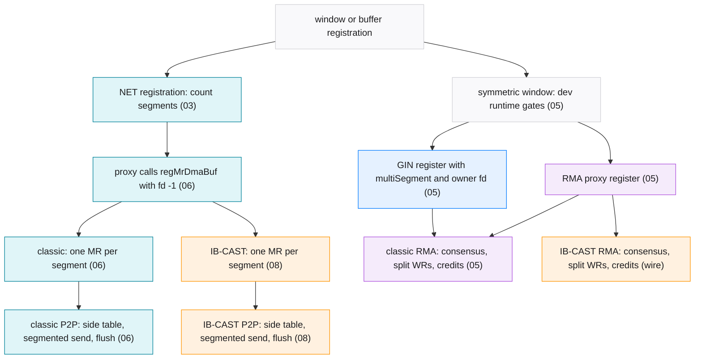

# Multi-segment registration: code map

This doc lists the code the multi-segment stack adds or changes, one table per source file, grouped by the layer that introduced it. Use it to find where a behavior lives, which pull request owns it, and which design section explains it. The design docs stay concise and link here instead of naming every function.

Line numbers are at the wire tip `6e4efc95f2b4` (`multi-segment-dmabuf-cast-gin`), the top of the open stack, and drift as the code changes; search by symbol when they do. "New" means the stack adds the symbol; "changed" means it edits a develop symbol, usually through a one-line `// RCCL:` hook. The layer is the first branch whose copy of the symbol differs from develop. Abbreviations are defined in the [overview terms](multi_segment_overview.md#terms).

## How the layers connect

The registration entry points in the runtime decide whether a buffer takes the multi-segment path. Each transport then registers one MR per segment and splits its operations at segment boundaries.

| Layer | Pull request | Branch (`users/atulkulk/mseg/...`) | Tables |
|---|---|---|---|
| 02, 03 | merged | `02-amd-host-vmm-compat`, `03-registration-range` | [Merged layers](#merged-layers-02-and-03) |
| 05 | [PR 10884](https://github.com/ROCm/rocm-systems/pull/10884) | `05-gin-rma-multisegment` | [Dev runtime and GIN](#layer-05-dev-runtime-and-gin-host), [classic RMA](#layer-05-classic-gin-and-rma) |
| 06 | [PR 10886](https://github.com/ROCm/rocm-systems/pull/10886) | `06-classic-netib-multisegment` | [Classic NET/IB P2P](#layer-06-classic-netib-p2p) |
| 07 | [PR 10890](https://github.com/ROCm/rocm-systems/pull/10890) | `07-hybrid-stress-ci` | [Tests](#tests-and-runner-configs) only |
| 08 | [PR 10889](https://github.com/ROCm/rocm-systems/pull/10889) | `08-cast-netib-multisegment` | [IB-CAST P2P](#layer-08-ib-cast-p2p) |
| wire | [PR 10888](https://github.com/ROCm/rocm-systems/pull/10888) | `multi-segment-dmabuf-cast-gin` | [IB-CAST GIN and RMA](#wire-ib-cast-gin-and-rma) |

## Merged layers 02 and 03

Design: [Current contract, registration](multi_segment_current.md#registration) and [switch-off behavior](multi_segment_current.md#switch-off-behavior).

| Symbol | File:line | Layer | Role |
|---|---|---|---|
| `rcclDevrProbeNonSymWindow` | `rccl_dev_runtime.cc:27` | 02 | Classifies a non-symmetric window and rejects host VMM across the LSA team. |
| `rcclDevrGinSegmentRegType` | `rccl_dev_runtime.cc:120` | 02 | Chooses the GIN pointer type and whether DMA-BUF registration is needed for a window with host segments. |
| `ncclSymIsHostSegment` | `dev_runtime.cc:50` | 02 | True for a host (or host NUMA) memory location; picks the host pointer type. |
| `NCCL_CUMEM_HOST_GATE` | `include/rocmwrap.h:84` | 02 | Compile-time gate for host VMM: needs both the host-location probe and a supported HIP version. |
| `ncclReg::rcclNet` | `include/register.h:63` | 03 | Cached NET segment count and all-peers flag, kept in an RCCL block at the end of the record. |
| `rcclNetRegSegmentCount` | `rccl_wrap.cc:2481` | 03 | Counts physical segments over the whole registration record and caches the result; with the switch off, a multi-segment record skips NET registration. |
| `rcclNetGraphRegSegmentCount` | `rccl_wrap.cc:2495` | 03 | Same count for the graph path's reused record. |
| `rcclNetRegCommit` | `rccl_wrap.cc:2504` | 03 | Sets `rcclNet.allPeers` only when every peer registered. |
| `netRegisterBuffer` | `transport/net.cc:2282` | 03 | Develop's local NET registration; calls the 03 count hook. |
| `ncclNetGraphRegisterBuffer` | `transport/net.cc:2396` | 03 | Develop's graph NET registration; calls the graph count hook. |

## Layer 05: dev runtime and GIN host

Design: [GIN/RMA window gates](multi_segment_gin_rma.md#window-gates) and [host owner DMA-BUF](multi_segment_gin_rma.md#host-owner-dma-buf).

### `dev_runtime.cc` and `dev_runtime_internal.h`

| Symbol | Line | Kind | Role |
|---|---|---|---|
| `symLsaMessage` | 389 | changed | Carries a flag that this rank holds the creating POSIX fd for a host segment. |
| `symMemoryImportAndMapSegmentsForRank` | 457 | changed | Notes that an imported host handle cannot export a DMA-BUF, so NIC registration needs the owner's fd. |
| `symMemoryGetHostOwnerFd` | 490 | new | Fetches the owner's POSIX fd for an imported host segment from the rank that exported it; no fallback when no rank exported. |
| `symMemoryPublishHostOwnerFds` | 509 | new | Publishes the owner fds by local VA so per-segment RMA registration can find them. |
| `symMemoryCloseHostOwnerFds` | 518 | new | Deregisters and closes the published owner fds. |
| `symMemoryMapLsaTeam` | 529 | changed | Collects owner fds while mapping the LSA team; rank-local failures are returned after the intra-node barrier so peers do not wait. |
| `symMemoryRegisterGin` | 901 | changed | Fails closed unless the GIN backend registers per segment, records imported host segments as host, and passes `multiSegment` and the owner fd to `ncclGinRegister`. |
| `symMemoryRegisterRma` | 984 | changed | Registers the RMA window only when `rcclDevrRmaRegistersMultiSegment` holds; inputs are communicator-wide, so every rank takes the same branch. |
| `symMemoryUnregister` | 998 | changed | Deregisters the RMA window only if it was registered. |
| `symMemoryObtain` | 1047 | changed | Records `minGlobalNumSegments` across ranks; RMA needs the same count everywhere. |
| `symMemoryDestroy` | 1287 | changed | Closes the owner fds published for the window. |
| `ncclDevrMemory` | `dev_runtime_internal.h:64` | changed | Adds `minGlobalNumSegments` (line 85) and `hostOwnerFds` (line 95). |

### `rccl_dev_runtime.cc` and `include/rccl_common.h`

| Symbol | Line | Kind | Role |
|---|---|---|---|
| `rcclDevrRmaRegistersMultiSegment` | 135 | new | True when the switch is on, the RMA backend is the classic or IB-CAST proxy, every rank has the same count, and the count is at most 16. |
| `rcclDevrGinRegistersMultiSegment` | 143 | new | Adds that every active GIN backend is the proxy; other GIN backends take the window as one MR. |
| `rcclHostSegmentFd` | 154 | new | Table entry mapping a host segment VA range to its owner's fd. |
| `rcclHostSegmentFdRegister` | 163 | new | Adds an entry. |
| `rcclHostSegmentFdDeregister` | 168 | new | Removes an entry. |
| `rcclHostSegmentFdLookup` | 179 | new | Finds the fd for a VA and dups it, so the publisher can close its own copy. |
| Gate declarations | `include/rccl_common.h:490–492` | new | Declare `rcclDevrRmaRegistersMultiSegment`, `rcclDevrGinRegistersMultiSegment` and the host-segment fd table helpers. |

### GIN host interface

| Symbol | File:line | Kind | Role |
|---|---|---|---|
| `ncclGinRegister` | `gin/gin_host.cc:561` | changed | Takes `multiSegment` and a caller-supplied DMA-BUF fd, which covers imported host segments the runtime cannot export. |
| `ncclGinProxyRegMrSymDmaBuf` | `gin/gin_host_proxy.cc:487` | new | Proxy GIN registration with a caller-supplied DMA-BUF fd, wired into the proxy vtable. |
| `ncclGinDevCommSetup`, `ncclGinRegister` | `include/gin/gin_host.h:90`, `:99` | changed | Declarations with the `multiSegment` and `dmabufFd` arguments; `gin_host_win_stub.h` and `os/windows_stubs.cc` carry matching stubs. |

## Layer 05: classic GIN and RMA

Design: [GIN/RMA](multi_segment_gin_rma.md): [handle](multi_segment_gin_rma.md#handle), [registration](multi_segment_gin_rma.md#registration), [consensus](multi_segment_gin_rma.md#consensus), [segmented WR builder](multi_segment_gin_rma.md#segmented-wr-builder), [credits](multi_segment_gin_rma.md#credits), [prefix post](multi_segment_gin_rma.md#prefix-post-and-completion).

### `transport/net_ib/rma_multiseg.h` (shared by classic and IB-CAST)

| Symbol | Line | Kind | Role |
|---|---|---|---|
| `NCCL_RMA_MAX_SEGMENTS` | 22 | new | 16, the per-buffer segment cap; asserted equal to `NCCL_IB_MAX_SEGMENTS`. |
| `NCCL_RMA_MAX_DATA_WRS` | 27 | new | 64 data WRs per operation; a chain past it fails closed. |
| `NCCL_RMA_MAX_SIGNAL_WRS` | 28 | new | 65: the data WRs plus the signal WR. |
| `NCCL_RMA_MAX_FLUSH_WRS` | 29 | new | 16: one flush read per segment for one operation (not the flush QP depth). |
| `NCCL_RMA_SEND_QP_WRS` | 31 | new | Classic sender QP depth, 2568; `connect.cc` asserts it equals `NCCL_IB_MAX_SEND_WRS`. On 05 alone it is 577. |
| `ncclRmaSegmentSliceBytes` | 38 | new | Bytes the next WR may move: the minimum of the remaining length and both segments' remaining bytes. |
| `ncclRmaDataWrBudgetFull` | 46 | new | True when a chain has used its data WR budget. |
| `ncclRmaCountPairedDataWrs` | 52 | new | Counts the WRs to move a size inside one local and one remote segment (only `UINT32_MAX` SGE splits). |
| `ncclRmaSegIndexOf` | 67 | new | Segment index for an offset in a `segOff` table. |
| `ncclRmaNextSlice` | 77 | new | Size of the next WR and the segments it lands in; shared by the builder and the counter. |
| `ncclRmaCountLayoutDataWrs` | 90 | new | Counts the WRs for explicit local and remote `segOff` tables; returns `maxWr + 1` if the chain does not fit. |
| `ncclRmaWrIsSignaled` | 107 | new | Only the last WR of a chain is signaled. |
| `ncclRmaWrCredits` and `NCCL_RMA_CREDIT_IDS` | 117–118 | new | Per-peer send-queue credit ring indexed by request id. |
| `ncclRmaWrCreditsAvailable`, `Release`, `InUse`, `Record` | 111–140 | new | Credit ring arithmetic. |
| `ncclRmaPrefixPostLostSignaledTail` | 148 | new | True when `ibv_post_send` accepted a prefix that did not include the signaled last WR. |
| `ncclRmaSignalOffsetValid` | 152 | new | Checks the signal offset fits the window. |
| `ncclRmaSegmentCountsMatch` | 158 | new | Every rank has the same count in `[1, 16]`; terminal sizes may differ. |
| `ncclRmaSegOffTableValid` | 163 | new | A peer `segOff` table starts at 0 and never decreases. |
| `ncclRmaPeerSegOff` | 172 | new | Per-rank `segOff` from the registration allgather, falling back to the local table. |
| `ncclRmaPostedWrCount` | 186 | new | Counts the WRs the HCA accepted when `ibv_post_send` fails at `bad_wr`. |
| `ncclRmaRegistrationHandleReady` | 198 | new | A failed handle allocation must not read `segOff` before the status allgather. |
| `ncclRmaPostedRequestStatus`, `ncclRmaCompletePostedRequest` | 204, 212 | new | Keep-or-free decision after a post: nothing posted frees the slot; a prefix keeps the request; a lost tail marks it failed. |
| `ncclRmaReleaseSeqId` | 223 | new | A freed request returns its sequence id only if no later request took one. |
| `rcclRmaIbProxy*` declarations | 234–241 | new | Declarations of the classic multi-segment op bodies for the hooks in `gin.cc`. |
| `rcclRmaMrSegmentCount` | 252 | new | Segment count of a tagged handle, or 0 for the single-MR layout. |

### `transport/net_ib/gin.cc`

| Symbol | Line | Kind | Role |
|---|---|---|---|
| `ncclRmaIbProxyCtx` | 446 | changed | Adds the per-peer send and flush credit tables. |
| `ncclRmaIbProxyCommitWrs` | 492 | changed | Waits on the CQ when segment-split chains fill the send queue before the proxy's request cap. |
| `ncclRmaIbProxyGetSendComm` | 509 | new | Send comm for a peer and context. |
| `rcclRmaWrCreditsGet`, `rcclRmaWrCreditsFree` | 514, 523 | new | Allocate on first use and free the credit tables. |
| `rcclRmaIbProxyPollSeq` | 534 | new | Advances the completed sequence from up to four CQEs, as `Test()` does. |
| `rcclRmaWrCreditsReserve` | 552 | new | Waits until a chain fits the peer's send or flush queue at the depth the QP was created with. |
| `ncclRmaIbProxyCreateContext`, `DestroyContext` | 600, 676 | changed | Record `nranks` for the credit tables and free them after the QPs. |
| `ncclRmaIbProxyConnect`, `ncclGinIbCloseColl` | 423, 271 | changed | Allocate and free the per-rank registration consensus records. |
| `rcclRmaIbProxySegMrHandle` | 775 | new | Multi-segment handle: tag, segment count, per-segment MRs, per-rank `segOff`, VAs and rkeys. |
| `rcclRmaIbProxyMrSegmentCount` | 796 | new | Test accessor for the handle's segment count. |
| `ncclRmaIbProxyRegistration` | 800 | new | Fixed-size consensus record: status, segment count and `segOff`. |
| `ncclRmaRkeyIndex`, `RemoteRkey`, `RankOff`, `SegOf`, `MrBytes`, `RangeOk` | 806–826 | new | Handle indexing helpers for rkeys, per-rank offsets and range checks. |
| `ncclRmaBuildSegmentedWrs` | 843 | new | Builds a chained WR list split at local and remote boundaries; flush mode emits one read per touched remote segment. |
| `ncclRmaPostWrs` | 909 | new | Posts a chain and reports how many WRs were accepted. |
| `ncclRmaStampSendWrs`, `ncclRmaIbProxyQueueWrs` | 926, 935 | new | Stamp ids and queue a chain behind earlier batched WRs. |
| `ncclRmaFinishPostedRequest` | 961 | new | Applies the keep-or-free rule after a post. |
| `rcclRmaIbProxyConnectFinish` | 975 | new | Connect-time setup so registration cannot fail locally before its first collective. |
| `rcclRmaIbProxyRegMrSymDmaBuf` | 991 | new | Per-segment DMA-BUF registration: consensus allgather, per-segment MRs (owner fd for imported host segments), then VA and rkey exchange. |
| `rcclRmaIbProxyDeregMrSym` | 1203 | new | Deregisters every segment MR and frees the handle. |
| `rcclRmaIbProxyIPut`, `IGet`, `IPutSignal` | 1223, 1276, 1330 | new | Split operations at segment boundaries; the signal rides the last WR, and a prefix post keeps the request. |
| `rcclRmaIbProxyIFlush` | 1428 | new | One read per touched segment, so a GPUDirect flush covers the whole window. |
| `rcclRmaIbProxyTestFailed` | 1484 | new | Completes a request whose signaled tail never posted as an error. |
| `rcclRmaIbProxyUseSingle` | 1491 | new | A one-segment handle uses develop's op body through the embedded single MR. |
| `ncclRmaIbProxyRegMrSymDmaBuf`, `DeregMrSym` | 702, 740 | changed | Hooks into the per-segment bodies when the switch is on. |
| `ncclRmaIbProxyIPut`, `IGet`, `IPutSignal`, `IFlush` | 1503–1783 | changed | Multi-segment handles take the split path; one segment keeps develop's body. |
| `ncclRmaIbProxyTest` | 1711 | changed | Rings a deferred doorbell and completes a failed request as an error. |
| `ncclGinIbCollComm` | `net_ib/gin.h:15` | changed | Holds the per-rank consensus records. |

### Classic queue pairs and registration touched by 05

| Symbol | File:line | Kind | Role |
|---|---|---|---|
| `ncclIbQp::maxSendWrs` | `net_ib/common.h:349` | changed | Send-queue depth requested at creation; credits stop there. |
| `ncclIbQpCreate` | `net_ib/connect.cc:488` | changed | Records `maxSendWrs`. |
| `ncclIbSenderQpsCreate` | `net_ib/connect.cc:756` | changed | Sizes the sender QP for multi-segment chains. |
| `ncclIbSenderQpsToRts`, `ncclIbReceiverQpsCreateToRts` | `net_ib/connect.cc:845`, `:1282` | changed | Reject a peer device index outside the device table, because it indexes the RMA rkey tables. |
| `ncclIbCreateFlushQp` | `net_ib/connect.cc:1434` | changed | On 05, adds the RMA flush WRs (528) while multi-segment RMA is on; from 06 the depth comes from `ncclIbFlushQpSendDepth`, and the switch off keeps 512. |
| `ncclIbConnectionMetadata` | `net_ib/connect.h:51` | changed | Notes that the capability rides in `devName`, so the struct stays the upstream size. |
| `ncclIbRegMrDmaBufInternal2`, `Internal` | `net_ib/reg.cc:13`, `:74` | changed | The failure path releases MRs created before a later device fails; a real fd stays one MR. |
| `ncclIbDeregMrInternal` | `net_ib/reg.cc:197` | changed | Deregisters one MR per segment. |

## Layer 06: classic NET/IB P2P

Design: [Classic NET/IB P2P](multi_segment_netib_wire.md): [data structures](multi_segment_netib_wire.md#data-structures), [registration](multi_segment_netib_wire.md#registration), [data path](multi_segment_netib_wire.md#data-path), [flush](multi_segment_netib_wire.md#flush), [queue sizing](multi_segment_netib_wire.md#queue-sizing), [compatibility](multi_segment_netib_wire.md#compatibility).

### `transport/net.cc` and `transport/rccl_ib_multiseg.h`

| Symbol | File:line | Kind | Role |
|---|---|---|---|
| `sendProxyRegBuffer`, `recvProxyRegBuffer` | `transport/net.cc:2438`, `:2530` | changed | Call the plugin's `regMrDmaBuf` with `fd = -1` for a multi-segment buffer, asking for one MR per segment. |
| `ncclIbRegMrDmaBufMultiSeg` | `transport/rccl_ib_multiseg.h:16` | new | Private declaration of the classic per-segment registration (not part of the plugin API). |

### `transport/net_ib/multiseg.h` (shared by classic and IB-CAST)

| Symbol | Line | Kind | Role |
|---|---|---|---|
| `NCCL_IB_MAX_SEGMENTS` | 27 | new | 16, the P2P segment cap. |
| `NCCL_IB_CAP_MULTISEG`, `NCCL_IB_CONNECT_CAPS_MAGIC` | 33–34 | new | Connect-time capability bit and the magic of the trailer that carries it. |
| `ncclIbConnectCapsTrailer`, `ncclIbSetConnectCaps`, `ncclIbGetConnectCaps` | 36–49 | new | Trailer in the reserved tail of `devName`, so the connect metadata keeps its legacy size. |
| `NCCL_IB_CTS_NREQS_SIDE_TABLE`, `ncclIbCtsNreqs`, `ncclIbCtsHasSideTable` | 59–65 | new | Bit in each CTS entry's `nreqs` that says the receiver also wrote the side table. |
| `ncclIbSideTableReady` | 70 | new | False means retry: no table, no peer capability or no side bit yet. |
| `ncclIbDeclineMultiSegRegistration` | 82 | new | A receive multi-segment registration is declined unless the peer can parse the side table. |
| `ncclIbSegmentIndexForRange` | 93 | new | Segment that fully contains a range, or -1. |
| `ncclIbSegmentsUniform` | 113 | new | True when every interior segment equals the largest one. |
| `ncclIbCtsRemoteLayoutValid` | 128 | new | Validates a peer side-table layout: count in range, device index in range, offsets increasing. |
| `ncclIbSegmentsOverlappingRange` | 144 | new | Indices of the segments a range touches. |
| `ncclIbSegSlice`, `ncclIbSplitTransferAtOffsets` | 181, 210 | new | Splits a transfer at local and remote segment offsets into WR slices. |
| `ncclIbSegmentForOffset`, `ncclIbSegmentForZeroLengthOffset` | 190, 199 | new | Segment for an offset; a 0-byte write at the end of the last segment uses that segment. |
| `ncclIbBytesRemainingInSegment` | 245 | new | Remaining bytes in a segment, guarding a host VMM base of 0. |
| `ncclIbFlushQpSendDepth` | 251 | new | Flush QP depth: steps × receives × segments with the capability, otherwise the legacy depth. |

### `transport/net_ib/common.h`

| Symbol | Line | Kind | Role |
|---|---|---|---|
| `NCCL_IB_CTS_FIFO_BYTES`, `NCCL_IB_SEG_LAYOUT_FIFO_BYTES` | 310–311 | new | Sizes of the sender CTS FIFO and the side table that follows it in one block. |
| `NCCL_IB_MAX_WRS_PER_SEND` | 316 | new | Worst-case WRs for one multi-receive send on one QP. |
| `NCCL_IB_MAX_SEND_WRS` | 319 | new | `2 * 256 + NCCL_STEPS * 257` = 2568, the classic sender depth. |
| `ncclIbRequest`, `ncclIbMrHandle` | 223, 405 | changed | Per-segment MRs and lkeys; `mrs[]` aliases segment 0. |
| `ncclIbSendComm`, `ncclIbRemCtsFifo`, `ncclIbRecvComm` | 562, 628, 672 | changed | Side table, its shadow and MR, and the receiver's local source of the side-table write. |

### `transport/net_ib/connect.cc`

| Symbol | Line | Kind | Role |
|---|---|---|---|
| `ncclIbSendCommAllocCts` | 21 | new | Allocates the CTS FIFO and, only when advertising, the side table in one page-aligned block. |
| `ncclIbConnectImpl`, `ncclIbAcceptImpl` | 914, 1536 | changed | Exchange the capability and create the CTS queue with room for the side-table WRs. |
| `ncclIbCloseSend`, `ncclIbCloseRecv` | 2021, 2061 | changed | Free the CTS block and deregister the side-table MR. |

### `transport/net_ib/reg.cc`

| Symbol | Line | Kind | Role |
|---|---|---|---|
| `rcclIbRegMrDmaBufFromRange` | 108 | new | `regMrDmaBuf` with `fd < 0`: the offset carries the export flags and the segment count. |
| `ncclIbRegMrDmaBuf` | 185 | changed | `fd < 0` registers one MR per segment; a real fd stays one MR. |
| `ncclIbRegMrDmaBufMultiSeg` | 220 | new | Exports and registers each segment and builds the multi-segment handle. |
| `rcclIbDeregMrMultiSeg`, `ncclIbDeregMr` | 274, 290 | new, changed | Deregister every segment MR, then free the handle. |

### `transport/net_ib/p2p.cc`

| Symbol | Line | Kind | Role |
|---|---|---|---|
| `ncclIbMrForRange` | 92 | new | MR whose segment contains a range. |
| `ncclIbCtsRemoteMultiSeg` | 100 | new | True when the side-table slot matches this CTS and has more than one segment. |
| `ncclIbQpChunkSize` | 111 | new | Per-QP chunk size, as `ncclIbMultiSend` computes it. |
| `ncclIbMultiSendSegmented` | 122 | new | Segmented send: splits each request at local and remote boundaries, uses each segment's keys, and signals only the tail. |
| `rcclIbMultiSendNeedsSegmented` | 400 | new | Chooses the segmented builder when any buffer spans segments. |
| `rcclIbIsendSideTableReady` | 409 | new | Waits for the side-table index to match this CTS before sending. |
| `rcclIbPostFifoSideWr` | 428 | new | Chains the unsignaled side-table write before the CTS WR. |
| `rcclIbIrecvCheckHandle` | 456 | new | Rejects a null handle or missing per-device MR before the CTS rkey load. |
| `rcclIbIrecvFillSideTable` | 470 | new | Writes the receiver's segment layout into the side table. |
| `rcclIbCtsFlagSideTable` | 497 | new | Sets the side-table bit in the CTS entry. |
| `rcclIbIflushNeedsMultiSeg`, `rcclIbIflushMultiSeg` | 502, 510 | new | Direct-GDR flush with one read per receive per touched segment. |
| `ncclIbMultiSend`, `ncclIbIsend` | 666, 886 | changed | Hook the segmented builder and ignore the side-table bit in the request count. |
| `ncclIbPostFifo`, `ncclIbIrecv`, `ncclIbIflush` | 1036, 1119, 1264 | changed | Hook the side-table write, the handle check and the multi-segment flush. |

## Layer 08: IB-CAST P2P

Design: [IB-CAST P2P](multi_segment_netib_cast.md): [differences from classic](multi_segment_netib_cast.md#differences-from-classic), [declines](multi_segment_netib_cast.md#when-multi-segment-is-declined), [connect and CTS](multi_segment_netib_cast.md#connect-and-the-32-byte-cts), [data path](multi_segment_netib_cast.md#data-path), [failure handling](multi_segment_netib_cast.md#failure-handling).

### `transport/net_ib_cast/common_cast.h` and `connect_cast.h`

| Symbol | File:line | Kind | Role |
|---|---|---|---|
| `WR_IMM_SIZE_BITS`, `WR_IMM_SEGMENTED_FLAG`, `WR_IMM_SPLIT_DATA_FLAG` | `net_ib_cast/common_cast.h:217–221` | changed, new | Size bits drop from 23 to 22 to make room for the segmented-send flag in the immediate. |
| `NCCL_NET_IB_REQ_FAILED` | `net_ib_cast/common_cast.h:295` | new | Request type for a send or flush whose signaled tail never posted. |
| `NCCL_IB_MAX_WRS_PER_SEND`, `NCCL_IB_MAX_SEND_WRS` | `net_ib_cast/common_cast.h:499–502` | new | 769 = `2 * 256 + 257`: the legacy budget plus one segmented group, since only one is admitted at a time. |
| `ncclIbRequest`, `ncclIbMrHandle`, `ncclIbSendComm`, `ncclIbRecvComm`, `ncclIbRemCtsFifo` | `net_ib_cast/common_cast.h:393–858` | changed | Per-segment MRs, side table and shadow, as in classic. |
| `IB_CAST_CTS_FIFO_BYTES`, `IB_CAST_SEG_LAYOUT_FIFO_BYTES` | `net_ib_cast/common_cast.h:793–794` | new | Sizes of the 32-byte CTS FIFO and the side table. |
| `IbCastRequestHasEvents` | `net_ib_cast/common_cast.h:933` | new | True while a request still has completions pending. |
| `ncclIbConnectionMetadata` | `net_ib_cast/connect_cast.h:108` | changed | With the switch off, keeps the legacy metadata, CTS MR and QP depths. |
| `IbCastCommAdvertisesMultiSeg` | `net_ib_cast/connect_cast.h:148` | new | RMA comms never post a CTS, so they skip the side table and the capability. |
| `IbCastQpCreateAttrInitSharing`, `IbCastFlushQpSendDepth` | `net_ib_cast/connect_cast.h:155`, `:164` | changed, new | Flush QP depth for a direct-GDR flush posted on every proxy step. |

### `transport/net_ib_cast/connect.cc`

| Symbol | Line | Kind | Role |
|---|---|---|---|
| `IbCastBuildDataQpCreateAttr`, `IbCastSenderQpsCreate` | 601, 1028 | changed | Sender data QP sized for one segmented group; the switch off keeps 512. |
| `IbCastSendCommAllocCts`, `IbCastQpSharingSenderRegisterPrimary` | 1381, 1341 | new, changed | CTS and side table in one page-aligned block, also under QP sharing. |
| `IbCastConnectImpl`, `IbCastAccept` | 1393, 2314 | changed | Exchange the capability; with the switch off or an RMA peer, ignore the peer's capability. |
| `IbCastReceiverQpsCreateToRts` | 1845 | changed | Room for the side-table WR chained before each CTS WR. |
| `IbCastInitCommDevBase`, `IbCastDestroyBase` | 183, 208 | changed | Protection-domain reference counting and CQ teardown hardening. |
| `IbCastCloseSend`, `IbCastCloseRecvCommDevResources`, `IbCastCloseRecv` | 2793, 2875, 2887 | changed | Free the CTS block, the side-table MR and the remote layout. |

### `transport/net_ib_cast/reg.cc` and `rccl_reg_multiseg_cast.cc`

| Symbol | File:line | Kind | Role |
|---|---|---|---|
| `IbCastRegMrDmaBufFromRange` | `net_ib_cast/reg.cc:110` | new | `regMrDmaBuf` with `fd < 0`, as in classic. |
| `IbCastRegMrDmaBuf`, `IbCastRegMrDmaBufInternal`, `IbCastDeregMr` | `net_ib_cast/reg.cc:187`, `:73`, `:220` | changed | Hooks for per-segment registration and deregistration; `Internal` keeps develop's allocation and failure path. |
| `IbCastRegMrDmaBufMultiSeg` | `net_ib_cast/rccl_reg_multiseg_cast.cc:18` | new | Exports and registers each segment. |
| `rcclIbCastDeregMrMultiSeg` | `net_ib_cast/rccl_reg_multiseg_cast.cc:84` | new | Frees every segment MR; `mrs[]` aliases segment 0. |

### `transport/net_ib_cast/p2p.cc`

| Symbol | Line | Kind | Role |
|---|---|---|---|
| `IbCastCtsRemoteMultiSeg` | 109 | new | True when the peer's side-table slot has more than one segment. |
| `IbCastMultiSendSegmented` | 116 | new | Segmented send for IB-CAST, publishing the full logical size before the immediate. |
| `rcclIbCastMultiSendNeedsSegmented`, `rcclIbCastSendIsSegmented` | 414, 423 | new | Choose and identify the segmented builder. |
| `IbCastHasOtherSegmentedSend` | 428 | new | Admission gate: one segmented group in flight at a time. |
| `IbCastWaitSideTable`, `rcclIbCastIsendWaitSideTable` | 442, 470 | new | Bounded wait for the side table, so a peer that never writes it fails instead of hanging. |
| `rcclIbCastPostFifoSideWr` | 480 | new | Chains the side-table write before the CTS WR. |
| `rcclIbCastIrecvCheckHandle`, `rcclIbCastIrecvFillSideTable` | 501, 539 | new | Validate every handle before taking a request; fill the side table. |
| `rcclIbCastImmSegmented` | 565 | new | True for a segmented send's immediate (by-index completions use the published size). |
| `rcclIbCastIflushNeedsMultiSeg`, `rcclIbCastIflushMultiSeg` | 569, 577 | new | Multi-segment direct-GDR flush; only the tail read is signaled. |
| `IbCastMultiSend`, `IbCastIsend`, `IbCastPostFifo`, `IbCastIrecv`, `IbCastIflush` | 736–1474 | changed | Hooks for the segmented send, side-table wait and write, handle check and flush. |
| `IbCastRequestComplete`, `IbCastCompletionEventByOrder`, `IbCastCompletionEventProcess`, `IbCastTest` | 1634–1992 | changed | Handle `NCCL_NET_IB_REQ_FAILED` and segmented immediates in completion processing. |

## Wire: IB-CAST GIN and RMA

Design: [IB-CAST GIN/RMA](multi_segment_netib_cast_gin.md): [handle and indexing](multi_segment_netib_cast_gin.md#handle-and-indexing), [registration](multi_segment_netib_cast_gin.md#registration), [data path](multi_segment_netib_cast_gin.md#data-path), [credits](multi_segment_netib_cast_gin.md#credits), [error completions](multi_segment_netib_cast_gin.md#error-completions).

### Shared additions in `transport/net_ib/rma_multiseg.h`

| Symbol | Line | Kind | Role |
|---|---|---|---|
| `NCCL_RMA_MAX_INFLIGHT_REQUESTS` | 34 | new | 256, equal to `NET_IB_MAX_REQUESTS`; `common_cast.h` asserts it. |
| `NCCL_RMA_MAX_SEND_QP_WRS`, `NCCL_RMA_MAX_FLUSH_QP_WRS` | 35, 36 | new | IB-CAST RMA depths: 575 (`2*256 + 65 - 2`) and 271. |
| `ncclRmaOffsetRangeOk` | 177 | new | Range check against a `segOff` table, shared by both plugins. |
| `ncclRmaDevSlotOf`, `ncclRmaRkeyIbDevN` | 267, 278 | new | Translate a QP's physical device to the registration's device slot when looking up rkeys. |

### `transport/net_ib_cast/gin.cc`, `gin_cast.h` and resiliency

| Symbol | File:line | Kind | Role |
|---|---|---|---|
| `IbCastRmaIbProxyCtx`, `CastIbGinCollComm` | `net_ib_cast/gin.cc:395`, `net_ib_cast/gin_cast.h:15` | changed | Credit state and per-rank consensus records. |
| `IbCastRmaIbProxyConnect`, `IbCastGinIbCloseColl` | `net_ib_cast/gin.cc:384`, `:239` | changed | Finish connect setup and free the consensus records. |
| `IbCastRmaProxySegMrHandle` | `net_ib_cast/gin.cc:408` | new | IB-CAST multi-segment handle; carries `rcclRmaSegMrTag` so `rcclRmaMrSegmentCount` reads it. |
| `IBCAST_RMA_REGISTRATION_MAGIC`, `VERSION`, `IbCastRmaProxyRegistration` | `net_ib_cast/gin.cc:429–431` | new | Fixed-size consensus record with magic and version, so mismatched layouts fail collectively. |
| `IbCastRmaRkeyIndex`, `RemoteRkey`, `DevSlot`, `RankOff`, `SegOf`, `MrBytes`, `RangeOk` | `net_ib_cast/gin.cc:439–464` | new | Handle indexing helpers. |
| `IbCastRmaBuildSegmentedWrs` | `net_ib_cast/gin.cc:478` | new | Segmented WR builder for IB-CAST (paired and flush modes). |
| `rcclIbCastRmaIbProxyConnectFinish` | `net_ib_cast/gin.cc:555` | new | Connect-time setup; the switch off keeps the single-MR path. |
| `rcclIbCastRmaIbProxyRegMrSymDmaBuf`, `rcclIbCastRmaIbProxyDeregMrSym` | `net_ib_cast/gin.cc:570`, `:778` | new | Per-segment registration with consensus, and deregistration. |
| `IbCastRmaIbProxyGetSendComm`, `GetRecvComm` | `net_ib_cast/gin.cc:797`, `:806` | new | Comm lookup for a peer and context. |
| `IbCastRmaRefundWrs`, `AccountCompletion`, `PollCq`, `CreditTimeoutNs`, `ReserveWrs`, `ReleaseWrs` | `net_ib_cast/gin.cc:816–928` | new | Completion-driven credits; the reserve timeout outlasts the HCA's own retries. |
| `IbCastRmaPostWrs`, `CompletePostedRequest`, `ReservePostComplete` | `net_ib_cast/gin.cc:935–972` | new | Post a chain and apply the keep-or-free rule; a rejected tail marks the request failed. |
| `rcclIbCastRmaIbProxyIPut`, `IGet`, `IPutSignal`, `IFlush`, `Test` | `net_ib_cast/gin.cc:985–1207` | new | Split operation bodies and their completion test. |
| `IbCastRmaIbProxyRegMrSymDmaBuf`, `DeregMrSym`, `IPut`, `IGet`, `IPutSignal`, `Test`, `IFlush` | `net_ib_cast/gin.cc:1329–1635` | changed | Hooks: multi-segment handles take the split path; one segment keeps develop's body; a lost tail completes as an error. |
| `IbCastRmaAbandonDeviceRequests` | `net_ib_cast/p2p_resiliency_recovery_ainic.cc:24` | new | Port recovery drops RMA requests on the failed device and returns their credits. |
| `IbCastPortRecoveryQpsRestoreAinic` | `net_ib_cast/p2p_resiliency_recovery_ainic.cc:41` | changed | Abandons those requests and recreates the flush QP at `IbCastFlushQpSendDepth`. |

## Tests and runner configs

Design: [Testing](multi_segment_testing.md).

| File | Suites | Covers |
|---|---|---|
| `test/RegistrationMPITests.cpp` | `UBR_MultiSegment` (15 tests) | End-to-end registration: NET segment count, GIN and LSA windows, hybrid host and device windows, switch off. |
| `test/transport/RmaMPI/RmaMultiSegmentMPITests.cpp` | `RmaMultiSegmentMPITest`, `RmaMultiSegmentPostMPITest` | RMA put, get, signal and flush across segments; WR batching, send-queue capacity, rejected ops, registration churn. |
| `test/transport/NetIbMPI/NetIbMultiSegmentMPITests.cpp` | `NetIbMultiSegmentMPITest` | Classic and IB-CAST P2P across segments: side table, flush and switch off. |
| `test/NetIbMultiSegmentUnitTests.cpp` | `NetIbMultiSeg`, `NetIbSplit`, `NetIbCtsLayout`, `NetIbSideTable` | Boundary math, splitting and CTS layout checks in `multiseg.h`. |
| `test/RmaSegmentMathTests.cpp` | `RmaSegmentMathTest` | WR counting, credits and keep-or-free rules in `rma_multiseg.h`. |
| `test/transport/NetIbCast/NetIbCastMultiplaneTests.cpp` | `NetIbCastSegmentedSendPrefix`, `NetIbCastSideTable`, `NetIbCastFlushPrefix` | IB-CAST prefix posts, side table and flush. |
| `test/transport/NetIb/NetIbSegmentedSendPrefixTests.cpp` | `NetIbSegmentedSendPrefix` | Classic segmented-send prefix posts. |
| `test/host/dev-runtime-test.cc` | `SymMemoryMapLsaTeamTest`, `SymMemoryRegisterGinElasticTest`, `SymMemoryRegisterRmaTest` | Host owner fd, GIN and RMA window gates with host fakes. |
| `test/ce/CeMPITests.cpp` | `CeMPI_AllGather`, `CeMPI_AlltoAll` (`MultiNodeHierarchical*`) | Hierarchical CE over two-segment windows. |
| `test/common/HybridVmmHelpers.hpp`, `MultiSegmentVmmHelpers.hpp` | helpers | Allocate hybrid host and device VMM windows and free them collectively. |
| `tools/scripts/test_runner/configs/*.json` | runner jobs | The multi-segment suites per platform; `check_test_filters.py` fails a filter that matches no test. |
