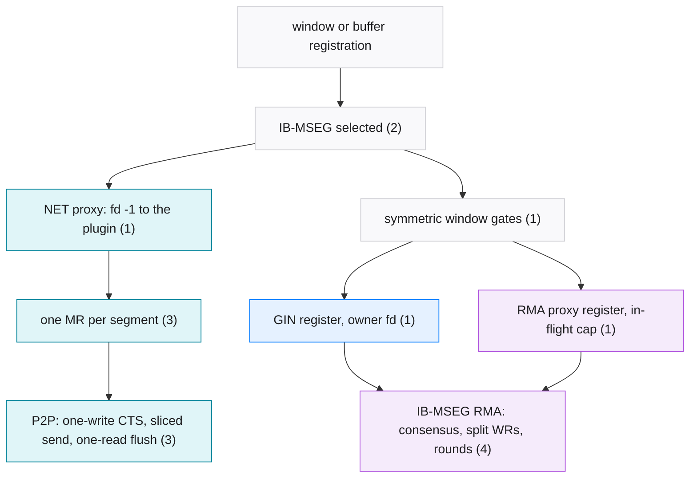

# Multi-segment registration: code map

This doc lists the code the IB-MSEG fork stack adds or changes, one table per area, with the fork that owns each symbol. Use it to find where a behavior lives and which fork introduces it. The design docs stay concise and link here instead of naming every function. The forks and their scope are described in [the fork plugin](multi_segment_fork_plugin.md#forks), and the code paths in execution order are in the code walkthrough book.

## How to read

Each row names a file and a symbol as of fork 4; search the file for the symbol to find its definition. Paths are relative to `projects/rccl/src/` unless they start with `test/` or `tools/`.

The Fork column is the fork (1 to 4) whose commit introduces the symbol or, for a develop symbol, adds the multi-segment hook to it; "1, 4" means both forks change it. Kind is "new" when the stack adds the symbol and "changed" when it edits a develop symbol, usually through a short `// RCCL:` hook. Inside `transport/net_ib_multiseg/`, "changed" means changed against fork 2's copy of `net_ib`; symbols there carry the `IbMseg` prefix from `rename_map.txt`. `transport/net_ib/` and `transport/net_ib_cast/` are not touched by the stack. Develop already has the NET segment count from the merged registration-range work (`rcclNetRegSegmentCount` in `rccl_wrap.cc`) and the switch `NCCL_MULTI_SEGMENT_REGISTER` (in `transport/generic.cc`); they are not listed below. Abbreviations are defined in the [overview terms](multi_segment_overview.md#terms).

## How the forks connect

The registration entry points in the runtime decide whether a buffer takes the multi-segment path. Core code (fork 1) gates every path on a comm-level flag that is set only when the selected plugin registers one MR per segment; fork 2 makes IB-MSEG that plugin; forks 3 and 4 add the per-segment registration and data paths inside it.

| Fork | Tables |
|---|---|
| 1 | [Core: device runtime](#core-device-runtime-and-symmetric-windows), [GIN and RMA proxies](#core-gin-and-rma-proxies), [shared limits](#core-shared-limits), most of [NET proxy](#core-comm-flags-and-the-net-proxy) |
| 2 | [Core: plugin selection](#core-plugin-selection), [the copy](#ib-mseg-the-copy) |
| 3 | [Fork-local files](#ib-mseg-fork-local-files) (P2P and registration), [hooks](#ib-mseg-hooks-in-the-copied-files) |
| 4 | [Fork-local files](#ib-mseg-fork-local-files) (RMA), [hooks](#ib-mseg-hooks-in-the-copied-files) in `gin.cc` and `connect.cc`, `include/alloc.h` |

Forks 5 and 6 (IB-CAST base and IB-CAST multi-segment) are planned and have no code in this map.

## Core: device runtime and symmetric windows

Design: [GIN and RMA](multi_segment_gin_rma.md).

| File | Symbol | Fork | Kind | Role |
|---|---|---|---|---|
| `dev_runtime.cc` | `symLsaMessage` | 1 | changed | adds `hostExportable`: 1 when this rank holds the creating POSIX fd for the segment |
| `dev_runtime.cc` | `symMemoryEnsureHostOwnerFds` | 1 | new | lazily makes the per-segment owner-fd table, every entry -1 |
| `dev_runtime.cc` | `symMemoryGetHostOwnerFd` | 1 | new | fetches the one exporter's fd, since an imported host handle cannot export a DMA-BUF |
| `dev_runtime.cc` | `symMemoryPublishHostOwnerFds` | 1 | new | publishes the owner fds by VA so window registration can look them up |
| `dev_runtime.cc` | `symMemoryCloseHostOwnerFds` | 1 | new | unpublishes each owner fd before closing it |
| `dev_runtime.cc` | `symMemoryMapLsa` | 1 | changed | exports the local host fd; borrows a peer's fd only when exactly one rank can export; the ROCM-29810 TODO is removed |
| `dev_runtime.cc` | `symMemoryRegisterGin` | 1 | changed | registers a multi-segment device window with GIN only when `rcclDevrGinRegistersMultiSegment` holds; otherwise fails a `NCCL_WIN_GIN_ONLY` window with `ncclInvalidUsage` and leaves any other unregistered with GIN; marks owner-fd segments as host |
| `dev_runtime.cc` | `symMemoryRegisterRma` | 1 | changed | registers a multi-segment window through `rcclRmaProxyRegisterMultiSeg` when `rcclDevrRmaRegistersMultiSegment`; otherwise every rank skips together |
| `dev_runtime.cc` | `symMemoryUnregister` | 1 | changed | deregisters the RMA window whatever its segment count |
| `dev_runtime.cc` | `symMemoryObtain` | 1 | changed | gathers `minGlobalNumSegments`; all ranks agree on the owner-fd status; publishes owner fds |
| `dev_runtime.cc` | `symMemoryDestroy` | 1 | changed | closes the owner fds published for the window |
| `dev_runtime_internal.h` | `ncclDevrMemory` | 1 | changed | adds `minGlobalNumSegments`, `hostOwnerFds` and `hostOwnerFdStatus` |
| `rccl_dev_runtime.cc` | `rcclMultiSegOn` | 1 | new | comm flag: the plugin registers per segment, the switch is on and DMA-BUF is on |
| `rccl_dev_runtime.cc` | `rcclDevrRmaRegistersMultiSegment` | 1 | new | RMA flag set, same segment count on every rank, segment table fits |
| `rccl_dev_runtime.cc` | `rcclRmaProxyMaxInflightRequests` | 1 | new | per-peer in-flight cap for the RMA and GIN proxies |
| `rccl_dev_runtime.cc` | `rcclDevrGinRegistersMultiSegment` | 1 | new | same as RMA, and every active GIN backend is the proxy |
| `rccl_dev_runtime.cc` | `rcclHostSegmentFd` | 1 | new | VA-keyed owner-fd table entry |
| `rccl_dev_runtime.cc` | `rcclHostSegmentFdRegister`, `rcclHostSegmentFdDeregister`, `rcclHostSegmentFdLookup` | 1 | new | publish, unpublish and find an owner fd by VA range |
| `include/rccl_common.h` | declarations of the `rccl_dev_runtime.cc` functions above | 1 | new | |
| `include/alloc.h` | `rcclCuMemIsSysmemSegment` | 4 | new | whether the cuMem allocation at a pointer is host memory; used by `seg_export_mseg.h` |
| `include/alloc.h` | `ncclCuMemGetAddressRange` | 4 | changed | uses `rcclCuMemIsSysmemSegment` for its host-segment check |

## Core: GIN and RMA proxies

Design: [GIN and RMA](multi_segment_gin_rma.md).

| File | Symbol | Fork | Kind | Role |
|---|---|---|---|---|
| `gin/gin_host.cc` | `ginDevCommSetupWithBackend` | 4 | changed | passes `comm->rcclMultiSegRma` to the GIN proxy before it creates a context |
| `gin/gin_host.cc` | `ncclGinRegister` | 1 | changed | registers a host segment with its owner fd through `regMrSymDmaBuf` |
| `gin/gin_host.cc` | `rcclGinRegisterMultiSeg` | 1 | new | registers a device-only multi-segment window; with `comm->rcclMultiSegRma` a GIN proxy backend gets fd -1 |
| `gin/gin_host_proxy.cc` | `rmaMultiSeg` | 1 | new | the comm's RMA flag, set by `rcclGinProxySetMultiSeg` |
| `gin/gin_host_proxy.cc` | `ncclGinProxyRegMrSymDmaBuf` | 1 | new | registers with a caller-supplied DMA-BUF fd, or fd -1 for a per-segment backend; without DMA-BUF, fd -1 goes to the backend's `regMrSym` and a real fd to `ncclGinProxyRegMrSym` |
| `gin/gin_host_proxy.cc` | `ncclGinProxyCreateContext` | 1 | changed | caps `NCCL_GIN_PROXY_QUEUE_SIZE` for multi-segment chains |
| `gin/gin_host_proxy.cc` | `ncclGinProxy` | 1 | changed | fills the `regMrSymDmaBuf` slot |
| `gin/gin_host_proxy.cc` | `rcclGinProxySetMultiSeg` | 1 | new | setter, declared in `include/gin/gin_host_proxy.h` |
| `rma/rma_proxy.cc` | `ncclRmaProxyCtxAlloc` | 1 | changed | caps requests in flight per peer for multi-segment chains |
| `rma/rma_proxy.cc` | `rcclRmaProxyRegisterMultiSeg` | 1 | new | registers a multi-segment window with fd -1 (or `regMrSym` without DMA-BUF), exporting no whole-range fd |
| `rma/rma_proxy_launch.cc` | `ncclRmaProxyPutBuildOp` | 1 | changed | fails a put on a window whose RMA registration was skipped |
| `ce_coll.cc` | `ncclHierCeAvailable` | 1 | changed | skips hierarchical CE when a window has no RMA registration |

## Core: comm flags and the NET proxy

Design: [NET/IB P2P](multi_segment_netib_wire.md).

| File | Symbol | Fork | Kind | Role |
|---|---|---|---|---|
| `include/comm.h` | `ncclComm::rcclMultiSegNet`, `ncclComm::rcclMultiSegRma` | 1 | new | the comm's net and RMA plugin register one MR per segment |
| `include/proxy.h` | `ncclProxyState::rcclMultiSegNet` | 1 | new | proxy copy of the net flag |
| `proxy.cc` | `ncclProxyCreate` | 1 | changed | copies the net flag into the proxy state |
| `init.cc` | `commAlloc` | 3, 4 | changed | sets `rcclMultiSegNet` for IB-MSEG (fork 3) and `rcclMultiSegRma` for its RMA backend, inherited by child comms (fork 4) |
| `init.cc` | `rcclSetIbGdrFlushFlag`, `fillInfo` | 2 | changed | GDR flush flag through `rcclIbGdrFlushOpsFor`, so it also works on IB-MSEG |
| `transport/net.cc` | `rcclNetRegMultiSeg` | 1 | new | passes fd -1 only to a plugin that walks a multi-segment buffer itself; false means stage |
| `transport/net.cc` | `sendProxyRegBuffer`, `recvProxyRegBuffer` | 1 | changed | multi-segment buffers go to `rcclNetRegMultiSeg` or stage; skip whole-range HSA DMA-BUF |
| `transport/net.cc` | `recvProxySetup`, `recvProxyConnect`, `recvProxyProgress` | 2 | changed | GDR flush flag calls through `rcclIbGdrFlushOpsFor` |
| `transport/net.cc` | `sendProxyConnect` | 2 | changed | applies `IbMsegNetP2pPolicy` on IB-MSEG |

## Core: plugin selection

Design: [the fork plugin, selection](multi_segment_fork_plugin.md#selection).

| File | Symbol | Fork | Kind | Role |
|---|---|---|---|---|
| `include/net.h` | `ncclNetIbMseg`, `IbMsegNetP2pPolicy` | 2 | new | the IB-MSEG net vtable and its P2P policy |
| `include/net.h` | `IbMsegGdrFlushFlagLocalSupport` and the other `IbMseg*GdrFlushFlag*` entry points | 2 | new | the copy's GDR flush flag functions |
| `include/net.h` | `rcclIbGdrFlushOps`, `rcclIbGdrFlushOpsFor` | 2 | new | picks `net_ib`'s or IB-MSEG's flush-flag functions by net vtable |
| `include/rma.h` | `IbMsegRmaIbProxy` | 2 | new | IB-MSEG's RMA backend |
| `plugin/net.cc` | `initPluginLibsOnceFunc` | 2 | changed | IB-MSEG takes the IB slot with `NCCL_MULTI_SEGMENT_REGISTER=1` or `NCCL_NET=IB-MSEG` |
| `plugin/net.cc` | `ncclNetInit` | 2 | changed | with the switch on, IB-MSEG serves a request for `IB` |
| `plugin/rma.cc` | `initPluginLibsOnceFunc` | 2 | changed | selects `IbMsegRmaIbProxy` under the same condition |
| `ras/diagnostics_checks_common.cc` | `rasDiagnosticsNetPluginSupported` | 2 | changed | lists `IB-MSEG` |
| `CMakeLists.txt` | `add_subdirectory(transport/net_ib_multiseg)`, `NET_IB_MULTISEG_SOURCES` | 2 | new | builds the copy |
| `CMakeLists.txt` | `transport/rccl_mseg.h`, `transport/rccl_mseg_rma.h` | 1 | new | shared limit headers |

## Core: shared limits

| File | Symbol | Fork | Kind | Role |
|---|---|---|---|---|
| `transport/rccl_mseg.h` | `RCCL_IB_REG_SEG_DEFAULT` | 1 | new | most segments one registration takes |
| `transport/rccl_mseg.h` | `rcclIbSegCountSupported` | 1 | new | the one segment-count check |
| `transport/rccl_mseg_rma.h` | `RCCL_RMA_SEG_TABLE_MAX_ENTRIES`, `rcclRmaSegTableFits` | 1 | new | every rank holds every rank's segment table, so ranks times segments is bounded |
| `transport/rccl_mseg_rma.h` | `RCCL_RMA_MAX_INFLIGHT_REQUESTS`, `rcclRmaInflightRequestsCap` | 1 | new | the in-flight cap (32 requests per peer) with multi-segment on |

## IB-MSEG: the copy

Design: [the copy and the rename map](multi_segment_fork_plugin.md#the-copy-and-the-rename-map).

| File | Symbol | Fork | Kind | Role |
|---|---|---|---|---|
| `transport/net_ib_multiseg/` (22 files) and `tools/scripts/net_ib_multiseg/rename_map.txt` | the renamed copy of `net_ib` | 2 | new | byte-identical to `net_ib` apart from the names in `rename_map.txt`; the copied symbols are not listed here |

The copy was produced by a rename tool kept outside the stack. `rename_map.txt` stays in fork 2 because the compile-twice host tests read it.

## IB-MSEG: fork-local files

These files exist only in the fork. Design: [NET/IB P2P](multi_segment_netib_wire.md) for fork 3 and [GIN and RMA](multi_segment_gin_rma.md) for fork 4.

| File | Fork | Holds |
|---|---|---|
| `seg_mseg.h` | 3 | segment table, slice and cursor |
| `seg_reg_mseg.h` | 3 | register-all-or-unwind helper and the walk block |
| `seg_wr_mseg.h` | 3, 4 | fills one slice's WR and SGE (fork 3); chains per-segment WRs (fork 4) |
| `seg_p2p_mseg.h`, `seg_p2p.cc` | 3 | CTS layout prefix, layout blob, per-segment MR set, send segment tables, layout cache |
| `p2p_multiseg_mseg.h`, `p2p_multiseg.cc` | 3 | the P2P send and receive builders |
| `ib_multiseg_mseg.h` | 3, 4 | connect-time decision (fork 3) and the RMA entry points (fork 4) |
| `seg_export_mseg.h` | 4 | per-segment DMA-BUF export walk |
| `seg_rma_mseg.h` | 4 | RMA WR limits, send-queue depth, signal and posted-prefix rules |
| `seg_rma_round_mseg.h` | 4 | RMA rounds and per-peer queues |
| `seg_sym_mseg.h` | 4 | per-rank segment consensus and key exchange |

### `seg_mseg.h`, `seg_reg_mseg.h`, `seg_wr_mseg.h` (forks 3 and 4)

| File | Symbol | Role |
|---|---|---|
| `seg_mseg.h` | `RCCL_IB_SGE_MAX_BYTES` | largest SGE length |
| `seg_mseg.h` | `rcclIbSegTable`, `rcclIbSegSlice`, `rcclIbSegCursor` | segment table, one slice and the walk cursor |
| `seg_mseg.h` | `rcclIbSegIndexOf`, `rcclIbSegCursorInit`, `rcclIbSegCursorNext` | find a segment and step the cursor over local and remote tables |
| `seg_reg_mseg.h` | `rcclIbSegRegOps`, `rcclIbSegRegister`, `rcclIbSegDeregister` | register every segment or unwind the ones done |
| `seg_reg_mseg.h` | `rcclIbSegWalkBytes`, `rcclIbSegWalk`, `rcclIbSegWalkBind` | one allocation for the per-segment address, length and offset arrays |
| `seg_reg_mseg.h` | `IbMsegRegMrDmaBufMultiSeg` (declaration) | defined in `reg.cc` |
| `seg_wr_mseg.h` | `rcclIbSegFillWr` | fill the WR and SGE for one slice of a local and a remote table |
| `seg_wr_mseg.h` | `rcclIbSegWrIn`, `rcclIbSegAppendWrs` | fork 4: split one transfer into a chain of per-segment WRs through `rcclIbSegFillWr` |

### `seg_p2p_mseg.h` and `seg_p2p.cc` (fork 3)

| File | Symbol | Role |
|---|---|---|
| `seg_p2p_mseg.h` | `RCCL_IB_MSEG_MAX_DEVS`, `RCCL_IB_MSEG_MAX_RECVS`, `RCCL_IB_CTS_INLINE_SEGS` | limits; up to 4 segments fit inline in the CTS slot |
| `seg_p2p_mseg.h` | `NCCL_IB_CTS_NREQS_LAYOUT`, `IbMsegCtsNreqs`, `IbMsegCtsHasLayout` | the layout bit in the CTS `nreqs` field |
| `seg_p2p_mseg.h` | `IbMsegSegmentIndexForRange`, `IbMsegCtsRemoteLayoutValid` | find the segment for a range; validate a peer-written layout |
| `seg_p2p_mseg.h` | `rcclIbLayoutBlobBytes`, `rcclIbLayoutBlobOff`, `rcclIbLayoutBlobRkeys`, `rcclIbLayoutBlobValid` | the out-of-line layout blob for more than 4 segments |
| `seg_p2p_mseg.h` | `IbMsegSegmentForZeroLengthOffset`, `IbMsegBytesRemainingInSegment` | edge cases at segment ends |
| `seg_p2p_mseg.h` | `rcclIbSegLayoutRef`, `IbMsegSegLayout` | the 192-byte layout slot the receiver writes with the CTS |
| `seg_p2p_mseg.h` | `rcclIbLayoutRkey`, `rcclIbLayoutSetRkey`, `rcclIbLayoutStamp`, `rcclIbLayoutArrived` | read, write and stamp a layout slot; detect a torn write |
| `seg_p2p_mseg.h` | `rcclIbSegMr`, `rcclIbSegMrAt` | per-segment, per-device MR set |
| `seg_p2p_mseg.h` | `rcclIbSendSegTable` | the sender's per-request table of one side: an embedded `rcclIbSegTable seg`, the request offset and the rkeys |
| `seg_p2p_mseg.h` | `rcclIbLayoutState`, `rcclIbLayoutCacheEntry`, `rcclIbLayoutCache`, `rcclIbLayoutReadQp` | cache of receiver layouts the sender read by RDMA |
| `seg_p2p.cc` | `rcclIbSegMrInit`, `rcclIbSegMrFreeArrays`, `rcclIbSegMrPublishLayout`, `rcclIbSegMrFreeLayout` | build and free the MR set and its published layout |
| `seg_p2p.cc` | `rcclIbSegMrForRange`, `rcclIbSegLayoutFill` | MR for a range; fill a layout slot for a receive |
| `seg_p2p.cc` | `rcclIbSegTableSingle`, `rcclIbSegTableLocal`, `rcclIbSegTableInline` | send segment table from one MR, the local MR set or an inline layout |
| `seg_p2p.cc` | `rcclIbLayoutCacheFind`, `rcclIbLayoutRead` | look up or read a referenced layout |
| `seg_p2p.cc` | `rcclIbLayoutsReady`, `rcclIbLayoutReadDone`, `rcclIbLayoutCacheFree`, `rcclIbSegTableReferenced` | wait for, complete and free layout reads; table from a referenced layout |

### `p2p_multiseg_mseg.h` and `p2p_multiseg.cc` (fork 3)

| File | Symbol | Role |
|---|---|---|
| `p2p_multiseg_mseg.h` | `rcclIbSendCtsRow`, `rcclIbRecvCtsRow`, `rcclIbCtsLayout` | CTS row and layout slot addressing |
| `p2p_multiseg.cc` | `IbMsegMrForRange` | the MR covering a range on a device |
| `p2p_multiseg.cc` | `rcclIbCtsRemoteLayout`, `IbMsegCtsRemoteMultiSeg`, `rcclIbBuildRemoteSegmentLayout` | read the receiver's layout from the CTS |
| `p2p_multiseg.cc` | `rcclIbSegSendNextWr`, `rcclIbAppendSegmentedRequestWrs` | one cursor step and `rcclIbSegFillWr` per request per post |
| `p2p_multiseg.cc` | `rcclIbSegSendSizesWr`, `rcclIbAppendSegmentedTailWr` | sizes write and the signaled tail |
| `p2p_multiseg.cc` | `rcclIbFillSendWrs`, `rcclIbSendSliceDone`, `rcclIbMultiSendNeedsSegmented` | sliced send: fill, completion and the decision to segment; the fill counts each post in `segStats` |
| `p2p_multiseg.cc` | `rcclIbSendCommSegStats` | test hook: reads a send comm's segmented-post counters |
| `p2p_multiseg.cc` | `rcclIbPrepareCtsWrite` | the one-write CTS with the layout prefix |
| `p2p_multiseg.cc` | `rcclIbIrecvCheckHandle`, `rcclIbIrecvFillLayout` | receiver: check the MR handle, fill the layout slot |
| `p2p_multiseg.cc` | `rcclIbLayoutReadStamp`, `rcclIbLayoutReadArg`, `rcclIbLayoutReadQp` | QP and WR for a layout read |
| `p2p_multiseg.cc` | `rcclIbSendLayoutsReady`, `rcclIbSendLayoutReadDone`, `rcclIbSendLayoutCacheFree` | send-side wrappers over the layout cache |
| `p2p_multiseg.cc` | `rcclIbCtsFlagLayout`, `rcclIbCtsLayoutsArrived` | set the layout bit; wait for every layout of a row |

### `ib_multiseg_mseg.h` (forks 3 and 4)

| Symbol | Fork | Role |
|---|---|---|
| `rcclRmaReleaseSeqId` | 4 | retire an RMA sequence id |
| `rcclRmaIbProxyConnectFinish`, `rcclRmaIbProxyRegMrSym`, `rcclRmaIbProxyRegMrSymDmaBuf`, `rcclRmaIbProxyDeregMrSym` | 4 | declarations of the multi-segment RMA registration entry points in `gin.cc` |
| `rcclRmaIbProxyIPut`, `rcclRmaIbProxyIGet`, `rcclRmaIbProxyIPutSignal`, `rcclRmaIbProxyIFlush`, `rcclRmaIbProxyTestFailed`, `rcclRmaIbProxyMrSegmentCount` | 4 | declarations of the multi-segment RMA data entry points |
| `IbMsegUseMultiSeg` | 3 | the connect-time decision: switch on, not GIN, not resilient |
| `rcclIbSegStats`, `rcclIbSendCommSegStats`, `rcclRmaIbProxySegStats` | 3, 4 | the segmented-post counters (posts, data WRs, posts that reach a later segment) and their test hooks for P2P (fork 3) and RMA (fork 4) |

### `seg_export_mseg.h`, `seg_sym_mseg.h` (fork 4)

| File | Symbol | Role |
|---|---|---|
| `seg_export_mseg.h` | `rcclIbSegWalkState`, `rcclIbSegExport` | walk state over a VA range and one exported segment |
| `seg_export_mseg.h` | `rcclIbSegExportNext`, `rcclIbSegExportClose`, `rcclIbSegWalkAdvance` | export the next segment's DMA-BUF (or use a published owner fd), close it, step |
| `seg_export_mseg.h` | `rcclIbSegExportIsHost` | host or device segment, through `rcclCuMemIsSysmemSegment` |
| `seg_sym_mseg.h` | `rcclIbSegSymTable`, `rcclIbSegSymRecord`, `rcclIbSegSymAllGatherFn` | per-rank segment table, one rank's record, the all-gather hook |
| `seg_sym_mseg.h` | `rcclIbSegSymVa`, `rcclIbSegSymKey`, `rcclIbSegSymTableFree` | look up a peer's segment VA and key |
| `seg_sym_mseg.h` | `rcclIbSegSymAgree`, `rcclIbSegSymExchange` | consensus on status and counts, then exchange VAs and keys |

### `seg_rma_mseg.h`, `seg_rma_round_mseg.h` (fork 4)

| File | Symbol | Role |
|---|---|---|
| `seg_rma_mseg.h` | `RCCL_RMA_MAX_DATA_WRS`, `RCCL_RMA_MAX_SIGNAL_WRS`, `RCCL_RMA_MAX_REQUESTS` | WR limits per round (64 data WRs, one more with the signal) and live request ids per comm |
| `seg_rma_mseg.h` | `RCCL_RMA_SEND_QP_WRS` | RMA send-queue depth, 32 times 65 = 2080 |
| `seg_rma_mseg.h` | `rcclRmaSegIndexOf`, `rcclRmaPeerSegOff` | segment lookup in a rank's offset table |
| `seg_rma_mseg.h` | `rcclRmaWrIsSignaled`, `rcclRmaPrefixPostLostSignaledTail`, `rcclRmaSignalOffsetValid` | signaling rules for a split request |
| `seg_rma_mseg.h` | `rcclRmaPostedWrCount`, `rcclRmaCompletePostedRequest` | keep-or-free after a partial post |
| `seg_rma_mseg.h` | `rcclRmaMultiSegEnabled`, `rcclRmaSegMrTag`, `rcclRmaMrSegmentCount` | process-wide switch; tag and count of a multi-segment MR handle |
| `seg_rma_round_mseg.h` | `rcclRmaRoundOp`, `rcclRmaRoundQueue`, `rcclRmaRoundQueues`, `rcclRmaRoundHooks` | an op wider than one round, the per-peer queue and the backend hooks |
| `seg_rma_round_mseg.h` | `rcclRmaStampWrs`, `rcclRmaRoundClampWindow`, `rcclRmaRoundDataOp`, `rcclRmaRoundSetSignal` | build an op and its WR window |
| `seg_rma_round_mseg.h` | `rcclRmaRoundQueueOf`, `rcclRmaRoundQueueBusy`, `rcclRmaRoundPush`, `rcclRmaRoundPop`, `rcclRmaRoundQueuesFree` | queue operations |
| `seg_rma_round_mseg.h` | `rcclRmaRoundFillNode`, `rcclRmaRoundAppendSignal`, `rcclRmaRoundBuild`, `rcclRmaRoundFirst` | build the next round |
| `seg_rma_round_mseg.h` | `rcclRmaRoundPostNext`, `rcclRmaRoundPump`, `rcclRmaRoundTailDone` | post rounds as completions free the send queue |

## IB-MSEG: hooks in the copied files

These are edits to fork 2's copy of `net_ib` inside `transport/net_ib_multiseg/`.

### `connect.cc`, `connect_mseg.h`

| File | Symbol | Fork | Kind | Role |
|---|---|---|---|---|
| `connect.cc` | `IbMsegResolveUseMultiSeg` | 3 | new | this side's `useMultiSeg`, logged at TRACE |
| `connect.cc` | `IbMsegCheckPeerUseMultiSeg` | 3 | new | on a mismatch the accepting side WARNs, closes the socket and returns `ncclInvalidUsage`; the connecting side re-checks a reply |
| `connect.cc` | `IbMsegSendCommAllocCts`, `IbMsegSendCommFreeCts` | 3 | new | the sender's CTS block: the combined slots with the send cursor and layout cache, or the legacy FIFO; free also releases a cursor allocated later |
| `connect.cc` | `rcclIbSendQpWrs` | 4 | new | send-queue depth by role: `RCCL_RMA_SEND_QP_WRS` on a multi-segment RMA comm, the base depth otherwise |
| `connect.cc` | `IbMsegHandle` | 3 | changed | adds `isGin` |
| `connect.cc` | `rcclIbMarkGinListen` | 3 | new | marks GIN and RMA listens so their comms skip the layout |
| `connect.cc` | `IbMsegSenderQpsCreate` | 4 | changed | uses `rcclIbSendQpWrs` |
| `connect.cc` | `IbMsegSenderQpsToRts`, `IbMsegReceiverQpsCreateToRts` | 4 | changed | bound the peer's device index |
| `connect.cc` | `IbMsegConnectImpl` | 3, 4 | changed | exchanges and checks `useMultiSeg` (fork 3); sets `isRma` (fork 4) |
| `connect.cc` | `IbMsegCreateFlushQp` | 4 | changed | sets the loopback flush QP's device indices |
| `connect.cc` | `IbMsegAcceptImpl`, `IbMsegCloseSend`, `IbMsegCloseRecv` | 3 | changed | check `useMultiSeg`, allocate and free the receiver's CTS slots or legacy FIFO shadow (also on accept failure), free the layout cache |
| `connect_mseg.h` | `IbMsegConnectionMetadata` | 3 | changed | adds `useMultiSeg` |

### `common_mseg.h`, `gin_mseg.h`, `init.cc`

| File | Symbol | Fork | Kind | Role |
|---|---|---|---|---|
| `common_mseg.h` | `IbMsegDev` | 3 | changed | adds `maxMr` |
| `common_mseg.h` | `IbMsegRequest` | 3 | changed | adds `send.mh`, the MR handle the segmented send reads per-segment lkeys from |
| `common_mseg.h` | `IbMsegCtsSlot`, `NCCL_IB_CTS_FIFO_BYTES`, `NCCL_IB_CTS_SLOTS_BYTES` | 3 | new | combined CTS entry and layout slot |
| `common_mseg.h` | `rcclIbSendCursor` | 3 | new | the slot whose segmented send is still posting |
| `common_mseg.h` | `IbMsegSendComm::segStats`, `rcclIbSegStatsAdd`, `rcclIbSegStatsRead` | 3 | new | per-comm segmented-post counters, updated with relaxed atomic adds |
| `common_mseg.h` | `IbMsegMrHandle` | 3 | changed | adds `seg`, the per-segment MR set |
| `common_mseg.h` | `IbMsegNetCommBase` | 4 | changed | adds `isRma` |
| `common_mseg.h` | `rcclIbMrAdmit` (declaration) | 3 | new | defined in `reg.cc` |
| `common_mseg.h` | `IbMsegSendComm` | 3 | changed | adds `ctsSlots`, `useMultiSeg`, and the `sendCursor` and `layoutCache` pointers; `ctsFifo` becomes a pointer |
| `common_mseg.h` | `IbMsegRecvComm` | 3 | changed | adds `ctsSlots`, `ctsSlotStride` and `useMultiSeg` |
| `common_mseg.h` | `IbMsegRemCtsFifo` | 3 | changed | `elems` becomes a pointer, allocated only for a legacy-CTS receiver |
| `common_mseg.h` | `IbMsegListenComm` | 3 | changed | adds `isGin` |
| `gin_mseg.h` | `IbMsegGinIbCollComm` | 4 | changed | adds `regRecords` |
| `init.cc` | `IbMsegInitDevices` | 3 | changed | records `devAttr.max_mr` |

### `reg.cc`

| Symbol | Fork | Kind | Role |
|---|---|---|---|
| `rcclIbMrAdmit` | 3 | new | admits a registration only if `nSeg` more MRs fit under `max_mr` on every rail |
| `IbMsegRegMrDmaBufInternal` | 3, 4 | changed | a real fd stays one MR (fork 3); unwinds MRs on earlier devices when a later device fails (fork 4) |
| `rcclIbCountRangeSegments`, `rcclIbRegMrDmaBufFromRange` | 3 | new | fd -1: count the range's segments and register each |
| `IbMsegRegMrDmaBuf` | 3 | changed | routes fd -1 to the range path |
| `rcclIbMultiSegRegCtx`, `rcclIbMultiSegRegOne`, `rcclIbMultiSegDeregOne` | 3 | new | per-segment register and deregister callbacks |
| `rcclIbMrHandleFreeSegments`, `rcclIbMrHandlePublishLayout` | 3 | new | free the MR set; publish its layout |
| `IbMsegRegMrDmaBufMultiSeg` | 3 | new | one MR per segment per device, all or nothing |
| `rcclIbDeregMrMultiSeg` | 3 | new | deregister a multi-segment handle |
| `IbMsegDeregMr` | 3 | changed | routes a multi-segment handle to `rcclIbDeregMrMultiSeg` |

### `p2p.cc`

| Symbol | Fork | Kind | Role |
|---|---|---|---|
| `rcclIbSendHoldSlice` | 3 | new | holds one more event per request until a slice's signaled write completes |
| `rcclIbPostSendWrs` | 3 | new | shared post for `IbMsegMultiSend` and `rcclIbSendResume`: holds, stamps and posts; on failure drops the events of QPs that will not complete and marks the comm fatal |
| `IbMsegMultiSend` | 3 | changed | segmented send through `rcclIbFillSendWrs`; uses the validated `nreqs`; allocates the cursor on a legacy-CTS comm's first segmented send |
| `rcclIbSendResume`, `rcclIbSendProgress` | 3 | new | resume a partly posted segmented send |
| `IbMsegIsend` | 3 | changed | strips the layout bit; waits for layouts |
| `IbMsegPostFifo`, `IbMsegIrecv` | 3 | changed | the one-write CTS with the layout prefix |
| `IbMsegIflush` | 3 | changed | one-read flush: the read uses the MR of the segment holding the last byte |
| `IbMsegCompletionEventProcess`, `IbMsegTest` | 3 | changed | slice and layout-read completions |

### `gin.cc`

| Symbol | Fork | Kind | Role |
|---|---|---|---|
| `IbMsegGinIbCloseColl` | 4 | changed | frees `regRecords` |
| `IbMsegGinIbGdakiListen` | 3 | changed | marks the listen as GIN |
| `rcclRmaIbProxyInstallMultiSeg` | 4 | new | swaps the RMA vtable's MR and data entries for the multi-segment ones |
| `IbMsegRmaIbProxyInit` | 4 | changed | installs them once when the switch is on |
| `IbMsegRmaIbProxyListen` | 3 | new | RMA listen that marks per-peer comms as GIN |
| `IbMsegRmaIbProxyConnect` | 4 | changed | calls `rcclRmaIbProxyConnectFinish` |
| `IbMsegRmaIbProxyCtx` | 4 | changed | adds `pending`, the per-peer round queues |
| `IbMsegRmaIbProxyPostBatch`, `IbMsegRmaIbProxyDestroyContext` | 4 | changed | pump and free the round queues; a failed doorbell calls `rcclRmaIbProxyFailBatch` |
| `rcclRmaIbProxyFailBatch` | 4 | new | marks FAILED every request with a WR in a batch whose doorbell failed, including aggregated requests already returned |
| `IbMsegRmaIbProxyCreateContext` | 3, 4 | changed | marks the per-peer listen (fork 3); allocates the round queues (fork 4) |
| `rcclRmaIbProxySegMrHandle`, `rcclRmaIbProxyMrSegmentCount` | 4 | new | the multi-segment MR handle and its count |
| `rcclRmaRemoteRkey`, `rcclRmaRankOff`, `rcclRmaSegOf`, `rcclRmaRangeOk` | 4 | new | per-rank segment lookups and the range check |
| `rcclRmaBuildSegmentedWrs`, `rcclRmaPostWrs` | 4 | new | split an op at segment boundaries and post it |
| `rcclRmaIbProxyQueueWrs`, `rcclRmaFinishPostedRequest`, `rcclRmaIbProxyStartRequest`, `rcclRmaIbProxyQueueRequest` | 4 | new | request bookkeeping for a partial post |
| `rcclRmaIbRoundBuild`, `rcclRmaIbRoundOutstanding`, `rcclRmaIbRoundPost`, `rcclRmaIbRoundRetire`, `rcclRmaIbRoundFailed`, `rcclRmaIbRoundHooks` | 4 | new | the round hooks for `seg_rma_round_mseg.h` |
| `rcclRmaIbNoteRound`, `rcclRmaIbProxySegStats` | 4 | new | counts a fully posted round in the peer comm's `segStats` and logs its end at TRACE; the test hook reads one context and peer |
| `rcclRmaIbProxyQueueOf`, `rcclRmaIbProxyPeerBusy`, `rcclRmaIbProxyPostChain`, `rcclRmaIbProxyEnqueue`, `rcclRmaIbProxySubmit` | 4 | new | per-peer ordering: post now or queue behind earlier rounds |
| `rcclRmaDeregOneSegment`, `rcclRmaIbProxySegMrHandleFree`, `rcclRmaSegRegCtx`, `rcclRmaRegOneSegment`, `rcclRmaRegAllGather` | 4 | new | per-segment register, unwind and the consensus all-gather |
| `rcclRmaIbProxyConnectFinish` | 4 | new | allocates the per-rank registration records |
| `rcclRmaIbProxyRegMrSymDmaBuf`, `rcclRmaIbProxyDeregMrSym`, `rcclRmaIbProxyRegMrSym` | 4 | new | the one registration path for GIN and RMA windows (the GIN proxy calls these): one MR per physical segment, then consensus |
| `rcclRmaIbProxyUseSingle` | 4 | new | one-segment handles take the copied single-MR op bodies |
| `rcclRmaIbProxyIPut`, `rcclRmaIbProxyIGet`, `rcclRmaIbProxyIPutSignal`, `rcclRmaIbProxyIFlush`, `rcclRmaIbProxyTestFailed` | 4 | new | multi-segment data ops |
| `IbMsegRmaIbProxy` | 3 | changed | uses `IbMsegRmaIbProxyListen` |

## Tests

The suites each fork adds, with their files and jobs, are in the [validation plan](multi_segment_validation_plan.md#coverage-by-area), and the runner jobs per config are in its [job and config matrix](multi_segment_validation_plan.md#runner-jobs-and-configs). The test infrastructure the stack adds:

| File | Fork | Role |
|---|---|---|
| `test/host/fakes/rccl_mseg_fakes.*` | 1 | fakes for the `rccl_dev_runtime.cc` gates in host tests |
| `test/host/fakes/net_ib_mseg_params*.cc` (new) | 3 | `net_ib` parameter definitions, hand-copied because the fork binaries link no `net_ib` unit; `NetIbMsegParamCopies` fails when they drift |
| `test/transport/NetIbMPI/NetIbMsegInspect.hpp` (new) | 2 | inspection helpers for the `*_mseg` reruns of the `net_ib` MPI suites |
| `test/common/IbFakePostSend.hpp`, `MultiSegmentVmmHelpers.hpp`, `TestChecks.hpp` (new) | 3, 4 | fake post-send and multi-segment VMM allocation (`AllocSegmentedVmm`) |
| `test/common/HybridVmmHelpers.hpp`, `MultiSegmentTestSupport.hpp` (new) | 4 | hybrid host and device VMM windows, freed collectively; `AllocHybridVmm` builds on `AllocSegmentedVmm` |
| `test/host/transport/derived_transport_tests.cmake`, `derived_transport_tests*.h`, `derived_transport_tests_check.cc` (new) | 4 | compile-twice: build `net_ib`'s host tests against the fork through `rename_map.txt`; `NetIbMsegBaseTestExclusions` self-checks |
| `test/host/transport/net_ib_multiseg/host_tests.cmake`, `shim/` (new) | 4 | the four IB-MSEG host-test binaries; the seam shims for `connect.cc`, `gin.cc`, `p2p.cc` |

The `net_ib_multiseg/*-test.cc` files hold only the fork's own tests on top of the included `net_ib` tests; see [compile-twice host tests](multi_segment_fork_plugin.md#compile-twice-host-tests).
