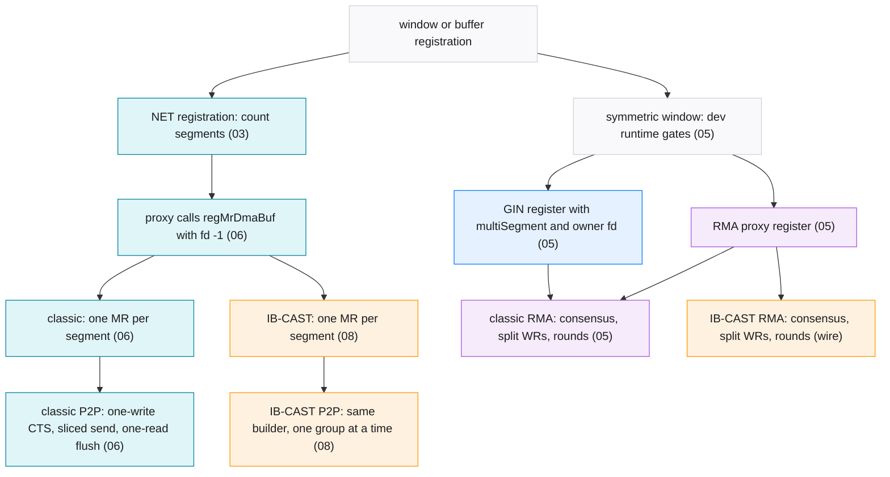

# Multi-segment registration: code map

This doc lists the code the multi-segment stack adds or changes, one table per source file, grouped by the layer that introduced it. Use it to find where a behavior lives, which pull request owns it, and which design section explains it. The design docs stay concise and link here instead of naming every function.

Line numbers are at the old-stack wire code tip `ac1de99e4627` (tests tip `ba3ab26f30a7`) on develop `c43b4a9e7307`, as of 2026-11-23, and drift as the code changes; search by symbol when they do. "New" means the stack adds the symbol; "changed" means it edits a develop symbol, usually through a one-line `// RCCL:` hook. The layer is the first branch whose copy of the symbol differs from develop. The last column quotes the code comment next to the symbol, where there is one. Abbreviations are defined in the [overview terms](multi_segment_overview.md#terms).

> [!NOTE]
> The 11-04 version of this map named files that no longer exist: `net_ib/rma_multiseg.h` and `net_ib/multiseg.h` became the shared `transport/rccl_mseg*.h` headers and `net_ib/ib_multiseg.h`; `rccl_ib_multiseg.h` became `rccl_mseg_reg.h`; `net_ib_cast/p2p_multiseg_cast.*` and `rccl_reg_multiseg_cast.cc` were folded into the shared `transport/rccl_p2p_multiseg.*` and into `net_ib_cast/p2p.cc`, `reg.cc` and `ib_cast_multiseg.h`. In the IB-MSEG fork the same code moves into `net_ib_multiseg/`; see [the fork plugin](multi_segment_fork_plugin.md#forks).

## How the layers connect

The registration entry points in the runtime decide whether a buffer takes the multi-segment path. Each transport then registers one MR per segment and splits its operations at segment boundaries.

| Layer | Pull request | Branch (`users/atulkulk/mseg/...`) | Tables |
|---|---|---|---|
| 02, 03 | merged | `02-amd-host-vmm-compat`, `03-registration-range` | [Merged layers](#merged-layers-02-and-03) |
| 05 | [PR 10884](https://github.com/ROCm/rocm-systems/pull/10884) | `05-gin-rma-multisegment` | [GIN/RMA, registration and shared headers](#layer-05-ginrma-registration-and-shared-headers) |
| 06 | [PR 10886](https://github.com/ROCm/rocm-systems/pull/10886) | `06-classic-netib-multisegment` | [Classic NET/IB P2P](#layer-06-classic-netib-p2p) |
| 07 | [PR 10890](https://github.com/ROCm/rocm-systems/pull/10890) | folded into 05 and 06 | [Tests](#tests-and-runner-configs) only |
| 08 | [PR 10889](https://github.com/ROCm/rocm-systems/pull/10889) | `08-cast-netib-multisegment` | [IB-CAST P2P](#layer-08-ib-cast-p2p) |
| wire | [PR 10888](https://github.com/ROCm/rocm-systems/pull/10888) | `multi-segment-dmabuf-cast-gin` | [IB-CAST GIN/RMA](#wire-ib-cast-ginrma) |
| 09 | open, `users/bdoganca/mseg/09-mseg-tests-coverage` | `09-tests-local` | [Tests](#tests-and-runner-configs) only |

## Merged layers 02 and 03

Design: [Current contract, registration](multi_segment_current.md#registration) and [switch-off behavior](multi_segment_current.md#switch-off-behavior).

| Symbol | File:line | Layer | Role |
|---|---|---|---|
| `rcclDevrProbeNonSymWindow` | `rccl_dev_runtime.cc:22` | 02 | Classifies a non-symmetric window and rejects host VMM across the LSA team. |
| `rcclDevrGinSegmentRegType` | `rccl_dev_runtime.cc:115` | 02 | Chooses the GIN pointer type and whether DMA-BUF registration is needed for a window with host segments. |
| `ncclSymIsHostSegment` | `dev_runtime.cc:50` | 02 | True for a host (or host NUMA) memory location; picks the host pointer type. |
| `NCCL_CUMEM_HOST_GATE` | `include/rocmwrap.h:84` | 02 | Compile-time gate for host VMM: needs both the host-location probe and a supported HIP version. |
| `ncclReg::rcclNet` | `include/register.h:65` | 03 | Cached NET segment count and all-peers flag, kept in an RCCL block at the end of the record. |
| `rcclNetRegSegmentCount` | `rccl_wrap.cc:3087` | 03 | Counts physical segments over the whole registration record and caches the result; with the switch off, a multi-segment record skips NET registration. |
| `rcclNetGraphRegSegmentCount` | `rccl_wrap.cc:3101` | 03 | Same count for the graph path's reused record. |
| `rcclNetRegCommit` | `rccl_wrap.cc:3110` | 03 | Sets `rcclNet.allPeers` only when every peer registered. |
| `netRegisterBuffer` | `transport/net.cc:2490` | 03 | Develop's local NET registration; calls the 03 count hook. |
| `ncclNetGraphRegisterBuffer` | `transport/net.cc:2604` | 03 | Develop's graph NET registration; calls the graph count hook. |

## Layer 05: GIN/RMA, registration and shared headers

### `dev_runtime.cc`

| Symbol | Line | Kind | Code comment |
|---|---|---|---|
| `symLsaMessage` | 483 | changed | 1 when this rank holds the creating POSIX fd for the segment. |
| `symMemoryEnsureHostOwnerFds` | 583 | new function | lazily make the per-segment owner-fd table, every entry -1. |
| `symMemoryGetHostOwnerFd` | 591 | new function | an imported host handle cannot export a DMA-BUF, so NIC registration uses the owner's POSIX fd. |
| `symMemoryPublishHostOwnerFds` | 608 | new function | publishes the owner fds by VA so per-segment RMA registration can find them. |
| `symMemoryCloseHostOwnerFds` | 617 | new function |  |
| `symMemoryMapLsa` | 634 | changed |  |
| `symMemoryRegisterGin` | 984 | changed | one HIP DMA-BUF covers only the first segment; |
| `symMemoryRegisterRma` | 1067 | changed | inputs are communicator-wide, so every rank takes the same branch and skips registration together. |
| `symMemoryUnregister` | 1083 | changed |  |
| `symMemoryObtain` | 1167 | changed | re-gathered after the LSA map; |
| `symMemoryDestroy` | 1424 | changed | close the owner fds published for this window. |

### `dev_runtime_internal.h`

| Symbol | Line | Kind | Code comment |
|---|---|---|---|
| `ncclDevrMemory` | 63 | changed | min(numSegments) across all communicator ranks |

### `gin/gin_host.cc`

| Symbol | Line | Kind | Code comment |
|---|---|---|---|
| `ncclGinRegister` | 686 | changed | an imported host segment cannot be exported here; |

### `gin/gin_host_proxy.cc`

| Symbol | Line | Kind | Code comment |
|---|---|---|---|
| `ncclGinProxyRegMrSymDmaBuf` | 523 | new function | registers with a caller-supplied DMA-BUF fd, e.g. |
| `ncclGinProxyCreateContext` | 547 | changed |  |

### `include/alloc.h`

| Symbol | Line | Kind | Code comment |
|---|---|---|---|
| `ncclCuMemIsSysmemSegment` | 920 | new function |  |
| `ncclCuMemGetAddressRange` | 925 | changed |  |

### `include/rccl_common.h`

| Symbol | Line | Kind | Code comment |
|---|---|---|---|
| `rcclDevrGinSegmentRegType` | 530 | changed |  |

### `rccl_dev_runtime.cc`

| Symbol | Line | Kind | Code comment |
|---|---|---|---|
| `rcclDevrRmaRegistersMultiSegment` | 130 | new function |  |
| `rcclRmaProxyMaxInflightRequests` | 139 | new function |  |
| `rcclDevrGinRegistersMultiSegment` | 145 | new function |  |
| `rcclHostSegmentFd` | 156 | new type |  |
| `rcclHostSegmentFdRegister` | 165 | new function |  |
| `rcclHostSegmentFdDeregister` | 170 | new function |  |
| `rcclHostSegmentFdLookup` | 181 | new function | Returns the published fd, valid until its window is torn down; |

### `rma/rma_proxy_launch.cc`

| Symbol | Line | Kind | Code comment |
|---|---|---|---|
| `ncclRmaProxyPutBuildOp` | 61 | changed | a window whose RMA registration was skipped has no handle; |

### `transport/net_ib/connect.cc`

| Symbol | Line | Kind | Code comment |
|---|---|---|---|
| `rcclIbSendQpWrs` | 54 | new function | sender QP depth. |
| `ncclIbSenderQpsCreate` | 874 | changed | full RMA chains with multi-segment on. |
| `ncclIbSenderQpsToRts` | 962 | changed | the peer sends devIndex, and it indexes remDevs and the RMA rkey tables, filled up to its ndevs. |
| `ncclIbReceiverQpsCreateToRts` | 1420 | changed | the peer sends devIndex, and it indexes remDevs and the RMA rkey tables, filled up to its ndevs. |
| `ncclIbCreateFlushQp` | 1569 | changed | loopback flush QP, so local and remote device indices are this recv device. |

### `transport/net_ib/gin.cc`

| Symbol | Line | Kind | Code comment |
|---|---|---|---|
| `ncclGinIbCloseColl` | 296 | changed | rcclRmaIbProxyConnectFinish allocated the per-rank registration records. |
| `rcclRmaIbProxyInstallMultiSeg` | 455 | new function | multi-segment MR handles have their own layout, so every MR and data op takes the multi-segment entry. |
| `ncclRmaIbProxyInit` | 465 | changed | the switch is process-wide; |
| `ncclRmaIbProxyConnect` | 497 | changed |  |
| `ncclRmaIbProxyCtx` | 518 | changed | multi-segment ops wider than one round, per peer. |
| `ncclRmaIbProxyPostBatch` | 529 | changed | reset even on failure, so a later post cannot resend WRs the HCA accepted. |
| `ncclRmaIbProxyCreateContext` | 577 | changed | the per-peer round queues are nranks long. |
| `ncclRmaIbProxyDestroyContext` | 671 | changed |  |
| `rcclRmaIbProxySegMrHandle` | 770 | new type |  |
| `rcclRmaIbProxyMrSegmentCount` | 789 | new function | tests read nSegments from the handle. |
| `rcclRmaRemoteRkey` | 793 | new function |  |
| `rcclRmaRankOff` | 797 | new function |  |
| `rcclRmaSegOf` | 801 | new function |  |
| `rcclRmaRangeOk` | 805 | new function |  |
| `rcclRmaBuildSegmentedWrs` | 810 | new function | keys and per-rank bases stay here; |
| `rcclRmaIbProxyQueueWrs` | 875 | new function | queue a chain behind earlier batched WRs. |
| `rcclRmaFinishPostedRequest` | 900 | new function | free the request and its id if nothing posted. |
| `rcclRmaIbProxyStartRequest` | 916 | new function | take a request for a multi-segment chain and stamp its WRs. |
| `rcclRmaIbProxyQueueRequest` | 938 | new function | queue a started request's chain and finish it. |
| `rcclRmaIbRoundBuild` | 951 | new function | this plugin's half of a multi-segment round. |
| `rcclRmaIbRoundPost` | 962 | new function |  |
| `rcclRmaIbRoundRetire` | 968 | new function |  |
| `rcclRmaIbRoundFailed` | 975 | new function |  |
| `rcclRmaIbProxyQueueOf` | 984 | new function | a flush is one read posted at once, so only sends queue. |
| `rcclRmaIbProxyPeerBusy` | 989 | new function | behind a queued op every op queues, so a single-MR op cannot complete ahead of it. |
| `rcclRmaIbProxyPostChain` | 994 | new function | one chain with nothing queued ahead: batched for data, posted at once for a flush. |
| `rcclRmaIbProxyEnqueue` | 1008 | new function | queue an op behind the peer's earlier ones. |
| `rcclRmaIbProxySubmit` | 1037 | new function | post a multi-segment op as one chain when it fits in one round with nothing queued ahead, otherwise round by round from the peer's queue. |
| `rcclRmaDeregOneSegment` | 1054 | new function | the RMA segment handle is an ncclIbMrHandle, so the plugin's deregMr releases it whole. |
| `rcclRmaIbProxySegMrHandleFree` | 1059 | new function | release the first nRegistered segment MRs through the shared deregister, then free the handle. |
| `rcclRmaRegAllGather` | 1071 | new function |  |
| `rcclRmaIbProxyConnectFinish` | 1076 | new function |  |
| `rcclRmaIbProxyRegMrSymDmaBuf` | 1090 | new function | one DMA-BUF MR per physical segment, then one consensus record per rank. |
| `rcclRmaIbProxyDeregMrSym` | 1234 | new function | release every segment MR, not only the first. |
| `rcclRmaIbProxyUseSingle` | 1252 | new function | a one-segment handle uses the single-MR op body through the embedded single MR. |
| `rcclRmaIbProxyRegMrSym` | 1263 | new function |  |
| `rcclRmaIbProxyIPut` | 1269 | new function | split the put at segment boundaries and keep the request if a prefix posted. |
| `rcclRmaIbProxyIGet` | 1297 | new function | split the get at segment boundaries and keep the request if a prefix posted. |
| `rcclRmaIbProxyIPutSignal` | 1329 | new function | the signal rides the last segment WR, so a split put still signals once. |
| `rcclRmaIbProxyIFlush` | 1382 | new function | a PCIe read cannot pass the posted writes ahead of it, so one read of any device segment flushes them all. |
| `rcclRmaIbProxyTestFailed` | 1418 | new function | a signaled tail that never posted has no CQE. |
| `ncclRmaIbProxyIPut` | 1424 | new function |  |
| `ncclRmaIbProxyIGet` | 1476 | new function |  |
| `ncclRmaIbProxyIPutSignal` | 1526 | new function |  |
| `ncclRmaIbProxyTest` | 1612 | changed | a request whose signaled tail never posted completes as an error. |

### `transport/net_ib/gin.h`

| Symbol | Line | Kind | Code comment |
|---|---|---|---|
| `ncclGinIbCollComm` | 15 | changed | per-rank registration records (status and segment layout); |

### `transport/net_ib/ib_multiseg.h`

| Symbol | Line | Kind | Code comment |
|---|---|---|---|
| `ncclIbMultiSegOk` | 18 | new function | one connect-time decision. |
| `NCCL_RMA_MAX_IB_WRS_PER_OP` | 23 | new macro | a put with signal is two WRs. |
| `NCCL_RMA_IB_WR_BATCHSIZE` | 24 | new macro |  |
| `rcclRmaReleaseSeqId` | 27 | new function | a freed request returns its sequence id only if no later request took one. |
| `rcclRmaIbProxyRegMrSym` | 33 | new function |  |
| `rcclRmaIbProxyRegMrSymDmaBuf` | 35 | new function |  |
| `rcclRmaIbProxyIPut` | 38 | new function |  |
| `rcclRmaIbProxyIGet` | 40 | new function |  |
| `rcclRmaIbProxyIPutSignal` | 43 | new function |  |

### `transport/net_ib/init.cc`

| Symbol | Line | Kind | Code comment |
|---|---|---|---|
| `ncclIbInitDevices` | 553 | changed |  |

### `transport/net_ib/reg.cc`

| Symbol | Line | Kind | Code comment |
|---|---|---|---|
| `rcclIbMrAdmit` | 65 | new function |  |
| `ncclIbRegMrDmaBufInternal` | 78 | changed |  |

### `transport/rccl_mseg.h`

| Symbol | Line | Kind | Code comment |
|---|---|---|---|
| `RCCL_IB_SGE_MAX_BYTES` | 17 | new const | ibv_sge::length is 32 bits, so a slice stops there. |
| `RCCL_IB_SEG_PROTOCOL_MAX` | 21 | new macro | protocol ceiling on segments per registration, the P2P IPC limit (NCCL_P2P_MAX_PHYSICAL_SEGMENTS). |
| `RCCL_IB_REG_SEG_DEFAULT` | 23 | new macro | default local cap; |
| `rcclIbRegSegCapFrom` | 25 | new function |  |
| `rcclIbSegTable` | 35 | new type | base is the VA of byte 0. |
| `rcclIbSegSlice` | 41 | new type |  |
| `rcclIbSegCursor` | 50 | new type | localSeg/remoteSeg advance only forward. |
| `rcclIbSegIndexOf` | 59 | new function | Last segment when off is past the end. |
| `rcclIbSegCursorInit` | 67 | new function |  |
| `rcclIbSegCursorNext` | 79 | new function | 1 and a filled slice, or 0 when nothing remains or the offset is past a table. |

### `transport/rccl_mseg_export.h`

| Symbol | Line | Kind | Code comment |
|---|---|---|---|
| `rcclIbSegWalkState` | 25 | new type | Walk position plus the local layout it fills: segOff[s + 1] is the end of segment s, vas[s] its start. |
| `rcclIbSegExport` | 34 | new type | One segment's export. |
| `rcclIbSegExportClose` | 42 | new function |  |
| `rcclIbSegExportNext` | 50 | new function | Exports the segment at w->ptr over the whole pages the MR spans; |
| `rcclIbSegExportIsHost` | 77 | new function | An owner-published fd is always a host segment; |
| `rcclIbSegWalkAdvance` | 85 | new function | Records segment seg after it registered and moves the walk past it. |
| `ncclResult_t` | 95 | new function | The plugin's DMA-BUF registration; |
| `rcclIbSegRegCtx` | 98 | new type |  |
| `rcclIbSegRegOne` | 108 | new function | One segment of the walk. |

### `transport/rccl_mseg_reg.h`

| Symbol | Line | Kind | Code comment |
|---|---|---|---|
| `rcclIbSegRegOps` | 18 | new type |  |
| `rcclIbSegDeregister` | 24 | new function | Skips NULL slots, clears each slot it releases, and returns the first deregister error. |
| `rcclIbSegRegister` | 39 | new function | On failure, releases every slot in [0, index] through deregOne, including a handle regOne stored before failing. |
| `rcclIbSegWalkBytes` | 53 | new function | addrs[n], lens[n], offs[n], fds[n] in one zeroed block. |
| `rcclIbSegWalk` | 59 | new type |  |
| `rcclIbSegWalkBind` | 67 | new function | block is rcclIbSegWalkBytes(n) bytes and malloc-aligned. |
| `ncclIbRegMrDmaBufMultiSeg` | 81 | new function | classic net entry, one dma-buf MR per physical segment when the export fd is -1. |
| `IbCastRegMrDmaBufMultiSeg` | 84 | new function | CAST entry, same walk. |

### `transport/rccl_mseg_rma.h`

| Symbol | Line | Kind | Code comment |
|---|---|---|---|
| `RCCL_RMA_SEG_TABLE_MAX_ENTRIES` | 21 | new macro | every rank holds every rank's RMA segment table (48 bytes per entry), so RMA bounds ranks x segments. |
| `rcclRmaSegTableFits` | 22 | new function |  |
| `NCCL_RMA_MAX_DATA_WRS` | 29 | new macro | One round of a multi-segment op: up to NCCL_RMA_MAX_DATA_WRS data WRs, plus the signal on the last round. |
| `NCCL_RMA_MAX_SIGNAL_WRS` | 30 | new macro |  |
| `NCCL_RMA_MAX_REQUESTS` | 32 | new macro | Live request ids per IB comm. |
| `NCCL_RMA_MAX_INFLIGHT_REQUESTS` | 34 | new macro | With multi-segment on, the RMA and GIN proxies keep at most this many requests in flight per peer and context. |
| `NCCL_RMA_SEND_QP_WRS` | 36 | new macro | Sender QP depth with RMA multi-segment on: every in-flight request may have one full round posted. |
| `rcclRmaSegIndexOf` | 42 | new function | Offsets at or past the terminal size clamp to the last segment. |
| `rcclRmaWrIsSignaled` | 47 | new function |  |
| `rcclRmaInflightRequestsCap` | 52 | new function | Requests a proxy keeps in flight per peer: the cap when the backend takes multi-segment chains, else its own limit. |
| `rcclRmaPrefixPostLostSignaledTail` | 57 | new function | true when ibv_post_send accepted a prefix that did not include the signaled last WR. |
| `rcclRmaSignalOffsetValid` | 61 | new function |  |
| `rcclRmaOffsetRangeOk` | 66 | new function |  |
| `rcclRmaDevSlotOf` | 74 | new function | Maps a physical ibDevN to its registration slot (recvComm device order, which a peer QP's HCA may not follow). |
| `rcclRmaPeerSegOff` | 84 | new function | per-rank segOff table from registration allgather, nSegments + 1 entries per rank; |
| `rcclRmaPostedWrCount` | 91 | new function | WRs the HCA accepted from a next-linked chain of nWr when ibv_post_send fails at badWr (NULL: the whole chain). |
| `rcclRmaCompletePostedRequest` | 104 | new function | Keep-or-free after ibv_post_send: free the slot only if nothing posted, and mark FAILED if the signaled tail was lost or the doorbell failed. |
| `rcclRmaMrSegmentCount` | 124 | new function | Segment count, or 0 when the handle is empty or is the single-MR layout. |

### `transport/rccl_mseg_rma_round.h`

| Symbol | Line | Kind | Code comment |
|---|---|---|---|
| `rcclRmaRoundOp` | 22 | new type |  |
| `rcclRmaRoundQueue` | 41 | new type |  |
| `rcclRmaRoundQueues` | 48 | new type | Per-peer queues of one context, nranks long; |
| `rcclRmaRoundHooks` | 53 | new type | The plugin's half of a round. |
| `rcclRmaStampWrs` | 70 | new function | Every WR carries the request's wrId; |
| `rcclRmaPostWrs` | 78 | new function | ibv_post_send can fail after accepting a prefix, whose unsignaled WRs then need the request; |
| `rcclRmaRoundClampWindow` | 94 | new function | A partial round touches at most maxWr segments on each side, so the key windows clamp to that. |
| `rcclRmaRoundDataOp` | 101 | new function |  |
| `rcclRmaRoundSetSignal` | 119 | new function | An atomic add of `add` at remoteAddr; |
| `rcclRmaRoundQueueOf` | 135 | new function |  |
| `rcclRmaRoundPush` | 142 | new function | Appends op; |
| `rcclRmaRoundPop` | 151 | new function |  |
| `rcclRmaRoundDrop` | 159 | new function | Unlinks req's op, if queued, before the plugin frees req. |
| `rcclRmaRoundQueuesFree` | 172 | new function |  |
| `rcclRmaRoundFillNode` | 182 | new function | Copies op into a node the plugin allocated, ready to push. |
| `rcclRmaRoundAppendSignal` | 190 | new function |  |
| `rcclRmaRoundBuild` | 201 | new function | The op's next round into wr/sge (NCCL_RMA_MAX_SIGNAL_WRS long); |
| `rcclRmaRoundFirst` | 220 | new function | The first round, built on a copy of op. |
| `rcclRmaRoundPostNext` | 232 | new function | Posts the head's next round. |
| `rcclRmaRoundPump` | 253 | new function | Posts rounds from the head until one is in flight or the queue is empty. |
| `rcclRmaRoundTailDone` | 267 | new function | For plugins that complete a round by its tail CQE: true if that CQE ends req's in-flight round, which frees the head for its next round without completing req. |

### `transport/rccl_mseg_sym.h`

| Symbol | Line | Kind | Code comment |
|---|---|---|---|
| `rcclIbSegSymTable` | 21 | new type | per-rank layout of a symmetric multi-segment registration, shared by every backend that splits operations at segment boundaries. |
| `rcclIbSegSymRecord` | 28 | new type | Consensus record per rank; |
| `rcclIbSegSymVa` | 35 | new function |  |
| `rcclIbSegSymKey` | 39 | new function |  |
| `rcclIbSegSymTableFree` | 44 | new function |  |
| `rcclIbSegSymAgree` | 54 | new function | Gathers one status per rank; |
| `rcclIbSegSymExchange` | 72 | new function | every rank calls this after its local walk, even after a local failure, so all ranks fail together. |

### `transport/rccl_mseg_wr.h`

| Symbol | Line | Kind | Code comment |
|---|---|---|---|
| `rcclIbSegWrIn` | 26 | new type | Returns the WR count, or -1 if the chain exceeds maxWr or runs past a table. |
| `rcclIbSegAppendWrs` | 39 | new function |  |

## Layer 06: classic NET/IB P2P

### `include/plugin/nccl_net.h`

| Symbol | Line | Kind | Code comment |
|---|---|---|---|
| `NCCL_PTR_DMABUF_MULTISEG` | 29 | new macro |  |

### `transport/net.cc`

| Symbol | Line | Kind | Code comment |
|---|---|---|---|
| `rcclNetPluginMultiSeg` | 465 | new function | fd -1 is only for a plugin that walks a multi-segment buffer itself. |
| `sendProxyRegBuffer` | 2646 | changed | fd -1 and the export flags in offset. |
| `recvProxyRegBuffer` | 2737 | changed | fd -1 and the export flags in offset. |

### `transport/net_ib/common.h`

| Symbol | Line | Kind | Code comment |
|---|---|---|---|
| `ncclIbRequestCompletionRecord` | 207 | changed | defined below with one MR per segment. |
| `ncclIbRequest` | 225 | changed | segmented send reads per-segment lkeys from this handle. |
| `ncclIbCtsSlot` | 305 | new type | advertising slots. |
| `NCCL_IB_CTS_FIFO_BYTES` | 314 | new macro | byte size of the legacy CTS FIFO, and of one advertising slot array. |
| `NCCL_IB_CTS_SLOTS_BYTES` | 315 | new macro |  |
| `rcclIbSendQpState` | 318 | new type | a segmented send posts one slice of each receive per QP and resumes on a later test. |
| `rcclIbSendCursor` | 320 | new type | slots post in fifo order. |
| `ncclIbMrHandle` | 419 | changed | per-segment MRs; |
| `ncclIbSendComm` | 578 | changed |  |
| `ncclIbRecvComm` | 688 | changed | local combined slots when the peer advertised. |
| `ncclIbListenComm` | 747 | changed | set by rcclIbMarkGinListen; |

### `transport/net_ib/connect.cc`

| Symbol | Line | Kind | Code comment |
|---|---|---|---|
| `ncclIbCacheMultiSegOk` | 18 | new function | cached once per comm. |
| `ncclIbSendCommAllocCts` | 27 | new function | one page-aligned block. |
| `ncclIbSendCommFreeCts` | 42 | new function | the CTS block is one allocation, either the legacy FIFO or the combined slots. |
| `ncclIbHandle` | 147 | changed | set by rcclIbMarkGinListen; |
| `rcclIbMarkGinListen` | 853 | new function |  |
| `ncclIbConnectImpl` | 1031 | changed | combined CTS slots only when advertising. |
| `ncclIbAcceptImpl` | 1763 | changed |  |
| `ncclIbCloseSend` | 2259 | changed | read layouts' MRs go before their PDs. |
| `ncclIbCloseRecv` | 2301 | changed | combined CTS slots, only for a multi-seg peer. |

### `transport/net_ib/connect.h`

| Symbol | Line | Kind | Code comment |
|---|---|---|---|
| `ncclIbConnectionMetadata` | 51 | changed | RCCL_IB_CAP_MULTISEG when this peer's CTS carries the layout prefix. |

### `transport/net_ib/gin.cc`

| Symbol | Line | Kind | Code comment |
|---|---|---|---|
| `ncclGinIbGdakiListen` | 352 | changed | GIN comms skip the multi-segment side table. |
| `ncclRmaIbProxyListen` | 491 | new function |  |

### `transport/net_ib/init.cc`

| Symbol | Line | Kind | Code comment |
|---|---|---|---|
| `ncclIbGetPhysProperties` | 829 | changed | fd -1 walks one MR per physical segment. |

### `transport/net_ib/p2p.cc`

| Symbol | Line | Kind | Code comment |
|---|---|---|---|
| `rcclIbSendHoldSlice` | 89 | new function | a slice post holds one more event per request on its device until its signaled write completes. |
| `ncclIbMultiSend` | 93 | changed | ignore the side-table bit in the count. |
| `rcclIbSendResume` | 317 | new function | post the next slice on each QP whose last slice completed. |
| `rcclIbSendProgress` | 348 | new function |  |
| `ncclIbIsend` | 365 | changed |  |
| `ncclIbPostFifo` | 528 | changed |  |
| `ncclIbIrecv` | 612 | changed |  |
| `ncclIbIflush` | 759 | changed | one read fences the device. |
| `ncclIbCompletionEventProcess` | 1045 | changed | a send comm reads only referenced segment layouts. |
| `ncclIbTest` | 1182 | changed | a completion may have freed a QP of a send still posting slices. |

### `transport/net_ib/p2p_multiseg.cc`

| Symbol | Line | Kind | Code comment |
|---|---|---|---|
| `ncclIbMrForRange` | 20 | new function | the MR covering [addr, addr+len) on devIndex: mrs[devIndex] for a single-segment handle, else the containing segment's MR, or NULL when the range crosses a segment boundary. |
| `rcclIbCtsRemoteLayout` | 27 | new function | this CTS entry's layout prefix, or NULL when the write did not include one. |
| `ncclIbCtsRemoteMultiSeg` | 37 | new function | true when this CTS entry carries more than one segment inline or by reference. |
| `rcclIbBuildRemoteSegmentLayout` | 43 | new function | remote table from the inline or referenced layout, else one segment from the CTS slot. |
| `rcclIbSegSendNextWr` | 54 | new function |  |
| `rcclIbAppendSegmentedRequestWrs` | 65 | new function | one data slice from off, inside one local and one remote segment, via rcclIbSegAppendWrs; |
| `rcclIbSegSendSizesWr` | 142 | new function | the sizes record for a multi-recv or non-BY_INDEX receiver, at comm->wrs[w]. |
| `rcclIbAppendSegmentedTailWr` | 154 | new function | final WR carrying the WRITE_WITH_IMM, mirroring ncclIbMultiSend's lastWr: this QP's flush flag (after a plain sizes write), a dedicated sizes/imm WR, or the last data WR. |
| `rcclIbFillSendWrs` | 203 | new function | one QP's next post. |
| `rcclIbSendSliceDone` | 237 | new function | true for the signaled slice of the slot still posting, which lets that QP post its next slice. |
| `rcclIbMultiSendNeedsSegmented` | 250 | new function | segmented builder when any request's local or remote buffer spans several segments. |
| `rcclIbPrepareCtsWrite` | 259 | new function | one CTS WR. |
| `rcclIbIrecvCheckHandle` | 283 | new function | a NULL handle or per-device MR would be dereferenced for the CTS rkey. |
| `rcclIbIrecvFillSideTable` | 297 | new function |  |
| `rcclIbLayoutReadStamp` | 309 | new function |  |
| `rcclIbLayoutReadArg` | 313 | new type |  |
| `rcclIbLayoutReadQp` | 319 | new function | layout reads post on the QP of the slot's first request. |
| `rcclIbSendLayoutsReady` | 335 | new function | true once every layout the slot references is read; |
| `rcclIbSendLayoutReadDone` | 344 | new function |  |
| `rcclIbCtsFlagSideTable` | 356 | new function | set the side-table bit so the sender reads the layout prefix. |
| `rcclIbIflushNeedsMultiSeg` | 361 | new function | flush splits when any non-empty receive spans segments. |
| `rcclIbIflushScratchpadWrite` | 370 | new function | fence the RO=1 bulk data through an RO=0 scratchpad - RDMA_WRITE a dummy payload into it before the read. |
| `rcclIbIflushAddRead` | 382 | new function |  |
| `rcclIbIflushAppendReads` | 391 | new function | one read fences the device. |
| `rcclIbIflushChainReads` | 416 | new function | make the reads one RDMA_READ chain into the flush sge, signaling only the last. |
| `rcclIbIflushMultiSeg` | 429 | new function | ncclIbIflush with one RDMA read. |

### `transport/net_ib/p2p_multiseg.h`

| Symbol | Line | Kind | Code comment |
|---|---|---|---|
| `rcclIbWriteChunkAlignment` | 17 | new const | segmented chunk alignment; |
| `rcclIbFillSendWrs` | 27 | new function | one QP's next post: one slice of each receive, advancing off[]. |
| `rcclIbSendCtsRow` | 39 | new function | CTS row for this slot. |
| `rcclIbRecvCtsRow` | 47 | new function |  |
| `rcclIbCtsLayout` | 52 | new function | request r's layout, packed immediately before the CTS row. |
| `rcclIbIrecvFillSideTable` | 63 | new function |  |

### `transport/net_ib/reg.cc`

| Symbol | Line | Kind | Code comment |
|---|---|---|---|
| `rcclIbCountRangeSegments` | 111 | new function | fd < 0 walks one MR per segment. |
| `rcclIbRegMrDmaBufFromRange` | 131 | new function |  |
| `ncclIbRegMrDmaBuf` | 198 | changed | fd < 0 registers one MR per physical segment. |
| `rcclIbMultiSegRegCtx` | 232 | new type | one slot per (segment, device) for rcclIbSegRegister and rcclIbSegDeregister, laid out like segMrs. |
| `rcclIbMultiSegRegOne` | 241 | new function |  |
| `rcclIbMultiSegDeregOne` | 254 | new function |  |
| `rcclIbMrHandleFreeSegments` | 262 | new function | free the counted segment arrays and the handle; |
| `rcclIbMrHandlePublishLayout` | 268 | new function | a receive overlapping more than RCCL_IB_CTS_INLINE_SEGS segments sends a reference to this layout. |
| `ncclIbRegMrDmaBufMultiSeg` | 278 | new function | one MR per segment. |
| `rcclIbDeregMrMultiSeg` | 335 | new function | mrs[] aliases segment 0, so it is freed via segMrs here (do not double-free). |
| `ncclIbDeregMr` | 349 | changed | multi-segment handles own one MR per segment, not mrs[] alone. |

### `transport/rccl_p2p_multiseg.cc`

| Symbol | Line | Kind | Code comment |
|---|---|---|---|
| `rcclIbSegMrInit` | 17 | new function |  |
| `rcclIbSegMrFreeArrays` | 32 | new function |  |
| `rcclIbSegMrPublishLayout` | 43 | new function |  |
| `rcclIbSegMrFreeLayout` | 61 | new function |  |
| `rcclIbSegLayoutFill` | 79 | new function |  |
| `rcclIbSegTableSingle` | 130 | new function |  |
| `rcclIbSegTableLocal` | 143 | new function |  |
| `rcclIbSegTableInline` | 161 | new function |  |
| `rcclIbLayoutCacheEntry` | 194 | new type |  |
| `rcclIbLayoutRead` | 203 | new function | post one signaled read of a referenced layout into entry e. |
| `rcclIbLayoutsReady` | 253 | new function |  |
| `rcclIbLayoutReadDone` | 290 | new function |  |
| `rcclIbLayoutCacheFree` | 305 | new function |  |
| `rcclIbSegTableReferenced` | 319 | new function |  |

### `transport/rccl_p2p_multiseg.h`

| Symbol | Line | Kind | Code comment |
|---|---|---|---|
| `RCCL_IB_MSEG_MAX_DEVS` | 27 | new macro | the IB plugins' NCCL_IB_MAX_DEVS_PER_NIC and NCCL_NET_IB_MAX_RECVS; |
| `RCCL_IB_MSEG_MAX_RECVS` | 28 | new macro |  |
| `RCCL_IB_CTS_INLINE_SEGS` | 33 | new macro | segments a CTS carries inline; |
| `RCCL_IB_CAP_MULTISEG` | 36 | new macro | bit in the connect metadata caps. |
| `NCCL_IB_CTS_NREQS_SIDE_TABLE` | 40 | new macro | set in every CTS entry's nreqs when the write includes the layout prefix. |
| `ncclIbDeclineMultiSegRegistration` | 47 | new function | a recv multi-segment registration is usable only if the peer can parse the CTS side table. |
| `ncclIbSegmentIndexForRange` | 53 | new function | index of the segment that fully contains [addr, addr+len), or -1 when addr is outside every segment or the range crosses a boundary. |
| `ncclIbCtsRemoteLayoutValid` | 70 | new function | peer CTS side table is usable iff nSegments is in [1, maxSegments], remDevIdx is in range, segStart is strictly increasing, and every rkey is nonzero. |
| `rcclIbLayoutBlobBytes` | 83 | new function | published layout, {va0, off[nSeg + 1], rkeys[ndevs][nSeg]}; |
| `rcclIbLayoutBlobRkeys` | 87 | new function |  |
| `rcclIbLayoutBlobValid` | 92 | new function | a read layout is usable iff its offsets start at 0 and increase and every rkey is nonzero. |
| `ncclIbSegmentForZeroLengthOffset` | 108 | new function | Segment whose rkey a 0-byte RDMA_WRITE at `off` uses: the one holding off, or the last segment at its exclusive end. |
| `ncclIbBytesRemainingInSegment` | 116 | new function | host VMM can report base 0; |
| `rcclIbSegLayoutRef` | 121 | new type | where the sender reads a registration's whole layout (rcclIbLayoutBlob*) with one RDMA read. |
| `ncclIbSegLayout` | 131 | new type | layout carried in front of one slot's CTS entries; |
| `rcclIbSegMr` | 148 | new type | a registration's segments, embedded in each IB plugin's MR handle. |
| `rcclIbSegMrAt` | 162 | new function |  |
| `rcclIbSegLayoutFill` | 178 | new function | fills one receive's layout prefix from its registration. |
| `rcclIbSendSegTable` | 185 | new type | one side's segment table for a request. |
| `rcclIbSegTableLocal` | 200 | new function | the local table from the send handle (NULL or single-segment gives one segment). |
| `rcclIbSegTableInline` | 203 | new function | the remote table from an inline layout; |
| `RCCL_IB_LAYOUT_CACHE_ENTRIES` | 209 | new macro | referenced layouts read from the receiver. |
| `rcclIbLayoutState` | 210 | new type |  |
| `rcclIbLayoutCacheEntry` | 211 | new type |  |
| `rcclIbLayoutCache` | 223 | new type |  |
| `rcclIbLayoutReadQp` | 229 | new type | the QP a layout read posts on, chosen by the plugin. |
| `rcclIbLayoutsReady` | 242 | new function | *ready once every referenced layout in sides[0..n) is read; |
| `rcclIbSegTableReferenced` | 248 | new function | the remote table from a referenced layout the sender already read; |

## Layer 08: IB-CAST P2P

### `transport/net_ib_cast/common_cast.h`

| Symbol | Line | Kind | Code comment |
|---|---|---|---|
| `WR_IMM_SIZE_BITS` | 234 | new macro |  |
| `WR_IMM_SEGMENTED_FLAG` | 237 | new macro |  |
| `WR_IMM_SPLIT_DATA_FLAG` | 238 | new macro |  |
| `NCCL_NET_IB_REQ_FAILED` | 316 | new macro |  |
| `ncclIbRequestCompletionRecord` | 395 | changed |  |
| `ncclIbRequest` | 414 | changed |  |
| `ncclIbCtsSlot` | 510 | new type | advertising slots. |
| `rcclIbCastSendQpState` | 519 | new type | a segmented send posts one slice of each receive per QP and resumes on a later test. |
| `rcclIbCastSendPost` | 521 | new type | what every post of one slot needs. |
| `rcclIbCastSendCursor` | 531 | new type | the one segmented slot still posting; |
| `ncclIbMrHandle` | 655 | changed | per-segment MRs; |
| `ncclIbSendComm` | 792 | changed | legacy FIFO when this rank does not advertise. |
| `IB_CAST_CTS_FIFO_BYTES` | 850 | new macro |  |
| `IB_CAST_CTS_SLOTS_BYTES` | 852 | new macro |  |
| `ncclIbRecvComm` | 908 | changed | local source of a long CTS write. |
| `IbCastRequestHasEvents` | 985 | new function |  |

### `transport/net_ib_cast/connect.cc`

| Symbol | Line | Kind | Code comment |
|---|---|---|---|
| `IbCastInitCommDevBase` | 186 | changed |  |
| `IbCastDestroyBase` | 211 | changed |  |
| `IbCastSendCommAllocCts` | 1407 | new function | one page-aligned block. |
| `IbCastSendCommFreeCts` | 1421 | new function |  |
| `IbCastReceiverQpsCreateToRts` | 1880 | changed |  |
| `IbCastAccept` | 2348 | changed |  |
| `IbCastCloseSend` | 2829 | changed | read layouts' MRs go before their PDs. |
| `IbCastCloseRecv` | 2922 | changed |  |

### `transport/net_ib_cast/connect_cast.h`

| Symbol | Line | Kind | Code comment |
|---|---|---|---|
| `ncclIbConnectionMetadata` | 108 | changed | RCCL_IB_CAP_MULTISEG when this peer's CTS carries the layout prefix. |
| `IbCastMultiSegScopeOk` | 150 | new function | the one cached decision. |
| `IbCastMultiSegAdvertise` | 154 | new function | CTS layout and the capability bit. |
| `IbCastMultiSegOk` | 157 | new function |  |

### `transport/net_ib_cast/ib_cast_multiseg.h`

| Symbol | Line | Kind | Code comment |
|---|---|---|---|
| `ctsFifoHasLayout` | 16 | new function |  |
| `IbCastSendCtsRow` | 21 | new function | CTS row for this slot. |
| `IbCastRecvCtsRow` | 25 | new function |  |
| `IbCastCtsLayout` | 30 | new function | request r's layout, packed immediately before the CTS row. |
| `rcclIbCastIrecvCheckHandle` | 48 | new function |  |
| `rcclIbCastIrecvFillSideTable` | 50 | new function |  |
| `rcclIbCastSendDefer` | 55 | new function |  |

### `transport/net_ib_cast/init.cc`

| Symbol | Line | Kind | Code comment |
|---|---|---|---|
| `IbCastInitDevices` | 439 | changed |  |
| `IbCastGetPhysProperties` | 840 | changed | fd -1 walks one MR per physical segment. |

### `transport/net_ib_cast/p2p.cc`

| Symbol | Line | Kind | Code comment |
|---|---|---|---|
| `IbCastGetNumWqeSplits` | 104 | new function | WRs needed to split every write in the chain that is longer than IbCastMaxPostSendBytes. |
| `IbCastPostDataWithinCap` | 117 | new function | posts the contiguous chain rcclIbCastFillSendWrs built in comm->wrs, so it covers segmented slices and the sizes or adaptive-routing tail too. |
| `IbCastCtsRemoteLayout` | 193 | new function | this CTS entry's layout prefix, or NULL when the write did not include one. |
| `IbCastCtsRemoteMultiSeg` | 203 | new function | true when this CTS entry carries more than one segment inline or by reference. |
| `rcclIbCastBuildRemoteSegmentLayout` | 209 | new function | remote table from the inline or referenced layout, else one segment from the CTS slot. |
| `rcclIbCastAppendRequestWrs` | 229 | new function | one data slice from off, inside one local and one remote segment, via rcclIbSegAppendWrs; |
| `rcclIbCastRangeSplits` | 292 | new function |  |
| `rcclIbCastSignalWr` | 304 | new function | wr_id and signal of the WR that ends a post. |
| `rcclIbCastFillSendWrs` | 328 | new function | one QP's next post. |
| `rcclIbCastHoldSlice` | 382 | new function | a post that ends on a slice holds one event per request on that device until the slice completes. |
| `rcclIbCastSendResume` | 387 | new function | post the next slice on each QP whose last slice completed. |
| `rcclIbCastLayoutReadArg` | 422 | new type |  |
| `rcclIbCastLayoutReadQp` | 428 | new function | layout reads post on the first QP of the slot's first request. |
| `rcclIbCastSendLayoutsReady` | 442 | new function | true once every layout the slot references is read; |
| `rcclIbCastSendLayoutReadDone` | 453 | new function |  |
| `rcclIbCastSendLayoutCacheFree` | 457 | new function |  |
| `rcclIbCastSendDefer` | 462 | new function | hold a matched slot until its referenced layouts are read; |
| `rcclIbCastSendProgress` | 473 | new function |  |
| `rcclIbCastSendSliceDone` | 494 | new function | true for the signaled slice of the slot still posting, which lets that QP post its next slice. |
| `rcclIbCastMultiSendNeedsSegmented` | 506 | new function |  |
| `rcclIbCastSendIsSegmented` | 513 | new function |  |
| `rcclIbCastHasOtherSegmentedSend` | 517 | new function |  |
| `rcclIbCastPrepareCtsWrite` | 528 | new function |  |
| `rcclIbCastIrecvCheckHandle` | 541 | new function |  |
| `rcclIbCastIrecvFillSideTable` | 583 | new function | a receive inside one segment sends the short CTS with that segment's rkeys; |
| `rcclIbCastCtsFlagLayout` | 596 | new function |  |
| `rcclIbCastImmSegmented` | 600 | new function |  |
| `rcclIbCastIflushNeedsMultiSeg` | 604 | new function |  |
| `rcclIbCastMrForRange` | 611 | new function |  |
| `rcclIbCastIflushMultiSeg` | 618 | new function | one read of the first byte of the last non-zero receive. |
| `IbCastMultiSend` | 698 | changed |  |
| `IbCastIsend` | 958 | changed |  |
| `IbCastPostFifo` | 1177 | changed |  |
| `IbCastIrecv` | 1277 | changed |  |
| `IbCastIflush` | 1423 | changed |  |
| `IbCastRequestComplete` | 1591 | changed |  |
| `IbCastCompletionEventByOrder` | 1678 | changed |  |
| `IbCastCompletionEventProcess` | 1800 | changed | a send comm reads only referenced segment layouts. |
| `IbCastTest` | 1959 | changed |  |

### `transport/net_ib_cast/p2p_cast.h`

| Symbol | Line | Kind | Code comment |
|---|---|---|---|
| `ctsFifoNreqs` | 74 | changed | the layout-prefix bit rides above the receive count. |
| `ctsFifoTag` | 102 | changed | multi-segment CTS rows and hooks. |

### `transport/net_ib_cast/p2p_resiliency_recovery_ainic.cc`

| Symbol | Line | Kind | Code comment |
|---|---|---|---|
| `IbCastPortRecoveryQpsRestoreAinic` | 35 | changed |  |

### `transport/net_ib_cast/reg.cc`

| Symbol | Line | Kind | Code comment |
|---|---|---|---|
| `IbCastRegMrDmaBufInternal` | 70 | changed |  |
| `IbCastCountRangeSegments` | 107 | new function | fd < 0 walks one MR per segment. |
| `IbCastRegMrDmaBufFromRange` | 127 | new function |  |
| `IbCastRegMrDmaBuf` | 187 | changed | fd < 0 registers one MR per physical segment. |
| `rcclIbCastMrAdmit` | 199 | new function |  |
| `rcclIbCastMultiSegRegCtx` | 230 | new type | one slot per segment. |
| `IbCastCommMultiSegScopeOk` | 239 | new function |  |
| `rcclIbCastMultiSegRegOne` | 243 | new function |  |
| `rcclIbCastMultiSegDeregOne` | 249 | new function |  |
| `IbCastMrHandleFreeSegments` | 268 | new function | free the counted segment arrays and the handle; |
| `rcclIbCastMrHandlePublishLayout` | 274 | new function | a receive overlapping more than RCCL_IB_CTS_INLINE_SEGS segments sends a reference to this layout. |
| `IbCastRegMrDmaBufMultiSeg` | 284 | new function | one MR per segment. |
| `rcclIbCastDeregMrMultiSeg` | 349 | new function | mrs[] aliases segment 0, so it is freed via segMrs here (do not double-free). |
| `IbCastDeregMr` | 366 | changed |  |

## Wire: IB-CAST GIN/RMA

### `transport/net_ib_cast/connect.cc`

| Symbol | Line | Kind | Code comment |
|---|---|---|---|
| `IbCastBuildDataQpCreateAttr` | 601 | changed | the RMA proxy keeps NCCL_RMA_MAX_INFLIGHT_REQUESTS chains per peer; |
| `IbCastSenderQpsCreate` | 1026 | changed |  |

### `transport/net_ib_cast/gin.cc`

| Symbol | Line | Kind | Code comment |
|---|---|---|---|
| `IbCastGinIbCloseColl` | 289 | changed |  |
| `IbCastRmaIbProxyGetProperties` | 426 | changed |  |
| `IbCastRmaIbProxyConnect` | 434 | changed |  |
| `IbCastRmaProxySegMrHandle` | 456 | new type |  |
| `IBCAST_RMA_REGISTRATION_MAGIC` | 474 | new macro | Gathered after the shared exchange; |
| `IBCAST_RMA_REGISTRATION_VERSION` | 475 | new macro |  |
| `IbCastRmaProxyRegistration` | 476 | new type |  |
| `IbCastRmaRemoteRkey` | 482 | new function |  |
| `IbCastRmaDevSlot` | 486 | new function |  |
| `IbCastRmaRankOff` | 491 | new function |  |
| `IbCastRmaSegOf` | 495 | new function |  |
| `IbCastRmaRangeOk` | 499 | new function |  |
| `IbCastRmaCapWrs` | 505 | new function | split slices longer than IbCastMaxPostSendBytes. |
| `IbCastRmaBuildSegmentedWrs` | 549 | new function | device slots and keys stay here; |
| `IbCastRmaSegMrHandleFree` | 627 | new function | release the first nRegistered segment MRs through the shared deregister, then free the handle. |
| `IbCastRmaRegAllGather` | 638 | new function |  |
| `rcclIbCastRmaIbProxyConnectFinish` | 643 | new function |  |
| `rcclIbCastRmaIbProxyRegMrSymDmaBuf` | 661 | new function |  |
| `rcclIbCastRmaIbProxyDeregMrSym` | 814 | new function |  |
| `IbCastRmaIbProxyGetSendComm` | 820 | new function |  |
| `IbCastRmaIbProxyGetRecvComm` | 829 | new function |  |
| `IbCastRmaAccountCompletion` | 839 | new function |  |
| `kIbCastRmaRemoteDev` | 851 | new const | the RMA proxy connects one QP, to the peer's device 0; |
| `IbCastRmaPollCq` | 853 | new function |  |
| `IbCastRmaCompletePostedRequest` | 905 | new function | Nothing posted frees the slot; |
| `IbCastRmaPostComplete` | 919 | new function |  |
| `rcclIbCastRmaRoundBuild` | 928 | new function | this plugin's half of a multi-segment round. |
| `rcclIbCastRmaRoundDev` | 936 | new function |  |
| `rcclIbCastRmaRoundOutstanding` | 941 | new function | Only the hold is left once the round in flight completes. |
| `rcclIbCastRmaRoundPost` | 945 | new function |  |
| `rcclIbCastRmaRoundRetire` | 955 | new function |  |
| `rcclIbCastRmaRoundFailed` | 965 | new function |  |
| `rcclIbCastRmaStartRequest` | 973 | new function |  |
| `rcclIbCastRmaPostChain` | 993 | new function | one chain with nothing queued ahead posts at once. |
| `rcclIbCastRmaEnqueue` | 1005 | new function | queue an op behind the peer's earlier ones; |
| `rcclIbCastRmaSubmit` | 1030 | new function | post a multi-segment op as one chain when it fits in one round with nothing queued ahead, otherwise round by round from the peer's queue. |
| `rcclIbCastRmaIbProxyIPut` | 1042 | new function |  |
| `rcclIbCastRmaIbProxyIGet` | 1064 | new function |  |
| `rcclIbCastRmaIbProxyIPutSignal` | 1087 | new function |  |
| `rcclIbCastRmaIbProxyTest` | 1140 | new function |  |
| `rcclIbCastRmaIbProxyIFlush` | 1183 | new function |  |
| `IbCastRmaIbProxyCreateContext` | 1219 | changed |  |
| `IbCastRmaIbProxyDestroyContext` | 1297 | changed |  |
| `IbCastRmaIbProxyRegMrSymDmaBuf` | 1322 | changed | one DMA-BUF MR per physical segment. |
| `IbCastRmaIbProxyDeregMrSym` | 1350 | changed | release every segment MR; |
| `IbCastRmaIbProxyTest` | 1612 | changed | a lost signaled tail completes as an error. |
| `IbCastRmaIbProxyIFlush` | 1673 | changed | multi-segment reads one device segment; |

### `transport/net_ib_cast/gin_cast.h`

| Symbol | Line | Kind | Code comment |
|---|---|---|---|
| `CastIbGinCollComm` | 15 | changed |  |

### `transport/net_ib_cast/p2p_resiliency_recovery_ainic.cc`

| Symbol | Line | Kind | Code comment |
|---|---|---|---|
| `IbCastRmaAbandonDeviceRequests` | 23 | new function | A destroyed QP drops its outstanding WRs, so fail the in-flight requests rather than letting Test() wait for CQEs that will never come. |

## IB-MSEG fork counterparts

In the [fork plugin](multi_segment_fork_plugin.md) the same pieces live in fork-local files inside `src/transport/net_ib_multiseg/`, with `_mseg` header names. Line counts are at the `users/atulkulk/netib-mseg/04-rma-gin-multiseg` tip; symbols inside the copied `net_ib` files carry the `IbMseg` prefix from `rename_map.txt`.

| Old stack | Fork file | Lines | Added in fork |
|---|---|---|---|
| `transport/rccl_mseg.h` | `transport/rccl_mseg.h` (core: the cap) and `net_ib_multiseg/seg_mseg.h` | 22, 92 | 1, 3 |
| `transport/rccl_mseg_rma.h` | `transport/rccl_mseg_rma.h` (core: table fit, in-flight cap) and `net_ib_multiseg/seg_rma_mseg.h` | 33, 101 | 1, 4 |
| `transport/rccl_mseg_export.h`, `rccl_mseg_reg.h`, `rccl_mseg_sym.h`, `rccl_mseg_wr.h` | `seg_export_mseg.h`, `seg_reg_mseg.h`, `seg_sym_mseg.h`, `seg_wr_mseg.h` | 93, 84, 108, 73 | 3 and 4 |
| `transport/rccl_mseg_rma_round.h` | `seg_rma_round_mseg.h` | 241 | 4 |
| `transport/rccl_p2p_multiseg.h`, `rccl_p2p_multiseg.cc` | `seg_p2p_mseg.h`, `seg_p2p.cc` | 276, 342 | 3 |
| `transport/net_ib/p2p_multiseg.h`, `p2p_multiseg.cc`, `ib_multiseg.h` | `p2p_multiseg_mseg.h`, `p2p_multiseg.cc`, `ib_multiseg_mseg.h` | 73, 368, 49 | 3 |
| hooks in `net_ib/*.cc` | edits in place in the fork's copied `p2p.cc`, `connect.cc`, `reg.cc`, `gin.cc`, `init.cc` | — | 3 and 4 |
| (none) | `test/host/transport/derived_transport_tests.cmake` and `net_ib_multiseg/host_tests.cmake` | — | 4 |
| (none) | `tools/scripts/net_ib_multiseg/sync.py`, `rename_map.txt`, `BASELINE`, `check_symbols.sh` | — | 2 |

## Tests and runner configs

Design: [Testing](multi_segment_testing.md). Counts are at the wire tests tip.

| File | Suites | Covers |
|---|---|---|
| `test/RegistrationMPITests.cpp` | `UBR_MultiSegment` (18 tests) | End-to-end registration: NET segment count, GIN and LSA windows, hybrid host and device windows, switch off. |
| `test/transport/RmaMPI/RmaMultiSegmentMPITests.cpp` | `RmaMultiSegmentMPITest` (32), `RmaMultiSegmentPostMPITest` (13) | RMA put, get, signal and flush across segments; DeepEP and hybrid windows; WR batching, the in-flight cap, rejected ops, registration churn. |
| `test/transport/NetIbMPI/NetIbMultiSegmentMPITests.cpp` | `NetIbMultiSegmentMPITest` (22) | Classic and IB-CAST P2P across segments: layouts, flush, GDR flush flag, old peer and switch off. |
| `test/NetIbMultiSegmentUnitTests.cpp` | `NetIbMultiSeg`, `NetIbCtsLayout`, `NetIbLayoutBlob` (23) | Peer-cap decline, segment selection, CTS layout and blob checks in `rccl_p2p_multiseg.h`. |
| `test/RmaSegmentMathTests.cpp` | `RmaSegmentMathTest` (34), `RmaRoundTest` (7) | WR counting, the cursor, the count check, the in-flight cap, device slots, keep-or-free rules and rounds in `rccl_mseg*.h`. |
| `test/transport/NetIb/NetIbSegmentedSendPrefixTests.cpp` | `NetIbSegmentedSendPrefix`, `NetIbSegmentedFlushPrefix`, `NetIbSegmentedHooks` (56) | Classic slice posts, resume, the one-read flush and every P2P hook. |
| `test/transport/NetIbCast/NetIbCastMultiSegTests.cpp` | `NetIbCastSegmentedSendPrefix`, `NetIbCastFlushPrefix`, `NetIbCastSegmentedFlush`, `NetIbCastSegmentedHooks`, `NetIbCastSideTable` (56) | IB-CAST posts, deferred slots, flush, hooks, scope and combined CTS slots. |
| `test/host/dev-runtime-test.cc` | `SymMemoryMapLsaTeamTest`, `SymMemoryRegisterGinTest`, `SymMemoryRegisterGinElasticTest`, `SymMemoryRegisterRmaTest`, `RmaProxyInflightCapTest` | Host owner fd, GIN and RMA window gates and the in-flight cap with host fakes. |
| `test/host/transport/net_ib/*-test.cc` | `NetIbRegMicrotest`, `NetIbRegRangeMicrotest`, `NetIbConnectMultiSegMicrotest`, `NetIbConnectMultiSegOk`, `NetIbGinMicrotest`, `NetIbP2pMicrotest` | Classic registration unwinding, connect and listen marks, the cached `multiSegOk`, flush post error. |
| `test/host/transport/net_ib_cast/*-test.cc` | `NetIbCastReg*Microtest`, `NetIbCastP2p*Microtest`, `NetIbCastConnectTest`, `NetIbCastConnectMultiSegMicrotest`, `NetIbCastGin*Microtest` | IB-CAST registration, FAILED drain, connect pairs and depths, RMA registration, rounds and post path. |
| `test/host/p2p-resiliency-recovery-ainic-test.cc` | `P2pResiliencyRecoveryAinicRmaMicrotest` | AINIC restore of RMA requests. |
| `test/ce/CeMPITests.cpp` | `CeMPI_AllGather`, `CeMPI_AlltoAll` (`MultiNodeHierarchical*`) | Hierarchical CE over two-segment windows. |
| `test/common/HybridVmmHelpers.hpp`, `MultiSegmentVmmHelpers.hpp` | helpers | Allocate hybrid host and device VMM windows and free them collectively. |
| `tools/scripts/test_runner/configs/*.json` | runner jobs | The multi-segment suites per platform; `check_test_filters.py` fails a filter that matches no test. The job-by-config matrix is in `~/ginocc/sw/docs_update_1123/oldstack_runner_jobs.md`. |

Per layer, the code commit and the tests commit add these test definitions: 05 96 and 51, 06 24 and 99, 08 21 and 59, wire 44 and 0. The coverage PR (09) moves the `UBR_MultiSegment` cases to `test/multisegment/MultiSegmentRegistrationMPITests.cpp` and `MultiSegmentCollectiveMPITests.cpp` with the fixture in `MultiSegmentTestFixture.hpp`, and adds `CeMPI_MultiSegment` to `test/ce/CeMPITests.cpp`; it is still based on the 11-04 stack. Its tests are listed in the [validation plan](multi_segment_validation_plan.md#coverage-pr-tests).
