# Multi-segment — current contract

Short, with diagrams. Full design: [`multi_segment_dmabuf_gin_and_netib.md`](multi_segment_dmabuf_gin_and_netib.md) (it also has the stack and PR map).
Walkthroughs: GIN [overview §8](multi_segment_dmabuf_gin_and_netib.md), CAST GIN [`multi_segment_netib_cast_gin_walkthrough.md`](multi_segment_netib_cast_gin_walkthrough.md).

Last updated 2026-10-16. Describes the wire branch `users/atulkulk/mseg/multi-segment-dmabuf-cast-gin` and the stacked branches below it, rebased on `develop`. Local notes — do not commit with the stacked PRs.

## What changed on 2026-10-16

HIP now defaults `NCCL_MULTI_SEGMENT_REGISTER` to 0. The knob is still `ncclParamMultiSegmentRegister()` in `transport/generic.cc`. `NCCL_MULTI_SEGMENT_REGISTER=1` turns the feature on, on HIP and on every other build. An unset variable takes the develop path on a HIP build. A non-HIP build still defaults to 1. The commit is `9af53b9bca21` on `users/atulkulk/mseg/01-ce-recv-window-offset`, replayed through the stack.

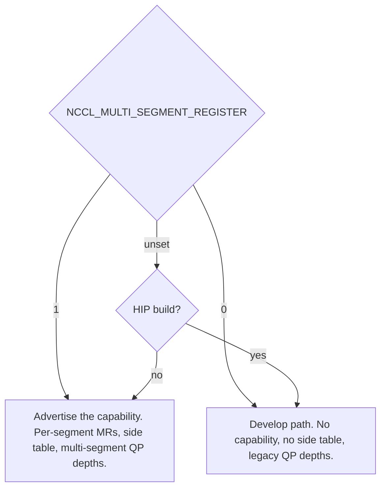

With the switch off, connect does not advertise `NCCL_IB_CAP_MULTISEG` and does not append the side table, so the sender QP stays at `2 * NET_IB_MAX_REQUESTS`. NET, P2P IPC and NVLS leave a multi-segment buffer unregistered. GIN and RMA stay on develop's bodies and do not reserve credits. A device-only GIN window with more than one segment and no sysmem returns `ncclInvalidUsage` instead of registering only the first segment.

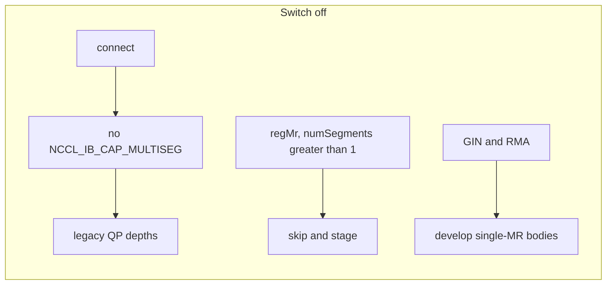

The direct-GDR flush QP is sized for one chain on every proxy step. `recvProxyProgress` posts `iflush` into `requests[step % NCCL_STEPS]` and returns before that flush is polled, so up to 8 flushes can be outstanding. With `RCCL_GDR_FLUSH_GPU_MEM_NO_RELAXED_ORDERING=0`, `rcclIbIflushMultiSeg` posts one RDMA read per receive per segment, at most `8 * 16 = 128` work requests, and signals only the last. Eight chains need `8 * 128 = 1024` slots. The previous depth, `NET_IB_MAX_REQUESTS + 128 = 384`, held three chains and the fourth post failed. `ncclIbFlushQpSendDepth` in `net_ib/multiseg.h` returns `NCCL_STEPS * NCCL_NET_IB_MAX_RECVS * NCCL_IB_MAX_SEGMENTS` when the peer advertised the capability, and `NET_IB_MAX_REQUESTS` (256) otherwise. Classic `ncclIbCreateFlushQp` calls it. `connect.cc` static-asserts that the multi-segment result holds at least one chain per step. The host test is `NetIbMultiSeg.FlushQpDepthCoversEveryOutstandingStep`.

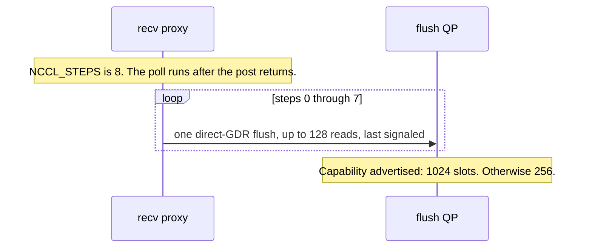

CAST non-RMA comms use the same helper. CAST RMA comms keep `NCCL_RMA_MAX_FLUSH_QP_WRS` (271), because RMA credits wait until one chain completes before the next post. With the switch off every flush QP stays at 256.

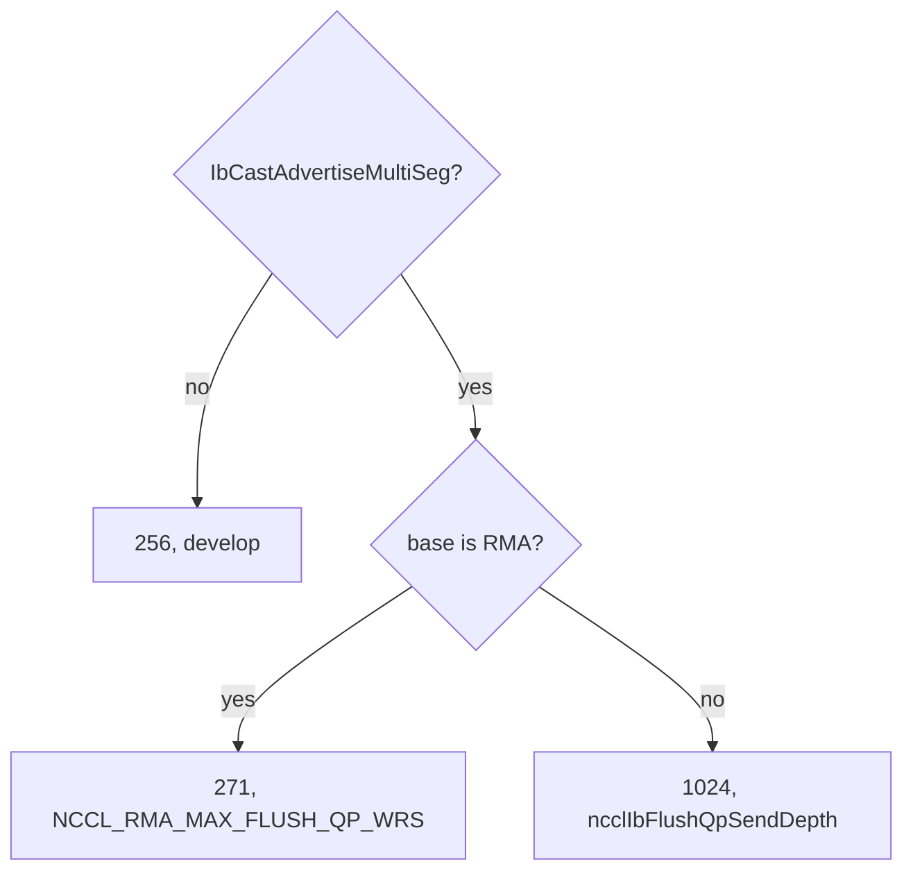

The scratchpad flush (`RCCL_GDR_FLUSH_GPU_MEM_NO_RELAXED_ORDERING=1`, the default) posts one write and one read and does not fill 1024 slots. The enlarged depth is for the direct-GDR path. `net_ib_multisegment_flush` selects that path by setting the parameter to 0.

Jobs that test the feature set `NCCL_MULTI_SEGMENT_REGISTER=1` in the runner config, because an unset HIP job now takes the off path. Register-off jobs stay at 0. `cast_multisegment_opt_recv_2qp` inherits 1 from `cast_multisegment_opt_recv`. `net_ib_rma_multisegment_wrbatch` on the wire branch, and the hybrid nightly jobs on 09 including `net_ib_multisegment_hybrid_stress_nightly`, set 1 as well. The WR-batch job fails under `RCCL_TEST_RMA_MSEG_REQUIRE=1` when the per-segment registration log is missing, and the hybrid IGet stress skips. `multisegment_host_boundary_math` is host-only and does not read the switch.

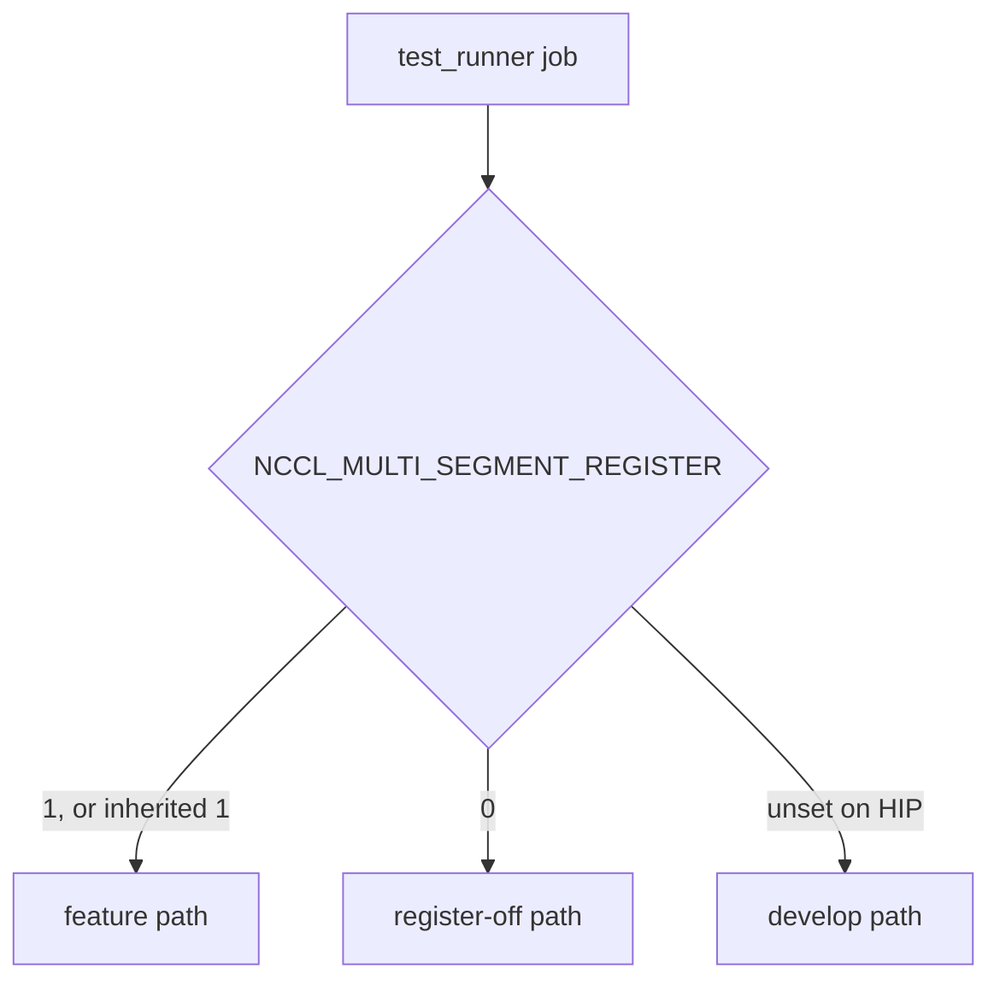

## What changed on 2026-10-14

- The interim RCCL-only headers and sources (`gin_multiseg.h`, `p2p_multiseg.h`, `rccl_reg_multiseg.cc`, `rccl_ib_multiseg.cc`, `p2p_multiseg_cast.h`, `gin_multiseg_cast.h`) were folded back into the files they hook. Develop's functions still carry one-line hooks; the bodies are separate `RCCL:`-marked functions in the same file (item 23).
- NET multi-segment registration goes through the existing `regMrDmaBuf` hook with `fd = -1` and a packed segment count; the plugin's `reg.cc` walks the range (item 21). `rcclNetIbRegMrMultiSeg` is gone.
- The peer-cap decline is receive-only on classic and CAST; CAST keeps CTS offload, BY_ORDER and QP sharing declines on both sides (item 19).
- `ncclIbRecvComm::remSegLayout` is allocated only for a capable peer on both transports (item 13).
- CAST RMA uses `NCCL_RMA_MAX_SEND_QP_WRS` / `NCCL_RMA_MAX_FLUSH_QP_WRS` directly; the `NCCL_IB_RMA_MAX_*` aliases are gone. CAST's segmented builder also bounds its own `nreqs` reload (item 15).

## What changed since the 2026-10-07 revision

- The stack was reworked so that develop functions carry one-line hooks into separate multi-segment bodies (then in RCCL-only files, folded back on 2026-10-14). Item 23 lists the layout per layer.
- `NCCL_MULTI_SEGMENT_REGISTER=0` is now a full off switch for P2P, GIN and RMA (item 22). The consensus buffer is allocated only when the switch is on (item 3).
- `rma_multiseg.h` now exists from layer 05 on (`net_ib/rma_multiseg.h`), not only at the wire layer. The helper table drops the removed `ncclRmaTranscriptHeaderOk`; CAST checks the transcript magic and version inline.
- The NET multi-segment registration entry moved out of `net.cc` (`netIbRegMrMultiSeg`); on 2026-10-14 it moved again, into each plugin's `reg.cc` (item 21).
- The probe-kind allgather moved to `rcclDevrProbeNonSymWindow` in `rccl_dev_runtime.cc` (item 20).
- CAST P2P declines now live in `net_ib_cast/rccl_reg_multiseg_cast.cc` (item 19).

---

## What a put does

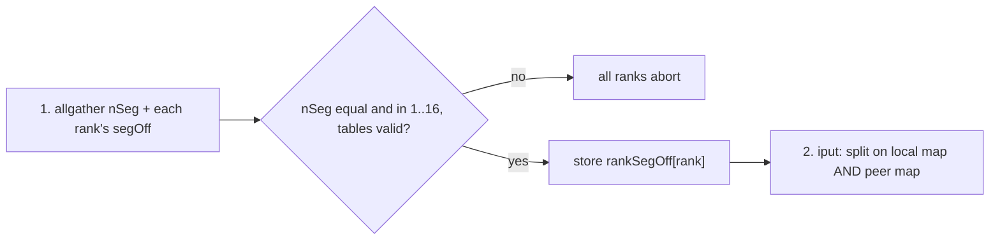

GIN needs the **same number of segments**. Sizes may differ per rank.
Classic P2P does not compare layouts across ranks: the receiver sends its own segment table per CTS slot, and the sender splits against it (item 13).

---

## 1. Different window sizes (GIN)

Each rank may register a different size. Example: both ranks have two segments and 6 MiB total, but the split is not the same.

```text
rank 0:  [4 MiB GPU][2 MiB CPU]
rank 1:  [2 MiB GPU][4 MiB CPU]
```

The put already splits local vs remote independently. Each side uses **that rank’s** `segOff` row.

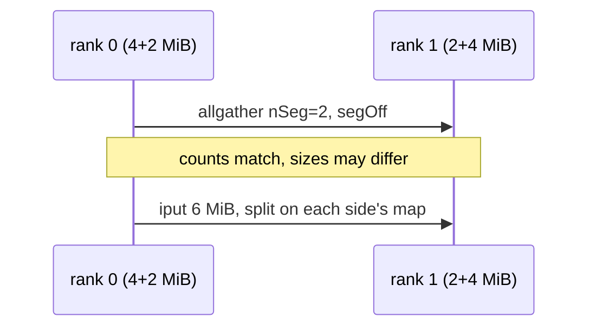

```text
rankSegOff[rank * (MAX_SEGMENTS + 1) + s]  = that rank's segOff[s]
ncclRmaPeerSegOff(table, local, rank)      = that row, or local if table is null
```

- Reject if `nSeg` differs or is outside `[1, 16]`, or if a peer's table is malformed (item 16).
- VA allgather index is still `rank * nSeg + seg` (count must match).

Tests: `RegisterEqualCountDifferentBoundariesTransfer`. Unequal **counts** still fail (`RegisterAsymmetricSegmentCountRejected`).

---

## 2. Prefix post — keep the request, return success

`ibv_post_send` can accept a **prefix** of a chained WR list. Only the last WR is signaled.
If you drop the request on error, the CQE for the accepted WRs has nowhere to go.
Callers `NCCLCHECK` the complete helper, so an error return also skips `Test()`.

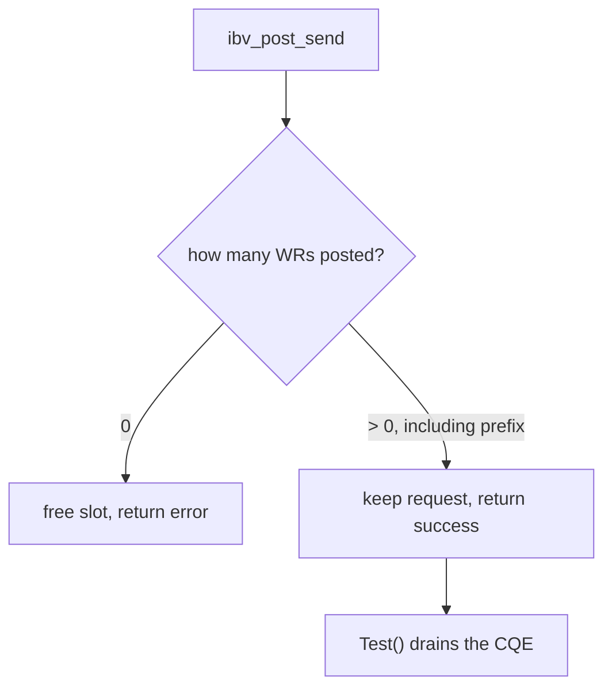

`ncclRmaPostedRequestStatus` (`rma_multiseg.h`) returns **success** when `posted > 0`, even if `ibv_post_send` itself failed, or `NCCLCHECK` skips `Test()`. `ncclRmaCompletePostedRequest` (also `rma_multiseg.h`) wraps it for both backends: keep the request, and mark **FAILED** if the prefix stopped before the signaled tail. Classic applies it in `ncclRmaFinishPostedRequest` (`net_ib/gin.cc`) and returns the sequence id with `ncclRmaReleaseSeqId` when nothing posted; CAST applies it in `IbCastRmaCompletePostedRequest` (`net_ib_cast/gin.cc`) and also returns credits for the unposted tail. Classic `Test()` reports a FAILED request through `rcclRmaIbProxyTestFailed`.

P2P flush follows the same rule: `rcclIbIflushMultiSeg` (classic) and `rcclIbCastIflushMultiSeg` (CAST) mark a prefix post FAILED and keep the request, so its `Test()` reports the error. A partly posted CAST send does the same.

---

## 3. Registration AllGather always runs

A local calloc miss must still meet peers in the collective. Do not `goto fail` before the first allgather.

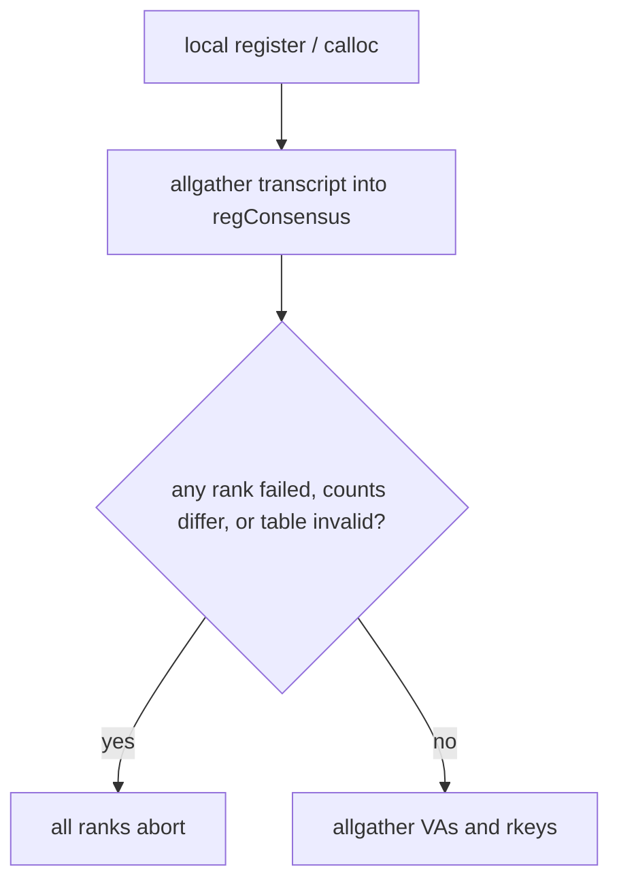

The gather target is `regConsensus`, one record per rank, allocated per communicator at connect time with `ncclIbMalloc` and freed on close. Classic allocates it in `rcclRmaIbProxyConnectFinish`, called from `ncclRmaIbProxyConnect`; CAST allocates it in `rcclIbCastRmaIbProxyConnectFinish`. Both allocate only when `rcclRmaMultiSegEnabled()` is true. Registration therefore has nothing to allocate before its first collective, at any `nranks`. Allocation failures after the first gather (`rankSegOff`, `base_vas`, `rkeys`, CAST `ibDevNs`) are reconciled by a second gather of the same record.

---

## 4. Host VMM length (`segBase == 0`)

`cuMemGetAddressRange` on a host VMM segment can return `segBase == 0`. `segSize - (segPtr - segBase)` would wrap. Same rule as `alloc.h`:

```text
inSeg = (segBase == 0) ? segSize : segSize - (segPtr - segBase)
thisLen = min(remaining, inSeg)
```

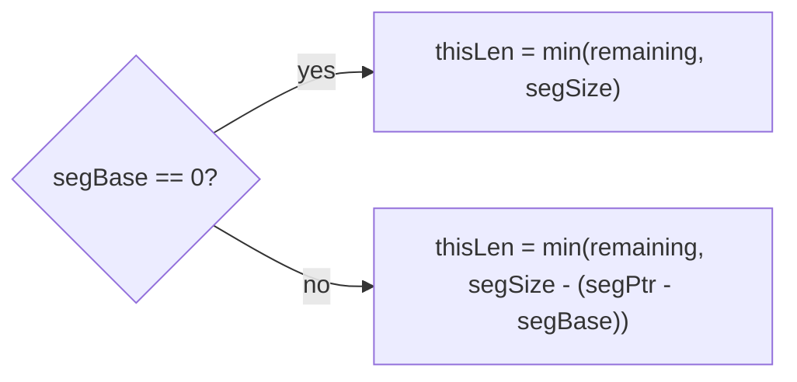

The NET path uses the same rule through `ncclIbBytesRemainingInSegment` (`multiseg.h`).

---

## 5. Flush QP device indices

The flush QP is loopback. Set both indices when it is created, or IFlush reads uninitialized `devIndex` / `remDevIdx`. Classic creates it lazily on the first flush (`ncclIbCreateFlushQp`).


---

## 6. WR budget — 4× segments

`2 * 16` only covered aligned boundaries. A 16-segment 8 GiB window with `UINT32_MAX` SGE splits needs 48 WRs. Cap is `NCCL_RMA_MAX_DATA_WRS = 64`. Overflow fails closed before posting (`ncclRmaDataWrBudgetFull`).

| Macro | Value |
|---|---|
| `NCCL_RMA_MAX_DATA_WRS` | **64** (`4 * 16`) |
| `NCCL_RMA_MAX_SIGNAL_WRS` | **65** |
| Classic GIN send QP `NCCL_RMA_SEND_QP_WRS` | **769** (equals `NCCL_IB_MAX_SEND_WRS`, `static_assert`ed in `connect.cc`) |
| CAST GIN send QP `NCCL_RMA_MAX_SEND_QP_WRS` | **575** (`2*256 + 65 - 2`) |
| CAST GIN flush array / flush QP | 16 / 271 (`NCCL_RMA_MAX_FLUSH_QP_WRS`) |

These depths apply only with `NCCL_MULTI_SEGMENT_REGISTER=1`; at 0 develop's depths apply (item 22). CAST GIN **admits** against its depth (`IbCastRmaReserveWrs`). Classic GIN and classic/CAST P2P do not use that counter. Classic GIN batches WRs (`NCCL_RMA_IB_WR_BATCHSIZE`, default 64); a chain longer than the batch posts directly. See the next section.

---

## 6a. P2P send queue versus a fat WR chain

One logical send/flush is no longer one WQE. Only the **last** WR is signaled, so the SQ holds every unsignaled slice until that CQE.

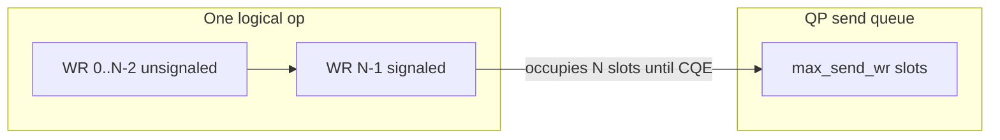

Worst-case **N** (builder cap, not “one WR per request”), with the switch on:

| Path | Chain width | QP `max_send_wr` | Admission |
|---|---|---|---|
| Classic P2P send | `NCCL_IB_MAX_WRS_PER_SEND+1` = **257** | `NCCL_IB_MAX_SEND_WRS` = **769** | none — post if a request slot is free |
| CAST P2P send | 257 | `NCCL_IB_MAX_SEND_WRS` = **769** | **one other segmented group** deferred (`IbCastHasOtherSegmentedSend`) |
| Classic P2P flush | `8*16` = **128** | `NCCL_STEPS * 128` = **1024** when the cap is advertised, else 256 | none |
| CAST P2P flush | 128 | `IbCastFlushQpSendDepth` = **1024** (RMA comms stay 271) | none |
| CAST GIN iputSignal | **65** | **575** | `rmaWrsOutstanding` wait (item 17) |
| Classic GIN iputSignal | 65 | **769** | none; rejected posts fail closed |

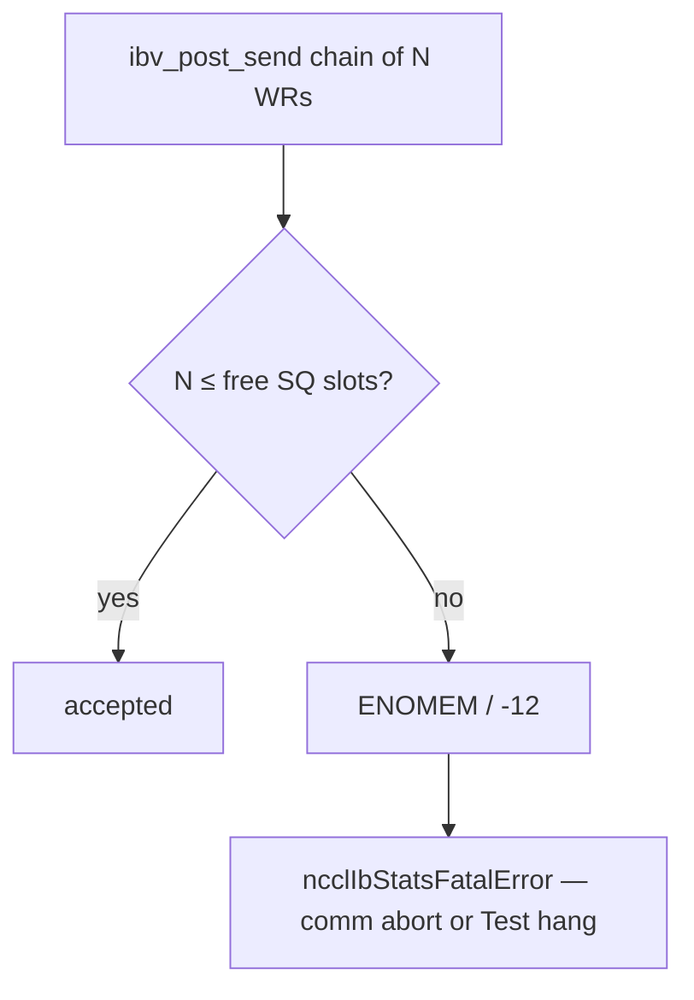

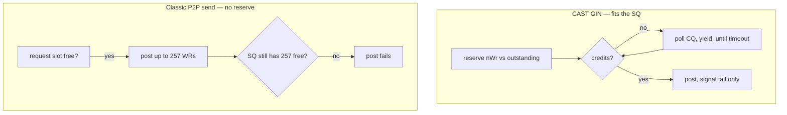

Both P2P send QPs hold the ordinary budget (two WRs per request slot) plus **one** fat chain of 257. Classic has no one-group gate, so two overlapping max-width classic sends can still exceed the queue; CAST defers the second. Both flush QPs fit one 128-WR flush chain alongside the ordinary budget. The classic CTS QP adds `NET_IB_MAX_REQUESTS*(res?1:2)` WRs to develop's depth for the side-table writes. Ordinary Ring AllReduce of one 4-segment window posts one modest chain and does not hit this. CTS stress / many outstanding 8-recv × 16-seg sends can (opt-in test `NetIB_MultiSeg_SendQueueFatChainOversubscribe`, `RCCL_MSEG_SQ_STRESS=1`).

Do **not** size the QP for `32 × 257`. Provider `max_qp_wr` will reject it.

---

## 7. NET cache stores the real count

Generic local-register walks the complete registration and caches the count in `ncclReg::rcclNet.nSegments` (`rcclNetRegSegmentCount`, then `rcclNetRegCommit` after every peer registered, which also sets `rcclNet.allPeers`). The test asserts **`== 8`**, not “greater than 1”. A 4-segment prefix would still be `> 1`. The walk length is `endAddr - begAddr - pageSize + 1`, so it stops inside the last registered page (item 21).

---

## 8. DeepEP elastic — own process

`UBR_MultiSegment_All_Core` excludes `DeepEP_ElasticWindowRegistration` (same-process OOM after `Symmetric_Elastic_Lsa`). The dedicated DeepEP job still runs it. Same filter on all six architecture JSONs.

---

## Shared helpers — `rma_multiseg.h`

`net_ib/rma_multiseg.h` is introduced on layer 05 and grows on the later layers. Classic `gin.cc` and `connect.cc` include it directly; CAST includes it through `common_cast.h`. It includes `multiseg.h`, so `NCCL_RMA_MAX_SEGMENTS` equals `NCCL_IB_MAX_SEGMENTS`. Do not co-include `gin.h` and `gin_cast.h` (same include guard).

| Helper | Role |
|---|---|
| `rcclRmaMultiSegEnabled` | reads `NCCL_MULTI_SEGMENT_REGISTER` for GIN/RMA dispatch |
| `ncclRmaSegmentCountsMatch` | GIN registration: equal `nSeg` in `[1, 16]` |
| `ncclRmaSegOffTableValid` | GIN registration: peer `segOff` starts at 0 and never decreases |
| `ncclRmaPeerSegOff` | row of `rankSegOff` |
| `ncclRmaPostedRequestStatus` | prefix post → success so drain happens |
| `ncclRmaCompletePostedRequest` | both backends: keep request; FAILED if signaled tail was not posted |
| `ncclRmaSegmentSliceBytes` | `min(rem, local, remote, UINT32_MAX)` |
| `ncclRmaWrCreditsAvailable` | CAST credit check against the QP depth |
| `ncclRmaDevSlotOf` / `ncclRmaRkeyIbDevN` | CAST: physical `ibDevN` to registration slot |

CAST checks the registration transcript magic and version (`IBCAST_RMA_REGISTRATION_MAGIC`, `net_ib_cast/gin.cc`) inline in `rcclIbCastRmaIbProxyRegMrSymDmaBuf`.

CAST rkeys are looked up by **physical `ibDevN`**, not raw `qp->remDevIdx`. Classic GIN indexes rkeys by `remDevIdx`. CAST recv QP sizing must not dereference a NULL resiliency pointer.

The INFO line `multi-segment buffer` is diagnostic. Do not treat a log substring as the test contract; use handle `nSegments`.

---

## 9. Host VMM location

Production AMD create/probe uses `hipMemLocationTypeHost` with `location.id = 0` (`rocmwrap.cc` / `alloc.h`). CLR still rejects `hipMemLocationTypeHostNuma` (AIRUNTIME-2638). `NCCL_CUMEM_HOST_VERSION_SUPPORTED` (`rocmwrap.h`) accepts native ROCm 7.12.60540 or later, or the 7.0.2.x backport window starting at `ROCM_VER_7_0_2_2` (`HIP_VERSION` 70051831). `NCCL_CUMEM_HOST_GATE` also requires the CMake probe `RCCL_HIP_MEM_LOCATION_HOST_SUPPORTED`. `hipMalloc` is a single allocation, not a multi-segment VMM window.

```text
prop.location.type = hipMemLocationTypeHost;  // not HostNuma
prop.location.id   = 0;
```

A host segment on one LSA rank and a device segment at the same index on another is **rejected** (`ncclInvalidUsage`) when sysmem-handle reuse is on. Host VMM cannot be exported through IPC; the non-symmetric path allgathers each rank's kind first (item 20). GIN then stores host segments as `CU_MEM_LOCATION_TYPE_HOST_NUMA` so the device put-fence sees sysmem (AMD’s enumerator is `hipMemLocationTypeHost`).

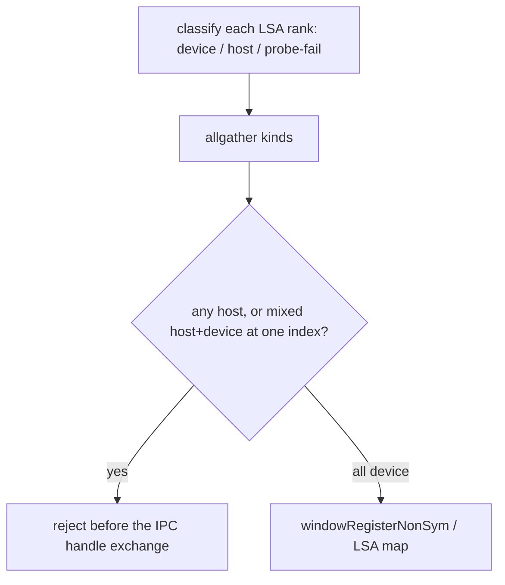

The host-location unit test is committed in `test/host/dev-runtime-test.cc`.

---

## 10. CAST covering MR + develop QP sharing

`segLayoutFifo` is `static_assert`ed immediately after `ctsFifo`. Connect registers **one** covering MR when it advertises the capability (`IbCastAdvertiseMultiSeg`); `meta.addr` stays `ctsFifo`. Capability still lives in the `devName` trailer (`ncclIbSetConnectCaps`), and `connect_cast.h` asserts the `ndevs` and `devName` offsets. Develop already added `sharedGroupIdx` / `commId` / `senderIbDevIdx` after `isRMA`; this stack does not append a `caps` field. CAST P2P indexes `segMrs[][]` directly. The receiver's side-table staging MR (`segLayoutFifoMr`) is registered with `IBV_ACCESS_LOCAL_WRITE` only. Multi-segment registration is declined while QP sharing is enabled (item 19).

---

## 11. CE AllReduce FORCE-unregistered

Develop added `RCCL_CE_SCRATCH` (`rcclUseCeAr2Shot`) for AG/A2A. In the AllReduce selector (`rccl_wrap.cc`), the first FORCE-unregistered AllReduce still reports `RCCL_CE_REGISTERED` while `ceARTmpBuf` is NULL, so enqueue initializes CE instead of hanging in IPC registration; `RCCL_CE_2SHOT` requires a non-NULL `ceARTmpBuf`. The arm is taken only outside a group, when graph capture allows CE, when `rcclUseCeAr2Shot` accepts the call, and when symmetric kernels were not requested. Staging size is `NCCL_CE_AR_TMPBUF_DEFAULT_BYTES` (256 MiB). The test-only fault bit `CE_FAULT_LEGACY_RECV_OFFSET` (0x10) is committed in `ce_fault_inject.h`.

---

## 12. Whole-page export per segment MR (GIN)

Both GIN paths export each segment from the page containing the segment pointer, rounded up to whole pages (`ncclOsGetPageSize`), because the MR spans whole pages at DMA-BUF offset 0. The NET P2P path exports the exact segment range.

---

## 13. Side table only for multi-segment slots (classic P2P)

`rcclIbIrecvFillSideTable` writes side entries only to a capable peer, and `rcclIbPostFifoSideWr` RDMA-writes the side table only when some receive in the slot is multi-segment. Then `rcclIbCtsFlagSideTable` sets `NCCL_IB_CTS_NREQS_SIDE_TABLE` in every CTS entry's `nreqs`, and the sender waits for the side table (`rcclIbIsendWaitSideTable`) only in that case. The side WR is unsignaled, chained before the CTS, and carries the CTS `wr_id`. A single-segment slot is the legacy wire format. CAST still publishes the side table on every CTS to a capable peer.

The receiver's staging table `ncclIbRecvComm::remSegLayout` (256 × 8 × 704 B, about 1.44 MB) is a pointer on classic and CAST, allocated and registered only when the peer advertised `NCCL_IB_CAP_MULTISEG`. The sender's `segLayoutFifo` stays inline, because the peer RDMA-writes it at `ctsFifo + sizeof(ctsFifo)` through the CTS MR.

---

## 14. Full size for a single segmented receive (classic P2P)

`ncclIbMultiSendSegmented` (`net_ib/p2p.cc`) writes the sizes WR when `nreqs > 1`, or when the receiver does not match by index (for example BY_ID) and the size is nonzero. A single segmented receive therefore reports its full size. CAST `IbCastMultiSendSegmented` always writes it for a segmented send.

---

## 15. CTS `nreqs` bound

The sender rejects a peer CTS whose `nreqs` (flag stripped by `ncclIbCtsNreqs`) is above `NCCL_NET_IB_MAX_RECVS` before waiting on any side slot, so a corrupt count cannot index past the slot. CAST also rejects `nreqs < 1`, both in `IbCastIsend` and when `IbCastMultiSendSegmented` reloads the slot.

---

## 16. Peer segment-table validation

- GIN: `ncclRmaSegOffTableValid` rejects a peer `segOff` table that does not start at 0 or decreases, on every rank.
- P2P: `ncclIbCtsRemoteLayoutValid` rejects a side entry whose count is outside `[1, 16]`, whose `remDevIdx` is out of range, whose starts do not strictly increase, or whose rkey is zero. The sender snapshots the entry once and clips it to the request end.

---

## 17. CAST credit-wait timeout

`IbCastRmaReserveWrs` polls the CQ and yields until credits free. The wait is bounded by `IbCastRmaCreditTimeoutNs`: `4.096 µs × 2^NCCL_IB_TIMEOUT × (NCCL_IB_RETRY_CNT + 1)` (clamped to 31 and 7), and never less than 2 s, so a link that is still retrying does not fail the post. On timeout it returns `ncclRemoteError`.

---

## 18. FAILED-owner propagation (CAST GIN)

After a QP error every flushed WQE completes with its owner's `wr_id`. `IbCastRmaPollCq` logs each error CQE and marks the owner `NCCL_NET_IB_REQ_FAILED` even when another request's `Test()` drained it, so the owner's own `Test()` fails instead of spinning. `IbCastRmaAccountCompletion` counts only the first flushed WQE of a request; `IbCastRmaRefundWrs` guards against credit underflow. The AINIC recovery path abandons device RMA requests (`IbCastRmaAbandonDeviceRequests`) only when the communicator is RMA and the switch is on.

---

## 19. CAST P2P declines

`IbCastRegMrDmaBufMultiSeg` (`net_ib_cast/rccl_reg_multiseg_cast.cc`) declines `nSegments > 1` on **both** sides when CTS offload is on (the sender would post one SGE with segment 0's lkey), under BY_ORDER matching (segmented writes carry no per-immediate `byte_len`, so a receive would report its size plus 4 bytes per QP), or when QP sharing is enabled (no `commId` or per-QP WR budget in segmented writes). These are limits of CAST's segmented send engine. It declines on the **receive** side only when the peer lacks `NCCL_IB_CAP_MULTISEG`: the side table describes the receiver, and a sender splits locally onto the receiver's single rkey. A decline stages the collective. Classic `ncclIbRegMrDmaBufMultiSeg` (`net_ib/reg.cc`) has only the receive-side peer-cap rule. With the switch off, the receiver declines and the sender registers; `MultiSegmentRegisterOff_DeclinesRegistration` checks both.

---

## 20. Probe-kind allgather

On the non-symmetric window path, `rcclDevrProbeNonSymWindow` (`rccl_dev_runtime.cc`) has each LSA rank allgather a fixed `int kinds[NCCL_MAX_LOCAL_RANKS]` (0 = device, 1 = host, 2 = probe failed) with `bootstrapIntraNodeAllGather` before any IPC handle exchange. Any failed kind returns an error on every rank, and any host kind rejects ("Host-backed VMM cannot be exported via IPC"). It errors if `lsaSize > NCCL_MAX_LOCAL_RANKS`, and is skipped when VMM allocation (cuMem) is off. `dev_runtime.cc` keeps a one-line call.

---

## 21. NET segment walk ends inside the last page

`endAddr` is page-rounded, but `hipMalloc` reports an unrounded size, so the walk covers `endAddr - begAddr - pageSize + 1` bytes and never queries past the allocation. `net.cc` calls the plugin's `regMrDmaBuf` from `sendProxyRegBuffer` / `recvProxyRegBuffer` with `fd = -1` and `offset = (export flags << 32) | numSegments` only when `numSegments > 1`. Classic `ncclIbRegMrDmaBuf` and CAST `IbCastRegMrDmaBuf` route that to `rcclIbRegMrDmaBufFromRange` / `IbCastRegMrDmaBufFromRange` (`reg.cc`), which export one fd per segment, reject a walk that did not cover every byte or produced a different count (`remaining != 0 || nSeg != nExpect`), apply `ncclIbSegmentsUniform`, and call `ncclIbRegMrDmaBufMultiSeg` or `IbCastRegMrDmaBufMultiSeg`. Any other plugin rejects the invalid fd and the collective stages.

---

## 22. Runtime switch

`NCCL_MULTI_SEGMENT_REGISTER` (`ncclParamMultiSegmentRegister()`, HIP default 0, non-HIP default 1) gates every multi-segment path. Classic reads it through `ncclIbAdvertiseMultiSeg()` (`net_ib/connect.cc`), CAST P2P through `IbCastAdvertiseMultiSeg()` (`connect_cast.h`), and GIN/RMA through `rcclRmaMultiSegEnabled()` (`rma_multiseg.h`). At 0:

- Neither plugin advertises `NCCL_IB_CAP_MULTISEG` or sizes the CTS MR for the side table. CAST masks the peer's capability to 0.
- NET skips multi-segment registration (staging), and a one-segment slice of a multi-segment registration also skips NET. Called directly, the plugin declines a multi-segment registration on the receiver and accepts it on the sender.
- Develop's P2P, CTS, flush and RMA QP depths apply, and `regConsensus` is not allocated.
- Classic and CAST `gin.cc` run develop's bodies; the `rcclRmaIbProxy*` / `rcclIbCastRmaIbProxy*` dispatches are skipped.
- `symMemoryRegisterGin` fails a device-only multi-segment window with `ncclInvalidUsage` ("GIN needs NCCL_MULTI_SEGMENT_REGISTER=1"). Windows that contain sysmem keep develop's per-segment path.
- `symMemoryRegisterRma` registers a multi-segment window only when `rcclDevrRmaRegistersMultiSegment(comm)` is true: the switch is on and the backend is the internal classic `ncclRmaIbProxy`.

---

## 23. Where the code lives

| Branch (`users/atulkulk/mseg/...`) | Multi-segment code |
|---|---|
| `02-amd-host-vmm-compat` | `rccl_dev_runtime.cc`: `rcclDevrProbeNonSymWindow`, `rcclDevrGinSegmentRegType`, `rcclDevrRmaRegistersMultiSegment` |
| `03-registration-range` | `rccl_wrap.cc`: `rcclNetRegSegmentCount`, `rcclNetGraphRegSegmentCount`, `rcclNetRegCommit` |
| `05-gin-rma-multisegment` | `net_ib/rma_multiseg.h` (shared helpers), `net_ib/gin.cc` (classic GIN bodies) |
| `06-classic-netib-multisegment` | `net_ib/multiseg.h`, `net_ib/p2p.cc` (`rcclIb*` bodies), `net_ib/reg.cc` (range walk and per-segment registration), `transport/net.cc` (`fd = -1` call), `transport/rccl_ib_multiseg.h` (declarations) |
| `07-hybrid-stress-ci` | tests and CI jobs only |
| `08-cast-netib-multisegment` | `net_ib_cast/p2p.cc` (`rcclIbCast*` bodies), `net_ib_cast/reg.cc` (range walk), `net_ib_cast/rccl_reg_multiseg_cast.cc` (per-segment registration and declines) |
| `multi-segment-dmabuf-cast-gin` | `net_ib_cast/gin.cc` (CAST GIN bodies) |

In the upstream-derived files (`net.cc`, `net_ib/p2p.cc`, `net_ib/reg.cc`, `net_ib/gin.cc`, `net_ib_cast/p2p.cc`, `net_ib_cast/reg.cc`, `net_ib_cast/gin.cc`), develop's functions carry one-line hooks into separate `RCCL:`-marked functions in the same file; `dev_runtime.cc` carries one-line calls into `rccl_dev_runtime.cc`. See [`multi_segment_sync_and_removal.md`](multi_segment_sync_and_removal.md).
