# Multi-Segment DMA-BUF GDR in RCCL — GIN/RMA + Classic NET/IB + CAST

**This is the source-of-truth overview.** Design rationale **and** a file-by-file code walkthrough for multi-segment cuMem/VMM DMA-BUF registration across all three IB paths: the **classic GIN/RMA proxy**, the **classic NET/IB P2P** transport, and the **CAST** fork (P2P and GIN/RMA). Includes sequence + flowchart diagrams and the testing strategy. Shared facts (constants, the v14 GIN/RMA split, the capability trailer, credits/signaling, the registration transcript) live here; the transport-specific docs link back instead of restating them.

- **Last updated:** 2026-10-16, against the wire branch `users/atulkulk/mseg/multi-segment-dmabuf-cast-gin` and the stacked branches below it (rebased on `develop`).
- **Tickets:** feature JIRA AICOMRCCL-1526; the original ROCm export limitation is tracked as AIRUNTIME-2351 (cited in the code comments).
- **Current contract (short):** [`multi_segment_current.md`](multi_segment_current.md) — per-rank GIN `segOff`, prefix-post drain, WR budget 64, P2P send queue vs a fat WR chain, mixed LSA host/device reject, per-comm registration consensus, side table only for multi-segment slots. On HIP the register switch defaults to 0, and a direct-GDR flush QP is 1024 when the peer advertised the capability.
- **Historical user branches (superseded):** `users/atulkulk/multi-segment-dmabuf` (GIN), `...-netib-classic` (rejected key-selection), `...-netib-wire`. An earlier "one collapsed branch / unstacked CAST GIN" draft is obsolete; CAST P2P (layer 08) and CAST GIN/RMA (wire) sit on classic GIN (05) and classic P2P (06).
- **Companion docs:** [`multi_segment_current.md`](multi_segment_current.md) (current contract), [`multi_segment_netib_wire.md`](multi_segment_netib_wire.md) (classic P2P), [`multi_segment_netib_classic.md`](multi_segment_netib_classic.md) (historical comparison), CAST [`multi_segment_netib_cast.md`](multi_segment_netib_cast.md) / CAST GIN [`multi_segment_netib_cast_gin.md`](multi_segment_netib_cast_gin.md), and their `_walkthrough.md` counterparts. Device-initiated AMD backends (not implemented): [`multi_segment_gin_rocshmem_gda_and_anvil_sdma.md`](multi_segment_gin_rocshmem_gda_and_anvil_sdma.md).

## Stack and PR map

The stack is linear; each layer is one pull request on [ROCm/rocm-systems](https://github.com/ROCm/rocm-systems) and builds on the one above it. Branch names share the prefix `users/atulkulk/mseg/`. The base is `develop`, which already includes CAST QP sharing, `RCCL_CE_SCRATCH`, and `rcclUseCeAr2Shot`.

| Layer | PR | Branch | Purpose | RCCL-only files added |
|---|---|---|---|---|
| 01 | [#10887](https://github.com/ROCm/rocm-systems/pull/10887) | `01-ce-recv-window-offset` | CE AllReduce receive-window offset and bounds fixes, selector gates | — |
| 02 | [#10891](https://github.com/ROCm/rocm-systems/pull/10891) | `02-amd-host-vmm-compat` | Host VMM compatibility: host location probe and shim, mixed host window classification, probe-kind allgather | `rccl_dev_runtime.cc` |
| 03 | [#10885](https://github.com/ROCm/rocm-systems/pull/10885) | `03-registration-range` | NET segment-count cache (`ncclReg::rcclNet`), last-page walk fix, graph NET segments | — (code in `rccl_wrap.cc`) |
| 05 | [#10884](https://github.com/ROCm/rocm-systems/pull/10884) | `05-gin-rma-multisegment` | Classic GIN/RMA per-segment MRs, segment-offset tables, segmented WRs, registration consensus | `net_ib/rma_multiseg.h`, `net_ib/gin.cc` |
| 06 | [#10886](https://github.com/ROCm/rocm-systems/pull/10886) | `06-classic-netib-multisegment` | Classic NET/IB P2P: 64-byte CTS + side table, capability trailer, segmented send, runtime switch | `net_ib/multiseg.h`, `net_ib/p2p.cc`, `net_ib/reg.cc`, `transport/net.cc`, `transport/rccl_ib_multiseg.h` |
| 07 | [#10890](https://github.com/ROCm/rocm-systems/pull/10890) | `07-hybrid-stress-ci` | Hybrid DeepEP VMM tests, stress, CI runner configs, non-blocking test-stream opt-in | tests only |
| 08 | [#10889](https://github.com/ROCm/rocm-systems/pull/10889) | `08-cast-netib-multisegment` | CAST P2P multi-segment (the wire option on IB-CAST) plus a CAST hardening commit | `net_ib_cast/p2p.cc`, `net_ib_cast/reg.cc`, `net_ib_cast/rccl_reg_multiseg_cast.cc` |
| wire | [#10888](https://github.com/ROCm/rocm-systems/pull/10888) | `multi-segment-dmabuf-cast-gin` | CAST GIN/RMA multi-segment, per-comm consensus, and credit fixes | `net_ib_cast/gin.cc` |

There is no layer 04. The multi-segment bodies live in the upstream-derived files they hook (`gin.cc`, `p2p.cc`, `reg.cc` for each transport), next to develop's code and marked with `RCCL:` comments; only the shared helpers (`multiseg.h`, `rma_multiseg.h`), the private declarations (`rccl_ib_multiseg.h`) and CAST's per-segment registration (`rccl_reg_multiseg_cast.cc`) are separate files. [`multi_segment_sync_and_removal.md`](multi_segment_sync_and_removal.md) lists the footprint.

## What changed on 2026-10-16

HIP now defaults `NCCL_MULTI_SEGMENT_REGISTER` to 0. The knob is still `ncclParamMultiSegmentRegister()` in `transport/generic.cc`. `NCCL_MULTI_SEGMENT_REGISTER=1` turns the feature on, on HIP and on every other build. An unset variable takes the develop path on a HIP build. A non-HIP build still defaults to 1. The commit is `9af53b9bca21` on `users/atulkulk/mseg/01-ce-recv-window-offset`, replayed through the stack.

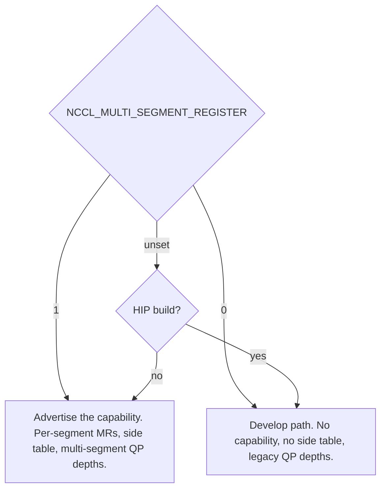

With the switch off, connect does not advertise `NCCL_IB_CAP_MULTISEG` and does not append the side table, so the sender QP stays at `2 * NET_IB_MAX_REQUESTS`. NET, P2P IPC and NVLS leave a multi-segment buffer unregistered. GIN and RMA stay on develop's bodies and do not reserve credits. A device-only GIN window with more than one segment and no sysmem returns `ncclInvalidUsage` instead of registering only the first segment.

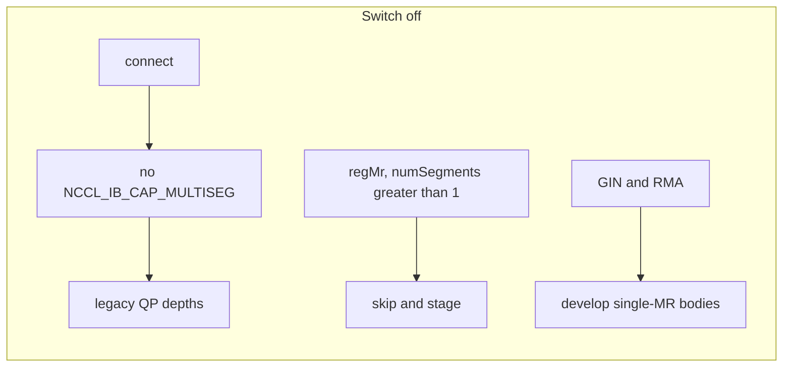

The direct-GDR flush QP is sized for one chain on every proxy step. `recvProxyProgress` posts `iflush` into `requests[step % NCCL_STEPS]` and returns before that flush is polled, so up to 8 flushes can be outstanding. With `RCCL_GDR_FLUSH_GPU_MEM_NO_RELAXED_ORDERING=0`, `rcclIbIflushMultiSeg` posts one RDMA read per receive per segment, at most `8 * 16 = 128` work requests, and signals only the last. Eight chains need `8 * 128 = 1024` slots. The previous depth, `NET_IB_MAX_REQUESTS + 128 = 384`, held three chains and the fourth post failed. `ncclIbFlushQpSendDepth` in `net_ib/multiseg.h` returns `NCCL_STEPS * NCCL_NET_IB_MAX_RECVS * NCCL_IB_MAX_SEGMENTS` when the peer advertised the capability, and `NET_IB_MAX_REQUESTS` (256) otherwise. Classic `ncclIbCreateFlushQp` calls it. `connect.cc` static-asserts that the multi-segment result holds at least one chain per step. The host test is `NetIbMultiSeg.FlushQpDepthCoversEveryOutstandingStep`.

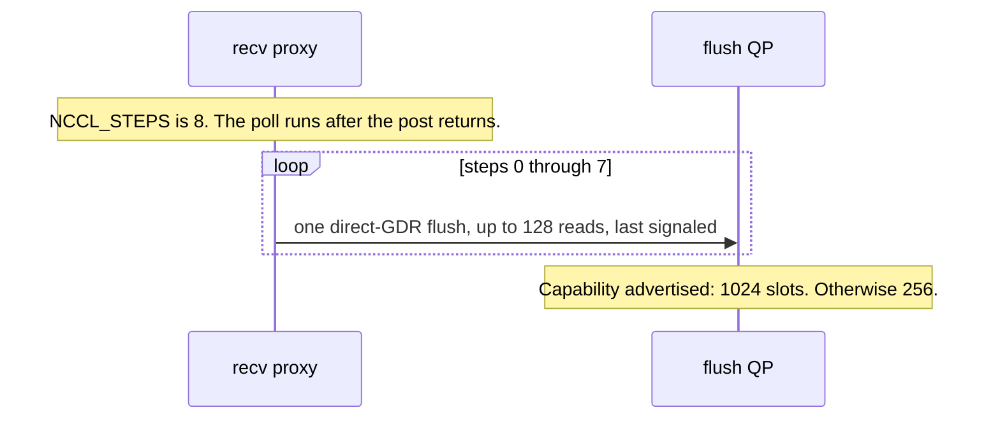

CAST non-RMA comms use the same helper. CAST RMA comms keep `NCCL_RMA_MAX_FLUSH_QP_WRS` (271), because RMA credits wait until one chain completes before the next post. With the switch off every flush QP stays at 256.

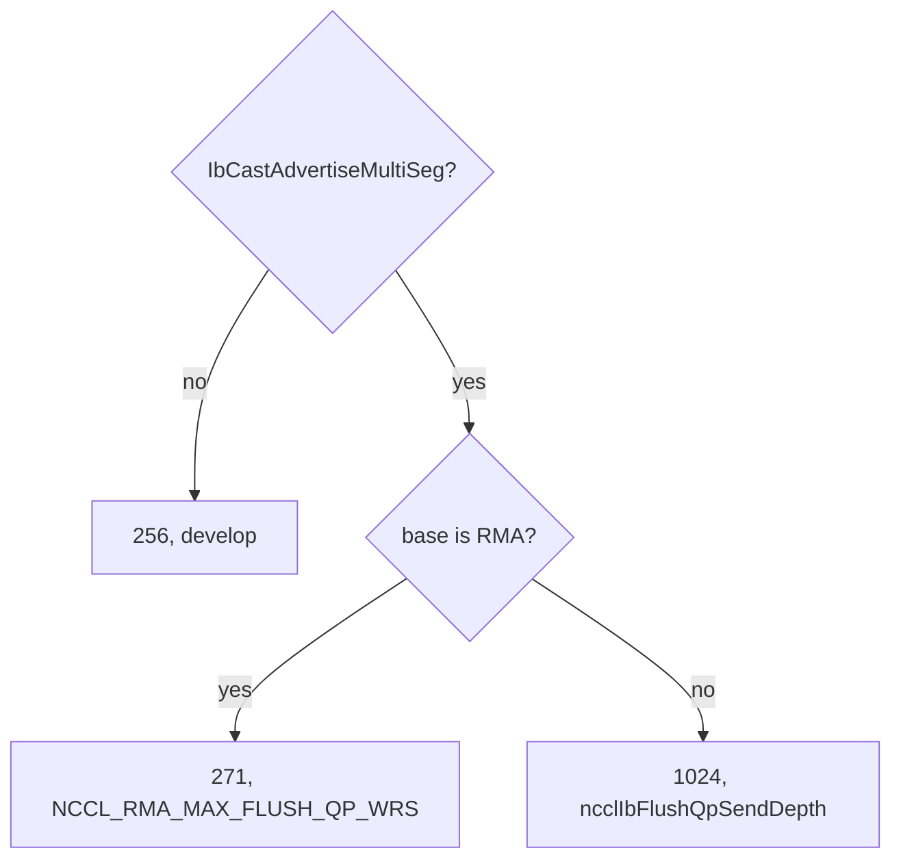

The scratchpad flush (`RCCL_GDR_FLUSH_GPU_MEM_NO_RELAXED_ORDERING=1`, the default) posts one write and one read and does not fill 1024 slots. The enlarged depth is for the direct-GDR path. `net_ib_multisegment_flush` selects that path by setting the parameter to 0.

Jobs that test the feature set `NCCL_MULTI_SEGMENT_REGISTER=1` in the runner config, because an unset HIP job now takes the off path. Register-off jobs stay at 0. `cast_multisegment_opt_recv_2qp` inherits 1 from `cast_multisegment_opt_recv`. `net_ib_rma_multisegment_wrbatch` on the wire branch, and the hybrid nightly jobs on 09 including `net_ib_multisegment_hybrid_stress_nightly`, set 1 as well. The WR-batch job fails under `RCCL_TEST_RMA_MSEG_REQUIRE=1` when the per-segment registration log is missing, and the hybrid IGet stress skips. `multisegment_host_boundary_math` is host-only and does not read the switch.

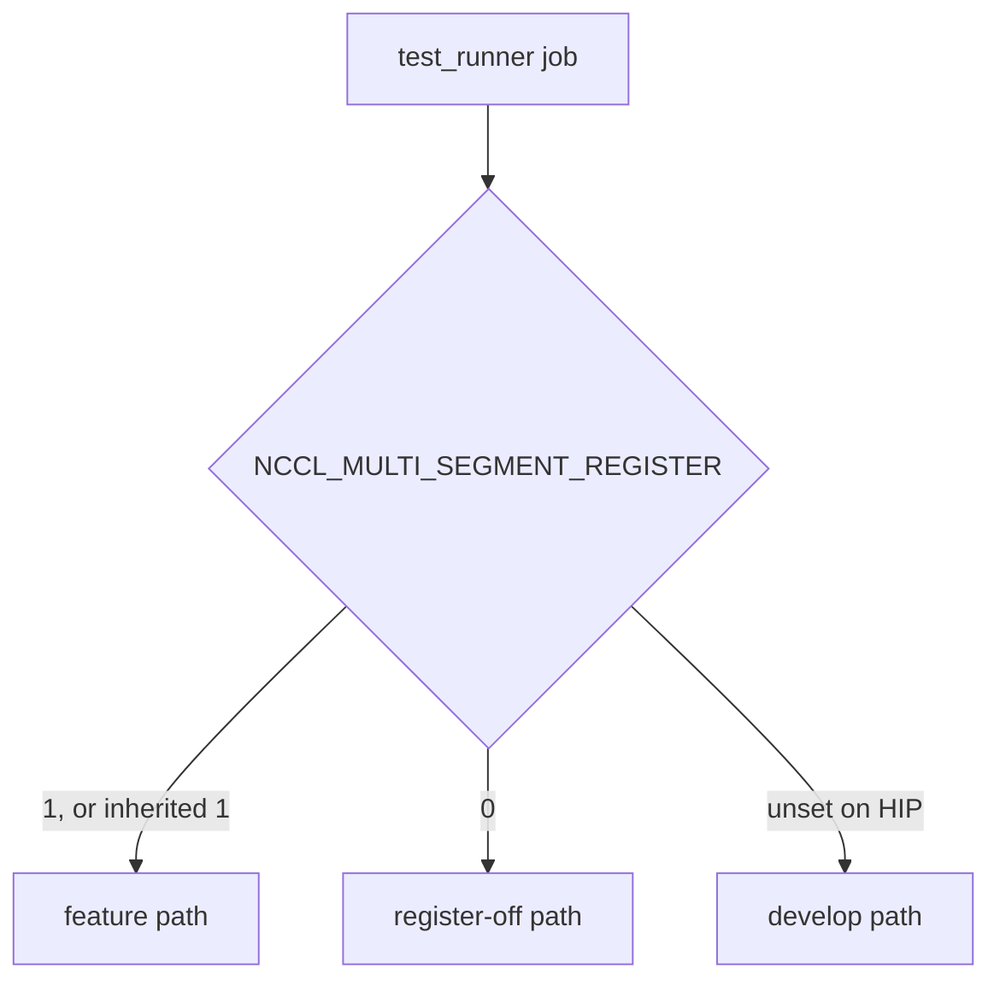

## What changed on 2026-10-14

- **Headers folded back.** `net_ib/gin_multiseg.h`, `net_ib/p2p_multiseg.h`, `net_ib/rccl_reg_multiseg.cc`, `transport/rccl_ib_multiseg.cc`, `net_ib_cast/p2p_multiseg_cast.h` and `net_ib_cast/gin_multiseg_cast.h` are gone. Their bodies sit in the file each one hooked (`gin.cc`, `p2p.cc`, `reg.cc`, `net.cc`), so an upstream sync carries one file per hook rather than a second, separately included file.
- **Registration path.** `net.cc` no longer exports fds: for `numSegments > 1` it calls the plugin's `regMrDmaBuf` once with `fd = -1` and `offset = (export flags << 32) | numSegments`. Each plugin's `reg.cc` walks the range, exports one fd per physical segment, checks coverage and uniformity, and calls `ncclIbRegMrDmaBufMultiSeg` (classic, `reg.cc`) or `IbCastRegMrDmaBufMultiSeg` (CAST, `rccl_reg_multiseg_cast.cc`). `rcclNetIbRegMrMultiSeg` no longer exists (§9.1).
- **Peer-cap decline is receive-only.** The side table describes the receiver; a sender splits a local multi-segment source onto the receiver's single rkey. Classic and CAST therefore decline a multi-segment registration for a peer without `NCCL_IB_CAP_MULTISEG` only on a recv comm. CAST still declines on both sides under CTS offload, BY_ORDER and QP sharing, because its segmented send cannot run there (§9.2). With `NCCL_MULTI_SEGMENT_REGISTER=0` the receiver declines and the sender still registers.
- **CAST receive side table on demand.** `ncclIbRecvComm::remSegLayout` is a pointer on both transports, allocated and registered only when the peer advertised the capability. The sender's `segLayoutFifo` stays inline because the peer writes it at `ctsFifo + sizeof(ctsFifo)` through the CTS MR.
- **CAST RMA depth names.** The aliases `NCCL_IB_RMA_MAX_SEND_WRS` / `NCCL_IB_RMA_MAX_FLUSH_WRS` were dropped; CAST uses `NCCL_RMA_MAX_SEND_QP_WRS` (575) and `NCCL_RMA_MAX_FLUSH_QP_WRS` (271) from `rma_multiseg.h` directly.
- **CAST hardening.** `IbCastMultiSendSegmented` rejects a peer-written `nreqs < 1` on its own reload of the CTS slot, and a CAST RMA request that fails mid-chain releases its unsignaled prefix's credits with the slot.

## What changed since the 2026-10-07 revision

- The stack was reworked and the PR branches were replaced. (Superseded on 2026-10-14: the bodies were first moved into RCCL-only headers and then folded back into the files they hook; see above.)
- `NCCL_MULTI_SEGMENT_REGISTER=0` is now a full off switch: no capability is advertised, the peer's capability is ignored, multi-segment NET registration is declined, develop's QP depths apply, `gin.cc` runs develop's bodies, and `regConsensus` is not allocated (§11).
- `rma_multiseg.h` is introduced on layer 05, not on the wire layer. Classic GIN multi-segment bodies are in `net_ib/gin.cc`; CAST GIN bodies are in `net_ib_cast/gin.cc` (§8).
- Renamed or removed symbols: the classic multi-segment GIN handle is `rcclRmaIbProxySegMrHandle` (develop's `ncclRmaIbProxyMrHandle` is single-MR again), the CAST handle is `IbCastRmaProxySegMrHandle`, `ncclRmaTranscriptHeaderOk` is gone (CAST checks the magic inline), `ncclIbSplitTransfer` is gone (`ncclIbSplitTransferAtOffsets` remains), and the proxy-side `netIbRegMrMultiSeg` is gone (the segment walk moved into each plugin's `reg.cc`).
- Classic P2P `ncclIbMultiSend` keeps develop's inline chunk math; the segmented send is `ncclIbMultiSendSegmented` in `net_ib/p2p.cc` (§9.4).
- CAST P2P partly posted sends and flushes mark the request FAILED and drain it, the side-table staging MR is local-write only, and a hardening commit fixes the PD refcount order, `IbCastDestroyBase` NULL guards, the `IbCastAccept` fail path, remap-entry frees on post failure, and the irecv error path.
- Testing: new jobs `net_ib_multisegment_register_off`, `net_ib_multisegment_flush`, `cast_multisegment_register_off`, `cast_multisegment_unsafe_modes`, `net_ib_rma_multisegment_wrbatch`, `cast_rma_multisegment` and `multisegment_netproxy_intranode_multinode`; new tests `MultiSegmentRegisterOff_DeclinesRegistration` and `MultiSegmentRegisterOff_KeepsUpstreamPath` (§10).

---

## What to read first

1. **New to the feature?** Read [`multi_segment_current.md`](multi_segment_current.md), then §1 (executive summary), §2 (the ROCm limitation), and the glossary below.
2. **Reviewing classic NET/IB P2P?** This overview §5 + §9, then [`multi_segment_netib_wire.md`](multi_segment_netib_wire.md) and [`multi_segment_netib_wire_walkthrough.md`](multi_segment_netib_wire_walkthrough.md).
3. **Reviewing GIN/RMA (classic or CAST)?** This overview §4 + §8, then [`multi_segment_netib_cast_gin.md`](multi_segment_netib_cast_gin.md) / [`multi_segment_netib_cast_gin_walkthrough.md`](multi_segment_netib_cast_gin_walkthrough.md).
4. **Reviewing CAST P2P?** [`multi_segment_netib_cast.md`](multi_segment_netib_cast.md) / [`multi_segment_netib_cast_walkthrough.md`](multi_segment_netib_cast_walkthrough.md).
5. **Want the trade-off history (key-selection vs wire)?** [`multi_segment_netib_classic.md`](multi_segment_netib_classic.md) and its walkthrough — clearly labeled historical/comparison material.
6. **rocSHMEM GDA or Anvil SDMA?** [`multi_segment_gin_rocshmem_gda_and_anvil_sdma.md`](multi_segment_gin_rocshmem_gda_and_anvil_sdma.md) (proposed device-backend integration; not the current proxy path).
7. **Planning an upstream sync, or removal once the driver exports multi-segment ranges?** [`multi_segment_sync_and_removal.md`](multi_segment_sync_and_removal.md).

## The v14 GIN/RMA split (read this once)

Under the v14 device-API split, the host/proxy data-path ops (`IPut`/`IGet`/`IPutSignal`/`IFlush`/`Test`) moved out of the old `ncclGin_t` vtable into a new **`ncclRma_t`** vtable, and proxy GIN is now the generic `ncclGinProxy` layered **on top of** an RMA backend. Consequences that pervade the code and these docs:

- Classic multi-segment symbols use the `ncclRma*` prefix for helpers (`ncclRmaBuildSegmentedWrs`, `ncclRmaSegOf`) and `rcclRmaIbProxy*` for the vtable bodies (`rcclRmaIbProxyRegMrSymDmaBuf` behind develop's `ncclRmaIbProxyRegMrSymDmaBuf`). The multi-segment handle is `rcclRmaIbProxySegMrHandle`; develop's `ncclRmaIbProxyMrHandle` stays the single-MR handle. The CAST twins are `IbCastRma*` / `rcclIbCastRmaIbProxy*` with handle `IbCastRmaProxySegMrHandle`, behind the vtable `IbCastRmaIbProxy` (`RMA_IB_PROXY`).
- GIN/RMA multi-segment tests live in **`test/transport/RmaMPI/RmaMultiSegmentMPITests.cpp`** (with `RmaMPITestBase.hpp`, `RmaMultiSegmentHelpers.hpp`).

## Shared vs transport-private state

The dependency-free header **`net_ib/rma_multiseg.h`** is introduced on layer 05 and shared by classic GIN (`net_ib/gin.cc` and `net_ib/connect.cc` include it directly) and CAST (through `net_ib_cast/common_cast.h`). It defines the limits (`NCCL_RMA_MAX_SEGMENTS`, the WR budgets, the classic GIN send depth `NCCL_RMA_SEND_QP_WRS`, and the CAST queue depths `NCCL_RMA_MAX_SEND_QP_WRS` / `NCCL_RMA_MAX_FLUSH_QP_WRS`), the switch reader `rcclRmaMultiSegEnabled`, and the integer helpers used on the data path and in registration: `ncclRmaSegmentSliceBytes`, `ncclRmaDataWrBudgetFull`, `ncclRmaCountPairedDataWrs`, `ncclRmaCountLayoutDataWrs`, `ncclRmaWrIsSignaled`, `ncclRmaWrCreditsAvailable`, `ncclRmaPrefixPostLostSignaledTail`, `ncclRmaSignalOffsetValid`, `ncclRmaSegmentCountsMatch`, `ncclRmaSegOffTableValid`, `ncclRmaPeerSegOff`, `ncclRmaOffsetRangeOk`, `ncclRmaSegIndexOf`, `ncclRmaPostedWrCount`, `ncclRmaPostedRequestStatus`, `ncclRmaCompletePostedRequest`, `ncclRmaRegistrationHandleReady`, `ncclRmaReleaseSeqId`, `ncclRmaDevSlotOf`, and `ncclRmaRkeyIbDevN`. It also declares the classic `rcclRmaIbProxy*` bodies. It includes `net_ib/multiseg.h` and `static_assert`s that `NCCL_RMA_MAX_SEGMENTS == NCCL_IB_MAX_SEGMENTS`. `net_ib/gin.h` gains only the `regConsensus` field of `ncclGinIbCollComm`.

The classic GIN multi-segment bodies are in **`net_ib/gin.cc`**, after `ncclRmaIbProxyGetRecvComm`, behind an `RCCL:` comment. The CAST GIN bodies are in **`net_ib_cast/gin.cc`**, after `IbCastRmaIbProxyCtx`. Develop's entry points in each file dispatch to them with one line when `rcclRmaMultiSegEnabled()`.

Capability negotiation and P2P boundary math live in the shared **`net_ib/multiseg.h`** (`ncclIbSegmentIndexForRange`, `ncclIbSegmentsUniform`, `ncclIbSplitTransferAtOffsets`, `ncclIbSegmentsOverlappingRange`, `ncclIbSegmentForOffset`, `ncclIbSegmentForZeroLengthOffset`, `ncclIbCtsRemoteLayoutValid`, `ncclIbDeclineMultiSegRegistration`, `ncclIbCtsNreqs`, `ncclIbCtsHasSideTable`, `NCCL_IB_CAP_MULTISEG`, `NCCL_IB_CTS_NREQS_SIDE_TABLE`, `ncclIbSetConnectCaps`/`ncclIbGetConnectCaps`), included by classic `net_ib/common.h` and CAST `common_cast.h`.

Everything else stays transport-private and is **not** cross-included: the two proxy handle structs (`rcclRmaIbProxySegMrHandle` vs `IbCastRmaProxySegMrHandle`), the two sets of P2P multi-segment bodies (in `net_ib/p2p.cc` vs `net_ib_cast/p2p.cc`), the two send engines, and the CAST-only credit counter (`ncclIbNetCommBase::rmaWrsOutstanding`). `net_ib/gin.h` and `net_ib_cast/gin_cast.h` still share the include guard `_NCCL_NET_IB_GIN_H_`, so they cannot be co-included in one translation unit. Copy no types across them; share only the two `*multiseg.h` headers.

## Constants and glossary (source of truth)

| Constant | Value | Where | Meaning |
|---|---|---|---|
| `NCCL_NET_MAX_REQUESTS` | 32 | `nccl_net.h` | net requests per comm |
| `NCCL_NET_IB_MAX_RECVS` | 8 | `common*.h` | receives per multi-receive group; also the bound on a peer's CTS `nreqs` |
| `NET_IB_MAX_REQUESTS` | 256 | `common*.h` | `32 * 8`; request ids fit in `wr_id` |
| `NCCL_IB_MAX_SEGMENTS` | 16 | `net_ib/multiseg.h` | max physical segments per P2P registration |
| `NCCL_RMA_MAX_SEGMENTS` | 16 | `net_ib/rma_multiseg.h` | max physical segments per GIN buffer; asserted equal to `NCCL_IB_MAX_SEGMENTS` |
| `NCCL_RMA_MAX_DATA_WRS` | 64 | `net_ib/rma_multiseg.h` | `4 * NCCL_RMA_MAX_SEGMENTS`; per-op put/get slice array |
| `NCCL_RMA_MAX_SIGNAL_WRS` | 65 | `net_ib/rma_multiseg.h` | `NCCL_RMA_MAX_DATA_WRS + 1` (data slices + atomic) |
| `NCCL_RMA_MAX_FLUSH_WRS` | 16 | `net_ib/rma_multiseg.h` | **per-operation** flush WR array size |
| `NCCL_RMA_MAX_INFLIGHT_REQUESTS` | 256 | `net_ib/rma_multiseg.h` | asserted equal to `NET_IB_MAX_REQUESTS` in `common_cast.h` |
| `NCCL_RMA_SEND_QP_WRS` | **769** | `net_ib/rma_multiseg.h` | classic GIN send QP depth; asserted equal to `NCCL_IB_MAX_SEND_WRS` in `net_ib/connect.cc` |
| `NCCL_RMA_MAX_SEND_QP_WRS` | **575** | `net_ib/rma_multiseg.h` | CAST RMA send/put/get **QP depth** = `2*256 + 65 - 2`, used directly by `net_ib_cast` |
| `NCCL_RMA_MAX_FLUSH_QP_WRS` | **271** | `net_ib/rma_multiseg.h` | CAST RMA flush **QP depth** = `256 + 16 - 1`, used directly by `net_ib_cast` |
| `NCCL_IB_MAX_WRS_PER_SEND` | 256 | `common*.h` | `8 * 2 * 16`; classic/CAST P2P per-send slice pool |
| `NCCL_IB_MAX_SEND_WRS` | **769** | classic `common.h` and CAST `common_cast.h` | P2P sender **QP depth** = `2*256 + 256 + 1` on both paths |
| Classic P2P flush QP | **1024** | `net_ib/connect.cc` (`ncclIbCreateFlushQp` via `ncclIbFlushQpSendDepth`) | `NCCL_STEPS * 8 * 16` when the peer advertised the cap, else 256; created lazily on the first flush |
| CAST P2P flush QP | **1024** | `net_ib_cast/connect_cast.h` (`IbCastFlushQpSendDepth`) | non-RMA comm with the cap: `NCCL_STEPS * 8 * 16`; RMA comms stay 271; switch off is 256 |
| `NCCL_IB_CAP_MULTISEG` | `1u<<0` | `net_ib/multiseg.h` | connect capability bit |
| `NCCL_IB_CONNECT_CAPS_MAGIC` | `0x4d534547` | `net_ib/multiseg.h` | magic for the `devName` capability trailer |
| `NCCL_IB_CTS_NREQS_SIDE_TABLE` | `1u<<31` | `net_ib/multiseg.h` | set in every CTS entry's `nreqs` when the receiver also wrote the side table for that slot |
| `sizeof(ncclIbSegLayout)` | 704 | `net_ib/common.h` | side-table slot; also the RDMA write length per receive |
| `WR_IMM_SEGMENTED_FLAG` | `0x00400000` | `net_ib_cast/common_cast.h` | CAST P2P imm-data flag: this completion is a segmented group |
| `WR_IMM_SIZE_MASK` | `0x003fffff` | `net_ib_cast/common_cast.h` | CAST P2P imm-data 22-bit transfer-size field |
| `IBCAST_RMA_REGISTRATION_MAGIC` / version | `0x524d5347` / 1 | `net_ib_cast/gin.cc` | CAST registration-transcript magic/version (classic has no magic) |

All QP depths above apply with `NCCL_MULTI_SEGMENT_REGISTER=1`. At 0, develop's depths apply (sender `2*NET_IB_MAX_REQUESTS`, flush `NET_IB_MAX_REQUESTS`, develop's CTS depth).

**Do not confuse** `NCCL_RMA_MAX_FLUSH_WRS = 16` (the per-operation flush WR array) with `NCCL_RMA_MAX_FLUSH_QP_WRS = 271` (the flush QP's `max_send_wr` capacity). They differ by the `_QP` infix. The former CAST aliases `NCCL_IB_RMA_MAX_SEND_WRS` / `NCCL_IB_RMA_MAX_FLUSH_WRS` were removed on 2026-10-14.

Glossary: **segment** = one `cuMemCreate`/VMM physical allocation inside a contiguous VA range; **credit** = a reserved slot in a QP's send queue, charged before posting and reclaimed on completion; **final-WR signaling** = only the last WR of a chained group sets `IBV_SEND_SIGNALED`, so one completion retires the whole group; **capability trailer** = a magic-tagged `{magic, caps}` record written into the reserved tail of the fixed-size `devName` field so this stack does not append a `caps` field (classic metadata size and offsets stay put; CAST develop already grew QP-sharing fields after `isRMA`); **side table** = the per-slot `ncclIbSegLayout` array the receiver RDMA-writes next to the CTS FIFO to describe a multi-segment receive buffer; **consensus** = the fixed-size per-rank record every rank allgathers during GIN registration so all ranks agree on success and layout.

## Performance limit of the 16-segment cap

Registration rejects buffers with more than `NCCL_RMA_MAX_SEGMENTS = 16` physical segments. This bounds how small the segments of a given window may be. Example: a 1 GiB window backed by 64 KiB segments would need `1 GiB / 64 KiB = 16,384` segments — far beyond the cap. With the current 16-segment cap, a fixed 1 GiB window is only supported down to `16 × 64 MiB` segments (segments must be at least 64 MiB when the window is 1 GiB). Smaller-grained multi-segment windows decline registration and fall back to staging.

---

## Table of contents

- Part I — Design
  1. Executive summary
  2. Background and the ROCm limitation
  3. The shared fix: one MR per physical segment
  4. Transport A: GIN proxy
  5. Transport B: classic NET/IB
  6. Feature comparison
- Part II — Code walkthrough
  7. Shared data structures and boundary math
  8. GIN proxy code walkthrough
  9. Classic NET/IB code walkthrough
- Part III — Testing
  10. Testing strategy and how to run
- Part IV — Reference
  11. Compatibility, gating, limitations
  12. File / symbol index

---

# Part I — Design

## 1. Executive summary

GPU-direct RDMA lets a NIC read/write GPU memory directly. To register GPU memory with the NIC, RCCL exports a **DMA-BUF** file descriptor and calls `ibv_reg_dmabuf_mr`. On **ROCm/HIP**, a cuMem/VMM allocation that spans **more than one physical segment** (for example RCCL's growable P2P pool, or a large user buffer made of several `cuMemCreate` handles) exports a DMA-BUF fd that describes **only the first physical segment**. Registering the whole VA range as one MR fails with `EINVAL`, and any transfer that crosses a segment boundary is rejected on the wire (`IBV_WC_REM_INV_REQ_ERR` / remote-access error), leaving the QP in a fatal state.

The fix, applied to every IB path, is: **register one DMA-BUF MR per physical segment** (each single-segment export is complete), then make the data path **segment-aware** — select the right per-segment key by address, and split each transfer at segment boundaries. The whole feature is on by default and can be turned off with `NCCL_MULTI_SEGMENT_REGISTER=0`, which stops the IB transports from advertising the capability, declines multi-segment registration, and restores develop's QP depths and GIN/RMA bodies.

- **Classic GIN/RMA proxy** (`net_ib/gin.cc`): per-segment MRs exported as whole pages, a segment-splitting WR builder (`ncclRmaBuildSegmentedWrs`), and a segment-aware flush, all on the v14 `ncclRma_t` vtable. Every rank must have the same segment count; per-rank sizes may differ (`rankSegOff`). Registration agreement runs through a fixed-size per-rank record gathered into a per-communicator buffer.
- **Classic NET/IB P2P** (`net.cc` for the proxy call, `net_ib/reg.cc` for the segment walk and registration, `net_ib/p2p.cc` for the data path): the same per-segment registration plus WR splitting at segment boundaries. The **64-byte CTS slot is unchanged**; the receiver layout rides a **side table** behind the `NCCL_IB_CAP_MULTISEG` capability advertised through the `devName` trailer, and is written only for slots that contain a multi-segment receive. The send QP is **769** with no one-group gate. A missing peer capability declines only the receiver's registration; the sender splits locally onto the receiver's single rkey. The IB helpers are declared in `rccl_ib_multiseg.h`, not `net.h`.
- **CAST P2P** (`net_ib_cast/p2p.cc`, `net_ib_cast/reg.cc`, `net_ib_cast/rccl_reg_multiseg_cast.cc`): the same wire option as classic P2P, with CAST types and send engine and helper `IbCastRegMrDmaBufMultiSeg`. Send QP is **769** with one segmented group at a time; flush QP is **1024**. Multi-segment registration is declined on both sides under CTS offload, BY_ORDER matching or QP sharing, and on the receive side only for a peer without the capability.
- **CAST GIN/RMA** (`net_ib_cast/gin.cc`): the `IbCastRmaIbProxy` (`RMA_IB_PROXY`) backend — per-segment MRs exported as whole pages, `IbCastRmaBuildSegmentedWrs`, completion-driven credits with a bounded wait, a versioned collective-safe registration transcript, and FAILED-owner propagation after a QP error.
- **Validation (2026-10-07, before the rework):** on the previous wire tree, multinode, 88 of 88 runner entries passed on ROCm 7.0.2.2 and on TheRock 10.2 (transport and CAST RMA multinode, hybrid except LsaGin, NET-IB and CAST multi-segment, and RMA groups). The reworked stack and its new jobs have not been revalidated in this document. See §10 for the known dependencies.

There is **no upstream data-path code to port**; this is a ROCm-only requirement.

## 2. Background and the ROCm limitation

### What a "segment" is

A cuMem/VMM buffer is a contiguous **virtual** address range backed by one or more **physical** allocations (`cuMemCreate` handles) mapped end to end. Each physical handle is a *segment*. `cuMemGetHandleForAddressRange` exports a DMA-BUF fd for a VA range, but on ROCm the exported fd only maps the **first** segment.

### The failure without this work

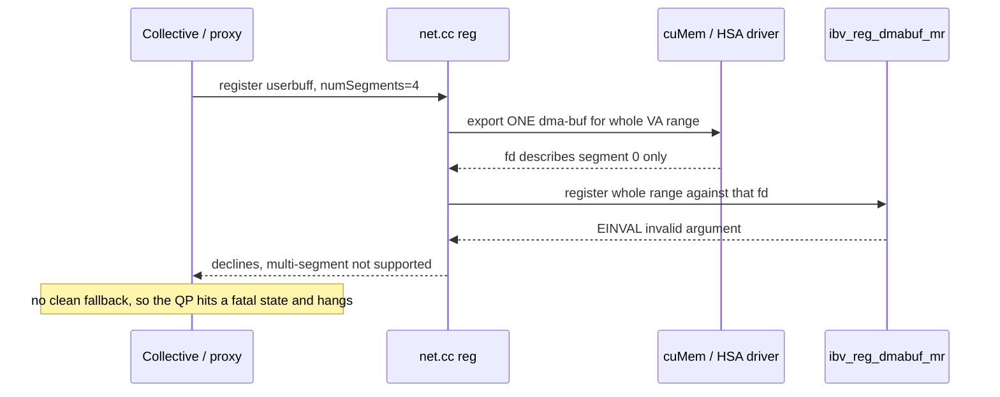

This was confirmed at the raw ibverbs level (independent of RCCL): a single-segment VMM buffer registers and transfers fine, but registering past segment 0 returns `EINVAL`, and a boundary-crossing transfer into a segment-0-only MR is rejected by the responder.

## 3. The shared fix: one MR per physical segment

All paths register **each physical segment separately**. Exporting a single segment alone yields a complete fd (it is one physical allocation), so each per-segment `ibv_reg_dmabuf_mr` succeeds. The GIN/RMA paths round each export out to whole host pages (from the page containing the segment pointer), because the MR they register spans those whole pages at DMA-BUF offset 0. The NET path (`rcclIbRegMrDmaBufFromRange` / `IbCastRegMrDmaBufFromRange` in the plugin's `reg.cc`, reached from `net.cc` through `regMrDmaBuf` with `fd = -1`) exports exactly the segment range.

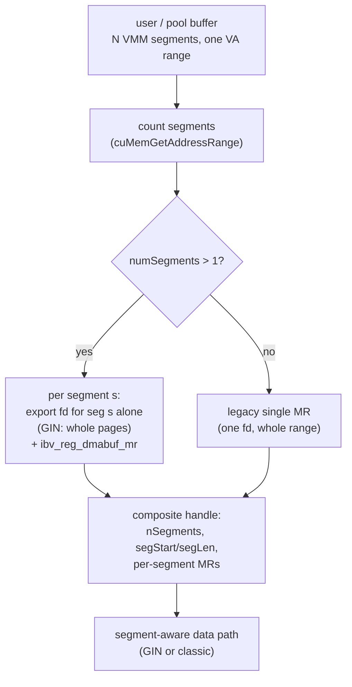

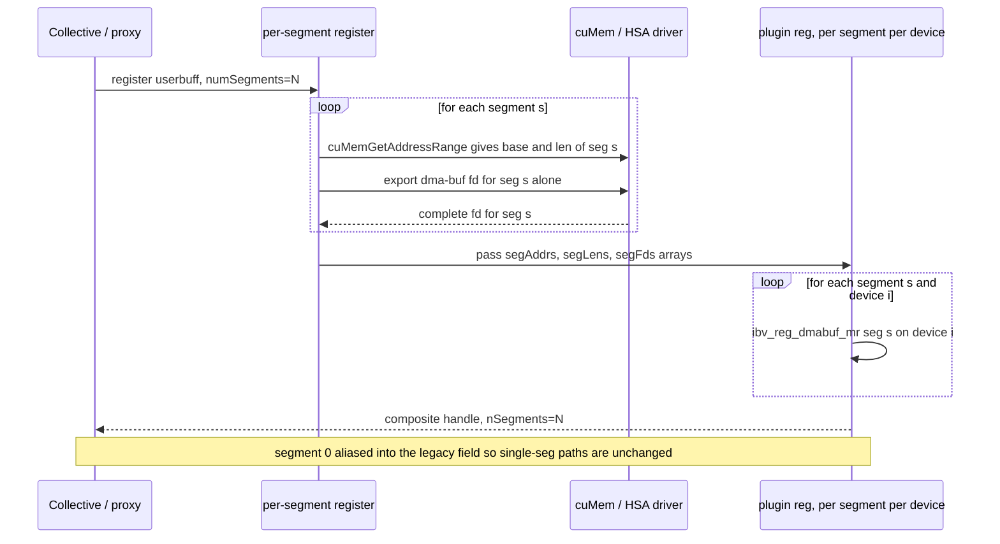

## 4. Transport A: GIN/RMA proxy

GIN/RMA (GPU-Initiated / Remote Memory Access) uses a **symmetric** buffer model: a collective registers the same symmetric buffer on every rank, and each rank holds a table of **every peer's** per-segment base VAs and rkeys. Registration counts segments, registers one MR per segment, verifies (via a fixed-size collective record, §8.5) that all ranks succeeded, have the same segment count, and sent a well-formed `segOff` table, and then all-gathers the per-segment `base_vas` / `rkeys` (indexed `rank*nSeg + seg`). CAST also gathers each rank's physical IB device numbers (`ibDevNs`) so it can look up rkeys by physical device.

The data path (`IPut` / `IGet` / `IPutSignal`) and the GDR flush go through one shared builder, `ncclRmaBuildSegmentedWrs` (CAST: `IbCastRmaBuildSegmentedWrs`), which splits a transfer at segment boundaries on **both** the local and remote sides. Only the **final** WR of each chain is signaled (`ncclRmaWrIsSignaled`); on CAST the chain first reserves WR **credits** against the QP depth (§8.4).

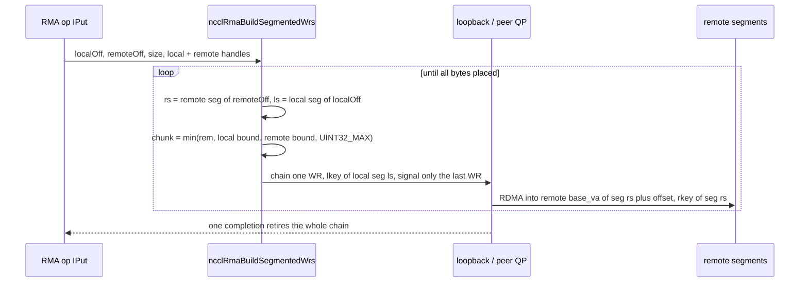

The flush is the same builder in "flush mode": it emits one tiny `RDMA_READ` per segment of the buffer (flush mode walks the remote/own handle and ignores the local handle), each landing one byte in a fixed scratch — so a single flush call fences GPU-direct writes across **every** segment. The original code read back only segment 0, which is why writes to later segments were never fenced.

## 5. Transport B: classic NET/IB

The classic data plane is single-MR by construction: its clear-to-send FIFO (`ncclIbSendFifo`) carries one remote address + one rkey per device, and `ncclIbMultiSend` walks a single contiguous region across QPs. Two ways to make it segment-aware were considered:

### Key-selection-only path (historical, not shipped)

Each network step's transfer must stay within one physical segment; the data path picks that segment's MR by VA. Correct while `stepSize <= segmentSize` and segments are uniform. Cross-boundary or non-uniform layouts are **declined** at registration and fall back to staging buffers. `ncclIbMultiSend` is untouched. This design is kept for comparison in [`multi_segment_netib_classic.md`](multi_segment_netib_classic.md).

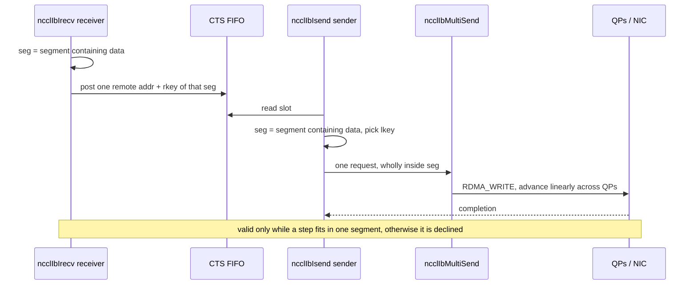

### Segment-aware path: 64-byte CTS + side table (selected)

Keep the historical 64-byte CTS slot. When a CTS slot contains at least one multi-segment receive and the peer advertised `NCCL_IB_CAP_MULTISEG`, the receiver also RDMA-writes that slot's segment tables into a **side table** (same slot index as the CTS) and sets `NCCL_IB_CTS_NREQS_SIDE_TABLE` in every CTS entry's `nreqs`. The sender splits each RDMA write at local **and** remote boundaries in `ncclIbMultiSendSegmented`. This removes the `stepSize <= segmentSize` assumption. Local and remote request bases can start at different offsets, so the builder tracks two registration-relative cursors.

Do **not** enlarge `ncclIbSendFifo` and do **not** version a large FIFO. A slot with only single-segment receives keeps the legacy wire format bit for bit. See [`multi_segment_netib_wire.md`](multi_segment_netib_wire.md).

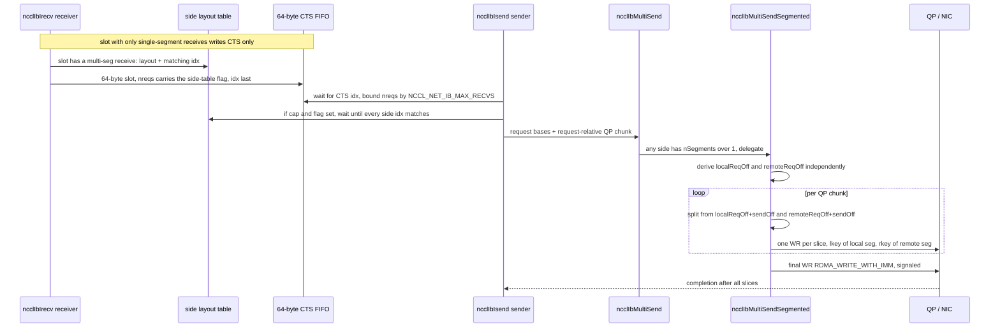

## 6. Feature comparison

| Aspect | GIN proxy | Classic key-selection path (historical) | Classic 64-byte CTS + side table (selected) |
|---|---|---|---|
| Registration | per-segment MRs | per-segment MRs | per-segment MRs |
| Buffer model | symmetric (all ranks equal count) | send/recv user buffer | send/recv user buffer |
| 64-byte CTS slot | n/a | unchanged | unchanged |
| Extra layout | GIN handle (per-seg VAs/rkeys) | none | side table (multi-seg slots only) + connect cap |
| Boundary-crossing transfer | split (always) | declined / staging | split (handled) |
| Assumption | equal segment count | step fits one segment, uniform | interior segments equal at registration |
| Send hot path | segmented builder | untouched | segmented builder for multi-seg only |
| Flush | per-segment RDMA_READ | segment MR by address | one read per touched segment; single read otherwise |
| Interop, `nSegments <= 1` | n/a | yes | yes (same 64-byte slot, no side table) |
| Interop, `nSegments > 1` | n/a | staging | requires peer cap; else staging |
| AINIC inline CTS | n/a | safe (32-byte / 64-byte slot) | safe (does not enlarge CTS) |
| Rejected alternative | — | — | in-FIFO `nSegments`/`segRkeys` (~712 B) |

---

# Part II — Code walkthrough

## 7. Shared data structures and boundary math

### 7.1 Classic composite handle (`net_ib/common.h`)

`mrs[]` still exists and **aliases segment 0**, so single-segment consumers are unchanged. CAST `common_cast.h` has the same struct.

```c
struct ncclIbMrHandle {
  ibv_mr* mrs[NCCL_IB_MAX_DEVS_PER_NIC];        // segment 0 (legacy fast path)
  int nSegments;                                 // 1 = legacy single MR
  uintptr_t segStart[NCCL_IB_MAX_SEGMENTS];
  size_t    segLen[NCCL_IB_MAX_SEGMENTS];
  ibv_mr*   segMrs[NCCL_IB_MAX_SEGMENTS][NCCL_IB_MAX_DEVS_PER_NIC];
};
```

The containing-segment accessor, cheap for normal buffers. It lives in `net_ib/p2p.cc`; the classic data path uses it in `rcclIbIflushMultiSeg` for single-segment entries of a multi-receive flush:

```c
static inline ibv_mr* ncclIbMrForRange(const struct ncclIbMrHandle* h,
                                       uintptr_t addr, size_t len, int devIndex) {
  if (h == NULL) return NULL;
  if (h->nSegments <= 1) return h->mrs[devIndex];   // one compare + index
  int s = ncclIbSegmentIndexForRange(h->nSegments, h->segStart, h->segLen, addr, len);
  return (s < 0) ? NULL : h->segMrs[s][devIndex];   // NULL = straddles a boundary
}
```

### 7.2 Pure boundary math (`net_ib/multiseg.h`)

Dependency-free (no ibverbs/RCCL types) so it is host-unit-testable without a NIC:

- `ncclIbSegmentIndexForRange` — segment fully containing `[addr, addr+len)`, or `-1` (outside all segments, address overflow, or boundary crossing).
- `ncclIbSegmentsUniform` — every interior segment equals the largest segment; the first and last may be shorter (registration can clip a physical allocation at either end), so every two-segment layout passes.
- `ncclIbSplitTransferAtOffsets` — decompose local and remote ranges that may start at different registration-relative offsets into slices that each stay within one **local** and one **remote** segment. There is no same-offset wrapper; callers with identical offsets pass the same offset twice.
- `ncclIbSegmentForOffset` — the segment containing a registration-relative offset.
- `struct ncclIbSegSlice` — one slice of a split transfer (output of `ncclIbSplitTransferAtOffsets`).
- `ncclIbSegmentForZeroLengthOffset` — picks the remote segment (and so the rkey) for a zero-length RDMA write by offset; the exclusive end of the last segment uses the last segment. Classic and CAST both use it.
- `ncclIbSegmentsOverlappingRange` — segments a flush must read for one receive.
- `ncclIbCtsRemoteLayoutValid` — a peer side-table entry is usable only if `nSegments` is in `[1, 16]`, `remDevIdx` is in range, segment starts strictly increase, and every rkey is nonzero.
- `ncclIbDeclineMultiSegRegistration` — true when `nSegments > 1` and the peer did not advertise `NCCL_IB_CAP_MULTISEG`. Classic and CAST apply it to recv comms only.
- `ncclIbCtsNreqs` / `ncclIbCtsHasSideTable` — strip or test the `NCCL_IB_CTS_NREQS_SIDE_TABLE` flag in a CTS `nreqs`.
- `ncclIbBytesRemainingInSegment` — the host-VMM-safe remaining length (`segBase == 0` means "use `segSize`").

### 7.3 GIN/RMA handle (`net_ib/gin.cc`, CAST twin in `net_ib_cast/gin.cc`)

```c
struct rcclRmaIbProxySegMrHandle {           // CAST: struct IbCastRmaProxySegMrHandle
  int nSegments;
  size_t segOff[NCCL_RMA_MAX_SEGMENTS + 1];  // local map: segOff[0]=0, segOff[nSeg]=size
  struct ncclIbMrHandle* mrHandle[NCCL_RMA_MAX_SEGMENTS];
  uintptr_t* base_vas;                       // [rank*nSeg + seg]
  uint32_t*  rkeys;                          // [(rank*nSeg + seg)*MAX_DEVS + slot]
  size_t* rankSegOff;                        // [rank * (MAX_SEGMENTS+1)] after allgather
  // CAST only: int* ibDevNs;                // [rank][slot] = physical ibDevN, or -1
};
```

Classic GIN indexes `rkeys` by the QP's `remDevIdx`. CAST registers through `cComm->recvComm` but posts on per-peer QPs whose device indices may name a different physical HCA, so it translates the physical `ibDevN` to a registration slot with `ncclRmaDevSlotOf` (data WRs use the remote QP's device, flush reads use the local one, `ncclRmaRkeyIbDevN`).

## 8. GIN/RMA proxy code walkthrough (`net_ib/gin.cc`; CAST `net_ib_cast/gin.cc`)

Symbols shown are the classic `ncclRma*` / `rcclRmaIbProxy*` names; the CAST fork uses `IbCastRma*` / `rcclIbCastRmaIbProxy*` twins with the same structure.

Develop's `gin.cc` keeps its single-MR bodies. Each multi-segment entry point is a one-line dispatch in the develop function. The registration and data-path dispatches are taken only when `rcclRmaMultiSegEnabled()` is true, `rcclRmaIbProxyConnectFinish` returns at once when it is false, and the `Test` hook fires only for a request already marked FAILED:

| Develop function (classic `net_ib/gin.cc`) | Dispatch |
|---|---|
| `ncclRmaIbProxyConnect` | `rcclRmaIbProxyConnectFinish` (allocates `regConsensus`) |
| `ncclRmaIbProxyRegMrSymDmaBuf` / `ncclRmaIbProxyDeregMrSym` | `rcclRmaIbProxyRegMrSymDmaBuf` / `rcclRmaIbProxyDeregMrSym` |
| `ncclRmaIbProxyIPut` / `IGet` / `IPutSignal` / `IFlush` | `rcclRmaIbProxyIPut` / `IGet` / `IPutSignal` / `IFlush` |
| `ncclRmaIbProxyTest` | `rcclRmaIbProxyTestFailed` for a request marked `NCCL_NET_IB_REQ_FAILED` |
| close | `free(cComm->regConsensus)` |

CAST `net_ib_cast/gin.cc` has the same shape with `rcclIbCastRmaIbProxy*` dispatches, including `Test`. With the switch off, both files run develop's code unchanged.

### 8.1 Registration — `rcclRmaIbProxyRegMrSymDmaBuf` (CAST: `rcclIbCastRmaIbProxyRegMrSymDmaBuf`)

```text
count segments: ncclCuMemGetAddressRange(data, size, &base, &baseSize, &nSeg)
  (only for NCCL_PTR_CUDA with ncclCuMemEnable(), and when the build passes CUDA_VERSION >= 11070 || NCCL_CUMEM_DMABUF_EXPORT_GATE)
reject nSeg > NCCL_RMA_MAX_SEGMENTS  (see the segment-size floor at the top of this doc)
if nSeg == 1: reuse caller fd (fd == -1 falls back to ibv_reg_mr)
else per segment s:
    cuMemGetAddressRange -> physical base + size of seg s
    inSeg   = (segBase == 0) ? segSize : segSize - (segPtr - segBase)  // host VMM: base can be 0
    thisLen = min(remaining, inSeg)
    exportBase = page containing segPtr; exportLen = page-rounded [exportBase, segPtr + thisLen)
    cuMemGetHandleForAddressRange(exportBase, exportLen) -> complete fd; register one MR per device; close(fd)
leftover bytes after nSeg segments -> local failure (still exchanged below)
fixed-size consensus (§8.5): every rank allgathers {status, nSegments, segOff[]} (CAST adds magic, version)
status reconciliation: any rank's failure aborts on all ranks (no peer left blocked)
count check: ncclRmaSegmentCountsMatch — equal nSeg in [1, 16]; terminal sizes may differ
table check: ncclRmaSegOffTableValid — every peer's segOff starts at 0 and never decreases
copy each rank's segOff into rankSegOff[rank]
allocation reconciliation: rankSegOff/base_vas/rkeys (CAST: ibDevNs) calloc failure is itself gathered
allGather per-segment localVas / localRkeys (CAST: and localIbDevNs)
```

GIN addresses peers by `base_vas`/`rkeys` **and** that peer's `rankSegOff` row. Ranks must share **nSeg**, not necessarily the same offsets. Prefix post, host-VMM length, flush-QP indices, and WR budget: [`multi_segment_current.md`](multi_segment_current.md).

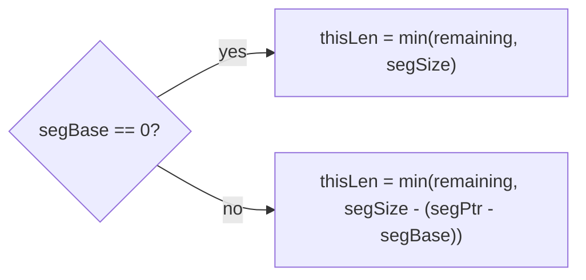

### 8.2 The segment-splitting WR builder — `ncclRmaBuildSegmentedWrs`

The heart of the data path. It walks `size` bytes, and for each step clamps the chunk to the nearer of the local and remote segment boundaries (and to `UINT32_MAX`, because `ibv_sge::length` is 32-bit), emitting one chained WR per slice:

```c
while (rem > 0) {
  if (ncclRmaDataWrBudgetFull(n, maxWr)) { WARN("... spans more than %d segment slices", maxWr); return ncclInternalError; }
  const size_t* rOffs = ncclRmaRankOff(remoteH, remoteRank);   // remote rank's map
  int rs = ncclRmaSegOf(remoteH, remoteRank, rOff);
  size_t remoteRemaining = rOffs[rs + 1] - rOff;
  int ls = 0; size_t localRemaining = SIZE_MAX; const size_t* lOffs = NULL;
  if (flushSge == NULL) {                                      // paired (put/get) mode
    lOffs = ncclRmaRankOff(localH, localRank);
    ls = ncclRmaSegOf(localH, localRank, lOff);
    localRemaining = lOffs[ls + 1] - lOff;
  }
  size_t chunk = flushSge == NULL
    ? ncclRmaSegmentSliceBytes(rem, localRemaining, remoteRemaining)   // also clamps to UINT32_MAX
    : (rem < remoteRemaining ? rem : remoteRemaining);
  uintptr_t rAddr = remoteH->base_vas[remoteRank * remoteH->nSegments + rs] + (rOff - rOffs[rs]);
  wr[n].wr.rdma.remote_addr = rAddr;
  wr[n].wr.rdma.rkey        = ncclRmaRemoteRkey(remoteH, remoteRank, rs, qp->remDevIdx);
  if (flushSge != NULL) { sge[n] = *flushSge; sge[n].length = 1; }     // flush: 1 byte/segment
  else {
    uintptr_t lAddr = localH->base_vas[localRank * localH->nSegments + ls] + (lOff - lOffs[ls]);
    struct ibv_mr* lmr = localH->mrHandle[ls]->mrs[qp->devIndex];
    if (lmr == NULL) { WARN("no local MR for segment %d device %d", ls, qp->devIndex); return ncclInternalError; }
    sge[n].addr = lAddr; sge[n].length = (uint32_t)chunk; sge[n].lkey = lmr->lkey;
  }
  if (n > 0) wr[n - 1].next = &wr[n];
  lOff += chunk; rOff += chunk; rem -= chunk; n++;
}
```

- **Paired mode** (`IPut`/`IGet`/`IPutSignal`): one lkey (local seg) + one rkey (remote seg) per slice; the two sides split independently on **that rank's** `segOff`. Slice arrays are `NCCL_RMA_MAX_DATA_WRS = 64`; overflow is rejected before posting.
- **Flush mode** (`flushSge != NULL`): one tiny `RDMA_READ` per segment, each landing one byte in the fixed scratch — fences writes across every segment. Array size is `NCCL_RMA_MAX_FLUSH_WRS = 16` (per operation).
- CAST's `IbCastRmaBuildSegmentedWrs` has the same loop, but resolves the rkey and local MR slot from physical `ibDevN` (§7.3).
- Classic GIN queues chains through its WR batch (`ncclRmaIbProxyQueueWrs`, batch size `NCCL_RMA_IB_WR_BATCHSIZE`). A chain longer than the batch posts directly, right after the pending batch, so WRs reach the QP in request-id order.

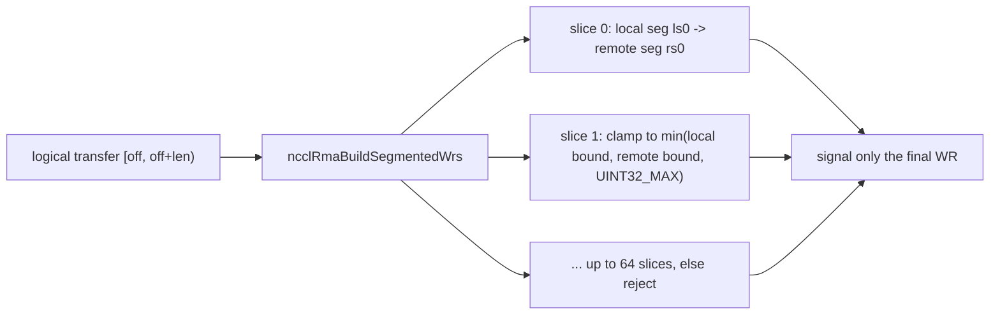

### 8.3 Signaling — only the final WR

Every op signals just the last WR of its chain (`ncclRmaWrIsSignaled(i, nWr)` is true only for `i == nWr-1`). `IPutSignal` unsignals every PUT slice and signals only the trailing `IBV_WR_ATOMIC_FETCH_AND_ADD`, which must be 8-byte aligned and contained in one segment (`ncclRmaSignalOffsetValid`). One completion therefore retires the whole chain, which is what the CAST credit accounting (§8.4) keys on.

### 8.4 Completion-driven WR credits (CAST)

CAST tracks a per-comm counter `ncclIbNetCommBase::rmaWrsOutstanding` and, before posting, reserves `nWr` credits against the QP depth:

- Send/put/get QP depth is `NCCL_RMA_MAX_SEND_QP_WRS = 575 = 2*256 + 65 - 2`.
- Flush QP depth is `NCCL_RMA_MAX_FLUSH_QP_WRS = 271 = 256 + 16 - 1`.
- `IbCastRmaReserveWrs` polls the CQ (then `sched_yield`) while `ncclRmaWrCreditsAvailable(outstanding, nWr, maxWrs)` is false, then adds `nWr` and records `req->rmaNwrs`. The wait is bounded by `IbCastRmaCreditTimeoutNs`: `4.096 µs × 2^NCCL_IB_TIMEOUT × (NCCL_IB_RETRY_CNT + 1)` (read through `ncclParamIbCastTimeout` / `ncclParamIbCastRetryCnt`, clamped to 31 and 7), never less than 2 s, so a recovering link does not abort the post. On timeout it returns `ncclRemoteError`.
- `IbCastRmaPollCq` and `IbCastRmaAccountCompletion` refund `req->rmaNwrs` (`IbCastRmaRefundWrs`, with an underflow guard) when the request's last event completes. After a QP error every flushed WQE completes with the owner's `wr_id`; only the first one owns the event, and each error CQE is logged with one WARN.
- If the CQ is drained by another request's `Test()`, the owner of an error completion is marked `NCCL_NET_IB_REQ_FAILED`, so its own next `Test()` still fails instead of spinning.
- On a post failure the credits for the unposted tail are refunded immediately; if nothing posted, all credits are released before the request is freed.

Under IB-CAST the send-queue flood test (`RmaMultiSegmentPostMPITest.IPutSignalSendQueueOversubscribe`) expects zero rejected or failed posts because the post path waits for credits: it recorded 48 accepted and 0 rejected. Classic GIN has no credits, so the same flood on classic IB recorded 27 accepted and 21 rejected; rejected posts fail closed and the other context still delivers.

If `ibv_post_send` accepts a **prefix** of the chain, classic and CAST both **keep the request and return success** so callers that `NCCLCHECK` the complete helper still reach `Test()` and drain the CQE (`ncclRmaCompletePostedRequest`, which wraps `ncclRmaPostedRequestStatus`; the backends apply it in `ncclRmaFinishPostedRequest` / `IbCastRmaCompletePostedRequest`). Only a zero-length prefix frees the slot (classic also returns the sequence id with `ncclRmaReleaseSeqId`). A prefix that stops before the signaled tail marks the request FAILED. A count/range leftover after walking `nSeg` is a local failure **before** the consensus gather, and is still exchanged so peers abort together.

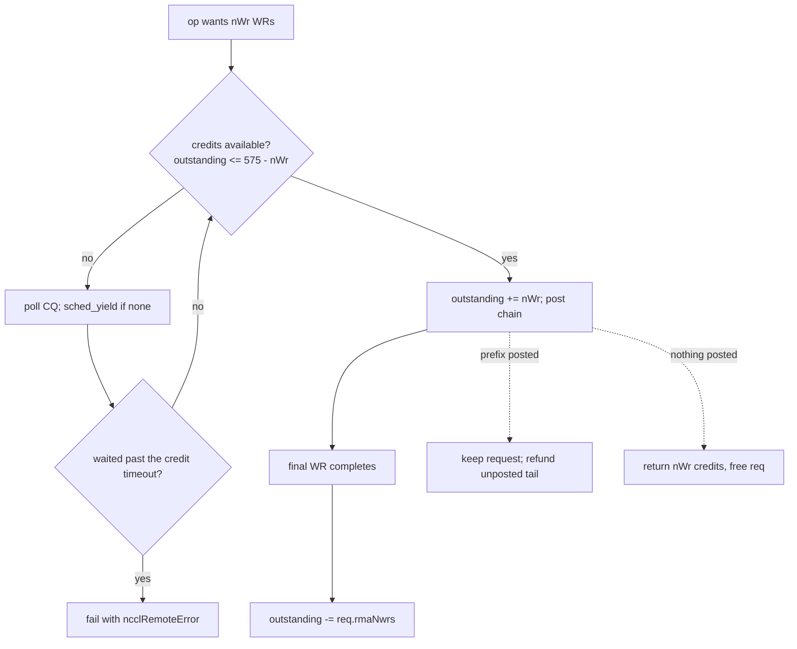

### 8.4a P2P send queues have no WR credits

`rmaWrsOutstanding` is CAST GIN only. Both P2P senders size the send QP to `NCCL_IB_MAX_SEND_WRS` = **769** (two WRs per request slot plus one worst-case segmented send of 257 WQEs). Classic P2P posts a fat chain whenever a request slot is free, with no one-group gate. CAST P2P defers a second segmented group (`IbCastHasOtherSegmentedSend`). Both P2P flush QPs are **1024** (`NCCL_STEPS * 8 * 16`) when the cap is advertised, so one 128-WR chain fits on each of the 8 proxy steps. CAST RMA flush stays 271. Diagrams: [`multi_segment_current.md`](multi_segment_current.md) §6a.

### 8.5 Fixed-size collective-safe registration consensus

Rather than a variable-size gather that could deadlock if one rank fails mid-enumeration, every rank exchanges one fixed-size record, even on local failure:

- Classic: `ncclRmaIbProxyRegistration { status, nSegments, segOff[NCCL_RMA_MAX_SEGMENTS+1] }`.
- CAST: `IbCastRmaProxyRegistration { magic, version, status, nSegments, segOff[...] }` with `IBCAST_RMA_REGISTRATION_MAGIC` / `IBCAST_RMA_REGISTRATION_VERSION` (`0x524d5347` / 1, defined in `net_ib_cast/gin.cc`). `rcclIbCastRmaIbProxyRegMrSymDmaBuf` checks every peer's magic and version inline, so a future same-sized revision fails collectively instead of being misread.

The receive buffer for the gather is **per communicator**: `rcclRmaIbProxyConnectFinish` (called from `ncclRmaIbProxyConnect`) and `rcclIbCastRmaIbProxyConnectFinish` (called from `IbCastRmaIbProxyConnect`) allocate `nranks` records into `regConsensus` with `ncclIbMalloc` (page-aligned, because the allgather registers whole pages), and close frees it. Both allocate only when `rcclRmaMultiSegEnabled()` is true; at `NCCL_MULTI_SEGMENT_REGISTER=0` develop's registration runs and needs no consensus buffer. Allocating at connect time means registration cannot fail locally before its first collective.

After the gather: `status` reconciliation aborts on all ranks if any rank failed; `ncclRmaSegmentCountsMatch` requires equal `nSeg`; `ncclRmaSegOffTableValid` rejects a peer table that does not start at 0 or decreases (those tables feed unsigned offset math); each rank's map is copied into `rankSegOff`; and a second gather of the same record reconciles allocation failures before the VA/rkey gathers.

### 8.6 Deregistration and rollback

`rcclRmaIbProxyDeregMrSym` (CAST `rcclIbCastRmaIbProxyDeregMrSym`) frees every `mrHandle[s]`, then `base_vas`, `rkeys`, `rankSegOff` (and CAST `ibDevNs`). The registration `fail:` path deregisters only the `registered` count of **complete** `ncclIbMrHandle` objects (a half-built handle is never handed to `deregMr`) and frees the arrays and the handle — no leak, no double free.

### 8.7 Flush QP device indices

The flush QP is loopback. Set both indices when it is created (classic `ncclIbCreateFlushQp` in `connect.cc`, which builds it lazily on the first flush; CAST `connect.cc`, sized by `IbCastFlushQpSendDepth`, which the AINIC recovery rebuild also uses):


Without this, IFlush reads uninitialized `devIndex` / `remDevIdx` (often zero by luck).

## 9. Classic NET/IB code walkthrough

### 9.1 Registration — proxy call (`net.cc`) and plugin walk (`net_ib/reg.cc`)

`sendProxyRegBuffer` / `recvProxyRegBuffer` get `numSegments` from the registration record. `rcclNetRegSegmentCount` (`rccl_wrap.cc`) returns the cached `ncclReg::rcclNet.nSegments` or walks the record with `ncclCuMemGetAddressRange`. The walk length is `endAddr - begAddr - pageSize + 1`: `endAddr` is page-rounded but a `hipMalloc` allocation reports its unrounded size, so the walk stops inside the last registered page instead of querying past the allocation. `rcclNetRegCommit` caches the count and sets `rcclNet.allPeers` only after every peer registered. If `numSegments > 1` and `NCCL_MULTI_SEGMENT_REGISTER=0`, registration is skipped and the collective stages; a one-segment slice of a multi-segment registration also skips NET, and `rcclNetGraphRegSegmentCount` drops the graph reference in that case.

`net.cc` keeps develop's single-MR code and stays plugin-neutral. For `numSegments > 1`, `sendProxyRegBuffer` / `recvProxyRegBuffer` call the plugin's own `regMrDmaBuf` once with `fd = -1` and `offset = (getHandleForAddressRangeFlags(useGdr) << 32) | numSegments`; the HSA DMA-BUF fallback runs only for `numSegments <= 1`. A plugin that does not understand `fd = -1` fails the call and the collective stages. Classic `ncclIbRegMrDmaBuf` (`net_ib/reg.cc`) and CAST `IbCastRegMrDmaBuf` (`net_ib_cast/reg.cc`) route `fd == -1` to `rcclIbRegMrDmaBufFromRange` / `IbCastRegMrDmaBufFromRange`, built when `CUDA_VERSION >= 11070 || NCCL_CUMEM_DMABUF_EXPORT_GATE`. That function unpacks the count and flags, walks the range one physical segment at a time, exports a per-segment fd, applies the coverage and uniform-segment guards, then registers:

```c
uintptr_t segPtr = (uintptr_t)buffer;
for (int s = 0; s < numSegments && remaining > 0; s++) {
  CUdeviceptr segBase = 0; size_t segSize = 0;
  cuMemGetAddressRange(&segBase, &segSize, (CUdeviceptr)segPtr);
  size_t inSeg = ncclIbBytesRemainingInSegment(segPtr, (uintptr_t)segBase, segSize);
  size_t thisLen = remaining < inSeg ? remaining : inSeg;
  cuMemGetHandleForAddressRange(&fd, segPtr, thisLen, CU_MEM_RANGE_HANDLE_TYPE_DMA_BUF_FD,
                                handleFlags);  // seg-only fd is complete
  segAddrs[s] = segPtr; segLens[s] = thisLen; segOffsets[s] = 0; segFds[s] = fd;
  segPtr += thisLen; remaining -= thisLen; nSeg++;
}
// remaining != 0 or nSeg != numSegments -> ncclInvalidUsage (never a partial handle)
// !ncclIbSegmentsUniform(nSeg, segLens)  -> decline to staging
// ncclIbRegMrDmaBufMultiSeg (IB) or IbCastRegMrDmaBufMultiSeg (IB-CAST)
```

The walk closes every exported fd after registration. If the multi-segment register **fails**, `needReg` stays true and the collective falls back to staging buffers — no crash, and no HSA DMA-BUF fallback for a multi-segment buffer. Only the built-in IB and IB-CAST plugins implement `fd = -1`; other plugins fail the call and stage.

### 9.2 Registration — plugin (`net_ib/reg.cc`)

`ncclIbRegMrDmaBufMultiSeg` (`net_ib/reg.cc`) first declines with `ncclInvalidUsage` on a **recv** comm when `ncclIbDeclineMultiSegRegistration(peerCaps, nSeg)` is true: the peer cannot read the side table that would describe this receive. A send comm registers regardless of the peer cap, because a sender only splits its own buffer and writes each slice to the receiver's single rkey. It then `calloc`s the handle (so MR pointers start `NULL` for clean rollback), registers one MR per segment per device into `segMrs[s][i]`, and aliases segment 0 into `mrs[]`. On partial failure it unwinds exactly the MRs made so far. Develop's `ncclIbDeregMr` in `reg.cc` has one hook, `if (nSegments > 1) return rcclIbDeregMrMultiSeg(...)`, which frees strictly through `segMrs[][]` (never the `mrs[]` alias) to avoid a double free. Develop's single-MR registration in `reg.cc` now `calloc`s its handle and unwinds partial registrations.

### 9.3 Key-selection data path (historical)

The key-selection-only design (select one segment's key by address and reject a straddling range) is not what ships; see §5. What remains of it is `ncclIbMrForRange` (in `net_ib/p2p.cc`), used by `rcclIbIflushMultiSeg` for single-segment entries in a flush that also contains a multi-segment handle.

### 9.4 Segment-aware data path (`net_ib/p2p.cc`) — 64-byte CTS + side table

`net_ib/p2p.cc` keeps develop's code, including the inline chunk math in `ncclIbMultiSend`. The multi-segment bodies are `static inline` functions placed in the same file behind an `RCCL:` comment, and develop's functions call them at fixed points:

| Hook | Called from | Role |
|---|---|---|
| `rcclIbMultiSendNeedsSegmented` | `ncclIbMultiSend` | delegate to `ncclIbMultiSendSegmented` when any local handle or remote side entry is multi-segment |
| `rcclIbIsendWaitSideTable` | `ncclIbIsend` | wait until every side entry's `idx` matches when the slot is flagged |
| `rcclIbPostFifoSideWr` | `ncclIbPostFifo` | chain the side-table write before the CTS WR when the slot is flagged |
| `rcclIbIrecvCheckHandle` | `ncclIbIrecv` | reject a NULL handle or a missing per-device MR |
| `rcclIbIrecvFillSideTable` | `ncclIbIrecv` | fill the side entry and report whether any receive is multi-segment |
| `rcclIbCtsFlagSideTable` | `ncclIbIrecv` | set `NCCL_IB_CTS_NREQS_SIDE_TABLE` in every CTS entry of the slot |
| `rcclIbIflushNeedsMultiSeg` / `rcclIbIflushMultiSeg` | `ncclIbIflush` | segment-aware flush when any handle is multi-segment |

- `ncclIbIrecv` always writes the **64-byte** CTS slot (addr, size, segment-0 rkeys, idx last). When the peer advertised `NCCL_IB_CAP_MULTISEG`, each receive's side entry gets its `ncclIbSegLayout` (or `nSegments = 0` for a single-segment receive) and the slot's `idx`. If any receive in the slot is multi-segment, every CTS entry in the slot gets `NCCL_IB_CTS_NREQS_SIDE_TABLE` in `nreqs`, and the side table is RDMA-written as an unsignaled WR chained **before** the CTS WR. A slot with only single-segment receives sends no side table. `ncclIbIsend` stashes the local handle in `req->send.mh`.
- The side-table WR carries the CTS WR's `wr_id`, because flushed unsignaled WRs still complete on error and resiliency maps `wr_id` to a slot. The staging MR `segLayoutFifoMr` is registered `IBV_ACCESS_LOCAL_WRITE` only when the peer has the capability.
- The sender bounds the peer's `nreqs` (with the flag stripped by `ncclIbCtsNreqs`) by `NCCL_NET_IB_MAX_RECVS` before waiting on anything. Side table and CTS are separate RDMA writes, so when the flag is set, `ncclIbIsend` **waits until every side slot's `idx` matches** so a late side table is not treated as single-segment.
- With the switch on, the CTS QP send queue adds `NET_IB_MAX_REQUESTS * (resiliency ? 1 : 2)` WRs to develop's depth for the side-table writes. The CTS MR covers `ctsFifo` plus `segLayoutFifo` only when this rank advertises the capability (`ncclIbAdvertiseMultiSeg`).
- `rcclIbMultiSendNeedsSegmented` pre-checks: if any request's local handle has `nSegments > 1`, or `ncclIbCtsRemoteMultiSeg` sees a flagged slot whose side entry matches the CTS `idx` with `nSegments > 1`, `ncclIbMultiSend` delegates to `ncclIbMultiSendSegmented`.
- `ncclIbMultiSendSegmented` (with its chunk helper `ncclIbQpChunkSize`) snapshots the remote starts and rkeys once, validates them with `ncclIbCtsRemoteLayoutValid`, clips the remote table to the request end, computes `localReqOff` and `remoteReqOff` independently, splits at both boundaries, and posts one WR per slice. A zero-length chunk picks its rkey with `ncclIbSegmentForZeroLengthOffset`.
- The final WR carries the imm data. A separate sizes WR is written when `nreqs > 1`, or when the receiver does not match by index (for example BY_ID) and the size is nonzero, so a single segmented receive reports its full size. Completion accounting otherwise matches `ncclIbMultiSend`.
- `ncclIbIflush` posts develop's single read unless `rcclIbIflushNeedsMultiSeg` finds a multi-segment handle. Then `rcclIbIflushMultiSeg` posts one read per segment each non-empty receive overlaps, as one chain (a single read when the GPU-memory flush scratch is used, which is the default `RCCL_GDR_FLUSH_GPU_MEM_NO_RELAXED_ORDERING=1`). A prefix post that loses the signaled tail marks the request FAILED and keeps it.
- Incomplete segment enumeration (`remaining != 0` or count different from `numSegments`) is rejected **before** a handle is produced. A partial handle would advertise addresses beyond the final MR with that MR's rkey (`IBV_WC_REM_ACCESS_ERR`).

`ncclIbRegMrDmaBufMultiSeg`, `IbCastRegMrDmaBufMultiSeg` and `rcclIbCastDeregMrMultiSeg` are declared in `src/transport/rccl_ib_multiseg.h`, **not** `src/include/net.h`; classic `rcclIbDeregMrMultiSeg` is `static` in `reg.cc`.

CAST P2P mirrors this layout with `rcclIbCast*` bodies in `net_ib_cast/p2p.cc` (plus `IbCastCtsRemoteMultiSeg`, `IbCastMultiSendSegmented`, `IbCastHasOtherSegmentedSend`, `IbCastWaitSideTable`) and per-segment registration in `net_ib_cast/rccl_reg_multiseg_cast.cc`. Its receive side table (`remSegLayout`) is allocated only for a capable peer, as classic's is, and `IbCastMultiSendSegmented` bounds its own reload of the peer-written `nreqs` to `[1, NCCL_NET_IB_MAX_RECVS]`. It differs in four ways: it publishes the side table on every CTS to a capable peer (including single-segment slots) unless CTS offload is on, its sender waits for the side table with a 2 s bound (`IbCastWaitSideTable`), it always writes the sizes WR for a segmented send, and a partly posted send or flush marks the request `NCCL_NET_IB_REQ_FAILED` and drains it.

The independent offsets are a correctness requirement discovered during post-rebase testing. The original shared `off` worked when both requests began at segment 0, but selected the wrong segment/address/key when the request bases had different offsets within their registrations.

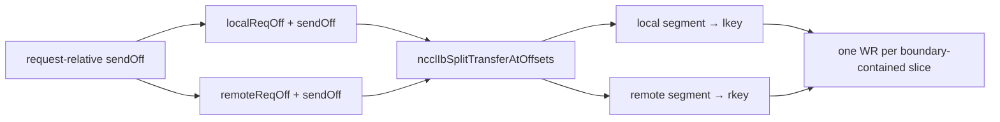

```c
for (int k = 0; k < ns; k++) {
  wr->opcode = IBV_WR_RDMA_WRITE;
  wr->wr.rdma.remote_addr = slices[k].remoteAddr;
  wr->wr.rdma.rkey = remoteMulti ? remoteRkeys[slices[k].remoteSeg] : slots[r].rkeys[remDevIdx];
  sge->addr = slices[k].localAddr; sge->length = slices[k].len;
  sge->lkey = (mh && mh->nSegments > 1) ? mh->segMrs[slices[k].localSeg][devIndex]->lkey
                                        : reqs[r]->send.lkeys[devIndex];
}
```

WR/SGE pools were widened to `NCCL_IB_MAX_WRS_PER_SEND` with an explicit overflow guard; the single-segment fast path never enters the segmented engine.

---

# Part III — Testing

## 10. Testing strategy and how to run

The strategy is two-layered: put the **correctness burden on pure, host-testable boundary math**, and use **hardware MPI tests** to validate the ibverbs wiring, the collective agreement, and the queue-depth limits.

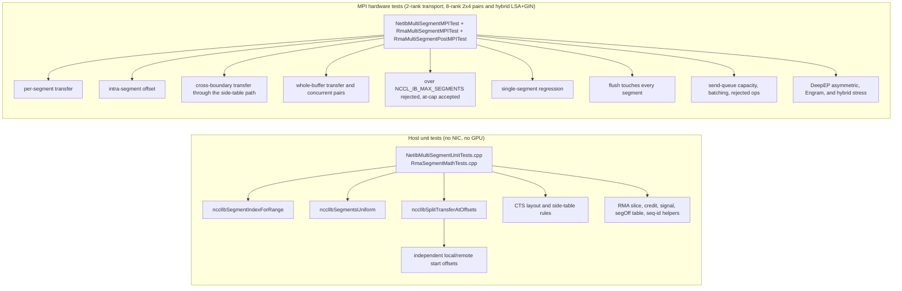

### Coverage matrix

| Scenario | Host unit | MPI (classic / CAST P2P) | MPI (GIN/RMA) |
|---|---|---|---|
| Segment selection (start / mid / last byte) | yes | via transfer | via transfer |
| Uniformity gate (decline non-uniform interior) | yes | yes | n/a |
| Split: symmetric / asymmetric / zero-len / overflow / full | yes | — | — |
| Split: independent local/remote start offsets | yes | via intra-segment offset | yes |
| CTS side-table validation and segment-count cap | yes (`NetIbCtsLayout`) | peer-cap decline | n/a |
| Peer `segOff` table validation, sequence-id release | yes (`RmaSegmentMathTest`) | — | via registration |
| Single-segment regression | — | yes | yes |
| Single- and multi-segment handles in one multi-receive | — | yes (transfer and flush) | n/a |
| Multi-segment registration builds N MRs | — | yes | yes |
| Per-segment transfer + intra-segment offset | — | yes | yes |
| Boundary-crossing transfer | — | splits and succeeds | succeeds |
| Over `MAX_SEGMENTS` rejected/declined cleanly | yes | yes (after at-cap success) | yes |
| Deregistration (no leak / no double free) | — | yes | yes |
| Flush fences all segments | — | yes | yes (per-segment READ) |
| Asymmetric peer layouts | yes (split) | 2-node stress | GIN: equal `nSeg`, sizes may differ |
| Concurrent pairs across every boundary | — | 2 ranks and 2x4 | all-pairs and many-to-one at 2x4 |
| Send-queue oversubscription | — | opt-in fat-chain stress | opt-in flood (IB and IB-CAST) |
| DeepEP mixed `[GPU][CPU]` Engram window | geometry | — | single- and multi-node |
| DeepEP hybrid `[GPU][CPU rank 0]…[CPU rank N-1]` | — | 8-rank / 2-node strict symmetric window (4 local ranks) | positive, bounds-negative, stress |
| Registered-buffer reuse | — | UBR `Generic_Reuse` on Ring/Simple with CE off | via UBR |
| Symmetric LSA receive buffer at non-zero window offset | — | CE receive-offset suite before/after control | — |
| `NCCL_MULTI_SEGMENT_REGISTER=0` | — | `MultiSegmentRegisterOff_DeclinesRegistration`, single-segment regressions, UBR slice-skips-NET | `MultiSegmentRegisterOff_KeepsUpstreamPath`, RMA basics on the develop bodies |
| CAST unsafe modes (BY_ORDER, QP sharing) | — | `CastUnsafeMode_DeclinesRegistration` | n/a |

### Why the split cases live in host tests

`ncclIbSplitTransferAtOffsets`, the segment selectors, the CTS layout rules, and the RMA helpers in `rma_multiseg.h` are pure functions of integers, so every tricky case (different local/remote starts, asymmetric layouts, zero-length, address overflow, slice-count overflow, `UINT32_MAX` slicing, credit exhaustion, atomic alignment/containment, malformed peer `segOff` tables, DeepEP CPU-to-GPU geometry) is deterministic and needs no hardware. The host suites are `NetIbMultiSeg`, `NetIbSplit`, and `NetIbCtsLayout` in `rccl-UnitTestsFixtures` (`test/NetIbMultiSegmentUnitTests.cpp`) and `RmaSegmentMathTest` in `rccl-UnitTests` (`test/RmaSegmentMathTests.cpp`). The classic asymmetric cross-boundary test and the GIN Engram IGet stress both vary local and remote boundaries independently and protect untouched memory with sentinels. The Engram case reproduces an unequal `[GPU][CPU]` window and reads from a non-zero remote CPU-segment offset into a different local GPU-segment offset.

The RMA post-path fixture (`RmaMultiSegmentPostMPITest`) covers WR batching and aggregation, context isolation, rejected-op slot accounting, zero-size ops on a fresh context, registration churn, send-queue capacity, all-pairs, and many-to-one. After the send-queue flood it proves context 1 still delivers, using a range the flood never touches. The same suite runs under IB-CAST, where no-WR ops complete without waiting on their predecessor.

The registration controls:

- **Registration reuse:** `UBR_MultiSegment.Generic_Reuse` runs with `RCCL_CE_ALLREDUCE=0`, `NCCL_ALGO=Ring`, and `NCCL_PROTO=Simple`, which deterministically enters the Ring/Simple IPC or NET registration path and requires a reuse-cache log. The earlier forced-CE "before" control was dropped.
- **Symmetric LSA addressing:** the CE receive-offset suite (runner configuration `ce_allreduce_recv_offset`, jobs `CE_RecvOffset_*`) uses test-only fault injection (`CE_FAULT_LEGACY_RECV_OFFSET`) to restore the legacy CE Phase-3 offset and confirm corruption when `recvbuff` starts inside, rather than at the base of, its symmetric window. The after test verifies the corrected window-relative offset, and two more tests check that a receive range past the window falls back.
- **NET registration completeness:** `UBR_MultiSegment.Generic` gates on NET registration completion, so it fails instead of skipping if the commit call is dropped, and asserts the cached count over the full range. `UBR_MultiSegment.NetProxyPartialFinalSegment` drives the proxy path with a clipped final MR; the `multisegment_netproxy_intranode_multinode` job runs it with 4 ranks on 2 nodes so the proxy also has an intra-node peer.
- **Switch off:** `MultiSegmentRegisterOff_DeclinesRegistration` (classic and CAST) registers a 4-segment window on both ranks with neither peer advertising the side table: the receiver's registration returns `ncclInvalidUsage` with a NULL handle, and the sender's succeeds, because a sender's split does not depend on the peer cap. `RmaMultiSegmentMPITest.MultiSegmentRegisterOff_KeepsUpstreamPath` checks that a multi-segment RMA window stays on the develop single-MR path. `UBR_MultiSegment.MultiSegmentRegisterOff_SliceSkipsNet` and `MultiSegmentRegisterOff_GraphSliceSkipsNet` check that a one-segment slice of a multi-segment registration skips NET.
- **CAST unsafe modes:** `NetIbMultiSegmentMPITest.CastUnsafeMode_DeclinesRegistration` runs under BY_ORDER matching and under QP sharing and expects the 4-segment registration to be declined on **both** ranks (recv on rank 0, send on rank 1). The CAST multi-segment jobs no longer set `RCCL_IB_P2P_DISABLE_CTS=1`; `net_ib_cts_stress` still does.
- **Flush with direct GDR reads:** `net_ib_multisegment_flush` sets `RCCL_GDR_FLUSH_GPU_MEM_NO_RELAXED_ORDERING=0`, because the default routes the flush through the relaxed-ordering-off scratchpad, which posts a single read. It runs `MultiSegmentFlushSelectsSegmentMr`, `MultiSegmentFlushTouchesEverySegment`, `MultiRecvFlushTouchesEveryHandle`, and the mixed single- and multi-segment flush. `MultiRecvMixesSingleAndMultiSegmentHandles` starts its multi-segment entry in segment 1 and requires a flush request when direct GDR flush is on.

### Non-blocking test stream (opt-in)

MPI tests normally use a blocking test stream. A test can set `test_stream_flags_ = hipStreamNonBlocking` before `createTestCommunicator()` (`test/common/MPITestCore.hpp`), and `RCCL_TEST_STREAM_NONBLOCKING=1` or `0` overrides the choice for any run. The reason: before HIP 7.17, a peer proxy's `hipMemMap` waits for kernels on blocking streams, so lazy intra-node IPC registration can deadlock against a collective already running on the test stream. On the wire branch, `UBR_MultiSegment.NetProxyPartialFinalSegment` opts in.

### Hybrid DeepEP symmetric-window and GIN coverage

"Hybrid VMM" means that one continuous virtual address range is backed by separate GPU and host allocations. The application gets one base pointer, but RCCL must register the real backing segments independently:

```text
one application pointer
│
▼
+------------------+------------------+-----+------------------+
| private GPU VMM  | host VMM owner 0 | ... | host VMM owner N-1 |
+------------------+------------------+-----+------------------+
```

Each process creates a private GPU segment and one 2 MiB-aligned host segment. Local ranks exchange host sizes with MPI and POSIX DMA-BUF FDs with `SCM_RIGHTS`. They map every host handle in local-rank order. CI launches **8 ranks on 2 nodes (4 ranks per node)** so every GPU is exercised; the helper is N-agnostic (`[GPU][CPU 0]…[CPU N-1]`). With four local ranks the window has **five** backing segments:

```text
local rank k: [GPU k][CPU 0][CPU 1][CPU 2][CPU 3]
              CPU k is local; the other three host segments are imported
```

All segments receive GPU access, and the host segments also receive CPU access. The result looks like one buffer to the caller but remains `1 + N` VMM mappings to RCCL. LSA reuses the owner rank's host-memory handle. GIN registers every AMD VMM segment through DMA-BUF, including CPU-backed VMM; an imported VMM mapping is not ordinary host memory and must not use `ibv_reg_mr`.

**Imported host segments use the owner's DMA-BUF.** The importing process cannot ask the runtime for a DMA-BUF of an imported host segment: on ROCm 10.2 both `hipMemGetHandleForAddressRange` on the imported range and `hipMemExportToShareableHandle` on the imported handle return invalid argument, and CUDA does not re-export imported handles either. The owner's POSIX fd is already a DMA-BUF that `ibv_reg_dmabuf_mr` accepts in any process, so RCCL uses that instead:

| Step | Where | What |
|---|---|---|
| Find the owner | `symMemoryMapLsaTeam` (`dev_runtime.cc`) | The ROCM-29810 type propagation already finds the one LSA rank that reports a host location for each segment. |
| Fetch the fd | `symMemoryGetHostOwnerFd` | For each segment imported from another owner, `ncclProxyClientGetFdBlocking` (the call LSA uses to import device handles) returns the owner's fd, kept in `ncclDevrMemory::hostOwnerFds`. |
| Publish by VA | `symMemoryPublishHostOwnerFds`, `rcclHostSegmentFdRegister` (`rccl_dev_runtime.cc`) | A mutex-protected, process-wide table maps local VA ranges to fds. |
| GIN | `symMemoryRegisterGin` → `ncclGinRegister(..., dmabufFd)` → backend `regMrSymDmaBuf` | The GIN proxy now implements `regMrSymDmaBuf` and forwards to the RMA backend. The segment is stored as `CU_MEM_LOCATION_TYPE_HOST_NUMA`, because the imported handle reads as device (ROCM-29810). |
| RMA per-segment walk | `rcclRmaIbProxyRegMrSymDmaBuf` (`net_ib/gin.cc`), CAST twin in `net_ib_cast/gin.cc` | `rcclHostSegmentFdLookup` runs before `cuMemGetHandleForAddressRange`; the MR offset is the page-aligned distance from the segment base. |
| Lifetime | `symMemoryCloseHostOwnerFds` | Fds live as long as the backing memory, because a later GIN enable re-registers it, and are removed from the table and closed in `symMemoryDestroy` and on obtain failure. |

Backend coverage: GIN proxy (`NCCL_GIN_TYPE=2`) and the in-tree IB RMA backend use the owner fd. rocSHMEM GDA and Anvil SDMA accept `regMrSymDmaBuf` but ignore the fd (GDA registers through `rocshmem_gin_reg_mr_vmm`), so hybrid windows on those backends still need their own support. Classic NET/IB and IB-CAST P2P never register a buffer with CPU-backed segments (`register.cc` skips it and the transfer stages), so they are unaffected.

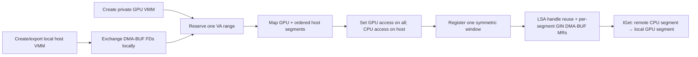

This is modeled without a DeepEP dependency using the alignment and lifecycle of `HybridElasticSymmetricMemory`.

The eight-rank/two-node (4 ranks per node) tier covers:

- positive strict-window registration, LSA pointer creation, and the explicit system-memory-handle reuse configuration;
- positive cross-node GIN IGet from an imported remote CPU segment;
- negative elastic-registration gating and an out-of-range IGet that must not post or corrupt the GPU destination; and
- 32 stress iterations alternating remote CPU owners, transfer sizes, and independent source/destination offsets with sentinel protection.

The workload-independent helper (`test/common/HybridVmmHelpers.hpp`, entry point `AllocHybridCollective`) transfers descriptors through RCCL's existing Unix-domain IPC socket API (`SCM_RIGHTS`), avoiding `pidfd_getfd` permission and kernel-version dependencies. It skips collectively when host VMM, DMA-BUF, GIN, or the required topology is unavailable, and `CheckHybridVmmRuntimeSupport` skips with "ROCM-29812: imported host VMM CPU access is unsupported" when the runtime cannot grant CPU access to an imported host segment. It does not probe re-export (the former ROCM-29815 skip), because RCCL registers imported host segments from the owner's fd; the hybrid tests run on ROCm 10.2 and 7.0.2.2. The RMA fixture calls the plugin directly, so it publishes the fds it received with `rcclHostSegmentFdRegister`. The LsaGin job sets `RCCL_TEST_HYBRID_VMM_REQUIRE=1`, which turns a missing ROCM-29812 fix or a missing host VMM gate into a failure. `DeepEP_HybridWindowRegistrationAndHandleReuse` also checks the retained handles. The cleanup that frees hybrid VMM is installed before any collective skip, so a coordinated skip still releases the mappings. MRs/windows are deregistered before imported mappings and handles are released.

**Supported contract:** hybrid elastic windows with `NCCL_ELASTIC_BUFFER_REGISTER=1` and `NCCL_SYM_REUSE_SYSMEM_HANDLES=1`. The 8-rank/two-node (4 ranks per node) LSA+GIN tier in the architecture JSONs (`ubr_multisegment_lsagin_multinode`) is the primary validation. Classic segment-aware NET wire support remains available for uniform GPU multi-segment buffers.

### Known dependencies and baseline failures

- `UBR_MultiSegment.Symmetric_LsaGin` depends on [ROCm/rocm-systems#12104](https://github.com/ROCm/rocm-systems/pull/12104) ("launch GIN RailA2A with 512 threads on wave64"). Without it, develop's symmetric GIN ReduceScatter RailA2A kernel launches 1024 threads with maximum dynamic LDS on wave64 and hangs or aborts. It fails on bare develop too.
- Failures that are present on develop and are not caused by this stack: CAST `CastStressMultiRoundTwoConns`, `CE_AllReduce_3Ranks` (and its pipelined variant), HostApi `GraphCaptureReplayPutWait` (proxy and symmem), MemManager AnyRanks CuMem0/1, `Resiliency_GidChangeRefresh`, and the symmetric ReduceScatter group (same root cause as PR 12104).

### How to build and run

```bash
# Build with MPI tests. A Debug build exposes internal symbols to the MPI tests.
MPI_PATH=/opt/sre-tools/ompi ./install.sh --debug --enable-mpi-tests -t -l

# Host unit tests (no NIC, no GPU)
./build/test/rccl-UnitTestsFixtures --gtest_filter='NetIbMultiSeg.*:NetIbSplit.*:NetIbCtsLayout.*'
./build/test/rccl-UnitTests        --gtest_filter='RmaSegmentMathTest.*'

# 2-rank, 2-node MPI hardware tests (RoCE/IB with GDR + dma-buf); env as in multisegment_transport_multinode:
mpirun -np 2 --map-by ppr:1:node ./build/test/rccl-UnitTestsMPI \
  --gtest_filter='NetIbMultiSegmentMPITest.*:RmaMultiSegmentMPITest.*-RmaMultiSegmentMPITest.DeepEP_Hybrid*'
# Same RMA suites on CAST (NCCL_NET=IB-CAST), as in multisegment_cast_rma_multinode:
NCCL_NET=IB-CAST mpirun -np 2 --map-by ppr:1:node ./build/test/rccl-UnitTestsMPI \
  --gtest_filter='RmaMultiSegmentMPITest.*:RmaMultiSegmentPostMPITest.*-RmaMultiSegmentMPITest.DeepEP_Hybrid*'
# Opt-in send-queue stress (classic fat chain and RMA flood):
RCCL_MSEG_SQ_STRESS=1 mpirun -np 2 --map-by ppr:1:node ./build/test/rccl-UnitTestsMPI \
  --gtest_filter='RmaMultiSegmentPostMPITest.IPutSignalSendQueueOversubscribe'

# Switch off (classic; the RMA variant is net_ib_rma_multisegment's RegisterOff entries):
NCCL_MULTI_SEGMENT_REGISTER=0 mpirun -np 2 --map-by ppr:1:node ./build/test/rccl-UnitTestsMPI \
  --gtest_filter='NetIbMultiSegmentMPITest.MultiSegmentRegisterOff_DeclinesRegistration'

# 8-rank hybrid LSA+GIN (4 ranks per node, 2 nodes):
mpirun -np 8 --map-by ppr:4:node ./build/test/rccl-UnitTestsMPI \
  --gtest_filter='UBR_MultiSegment.DeepEP_Hybrid*:RmaMultiSegmentMPITest.DeepEP_Hybrid*'
```

The runner (`tools/scripts/test_runner/test_runner.py`) applies the per-job environment from the JSON configs, which is the recommended way to reproduce CI. `tools/scripts/test_runner/check_test_filters.py` flags `test_filter` clauses that match no test.

### Architecture test-runner coverage

All six architecture configurations (`mi300x_mellanox_ib.json`, `mi300_mellanox_ib_func.json`, `mi355x_thor2_roce.json`, `mi355x_thor2_roce_func.json`, `mi455_ainic_roce.json`, `mi455_ainic_roce_func.json`) carry the same multi-segment block:

1. `multisegment_host_boundary_math` — 1 rank, `rccl-UnitTestsFixtures`, host-only boundary helpers.
2. `ubr_multisegment_comprehensive` — 2 ranks on 1 node: `UBR_MultiSegment_All_Core` (which excludes the jobs below that need their own environment or two nodes, including `DeepEP_ElasticWindowRegistration`), `Generic_Reuse`, and elastic gating.
3. `multisegment_transport_multinode` — 2 ranks on 2 nodes: `MultiSegment_Transport_All_MultiNode` (all classic NET/IB and GIN multi-segment tests except hybrid), `MultiSegment_Transport_RegisterOff_MultiNode`, `UBR_MultiSegment_Generic`, and `NET_Proxy_Partial_Final_Segment`.
4. `multisegment_netproxy_intranode_multinode` — 4 ranks on 2 nodes: `NetProxyPartialFinalSegment` with an intra-node peer.
5. `ubr_multisegment_lsagin_multinode` — 8 ranks on 2 nodes (4 GPUs per node), `RCCL_TEST_HYBRID_VMM_REQUIRE=1`: `GenericGraph`, `Symmetric_LsaGin`, `MultiSegmentRegisterOff_SliceSkipsNet`, `MultiSegmentRegisterOff_GraphSliceSkipsNet`, the DeepEP hybrid jobs, and `DeepEP_ElasticWindowRegistration` in its own process.
6. `ce_allreduce_recv_offset` — the `CE_RecvOffset_*` jobs.

The two MI300 IB configurations add `multisegment_cast_rma_multinode` (2 ranks on 2 nodes, `NCCL_NET=IB-CAST`), with `MultiSegment_CAST_RMA_All_MultiNode` and `MultiSegment_CAST_RMA_PostPath`. `mi300x_mellanox_ib.json` also runs `MultiSegment_CAST_RMA_SendQueueOversubscribe` (`RCCL_MSEG_SQ_STRESS=1`), which expects every post to be accepted because the CAST post path waits for credits, and `ce_hierarchical_multisegment_multinode` (`CeMPI_AllGather.MultiNodeHierarchicalMultiSegment`, `CeMPI_AlltoAll.MultiNodeHierarchicalMultiSegment`).

`net_ib_transport.json` holds the per-test NET-IB and CAST entries:

| Job | Scope |
|---|---|
| `net_ib_multisegment` | classic P2P, 2 ranks on 2 nodes, plus the opt-in `NetIB_MultiSeg_SendQueueFatChainOversubscribe` |
| `net_ib_multisegment_register_off` | classic P2P with `NCCL_MULTI_SEGMENT_REGISTER=0`: decline and single-segment regressions |
| `net_ib_multisegment_scale_2x4` | `ConcurrentPairsMoveEverySegmentBoundary` with 4 ranks on each of 2 nodes, each pair on its own NIC |
| `net_ib_multisegment_flush` | per-segment flush chain with `RCCL_GDR_FLUSH_GPU_MEM_NO_RELAXED_ORDERING=0` |
| `cast_multisegment`, `cast_multisegment_opt_recv`, `cast_multisegment_opt_recv_2qp` | CAST P2P suite, with optional receive completion on 1 and 2 QPs |
| `cast_multisegment_register_off` | CAST P2P with the switch off |
| `cast_multisegment_unsafe_modes` | CAST declines under BY_ORDER and QP sharing |
| `net_ib_rma_multisegment` | classic RMA suite with `RCCL_TEST_RMA_MSEG_REQUIRE=1`, including the RegisterOff entries and the opt-in `NetIB_RMA_MultiSeg_SendQueueOversubscribe` |
| `net_ib_rma_multisegment_wrbatch` | classic RMA post path at WR batch sizes 8 and 2 |
| `cast_rma_multisegment` | the RMA suite on IB-CAST |
| `net_ib_rma_multisegment_scale_1x2`, `net_ib_rma_multisegment_scale_2x4`, `net_ib_rma_multisegment_hybrid` | RMA scale and hybrid variants |

The RMA send-queue stress test takes its depth from `NCCL_RMA_SEND_QP_WRS`. Perf-only configurations intentionally do not run these gtests.

### Regression guards to keep

1. **Single-segment fast path** must stay byte-identical (same WRs, same completion, no side table, single flush read).
2. **No double free**: `mrs[]` aliases segment 0; free only through `segMrs[][]`.
3. **Fail loud, never corrupt**: split failure, WR-pool overflow, invalid peer layout, or boundary straddle all `WARN` and return an error rather than posting a bad WR.
4. **Prefix post returns success** when any WR was accepted, so `Test()` can drain; a lost signaled tail marks FAILED.
5. **Host VMM `segBase == 0`** must not wrap the per-segment length.
6. **NET segment count** is cached in `ncclReg::rcclNet.nSegments` over the full registration (not "> 1"), only after every peer registered, and the walk ends inside the last registered page.
7. **Window-relative CE addressing**: peer LSA destinations must include `recvbuff - recvWin->userPtr` before adding the rank shard offset.
8. **Reuse tests must select the registration path**: use Ring/Simple with CE disabled when asserting IPC/NET cache-reuse logs.
9. **P2P send-queue occupancy**: a fat unsignaled chain occupies `N` slots until the tail CQE. Both P2P send QPs are 769; only CAST has the one-group gate (`IbCastHasOtherSegmentedSend`). Do not size the QP for `32 × 257`.
10. **GIN export covers whole pages** from the segment pointer's page, matching the MR.
11. **Consensus is collective**: the per-comm `regConsensus` buffer is allocated at connect, every rank reaches the first gather even on local failure, and peer `segOff` tables pass `ncclRmaSegOffTableValid`.
12. **Side table only for multi-segment slots**, flagged by `NCCL_IB_CTS_NREQS_SIDE_TABLE`; the peer's `nreqs` is bounded before any wait.
13. **CAST declines** multi-segment on both sides under CTS offload, BY_ORDER or QP sharing, and on the receive side for a peer without the capability. Classic declines only the receive side for a peer without the capability.
14. **Host-window classification allgathers** a fixed-size `kinds[NCCL_MAX_LOCAL_RANKS]` array, so a failing rank cannot leave peers waiting.
15. **The switch restores develop**: with `NCCL_MULTI_SEGMENT_REGISTER=0`, no capability is advertised, develop's QP depths and GIN/RMA bodies run, and `regConsensus` is not allocated.
16. **Develop functions carry only one-line hooks**: keep multi-segment bodies as separate `RCCL:`-marked functions in the file they hook, so upstream syncs stay mechanical.

---

# Part IV — Reference

## 11. Compatibility, gating, limitations

- **Runtime switch:** `NCCL_MULTI_SEGMENT_REGISTER` (`ncclParamMultiSegmentRegister()`, HIP default 0 and non-HIP default 1, `transport/generic.cc`) gates every multi-segment path. Classic reads it through `ncclIbAdvertiseMultiSeg()` (`net_ib/connect.cc`), CAST P2P through `IbCastAdvertiseMultiSeg()` (`net_ib_cast/connect_cast.h`), and GIN/RMA through `rcclRmaMultiSegEnabled()` (`rma_multiseg.h`). When it is 0:
  - NET registration of a multi-segment buffer is skipped (staging), including a one-segment slice of a multi-segment registration.
  - Neither plugin sets the capability trailer or sizes the CTS MR to cover the side table, so the connect metadata and CTS MR are the legacy ones. CAST masks the peer's capability to 0.
  - Develop's QP depths apply: sender `2*NET_IB_MAX_REQUESTS`, develop's CTS depth, flush `NET_IB_MAX_REQUESTS`, and develop's RMA depths.
  - Classic and CAST `gin.cc` run develop's bodies, `regConsensus` is not allocated, and the AINIC abandon hook (`IbCastRmaAbandonDeviceRequests`) is skipped.
  - `symMemoryRegisterGin` fails a device-only multi-segment window with `ncclInvalidUsage` ("GIN needs NCCL_MULTI_SEGMENT_REGISTER=1"); windows that contain sysmem keep develop's per-segment path.
  - `symMemoryRegisterRma` registers a multi-segment window only when `rcclDevrRmaRegistersMultiSegment(comm)` is true, which needs the switch on and the internal classic `ncclRmaIbProxy` backend. Socket, IB-CAST and external RMA plugins skip it.
- **Version gates:** per-segment export is compiled when `CUDA_VERSION >= 11070 || NCCL_CUMEM_DMABUF_EXPORT_GATE`. On HIP, `NCCL_CUMEM_DMABUF_EXPORT_GATE` requires both the CMake symbol probe (`RCCL_CUMEM_DMABUF_EXPORT_SUPPORTED`) and `NCCL_CUMEM_VERSION_SUPPORTED(HIP_VERSION)`, which is true for native ROCm 7.12.60540 or later and for the 7.0.2.x backport window (`ROCM_VER_7_0_2_2` up to `ROCM_VER_7_0_3_0`, `rocmwrap.h`). Without the gate, GIN registration of more than one segment fails with "multi-segment registration requires HIP >= 7.12.60540".
- **PCIe export flag:** `getHandleForAddressRangeFlags` must not set the PCIe DMA-BUF flag on the 7.0.2.2 backport (unimplemented there). The NET multi-segment path reuses the same helper as single-segment, so the guard is inherited, not re-introduced.
- **CTS slot:** stays **64 bytes** (`static_assert` in `net_ib/common.h`). Multi-segment layout is a side table behind `NCCL_IB_CAP_MULTISEG`, written only for slots flagged with `NCCL_IB_CTS_NREQS_SIDE_TABLE`. Single-segment slots are bit-compatible with stock classic. There is no versioned ~712-byte FIFO.
- **Capability negotiation (no new metadata field):** `NCCL_IB_CAP_MULTISEG` is written into a magic-tagged trailer at the reserved tail of the fixed-size `devName` field via `ncclIbSetConnectCaps`/`ncclIbGetConnectCaps` (`net_ib/multiseg.h`, magic `0x4d534547`). There is **no** appended `uint32_t caps` field. Classic `ncclIbConnectionMetadata` keeps its legacy size and field offsets. CAST on `develop` already grew QP-sharing fields (`sharedGroupIdx`, `commId`, `senderIbDevIdx`) **after** `isRMA`. CAST `static_assert`s that `ndevs` immediately follows `addr` and that `devName` stays at its legacy offset (`connect_cast.h`), because the trailer position is wire format. A peer that does not set the trailer reads back caps `0` and multi-segment registration declines to staging. Mixed-version CAST that stops at `isRMA` is already broken by develop QP sharing, independent of this stack.
- **CAST P2P declines:** `IbCastRegMrDmaBufMultiSeg` (`net_ib_cast/rccl_reg_multiseg_cast.cc`) declines `nSegments > 1` on **both** sides when CTS offload is on (the NIC owns CTS and will not read a host-visible side table, and the sender would post one SGE with segment 0's lkey), under BY_ORDER matching (segmented writes carry no per-imm `byte_len`, so a receive would report the size plus 4 bytes per QP), or when QP sharing is enabled (segmented writes carry no `commId` and no per-QP WR budget). It declines on the **receive** side only when the peer did not advertise the capability, as classic does.
- **GIN segment counts:** every rank must register the same number of segments (1 to 16); the per-rank sizes and boundaries may differ. A different count, or a peer `segOff` table that does not start at 0 or decreases, fails registration on all ranks.
- **Host cuMem location:** AMD production create/probe uses `hipMemLocationTypeHost` with `location.id = 0` (`rocmwrap.cc`, `alloc.h`), because CLR rejects `hipMemLocationTypeHostNuma` (AIRUNTIME-2638). Host VMM code is compiled only under `NCCL_CUMEM_HOST_GATE`, which requires both the CMake probe `RCCL_HIP_MEM_LOCATION_HOST_SUPPORTED` and `NCCL_CUMEM_HOST_VERSION_SUPPORTED` (native 7.12.60540 or the 7.0.2.x backport); stock ROCm 7.0.2 has the backport's `HIP_VERSION` but no host location types. On the 7.0.2.x backport `hip_compat.h` aliases `CU_MEM_LOCATION_TYPE_HOST_NUMA` until the LCOMPILER-2603 hipify mapping ships. A host segment on one LSA rank and a device segment at the same index on another is rejected (`ncclInvalidUsage`) when sysmem-handle reuse is on. On the non-symmetric IPC fallback, each LSA rank classifies the window as device, host, or probe-failed and allgathers that kind in a fixed-size array, so a host or failing rank cannot return while a device peer still enters the IPC handle exchange (`rcclDevrProbeNonSymWindow`, `rccl_dev_runtime.cc`). GIN stores host segments as `CU_MEM_LOCATION_TYPE_HOST_NUMA` so the device put-fence sees sysmem.
- **ROCm runtime tickets:** ROCM-29812 (CPU access to imported host VMM), ROCM-29810 (imported host VMM reports a device location), and AIRUNTIME-2593 (legacy IPC attribute). Mixed GPU/host windows need ROCM-29812 fixed; the hybrid tests skip collectively otherwise. ROCM-29815 (re-export of imported POSIX VMM) is no longer a dependency: RCCL registers imported host segments from the owner's DMA-BUF fd. The CHANGELOG bullet carries the ROCM-29812 caveat.
- **CE AllReduce FORCE-unregistered:** develop added `RCCL_CE_SCRATCH` for AG/A2A 2-shot via `rcclUseCeAr2Shot`. In the AllReduce selector (`rccl_wrap.cc`), the first forced (`RCCL_FORCE_CE_ALLREDUCE`) AllReduce on unregistered buffers selects `RCCL_CE_REGISTERED` while `ceARTmpBuf` is still NULL, so enqueue can initialize CE instead of hanging in IPC registration. That arm is taken only outside a group, when graph capture allows CE, when `rcclUseCeAr2Shot` says the CE driver can serve the call, and when symmetric kernels were not requested. Staging size is `NCCL_CE_AR_TMPBUF_DEFAULT_BYTES` (256 MiB).
- **Covering CTS MR:** `segLayoutFifo` is `static_assert`ed to sit immediately after `ctsFifo` (classic and CAST); connect registers one MR covering both when the capability is advertised. That layout is part of the connect contract.
- **Plugin helper:** `ncclIbRegMrDmaBufMultiSeg` is IB-private (`src/transport/rccl_ib_multiseg.h`), not `src/include/net.h`. The CAST twin is `IbCastRegMrDmaBufMultiSeg`. There is no proxy-side entry: `net.cc` passes `fd = -1` with a packed segment count, and the plugin's `reg.cc` (`rcclIbRegMrDmaBufFromRange` / `IbCastRegMrDmaBufFromRange`) does the walk.
- **Non-uniform layouts (classic P2P):** declined at registration (staging) when an interior segment differs from the largest one, even though the split engine itself supports them — a conservative guard, relaxable as a follow-up.
- **Segment-count cap:** `NCCL_RMA_MAX_SEGMENTS` / `NCCL_IB_MAX_SEGMENTS = 16` bounds the minimum segment size for a given window (see the performance-limit note at the top of this doc). Host unit tests include `NetIbCtsLayout.AcceptsSegmentCountAtCap`; MPI proves at-cap VMM registration succeeds before the over-cap reject.

## 12. File / symbol index

| Concern | File | Symbol |
|---|---|---|
| GIN/RMA dispatch hooks | `net_ib/gin.cc` (CAST `net_ib_cast/gin.cc`) | `if (rcclRmaMultiSegEnabled()) return rcclRmaIbProxy*` / `rcclIbCastRmaIbProxy*`, `rcclRmaIbProxyTestFailed`, `free(cComm->regConsensus)` |
| GIN/RMA handle + segment lookup | `net_ib/gin.cc` (CAST `net_ib_cast/gin.cc`) | `rcclRmaIbProxySegMrHandle` / `IbCastRmaProxySegMrHandle`, `ncclRmaSegOf` / `IbCastRmaSegOf`, `ncclRmaRankOff`, `ncclRmaRemoteRkey`, `IbCastRmaDevSlot` |
| GIN/RMA per-segment registration | `net_ib/gin.cc` (CAST `net_ib_cast/gin.cc`) | `rcclRmaIbProxyRegMrSymDmaBuf` / `rcclIbCastRmaIbProxyRegMrSymDmaBuf`, `rcclRmaIbProxyDeregMrSym` / `rcclIbCastRmaIbProxyDeregMrSym` |
| GIN/RMA consensus record + per-comm buffer | `net_ib/gin.cc`, `net_ib/gin.h` (CAST `net_ib_cast/gin.cc`) | `ncclRmaIbProxyRegistration` / `IbCastRmaProxyRegistration`, `ncclGinIbCollComm::regConsensus`, `rcclRmaIbProxyConnectFinish` / `rcclIbCastRmaIbProxyConnectFinish`, `IBCAST_RMA_REGISTRATION_MAGIC` |
| GIN/RMA segment-splitting WRs + flush | `net_ib/gin.cc` (CAST `net_ib_cast/gin.cc`) | `ncclRmaBuildSegmentedWrs` / `IbCastRmaBuildSegmentedWrs` |
| Classic GIN post and request completion | `net_ib/gin.cc` | `ncclRmaIbProxyQueueWrs`, `ncclRmaPostWrs`, `ncclRmaStampSendWrs`, `ncclRmaFinishPostedRequest` |
| Shared RMA limits + slice/credit/signal/layout math | `net_ib/rma_multiseg.h` | `NCCL_RMA_MAX_*`, `NCCL_RMA_SEND_QP_WRS`, `rcclRmaMultiSegEnabled`, `ncclRmaSegmentSliceBytes`, `ncclRmaDataWrBudgetFull`, `ncclRmaWrIsSignaled`, `ncclRmaWrCreditsAvailable`, `ncclRmaSignalOffsetValid`, `ncclRmaSegmentCountsMatch`, `ncclRmaSegOffTableValid`, `ncclRmaPeerSegOff`, `ncclRmaOffsetRangeOk`, `ncclRmaSegIndexOf`, `ncclRmaPostedWrCount`, `ncclRmaPostedRequestStatus`, `ncclRmaCompletePostedRequest`, `ncclRmaRegistrationHandleReady`, `ncclRmaReleaseSeqId`, `ncclRmaDevSlotOf`, `ncclRmaRkeyIbDevN` |
| CAST RMA vtable, credits, completion | `net_ib_cast/gin.cc` | `IbCastRmaIbProxy` (`RMA_IB_PROXY`), `IbCastRmaReserveWrs`, `IbCastRmaRefundWrs`, `IbCastRmaReleaseWrs`, `IbCastRmaCreditTimeoutNs`, `IbCastRmaPollCq`, `IbCastRmaAccountCompletion`, `IbCastRmaCompletePostedRequest`, `rmaWrsOutstanding` |
| CAST RMA QP depths | `net_ib/rma_multiseg.h` | `NCCL_RMA_MAX_SEND_QP_WRS` (575), `NCCL_RMA_MAX_FLUSH_QP_WRS` (271) |
| Classic composite handle + lookup | `net_ib/common.h`, `net_ib/p2p.cc` | `ncclIbMrHandle`, `ncclIbMrForRange` |
| CAST composite handle | `net_ib_cast/common_cast.h` | `ncclIbMrHandle` (CAST P2P indexes `segMrs[][]` directly) |
| Pure boundary math + capability trailer + CTS rules | `net_ib/multiseg.h` | `ncclIbSegmentIndexForRange`, `ncclIbSegmentsUniform`, `ncclIbSplitTransferAtOffsets`, `ncclIbSegmentForOffset`, `ncclIbSegmentForZeroLengthOffset`, `ncclIbSegmentsOverlappingRange`, `ncclIbCtsRemoteLayoutValid`, `ncclIbDeclineMultiSegRegistration`, `ncclIbCtsNreqs`, `ncclIbCtsHasSideTable`, `ncclIbBytesRemainingInSegment`, `NCCL_IB_CAP_MULTISEG`, `NCCL_IB_CTS_NREQS_SIDE_TABLE`, `ncclIbSetConnectCaps`/`ncclIbGetConnectCaps`, `ncclIbFlushQpSendDepth` |
| Runtime switch | `transport/generic.cc`, `net_ib/connect.cc`, `net_ib_cast/connect_cast.h`, `net_ib/rma_multiseg.h`, `rccl_dev_runtime.cc` | `NCCL_MULTI_SEGMENT_REGISTER` (`ncclParamMultiSegmentRegister`), `ncclIbAdvertiseMultiSeg`, `IbCastAdvertiseMultiSeg`, `rcclRmaMultiSegEnabled`, `rcclDevrRmaRegistersMultiSegment` |
| Proxy multi-segment registration call | `transport/net.cc` | `sendProxyRegBuffer`, `recvProxyRegBuffer` (`regMrDmaBuf` with `fd = -1`, packed count) |
| Plugin range walk + per-segment export | `net_ib/reg.cc` (CAST `net_ib_cast/reg.cc`) | `rcclIbRegMrDmaBufFromRange` / `IbCastRegMrDmaBufFromRange`, routed from `ncclIbRegMrDmaBuf` / `IbCastRegMrDmaBuf` on `fd == -1` |
| NET segment-count cache | `src/rccl_wrap.cc`, `src/include/register.h`, `src/include/rccl_common.h` | `rcclNetRegSegmentCount`, `rcclNetGraphRegSegmentCount`, `rcclNetRegCommit`, `ncclReg::rcclNet` |
| Classic plugin reg / dereg | `net_ib/reg.cc` | `ncclIbRegMrDmaBufMultiSeg` (recv-only peer-cap decline), `rcclIbDeregMrMultiSeg` (`static`); `ncclIbDeregMr` hook |
| Private IB declarations | `transport/rccl_ib_multiseg.h` | `ncclIbRegMrDmaBufMultiSeg`, `IbCastRegMrDmaBufMultiSeg`, `rcclIbCastDeregMrMultiSeg` |
| P2P data path | `net_ib/p2p.cc` (CAST `net_ib_cast/p2p.cc`) | `ncclIbIsend`/`IbCastIsend`, `ncclIbIrecv`/`IbCastIrecv`, `ncclIbIflush`/`IbCastIflush` |
| P2P multi-segment hooks | `net_ib/p2p.cc` (CAST `net_ib_cast/p2p.cc`) | `rcclIbMultiSendNeedsSegmented`, `rcclIbIsendWaitSideTable`, `rcclIbPostFifoSideWr`, `rcclIbIrecvCheckHandle`, `rcclIbIrecvFillSideTable`, `rcclIbCtsFlagSideTable`, `rcclIbIflushNeedsMultiSeg`, `rcclIbIflushMultiSeg`; CAST `rcclIbCast*` twins plus `rcclIbCastSendIsSegmented`, `rcclIbCastImmSegmented` |
| P2P segment-aware send | `net_ib/p2p.cc` (CAST `net_ib_cast/p2p.cc`) | `ncclIbMultiSendSegmented` / `IbCastMultiSendSegmented`, `ncclIbQpChunkSize`, `IbCastHasOtherSegmentedSend`, `IbCastWaitSideTable` |
| 64-byte CTS + side layout | `net_ib/common.h` (CAST `net_ib_cast/common_cast.h`) | `ncclIbSendFifo` (64 B), `ncclIbSendFifoCtsInline` (CAST, 32 B), `ncclIbSegLayout` (704 B), `segLayoutFifo` (send comm, inline), `remSegLayout` (recv comm, allocated only for a capable peer), `segLayoutFifoMr`; `ncclIbCtsRemoteMultiSeg` / `IbCastCtsRemoteMultiSeg` in the `p2p.cc` files |
| CAST P2P completion-size imm data | `net_ib_cast/common_cast.h` | `WR_IMM_SEGMENTED_FLAG` (0x00400000), `WR_IMM_SIZE_MASK` (0x003fffff) |
| P2P sender QP depth | `net_ib/common.h`, `net_ib_cast/common_cast.h` | `NCCL_IB_MAX_SEND_WRS` (769) on both; CAST adds the one-group gate |
| P2P flush QP depth | `net_ib/connect.cc` / `net_ib_cast/connect_cast.h` | `ncclIbCreateFlushQp` (1024) / `IbCastFlushQpSendDepth` (1024 for P2P, 271 for RMA) |
| CAST P2P registration declines | `net_ib_cast/rccl_reg_multiseg_cast.cc` | `IbCastRegMrDmaBufMultiSeg` (both sides: CTS offload, BY_ORDER, QP sharing; recv only: no peer cap), `rcclIbCastDeregMrMultiSeg` |
| CAST connect metadata offsets | `net_ib_cast/connect_cast.h` | `ncclIbConnectionMetadata` `static_assert`s on `ndevs` and `devName` |
| Host unit tests | `test/NetIbMultiSegmentUnitTests.cpp`, `test/RmaSegmentMathTests.cpp` | `NetIbMultiSeg`, `NetIbSplit`, `NetIbCtsLayout`, `RmaSegmentMathTest` |
| P2P hardware tests | `test/transport/NetIbMPI/NetIbMultiSegmentMPITests.cpp` (`NetIbMultiSegmentHelpers.hpp`) | `NetIbMultiSegmentMPITest`: per-segment, boundary, mixed multi-receive, concurrent pairs, flush, at-cap and over-cap, fat-chain stress |
| GIN/RMA hardware tests | `test/transport/RmaMPI/RmaMultiSegmentMPITests.cpp` (`RmaMPITestBase.hpp`, `RmaMultiSegmentHelpers.hpp`) | `RmaMultiSegmentMPITest` (IPut/IGet/IPutSignal/IFlush, Engram, bounds, stress, hybrid) and `RmaMultiSegmentPostMPITest` (post path, send-queue flood) |
| Shared VMM test helpers | `test/common/MultiSegmentVmmHelpers.hpp`, `test/common/HybridVmmHelpers.hpp` | `CheckHybridVmmRuntimeSupport`, `FreeHybridVmm` |
| MPI test stream flags | `test/common/MPITestCore.hpp`, `test/common/MPITestCore.cpp` | `test_stream_flags_`, `RCCL_TEST_STREAM_NONBLOCKING` |
| UBR + symmetric integration | `test/RegistrationMPITests.cpp` | `UBR_MultiSegment` (Generic, Generic_Reuse, GenericGraph, NetProxyPartialFinalSegment, Symmetric_LsaGin, DeepEP) |
| CE symmetric-window offset | `src/ce_coll.cc`, `src/include/ce_fault_inject.h` | `ncclCeAllReduce` Phase-3 peer destinations; `CE_FAULT_LEGACY_RECV_OFFSET` (0x10) |
| CE eligibility | `src/include/rccl_common.h`, `src/rccl_wrap.cc` | `RCCL_CE_REGISTERED`, `RCCL_CE_SCRATCH`, `rcclUseCeAr2Shot`, `NCCL_CE_AR_TMPBUF_DEFAULT_BYTES` |
| Host VMM location + gates | `src/misc/rocmwrap.cc`, `src/include/rocmwrap.h`, `src/include/alloc.h`, `src/include/nccl_device/hip_compat.h` | `hipMemLocationTypeHost`, `NCCL_CUMEM_HOST_GATE`, `NCCL_CUMEM_HOST_VERSION_SUPPORTED`, `NCCL_CUMEM_DMABUF_EXPORT_GATE`, `CU_MEM_LOCATION_TYPE_HOST_NUMA` alias |
| Mixed host window classification | `src/rccl_dev_runtime.cc`, called from `src/dev_runtime.cc` | `rcclDevrProbeNonSymWindow` (probe-kind allgather before `windowRegisterNonSym`'s IPC exchange), `rcclDevrGinSegmentRegType` |
| Architecture matrix | `tools/scripts/test_runner/configs/mi*.json` | the multi-segment block on every architecture, plus `multisegment_cast_rma_multinode` on the MI300 IB configurations |
| NET-IB and CAST per-test matrix | `tools/scripts/test_runner/configs/net_ib_transport.json` | `net_ib_multisegment*`, `cast_multisegment*`, `net_ib_rma_multisegment*`, `cast_rma_multisegment` |
| Runner filter check | `tools/scripts/test_runner/check_test_filters.py` | flags `test_filter` clauses that match no test |
