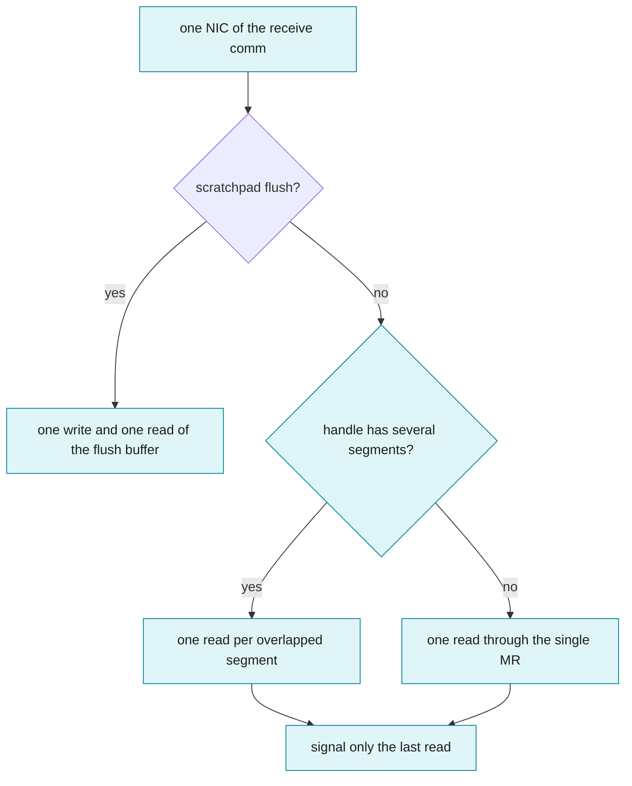
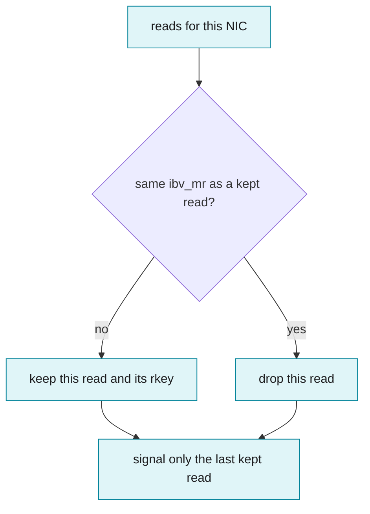

# Follow-up: collapse direct-GDR flush reads that share one MR

A multi-segment direct-GDR flush posts one `RDMA_READ` per overlapped segment on every NIC, up to 128 reads for 8 receives over a 16-segment window. This design drops a read only when the flush already posts a read through the same `ibv_mr`, because that is the only collapse that does not change which memory region the signaled read fences. Merging by GPU device and skipping coherent host segments are later steps. It is design only and is not implemented.

*Terms, diagram colors and callout boxes follow the [overview](multi_segment_overview.md#color-legend).*

> [!NOTE]
> **Status:** design only. The classic commit would go on layer 06 and the CAST twin on 08, then restack. Put the helper in both transports, not only CAST. GIN flush is not part of the first patch.

## What the flush posts today

With `RCCL_GDR_FLUSH_GPU_MEM_NO_RELAXED_ORDERING=0` (direct GDR), classic `rcclIbIflushMultiSeg` (`net_ib/p2p.cc`) builds `flushWrs[NCCL_NET_IB_MAX_RECVS * NCCL_IB_MAX_SEGMENTS]` (128 entries). For a multi-segment handle it calls `ncclIbSegmentsOverlappingRange` and posts `segMrs[seg][i]->rkey` at the first byte of each overlap. A single-segment handle posts one read through `ncclIbMrForRange`. Only the last read is signaled. CAST `IbCastIflush` (`net_ib_cast/p2p.cc`) builds the same chain, with `mhandle->mrs[i]` on the single-segment arm. The scratchpad path (`useGpuFlushMem`) posts one write and one read of the flush buffer and never walks segments. Eight 128-read chains are why the advertised P2P flush QP depth is 1024.

GIN flush in `ncclRmaBuildSegmentedWrs` (`net_ib/gin.cc` and the CAST copy) emits one loopback read per remote segment of one window, each with that segment's rkey, capped by `NCCL_RMA_MAX_FLUSH_WRS` (16).

## What may be collapsed

Two reads on one flush QP become one only when they use the same `ibv_mr`, which means the same rkey on the same NIC index. That happens when two receives in one `iflush` overlap one segment, or when the same handle is passed twice. Keep the first read and its address. The last kept read stays the signaled one.

> [!IMPORTANT]
> A receive that crosses two segments still posts two reads. Those are two memory regions even when they sit on one GPU, and a read of the second rkey does not fence the first. A kept read keeps the address the code uses today, `max(data[r], segStart[seg])`; do not retarget it to cover another segment.

## Implementation

- Add `ncclIbFlushReadNeeded` beside the direct-GDR fill in `rcclIbIflushMultiSeg`. It returns false when `flushWrs` already holds the same `ibv_mr*` for this NIC. Call it before appending a segment read and before appending the single-segment read. Compare `ibv_mr*` pointers, not GPU index or remote address.
- `IbCastIflush` calls the same helper in the `else` arm of `useGpuFlushMem`. The helper sees an `ibv_mr*` from either `mrs[i]` or `segMrs[seg][i]`, so the comparison is not duplicated in both arms.
- The collapse only lowers `nFlushWrs`. The array size, the missing-MR `ncclInternalError`, and the prefix-post handling stay as they are: classic sets `NCCL_NET_IB_REQ_FAILED` and returns success when a prefix posted, and CAST calls `IbCastAddEvent` and does the same.
- Mark the helper and the calls with `// RCCL:` comments.

## Later steps

- **Merge by device.** If one read fences the whole device, a second read on the same device could go, which would also merge two segments of one GPU with different `ibv_mr` values. Today the completion is tied to the posted rkey, so this waits until device-wide fencing is the rule the flush relies on.
- **Skip coherent host segments.** A segment the CPU sees without a device read may need no flush read. The handle does not record host coherence, so this waits until registration stores it.

## Unchanged

- The scratchpad flush, which is already one read.
- GIN flush. Every segment of a window has its own rkey, so the same-MR rule removes nothing; do not teach that builder about devices.
- Flush QP depths: 1024 when the capability is advertised, 512 for classic and 256 for CAST with the switch off, and 271 for the CAST RMA flush QP. Do not shrink a queue because a typical flush posts fewer reads.
- `ncclIbSegmentsOverlappingRange`, the side-table allocation ([side table on first registration](multi_segment_sidetable_first_reg.md)) and the 16-segment cap ([past 16 segments](multi_segment_varseg.md)).

## Tests

> [!WARNING]
> `MultiSegmentFlushSelectsSegmentMr`, `MultiSegmentFlushTouchesEverySegment` and `MultiRecvFlushTouchesEveryHandle` check completion and bytes. They stay green even if a needed rkey is dropped, so they do not lock this change.

Add a host test in `test/NetIbMultiSegmentUnitTests.cpp` on 06, carried by 08, that builds the rkey list one direct-GDR flush would post for one NIC, without opening a device:

- Two ranges inside one segment produce one rkey.
- One range that crosses `segStart[1]` produces `segMrs[0]` and `segMrs[1]`, in overlap order.
- Two segments of one GPU still produce two rkeys.
- Only the last kept read has `IBV_SEND_SIGNALED`.

After each commit, run the existing two-node direct-GDR flush jobs on ROCm 7.0.2.2 and 10.2.
