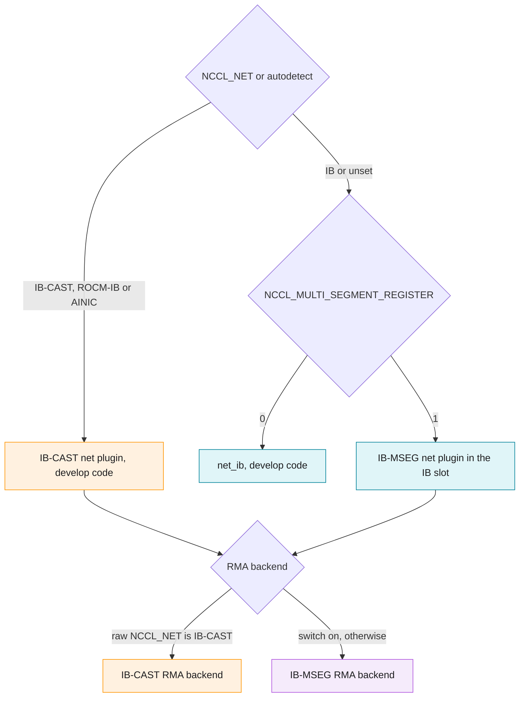
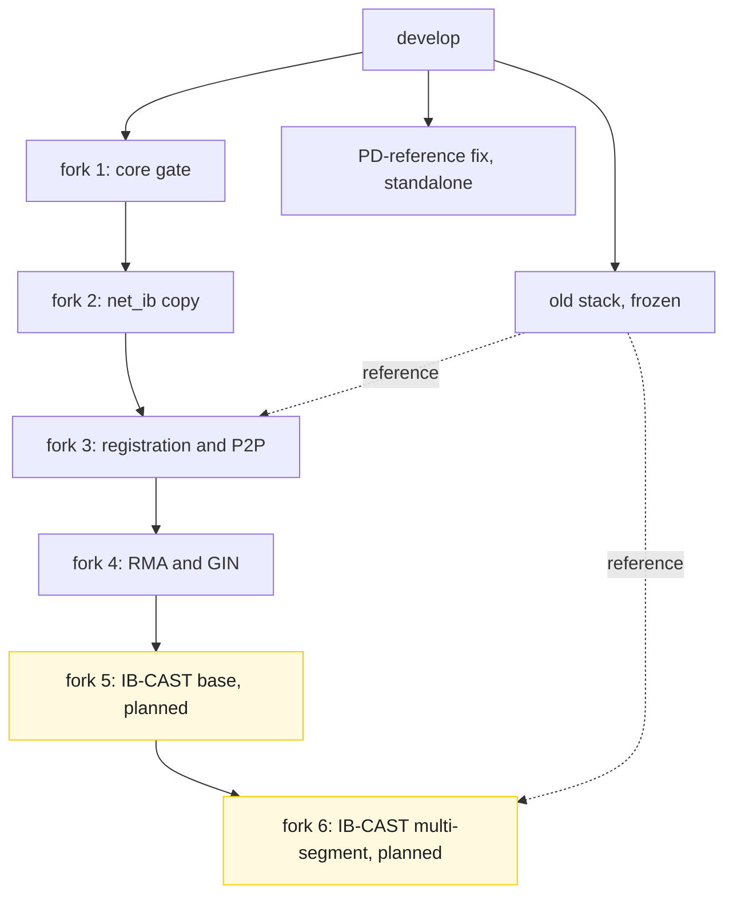
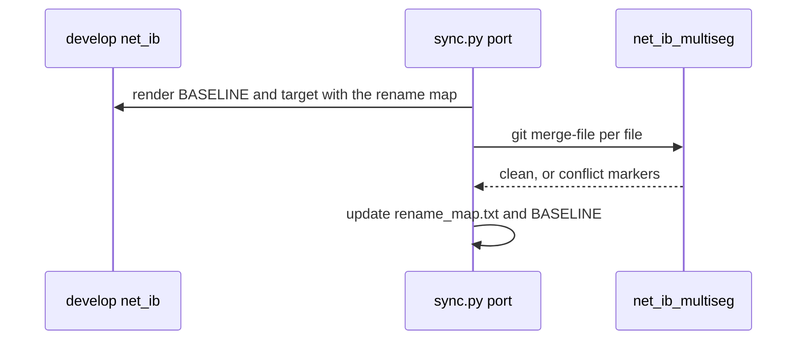
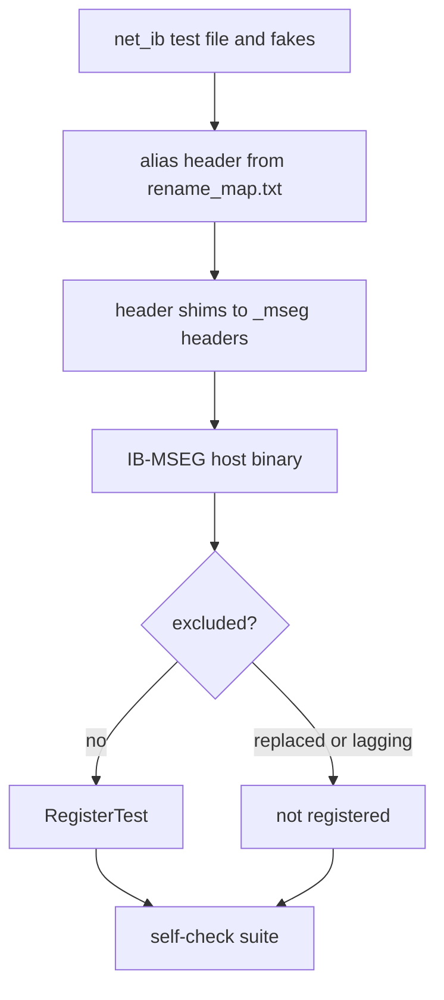
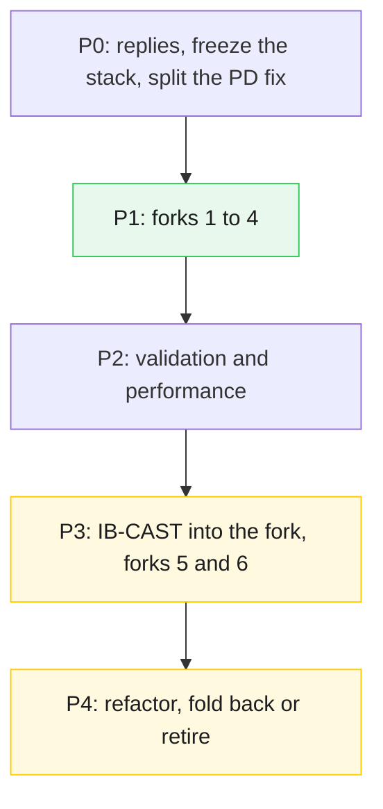
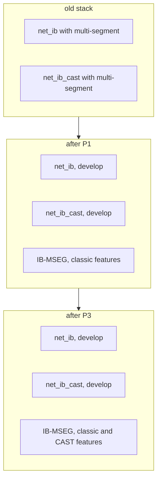
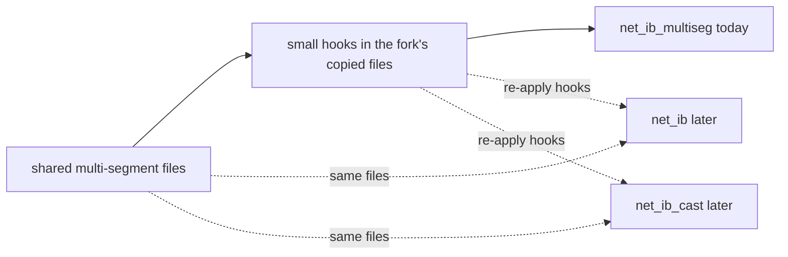
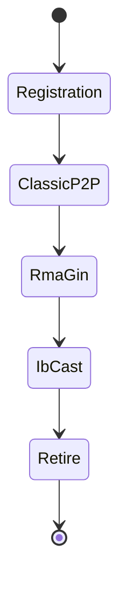

# IB-MSEG: multi-segment registration in one forked plugin

This note describes the planned replacement of the old multi-segment stack. Instead of editing classic `net_ib` and `net_ib_cast` in place, multi-segment support goes into one separate plugin, IB-MSEG (`src/transport/net_ib_multiseg/`), a renamed copy of `net_ib` that `NCCL_MULTI_SEGMENT_REGISTER=1` selects. It covers why the fork exists, how it is selected, the six fork branches and their status, the copy tool, the compile-twice host tests, the phases, how IB-CAST joins in phase 3, validation, and how the code can later move back into `net_ib` and `net_ib_cast`. Terms follow the [overview](multi_segment_overview.md#terms).

> [!NOTE]
> **Status (2026-11-23).** Forks 1 to 4 are committed locally on `users/atulkulk/netib-mseg/01` to `04` and are not pushed. Forks 5 and 6 are planned and have no branch. The old stack (05, 06, 08 and wire) stays frozen as the reference implementation and the test oracle. The source of truth for the plan is `~/ginocc/sw/oneplugin/plan_fork_net_ib_multiseg.md`; where this note and the fork branches differ from it, the branches win and the difference is listed under [open items](#open-items-and-differences-from-the-plan).

## Why a fork

The reviewers asked to keep multi-segment code out of production `net_ib` and `net_ib_cast`. With the fork, both return to develop, so with the switch off nothing changes and there is no performance question for them. Inside the fork the compatibility machinery goes away (capability negotiation, old-peer fallbacks), and so do the segmented copies of develop functions that the old stack kept beside the originals, because the fork edits its own `ncclIbMultiSend`, flush, `iput` and `iget` in place.

What stays is what the hardware limit forces: a ROCm DMA-BUF export covers one physical segment, so a multi-segment buffer still needs one MR and one rkey per segment, the receiver still tells the sender its per-segment layout, and a transfer still posts more than one WR. Those pieces go away only when ROCm can export one DMA-BUF over a whole VA range; then develop `net_ib` handles such buffers unchanged and the fork can be retired.

The cost is one more directory to sync by hand: every upstream change to `net_ib` must be considered for the fork. The copy tool keeps that merge mechanical.

## Selection

- `plugin/net.cc` keeps IB-CAST first for `NCCL_NET=IB-CAST`, `ROCM-IB` and AINIC autodetect. Otherwise the switch registers `ncclNetIbMseg`, named `IB-MSEG`, in the IB slot, and a request for `IB` (from the environment or the comm's `netName`) matches it.
- `plugin/rma.cc` follows the same order. Under the switch it picks `IbMsegRmaIbProxy` unless the raw `NCCL_NET` is `IB-CAST`, so `ROCM-IB` and AINIC autodetect pair the IB-CAST net plugin with the IB-MSEG RMA backend until phase 3. `plugin/gin.cc` is unchanged, so IB-CAST keeps its GDAKI backend; multi-segment GIN runs over the proxy backend (GIN type 2).
- `NCCL_NET=IB-MSEG` also selects the fork without turning on multi-segment registration. It is a temporary developer selector, documented as such, and is removed without an alias at fold-back.
- Jobs and runner configs select only by the switch, so folding the code back later changes nothing for them.
- GDAKI is not copied. A multi-segment GIN window on a non-proxy backend keeps failing with `ncclInvalidUsage`; GDAKI support would be new kernel work (per-segment rkey lookup and slicing in the WQE builder), not a port.

## No edits to net_ib or net_ib_cast

No fork branch edits `src/transport/net_ib/`, `src/transport/net_ib_cast/`, or the sibling headers `net_ib_gid_inspect.h` and `net_ib_wqe_lat_inspect.h`. The fork gets their behaviour by copying and renaming, never by calling into them. Shared code outside those directories (core files, `misc/ibvwrap`, the GID helpers) may change. Each fork branch is checked with `git diff --stat <develop base> HEAD -- <those paths>`, which must be empty; it is empty at the fork 4 tip.

## Forks

| Fork | Branch (`users/atulkulk/netib-mseg/...`) | Status | `src` change against develop |
|---|---|---|---|
| 1 | `01-core-backend-multiseg-gate` | committed, not pushed (code, tests, owner-fd fix) | +373 / −15 in 17 files |
| 2 | `02-net-ib-multiseg-copy` | committed, not pushed (code, tests) | the copy, about +10.9k |
| 3 | `03-registration-p2p-multiseg` | committed, not pushed (code, tests) | about +1.8k over fork 2 |
| 4 | `04-rma-gin-multiseg` | committed, not pushed (code, tests, review fixes, compile-twice host tests) | about +1.4k over fork 3; 58 files, +14,484 / −43 in total |
| 5 | none yet | planned, phase 3 | the develop `net_ib` to `net_ib_cast` delta, a few thousand lines |
| 6 | none yet | planned, phase 3 | CAST-specific multi-segment hooks |
| PD fix | `users/atulkulk/fix/ibcast-failed-pd-ref` | standalone branch from develop | the AICOMRCCL-3085 fix split out of 08 |

Tips on 2026-11-23, after fork 1's changelog line was amended and forks 2 to 4 were restacked (each restacked tip differs from the one before only by that line): fork 1 `3f5973a3fe00`, fork 2 `3507c9437f51`, fork 3 `97e3ea48d718`, fork 4 `7f84f495265d`, all on develop `c43b4a9e7307`. Code moved from the old stack by copying files or porting by hand, not by cherry-picking, because the fork drops most of what the stack adds beside develop code.

### Fork 1: core gate

- Two comm-level flags, `comm->rcclMultiSegNet` and `comm->rcclMultiSegRma`, say whether the comm's net or RMA plugin registers one MR per physical segment. `rcclMultiSegOn(bool)` combines that with `NCCL_MULTI_SEGMENT_REGISTER` and `NCCL_DMABUF_ENABLE`. The flags are separate because AINIC with the switch on uses IB-CAST for net and IB-MSEG for RMA. `proxyState->rcclMultiSegNet` copies the net flag. The plugin ABI and plugin lists are unchanged, and nothing sets the flags in fork 1.
- The core no longer names any plugin: the old stack's identity checks (`rcclRmaProxyMaxInflightRequests` comparing the backend with `ncclRmaIbProxy` and `IbCastRmaIbProxy`) become reads of the RMA flag. The RMA and GIN proxies cap requests in flight at 32 when it is set; the GIN proxy takes the flag through `rcclGinProxySetMultiSeg`, because `ncclGinProxyInit` runs inside `ncclRmaInit` before the flag exists.
- NET registration: a multi-segment buffer goes through `regMrDmaBuf` with fd -1 (one helper, `rcclNetRegMultiSeg`) only when the net flag is set, and stages otherwise. The `NCCL_PTR_DMABUF_MULTISEG` bit of 06 is not taken.
- Symmetric windows: RMA registers a multi-segment window only with the RMA flag, equal segment counts on every rank, and a segment table that fits; GIN only on the proxy backend. An RMA put on a window without an RMA registration returns `ncclInvalidUsage`, and hierarchical CE falls back when either window has none.
- Host owner fd for hybrid windows under `NCCL_SYM_REUSE_SYSMEM_HANDLES=1`: a rank that exported its own host handle uses its fd; otherwise it borrows the fd of the one rank that exported the segment, and with several exporters it borrows none. The decision counts exporters, not host-typed handles, because an imported handle reads as host or device depending on the ROCm version. Every rank agrees on the fetch result, also with GIN off. The old stack borrowed from the first exporter without this agreement; see [host owner DMA-BUF](multi_segment_gin_rma.md#host-owner-dma-buf).
- `TODO(ROCM-29810)` is removed: the runtime fix ships in 7.0.2.x and 10.3. The host-owner type propagation it described stays.
- Headers: `transport/rccl_mseg.h` (the per-registration cap of 1024) and `rccl_mseg_rma.h` (segment-table fit, in-flight cap `RCCL_RMA_MAX_INFLIGHT_REQUESTS`). They are the only `rccl_mseg*` headers left in `src/transport/` at the fork 4 tip.
- Changelog fragment `changelog.d/mseg-core-dmabuf-multiseg.changed.md`; its wording was amended on 2026-11-23 to "the single exporter's fd".

### Fork 2: net_ib copy

- `src/transport/net_ib_multiseg/` is develop `net_ib` without `gdaki/`, plus the two test-hook headers, with 395 renames in `rename_map.txt`: `ncclNetIb` becomes `ncclNetIbMseg`, other IB, RMA and GIN symbols get an `IbMseg` prefix, and `rcclNetP2pPolicy` becomes `IbMsegNetP2pPolicy`. Headers take a `_mseg` suffix, as IB-CAST uses `_cast`, because hipify renames repeated basenames. Parameter definitions become `extern` declarations, so both copies read the same `NCCL_IB_*` values. Like IB-CAST, the copy is plain code that later forks edit directly.
- `transport/net.cc` applies `IbMsegNetP2pPolicy` when the fork is the active net, as it does for `net_ib` and IB-CAST. RAS lists `IB-MSEG` as a verbs plugin.
- `RCCL_IB_GDR_FLUSH_FLAG` works on IB-MSEG: `init.cc` and `net.cc` reach the flag through `rcclIbGdrFlushOpsFor(net)` instead of comparing with `&ncclNetIb`. While the fork is selected, the RAS live link speed stays tied to `net_ib` and the active bandwidth diagnostic does not run, as for IB-CAST.
- `check_symbols.sh` fails when a `net_ib` object and a fork object define the same strong global, or a weak one nothing else defines.
- Tests: plugin selection with the switch and with `NCCL_NET=IB-MSEG`, name matching, RMA backend choice, the RAS list, the P2P policy, and the `sync.py` transforms; new `*_mseg` runner jobs run the MPI whitebox suites on IB-MSEG on the Mellanox IB and Thor2 configs and in `net_ib_transport`.

### Fork 3: registration and P2P

- `init.cc` sets the net flag when the comm selected IB-MSEG and `rcclMultiSegOn()` holds; split comms resolve the same net there.
- Registration: one MR per segment through `seg_reg_mseg.h`, the handle sized from the walked count, up to 1024 segments, and only while one more MR fits the device's `max_mr`.
- No capability bit. Both ends compute `IbMsegUseMultiSeg(switch and DMA-BUF, GIN, port failover)`; the GIN role rides in the listen handle. GIN and resilient comms keep the legacy CTS and decline a multi-segment receive registration, so those buffers stage. Mismatched settings across ranks are not detected at connect; the changelog and env docs say they must match.
- CTS: the receiver sends the overlapped segments in the CTS write, inline for up to four, otherwise as a reference the sender reads once into a cache. Single-segment receives keep the short CTS write. Each layout line carries the receive's index (the V1 stamp from the fork 3 review).
- Send: one WR fill builds every send, single-segment being the one-entry case; each write stays inside one local and one remote segment; a segmented send posts one slice per progress call; a partial post keeps or frees its request correctly; `isend` returns the post error.
- Flush: one read through the MR of the segment that holds the last receive's first byte; segmented sends write the GDR flush flag.
- Memory: with multi-segment on, the CTS slots add about 384 KiB on the send side and 512 KiB on the receive side.
- Code: `seg_*.h`, `seg_p2p.cc` and `p2p_multiseg.cc` inside the fork; the old stack's shared `rccl_p2p_multiseg.*` and most `rccl_mseg*` headers are not used.
- Tests: four IB-MSEG host binaries (connect, GIN, P2P, registration), fixture tests for the segmented send, flush, hooks, split math and CTS layout, MPI suites on IB-MSEG, and runner jobs on the Mellanox IB and Thor2 configs and in `net_ib_transport`. AINIC configs get the jobs once IB-MSEG carries AINIC support.

### Fork 4: RMA and GIN

- `init.cc` sets `comm->rcclMultiSegRma` when IB-MSEG's RMA proxy is the comm's RMA backend and `rcclMultiSegOn()` holds; a child comm takes its parent's flag. `ginDevCommSetupWithBackend` hands each comm's flag to the GIN proxy just before it creates that comm's contexts, so a later comm cannot change an earlier comm's in-flight cap.
- Registration: one DMA-BUF MR per segment, up to 1024 segments and within `max_mr` (`rcclIbMrAdmit`); every rank needs the same count, or registration fails on every rank with `ncclInvalidUsage` before the tables are gathered; ranks times segments is capped at 1,048,576 entries. Connect allocates the per-rank registration records before the first registration collective; close frees them.
- Data path: `iput`, `iget` and `iputSignal` split at segment boundaries and post in fixed-size rounds; the in-flight cap bounds the send queue; RMA QPs get `RCCL_RMA_SEND_QP_WRS` send WRs, and only GIN and RMA connects pass `nQpsPerDev`, which marks the comm as RMA. `iflush` reads one device segment, or nothing when every segment is host memory.
- Hybrid windows register host segments with the fd the core publishes by VA.
- `alloc.h`'s host-segment query is `rcclCuMemIsSysmemSegment` and releases the retained handle when the properties query fails.
- Fork-local helpers: `seg_export_mseg.h`, `seg_sym_mseg.h`, `seg_rma_mseg.h`, `seg_rma_round_mseg.h`.
- Runner jobs: RMA multi-segment (plus hybrid, 1x2 and 2x4 scale), RMA segment math and rounds, UBR multi-segment comprehensive and LSA plus GIN on `mi300x_mellanox_ib`, `mi300_mellanox_ib_func`, `mi355x_thor2_roce` and `mi355x_thor2_roce_func`; five RMA jobs in `net_ib_transport`. The AINIC configs have no IB-MSEG jobs yet, and the two hierarchical CE multi-segment cases (`CeMPI_AllGather` and `CeMPI_AlltoAll` `MultiNodeHierarchicalMultiSegment`, job `ce_hierarchical_multisegment_8node`) are not ported yet.
- The last commit replaces the hand-copied IB-MSEG host tests with the [compile-twice host tests](#compile-twice-host-tests).

### Fork 5: IB-CAST base (planned)

Phase 3 replays the develop diff from `net_ib` to `net_ib_cast` onto the fork: multiplane, QP sharing, CTS offload, the `ionicdv` helpers, AINIC recovery, BY_INDEX ordering, and the per-WR cap `IbCastMaxPostSendBytes`. It has no multi-segment logic and can be split in two if reviewers ask. The replay produces `rename_map_cast.txt` (CAST symbol to IB-MSEG symbol) and keeps CAST's internal names and struct shapes where possible, so CAST's develop host tests compile against the fork through the same compile-twice module, as a second base (`BASE net_ib_cast`). Where CAST and `net_ib` disagree on a name, the fork follows CAST and the `net_ib` base lists that test as `replaced`; CAST tests the fork cannot run yet start as `lagging`.

### Fork 6: IB-CAST multi-segment (planned)

Fork 6 adds only what is specific to IB-CAST, ported from 08 and wire, because the shared send, receive, flush and RMA paths are already in the fork: the BY_INDEX immediate flag, the scheduler interaction (one segmented group at a time), CAST's own CQ poll, and `IbCastMaxPostSendBytes` over segmented P2P chains and multi-segment RMA rounds (`IbCastPostDataWithinCap` and `IbCastRmaCapWrs` in the old stack). After it, the switch selects the fork on AINIC too, with AINIC features. The open IB-CAST items from the 2026-11-14 local review (inline CTS scope under CTS offload, masked stride, the resume `nreqs`) and the `peerCaps` masking are carried here; see [review feedback](multi_segment_review_feedback.md#summary) and [IB-CAST P2P open items](multi_segment_netib_cast.md#open-items).

## sync.py and the rename map

`tools/scripts/net_ib_multiseg/sync.py` is a standalone tool; nothing in the build or CI depends on it.

- `copy [--rev REV] [--force]` writes the renamed copy, the fork's `CMakeLists.txt`, `rename_map.txt` and `BASELINE` (the last `net_ib` commit copied; `138896d1c4ad` today).
- `port [--to REV] [--dry-run]` renders `net_ib` at `BASELINE` and at the target with one rename map, runs `git merge-file` per file against the fork, adds new files to the fork's CMake list, reports deleted ones, and updates the map and `BASELINE`. On a conflict it returns 1 and leaves `<<<<<<< net_ib_multiseg` markers.
- Five `ncclIb*` names defined outside `net_ib` (`ncclIbMalloc`, the two GID helpers, the GDR probe and the peer-mem scan) stay shared. Includes, header guards (`_MSEG`) and the plugin name string are rewritten by the tool, so `port` merges stay conflict-free. Copied lines are not reformatted.
- `test_runner/tests/test_net_ib_multiseg_sync.py` covers the transforms, `copy` and `port`.

## Compile-twice host tests

The IB-MSEG host binaries compile the `net_ib` host test files and fakes a second time, against the fork's units, so every `net_ib` host test keeps checking the fork without a hand-kept copy. The fork-only tests stay in the IB-MSEG test files, which include the `net_ib` ones. This replaced about 4,450 copied lines in fork 4.

- A generic module, `test/host/transport/derived_transport_tests.cmake`, handles any transport derived from one or more base transports. Per base, it generates at configure time a force-included alias header from the base's rename map, minus the names the hand-written seam units (`shim/connect.cc`, `gin.cc`, `p2p.cc`) alias back, and header shims that resolve the base's includes to the derived headers.
- Per binary, `rccl_add_derived_transport_binary` takes an exclusion list whose entries are tagged `replaced` (the derived test file has its own test of that name) or `lagging` (a base change the fork has not taken yet), and a list of `DISABLED_` base tests it re-enables.
- Around the base test include, `TEST_F` registers each base test through `testing::RegisterTest` unless it is excluded, so the shared `main()` and `test/host/CMakeLists.txt` stay unchanged.
- A self-check suite in each binary fails on a stale or wrong exclusion; it was confirmed to fail on an injected stale entry and on a `replaced` entry with no fork test.
- The IB-MSEG configuration is `test/host/transport/net_ib_multiseg/host_tests.cmake`, included from `transport/host_tests.cmake`, with four binaries (connect, GIN, P2P, registration) on `BASE net_ib`. Today the P2P binary excludes eight tests as `replaced` (the fork's `ctsFifo` is a pointer) and one as `lagging` (`DISABLED_Iflush_ReadPostFailurePropagatesError`: the fork chains the flush write and read in one post), and the registration binary re-enables `DISABLED_RegMr_MultiDeviceFailureUnwindsEarlierRegistrations`.
- Developer rule: when a `net_ib` change breaks an IB-MSEG host test, add that test to its binary's `EXCLUDE_BASE_TESTS` as `lagging` with a reason; the fork owner ports the change and removes the entry. There is no Python step for developers.
- Fork 5 adds `BASE net_ib_cast` as one more base block in the same file, with its own seam list and exclusions.

## What the fork supersedes

| Old-stack note | In the fork |
|---|---|
| [Classic NET/IB P2P](multi_segment_netib_wire.md) | superseded by fork 3 for the design going forward; the capability bit and old-peer fallback are gone, the layout, slicing and one-read flush carry over |
| [GIN/RMA](multi_segment_gin_rma.md) | core part superseded by fork 1 (flags instead of identity checks, owner-fd agreement), classic RMA by fork 4 |
| [IB-CAST P2P](multi_segment_netib_cast.md), [IB-CAST GIN/RMA](multi_segment_netib_cast_gin.md) | still the reference: forks 5 and 6 are planned |
| [Current contract](multi_segment_current.md), [code map](multi_segment_code_map.md), [sync and removal](multi_segment_sync_and_removal.md) | describe the old stack; the fork's footprint against `net_ib` is zero, and removal becomes deleting `net_ib_multiseg/` |
| `design_one_multiseg_plugin.md` (outside this book) | superseded by the plan for the near term |

## Phases

- **P0.** Post the drafted replies to Aleksandr and say the stack moves to a fork (not posted yet). Freeze the rebased stack. Split the AICOMRCCL-3085 PD-reference fix out of 08 (done: `users/atulkulk/fix/ibcast-failed-pd-ref`).
- **P1.** Forks 1 to 4, as above: copy, rename, select, port 05 and 06 into the fork in place, keep in the core only the segment walk and gate, the DMA-BUF path in `net.cc`, the owner fd table and `rccl_mseg.h`/`rccl_mseg_rma.h`, give the fork its own host tests, and make the jobs set the switch. Committed locally.
- **P2.** Validation on ROCm 7.0.2.x and 10.3 on Mellanox IB (MI300X), Thor2 (MI355X) and AINIC, single and multi node, plus hostval with the gate-off build. The baseline to match is the old stack's 220 of 221 units per version and the IB-CAST RMA cap runs. Performance: switch off identical to develop; switch on with single-segment buffers at parity with develop `net_ib`; switch on with multi-segment buffers against develop staging at 2, 17, 64, 256 and 1024 segments; registration time and MR count. AINIC runs as plain RoCE until P3, and AINIC hardware is not reachable from the current cluster.
- **P3.** IB-CAST into the fork (forks 5 and 6, see the [consolidation plan](#consolidation-plan)).
- **P4.** Reduce the remaining protocol surface, merge upstream changes, and decide between keeping the fork, folding it back, or retiring it once ROCm DMA-BUF range export exists. The ROCm request should be filed in parallel with P1, because it is the only change that removes the per-segment design.

## Consolidation plan

Today the old stack carries the same feature twice, once in `net_ib` and once in `net_ib_cast`. The fork consolidates it into one plugin in two steps. P1 touches classic only and leaves IB-CAST at develop. P3 brings IB-CAST's develop features into the fork as fork 5, then CAST's own multi-segment hooks as fork 6, instead of adding multi-segment to `net_ib_cast` again. After P3 one plugin serves classic IB, RoCE and AINIC with multi-segment support, and the classic and CAST test twins collapse into one fork suite.

Test retention, as estimated in the plan from the old stack's 399 test definitions: core 88 (79 kept, 9 rewritten), classic transport 189 (168 kept, 12 rewritten, 9 dropped: the capability-word and old-peer tests and the switch-dependent send-depth test), CAST 122 (about 60 CAST-specific kept for fork 6, about 55 twins of classic tests that collapse into the fork suite, about 5 dropped).

## Validation

| Run | Tree | Result | Status file |
|---|---|---|---|
| Fork 3 hardware | fork 3 before commit | 207 of 207 units on ROCm 7.0.2.2 and 10.3, two MI355X Thor2 nodes | `~/ginocc/sw/fork3-hw4/status` |
| Fork 4 hardware | fork 4 tests commit | 214 of 214 units on 7.0.2.1 build 55 and 10.3 | `~/ginocc/sw/fork4-hw3-b55/status` |
| Fork 4 hardware with review fixes | uncommitted review fixes | 212 of 214 on each version; both failures were the alloc test pinning the old handle leak, flipped since | `~/ginocc/sw/fork4-hw4-argus/status` |
| Fork 4 hostval | final fork 4 tip | pytest 167 passed; 7.0.2.1 build 55 and 10.3 0 failed binaries; gate-off build 197 binaries, 13,271 passed | `~/ginocc/sw/oneplugin/fork4/hv-final/status` |
| Fork 4 hardware, final tip | final fork 4 tip | running on 2026-11-23, not finished when this note was written | `~/ginocc/sw/fork4-hw5-final/status` |

Forks 1 and 2 were validated with hostval (pytest, both ROCm versions, gate-off) and fork 2's `*_mseg` jobs on two MI355X nodes; the fork 2 PR draft reports that run on ROCm 10.2, which is not a supported validation version, so it needs a rerun on 10.3. The Mellanox IB configs have not run any fork yet.

## Open items and differences from the plan

- The plan's status line still says "plan, nothing implemented", and its branch record covers only forks 1 and 2.
- The plan says the fork adds a version field to its connect metadata and fails fast on a mismatch (appendix rule 7). Fork 3 has no such check: both ends compute `IbMsegUseMultiSeg` from their own settings, and mismatched settings are not detected at connect.
- The plan's main text moves the shared `rccl_mseg*` and `rccl_p2p_multiseg.*` code into the fork (P1 step 4), while appendix rule 1 keeps it in `src/transport/` for a later fold-back. Forks 3 and 4 follow the main text: the code lives in `net_ib_multiseg/seg_*`, and only `rccl_mseg.h` and `rccl_mseg_rma.h` stay in `src/transport/`. Rule 1 needs updating, or the fold-back has to move those files out again.
- The plan says fork QPs have one fixed depth. Fork 4 sizes by role instead: RMA and GIN connects get `RCCL_RMA_SEND_QP_WRS`, P2P keeps develop's depth.
- AINIC configs have no IB-MSEG jobs, and the hierarchical CE multi-segment cases are not ported.
- Fork 2's PR draft cites a hardware run on ROCm 10.2.
- Replies to Aleksandr are drafted but not posted.

## Migration and fold-back

This part is separate from the plan and does not change it. IB-MSEG ships first behind the switch and is tested in the field. Pieces then move into production `net_ib` and `net_ib_cast` one at a time, each after field results support it, rather than in one large merge.

Rules the fork follows, from the plan appendix:

1. Most logic lives in shared, transport-neutral files that take plain structs and callbacks, not in the copied files. (At the fork 4 tip this logic is in `net_ib_multiseg/seg_*`; see [open items](#open-items-and-differences-from-the-plan).)
2. The copied files change only at hook points: registration, CTS post, send, completion, flush, `iput`, `iget` and QP creation. The hook diff against `sync.py`'s rendering of `net_ib` at `BASELINE` is tracked; the target is a few hundred lines.
3. Single-segment buffers take develop's code unchanged: every hook first asks whether the buffer has more than one segment.
4. The rename is mechanical and recorded, so the reverse map turns the fork's hook diff back into a patch against `net_ib`. Fork 2 stays a pure rename.
5. `BASELINE` records which develop `net_ib` the fork is based on; re-syncing is `sync.py port --to <new develop>`.
6. Decisions that depend on the switch go through one helper each (send-queue depth, in-flight cap); the core already checks the comm-level flags rather than a plugin name.
7. The connect check is designed to outlive the fork, so no capability negotiation or old-peer fallback has to come back. (Not implemented in fork 3; see open items.)
8. CAST features enter the fork as develop code, kept apart from the hooks; at merge time that replayed code is dropped and only the CAST hooks are applied to `net_ib_cast`.
9. Tests target the shared files and the hooks separately: unit tests call the shared files directly, and fixture tests reach the hooks through one CMake variable that names the transport's sources.

Order, each step gated on field results from the previous one:

1. Registration: the per-segment walk and `max_mr` admission move into `net_ib` behind the switch.
2. Classic P2P: the layout exchange, segmented send and flush hooks move into `net_ib`; with the switch on, `net.cc` selects production `net_ib` again for NET, and the fork remains only for RMA and GIN.
3. RMA and GIN: the RMA hooks move into the `net_ib` RMA backend, the `init.cc` flag check points at it, and `plugin/rma.cc` stops selecting the fork.
4. IB-CAST: the same hooks plus CAST's own move into `net_ib_cast` and `IbCastRmaIbProxy`.
5. Delete `net_ib_multiseg/` once no switch setting selects it, and drop `NCCL_NET=IB-MSEG` without an alias.

Each step is three actions per transport: keep the shared files where they are, apply that step's part of the hook diff (reverse-renamed), and move the selection in `net.cc` or `plugin/rma.cc`. Between steps the configuration that already works stays selectable, so a regression can be backed out by switching the selection back.
