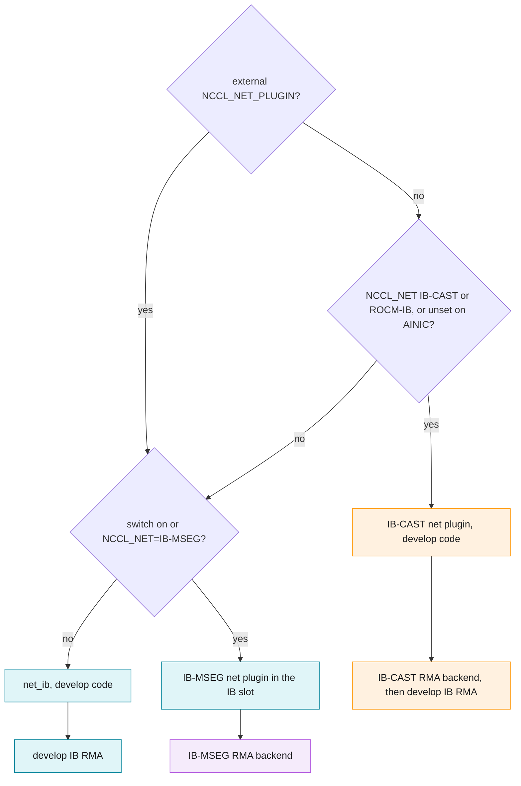
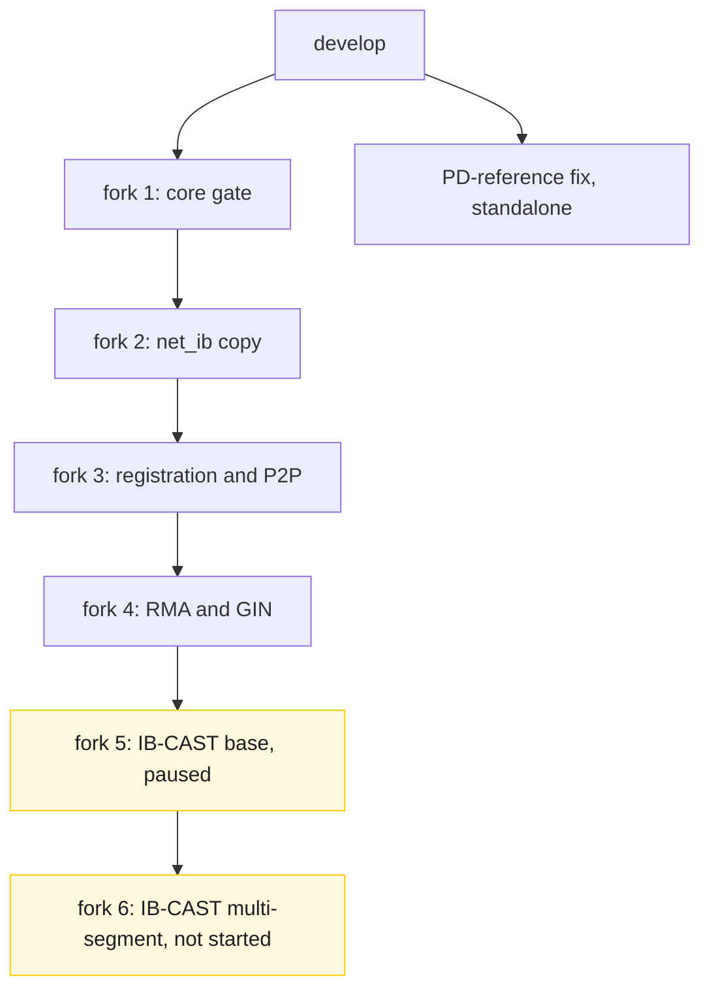
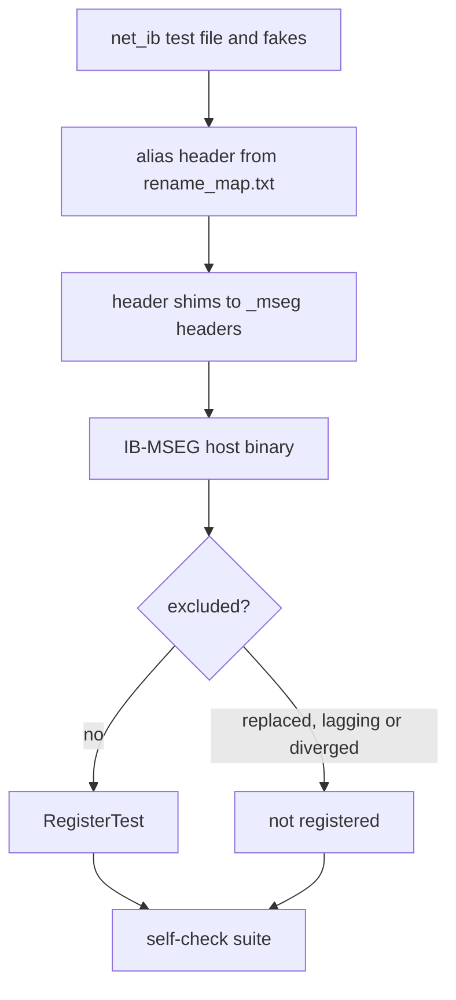
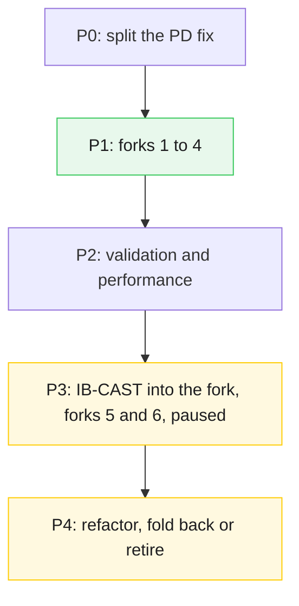
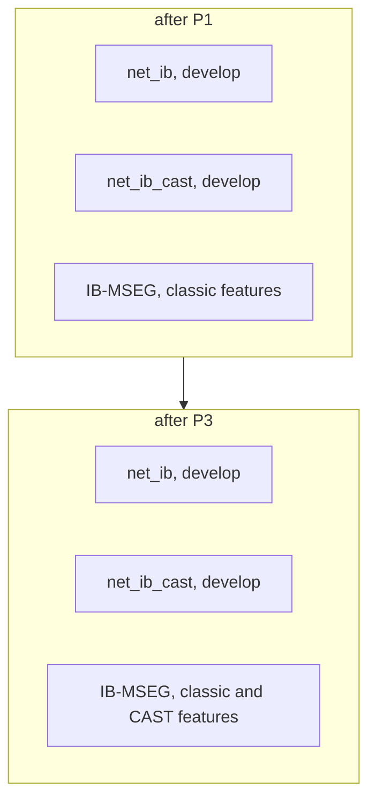
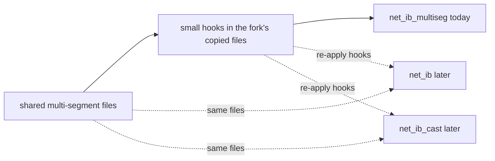
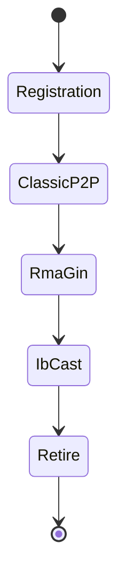

# IB-MSEG: multi-segment registration in one forked plugin

Multi-segment support lives in one separate plugin, IB-MSEG (`src/transport/net_ib_multiseg/`), a renamed copy of `net_ib` that `NCCL_MULTI_SEGMENT_REGISTER=1` selects. This note covers why it is a separate plugin, how it is selected, what each fork changes, the copy and its rename map, the compile-twice host tests, the phases, and how the code can later move back into `net_ib` and `net_ib_cast`. Terms follow the [overview](multi_segment_overview.md#terms); the stack table is in [stack and pull requests](multi_segment_overview.md#stack-and-pull-requests).

The code paths of each fork, in execution order, are in the code walkthrough book: [fork 1](walkthrough/multi_segment_walkthrough_fork1_core.md), [fork 2](walkthrough/multi_segment_walkthrough_fork2_copy.md), [fork 3](walkthrough/multi_segment_walkthrough_fork3_p2p.md) and [fork 4](walkthrough/multi_segment_walkthrough_fork4_gin_rma.md).

## Why a fork

Multi-segment support changes registration, the CTS and the send path of every transfer that uses it. A separate plugin keeps `net_ib` and `net_ib_cast` at develop, so with the switch off nothing changes and their performance is unaffected. Inside the fork there is no compatibility machinery (capability negotiation, old-peer fallbacks) and no segmented copies of develop functions beside the originals, because the fork edits its own `ncclIbMultiSend`, flush, `iput` and `iget` in place.

What stays is what the hardware limit forces: a ROCm DMA-BUF export covers one physical segment, so a multi-segment buffer still needs one MR and one rkey per segment, the receiver still tells the sender its per-segment layout, and a transfer still posts more than one WR. Those pieces go away only when ROCm can export one DMA-BUF over a whole VA range; then develop `net_ib` handles such buffers unchanged and the fork can be retired.

The cost is one more directory to sync by hand: every upstream change to `net_ib` must be considered for the fork. The recorded rename map keeps that merge mechanical.

## Selection

- `plugin/net.cc` canonicalizes `NCCL_NET` (`ROCM-IB` becomes `IB-CAST`) and keeps IB-CAST first for `IB-CAST`, or for `NCCL_NET` unset on an AINIC host (`rcclUseAinic`), but only when no external plugin is named in `NCCL_NET_PLUGIN`. Otherwise `rcclIbMsegRequested` (the switch on, or `NCCL_NET=IB-MSEG`) registers `ncclNetIbMseg`, named `IB-MSEG`, in the IB slot, and a request for `IB` (from the environment or the comm's `netName`) matches it. With an external plugin, IB-MSEG takes the internal slot even with `NCCL_NET=IB-CAST`.
- `plugin/rma.cc` uses the same inputs. Whenever the internal net plugin is IB-CAST, IB-CAST's RMA backend leads with develop's `ncclRmaIbProxy` as the fallback, so `ROCM-IB` and AINIC autodetect use IB-CAST for both net and RMA. Otherwise `rcclIbMsegRequested` puts `IbMsegRmaIbProxy` in the IB slot. `plugin/gin.cc` is unchanged, so IB-CAST keeps its GDAKI backend; multi-segment GIN runs over the proxy backend (GIN type 2).
- `NCCL_NET=IB-MSEG` also selects the fork without turning on multi-segment registration. It is a temporary developer selector, documented as such, and is removed without an alias at fold-back.
- Jobs and runner configs select only by the switch, so folding the code back later changes nothing for them. The one exception is the MI455 AINIC configs: there the IB-MSEG jobs of forks 2 to 4 also set `NCCL_NET=IB`, because without it AINIC autodetect keeps IB-CAST first. With the switch on and `NCCL_NET=IB`, AINIC uses IB-MSEG for net and RMA; with `NCCL_NET` unset it still uses IB-CAST until IB-CAST's features are in the fork.
- GDAKI is not copied. A device-only multi-segment GIN window on a non-proxy backend keeps develop's HIP outcome (`ncclInvalidUsage` for a GIN-only window, no GIN registration otherwise); GDAKI support would be new kernel work (per-segment rkey lookup and slicing in the WQE builder), not a port.

## Boundary with net_ib and net_ib_cast

No fork edits `src/transport/net_ib/`, `src/transport/net_ib_cast/`, or the sibling headers `net_ib_gid_inspect.h` and `net_ib_wqe_lat_inspect.h`. The fork gets their behaviour by copying and renaming, never by calling into them. Shared code outside those directories (core files, `misc/ibvwrap`, the GID helpers) may change. Each fork is checked with `git diff --stat <develop base> HEAD -- <those paths>`, which must be empty.

## Forks

| Fork | Approximate change over the parent (whole tree) |
|---|---|
| 1: core gate | 51 files, about +2,200 / −50 over develop |
| 2: net_ib copy | 62 files, about +12,900 / −120; about 10,900 of the added lines are the renamed copy |
| 3: registration and P2P | 65 files, about +14,200 / −140, most of it tests |
| 4: RMA and GIN | 70 files, about +10,700 / −5,200 (the compile-twice test change removes the hand-copied host tests) |
| 5: IB-CAST base (paused) | the develop `net_ib` to `net_ib_cast` delta, a few thousand lines; no commits yet |
| 6: IB-CAST multi-segment (not started) | CAST-specific multi-segment hooks |

The AICOMRCCL-3085 PD-reference fix for IB-CAST is a standalone change from develop, outside the stack. The tests each fork adds are in the [validation plan](multi_segment_validation_plan.md#coverage-by-area).

### Fork 1: core gate

- Two comm-level flags, `comm->rcclMultiSegNet` and `comm->rcclMultiSegRma`, say whether the comm's net or RMA plugin registers one MR per physical segment. `rcclMultiSegOn(bool)` combines that with `NCCL_MULTI_SEGMENT_REGISTER` and `NCCL_DMABUF_ENABLE`. The flags are separate because the net plugin and the RMA backend are chosen separately and need not both be IB-MSEG. `proxyState->rcclMultiSegNet` copies the net flag. The plugin ABI and plugin lists are unchanged, and nothing sets the flags in fork 1.
- The core names no plugin: `rcclRmaProxyMaxInflightRequests` reads the RMA flag instead of comparing the backend with a plugin. The RMA and GIN proxies cap requests in flight at 32 when it is set; the GIN proxy takes the flag through `rcclGinProxySetMultiSeg`, because `ncclGinProxyInit` runs inside `ncclRmaInit` before the flag exists.
- NET registration: a multi-segment buffer goes through `regMrDmaBuf` with fd -1 (one helper, `rcclNetRegMultiSeg`) only when the net flag is set, and stages otherwise. No new plugin pointer-type bit is added.
- Symmetric windows: RMA registers a multi-segment window only with the RMA flag, equal segment counts on every rank, and a segment table that fits; GIN only on the proxy backend. An RMA put on a window without an RMA registration returns `ncclInvalidUsage`, and hierarchical CE falls back when either window has none.
- Host owner fd for hybrid windows under `NCCL_SYM_REUSE_SYSMEM_HANDLES=1`: a rank that exported its own host handle uses its fd; otherwise it borrows the fd of the one rank that exported the segment, and with several exporters it borrows none. Every rank agrees on the fetch result, also with GIN off; see [host owner DMA-BUF](multi_segment_gin_rma.md#host-owner-dma-buf).
- `TODO(ROCM-29810)` is removed: the runtime fix ships in 7.0.2.x and 10.3. The host-owner type propagation it described stays.
- Headers: `transport/rccl_mseg.h` (the per-registration cap `RCCL_IB_REG_SEG_DEFAULT`) and `rccl_mseg_rma.h` (segment-table fit, in-flight cap `RCCL_RMA_MAX_INFLIGHT_REQUESTS`). They are the only `rccl_mseg*` headers in `src/transport/`.
- Changelog fragment `changelog.d/mseg-core-dmabuf-multiseg.changed.md`; it says that with `NCCL_SYM_REUSE_SYSMEM_HANDLES=1`, GIN registers a host segment "through its owner's fd".

### Fork 2: net_ib copy

- `src/transport/net_ib_multiseg/` is develop `net_ib` without `gdaki/`, plus the two test-hook headers, renamed as described in [the copy and the rename map](#the-copy-and-the-rename-map). Like IB-CAST, the copy is plain code that later forks edit directly.
- `transport/net.cc` applies `IbMsegNetP2pPolicy` when the fork is the active net, as it does for `net_ib` and IB-CAST. RAS lists `IB-MSEG` as a verbs plugin.
- `RCCL_IB_GDR_FLUSH_FLAG` works on IB-MSEG: `init.cc` and `net.cc` reach the flag through `rcclIbGdrFlushOpsFor(net)` instead of comparing with `&ncclNetIb`. While the fork is selected, the RAS live link speed stays tied to `net_ib` and the active bandwidth diagnostic does not run, as for IB-CAST.
- The copy tracks develop `net_ib`. The latest sync brought in develop's inline GDR flush scratchpad write and the flush QP's inline room for it.
- New `*_mseg` runner jobs rerun develop's NET-IB MPI whitebox suites on IB-MSEG.

### Fork 3: registration and P2P

- `init.cc` sets the net flag when the comm selected IB-MSEG and `rcclMultiSegOn()` holds; split comms resolve the same net there.
- Registration: one MR per segment through `seg_reg_mseg.h`, the handle sized from the walked count, up to `RCCL_IB_REG_SEG_DEFAULT` segments, and only while `nSeg` more MRs fit under `max_mr` on every rail (`rcclIbMrAdmit`).
- No capability bit. Both ends compute `IbMsegUseMultiSeg(switch and DMA-BUF, GIN, port failover)`; the GIN role rides in the listen handle. GIN and resilient comms keep the legacy CTS and decline a multi-segment receive registration, so those buffers stage.
- Mismatch check: each side puts its decision in the connect metadata (`useMultiSeg`); when the two differ, the accepting side WARNs (naming `NCCL_MULTI_SEGMENT_REGISTER`, `NCCL_DMABUF_ENABLE` and `NCCL_IB_RESILIENCY_PORT_FAILOVER`), closes the socket before replying and returns `ncclInvalidUsage`, so neither side reads the CTS in the wrong layout. The connecting side usually sees the socket close.
- CTS: the receiver sends the overlapped segments in the CTS write and marks it with the layout bit, inline for up to four, otherwise as a reference the sender reads once into a cache. Single-segment receives keep the short CTS write. Each layout line carries the receive's index.
- Memory: only a `useMultiSeg` comm pays for the multi-segment state. Each side's 128 KiB CTS FIFO becomes a 512 KiB slot array, and the sender adds the send cursor and the layout cache (about 11 KiB); a legacy comm keeps develop's FIFO on each side as a separate allocation and allocates a cursor only if it sends from a multi-segment handle.
- Send: one WR fill builds every send, single-segment being the one-entry case; each write stays inside one local and one remote segment; a segmented send posts one slice per progress call; a partial post keeps or frees its request correctly; `isend` returns the post error.
- Flush: one read through the MR of the segment that holds the last receive's first byte; segmented sends write the GDR flush flag. With relaxed ordering off, the scratchpad write is posted inline, as in `net_ib`.
- Observability: each send comm counts its segmented posts, their WRs and the posts that reach a later segment (`rcclIbSegStats`); `rcclIbSendCommSegStats` reads them for tests, and a `NET/IB` TRACE line logs each segmented slice.
- Code: `seg_*.h`, `seg_p2p.cc` and `p2p_multiseg.cc` inside the fork, with hooks in the copied files. The design is in [IB-MSEG NET/IB P2P](multi_segment_netib_wire.md).

### Fork 4: RMA and GIN

- `init.cc` sets `comm->rcclMultiSegRma` when IB-MSEG's RMA proxy is the comm's RMA backend and `rcclMultiSegOn()` holds; a child comm takes its parent's flag. `ginDevCommSetupWithBackend` hands each comm's flag to the GIN proxy just before it creates that comm's contexts, so a later comm cannot change an earlier comm's in-flight cap.
- Registration: one DMA-BUF MR per segment, up to `RCCL_IB_REG_SEG_DEFAULT` segments and within `max_mr` (`rcclIbMrAdmit`); every rank needs the same count, or registration fails on every rank with `ncclInvalidUsage` before the tables are gathered; ranks times segments is capped at `RCCL_RMA_SEG_TABLE_MAX_ENTRIES`. Connect allocates the per-rank registration records before the first registration collective; close frees them.
- Data path: `iput`, `iget` and `iputSignal` split at segment boundaries and post in fixed-size rounds; the in-flight cap bounds the send queue; RMA QPs get `RCCL_RMA_SEND_QP_WRS` send WRs, and only GIN and RMA connects pass `nQpsPerDev`, which marks the comm as RMA. `iflush` reads one device segment, or nothing when every segment is host memory. A failed batch doorbell fails every request with a WR in the batch, including aggregated requests already returned.
- Hybrid windows register host segments with the fd the core publishes by VA.
- Observability: each RMA context counts the rounds it posts, their data WRs and the rounds that end past the first segment, at post time so the probe build of a first round is not counted; `rcclRmaIbProxySegStats` reads them per peer, and a `NET/IB/RMA` TRACE line logs where each round ends.
- `alloc.h`'s host-segment query is `rcclCuMemIsSysmemSegment` and releases the retained handle when the properties query fails.
- Fork-local helpers: `seg_export_mseg.h`, `seg_sym_mseg.h`, `seg_rma_mseg.h`, `seg_rma_round_mseg.h`. The design is in [GIN/RMA](multi_segment_gin_rma.md).
- The hand-copied IB-MSEG host tests are replaced by the [compile-twice host tests](#compile-twice-host-tests).

### Fork 5: IB-CAST base (planned)

> [!WARNING]
> Paused since 2026-11-24 by decision: forks 1 to 4 are stabilized on IB and AINIC first, and IB-CAST's features come later. The fork 5 branch exists with no commits and is not rebased onto the current stack.

Phase 3 replays the develop diff from `net_ib` to `net_ib_cast` onto the fork: multiplane, QP sharing, CTS offload, the `ionicdv` helpers, AINIC recovery, BY_INDEX ordering, and the per-WR cap `IbCastMaxPostSendBytes`. It has no multi-segment logic and can be split in two pull requests if its size calls for it. The AINIC runner entries already exist: forks 2 to 4 each define their IB-MSEG jobs on the MI455 AINIC configs with `NCCL_NET=IB`. What fork 5 brings to AINIC is IB-CAST's features in the fork and AINIC autodetect selecting it. The replay produces `rename_map_cast.txt` (CAST symbol to IB-MSEG symbol) and keeps CAST's internal names and struct shapes where possible, so CAST's develop host tests compile against the fork through the same compile-twice module, as a second base (`BASE net_ib_cast`). Where CAST and `net_ib` disagree on a name, the fork follows CAST and the `net_ib` base lists that test as `replaced`; CAST tests the fork cannot run yet start as `lagging`.

Two probes were made before the pause, and both were set aside uncommitted:

- A minimal port: uDMA affinity, IB-CAST's per-WR cap and selection, adding `cast.cc` and `cast_mseg.h`, a CAST rename map, and host-test parameter fakes.
- A replay probe on an earlier fork 4 tip. It rendered `net_ib_cast` into the IB-MSEG namespace and ran a per-file three-way merge, with the fork as ours, `net_ib` renamed at the copy point as the base, and renamed CAST as theirs. 16 CAST-only files arrive unchanged. 15 shared files merge, 8 of them with conflicts, 60 conflict hunks in total: `p2p.cc` 19, `connect.cc` 15, `gin.cc` 12, `common_mseg.h` 9, `init.cc` 2, and `connect_mseg.h`, `gin_mseg.h` and `reg.cc` 1 each. 18 fork files have no CAST counterpart and are kept (`seg_*`, `p2p_multiseg`, `wqe_lat_mon`, the GID and WQE inspect headers).

Develop has changed IB-CAST files since, so the replay probe must be redone on the current fork 4 before fork 5 resumes.

### Fork 6: IB-CAST multi-segment (planned)

Not started; it waits on fork 5. The design below is unchanged, and the old stack's IB-CAST branches stay read-only references. Fork 6 must also fix three review items found on the old IB-CAST layer: the scope must exclude AINIC inline CTS (`IbCastMultiSegScopeOk`), the receiver must not size CTS slots from scope-masked `peerCaps`, and `rcclIbCastSendResume` must bound `nreqs`.

Fork 6 adds only what is specific to IB-CAST, because the shared send, receive, flush and RMA paths are already in the fork: the BY_INDEX immediate flag, the scheduler interaction (one segmented group at a time), CAST's own CQ poll, `IbCastMaxPostSendBytes` over segmented P2P chains and multi-segment RMA rounds, and the IB-CAST RMA registration record with a magic and a version. After it, the switch selects the fork on AINIC with AINIC features, also when `NCCL_NET` is unset and AINIC autodetect chooses the plugin. The requirements carried from review are in [IB-CAST P2P open items](multi_segment_netib_cast.md#open-items); the designs are [IB-CAST P2P](multi_segment_netib_cast.md) and [IB-CAST GIN/RMA](multi_segment_netib_cast_gin.md).

## The copy and the rename map

The fork 2 copy is develop `net_ib` with its global symbols, header names and include guards renamed, produced by a rename tool and committed unchanged; the tool is not part of the stack and nothing in the build or CI depends on it.

- `tools/scripts/net_ib_multiseg/rename_map.txt` records each `net_ib` global the copy renames and its fork name (395 entries): `ncclNetIb` becomes `ncclNetIbMseg`, other IB, RMA and GIN symbols get an `IbMseg` prefix, and `rcclNetP2pPolicy` becomes `IbMsegNetP2pPolicy`. Reversing it turns a fork change into a patch against `net_ib`, which is what fold-back needs.
- Headers take a `_mseg` suffix, as IB-CAST uses `_cast`, because hipify renames repeated basenames. Parameter definitions become `extern` declarations, so both copies read the same `NCCL_IB_*` values.
- The [compile-twice host tests](#compile-twice-host-tests) read the same file at configure time to build the alias header that points `net_ib` test code at the fork's symbols.
- Re-syncing the fork with a later develop `net_ib` uses the same rename tool; whether the tool lives in the tree or stays standalone is not decided yet.

## Compile-twice host tests

The IB-MSEG host binaries compile the `net_ib` host test files and fakes a second time, against the fork's units, so every `net_ib` host test keeps checking the fork without a hand-kept copy. The fork-only tests stay in the IB-MSEG test files, which include the `net_ib` ones. This replaced about 4,450 copied lines in fork 4.

- A generic module, `test/host/transport/derived_transport_tests.cmake`, handles any transport derived from one or more base transports. Per base, it generates at configure time a force-included alias header from the base's rename map, minus the names the hand-written seam units (`shim/connect.cc`, `gin.cc`, `p2p.cc`) alias back, and header shims that resolve the base's includes to the derived headers.
- Configure fails when a seam unit's `#define` names a rename-map entry on either side but does not reverse that entry.
- Per binary, `rccl_add_derived_transport_binary` takes an exclusion list whose entries are tagged `replaced` (the derived test file has its own test of that name), `lagging` (a base change the fork has not taken yet) or `diverged` (the fork differs by design; the comment names the fork test that covers it), and a list of `DISABLED_` base tests it re-enables.
- Around the base test include, `TEST_F` registers each base test through `testing::RegisterTest` unless it is excluded, so the shared `main()` and `test/host/CMakeLists.txt` stay unchanged.
- A self-check suite in each binary (`NetIbMsegBaseTestExclusions`) fails on a stale or wrong exclusion, including a `replaced` entry with no fork test.
- The IB-MSEG configuration is `test/host/transport/net_ib_multiseg/host_tests.cmake`, included from `transport/host_tests.cmake`, with four binaries (`rccl-UnitTestsMicroTransportNetIbMseg{Connect,Gin,P2p,Reg}`) on `BASE net_ib`. They include the `net_ib` host test files `connect-test.cc`, `gin-test.cc`, `net-ib-p2p-test.cc` and `reg-test.cc` (180 tests together). The P2P binary excludes thirteen tests as `replaced` (the fork's `ctsFifo` and the receiver's `remCtsFifo.elems` are pointers, so these base tests would dereference a NULL legacy FIFO) and one as `diverged` (`DISABLED_Iflush_ReadPostFailurePropagatesError`: the fork chains the flush write and read in one post), and the registration binary re-enables `DISABLED_RegMr_MultiDeviceFailureUnwindsEarlierRegistrations`.
- Developer rule: when a `net_ib` change breaks an IB-MSEG host test, add that test to its binary's `EXCLUDE_BASE_TESTS` as `lagging` with a reason; the fork owner ports the change and removes the entry. There is no Python step for developers.
- Fork 5, when it resumes, adds `BASE net_ib_cast` as one more base block in the same file, with its own seam list and exclusions.

## Phases

- **P0.** Split the AICOMRCCL-3085 PD-reference fix into a standalone change.
- **P1.** Forks 1 to 4: copy, rename, select, add per-segment registration, P2P, RMA and GIN to the fork in place, keep in the core only the segment walk and gate, the DMA-BUF path in `net.cc`, the owner fd table and `rccl_mseg.h`/`rccl_mseg_rma.h`, give the fork its own host tests, and make the jobs set the switch.
- **P2.** Validation on ROCm 7.0.2.x and 10.3 on Mellanox IB (MI300X), Thor2 (MI355X) and AINIC, single and multi node, plus the host tests including the gate-off build. Performance: switch off identical to develop; switch on with single-segment buffers at parity with develop `net_ib`; switch on with multi-segment buffers against develop staging at 2, 17, 64, 256 and 1024 segments; registration time and MR count. Forks 1 to 4 and a tests-only change on top are on develop as of 2026-11-25, validated on two MI355X Thor2 nodes (242 of 242 units on ROCm 7.0.2.1 and 10.3). Until P3, AINIC runs IB-MSEG with classic features through `NCCL_NET=IB`; the AINIC jobs are defined but have not run on AINIC hardware yet.
- **P3.** IB-CAST into the fork (forks 5 and 6, see the [consolidation plan](#consolidation-plan)). Paused until forks 1 to 4 are stable on IB and AINIC.
- **P4.** Reduce the remaining protocol surface, merge upstream changes, and decide between keeping the fork, folding it back, or retiring it once ROCm DMA-BUF range export exists. The ROCm request should be filed in parallel with P1, because it is the only change that removes the per-segment design.

## Consolidation plan

P1 touches classic only and leaves IB-CAST at develop. P3 brings IB-CAST's develop features into the fork as fork 5, then CAST's own multi-segment hooks as fork 6, instead of adding multi-segment to `net_ib_cast`. After P3 one plugin serves classic IB, RoCE and AINIC with multi-segment support, and one fork test suite covers both.

## Migration and fold-back

This part is separate from the plan and does not change it. IB-MSEG ships first behind the switch and is tested in the field. Pieces then move into production `net_ib` and `net_ib_cast` one at a time, each after field results support it, rather than in one large merge.

Rules the fork follows:

1. Most logic lives in shared, transport-neutral files that take plain structs and callbacks, not in the copied files. While the fork exists this logic is in `net_ib_multiseg/seg_*`, written without fork-specific symbols, and it moves to `src/transport/` at fold-back.
2. The copied files change only at hook points: registration, CTS post, send, completion, flush, `iput`, `iget` and QP creation. The hook diff is tracked against develop's `net_ib` at the copy point, rendered through `rename_map.txt`; the target is a few hundred lines.
3. Single-segment buffers take develop's code unchanged: every hook first asks whether the buffer has more than one segment.
4. The rename is mechanical and recorded, so the reverse map turns the fork's hook diff back into a patch against `net_ib`. Fork 2 stays a pure rename.
5. The copy point is develop's `net_ib` at the time of the copy; re-syncing with a later develop uses the rename tool.
6. Decisions that depend on the switch go through one helper each (send-queue depth, in-flight cap); the core checks the comm-level flags rather than a plugin name.
7. The connect check is designed to outlive the fork, so no capability negotiation or old-peer fallback has to come back. Fork 3 compares the two ends' `useMultiSeg` in the connect metadata and fails on a mismatch.
8. CAST features enter the fork as develop code, kept apart from the hooks; at merge time that replayed code is dropped and only the CAST hooks are applied to `net_ib_cast`.
9. Tests target the shared files and the hooks separately: unit tests call the shared files directly, and fixture tests reach the hooks through one CMake variable that names the transport's sources.

Order, each step gated on field results from the previous one:

1. Registration: the per-segment walk and `max_mr` admission move into `net_ib` behind the switch.
2. Classic P2P: the layout exchange, segmented send and flush hooks move into `net_ib`; with the switch on, `net.cc` selects production `net_ib` again for NET, and the fork remains only for RMA and GIN.
3. RMA and GIN: the RMA hooks move into the `net_ib` RMA backend, the `init.cc` flag check points at it, and `plugin/rma.cc` stops selecting the fork.
4. IB-CAST: the same hooks plus CAST's own move into `net_ib_cast` and `IbCastRmaIbProxy`.
5. Delete `net_ib_multiseg/` once no switch setting selects it, and drop `NCCL_NET=IB-MSEG` without an alias.

Each step is three actions per transport: keep the shared files where they are, apply that step's part of the hook diff (reverse-renamed), and move the selection in `net.cc` or `plugin/rma.cc`. Between steps the configuration that already works stays selectable, so a regression can be backed out by switching the selection back.
