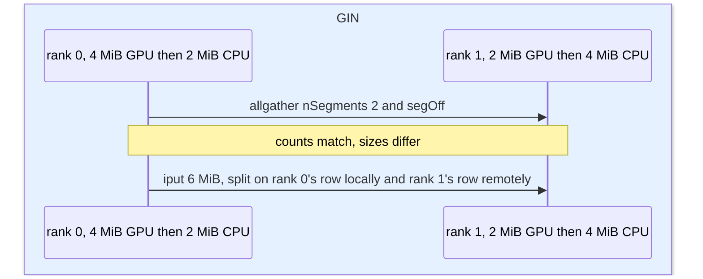
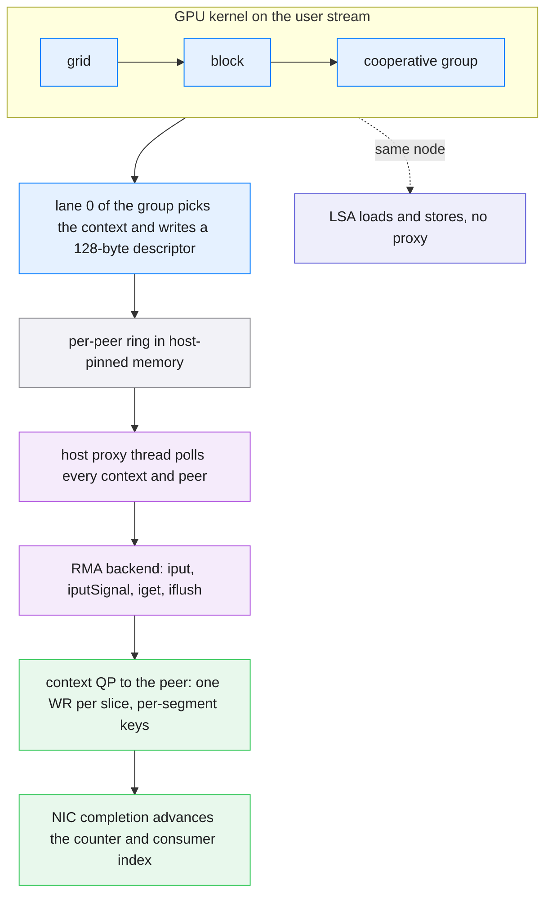
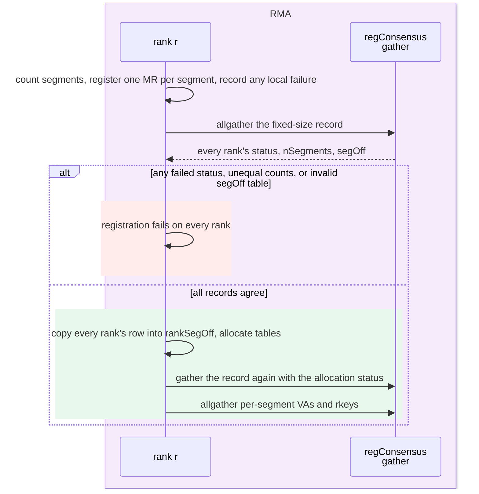
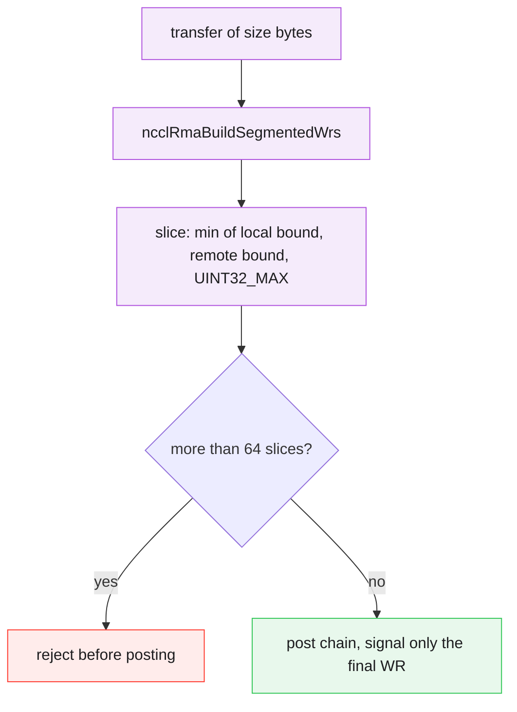
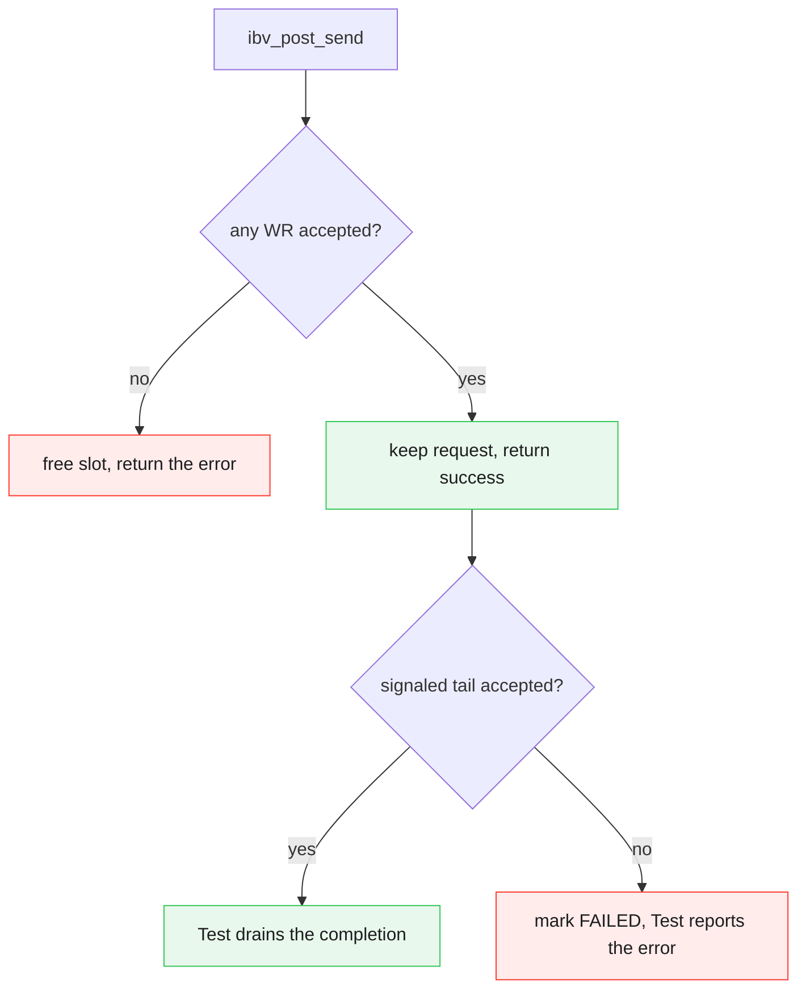
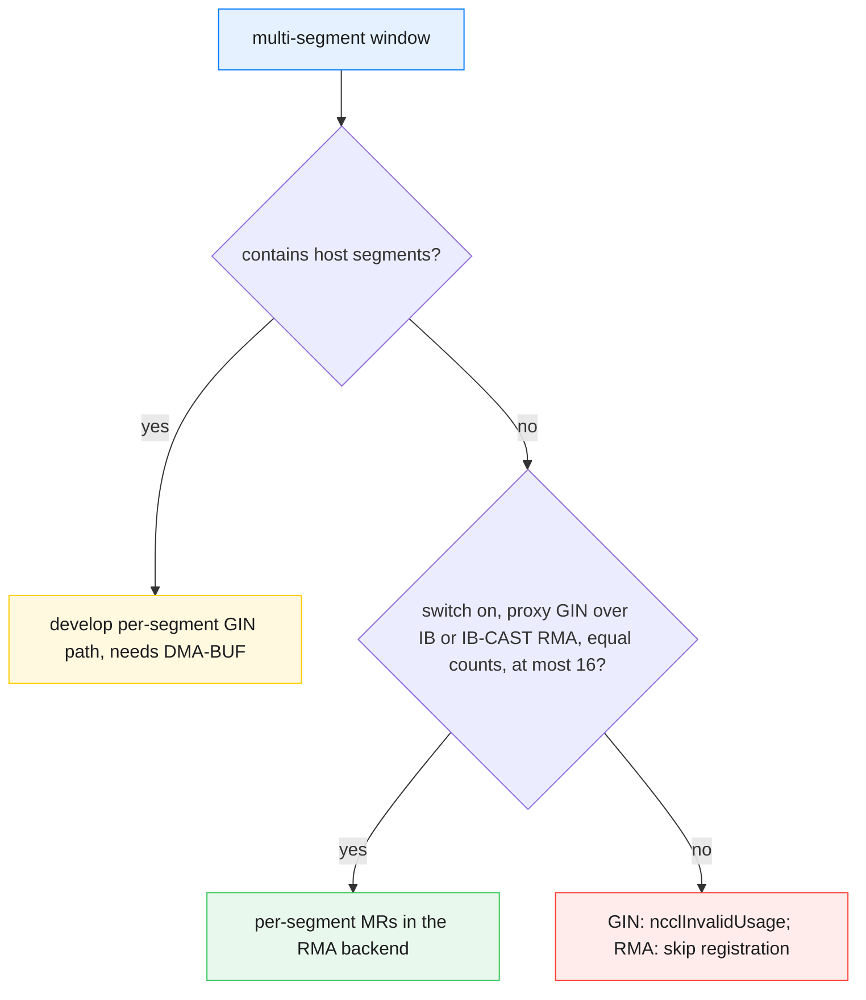

# GIN/RMA: per-segment registration and segmented work requests

GIN on the host-proxy type posts every put, get, signal and flush through an RMA backend, so multi-segment support for GIN is a host-side change in that backend. This doc covers the classic backend `ncclRmaIbProxy` (`net_ib/gin.cc`, layer 05, [PR 10884](https://github.com/ROCm/rocm-systems/pull/10884)) and the parts IB-CAST shares with it; IB-CAST's own differences are in [IB-CAST GIN/RMA](multi_segment_netib_cast_gin.md). It also covers the device-runtime pieces that DeepEP windows need: the window gates and the host owner DMA-BUF path.

## Why GIN is different from P2P

A GIN window is symmetric: one collective registers it on every rank, and each rank keeps a table of every peer's per-segment base addresses and rkeys. So the remote layout is known at registration, and no CTS or side table is involved. Registration counts the segments, registers one MR per segment, checks through the [consensus record](#consensus) that every rank succeeded with the same segment count and a valid `segOff` table, and then allgathers the per-segment addresses and rkeys, indexed `rank * nSegments + segment`.

The data path sends every operation through one builder that splits at local and remote boundaries. Each side uses its own rank's `segOff` row, so ranks may have different segment sizes as long as the counts match:



## Thread hierarchy mapping

A GIN operation starts in a GPU thread group and ends as work requests on a QP. Only lane 0 of the cooperative group (`coop.thread_rank() == 0`) writes the 128-byte descriptor into the per-peer ring in host-pinned memory; the kernel chooses the context through the `ncclGin` context index (`ginContextCount` defaults to 4). The host proxy progress thread polls every context and peer and calls the RMA backend, which posts on that context's QP to the peer. Multi-segment support changes only the last step: the backend splits the operation into one WR per slice. Same-node peers use LSA loads and stores and never reach the proxy.



## Code layout and dispatch

Develop's `gin.cc` keeps its single-MR bodies. Each entry point starts with a one-line dispatch into a separate `RCCL:`-marked function in the same file, taken only when `rcclRmaMultiSegEnabled()` is true:

| Develop function (`net_ib/gin.cc`) | Multi-segment body |
|---|---|
| `ncclRmaIbProxyConnect` | `rcclRmaIbProxyConnectFinish`, which allocates `regConsensus` |
| `ncclRmaIbProxyRegMrSymDmaBuf`, `ncclRmaIbProxyDeregMrSym` | `rcclRmaIbProxyRegMrSymDmaBuf`, `rcclRmaIbProxyDeregMrSym` |
| `ncclRmaIbProxyIPut`, `IGet`, `IPutSignal`, `IFlush` | `rcclRmaIbProxyIPut`, `IGet`, `IPutSignal`, `IFlush` |
| `ncclRmaIbProxyTest` | `rcclRmaIbProxyTestFailed`, for a request marked `NCCL_NET_IB_REQ_FAILED` |
| close | `free(cComm->regConsensus)` |

IB-CAST `net_ib_cast/gin.cc` has the same shape with `rcclIbCastRmaIbProxy*` bodies. The limits and integer helpers both backends use are in the dependency-free `net_ib/rma_multiseg.h`: the segment and WR limits, the QP depths, `rcclRmaMultiSegEnabled`, and helpers such as `ncclRmaSegmentSliceBytes`, `ncclRmaWrIsSignaled`, `ncclRmaSignalOffsetValid`, `ncclRmaSegmentCountsMatch`, `ncclRmaSegOffTableValid`, `ncclRmaSegIndexOf`, `ncclRmaCompletePostedRequest`, `ncclRmaWrCreditsAvailable` and `ncclRmaDevSlotOf`. They are host-unit-tested in `test/RmaSegmentMathTests.cpp`.

## Handle

```c
struct rcclRmaIbProxySegMrHandle {           // IB-CAST: IbCastRmaProxySegMrHandle
  int nSegments;
  size_t segOff[NCCL_RMA_MAX_SEGMENTS + 1];  // local map: segOff[0] = 0, segOff[nSegments] = size
  struct ncclIbMrHandle* mrHandle[NCCL_RMA_MAX_SEGMENTS];
  uintptr_t* base_vas;                       // [rank * nSegments + seg]
  uint32_t*  rkeys;                          // [(rank * nSegments + seg) * MAX_DEVS + slot]
  size_t* rankSegOff;                        // [rank * (MAX_SEGMENTS + 1)], every rank's segOff row
  // IB-CAST only: int* ibDevNs;             // [rank * MAX_DEVS + slot], physical ibDevN or -1
};
```

Develop's `ncclRmaIbProxyMrHandle` stays the single-MR handle and is used only with the switch off. The multi-segment handle carries a tag (`rcclRmaSegMrTag`) so tests can read its segment count with `rcclRmaIbProxyMrSegmentCount`. Classic indexes rkeys by the QP's `remDevIdx`; IB-CAST translates a physical `ibDevN` to a registration slot.

## Registration

```text
count segments: ncclCuMemGetAddressRange -> nSeg   (NCCL_PTR_CUDA with cuMem on, export gate compiled in)
nSeg > NCCL_RMA_MAX_SEGMENTS: local failure, still exchanged below
nSeg == 1: reuse the caller's fd (fd == -1 falls back to ibv_reg_mr)
for each segment s:
    cuMemGetAddressRange -> segBase, segSize
    inSeg   = (segBase == 0) ? segSize : segSize - (segPtr - segBase)
    thisLen = min(remaining, inSeg)
    fd = host owner fd for this VA if one is published, else export [page of segPtr, segPtr + thisLen) in whole pages
    register one MR per device at DMA-BUF offset 0; close an exported fd
bytes left after nSeg segments: local failure
consensus gather, checks, second gather, then VA and rkey gathers (next section)
```

The export covers whole pages because the MR spans whole pages at offset 0. A local failure never returns before the first gather; it is recorded in the consensus record so every rank fails together.

## Consensus

Each rank exchanges one fixed-size record, so a rank that failed halfway through enumeration still meets its peers in the collective:

- Classic: `ncclRmaIbProxyRegistration { status, nSegments, segOff[NCCL_RMA_MAX_SEGMENTS + 1] }`.
- IB-CAST: `IbCastRmaProxyRegistration` adds `magic` 0x524d5347 and `version` 1, checked on every record so a future same-size revision fails collectively instead of being misread.

The gather target `regConsensus` is per communicator, `nranks` records allocated with `ncclIbMalloc` (page-aligned, because the allgather registers whole pages) in the connect finish function, only with the switch on, and freed on close. Registration therefore has nothing to allocate before its first collective.



The checks are `ncclRmaSegmentCountsMatch` (equal `nSegments` in 1..16) and `ncclRmaSegOffTableValid` (starts at 0, never decreases), because those tables feed unsigned offset math.

## Segmented WR builder

`ncclRmaBuildSegmentedWrs` (IB-CAST `IbCastRmaBuildSegmentedWrs`) walks the transfer and cuts each slice at the nearer of the local and remote boundary:

```c
while (rem > 0) {
  if (ncclRmaDataWrBudgetFull(n, maxWr)) return ncclInternalError;     // 64 data WRs
  int rs = ncclRmaSegOf(remoteH, remoteRank, rOff);                    // remote rank's row
  size_t remoteRemaining = rOffs[rs + 1] - rOff;
  if (flushSge == NULL) {                                              // put or get
    ls = ncclRmaSegOf(localH, localRank, lOff);
    localRemaining = lOffs[ls + 1] - lOff;
  }
  size_t chunk = flushSge == NULL ? ncclRmaSegmentSliceBytes(rem, localRemaining, remoteRemaining)
                                  : min(rem, remoteRemaining);         // slices also clamp to UINT32_MAX
  wr[n].wr.rdma.remote_addr = remoteH->base_vas[remoteRank * nSeg + rs] + (rOff - rOffs[rs]);
  wr[n].wr.rdma.rkey = ncclRmaRemoteRkey(remoteH, remoteRank, rs, qp->remDevIdx);
  if (flushSge != NULL) { sge[n] = *flushSge; sge[n].length = 1; }   // flush: 1 byte per segment
  else sge[n] = { local address in segment ls, chunk, localH->mrHandle[ls]->mrs[qp->devIndex]->lkey };
  if (n > 0) wr[n - 1].next = &wr[n];
  lOff += chunk; rOff += chunk; rem -= chunk; n++;
}
```

- **Put and get** use one lkey and one rkey per slice; the two sides split on their own rows. At most `NCCL_RMA_MAX_DATA_WRS` (64) slices; more is rejected before posting.
- **IPutSignal** posts the put slices unsignaled, then one `IBV_WR_ATOMIC_FETCH_AND_ADD` on the segment that holds `signalOff`, which `ncclRmaSignalOffsetValid` requires to be 8-byte aligned and inside one segment. Only the atomic is signaled; the slot bound is 65.
- **Flush** runs the builder in flush mode against the rank's own window: one 1-byte `RDMA_READ` per segment into a fixed scratch, at most `NCCL_RMA_MAX_FLUSH_WRS` (16), so one flush fences writes to every segment.
- **Signaling.** Every chain signals only its last WR, so one completion retires it.
- **Batching.** Classic queues chains through its WR batch (`NCCL_RMA_IB_WR_BATCHSIZE`); a chain longer than the batch posts directly after the pending batch, so WRs reach the QP in request-id order.
- **Zero-size operations** post no WR. Classic ties such an operation to its predecessor's sequence id; IB-CAST completes it on its first `Test()`.



## Credits

A chain of up to 65 WRs holds that many send-queue slots until its signaled completion. Both backends therefore reserve send-queue capacity before posting, so a burst of maximum-width operations waits instead of overflowing the QP.

Classic (`rcclRmaWrCreditsReserve`) tracks posted and completed request sequence numbers per peer and per queue. If the chain does not fit within the QP's created depth, it first flushes the pending WR batch, then polls the CQ (yielding when nothing completed) until enough completes. It has no deadline: a WR that never completes surfaces as an error completion once the HCA's retries run out, and the wait returns `ncclRemoteError`. A chain wider than the QP itself is an internal error. IB-CAST uses a per-comm counter with a bounded wait instead; see [IB-CAST credits](multi_segment_netib_cast_gin.md#credits).

## Prefix post and completion

If `ibv_post_send` accepts only a prefix of a chain, the request is kept and the call returns success, so callers that `NCCLCHECK` it still reach `Test()` and drain the completion. If the accepted prefix stops before the signaled tail, no completion will come, so the request is marked FAILED and `Test()` reports the error. Only a post that accepted nothing frees the slot and returns the error; classic also returns the sequence id with `ncclRmaReleaseSeqId`. The rule is `ncclRmaCompletePostedRequest`, applied by classic in `ncclRmaFinishPostedRequest`.



## Deregistration and rollback

`rcclRmaIbProxyDeregMrSym` deregisters every `mrHandle[s]`, then frees `base_vas`, `rkeys` and `rankSegOff`. The registration failure path deregisters only the handles that completed, never a half-built one, and frees the tables and the handle once.

## Window gates

`dev_runtime.cc` decides per window whether a multi-segment window reaches these backends. The inputs are communicator-wide, so every rank takes the same branch.

- `rcclDevrRmaRegistersMultiSegment` holds when the switch is on, the RMA backend is `ncclRmaIbProxy` or `IbCastRmaIbProxy`, every rank has the same segment count, and the count is at most 16. `symMemoryRegisterRma` registers a single-segment window always, a multi-segment window only under this gate, and otherwise skips RMA registration with an INFO line.
- `rcclDevrGinRegistersMultiSegment` also requires every active GIN backend to be the proxy type. `symMemoryRegisterGin` fails a device-only multi-segment window with `ncclInvalidUsage` when it does not hold. A window that contains host segments keeps develop's per-segment GIN path and needs `NCCL_DMABUF_ENABLE=1`.



## Host owner DMA-BUF

A hybrid DeepEP window maps one private GPU segment plus one host segment per local rank; every rank imports the other ranks' host segments. The importing process cannot get a DMA-BUF for an imported host segment: on ROCm both `hipMemGetHandleForAddressRange` on the imported range and `hipMemExportToShareableHandle` on the imported handle return invalid argument. The owner's POSIX fd is already a DMA-BUF that `ibv_reg_dmabuf_mr` accepts in any process, so RCCL registers imported host segments from it.

| Step | Where | What |
|---|---|---|
| Export | `symMemoryMapLsaTeam` (`dev_runtime.cc`) | Each rank exports its own host segment before the intranode allgather; a successful export sets `hostExportable` in its message and keeps the fd. The flag is set before the ROCM-29810 type rewrite. |
| Keep or fetch | `symMemoryGetHostOwnerFd` | An exporter keeps its own fd in `ncclDevrMemory::hostOwnerFds`. Another rank asks the first `hostExportable` rank through `ncclProxyClientGetFdBlocking`. With no exporter there is no fallback, because that proxy would repeat the failed export and never reply; the segment then has no published fd. |
| Publish | `symMemoryPublishHostOwnerFds`, `rcclHostSegmentFdRegister` (`rccl_dev_runtime.cc`) | A mutex-protected process-wide table maps VA ranges to fds. |
| Register | `rcclRmaIbProxyRegMrSymDmaBuf` and the IB-CAST twin | `rcclHostSegmentFdLookup` runs before exporting; the MR offset is the page-aligned distance from the segment base. GIN stores the segment as `CU_MEM_LOCATION_TYPE_HOST_NUMA`, because the imported handle reads as device (ROCM-29810). |
| Lifetime | `symMemoryCloseHostOwnerFds` | Fds live as long as the backing memory, because a later GIN enable re-registers it; they are removed and closed in `symMemoryDestroy` and on obtain failure. |

The GIN proxy forwards `regMrSymDmaBuf` to the RMA backend, which uses the owner fd. rocSHMEM GDA and Anvil SDMA accept the call but ignore the fd, so hybrid windows on those backends need their own work ([proposal](multi_segment_gin_rocshmem_gda_and_anvil_sdma.md)). NET/IB P2P never registers a buffer with host segments (`register.cc` skips it and the transfer stages). The supported hybrid contract and its tests are in [testing](multi_segment_testing.md#hybrid-deepep-windows).

## Symbol index

| Concern | Symbols |
|---|---|
| Dispatch | `rcclRmaMultiSegEnabled`, `rcclRmaIbProxy*`, `rcclRmaIbProxyTestFailed` (`net_ib/gin.cc`) |
| Handle and lookup | `rcclRmaIbProxySegMrHandle`, `ncclRmaSegOf`, `ncclRmaRankOff`, `ncclRmaRemoteRkey`, `rcclRmaSegMrTag`, `rcclRmaIbProxyMrSegmentCount` |
| Consensus | `ncclRmaIbProxyRegistration`, `ncclGinIbCollComm::regConsensus` (`net_ib/gin.h`), `rcclRmaIbProxyConnectFinish` |
| Builder and post | `ncclRmaBuildSegmentedWrs`, `ncclRmaIbProxyQueueWrs`, `ncclRmaPostWrs`, `ncclRmaFinishPostedRequest` |
| Credits | `rcclRmaWrCreditsReserve`, `ncclRmaWrCredits*` (`rma_multiseg.h`) |
| Limits | `NCCL_RMA_MAX_SEGMENTS` (16), `NCCL_RMA_MAX_DATA_WRS` (64), `NCCL_RMA_MAX_SIGNAL_WRS` (65), `NCCL_RMA_MAX_FLUSH_WRS` (16, per operation; not the flush QP depth), `NCCL_RMA_SEND_QP_WRS` |
| Window gates | `rcclDevrRmaRegistersMultiSegment`, `rcclDevrGinRegistersMultiSegment`, `rcclDevrGinSegmentRegType` (`rccl_dev_runtime.cc`) |
| Host owner fd | `symMemoryGetHostOwnerFd`, `symMemoryPublishHostOwnerFds`, `symMemoryCloseHostOwnerFds`, `rcclHostSegmentFdRegister`, `rcclHostSegmentFdLookup` |
| Tests | `test/RmaSegmentMathTests.cpp`, `test/transport/RmaMPI/RmaMultiSegmentMPITests.cpp` |
