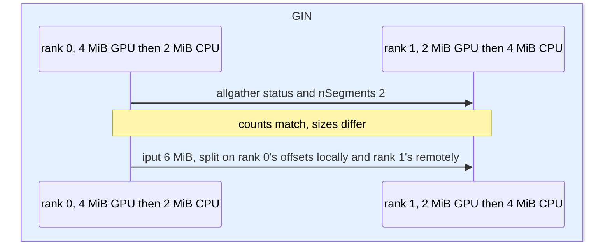
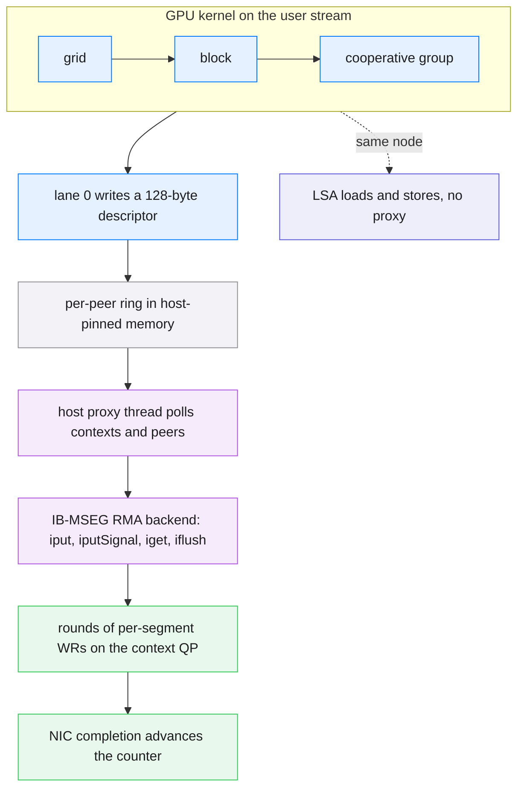
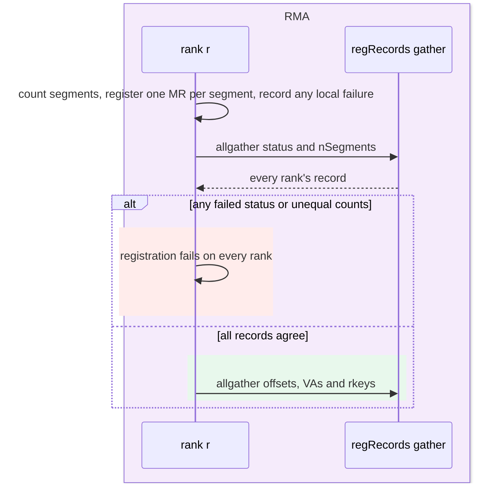
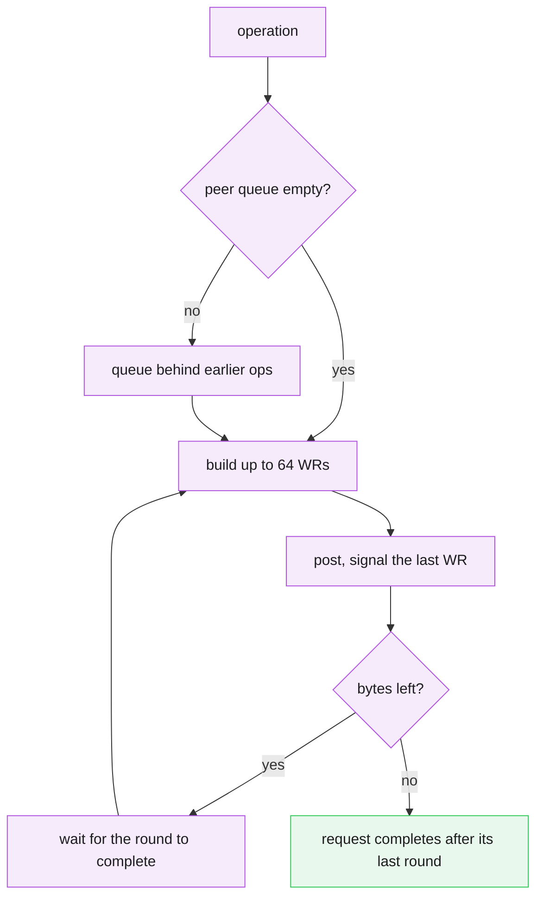
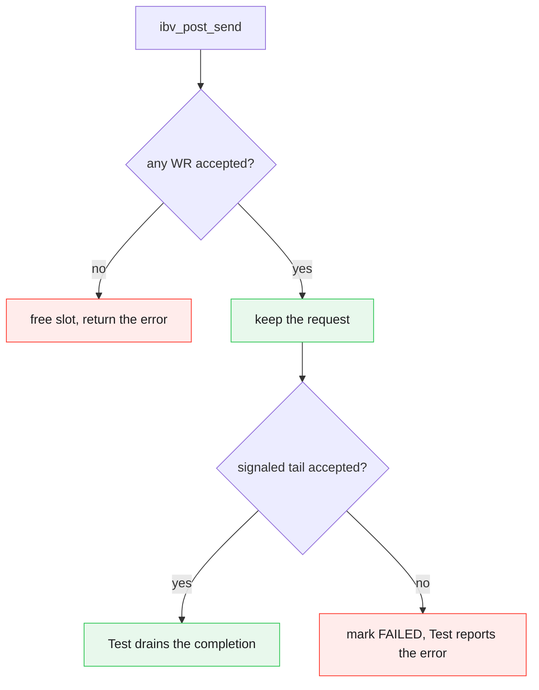
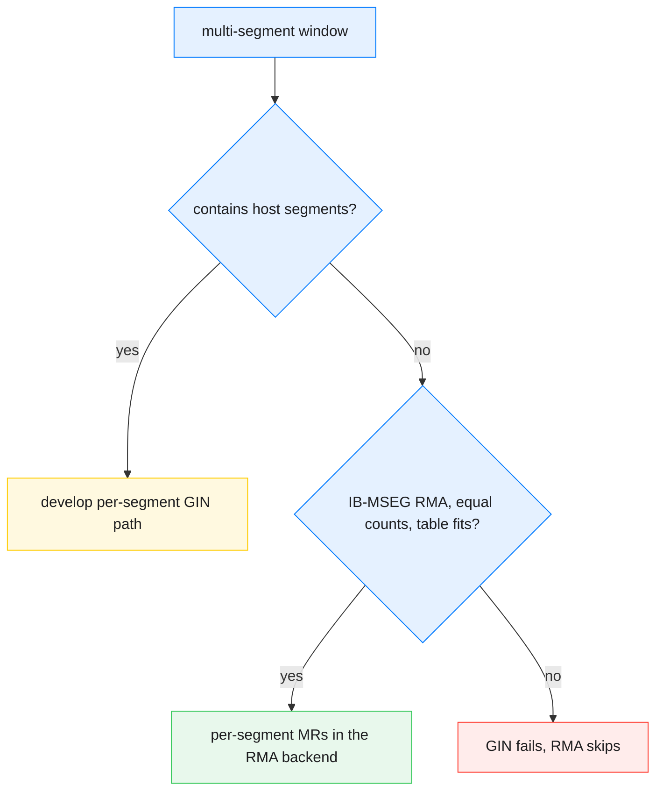

# GIN/RMA: per-segment registration and RMA rounds

> [!NOTE]
> Core part in fork 1 (`users/atulkulk/netib-mseg/01-core-backend-multiseg-gate`), plugin part in fork 4 (`users/atulkulk/netib-mseg/04-rma-gin-multiseg`), checked against fork 4 `9c67177e1f99`. Fork 1 carries the comm-level multi-segment flag, the window gates, the in-flight cap and the host owner DMA-BUF rule; fork 4 carries the RMA backend of the IB-MSEG plugin (`src/transport/net_ib_multiseg/gin.cc`). The old-stack GIN/RMA layer that edited `net_ib` in place is superseded by forks 1 and 4. See [the fork plugin](multi_segment_fork_plugin.md#fork-4-rma-and-gin).

GIN on the host-proxy type posts every put, get, signal and flush through an RMA backend, so multi-segment support for GIN is a host-side change in that backend. This doc covers the IB-MSEG backend `IbMsegRmaIbProxy` and the device-runtime pieces that DeepEP windows need: the window gates, the in-flight cap and the host owner DMA-BUF path. IB-CAST's multi-segment GIN/RMA is the fork 6 design in [IB-CAST GIN/RMA](multi_segment_netib_cast_gin.md).

## Why GIN is different from P2P

A GIN window is symmetric: one collective registers it on every rank, and each rank keeps a table of every peer's per-segment offsets, base addresses and rkeys. So the remote layout is known at registration, and no CTS is involved. Registration counts the segments, registers one MR per segment, checks through the [consensus exchange](#consensus) that every rank succeeded with the same segment count, and then allgathers the tables.

Each side of a transfer splits on its own rank's offsets, so ranks may have different segment sizes as long as the counts match:



## Thread hierarchy mapping

A GIN operation starts in a GPU thread group and ends as work requests on a QP. Only lane 0 of the cooperative group writes the 128-byte descriptor into the per-peer ring in host-pinned memory; the kernel chooses the context through the `ncclGin` context index. The host proxy progress thread polls every context and peer and calls the RMA backend, which posts on that context's QP to the peer. Multi-segment support changes only the last step. Same-node peers use LSA loads and stores and never reach the proxy.



## Comm-level flag

`rcclMultiSegOn(pluginRegistersPerSegment)` (`rccl_dev_runtime.cc`, fork 1) holds when the plugin registers per segment, `NCCL_MULTI_SEGMENT_REGISTER=1` and `NCCL_DMABUF_ENABLE=1`. `init.cc` evaluates it once per comm: `comm->rcclMultiSegRma` is set only when the RMA backend is `IbMsegRmaIbProxy`, and a child comm takes its parent's value. The plugin reads the same switch through `rcclRmaMultiSegEnabled()` (`seg_rma_mseg.h`), so the plugin and the core agree on every rank.

## Code layout and dispatch

With the switch on, `IbMsegRmaIbProxyInit` installs the multi-segment entries once per process (`rcclRmaIbProxyInstallMultiSeg`): every MR and data operation takes the `rcclRmaIbProxy*` body, because the multi-segment handle has its own layout. A one-segment handle runs develop's single-MR body through the handle's embedded `single` MR (`rcclRmaIbProxyUseSingle`).

| Develop function, fork name (`net_ib_multiseg/gin.cc`) | Multi-segment body |
|---|---|
| `IbMsegRmaIbProxyConnect` | `rcclRmaIbProxyConnectFinish`, which allocates `regRecords` |
| `IbMsegRmaIbProxyRegMrSymDmaBuf`, `IbMsegRmaIbProxyRegMrSym`, `IbMsegRmaIbProxyDeregMrSym` | `rcclRmaIbProxyRegMrSymDmaBuf`, `rcclRmaIbProxyRegMrSym`, `rcclRmaIbProxyDeregMrSym` |
| `IbMsegRmaIbProxyIPut`, `IbMsegRmaIbProxyIGet`, `IbMsegRmaIbProxyIPutSignal`, `IbMsegRmaIbProxyIFlush` | `rcclRmaIbProxyIPut`, `rcclRmaIbProxyIGet`, `rcclRmaIbProxyIPutSignal`, `rcclRmaIbProxyIFlush` |
| `IbMsegRmaIbProxyTest` | `rcclRmaIbProxyTestFailed`, for a request marked `NCCL_NET_IB_REQ_FAILED` |
| `IbMsegGinIbCloseColl` | `free(cComm->regRecords)` |

The shared multi-segment logic lives in `net_ib_multiseg/seg_*` files written without plugin-specific symbols, plus two core headers the device runtime also includes:

| Header | Contents |
|---|---|
| `transport/rccl_mseg.h` (fork 1) | `RCCL_IB_REG_SEG_DEFAULT`, `rcclIbSegCountSupported` |
| `transport/rccl_mseg_rma.h` (fork 1) | `RCCL_RMA_SEG_TABLE_MAX_ENTRIES`, `rcclRmaSegTableFits`, `RCCL_RMA_MAX_INFLIGHT_REQUESTS`, `rcclRmaInflightRequestsCap` |
| `seg_mseg.h` | `rcclIbSegTable`, `rcclIbSegCursor`, `rcclIbSegIndexOf`, `RCCL_IB_SGE_MAX_BYTES` |
| `seg_rma_mseg.h` | RMA limits, `rcclRmaMultiSegEnabled`, `rcclRmaCompletePostedRequest`, `rcclRmaSignalOffsetValid`, `rcclRmaSegMrTag`, `rcclRmaMrSegmentCount` |
| `seg_rma_round_mseg.h` | rounds and per-peer queues |
| `seg_sym_mseg.h` | `rcclIbSegSymRecord`, `rcclIbSegSymTable`, `rcclIbSegSymAgree`, `rcclIbSegSymExchange` |
| `seg_export_mseg.h`, `seg_reg_mseg.h`, `seg_wr_mseg.h` | per-segment export and owner-fd lookup, register and deregister, `rcclIbSegAppendWrs` |

Plugin-only glue is in `ib_multiseg_mseg.h` (`rcclRmaReleaseSeqId`, the `rcclRmaIbProxy*` declarations) and `gin_mseg.h` (`IbMsegGinIbCollComm::regRecords`).

## Handle

```c
struct rcclRmaIbProxySegMrHandle {
  uint32_t tag;                           // rcclRmaSegMrTag, asserted at offset 0
  int nSegments;
  size_t* segOff;                         // nSegments + 1, from the walked count
  void** mrHandle;                        // one IbMsegMrHandle per segment
  struct rcclIbSegSymTable sym;           // every rank's offsets, VAs and per-port rkeys
  int flushSeg;                           // first device segment, or -1 if all host
  struct IbMsegRmaIbProxyMrHandle single; // nSegments == 1: develop's layout over mrHandle[0]
};
```

Tests read the segment count through `rcclRmaMrSegmentCount` (or the plugin's `rcclRmaIbProxyMrSegmentCount`), which checks the tag. Rkeys are indexed by the QP's `remDevIdx`.

## Registration

```text
count segments: ncclCuMemGetAddressRange -> nSeg
nSeg outside rcclIbSegCountSupported, table too big (rcclRmaSegTableFits), or past max_mr (rcclIbMrAdmit): local failure, still exchanged
nSeg == 1: reuse the caller's fd
nSeg > 1 and NCCL_DMABUF_ENABLE off: local failure, still exchanged
for each segment s (rcclRmaRegOneSegment through rcclIbSegRegister):
    cuMemGetAddressRange -> segBase, segSize
    inSeg   = (segBase == 0) ? segSize : segSize - (segPtr - segBase)
    thisLen = min(remaining, inSeg)
    fd = owner fd for this VA if one is published (rcclHostSegmentFdLookup), else export whole pages
    register one MR per device
bytes left after nSeg segments: local failure
consensus exchange, then the table gathers
```

The export (`rcclIbSegExportNext`, `seg_export_mseg.h`) covers whole pages and the MR offset is the page-aligned distance from the segment base. `rcclIbSegExportIsHost` finds the first device segment, which becomes `flushSeg`. A local failure never returns before the first gather.

## Consensus

Each rank allgathers a `rcclIbSegSymRecord {status, nSegments}` into `regRecords`, which `rcclRmaIbProxyConnectFinish` allocated for `nranks` records, so registration has nothing to allocate before its first collective. `rcclIbSegSymExchange` fails every rank on any failed status or unequal count, agrees once more on the table allocations, and then gathers each rank's offsets, segment VAs and keys into the symmetric table; every rank checks that every rank's offsets start at 0 and are ordered.



## Segmented WR builder

`rcclRmaBuildSegmentedWrs` walks the transfer with `rcclIbSegCursor` over the local and remote rank's offsets and emits slices with the shared `rcclIbSegAppendWrs`, each cut at the nearer of the two boundaries and at `RCCL_IB_SGE_MAX_BYTES`. Out-of-range transfers are rejected before any WR is posted (`rcclRmaRangeOk`).

- **Put and get** use one lkey and one rkey per slice.
- **IPutSignal** adds one `IBV_WR_ATOMIC_FETCH_AND_ADD` on the segment holding `signalOff`, which must be 8-byte aligned and inside one segment (`rcclRmaSignalOffsetValid`); it rides the last round (`rcclRmaRoundSetSignal`).
- **Flush** is one 1-byte loopback read of `flushSeg`. A read cannot pass earlier posted writes, so one read flushes the window; a window that is all host memory posts nothing.
- **Signaling.** Each round signals only its last WR.

## Rounds

An operation wider than one round does not fail. `seg_rma_round_mseg.h` posts at most `RCCL_RMA_MAX_DATA_WRS` (64) data WRs per round, and the next round once the plugin reports the previous one done. Operations queue per peer in request order (`rcclRmaRoundQueue`), so a later operation never passes an earlier one; behind a queued operation every operation queues, including single-MR ones. The plugin supplies the hooks (`rcclRmaIbRoundBuild`, `rcclRmaIbRoundOutstanding`, `rcclRmaIbRoundPost`, `rcclRmaIbRoundRetire`, `rcclRmaIbRoundFailed`).



A chain with nothing queued ahead posts at once (`rcclRmaIbProxyPostChain`): data chains go through the WR batch (`NCCL_RMA_IB_WR_BATCHSIZE`, 64), flushes post directly. The proxy rings its pending batch before it publishes a queued request (`rcclRmaIbProxyEnqueue`), so a doorbell failure leaves nothing queued.

**In-flight cap.** When `comm->rcclMultiSegRma` is set, `rcclRmaProxyMaxInflightRequests` (`rccl_dev_runtime.cc`, fork 1) caps each peer and context at `RCCL_RMA_MAX_INFLIGHT_REQUESTS` (32). The RMA proxy (`rma/rma_proxy.cc`) and the GIN proxy (`gin/gin_host_proxy.cc`, told through `rcclGinProxySetMultiSeg`) log an INFO line when this lowers the per-peer request count or `NCCL_GIN_PROXY_QUEUE_SIZE`.

## Send-queue depth by role

| QP | Depth | Where |
|---|---|---|
| RMA send QP (`isRma`, switch on) | `RCCL_RMA_SEND_QP_WRS` = 32 × 65 = 2080 | `rcclIbSendQpWrs(isRma)` in `connect.cc` |
| P2P send QP | `2 * NET_IB_MAX_REQUESTS` (512), as on develop | same |
| P2P flush QP | `2 * NET_IB_MAX_REQUESTS` (512), as on develop | `connect.cc` |

Every in-flight RMA request may have one full round posted (`RCCL_RMA_MAX_SIGNAL_WRS` = 65), which sets the 2080. A `static_assert` keeps it at least the base depth and `RCCL_RMA_MAX_REQUESTS` equal to `NET_IB_MAX_REQUESTS`. 2080 fits Thor2's `max_qp_wr` of 4351; Mellanox has not been checked, and only the `static_assert` guards the size. P2P depths are in [IB-MSEG NET/IB P2P](multi_segment_netib_wire.md#queue-sizing).

## Prefix post and completion

If `ibv_post_send` accepts only a prefix of a round, the request is kept so `Test()` drains it. If the accepted prefix stops before the signaled tail, no completion will come, so the request is marked FAILED and `Test()` reports the error. Only a post that accepted nothing frees the slot and returns the error, and also returns the sequence id with `rcclRmaReleaseSeqId`. The rule is `rcclRmaCompletePostedRequest`, applied in `rcclRmaFinishPostedRequest`.



## Deregistration and rollback

`rcclRmaIbProxyDeregMrSym` deregisters every segment (`rcclRmaDeregOneSegment` through `rcclIbSegDeregister`) and frees the table and handle (`rcclRmaIbProxySegMrHandleFree`). The registration failure path deregisters only completed segments and frees once.

## Window gates

`dev_runtime.cc` decides per window whether a multi-segment window reaches the backend (fork 1). The inputs are communicator-wide, so every rank takes the same branch.

- `rcclDevrRmaRegistersMultiSegment` holds when `comm->rcclMultiSegRma` is set (switch on, `NCCL_DMABUF_ENABLE=1`, IB-MSEG RMA backend), every rank has the same segment count, and `rcclRmaSegTableFits(nRanks, count)` holds. `symMemoryRegisterRma` registers a single-segment window always, and a multi-segment window only under this gate and, if the window has host segments, only with `NCCL_SYM_REUSE_SYSMEM_HANDLES=1`; otherwise it skips RMA registration with an INFO line.
- `rcclDevrGinRegistersMultiSegment` also requires every active GIN backend to be the proxy type. `symMemoryRegisterGin` fails a device-only multi-segment window with `ncclInvalidUsage` when it does not hold. A window that contains host segments keeps develop's per-segment GIN path.



## Host owner DMA-BUF

A hybrid DeepEP window maps one private GPU segment plus one host segment per local rank; every rank imports the other ranks' host segments. The importing process cannot get a DMA-BUF for an imported host segment, but the owner's POSIX fd is already a DMA-BUF that `ibv_reg_dmabuf_mr` accepts in any process, so RCCL registers imported host segments from it. The path runs only with `NCCL_SYM_REUSE_SYSMEM_HANDLES=1`. All of it is fork 1.

| Step | Where | What |
|---|---|---|
| Export | `symMemoryMapLsa` (`dev_runtime.cc`) | Each rank exports its own host segment before the intranode allgather; a successful export sets `hostExportable` in its message and keeps the fd. |
| Keep or fetch | `symMemoryGetHostOwnerFd` | A rank that exported its own fd keeps it. Another rank borrows an fd only when exactly one LSA rank has `hostExportable` for that segment; with several exporters it borrows none, because an import could map a peer's pages. With no exporter there is no fallback, because that proxy would repeat the failed export and never reply. |
| Agree | `hostOwnerFdStatus`, gathered as `ownerFdStatus` in `symMemoryObtain` | A rank-local fetch or allocation failure is gathered before the collective GIN/RMA registration, so every rank fails together. |
| Publish | `symMemoryPublishHostOwnerFds`, `rcclHostSegmentFdRegister` (`rccl_dev_runtime.cc`) | A mutex-protected process-wide table maps VA ranges to fds. |
| Register | `rcclIbSegExportNext` (`seg_export_mseg.h`, fork 4) | `rcclHostSegmentFdLookup` runs before exporting. `symMemoryRegisterGin` records a segment with an owner fd as host memory. |
| Lifetime | `symMemoryCloseHostOwnerFds` | Fds live as long as the backing memory; they are closed in `symMemoryDestroy` and on obtain failure. |

The decision counts exporters, not host-typed handles, because an imported handle can read as host or device depending on the ROCm version. rocSHMEM GDA and Anvil SDMA accept `regMrSymDmaBuf` but ignore the fd ([proposal](multi_segment_gin_rocshmem_gda_and_anvil_sdma.md)). NET/IB P2P never registers a buffer with host segments. The hybrid contract and its tests are in [testing](multi_segment_testing.md#hybrid-deepep-windows).

## Symbol index

| Concern | Symbols |
|---|---|
| Comm flag | `rcclMultiSegOn` (`rccl_dev_runtime.cc`); `comm->rcclMultiSegRma`, `comm->rcclMultiSegNet` (`include/comm.h`); `rcclRmaMultiSegEnabled` (`seg_rma_mseg.h`) |
| Dispatch | `rcclRmaIbProxyInstallMultiSeg`, `rcclRmaIbProxyUseSingle`, `rcclRmaIbProxyTestFailed` (`gin.cc`) |
| Handle and lookup | `rcclRmaIbProxySegMrHandle`, `rcclRmaSegOf`, `rcclRmaRankOff`, `rcclRmaRemoteRkey`, `rcclRmaRangeOk` (`gin.cc`); `rcclRmaSegMrTag`, `rcclRmaMrSegmentCount` (`seg_rma_mseg.h`) |
| Registration | `rcclRmaIbProxyRegMrSymDmaBuf`, `rcclRmaRegOneSegment`, `rcclRmaSegRegCtx` (`gin.cc`); `rcclIbSegExportNext`, `rcclIbSegExportIsHost`, `rcclIbSegWalkAdvance` (`seg_export_mseg.h`); `rcclIbSegRegister`, `rcclIbSegDeregister` (`seg_reg_mseg.h`) |
| Consensus | `rcclIbSegSymRecord`, `rcclIbSegSymExchange` (`seg_sym_mseg.h`); `regRecords` (`gin_mseg.h`); `rcclRmaIbProxyConnectFinish`, `rcclRmaRegAllGather` (`gin.cc`) |
| Builder and rounds | `rcclRmaBuildSegmentedWrs`, `rcclRmaIbRound*`, `rcclRmaIbProxyStartRequest`, `rcclRmaIbProxyPostChain`, `rcclRmaIbProxyEnqueue`, `rcclRmaIbProxySubmit`, `rcclRmaIbProxyQueueWrs`, `rcclRmaFinishPostedRequest` (`gin.cc`); `rcclRmaRoundOp`, `rcclRmaRoundQueue`, `rcclRmaRoundHooks` (`seg_rma_round_mseg.h`) |
| Limits | `RCCL_RMA_MAX_DATA_WRS` (64), `RCCL_RMA_MAX_SIGNAL_WRS` (65), `RCCL_RMA_MAX_REQUESTS` (256), `RCCL_RMA_SEND_QP_WRS` (2080) (`seg_rma_mseg.h`); `RCCL_RMA_MAX_INFLIGHT_REQUESTS` (32), `RCCL_RMA_SEG_TABLE_MAX_ENTRIES` (2^20) (`transport/rccl_mseg_rma.h`); `RCCL_IB_REG_SEG_DEFAULT` (`transport/rccl_mseg.h`) |
| Window gates | `rcclDevrRmaRegistersMultiSegment`, `rcclDevrGinRegistersMultiSegment`, `rcclRmaProxyMaxInflightRequests` (`rccl_dev_runtime.cc`); `rcclGinProxySetMultiSeg` (`gin/gin_host_proxy.cc`) |
| Host owner fd | `symMemoryGetHostOwnerFd`, `symMemoryPublishHostOwnerFds`, `symMemoryCloseHostOwnerFds` (`dev_runtime.cc`); `rcclHostSegmentFdRegister`, `rcclHostSegmentFdLookup` (`rccl_dev_runtime.cc`) |
| Tests | `test/RmaSegmentMathTests.cpp`, `test/transport/RmaMPI/RmaMultiSegmentMPITests.cpp`, host suites under `test/host/transport/net_ib_multiseg/`, `test/host/gin/` and `test/host/rma/` |
