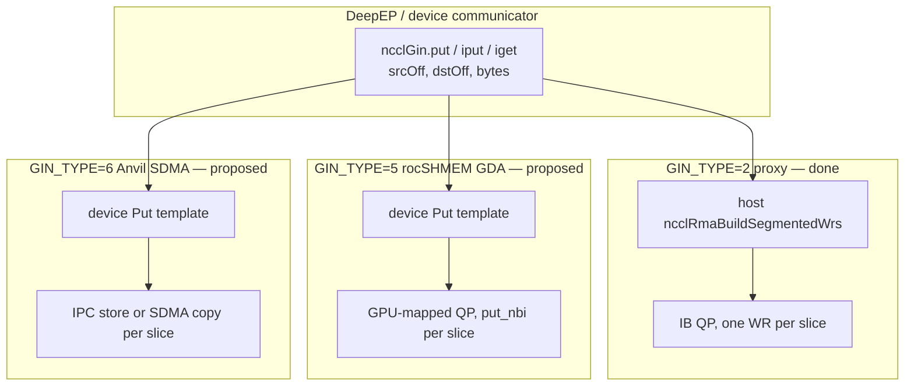
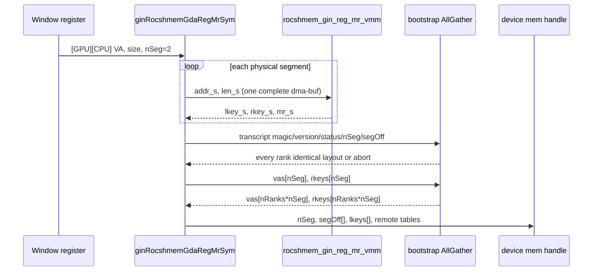
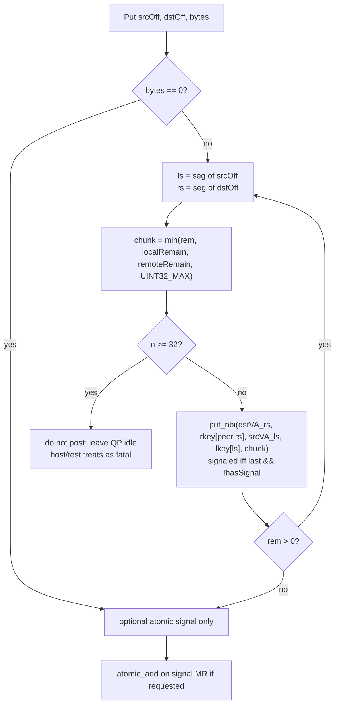
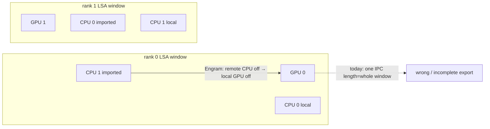
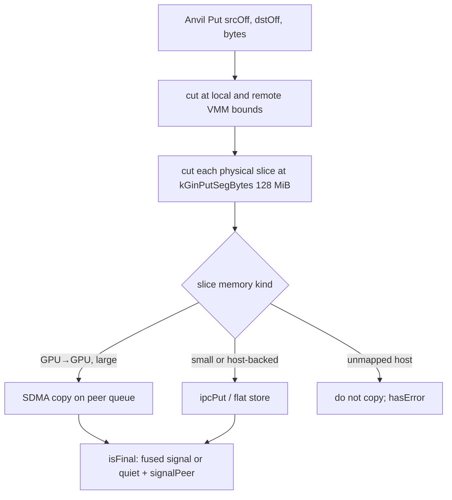

# Multi-Segment Integration for rocSHMEM GDA and Anvil SDMA

> **PROPOSED DESIGN.** Proxy GIN/RMA (classic and CAST) already splits at physical VMM segments. This document is the integration plan for the two AMD **device-initiated** GIN backends: **rocSHMEM GDA** (`NCCL_GIN_TYPE=5`) and **Anvil SDMA** (`NCCL_GIN_TYPE=6`). Neither backend implements the multi-segment contract today. Do not treat the diagrams below as the current data path.

**Shared facts** (16-segment cap, `UINT32_MAX` SGE clamp, independent local/remote offsets, DeepEP `[GPU][CPU…]` geometry) live in [`multi_segment_dmabuf_gin_and_netib.md`](multi_segment_dmabuf_gin_and_netib.md). Proxy GIN/RMA walkthrough: [`multi_segment_netib_cast_gin.md`](multi_segment_netib_cast_gin.md).

**Ticket:** AIRUNTIME-2351 / AICOMRCCL-1526 follow-on. **Gate:** both plugins compile only with `ENABLE_ROCSHMEM_GIN`.

Last updated 2026-10-12, against the wire branch `users/atulkulk/mseg/multi-segment-dmabuf-cast-gin`. The GDA and Anvil code described in §2 is develop's; the multi-segment stack does not change it.

## What changed since the 2026-10-07 revision

- The proxy references now point at the reworked layout: the classic GIN bodies are in `net_ib/gin.cc` (`rcclRmaIbProxyRegMrSymDmaBuf`, `ncclRmaBuildSegmentedWrs`), the CAST bodies in `net_ib_cast/gin.cc`, and both are reached only when `rcclRmaMultiSegEnabled()` (`NCCL_MULTI_SEGMENT_REGISTER`) is true. A GDA or Anvil integration should honor the same switch.
- §3 drops `ncclRmaLayoutsMatch`, which no longer exists, and lists the switch reader.
- The proposed device helper names in §6 no longer reuse the removed `ncclGinSegOf` name.
- The comparison with other vendors' device GIN stacks was removed. §10 now describes only the device GIN types RCCL builds.

---

## 1. Why these backends are a different problem

Proxy GIN (`GIN_TYPE=2`) never posts from the GPU. The host proxy thread runs `ncclRmaBuildSegmentedWrs` (`net_ib/gin.cc`; CAST `IbCastRmaBuildSegmentedWrs`), so adding per-segment MRs and a WR loop was a host-only change, reached from develop's `gin.cc` through one-line dispatches.

GDA and Anvil **are** the device `ncclGinApi_Put` / `Flush` templates. The GPU already has one destination rkey (GDA) or one resolved peer VA (Anvil) and issues **one** RDMA or SDMA operation for the whole `[srcOff, srcOff+bytes)` / `[dstOff, dstOff+bytes)` range. Multi-segment therefore has to appear on **both** sides:

| Layer | Proxy GIN/RMA (done) | GDA / Anvil (this doc) |
|---|---|---|
| Who posts | Host proxy | GPU kernel (GDA doorbell / SDMA packet) |
| Registration | Host, one DMA-BUF MR per physical segment | Host must still enumerate segments; GDA needs per-segment MRs, Anvil needs per-segment IPC/LSA coverage |
| Split | Host WR chain | **Device** loop; host only publishes tables |
| Credits | CAST `rmaWrsOutstanding` vs 575/271 | GDA: GPU SQ depth of the rocSHMEM `QueuePair`. Anvil: SDMA packet size (`kGinPutSegBytes`), not IB WQEs |
| Symmetric layout | Host allgather + CAST transcript | Same allgather/transcript on host; device consumes the published tables |



The ROCm DMA-BUF rule is unchanged: `hipMemGetHandleForAddressRange` / `hsa_amd_portable_export_dmabuf` over a multi-handle VMM range describes **only the first physical segment**.

---

## 2. Current code (single-MR / single-VA)

### 2.1 rocSHMEM GDA (`gin_plugin_rocshmem_gda.cc`, device `gin_rocshmem_gda.h`)

Registration calls `rocshmem_gin_reg_mr_vmm(qpSet, data, size)` once. That factory path exports **one** DMA-BUF for the entire VA and `ibv_reg_dmabuf_mr`s it:

```text
rocshmem_gin_reg_mr_vmm(addr, size)
  hipMemGetHandleForAddressRange(addr, aligned_size)   // ROCm: fd = segment 0 only
  ibv_reg_dmabuf_mr(pd, length=aligned_size, iova=addr, fd)
```

The device handle is a **scalar** key plus per-peer bases:

```c
struct ncclGinRocshmemGdaMemHandle {
  uintptr_t  local_va;
  uintptr_t* remote_vas;  // [nRanks]
  uint32_t   lkey;        // one local key
  uint32_t*  rkeys;       // [nRanks]
};
```

Device Put does one `put_nbi`:

```text
dstAddr = remote_vas[peer] + dstOff
srcAddr = local_va + srcOff
qp->put_nbi(dstAddr, rkeys[peer], srcAddr, lkey, bytes, …)
```

A DeepEP Engram IGet (remote CPU offset → local GPU offset) that crosses a physical boundary therefore uses the **segment-0** lkey/rkey against an address in a later segment: `EINVAL` at register time, or `IBV_WC_REM_INV_REQ_ERR` on the GPU QP.

Signals and counters are separate fine-grained allocations registered with `IBV_ACCESS_REMOTE_ATOMIC`. They are not elastic windows and do **not** need segment tables.

### 2.2 Anvil SDMA (`gin_plugin_anvil_sdma.cc`, device `gin_anvil_sdma.h`)

Anvil is **intra-node**. There is no IB MR. Registration:

1. Resolves the LSA flat VA (`ncclDevrGetLsaSelfAddr`).
2. Inserts **one** IPC-table entry covering `[lsaSelf, lsaSelf+size)`.
3. Publishes `vmmStride = devr->bigSize` so peer VA is `base + (peer − rank) × stride + off`.

```c
struct ncclGinAnvilSdmaMemHandle {
  uintptr_t  baseAddr;
  uintptr_t* remote_vas;  // [nRanks]
  ptrdiff_t  vmmStride;
};
```

Device Put already splits **by copy size** (`kGinPutSegBytes = 128 MiB`) because the SDMA linear-copy count field is 30 bits (max 1 GiB) and a fused copy+signal ≥ 256 MiB hangs MI355X. That splitter is `gin_anvil_sdma_put_policy.h`. It does **not** split at VMM physical boundaries.

```text
srcAddr = srcMh->baseAddr + srcOff
dstAddr = resolveRemotePeerVa(dstMh, peer, dstOff)   // stride or one IPC entry
if (bytes <= sdmaThreshold) ipcPut(dst, src, bytes)
else SDMA copy, chunked to 128 MiB
```

`resolveRemotePeerVa` / `ginAnvilResolvePeerVa` assume the byte range sits inside **one** IPC entry. A `[GPU][CPU]` window is two (or more) physical objects. One table entry for the whole VA either fails the export or maps only the GPU object; a put into the CPU segment then writes the wrong physical pages or returns null and drops the transfer.

The IPC table itself is a **global** 16-slot array (`NCCL_GIN_ANVIL_IPC_MAX_BUFS = 16`, `NCCL_GIN_ANVIL_IPC_MAX_RANKS = 16`). That 16 is “registered windows,” not “segments per window.” Registering each physical segment as its own table entry would let **one** 16-segment elastic window exhaust the table.

---

## 3. Shared contract to reuse (do not fork the math)

Keep `net_ib/rma_multiseg.h` (introduced on `users/atulkulk/mseg/05-gin-rma-multisegment`) as the source of truth for host-side limits and predicates:

| Symbol | Value | Use on GDA / Anvil |
|---|---|---|
| `rcclRmaMultiSegEnabled` | `NCCL_MULTI_SEGMENT_REGISTER` | Gate the per-segment registration; at 0 keep today's single-MR path |
| `NCCL_RMA_MAX_SEGMENTS` | 16 | Reject windows with more physical objects |
| `ncclRmaSegmentSliceBytes` | min(rem, local, remote, `UINT32_MAX`) | GDA device loop (verbs SGE is still 32-bit) |
| `ncclRmaSegmentCountsMatch` | equal `nSeg` in `[1, 16]` | GIN windows; sizes may differ per rank |
| `ncclRmaSegOffTableValid` | peer `segOff` starts at 0, never decreases | Validate every gathered table before device upload |
| `ncclRmaSignalOffsetValid` | 8-byte, in one segment | GDA `put`+atomic when the signal is in the **data** window (indexed signals stay on the dedicated signal MR) |
| `ncclRmaWrIsSignaled` | last index only | GDA: only the last `put_nbi` is signaled; atomic after the chain |

Anvil does **not** use `UINT32_MAX`. Its length cap is `kGinPutSegBytes` (128 MiB), already in `gin_anvil_sdma_put_policy.h`. The physical-segment split **composes** with that cap: first cut at VMM bounds, then cut each slice at 128 MiB.

Do **not** include `net_ib/gin.h` or `gin_cast.h` from the GDA/Anvil plugins, or reuse code from `net_ib/gin.cc` / `net_ib_cast/gin.cc` (`gin.h` and `gin_cast.h` share an include guard, and the IB multi-segment GIN bodies are file-local to those `gin.cc` files). Copy no IB request types. Share only `rma_multiseg.h` / `multiseg.h` and a **device-callable** slice helper (see §6).

---

## 4. rocSHMEM GDA — proposed integration

### 4.1 Host registration

`ginRocshmemGdaRegMrSym` / `ginRocshmemGdaRegMrSymDmaBuf` become the GDA analogue of the classic proxy's `rcclRmaIbProxyRegMrSymDmaBuf` (`net_ib/gin.cc`). As in the proxy, the fixed-size gather buffer should be allocated per communicator at connect time (the proxy's `regConsensus`), only when the switch is on, so registration cannot fail locally before its first collective:

```text
count segments: ncclCuMemGetAddressRange(data, size) → nSeg, segOff[]
if nSeg > NCCL_RMA_MAX_SEGMENTS: record local failure (do not return before the gather)
if nSeg == 1 or !rcclRmaMultiSegEnabled():
    rocshmem_gin_reg_mr_vmm(whole range)     // today's path
else:
    for each segment s:
        hipMemGetHandleForAddressRange(seg s alone, whole pages)   // complete fd
        rocshmem_gin_reg_mr_vmm(segAddr[s], segLen[s])
        close(fd)
fixed-size allgather: {magic, version, status, nSegments, segOff[17]}
reconcile: any rank failed → all abort, deregister complete MRs
ncclRmaSegmentCountsMatch and ncclRmaSegOffTableValid on every record; store per-rank segOff
allgather per-segment local VA and rkey into
    remote_vas[rank * nSeg + s], rkeys[rank * nSeg + s]
upload tables to the device mem handle
```

Factory change: `rocshmem_gin_reg_mr_vmm` may stay “one range → one MR,” but the **plugin** must only ever pass a single physical segment. Do not ask the factory to walk VMM; keep enumeration in RCCL (same as proxy). Optional later: a `rocshmem_gin_reg_mr_dmabuf(fd, addr, len)` so the plugin can pass the already-exported fd and avoid a second export.



Rollback: `calloc` the handle so MR pointers start NULL; on failure deregister only the segments that completed. `DeregMrSym` loops `nSegments` and frees the GPU tables.

### 4.2 Device handle

```c
struct ncclGinRocshmemGdaMemHandle {
  int        nSegments;                              // 1 = today's scalar path
  uintptr_t  local_va;                               // window base (seg 0)
  size_t     segOff[NCCL_RMA_MAX_SEGMENTS + 1];      // segOff[nSeg] == size
  uint32_t   lkeys[NCCL_RMA_MAX_SEGMENTS];           // local keys
  uintptr_t* remote_vas;                             // [nRanks * nSeg]
  uint32_t*  rkeys;                                  // [nRanks * nSeg]
};
```

`nSegments == 1` keeps the current layout in the first slot so the device fast path is one compare plus the old addressing.

GPU memory: `remote_vas` / `rkeys` grow from `O(nRanks)` to `O(nRanks × nSeg)`. At 1024 ranks × 16 segments that is 64 KiB of rkeys plus 128 KiB of VAs **per window**, per rank. Acceptable. At 8000 ranks it is still small next to the window itself. Do not allgather per-device rkeys unless GDA grows multi-rail QPs; today’s factory is one PD / one rkey per MR.

### 4.3 Device Put / PutValue / Flush

PutValue (inline immediate) only needs the **destination** segment that contains `dstOff`. A 4–8 byte inline store must not straddle a boundary; reject or require containment (same rule as `ncclRmaSignalOffsetValid`).

Put with windows:



Rules:

- Resolve **local** lkey from `srcOff`, **remote** rkey/VA from `dstOff`. Never use one offset for both (Engram).
- Chain with RC ordering: unsignaled `put_nbi` then signaled last put, or unsignaled puts then `atomic_add` (today’s `!hasSignal` flag on the data WR).
- Zero-byte put already skips RDMA and still delivers the signal; keep that.
- Flush (`quiet`) is per-QP, not per-MR. One quiet after a multi-slice put is enough **if** all slices went to the same peer QP. Do not emit one quiet per segment.
- Device code cannot `WARN` and unwind host credits. If the slice count would exceed `NCCL_RMA_MAX_DATA_WRS`, **do not post a partial chain**. Prefer a host-side check at registration or a compile-time bound: with 16+16−1 plus `UINT32_MAX` cuts, a single put of a huge uniform segment can exceed 64. Host should reject such windows for GDA, or the device loop must cap and set `hasError` on the GPU context (already exists as `ginRocshmemGdaGinCtx::hasError`).

### 4.4 GPU SQ credits (GDA’s analogue of 575)

CAST proxy sized the **host** QP to `575 = 2×256 + 65 − 2` and reserved software credits because many host IPuts can be in flight.

GDA posts from **one warp thread** per Put onto a rocSHMEM `QueuePair` whose send queue is provider-defined (Ionic, BNXT and other providers), typically hundreds to a few thousand WQEs — **not** 575. The danger is different:

- Many CTAs can Put to the same peer concurrently (`ThreadScope::thread`).
- One Put can expand from 1 WR to ≤64 WRs.

Do **not** copy CAST’s 575 onto GDA. Instead:

1. Query SQ depth from the factory after `rocshmem_gin_create_qps` and store it in `ncclGinRocshmemGdaGPUContext`.
2. Treat one device Put as at most `NCCL_RMA_MAX_SIGNAL_WRS` (65) WQEs.
3. If `nCtas × 65` can exceed SQ depth, either serialize Puts per peer (existing `coop.sync` + thread 0 already serializes **within** a coop) or have `put_nbi` internally stall on SQ space (rocSHMEM QP already has doorbell/credit behavior). Document the bound: **one coop Put ≤ 65 WQEs**; overlapping coops still rely on the QP implementation.

```text
worst-case WQEs for one GDA Put = min(64 data, remaining-to-boundary cuts)
                         + 1 atomic if signaled
                         ≤ 65
```

That 65 is the **per-operation** budget, the same number CAST added into 575. GDA does not need `2 × NET_IB_MAX_REQUESTS` because the GPU does not keep 256 host request slots on that QP.

---

## 5. Anvil SDMA — proposed integration

### 5.1 What actually breaks

Anvil never calls `ibv_reg_dmabuf_mr`. Multi-segment still matters because:

1. **IPC / VMM export** of a multi-handle range on ROCm is the same first-segment limitation. `ncclGinAnvilIpcTableRegisterVmm(lsaSelf, size, …)` must not assume one object covers `[0, size)`.
2. **`vmmStride` O(1) addressing** (`base + (peer−rank)×bigSize + off`) is valid only while every byte of `off` lands in the **same kind** of mapping on every rank. Hybrid `[GPU][CPU0][CPU1]` is still a contiguous VA with a uniform stride **if** LSA mapped the whole window. The CPU objects are different handles; a single IPC entry keyed at the GPU base does not describe the CPU range.
3. **`ginAnvilResolvePeerVa`** walks table entries with `[local_base, local_base+length)`. One entry per window cannot contain a hole or a second physical object.
4. SDMA vs IPC: GPU→GPU can use SDMA queues; GPU→CPU-backed VMM may need IPC stores or a host-accessible mapping. A slice’s **memory kind** must be known.



### 5.2 Host registration

Do **not** register one IPC row for the whole window. Enumerate physical segments (same `ncclCuMemGetAddressRange` walk as GDA/proxy) and register **each** segment:

```text
for each segment s:
    ncclGinAnvilIpcTableRegisterVmm(segBase[s], segLen[s], lsaSelf, lsaSize, 0)
    // stride 0 → force table lookup; do not use window-level vmmStride
publish on the mem handle:
    nSegments, segOff[], segKind[s] (GPU vs host),
    remote_vas[rank * nSeg + s] from LSA math per segment
vmmStride = 0 on multi-segment handles
```

**IPC table capacity.** Today `NCCL_GIN_ANVIL_IPC_MAX_BUFS = 16` is process-global. Options (pick one before coding):

| Option | Idea | Verdict |
|---|---|---|
| A | Raise `MAX_BUFS` to e.g. 64 or 256 | Simple; needed anyway if several elastic windows coexist |
| B | One table row per **window**, with an inline `nSeg` and `segOff[]` | Avoids blowing 16 slots; lookup becomes “find window, then segment” |
| C | Keep 16 rows = 16 windows, segments as subranges stored **in the mem handle**, IPC only for objects that need peer mapping | Best: GPU segments can stay stride-based; CPU/imported segments get explicit rows |

**Recommended: C + a raised rank cap if hybrid jobs exceed 16 local ranks.** DeepEP hybrid on 8 GPUs/node × 2 nodes is 8 LSA ranks, under `MAX_RANKS=16`. A 2-segment non-hybrid window needs **one extra IPC row for the CPU object**, not 16.

`NCCL_GIN_ANVIL_IPC_MAX_RANKS = 16` is LSA-local, not world size. Anvil is intra-node; world 1000-node jobs still have ≤16 ranks in the LSA team unless that constant is raised separately.

### 5.3 Device Put

Compose **two** splitters:

```text
remaining = bytes
srcOff, dstOff independent
while remaining:
    ls, rs = containing physical segments
    phys = min(remaining, localSegRemain, remoteSegRemain)
    // existing SDMA reliability cap
    for each 128 MiB chunk of phys:
        srcVA = localSegVA[ls] + localOffInSeg
        dstVA = resolve(peer, rs, remoteOffInSeg)   // table or per-seg remote_vas
        if kind GPU→GPU and bytes > sdmaThreshold: sdma put
        else: ipcPut (or skip/fail if CPU dest has no GPU mapping)
    advance both offsets
signal / quiet only after the last chunk (existing isFinal)
```



`vmmStride` remains valid for **single-segment GPU** windows (today’s common case). Multi-segment handles set `vmmStride = 0` so `resolveRemotePeerVa` uses `remote_vas[peer * nSeg + rs] + offInSeg`, never `base + off` across a GPU/CPU join.

Flush: existing `quiet` on dirty SDMA channels is enough; do not issue one fence per VMM segment. IPC stores still need the same agent/system fence already in `fenceBeforeSignal`.

### 5.4 Host VMM CPU segments on Anvil

DeepEP Engram on **one node** (LSA+GIN hybrid tests) fetches remote CPU into local GPU. For Anvil:

- The CPU segment must be in the LSA map with GPU access (`hipMemAccessFlagsProtReadWrite` on the device).
- SDMA engines may not DMA to that host VMM. Prefer **IPC flat stores** (or a CE copy) for any slice whose `segKind` is host, regardless of size.
- If GPU access to imported host VMM is missing (ROCM-29812), **collectively skip** — same policy as the existing hybrid MPI tests. Do not hang in `waitSignal`.

---

## 6. Device-side slice helper

Host tests already cover `ncclRmaSegmentSliceBytes` and `ncclIbSplitTransferAtOffsets`. The GDA/Anvil device loops need the same arithmetic without pulling IB headers into device code.

Add a HIP `__host__ __device__` helper next to Anvil’s existing `gin_anvil_sdma_put_policy.h` pattern, for example a new `gin_device_multiseg.h` (proposed; it does not exist yet):

```c
// Host+device. No ibverbs. Proposed names.
size_t rcclGinDevSegSliceBytes(size_t rem, size_t localRemain, size_t remoteRemain, size_t lenCap);
int rcclGinDevSegOf(int nSeg, const size_t* segOff, size_t off);  // -1 if out of range
```

GDA passes `lenCap = UINT32_MAX`. Anvil passes `lenCap = min(physRemain, kGinPutSegBytes)`.

Unit-test it from the host with `GIN_SDMA_HOST_ONLY`-style compilation, including:

- independent `srcOff` / `dstOff` (Engram)
- `UINT32_MAX + 4096` on GDA
- 128 MiB + 1 byte on Anvil **and** a VMM boundary inside that range
- `nSeg > 16` rejected on the host register path before the device ever sees it

---

## 7. DeepEP geometry (what must work)

Non-hybrid elastic window:

```text
[ GPU : workspace + dispatch  |  CPU : Engram ]
         srcOff in GPU                  dstOff in CPU   (or IGet the other way)
```

Hybrid (N local ranks; CI uses 4 per node / 8 ranks on 2 nodes):

```text
[ GPU | CPU rank0 | CPU rank1 | ... | CPU rankN-1 ]
```

| Backend | Must do | Must not do |
|---|---|---|
| GDA | Per-segment DMA-BUF MR; device Put splits; rkey[peer,seg] | One `put_nbi` with seg0 keys |
| Anvil | Per-object IPC; `vmmStride=0`; host slices via IPC not SDMA | One IPC length = whole window |
| Both | Independent local/remote offsets; layout match; skip if host VMM GPU access missing | Shared `off` for src and dst |

`NCCL_WIN_STRICT_ORDERING` stays a window flag. GDA already claims strong VA signals. Anvil signals are LSA atomics; segment splits must not reorder the trailing signal ahead of data slices (RC for GDA; SDMA `isFinal` / quiet for Anvil).

---

## 8. Implementation sequence

1. **Host GDA registration only** (still one device Put). Tests: register 2–16 segments, log MR count, reject `nSeg>16`, rollback on fd failure. Single-segment Put still works; crossing Put still fails until step 2 — that is acceptable if tests only assert registration.
2. **Device GDA Put loop** + `gin_device_multiseg.h`. MPI: boundary-crossing IPut/IGet, Engram offsets, `UINT32_MAX` host unit test, signal-after-chain.
3. **Anvil IPC per physical object** + `vmmStride=0` on multi-seg handles. Keep 128 MiB splitter. MPI: same-node hybrid if host VMM GPU access exists; else collective skip.
4. **Anvil host-kind slices** forced to `ipcPut`. Negative test: CPU dest with no GPU mapping → skip/error, no hang.
5. Raise `NCCL_GIN_ANVIL_IPC_MAX_BUFS` (or option C) **before** enabling multi-window + multi-seg together.
6. Do **not** block on the GDAKI (`GIN_TYPE=3`) or GPI (`GIN_TYPE=4`) device types. RCCL does not build `ncclGinIbGdaki` on AMD, the optional CAST GDAKI backend is separate work, and there is no AMD GPI plugin (§10).

---

## 9. Testing

Reuse `test/transport/RmaMPI/RmaMultiSegmentMPITests.cpp` patterns **without** requiring the RMA proxy. Add a GIN-device fixture that sets `NCCL_GIN_TYPE=5` or `6` and `ENABLE_ROCSHMEM_GIN`.

| Case | GDA | Anvil |
|---|---|---|
| Single-segment regression | yes | yes |
| N uniform GPU segments, crossing Put | yes | yes (intra-node) |
| DeepEP `[GPU][CPU]` Engram IGet | yes (inter-node) | yes if CPU GPU-mapped; else skip |
| Hybrid 8-rank `[GPU][CPU0]…[CPU3]` | yes | LSA-local only |
| `nSeg > 16` | host reject | host reject |
| Layout mismatch | collective abort | collective abort |
| Slice overflow (32 GDA / SDMA 128 MiB) | host or device hasError | existing policy test + VMM cut |
| Signal after multi-slice | atomic last | `isFinal` / quiet |
| ROCM-29812 no CPU access | skip | skip |

Capability skips must be **collective** (existing hybrid tests already do this).

---

## 10. Other device GIN types in RCCL

Device GIN types as RCCL builds them on AMD:

| `ncclNetDeviceType` | RCCL on AMD | Multi-segment status |
|---|---|---|
| 2 | Proxy (`ncclGinProxy` over the classic or CAST RMA backend) | Done (`net_ib/gin.cc`, `net_ib_cast/gin.cc`) |
| 3 | GDAKI: the internal `ncclGinIbGdaki` plugin is not built on `__HIP_PLATFORM_AMD__`; `IbCastGinIbGdaki` is registered only with `RCCL_NET_IB_CAST_ENABLE_GDAKI` and `NCCL_NET=IB-CAST`, and has `regMrSymDmaBuf = NULL` | Out of scope (§11) |
| 4 | GPI: device templates only (`nccl_device/gin/gpi/gin_gpi.h`); `gin_host.cc` keeps a version table so an external `NCCL_GIN_PLUGIN` reporting type 4 can load | Not an RCCL deliverable |
| 5 | rocSHMEM GDA | This doc §4 |
| 6 | Anvil SDMA | This doc §5 |

Any GPU-posted RDMA backend on ROCm needs the §4 shape: per-segment MRs, and a device loop that converts `dstOff` / `srcOff` to `(segment, offset in segment)` before building the work request. Each segment's MR can use either a zero IOVA (offsets relative to that segment) or the segment's VA as IOVA (absolute addresses); mixing the two in one Put is illegal.

If the GPI device templates were ever used on multi-segment memory, the same split applies: one descriptor names one source and one destination memory handle, so a Put that crosses a physical boundary must become one descriptor per slice, with the signal on the last one. The descriptor `size` field is 32-bit, which is the same `UINT32_MAX` cap as verbs SGEs.

GDA is the GPU-posted RDMA backend on AMD; Anvil's IPC table is the intra-node analogue of a NIC-owned window table.

## 11. Out of scope

- CAST P2P side table / 64-byte CTS / 769-WQE P2P budget.
- Copying CAST `rmaWrsOutstanding` onto GDA.
- Raising `NCCL_RMA_MAX_SEGMENTS` (1 GiB window still floors at 64 MiB/segment).
- Implementing multi-segment inside the GDAKI or GPI device types (AMD does not ship those plugins).
- Device GDAKI `regMrSymDmaBuf` on ROCm (still NULL in `IbCastGinIbGdaki`; CAST GDAKI is a separate compile flag).
- Making Anvil an inter-node NIC path.

---

## 12. File / symbol index (proposed)

| Concern | File | Change |
|---|---|---|
| GDA host reg | `src/gin/gin_plugin_rocshmem_gda.cc` | per-segment `reg_mr_vmm`, transcript, GPU tables |
| GDA factory | `src/gin/gin_rocshmem_gda_factory.cc` | optional explicit dmabuf entry; SQ depth query |
| GDA device handle | `gin_rocshmem_device_host_common_gda.h` | `nSegments`, `segOff`, `lkeys[]`, rank×seg tables |
| GDA Put | `gin_rocshmem_gda.h` | slice loop, last WR / atomic |
| Anvil host reg | `gin_plugin_anvil_sdma.cc` | enumerate segments; IPC per object; `vmmStride=0` |
| Anvil IPC table | `gin_anvil_ipc_table.h` / `_host.cc` | capacity; per-object rows |
| Anvil device handle | `gin_anvil_sdma_device_host_common.h` | `nSegments`, `segOff`, `segKind`, rank×seg VAs |
| Anvil Put | `gin_anvil_sdma.h` | VMM cut then `kGinPutSegBytes`; host-kind → ipcPut |
| Shared device math | new `gin_device_multiseg.h` | host+device slice helper |
| Host unit tests | `test/NetIbMultiSegmentUnitTests.cpp` or `test/gin/` | GDA `UINT32_MAX` + Anvil VMM+128 MiB composition |
| MPI | GIN_TYPE 5/6 suites next to `RmaMultiSegmentMPITests.cpp` | Engram + hybrid |
