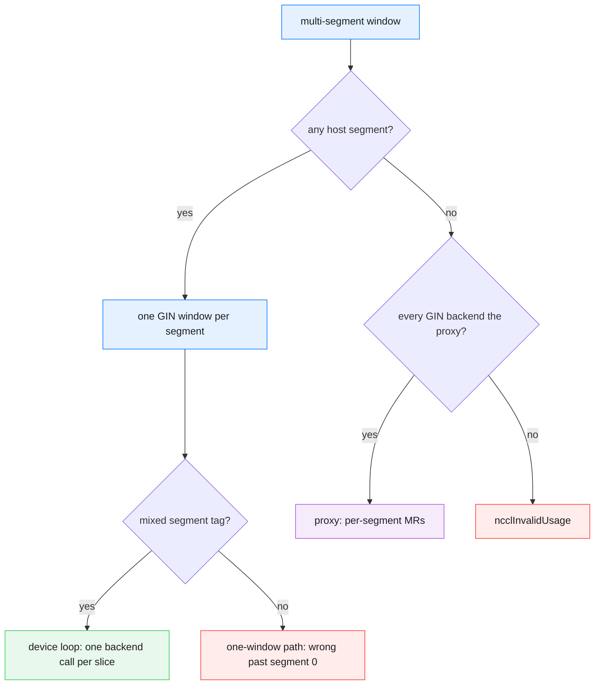
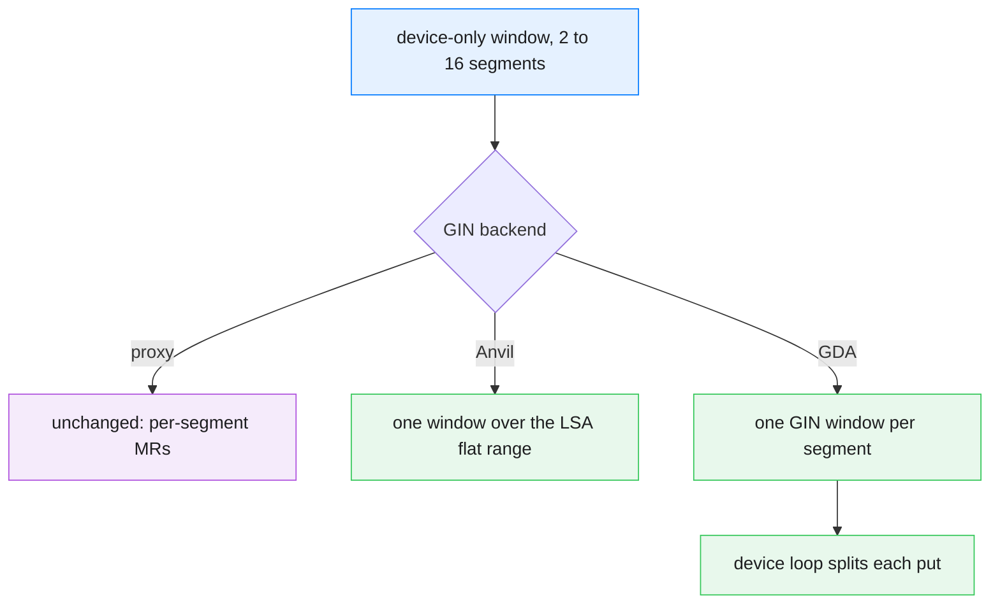

# Proposal: multi-segment windows on rocSHMEM GDA and Anvil SDMA

> [!NOTE]
> Proposed design, not implemented. "Current code" is develop at `0d3cab4b1568` (2026-10-28); the multi-segment stack does not change either backend. This revision follows the GDA and Anvil changes merged through 2026-10-27 and corrects the first draft, which missed that develop already splits windows with host segments for every GIN backend.

The host-proxy GIN type registers per physical segment through its RMA backend ([GIN/RMA](multi_segment_gin_rma.md)). The two AMD device-initiated GIN backends are rocSHMEM GDA (`NCCL_GIN_TYPE=6`) and Anvil SDMA (`NCCL_GIN_TYPE=7`); both plugins compile only with `ENABLE_ROCSHMEM_GIN`. This doc records what develop already does for multi-segment windows on those two backends, what is still missing, and the proposed changes. Tickets: AIRUNTIME-2351, AICOMRCCL-1526 follow-on.

## Summary

- **Windows with host segments already work in principle.** DeepEP's `[GPU][CPU]` and hybrid windows contain host segments, so develop registers one GIN window per physical segment, and the device `ncclGin` put and get split at segment boundaries before they reach the backend. Each backend call sees one segment. The caller must pass the mixed segment tag.
- **Device-only windows with 2 to 16 segments are the gap.** Develop registers them as one range. GDA's whole-range DMA-BUF covers only segment 0 on ROCm, so layer 05 rejects these windows with `ncclInvalidUsage` on every GIN type except the proxy. Anvil exports nothing and addresses every segment through the LSA flat mapping, so it is rejected only by that gate.
- **Proposed:** let Anvil through the gate; give GDA one GIN window per segment so develop's device loop does the split; make GDA register imported host segments with the owner's fd; stop Anvil spending an IPC-table row per segment.
- **Open:** whether SDMA reaches host segments, VA signal cells outside a window's first GIN segment, and GDA's missing device get.

## Develop changes reviewed

| Commit | Change | Effect here |
|---|---|---|
| `be26edf94106` (10-27) | GDA VA signals: the signal is an RDMA atomic into a cell of a data window, so data MRs now enable remote atomics | a VA signal resolves through its window's keys, not only the signal array |
| `ab8be46e3670` (10-25) | Anvil flush drains dirty queues by bit scan | none; refactor |
| `5512a983e83e` (10-25) | Anvil strong signals drain every SDMA queue to the peer first | a strong signal after a split stays ordered with no extra work |
| `170b9ae05702`, `c7047ffc473d` | signals de-aliased per logical context on both backends | none; signals are per context, not per window |
| `b8d1009e44db` (10-18) | Anvil small puts use IPC stores below `sdmaThreshold` | host-segment routing can reuse the IPC store path |
| `b31563aa0855`, `7aad70eed9c9`, `d752cb5c1479`, `84f6dcd7d16f` | GDA traffic class, ionic collapsed CQ, MI300X CPX gate, plugin finalize | none |

Corrections to the first draft: the GIN types are 6 and 7 (type 5 is EFA GDA); Anvil performs no export of its own, so it never "maps only the GPU object"; GDA has no device get; and windows with host segments were never on a single-MR path.

## What develop does with multi-segment windows

`ncclDevrBuildGinSegmentInfos` (`dev_runtime_segments.cc`) sets `numGinSegments = 1` for a device-only window and one GIN segment per physical segment, with its memory type, otherwise. `symMemoryRegisterGin` then calls `ncclGinRegister` once per GIN segment, so a backend's `regMrSym` sees one physical segment at a time. Develop requires identical segment counts and sizes on every rank (`ncclDevrVerifySegmentLayouts`).

On the device, `ncclDevrAllocAndPopulateSegmentWindows` publishes `ginMultiSegmentWins[backend * numSegments + seg]` with each segment's size and type. With the `ncclGin_SegmentMixed` or `ncclGin_SegmentHostNuma` tag, `put` and `get` find the segment of each offset (`findSegmentFromWindow`), cut every slice at both boundaries (`getSegmentChunkSize`), and call the backend once per slice with that segment's GIN window. The signal and counter ride on the last slice, and a host source raises the first slice's release to system scope. The default tag, `ncclGin_SegmentDevice`, takes the one-window path; RCCL's own kernels use it, and only `test/device/GinBackendMaskDispatch_test.cpp` passes the mixed tag.

`ginWinsDefaultBackend` is copied from the window-level cache, which is filled only when there is one GIN segment. A one-window lookup on a multi-GIN-segment window, from the default tag or from a VA signal descriptor (`getGinWindow`), therefore gets no valid window on backend 0 and segment 0's window on other backends.

On the stack, layer 05's `symMemoryRegisterGin` fails a device-only multi-segment window unless `rcclDevrGinRegistersMultiSegment` holds, and that predicate requires every active GIN backend to be the proxy. It also passes a host segment's owner DMA-BUF fd to `regMrSymDmaBuf`; both device backends ignore it.

## Current backend code

### rocSHMEM GDA

`ginRocshmemGdaRegMrSym` (`gin_plugin_rocshmem_gda.cc`) calls `rocshmem_gin_reg_mr_vmm(qpSet, data, size, atomic=1, ...)` once. That exports one DMA-BUF for the whole range with `hipMemGetHandleForAddressRange`, registers it with the VA as IOVA, and tries a fallback when the export fails. Remote atomics are on because a VA signal lands in the window. The plugin then allgathers one rkey and one base VA per rank. `ginRocshmemGdaRegMrSymDmaBuf` ignores `offset` and `fd` and calls `RegMrSym`.

The device handle is `ncclGinRocshmemGdaMemHandle {local_va, remote_vas[nRanks], lkey, rkeys[nRanks]}`. The put issues one `put_nbi(remote_vas[peer] + dstOff, rkeys[peer], local_va + srcOff, lkey, bytes)`, skips zero-byte RDMA but still signals, and sends the signal as an `atomic_add` on the same QP. A VA signal targets `remote_vas[peer] + signalOffset` with `rkeys[peer]` of the signal window. Put-value inlines the value into the WQE, and flush runs `quiet` on every peer QP.

Get, FlushAsync and Wait are `__builtin_trap()`, so GDA has no device get. `FlushesAllPutsOnAnySignal` is false. `ginRocshmemGdaQueryLastError` always reports no error, so device code has no way to report a failure. Signals and counters are per logical context, in separate allocations registered with remote atomics.

### Anvil SDMA

Anvil is intra-node and uses no IB MR and no DMA-BUF export. `ginAnvilRegMrSym` (`gin_plugin_anvil_sdma.cc`) resolves the LSA flat address with `ncclDevrGetLsaSelfAddr`, adds an IPC-table row on the first registration of an address (reference-counted), and publishes `baseAddr`, `vmmStride = devr->bigSize` and a `remote_vas[nRanks]` table computed from the same stride. `resolveRemotePeerVa` uses `base + (peer - rank) * stride + off` when the stride is non-zero, then `remote_vas[peer] + off`, then the IPC table.

The device runtime maps every segment of each LSA peer's window into that flat range (`symMemoryImportAndMapSegmentsForRank`), so stride addressing already reaches every segment of a device-only multi-segment window. `ginAnvilRegMrSymDmaBuf` ignores `fd`.

The put uses IPC flat stores up to `sdmaThreshold` bytes (default 128, `NCCL_GIN_ANVIL_SDMA_THRESHOLD`) and the peer's SDMA queue above it. SDMA copies are cut at `kGinPutSegBytes` = 128 MiB (`gin_anvil_sdma_put_policy.h`) because the linear-copy count is 30 bits and a fused copy and signal of 256 MiB or more hangs MI355X; an optional fused signal rides on the last piece. There is one in-order SDMA channel per peer. Weak signals quiet only this call's queue, strong signals drain every queue to the peer (`quietPeerQueues`), and a VA signal cell resolves like a put destination. Get is implemented over SDMA or IPC and traps when it cannot resolve an address.

> [!WARNING]
> The IPC table is a process-global array of 16 rows (`NCCL_GIN_ANVIL_IPC_MAX_BUFS`), each covering up to 16 LSA ranks (`NCCL_GIN_ANVIL_IPC_MAX_RANKS`), and registration fails when it is full. Develop's per-segment path takes one row per segment, so one 8-rank hybrid window (1 GPU plus 8 CPU segments) uses 9 rows and a second one fails.

## Gaps

| Window | GDA (type 6) | Anvil (type 7) |
|---|---|---|
| One segment | works | works |
| Device-only, 2 to 16 segments | one MR covers segment 0 only; the stack rejects it | addressing reaches every segment; the stack rejects it |
| Host segments, mixed tag, local CPU segment | per-segment MRs and device split work | per-segment rows and split work; SDMA into the host segment is unverified |
| Host segments, imported CPU segment (hybrid) | re-exports instead of using the owner fd | works through the LSA mapping; IPC rows run out |
| VA signal cell in a multi-GIN-segment window | no valid window on backend 0 | no valid window on backend 0 |
| Device get | traps | works |

## Proposed changes

### Anvil: accept device-only windows

Split `rcclDevrGinRegistersMultiSegment` so the proxy keeps its RMA requirement and Anvil needs only the switch (`rcclRmaMultiSegEnabled`) and at most `NCCL_RMA_MAX_SEGMENTS` (16) segments. The window stays one GIN window over the LSA flat range, and no device code changes.

### Anvil: no IPC row per segment

When `vmmStride` is non-zero, every peer address resolves without the table, so skip `ncclGinAnvilIpcTableRegisterVmm` for data windows and keep the table for explicit rows such as signal spans. Raising `NCCL_GIN_ANVIL_IPC_MAX_BUFS` is the fallback if a path still needs the rows.

### Anvil: host segments

Check on MI300X and MI355X that SDMA reads and writes host segments mapped in the LSA range. If it cannot, record the segment kind on `ncclGinAnvilSdmaMemHandle` at registration (`symMemoryRegisterGin` passes `NCCL_PTR_HOST`) and send those puts through IPC stores regardless of size. Without GPU access to imported host VMM (ROCM-29812), skip collectively, as the hybrid MPI tests do; never hang in `waitSignal`.

### GDA: one GIN window per segment

When an active GIN backend is GDA, build one GIN segment per physical segment for device-only windows too, so each segment gets its own `rocshmem_gin_reg_mr_vmm` MR and develop's device loop splits every put. Default-tag callers would then hit the one-window path, so the device-only branch in `gin__funcs.h` must fall through to the loop when `numSegments > 1`. That is one compare in an upstream-shared file and needs a `// RCCL:` marker.

| Option | Idea | Verdict |
|---|---|---|
| A | per-segment GIN windows plus develop's device loop | recommended: no new backend device code; the loop already puts the signal on the last slice and raises the release for host sources |
| B | per-segment MRs inside the plugin plus a GDA device loop over `rkeys[rank * nSeg + s]` (the first draft) | duplicates the loop and needs a slice cap and an error channel that `QueryLastError` does not have |

### GDA: owner fd for imported host segments

Implement `ginRocshmemGdaRegMrSymDmaBuf` with the fd it is given: add a factory entry such as `rocshmem_gin_reg_mr_dmabuf(qpSet, fd, offset, addr, size, atomic, ...)` over `wrap_ibv_reg_dmabuf_mr`, with the VA as IOVA like `reg_mr_vmm`. The caller keeps ownership of the fd. Fall back to `RegMrSym` when `fd < 0`.

### VA signals in multi-segment windows

Until the generic descriptor resolves the GIN segment that holds `signalOffset`, keep VA signal cells in windows with one GIN segment and say so in the API notes. The fix is a `findSegmentFromWindow` lookup in the VA signal descriptor builders, again in `gin__funcs.h`.

## DeepEP shapes

| Shape | Path today | GDA | Anvil |
|---|---|---|---|
| `[GPU][CPU]` non-hybrid | per-segment GIN windows, mixed tag | puts work; no Engram IGet, since get traps | puts and gets work; SDMA into the CPU segment to verify |
| `[GPU k][CPU 0]…[CPU N-1]` hybrid ([hybrid DeepEP windows](multi_segment_testing.md#hybrid-deepep-windows)) | same | needs the owner-fd change | needs the IPC-row change for a second window |
| GPU-only, N segments | one GIN window; the stack rejects it | needs per-segment GIN windows | needs the gate change |

`NCCL_WIN_STRICT_ORDERING` stays a window flag. A split must not move the signal ahead of data slices: on GDA the atomic follows the last `put_nbi` on the same QP, and on Anvil the last slice carries the fused signal or the signal follows a quiet.

## Open questions

- Can SDMA read and write host segments mapped in the LSA range on MI300X and MI355X, or must host slices use IPC stores?
- Should the VA signal segment lookup land in the shared device layer, or should registration reject VA signal use on multi-GIN-segment windows?
- Does any GDA user need device get, for example DeepEP's Engram IGet? That is a GDA feature of its own, not a multi-segment change.

## Implementation sequence

1. Tests that pin today's behavior: mixed-tag puts on host-segment windows for types 6 and 7, gets on 7, and the stack's rejection of device-only windows.
2. Anvil gate and IPC-row changes.
3. GDA owner-fd registration.
4. GDA per-segment GIN windows and the device-only fall-through.
5. Anvil host-segment SDMA check, then the VA signal rule or fix.
6. Do not wait on GDAKI (type 3) or GPI (type 4): RCCL does not build the internal GDAKI plugin on AMD, the optional IB-CAST GDAKI backend is separate work, and there is no AMD GPI plugin.

## Testing

Reuse the `RmaMultiSegmentMPITests.cpp` patterns in a GIN-device fixture that sets `NCCL_GIN_TYPE=6` or `7`.

| Case | GDA | Anvil |
|---|---|---|
| Single-segment regression | yes | yes |
| Device-only N segments, crossing put | after per-segment windows | after the gate change |
| Crossing get | not applicable; get traps | yes |
| `[GPU][CPU]` mixed-tag put | yes, today | yes, today; checks SDMA into host |
| Hybrid 8-rank window, two windows | after the owner-fd change | after the IPC-row change |
| More than 16 segments | host reject | host reject |
| Layout mismatch | develop's identical-layout check, collective | same |
| VA signal in a multi-GIN-segment window | rejected or documented | same |
| Strong signal after a multi-slice put | atomic after the last slice | `quietPeerQueues` before the signal |
| No GPU access to imported host VMM (ROCM-29812) | skip | skip |

Capability skips must be collective.

## Other device GIN types

| GIN type | RCCL on AMD | Multi-segment status |
|---|---|---|
| 2 | proxy over the classic or IB-CAST RMA backend | done |
| 3 | GDAKI: the internal plugin is not built on AMD; `IbCastGinIbGdaki` registers only with `RCCL_NET_IB_CAST_ENABLE_GDAKI` and `NCCL_NET=IB-CAST`, with `regMrSymDmaBuf = NULL` | out of scope |
| 4 | GPI: device templates only, loadable as an external plugin | not an RCCL deliverable |
| 5 | EFA GDA | not an AMD backend |
| 6 | rocSHMEM GDA | this proposal |
| 7 | Anvil SDMA | this proposal |

Out of scope: the IB-CAST P2P side table, copying IB-CAST's credit counter onto GDA, raising the 16-segment cap, multi-segment inside GDAKI or GPI, and making Anvil an inter-node path.

## Proposed file index

| Concern | File | Change |
|---|---|---|
| Window gate | `src/rccl_dev_runtime.cc` | `rcclDevrGinRegistersMultiSegment` accepts Anvil |
| GDA GIN segments | `src/dev_runtime_segments.cc`, `src/dev_runtime.cc` | one GIN segment per physical segment when GDA is active |
| Device-only fall-through, VA signal lookup | `src/include/nccl_device/impl/gin__funcs.h` | loop when `numSegments > 1`; find the signal's segment |
| GDA DMA-BUF entry | `src/gin/gin_rocshmem_gda_factory.cc`, `src/gin/gin_plugin_rocshmem_gda.cc` | register with the given fd |
| Anvil IPC rows | `src/gin/gin_plugin_anvil_sdma.cc` | no row for stride-addressed windows |
| Anvil host segments | `gin_anvil_sdma_device_host_common.h`, `gin_anvil_sdma.h` | segment kind; IPC stores for host |
| Tests | GIN type 6 and 7 MPI suites; `test/device/GinBackendMaskDispatch_test.cpp` for the mixed tag | crossing puts and gets, hybrid windows, VA signals |
