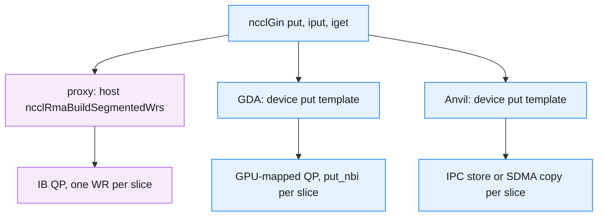
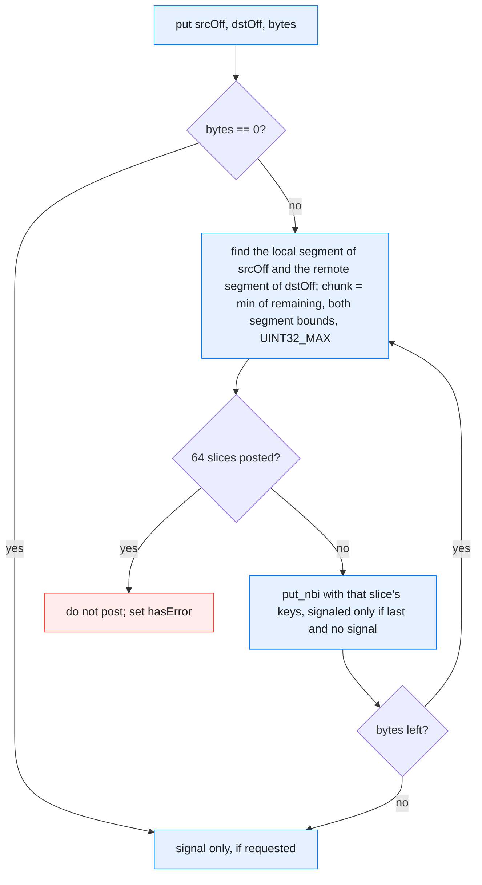
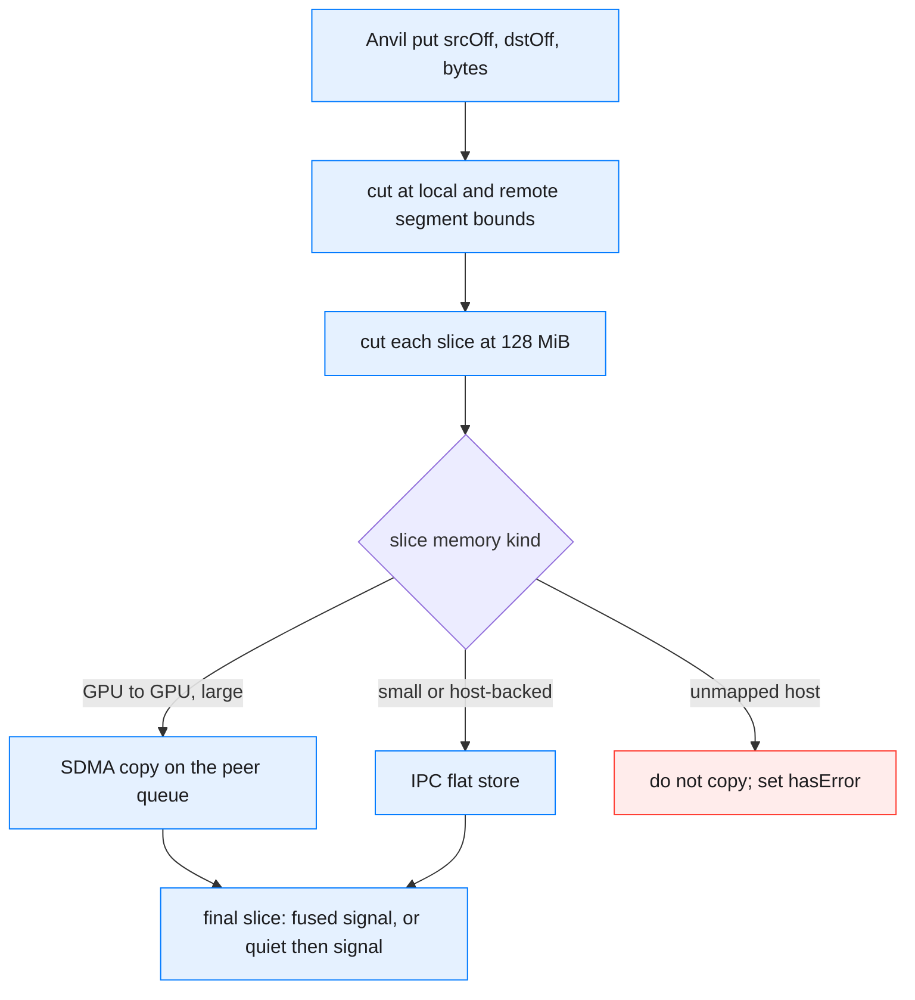

# Proposal: multi-segment windows on rocSHMEM GDA and Anvil SDMA

> [!NOTE]
> Proposed design, not implemented. The GDA and Anvil code described under "Current code" is develop's; the multi-segment stack does not change it.

The host-proxy GIN type already splits at physical segments ([GIN/RMA](multi_segment_gin_rma.md)). The two AMD device-initiated GIN backends, rocSHMEM GDA (`NCCL_GIN_TYPE=5`) and Anvil SDMA (`NCCL_GIN_TYPE=6`), do not: each issues one RDMA or SDMA operation per put from the GPU, using one key or one resolved peer address. This doc proposes how both backends would register per segment and split on the device. Both plugins compile only with `ENABLE_ROCSHMEM_GIN`. Tickets: AIRUNTIME-2351, AICOMRCCL-1526 follow-on.

## Why these backends differ from the proxy

The proxy posts from a host thread, so per-segment MRs and a WR loop were a host-only change. GDA and Anvil are the device `ncclGinApi_Put` and `Flush` templates: the GPU issues the operation, so the split has to happen in device code, with the host only publishing per-segment tables.

| Layer | Proxy GIN (done) | GDA and Anvil (proposed) |
|---|---|---|
| Who posts | host proxy | GPU kernel: GDA doorbell or SDMA packet |
| Registration | one DMA-BUF MR per segment | GDA: per-segment MRs; Anvil: per-segment IPC coverage |
| Split | host WR chain | device loop over host-published tables |
| Queue budget | IB-CAST credits against 575 and 271 | GDA: the rocSHMEM `QueuePair` send queue; Anvil: SDMA packet size |
| Layout agreement | host consensus gather | the same gather on the host |



## Current code

**rocSHMEM GDA** (`gin_plugin_rocshmem_gda.cc`, device `gin_rocshmem_gda.h`). Registration calls `rocshmem_gin_reg_mr_vmm(qpSet, data, size)` once, which exports one DMA-BUF for the whole range and registers it. On ROCm that fd covers segment 0 only. The device handle holds one `lkey`, one `rkeys[nRanks]` array and per-peer base addresses, and the device put issues one `put_nbi(remote_vas[peer] + dstOff, rkeys[peer], local_va + srcOff, lkey, bytes)`.

> [!CAUTION]
> A DeepEP Engram IGet from a remote CPU offset into a local GPU offset that crosses a physical boundary uses segment 0's keys against an address in a later segment: `EINVAL` at registration, or `IBV_WC_REM_INV_REQ_ERR` on the GPU QP.

Signals and counters are separate fine-grained allocations registered with `IBV_ACCESS_REMOTE_ATOMIC`; they are not elastic windows and need no segment tables.

**Anvil SDMA** (`gin_plugin_anvil_sdma.cc`, device `gin_anvil_sdma.h`). Anvil is intra-node and uses no IB MR. Registration resolves the LSA flat address (`ncclDevrGetLsaSelfAddr`), inserts one IPC-table entry covering the window, and publishes `vmmStride = devr->bigSize`, so a peer address is `base + (peer - rank) * stride + off`. The device put already splits by copy size (`kGinPutSegBytes` = 128 MiB in `gin_anvil_sdma_put_policy.h`), because the SDMA linear-copy count is 30 bits and a fused copy and signal of 256 MiB or more hangs MI355X. It does not split at physical boundaries. `ginAnvilResolvePeerVa` assumes the range sits inside one IPC entry, so a `[GPU][CPU]` window either fails the export or maps only the GPU object.

> [!WARNING]
> The IPC table is a process-global 16-slot array (`NCCL_GIN_ANVIL_IPC_MAX_BUFS` = 16, `NCCL_GIN_ANVIL_IPC_MAX_RANKS` = 16). That 16 counts registered windows, not segments, so one entry per segment would let a single 16-segment window fill it.

## Shared contract to reuse

Keep `net_ib/rma_multiseg.h` as the source of truth for host-side limits and predicates, and honor the same switch:

| Symbol | Value | Use on GDA and Anvil |
|---|---|---|
| `rcclRmaMultiSegEnabled` | `NCCL_MULTI_SEGMENT_REGISTER` | gate per-segment registration; off keeps today's path |
| `NCCL_RMA_MAX_SEGMENTS` | 16 | reject windows with more segments |
| `ncclRmaSegmentSliceBytes` | min of remaining, local, remote, `UINT32_MAX` | GDA device loop, since the verbs SGE is 32 bits |
| `ncclRmaSegmentCountsMatch`, `ncclRmaSegOffTableValid` | equal counts; tables start at 0 and never decrease | validate every gathered table before upload |
| `ncclRmaSignalOffsetValid` | 8-byte aligned, inside one segment | GDA put plus atomic when the signal is in the data window |
| `ncclRmaWrIsSignaled` | last index only | GDA: only the last `put_nbi` is signaled |

Anvil's length cap is its own 128 MiB, not `UINT32_MAX`: cut at segment boundaries first, then cut each slice at 128 MiB. Do not include `net_ib/gin.h` or `gin_cast.h` from these plugins (they share an include guard) and copy no IB request types; share only the two `*multiseg.h` headers and a device-callable slice helper.

## rocSHMEM GDA

### Host registration

`ginRocshmemGdaRegMrSym` and `ginRocshmemGdaRegMrSymDmaBuf` become the GDA analogue of `rcclRmaIbProxyRegMrSymDmaBuf`, with a per-communicator gather buffer allocated at connect when the switch is on:

```text
count segments with ncclCuMemGetAddressRange -> nSeg, segOff[]
nSeg > NCCL_RMA_MAX_SEGMENTS: record a local failure, do not return before the gather
nSeg == 1 or switch off: rocshmem_gin_reg_mr_vmm(whole range)    // today's path
else for each segment s:
    export segment s alone in whole pages (a complete fd)
    rocshmem_gin_reg_mr_vmm(segAddr[s], segLen[s]); close(fd)
allgather {magic, version, status, nSegments, segOff[17]}; any failure aborts all ranks
check counts and tables; store each rank's segOff
allgather per-segment VAs and rkeys into remote_vas[rank * nSeg + s], rkeys[rank * nSeg + s]
upload the tables to the device handle
```

> [!IMPORTANT]
> `rocshmem_gin_reg_mr_vmm` may stay one range to one MR, but the plugin must pass it only one physical segment at a time. Keep segment enumeration in RCCL, as the proxy does. A later `rocshmem_gin_reg_mr_dmabuf(fd, addr, len)` could avoid the second export.

Rollback: `calloc` the handle so MR pointers start NULL, deregister only completed segments on failure, and loop `nSegments` in `DeregMrSym`.

### Device handle

```c
struct ncclGinRocshmemGdaMemHandle {
  int        nSegments;                            // 1 = today's scalar path
  uintptr_t  local_va;                             // window base
  size_t     segOff[NCCL_RMA_MAX_SEGMENTS + 1];
  uint32_t   lkeys[NCCL_RMA_MAX_SEGMENTS];
  uintptr_t* remote_vas;                           // [nRanks * nSeg]
  uint32_t*  rkeys;                                // [nRanks * nSeg]
};
```

`nSegments == 1` keeps the current layout in the first slot, so the device fast path is one compare plus the old addressing. At 1024 ranks and 16 segments the tables are 64 KiB of rkeys and 128 KiB of addresses per window per rank. Do not gather per-device rkeys unless GDA gains multi-rail QPs; the factory has one PD and one rkey per MR.

### Device put, put-value and flush



- Resolve the local lkey from `srcOff` and the remote rkey and address from `dstOff`; never one offset for both.
- Chain with RC ordering: unsignaled puts then a signaled last put, or unsignaled puts then the atomic.
- A zero-byte put skips RDMA and still delivers the signal.
- Put-value needs only the destination segment that holds `dstOff`; a 4- to 8-byte inline store must not straddle a boundary.
- Flush (`quiet`) is per QP, so one quiet after a multi-slice put to one peer is enough.
- Device code cannot WARN and unwind, so it must not post a partial chain. Reject at registration any window whose worst-case put exceeds 64 slices, or cap the loop and set `ginRocshmemGdaGinCtx::hasError`.

### GPU send-queue budget

The IB-CAST proxy sized a host QP to 575 because many host IPuts can be in flight. GDA posts from one thread per put onto a provider-defined rocSHMEM queue (Ionic, BNXT and others), so do not copy 575. Instead, query the send-queue depth after `rocshmem_gin_create_qps`, treat one device put as at most 65 WQEs (64 data plus the atomic), and if `nCtas * 65` can exceed the depth, either serialize puts per peer or rely on `put_nbi` stalling for space.

## Anvil SDMA

### What breaks

1. IPC or VMM export of a multi-handle range has the same first-segment limit, so `ncclGinAnvilIpcTableRegisterVmm` must not assume one object covers the window.
2. `vmmStride` addressing is valid only while every offset maps to the same kind of mapping on every rank.
3. `ginAnvilResolvePeerVa` walks entries with `[local_base, local_base + length)`; one entry per window cannot describe a second physical object.
4. GPU-to-GPU slices can use SDMA queues, but a slice into host-backed VMM may need IPC stores; each slice's memory kind must be known.

### Host registration

Register each physical segment with stride 0, so lookups go through the table, and publish `nSegments`, `segOff[]`, a per-segment kind (GPU or host) and `remote_vas[rank * nSeg + s]` on the handle. Multi-segment handles set `vmmStride = 0`.

| Option for the 16-slot IPC table | Idea | Verdict |
|---|---|---|
| A | raise `NCCL_GIN_ANVIL_IPC_MAX_BUFS` to 64 or 256 | simple; needed anyway if several elastic windows coexist |
| B | one row per window with inline `nSeg` and `segOff[]` | avoids filling 16 slots; lookup finds the window, then the segment |
| C | keep rows per window, keep segments in the mem handle, add IPC rows only for objects that need peer mapping | recommended: GPU segments stay stride-based, host or imported segments get rows |

A two-segment non-hybrid window needs one extra row for the CPU object, not 16. DeepEP hybrid on 8 GPUs per node uses 8 LSA ranks, under `NCCL_GIN_ANVIL_IPC_MAX_RANKS` = 16, which counts LSA-local ranks, not world size.

### Device put



`vmmStride` stays valid for single-segment GPU windows, the common case. Multi-segment handles resolve `remote_vas[peer * nSeg + rs] + offset in segment`, never `base + off` across a GPU-to-CPU join. The existing `quiet` on dirty SDMA channels is enough for flush; IPC stores still need the fence already in `fenceBeforeSignal`.

**Host segments on Anvil.** A CPU segment must be in the LSA map with GPU access. SDMA engines may not reach host VMM, so use IPC stores (or a CE copy) for host slices regardless of size. Without GPU access to imported host VMM (ROCM-29812), skip collectively, as the hybrid MPI tests do; never hang in `waitSignal`.

## Device slice helper

Add a host-and-device header (proposed `gin_device_multiseg.h`, no ibverbs) next to `gin_anvil_sdma_put_policy.h`:

```c
size_t rcclGinDevSegSliceBytes(size_t rem, size_t localRemain, size_t remoteRemain, size_t lenCap);
int rcclGinDevSegOf(int nSeg, const size_t* segOff, size_t off);  // -1 if out of range
```

GDA passes `lenCap = UINT32_MAX`; Anvil passes `min(physRemain, kGinPutSegBytes)`. Test it on the host (`GIN_SDMA_HOST_ONLY`-style build) with independent offsets, `UINT32_MAX + 4096` for GDA, 128 MiB plus 1 byte with a segment boundary inside for Anvil, and over-16 rejection on the host register path.

## DeepEP shapes that must work

The non-hybrid window is `[GPU][CPU]` with puts or gets between a GPU offset and a CPU offset. The hybrid window is `[GPU k][CPU 0]…[CPU N-1]`; see [hybrid DeepEP windows](multi_segment_testing.md#hybrid-deepep-windows).

| Backend | Must do | Must not do |
|---|---|---|
| GDA | per-segment DMA-BUF MRs, device put split, `rkey[peer, seg]` | one `put_nbi` with segment 0's keys |
| Anvil | per-object IPC, `vmmStride = 0`, host slices through IPC stores | one IPC entry covering the whole window |
| Both | independent offsets, layout agreement, collective skip without host VMM GPU access | one offset for source and destination |

`NCCL_WIN_STRICT_ORDERING` stays a window flag. Splits must not move the trailing signal ahead of data slices (RC ordering on GDA; SDMA final-slice handling or quiet on Anvil).

## Implementation sequence

1. GDA host registration only, still one device put: register 2 to 16 segments, log the MR count, reject more than 16, roll back on fd failure.
2. GDA device put loop and `gin_device_multiseg.h`: boundary-crossing IPut and IGet, Engram offsets, `UINT32_MAX` host test, signal after the chain.
3. Anvil IPC per physical object with `vmmStride = 0` on multi-segment handles, keeping the 128 MiB splitter.
4. Anvil host-kind slices forced to IPC stores; a CPU destination without GPU mapping skips or errors without hanging.
5. Grow the Anvil IPC table (or option C) before enabling several multi-segment windows together.
6. Do not wait on GDAKI (type 3) or GPI (type 4): RCCL does not build the internal GDAKI plugin on AMD, the optional IB-CAST GDAKI backend is separate work, and there is no AMD GPI plugin.

## Testing

Reuse the `RmaMultiSegmentMPITests.cpp` patterns without the RMA proxy, in a GIN-device fixture that sets `NCCL_GIN_TYPE=5` or `6`.

| Case | GDA | Anvil |
|---|---|---|
| Single-segment regression | yes | yes |
| N uniform GPU segments, crossing put | yes | yes, intra-node |
| DeepEP `[GPU][CPU]` Engram IGet | yes, inter-node | yes if the CPU segment is GPU-mapped, else skip |
| Hybrid 8-rank window | yes | LSA-local only |
| More than 16 segments | host reject | host reject |
| Layout mismatch | collective abort | collective abort |
| Slice overflow | 64 slices: host reject or `hasError` | existing 128 MiB policy plus the segment cut |
| Signal after a multi-slice put | atomic last | final slice or quiet |
| No host VMM GPU access (ROCM-29812) | skip | skip |

Capability skips must be collective.

## Other device GIN types

| GIN type | RCCL on AMD | Multi-segment status |
|---|---|---|
| 2 | proxy over the classic or IB-CAST RMA backend | done |
| 3 | GDAKI: the internal plugin is not built on AMD; `IbCastGinIbGdaki` registers only with `RCCL_NET_IB_CAST_ENABLE_GDAKI` and `NCCL_NET=IB-CAST`, with `regMrSymDmaBuf = NULL` | out of scope |
| 4 | GPI: device templates only, loadable as an external plugin | not an RCCL deliverable |
| 5 | rocSHMEM GDA | this proposal |
| 6 | Anvil SDMA | this proposal |

Any GPU-posted RDMA backend on ROCm needs the GDA shape: per-segment MRs and a device loop that turns `srcOff` and `dstOff` into a segment and an offset within it. Each segment's MR may use a zero IOVA or the segment's VA as IOVA, but not a mix within one put. GPI descriptors name one source and one destination handle with a 32-bit size, so the same per-slice split would apply.

Out of scope: the IB-CAST P2P side table, copying IB-CAST's credit counter onto GDA, raising the 16-segment cap, multi-segment inside GDAKI or GPI, device GDAKI `regMrSymDmaBuf`, and making Anvil an inter-node path.

## Proposed file index

| Concern | File | Change |
|---|---|---|
| GDA host registration | `src/gin/gin_plugin_rocshmem_gda.cc` | per-segment `reg_mr_vmm`, consensus, GPU tables |
| GDA factory | `src/gin/gin_rocshmem_gda_factory.cc` | optional DMA-BUF entry, send-queue depth query |
| GDA device handle | `gin_rocshmem_device_host_common_gda.h` | `nSegments`, `segOff`, `lkeys[]`, rank-by-segment tables |
| GDA put | `gin_rocshmem_gda.h` | slice loop, last WR or atomic |
| Anvil host registration | `gin_plugin_anvil_sdma.cc` | per-segment IPC rows, `vmmStride = 0` |
| Anvil IPC table | `gin_anvil_ipc_table.h`, `_host.cc` | capacity and per-object rows |
| Anvil device handle | `gin_anvil_sdma_device_host_common.h` | `nSegments`, `segOff`, segment kind, rank-by-segment addresses |
| Anvil put | `gin_anvil_sdma.h` | segment cut then 128 MiB cut; host slices through IPC stores |
| Shared device math | new `gin_device_multiseg.h` | host-and-device slice helper |
| Tests | `test/NetIbMultiSegmentUnitTests.cpp` or `test/gin/`; GIN type 5 and 6 MPI suites | slice helper; Engram and hybrid |
