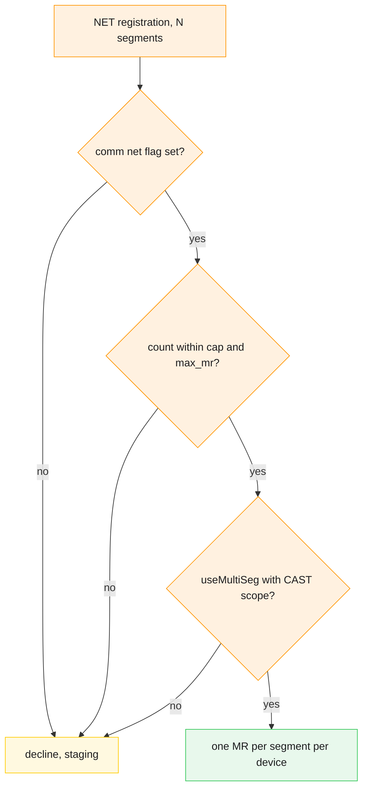

# IB-CAST P2P on IB-MSEG: fork 6 design

> [!NOTE]
> Planned, fork 6 ("IB-CAST on IB-MSEG"), not started. It waits on fork 5, which is paused while forks 1 to 4 are stabilized on IB and AINIC. The design is unchanged; the old stack's IB-CAST branches stay read-only references. See [the fork plugin](multi_segment_fork_plugin.md#fork-6-ib-cast-multi-segment-planned) for where fork 6 sits in the stack.

Multi-segment support for IB-CAST is not added to `net_ib_cast` again. IB-MSEG first takes develop's `net_ib` to `net_ib_cast` differences in [fork 5](multi_segment_fork_plugin.md#fork-5-ib-cast-base-planned) (multiplane, QP sharing, CTS offload, the `ionicdv` helpers, AINIC recovery, BY_INDEX and BY_ORDER matching, and the per-WR cap `IbCastMaxPostSendBytes`). Fork 6 then adds only what is specific to IB-CAST on top of the fork's shared send, receive and flush paths from [fork 3](multi_segment_fork_plugin.md#fork-3-registration-and-p2p). This doc states what fork 6 must do for P2P: the multi-segment scope, one segmented group at a time under the CAST scheduler, the BY_INDEX completion flag, the per-WR cap over segmented chains, and the requirements carried from review. IB-CAST GIN/RMA has no CTS and is covered in [IB-CAST GIN/RMA](multi_segment_netib_cast_gin.md).

## What fork 6 builds on

These pieces exist in the fork at fork 4 (`src/transport/net_ib_multiseg/`) and fork 6 reuses them unchanged:

| Piece | Fork symbols |
|---|---|
| Connect-time decision, cached per comm and checked against the peer | `IbMsegUseMultiSeg` (`ib_multiseg_mseg.h`), `IbMsegResolveUseMultiSeg` and `IbMsegCheckPeerUseMultiSeg` (`connect.cc`), `useMultiSeg` in the connect metadata |
| CTS slots and the layout prefix in the CTS write | `IbMsegSendCommAllocCts`, `NCCL_IB_CTS_NREQS_LAYOUT`, `rcclIbCtsFlagLayout`, `rcclIbPrepareCtsWrite`, `rcclIbIrecvFillLayout`, `rcclIbCtsLayoutsArrived` |
| Inline and referenced layouts | `IbMsegSegLayout`, `rcclIbSegTableInline`, `rcclIbSegTableReferenced`, the layout cache (`rcclIbLayoutCache`, `rcclIbSendLayoutsReady`, `rcclIbSendLayoutCacheFree`) |
| Segmented send | `rcclIbMultiSendNeedsSegmented`, `rcclIbFillSendWrs`, the send cursor (`rcclIbSendCursor`, `rcclIbSendProgress`), `rcclIbSendSliceDone` |
| Registration | `IbMsegRegMrDmaBufMultiSeg`, `rcclIbMrAdmit`, `rcclIbSegMr` |
| Receive checks | `rcclIbIrecvCheckHandle` |

## Differences from the fork 3 path

| Aspect | Fork 3 (IB-MSEG, classic features) | Fork 6 (IB-MSEG with CAST features) |
|---|---|---|
| Scope | switch and DMA-BUF on, not GIN, not resilient (`IbMsegUseMultiSeg`) | must also exclude CTS offload, BY_ORDER matching, QP sharing and AINIC inline CTS, inside the same decision |
| Receiver's CTS stride | from the sender's `useMultiSeg`, checked to match at connect | must stay so; no receiver-side mask of the peer's value |
| Segmented slots in flight | FIFO order through the send cursor | one segmented group at a time while the CAST scheduler picks QPs and chunks |
| Sizes WR and immediate | sizes record when `nreqs > 1`, or split and not BY_INDEX | under BY_INDEX, a split must set a segmented flag in the immediate instead |
| Per-WR cap | none | every segmented slice must respect `IbCastMaxPostSendBytes` |
| Resume `nreqs` | validated count stored in the request (`reqs[0]->nreqs`) | must keep the validated count when CAST's `IbCastMultiSend` loop is merged in |

## Scope

Fork 6 must fold the IB-CAST exclusions into the one connect-time decision, so `IbMsegResolveUseMultiSeg` returns 0 on both ends whenever the segmented send cannot serve the comm, and the existing `IbMsegCheckPeerUseMultiSeg` keeps rejecting a pair that disagrees with `ncclInvalidUsage`. A comm outside the scope keeps the legacy CTS, and `IbMsegRegMrDmaBufMultiSeg` already declines a multi-segment receive registration on such a comm, so those buffers stage. The decision should be logged in the existing INFO line with the new inputs.

The exclusions exist because the segmented send cannot serve them:

- **CTS offload** (`useCtsOffload`). The NIC owns the CTS and never reads a layout.
- **AINIC inline CTS** (`IbCastAinicCtsInlineData`). The 32-byte inline CTS element carries one rkey and no layout prefix; see [requirement 1](#open-items).
- **BY_ORDER matching.** The receiver adds each immediate's `byte_len`, but a split send's size rides a separate sizes write. AINIC defaults to BY_ORDER, so multi-segment on AINIC needs `NCCL_IB_RECEIVER_SIDE_MATCHING_SCHEME=0`.
- **QP sharing.** Shared QPs need a comm id in the immediate and a per-QP WR budget that a resumed send does not track.
- **Resiliency.** Already excluded in fork 3: resiliency replays a whole slot, which a send resumed across progress calls cannot do yet.

There is no per-peer capability check in the figure: fork 3 replaced it with the connect-time `useMultiSeg` match, so a receiver whose peer disagrees never finishes connecting.

## Data path

**Receiver.** Fork 6 must keep the fork's receive hooks on the CAST receive path: `rcclIbIrecvCheckHandle` before taking a request, `rcclIbIrecvFillLayout` for each receive, and `rcclIbCtsFlagLayout` and `rcclIbPrepareCtsWrite` so the CTS write starts at the layout prefix. CTS offload and inline CTS never reach these hooks because the scope excludes them.

**Sender.** A request is segmented when either the local handle or the remote layout spans more than one segment (`rcclIbMultiSendNeedsSegmented`). Develop's CAST send lets the scheduler spread a slot over QPs; fork 6 must allow only one slot's segmented group in flight at a time, so a later segmented slot returns `*request = NULL` from the send entry point until the earlier one has posted every slice. A slot with referenced layouts waits in the cursor's queue until `rcclIbSendLayoutsReady` reports them read, as in fork 3.

**Builder.** The CAST scheduler keeps choosing the per-QP chunk. Fork 6 must call the fork's `rcclIbFillSendWrs` for each non-offload chain so the fill cuts the chunk at local and remote segment boundaries with the shared cursor, and later slices post from `rcclIbSendProgress`. Every WR the fill emits must then pass through the `IbCastMaxPostSendBytes` split that fork 5 brings from develop (`IbCastGetNumWqeSplits` in develop's `p2p.cc`), so a segmented slice never exceeds the per-WR cap.

**Completion size.** Under BY_INDEX the immediate holds `rxReqIndex` and, with more than one QP, `WR_IMM_SPLIT_DATA_FLAG`. Fork 6 must add a segmented flag bit to the immediate when the request was split, and the receiver must skip adding `byte_len` for a single receive when it sees that flag, because the size arrives in the sizes write. This was proven on the superseded IB-CAST layer with a free bit of the BY_INDEX immediate; fork 6 must pick a bit that does not overlap develop's `WR_IMM_*` fields in `common_cast.h`.

**Flush.** Fork 3's flush (`IbMsegIflush`) posts one read per device through the MR of the segment holding the last receive's first byte, or the scratchpad write and read when that flush is on. Fork 6 keeps this flush on CAST's flush QP.

## Failure handling

Fork 6 must keep the fork's send failure rules under the CAST scheduler:

- **Send.** A slice whose post failed drops the event it held on that QP (`rcclIbSendHoldSlice` in the fork's `p2p.cc`), so the request fails through `Test()` instead of waiting. A queued slot that fails to post returns the post error from progress.
- **Test.** An error completion marks the connection fatal and the request `NCCL_NET_IB_REQ_FAILED`, so later `Test()` calls drain its completions.
- **Close.** The layout cache's MRs are freed before their PDs (`rcclIbSendLayoutCacheFree`), also when fork 5's AINIC recovery has rebuilt the QPs.

Dependency: fork 5 should include the standalone connect and teardown fix for AICOMRCCL-3085 (PD reference only after a successful `ibv_alloc_pd`) if it lands on develop first.

## Requirements carried from review

Internal review of the superseded IB-CAST layer found three problems that were not fixed there either: its scope check (`IbCastMultiSegScopeOk`) let AINIC inline CTS through, its receiver sized CTS slots from scope-masked `peerCaps`, and `rcclIbCastSendResume` did not bound `nreqs`. They are fork 6 requirements, together with the scope rules above; see [review feedback](multi_segment_review_feedback.md#summary).

### Open items

1. **Exclude AINIC inline CTS from the scope.** `IbMsegResolveUseMultiSeg` must return 0 when `IbCastAinicCtsInlineData` is set. Otherwise a P2P comm with CTS offload off but inline CTS on would take the combined CTS and register multi-segment, while the inline CTS element (`ncclIbSendFifoCtsInline`) carries only segment 0's rkey and no layout prefix.
2. **Size the receiver's CTS slots from the peer's raw value.** The receiver must choose its combined CTS slots and the remote stride from the sender's own decision as received at connect, not from a copy masked by the receiver's scope. Fork 3 already does this (`useMultiSeg` from the connect metadata, then `ctsSlotStride` in `connect.cc`); fork 6 must not add a receiver-side mask when it adds the CAST scope, or a sender whose scope passes would write at the combined stride to a receiver that does not use it.
3. **Bound the resumed `nreqs`.** Every path that resumes a send must use a count bounded to 1 to `NCCL_NET_IB_MAX_RECVS` (8), as the first post does, never a fresh read of the peer-written CTS row. In the fork, `IbMsegMultiSend` and `rcclIbSendResume` read `reqs[0]->nreqs`, the count `IbMsegIsend` validated; develop's `IbCastIsend` and `IbCastMultiSend` re-read `ctsFifoNreqs`, so fork 6 must keep the fork's rule when it merges CAST's send loop.

Tests for fork 6 are planned: CAST's develop host tests run against the fork through the compile-twice second base from fork 5, and the CAST-specific multi-segment tests come with fork 6. See [forks 5 and 6 in the validation plan](multi_segment_validation_plan.md#forks-5-and-6-planned).
