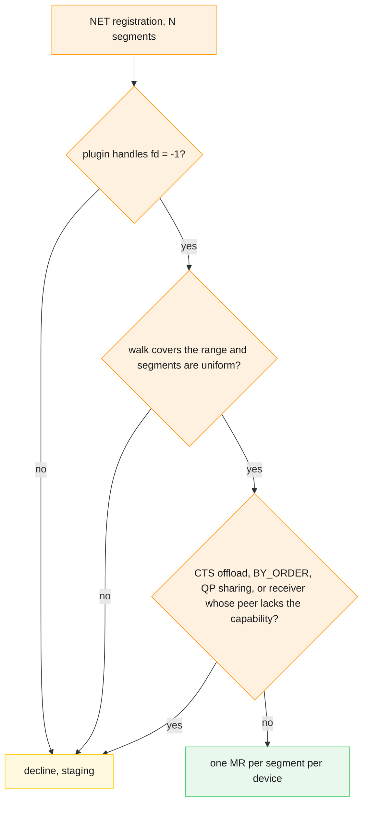
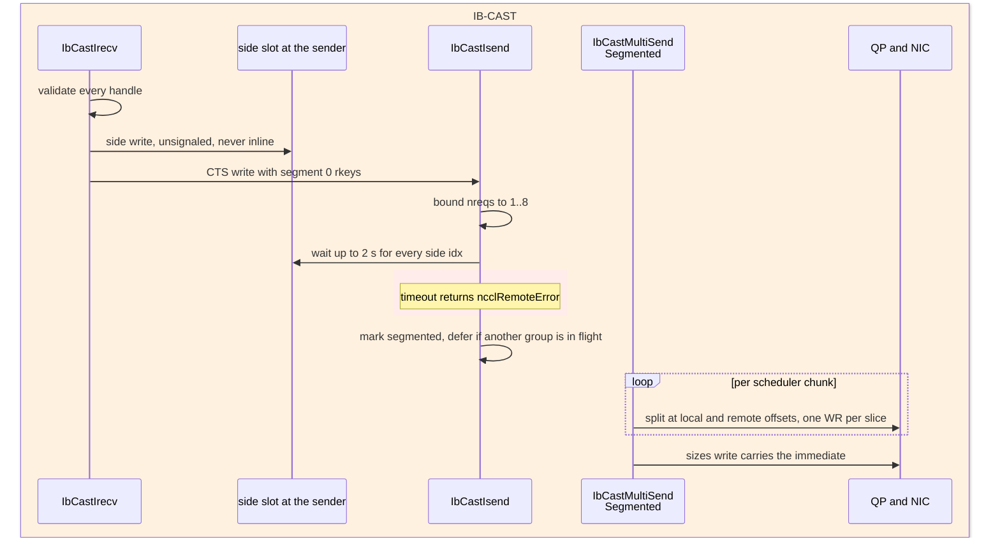

# IB-CAST P2P: the same wire format on the CAST engine

IB-CAST P2P (`net_ib_cast`, layer 08, [PR 10889](https://github.com/ROCm/rocm-systems/pull/10889)) uses the same design as [classic NET/IB P2P](multi_segment_netib_wire.md): one MR per segment, an unchanged CTS, a side table behind `NCCL_IB_CAP_MULTISEG`, and writes split at local and remote boundaries. This doc covers only what differs on IB-CAST: the 32-byte inline CTS, the QP scheduler, the declines, the failure handling, and a set of connect hardening fixes. IB-CAST GIN/RMA is a separate path with no CTS; see [IB-CAST GIN/RMA](multi_segment_netib_cast_gin.md).

## Differences from classic

| Aspect | Classic | IB-CAST |
|---|---|---|
| CTS entry | 64 bytes | 64 bytes, or 32 bytes packed inside the 64-byte row on AINIC (`IbCastAinicCtsInlineData`) |
| Side table written | only for slots with a multi-segment receive, flagged in `nreqs` | for every slot to a capable peer, unless CTS offload is on; no `nreqs` flag |
| Sender wait for the side table | until every `idx` matches | up to 2 s (`IbCastWaitSideTable`), then `ncclRemoteError` |
| Segmented groups in flight | no gate; sender QP 2568 | one at a time (`IbCastHasOtherSegmentedSend`); sender QP 769 |
| Sizes WR | when `nreqs > 1` or matching is not by index | always, with `WR_IMM_SEGMENTED_FLAG` in the immediate |
| Declines | receiver, for a peer without the capability | also both sides under CTS offload, BY_ORDER or QP sharing |
| Peer capability with the switch off | recorded | masked to 0 |
| Partial post | request kept for `Test()` | request kept if it has events, else freed; see [failure handling](#failure-handling) |

The handle (`ncclIbMrHandle` with `nSegments`, `segStart`, `segLen`, `segMrs`, `mrs[]` aliasing segment 0) and the side entry (`ncclIbSegLayout`, 704 bytes) are copies of classic's, because IB-CAST does not include `net_ib/common.h`. The boundary math comes from the shared `net_ib/multiseg.h`.

## When multi-segment is declined

`IbCastRegMrDmaBufMultiSeg` (`net_ib_cast/rccl_reg_multiseg_cast.cc`) returns `ncclInvalidUsage` for `nSegments > 1`, with one INFO line listing its inputs, and the collective stages:

```c
if (useCtsOffload || base->recvMatchingScheme == BY_ORDER || IbCastQpSharingEnabled() ||
    (!base->isSend && ncclIbDeclineMultiSegRegistration(peerCaps, nSeg)))
  return ncclInvalidUsage;
```

The first three apply on both sides because the segmented send engine cannot serve them:

- **CTS offload.** The NIC owns the CTS and never reads a side table, and a sender under offload would post one SGE with segment 0's lkey over the whole buffer.
- **BY_ORDER matching.** The receiver adds each immediate's `byte_len`, but a segmented send's immediate rides the 4-byte-per-request sizes write, so a receive would report its size plus 4 bytes per QP.
- **QP sharing.** Shared QPs need a `commId` in the immediate and a per-QP WR budget; segmented sends carry neither.

The last applies on the receive side only, as on classic: the side table describes the receiver, and a sender splits locally onto the receiver's single rkey. This also covers a local switch-off, because `peerCaps` is then 0.



`IbCastRegMrDmaBuf` (`net_ib_cast/reg.cc`) routes `fd == -1` to `IbCastRegMrDmaBufFromRange`, which mirrors classic's range walk. Develop's `IbCastRegMrDmaBufInternal` keeps its `malloc` and failure path; the stack only zeroes the handle and sets `nSegments = 1`. A failure on a later device still leaves the earlier devices' MRs registered, as on develop (AICOMRCCL-3093, Won't Do: error path only). `IbCastDeregMr` forwards a multi-segment handle to `rcclIbCastDeregMrMultiSeg`.

## Connect and the 32-byte CTS

`IbCastAdvertiseMultiSeg()` (`connect_cast.h`) gates the capability. When it is true, both sides write the `devName` trailer, the covering MR is `sizeof(ctsFifo) + sizeof(segLayoutFifo)`, and the receiver sets `remSegLayout.addr = remMeta.addr + sizeof(ctsFifo)`. The peer's caps are read into `peerCaps` only when the local switch is on, so a switched-off rank neither writes nor waits on a side table. Two `static_assert`s in `connect_cast.h` pin the metadata: `ndevs` follows `addr`, and `devName` keeps its offset, because the trailer position is wire format.

`segLayoutFifo` is `static_assert`ed right after `ctsFifo`. With AINIC inline CTS, the 32-byte packed entries live inside the 64-byte-typed `ctsFifo` rows; the side table still starts after the whole `ctsFifo` object, and `ctsFifoIdx` reads `idx` through either layout. The side WR is never `IBV_SEND_INLINE`, and `max_inline_data` is unchanged.

The receiver allocates `remSegLayout` and registers `segLayoutFifoMr` per device (`IBV_ACCESS_LOCAL_WRITE` only) only for a capable peer; they are released in `IbCastCloseRecvCommDevResources` and `IbCastCloseRecv`.

## Data path

**Receiver.** Before taking a request, `rcclIbCastIrecvCheckHandle` validates every handle: count in range, every MR present, and for a multi-segment handle contiguous non-empty segments that cover the receive range. `rcclIbCastIrecvFillSideTable` fills `remSegLayout->elems[slot][i]` for a capable peer with CTS offload off, including `nSegments = 0` for a single-segment receive, with `idx` last, so the sender can always wait on it. `IbCastPostFifo` chains the side write before the CTS write. If filling or posting the CTS fails, no completion can name the request, so `irecv` records a fatal error, frees the request and returns the error.

**Sender.** Once CTS slot 0's `idx` is visible, `IbCastIsend`:

1. rejects `nreqs` outside `[1, NCCL_NET_IB_MAX_RECVS]` with `ncclInternalError`;
2. for a capable peer, waits up to 2 s for every side entry (`rcclIbCastIsendWaitSideTable`), then returns `ncclRemoteError`;
3. marks the request segmented when CTS offload is off and either the local handle or `IbCastCtsRemoteMultiSeg` is multi-segment, and defers it (`*request = NULL`) while another slot's segmented group is in flight;
4. resets `send.sentData` for every request and stores the handle in `send.mh`.

**Segmented builder.** `IbCastMultiSend` hands the slot to `IbCastMultiSendSegmented` when `rcclIbCastMultiSendNeedsSegmented` holds. For each QP it takes the chunk the CAST scheduler chose, then splits it with `ncclIbSplitTransferAtOffsets` from independent local and remote cursors, after validating the remote layout with `ncclIbCtsRemoteLayoutValid`. Cutting the chunk instead of shrinking it matters: shrinking a straddling chunk to one segment would make the scheduler under-send or livelock. A zero-length chunk takes its rkey from `ncclIbSegmentForZeroLengthOffset`, the same key classic picks. The builder reloads and re-bounds `nreqs` before use.

**Completion size.** The segmented path always appends the sizes write, which carries the immediate: under BY_INDEX it holds `rxReqIndex`, `WR_IMM_SEGMENTED_FLAG` (0x00400000) and, with more than one QP, `WR_IMM_SPLIT_DATA_FLAG`. The receiver skips adding `byte_len` for a single receive when `rcclIbCastImmSegmented` sees the flag.

**Flush.** `IbCastIflush` hands the call to `rcclIbCastIflushMultiSeg` when a non-empty receive has a multi-segment handle. It validates every receive, then posts one read per overlapped segment on every device, with only the last read of each device's chain signaled. With the default scratchpad flush it posts develop's write and read instead. The loopback flush QP is `IbCastFlushQpSendDepth`: 1024 for a P2P comm with the switch on, 271 for an RMA comm, 256 with the switch off; the AINIC recovery path rebuilds it with the same helper.

## Failure handling

- **Send.** A builder that fails stops at the first failing QP and frees that QP's scheduler remap entry. `IbCastIsend` goes to `isendFail`, which records a fatal error and drops `events[devIndex]` for every QP whose `sentData` is still false. A QP whose post accepted a prefix but not the signaled tail leaves `sentData` clear, since no completion will come. Requests that still have events (`IbCastRequestHasEvents`) become `NCCL_NET_IB_REQ_FAILED` so `Test()` drains them; the rest are freed.
- **Flush.** A failed `ibv_post_send` on any device, even after a prefix, goes to `iflushFail`. The request is kept as FAILED only if earlier devices already hold events; otherwise it is freed and the error returned.
- **Host coverage.** `test/transport/NetIbCast/NetIbCastMultiplaneTests.cpp` holds the prefix-post and side-table fixtures.



## Connect and teardown hardening

Layer 08 also fixes IB-CAST connect paths that multi-segment testing exposed:

- `IbCastInitCommDevBase` takes a PD reference only after `wrap_ibv_alloc_pd` succeeds.
- `IbCastDestroyBase` destroys the CQ only if it exists, returns early when no PD was taken, and clears `cq`, `pd` and the device PD after release, so it is safe on a partly built base.
- `IbCastAccept` initializes the socket before publishing `rComm` and sends every failure through `fail`, which closes a published comm and frees it otherwise.

## File map

| File | Change |
|---|---|
| `net_ib_cast/common_cast.h` | composite handle, `segLayoutFifo` after `ctsFifo`, `peerCaps`, `remSegLayout`, `segLayoutFifoMr`, `NCCL_IB_MAX_SEND_WRS` (769), `WR_IMM_SEGMENTED_FLAG`, `NCCL_NET_IB_REQ_FAILED`; includes `net_ib/multiseg.h` |
| `net_ib_cast/connect_cast.h`, `connect.cc` | `IbCastAdvertiseMultiSeg`, `IbCastFlushQpSendDepth`, covering MR, switch-gated QP depths, `remSegLayout` for a capable peer, hardening fixes |
| `net_ib_cast/reg.cc` | zeroed handle with `nSegments = 1` in develop's registration, `fd == -1` route to `IbCastRegMrDmaBufFromRange`, dereg hook |
| `net_ib_cast/rccl_reg_multiseg_cast.cc` | `IbCastRegMrDmaBufMultiSeg` with the declines, `rcclIbCastDeregMrMultiSeg` |
| `net_ib_cast/p2p.cc` | one-line hooks plus `IbCastCtsRemoteMultiSeg`, `IbCastMultiSendSegmented`, `rcclIbCastMultiSendNeedsSegmented`, `rcclIbCastSendIsSegmented`, `IbCastHasOtherSegmentedSend`, `IbCastWaitSideTable`, `rcclIbCastPostFifoSideWr`, `rcclIbCastIrecvCheckHandle`, `rcclIbCastIrecvFillSideTable`, `rcclIbCastImmSegmented`, `rcclIbCastIflushMultiSeg` |
| `net_ib_cast/p2p_resiliency_recovery_ainic.cc` | flush QP rebuilt with `IbCastFlushQpSendDepth` |
| `transport/rccl_ib_multiseg.h` | declarations of `IbCastRegMrDmaBufMultiSeg` and `rcclIbCastDeregMrMultiSeg` |

The MPI helper `RegisterMultiSegmentMr(comm, buf, isCast, mhandle)` must pick `IbCastRegMrDmaBufMultiSeg` for IB-CAST: the IB-CAST comm layout differs from classic, so the classic helper skips multi-segment registration and can crash on the single-segment path. Tests and runner jobs for this path are in [testing](multi_segment_testing.md#classic-and-ib-cast-p2p).
