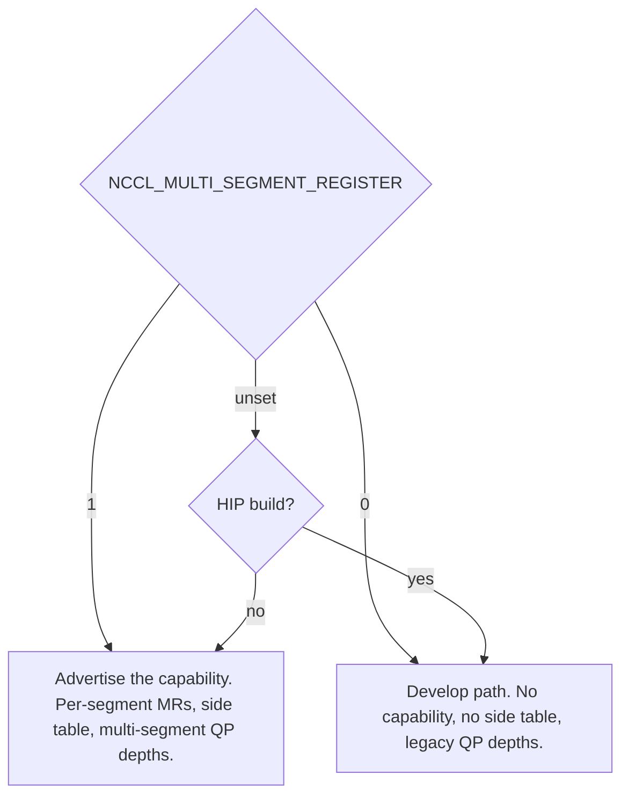
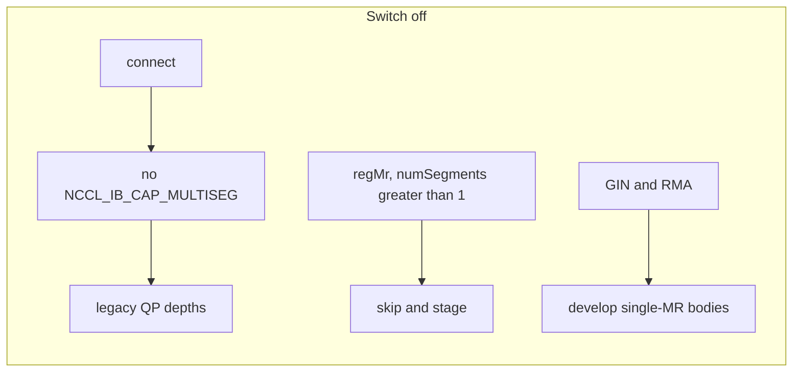
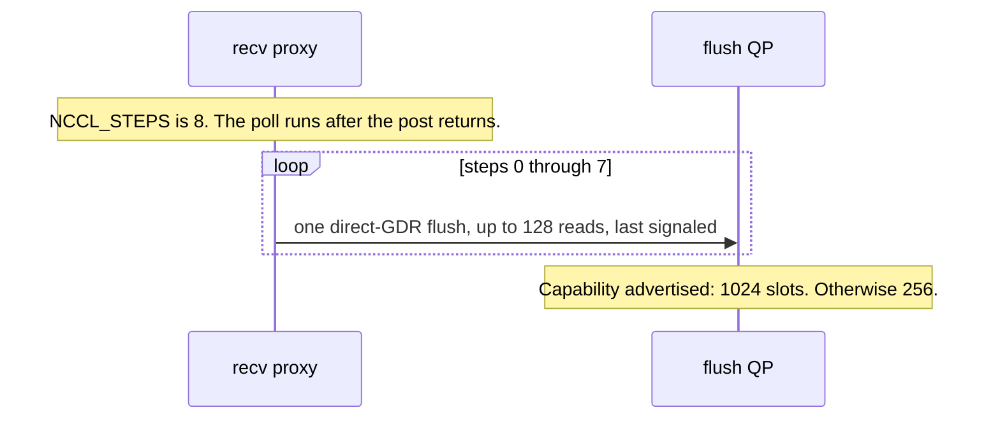
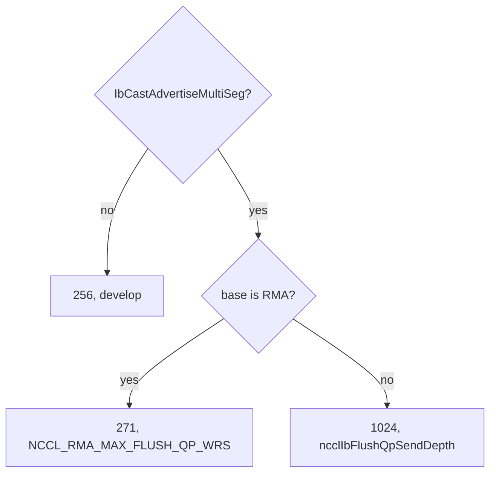
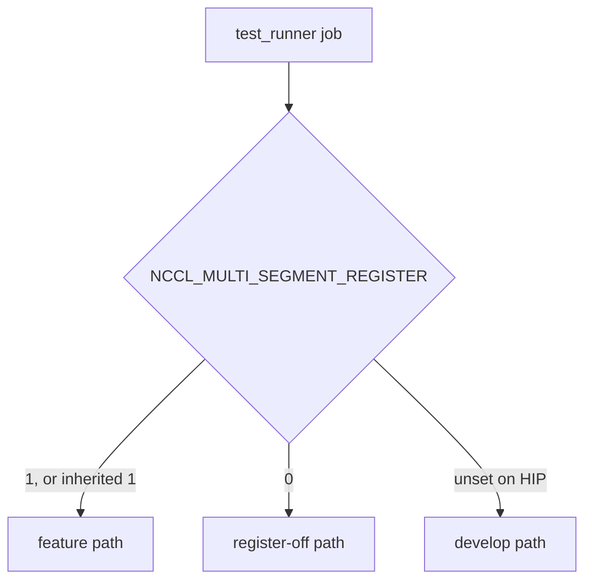
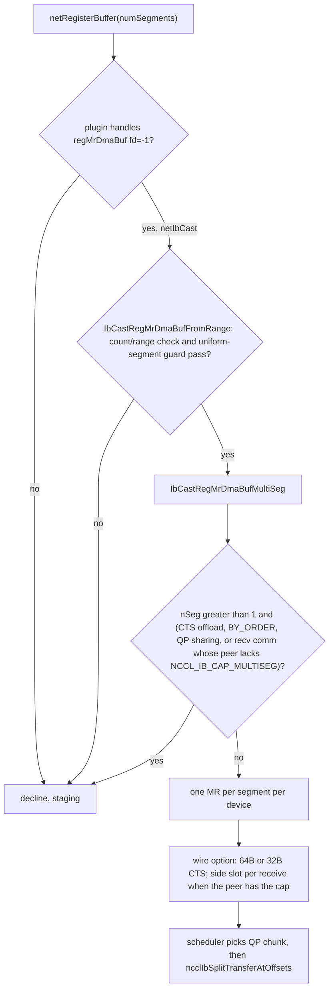

# Multi-Segment DMA-BUF for CAST NET/IB P2P — Wire Option

> **Shared facts** (constants, v14 GIN/RMA split, capability trailer, tests) are in the overview: [`multi_segment_dmabuf_gin_and_netib.md`](multi_segment_dmabuf_gin_and_netib.md). This doc covers the **CAST P2P** specifics.

**Last updated:** 2026-10-16, against stack layer 08 ([ROCm/rocm-systems#10889](https://github.com/ROCm/rocm-systems/pull/10889), branch `users/atulkulk/mseg/08-cast-netib-multisegment`) and the full stack tip (wire, [ROCm/rocm-systems#10888](https://github.com/ROCm/rocm-systems/pull/10888), branch `users/atulkulk/mseg/multi-segment-dmabuf-cast-gin`), both on develop.

**Status:** Implemented. CAST implements the **same wire option** as [`multi_segment_netib_wire.md`](multi_segment_netib_wire.md): keep the 64-byte CTS slot, publish extra layout on a **side table**, advertise `NCCL_IB_CAP_MULTISEG` via the fixed-size `devName` trailer, and **split RDMA writes at local and remote segment bounds**. CAST GIN/RMA lives on the wire layer and is described in [`multi_segment_netib_cast_gin.md`](multi_segment_netib_cast_gin.md).

**Verified:** on 2026-10-07, before the rework described in the next section, the wire tree passed 88/88 runner entries on two nodes (ROCm 7.0.2.2 and TheRock 10.2). The run covered the transport and CAST RMA multinode configs, the hybrid configs (minus `UBR_MultiSegment_Symmetric_LsaGin`), and the NET-IB and CAST multi-segment and RMA groups, which include the CAST P2P suites in §6. Cross-boundary CAST transfers complete; they are not skipped or declined. The two jobs added since (`cast_multisegment_register_off`, `cast_multisegment_unsafe_modes`) are not part of that run.

This is **not** the key-selection-only path (older docs sometimes call that the "classic path"): one rkey chosen by address, no side table, any transfer that crosses a segment boundary is declined. That path is rejected for CAST for the same reasons it was rejected for `ncclNetIb`, and for CAST-specific reasons below.

**Plugin:** `netIbCast` (`NCCL_NET=IB-CAST`). **Ticket:** AIRUNTIME-2351 (CAST follow-up); JIRA AICOMRCCL-1526. CAST GIN/RMA is covered in [`multi_segment_netib_cast_gin.md`](multi_segment_netib_cast_gin.md).

**CTS:** CAST `ncclIbSendFifo` stays **64 bytes**. AINIC `ncclIbSendFifoCtsInline` stays **32 bytes**. Neither slot grows `nSegments` / `segStart` / `segRkeys`. Extra layout is `ncclIbSegLayout` on a side FIFO.

**Plugin API:** `IbCastRegMrDmaBufMultiSeg` is CAST-private: it is declared in `src/transport/rccl_ib_multiseg.h` and defined in `src/transport/net_ib_cast/rccl_reg_multiseg_cast.cc`. It must **not** live in `src/include/net.h`. `ncclNetIb` already exports `ncclIbRegMrDmaBufMultiSeg` in `librccl`; CAST must use a **distinct** symbol.

**Code layout:** like classic NET/IB, the CAST multi-segment P2P bodies are separate `RCCL:`-marked `static inline` functions in `net_ib_cast/p2p.cc` (send, CTS side-table, irecv and flush), next to develop's functions, which gain one-line hooks. `net_ib_cast/reg.cc` holds the `fd == -1` route and the range walk (`IbCastRegMrDmaBufFromRange`), and `net_ib_cast/rccl_reg_multiseg_cast.cc` holds per-segment registration (`IbCastRegMrDmaBufMultiSeg`). `connect.cc` adds switch-gated sizes and the on-demand receive side table.

## What changed on 2026-10-16

HIP now defaults `NCCL_MULTI_SEGMENT_REGISTER` to 0. The knob is still `ncclParamMultiSegmentRegister()` in `transport/generic.cc`. `NCCL_MULTI_SEGMENT_REGISTER=1` turns the feature on, on HIP and on every other build. An unset variable takes the develop path on a HIP build. A non-HIP build still defaults to 1. The commit is `9af53b9bca21` on `users/atulkulk/mseg/01-ce-recv-window-offset`, replayed through the stack.



With the switch off, connect does not advertise `NCCL_IB_CAP_MULTISEG` and does not append the side table, so the sender QP stays at `2 * NET_IB_MAX_REQUESTS`. NET, P2P IPC and NVLS leave a multi-segment buffer unregistered. GIN and RMA stay on develop's bodies and do not reserve credits. A device-only GIN window with more than one segment and no sysmem returns `ncclInvalidUsage` instead of registering only the first segment.



The direct-GDR flush QP is sized for one chain on every proxy step. `recvProxyProgress` posts `iflush` into `requests[step % NCCL_STEPS]` and returns before that flush is polled, so up to 8 flushes can be outstanding. With `RCCL_GDR_FLUSH_GPU_MEM_NO_RELAXED_ORDERING=0`, `rcclIbIflushMultiSeg` posts one RDMA read per receive per segment, at most `8 * 16 = 128` work requests, and signals only the last. Eight chains need `8 * 128 = 1024` slots. The previous depth, `NET_IB_MAX_REQUESTS + 128 = 384`, held three chains and the fourth post failed. `ncclIbFlushQpSendDepth` in `net_ib/multiseg.h` returns `NCCL_STEPS * NCCL_NET_IB_MAX_RECVS * NCCL_IB_MAX_SEGMENTS` when the peer advertised the capability, and `NET_IB_MAX_REQUESTS` (256) otherwise. Classic `ncclIbCreateFlushQp` calls it. `connect.cc` static-asserts that the multi-segment result holds at least one chain per step. The host test is `NetIbMultiSeg.FlushQpDepthCoversEveryOutstandingStep`.



CAST non-RMA comms use the same helper. CAST RMA comms keep `NCCL_RMA_MAX_FLUSH_QP_WRS` (271), because RMA credits wait until one chain completes before the next post. With the switch off every flush QP stays at 256.



The scratchpad flush (`RCCL_GDR_FLUSH_GPU_MEM_NO_RELAXED_ORDERING=1`, the default) posts one write and one read and does not fill 1024 slots. The enlarged depth is for the direct-GDR path. `net_ib_multisegment_flush` selects that path by setting the parameter to 0.

Jobs that test the feature set `NCCL_MULTI_SEGMENT_REGISTER=1` in the runner config, because an unset HIP job now takes the off path. Register-off jobs stay at 0. `cast_multisegment_opt_recv_2qp` inherits 1 from `cast_multisegment_opt_recv`. `net_ib_rma_multisegment_wrbatch` on the wire branch, and the hybrid nightly jobs on 09 including `net_ib_multisegment_hybrid_stress_nightly`, set 1 as well. The WR-batch job fails under `RCCL_TEST_RMA_MSEG_REQUIRE=1` when the per-segment registration log is missing, and the hybrid IGet stress skips. `multisegment_host_boundary_math` is host-only and does not read the switch.



## What changed on 2026-10-14

- **Folded back.** `net_ib_cast/p2p_multiseg_cast.h` is gone; its functions are in `net_ib_cast/p2p.cc`.
- **Registration path.** `net.cc` calls `regMrDmaBuf` with `fd = -1` and a packed count; `IbCastRegMrDmaBuf` routes it to `IbCastRegMrDmaBufFromRange` (`net_ib_cast/reg.cc`), which walks and exports the segments and calls `IbCastRegMrDmaBufMultiSeg`. `rcclNetIbRegMrMultiSeg` and `transport/rccl_ib_multiseg.cc` no longer exist.
- **Sender registers without the peer cap.** The peer-cap decline now applies only to a recv comm, as on classic: the side table describes the receiver, and a sender splits locally onto the receiver's single rkey. CTS offload, BY_ORDER and QP sharing still decline on both sides, because CAST's segmented send cannot run there (see "When multi-segment is declined"). With the switch off, the receiver declines and the sender registers.
- **Receive side table on demand.** `ncclIbRecvComm::remSegLayout` is a pointer, allocated and its MR registered only when the peer advertised `NCCL_IB_CAP_MULTISEG`; `rcclIbCastIrecvFillSideTable` returns early otherwise. Accept's fail path and `IbCastCloseRecv` free it. The send-side `segLayoutFifo` stays inline because the peer writes it through the CTS MR.
- **`nreqs` reload bound.** `IbCastMultiSendSegmented` re-reads the peer-written CTS `nreqs` and now rejects values outside `[1, NCCL_NET_IB_MAX_RECVS]`, matching the check in `IbCastIsend`.
- **Tests.** The CAST multi-segment runner jobs no longer set `RCCL_IB_P2P_DISABLE_CTS=1` (`net_ib_cts_stress` keeps it). `MultiSegmentRegisterOff_DeclinesRegistration` expects the receiver to decline and the sender to register; `CastUnsafeMode_DeclinesRegistration` expects both sides to decline.

## What changed since the 2026-10-07 revision

- The multi-segment P2P bodies were split from develop's functions in `net_ib_cast/p2p.cc` (at the time into `net_ib_cast/p2p_multiseg_cast.h`, folded back on 2026-10-14): `IbCastMultiSendSegmented`, `rcclIbCastMultiSendNeedsSegmented`, `rcclIbCastSendIsSegmented`, `IbCastHasOtherSegmentedSend`, `IbCastWaitSideTable`, `rcclIbCastIsendWaitSideTable`, `rcclIbCastPostFifoSideWr`, `rcclIbCastIrecvCheckHandle`, `rcclIbCastIrecvFillSideTable`, `rcclIbCastImmSegmented`, `rcclIbCastIflushNeedsMultiSeg` and `rcclIbCastIflushMultiSeg`. `p2p.cc` keeps develop's single-segment send and flush and calls these hooks.
- The remote multi-segment predicate `ibCastCtsRemoteMultiSeg` was renamed `IbCastCtsRemoteMultiSeg` and moved from `p2p_cast.h` into `net_ib_cast/p2p.cc`.
- Registration moved from `net_ib_cast/reg.cc` into `net_ib_cast/rccl_reg_multiseg_cast.cc`: `IbCastRegMrDmaBufMultiSeg` registers each segment through `IbCastRegMrDmaBufInternal`, and `rcclIbCastDeregMrMultiSeg` frees a multi-segment handle. `IbCastDeregMr` forwards to it when `nSegments > 1`. `IbCastRegMrDmaBufInternal` now allocates the handle with `ncclCalloc`, sets `nSegments = 1`, and deregisters the devices it already registered when a later device fails.
- The proxy-side export and dispatch moved from the file-local `netIbRegMrMultiSeg` in `net.cc` to `rcclNetIbRegMrMultiSeg` in `src/transport/rccl_ib_multiseg.cc`. (Superseded on 2026-10-14: the export moved into each plugin's `reg.cc`.)
- `NCCL_MULTI_SEGMENT_REGISTER=0` is now honoured on the use side as well: the peer's `NCCL_IB_CAP_MULTISEG` is ignored (`peerCaps = 0`), so no side table is written or waited on, and the sender data QP, the CTS QP and the flush QP keep develop's depths.
- The receiver's side-table staging MR (`segLayoutFifoMr`) is registered only when the peer advertised the capability, and with `IBV_ACCESS_LOCAL_WRITE` only, because it is only the source of a local RDMA write.
- A hardening commit fixes connect and failure cleanup: the PD reference is taken only after `wrap_ibv_alloc_pd` succeeds, `IbCastDestroyBase` tolerates a partially initialised base, every `IbCastAccept` failure goes through `fail` (which closes the staged receive comm), the scheduler remap entry is freed when a post or an injected fault fails, and the irecv error path records a fatal error and clears `*request`.
- New runner jobs `cast_multisegment_register_off` and `cast_multisegment_unsafe_modes` run the new tests `MultiSegmentRegisterOff_DeclinesRegistration` and `CastUnsafeMode_DeclinesRegistration`. `MultiRecvMixesSingleAndMultiSegmentHandles` now starts its multi-segment entry in segment 1 and requires a flush request when direct flush is on; on IB-CAST that also needs `NCCL_GDR_FLUSH_DISABLE=0`.
- The flush section now describes the GPU flush-memory path that a multi-segment flush takes when `RCCL_GDR_FLUSH_GPU_MEM_NO_RELAXED_ORDERING` is on.

---

## 1. Same wire option as `ncclNetIb`

[`multi_segment_netib_wire.md`](multi_segment_netib_wire.md) is the selected design for the built-in IB plugin. CAST is a **fork** (`src/transport/net_ib_cast/*`) with its own types and send engine, so the code cannot be shared, but the **on-the-wire contract** is the same:

| Channel | Payload | When |
| --- | --- | --- |
| 64-byte CTS | `addr`, `size`, **seg-0** `rkeys[]`, `nreqs`, `tag`, `idx` (CAST also has `rxReqIndex`) | every irecv, including `nSegments <= 1` |
| 32-byte AINIC inline CTS | `addr`, **one** rkey, `size`, `nreqs`, `rxReqIndex`, `tag`, `idx` | only if `IbCastAinicCtsInlineData`; still **no** segment table |
| Side table `ncclIbSegLayout` | `nSegments`, `segStart[]`, `segRkeys[][]`, `idx` | every irecv when the peer advertised `NCCL_IB_CAP_MULTISEG`, the local switch is on and CTS offload is **off**; `nSegments = 0` for single-segment receives |
| `devName` capability trailer | `{magic=0x4d534547, caps=NCCL_IB_CAP_MULTISEG}` in the reserved tail of the fixed-size `devName` | once per QP setup, only when `IbCastAdvertiseMultiSeg()`; no appended `caps` field. Develop already grew CAST metadata after `isRMA` with QP-sharing fields |

One difference from classic NET/IB: classic writes the side table only for slots that contain a multi-segment receive and marks those slots with `NCCL_IB_CTS_NREQS_SIDE_TABLE` in `nreqs`. CAST does not use that bit. When the peer advertised the capability, CAST writes a side slot for every receive (with `nSegments = 0` for single-segment ones), so the sender can always wait on the side-slot `idx`.

```c
struct alignas(64) ncclIbSegLayout {
  uint32_t nSegments;
  uint32_t pad;
  uint64_t segStart[NCCL_IB_MAX_SEGMENTS];
  uint32_t segRkeys[NCCL_IB_MAX_SEGMENTS][NCCL_IB_MAX_DEVS_PER_NIC];
  uint64_t idx;       // last store; must equal the CTS slot's idx, so stale slots are ignored
};
```

Place `segLayoutFifo` **immediately after** `ctsFifo` on `ncclIbSendComm`. Register **one covering MR** when multi-segment is advertised. CTS RDMA stride stays `NCCL_NET_IB_MAX_RECVS * sizeof(ncclIbSendFifo)` (64-byte typed rows). AINIC 32-byte packing reinterprets bytes **inside** a CTS row; it must not spill into `segLayoutFifo`.

```text
ctsFifo[NET_IB_MAX_REQUESTS][NCCL_NET_IB_MAX_RECVS]     // 64 B storage
segLayoutFifo[...]                                      // immediately after; never inlined
```

The sender treats a receive as remote multi-segment iff `peerCaps & NCCL_IB_CAP_MULTISEG` **and** `side.nSegments > 1 && side.idx == cts.idx` (`net_ib_cast/p2p.cc:IbCastCtsRemoteMultiSeg`). After the CTS `idx` is visible and `nreqs` has passed the `[1, NCCL_NET_IB_MAX_RECVS]` bound, `IbCastIsend` calls `rcclIbCastIsendWaitSideTable`, which (when the peer has the cap) waits at most 2 s in `IbCastWaitSideTable` until every side slot's `idx` matches. With the switch on, the receiver's CTS QP send queue is sized for two WRs per slot (`NET_IB_MAX_REQUESTS * (resiliency ? 1 : 2) * 2`, develop's depth doubled).

Split math is shared: CAST includes `net_ib/multiseg.h` and calls `ncclIbSplitTransferAtOffsets` with **independent** local and remote registration offsets. Do not pass one shared `off` into both tables.

---

## 2. Why CAST does not use key-selection-only

Key-selection-only (the rejected alternative in the wire doc): keep CTS as today, pick the MR that contains `[addr, addr+len)`, **decline** if the range straddles a boundary. `MultiSend` stays a single linear WR per request per QP.

That is incompatible with CAST:

1. **Scheduler chunks straddle.** `IbCastMultiSend` already splits one request across QPs by advancing `sge.addr` / `wr.rdma.remote_addr` linearly. A QP chunk is not guaranteed to lie in one physical segment, even when the collective step would have. Key-selection would decline those chunks or post a WR with the wrong rkey/lkey.
2. **AINIC 32-byte CTS cannot carry extra rkeys.** Key-selection still needs the *sender* to know remote per-segment rkeys for a straddling chunk. Those rkeys are not in the 32-byte inline slot (one rkey) and must not be stuffed into the 64-byte slot (~712 B; RCCL #2185 class of bug). The wire option puts them on the side table.
3. **CTS offload.** The NIC owns CTS. It will not learn a new CTS element size, and it will not consume a side table. Multi-seg NET registration **declines** while `useCtsOffload` is on (staging). Key-selection does not solve offload either.
4. **Same HIP bug.** One dma-buf MR for the whole VA range is still `EINVAL`. Per-segment MRs are required regardless of data-path policy.

**Rejected for CAST (same as wire.md):** enlarge `ncclIbSendFifo` or `ncclIbSendFifoCtsInline`. **Rejected:** version a large FIFO. **Rejected:** put `nSegments` in either CTS slot. **Rejected:** key-selection-only (no side table, no WR split).

---

## 3. Problem this solved

On ROCm/HIP, `cuMemGetHandleForAddressRange` / `hsa_amd_portable_export_dmabuf` over a multi-segment HIP VMM buffer describes **only the first physical segment**. One MR for the whole range fails with `EINVAL`. A transfer that crosses a later segment dies with `IBV_WC_REM_INV_REQ_ERR`.

`ncclNetIb` implemented the wire option first. Stock CAST (before this work) did not:

- `ncclIbMrHandle` was only `ibv_mr* mrs[NCCL_IB_MAX_DEVS_PER_NIC]`.
- `IbCastIrecv` published one `addr` and one `rkeys[]` (or a single inline rkey).
- `IbCastMultiSend` walked one `remote_addr` / `rkey` / `lkey` linearly across scheduler QPs.
- `IbCastIflush` fenced **one** address: the last non-zero recv, with `mrs[i]->rkey`.
- The NET multi-segment registration accepted only `&ncclNetIb`, so `NCCL_NET=IB-CAST` **declined and staged**.

CAST cannot call `ncclIbRegMrDmaBufMultiSeg`: both plugins link into `librccl`. This work adds the distinct symbol `IbCastRegMrDmaBufMultiSeg`.

---

## 4. CAST implementation of the wire option

### When multi-segment is declined

`net_ib_cast/rccl_reg_multiseg_cast.cc:IbCastRegMrDmaBufMultiSeg` returns `ncclInvalidUsage` for `nSegments > 1` (so `net.cc` falls back to staging) when any of these holds:

| Condition | Side | Why |
| --- | --- | --- |
| `useCtsOffload` on the comm | both | The NIC owns CTS and will not consume a host-visible side table. A send under offload uses a dummy remote address, disables the segmented path, and would post one SGE with segment 0's lkey for the whole buffer. |
| `recvMatchingScheme == BY_ORDER` | both | The BY_ORDER receiver adds each immediate's `byte_len` to the receive size. A segmented send's immediate rides the extra completion-sizes write, so a segmented receive would report the size plus 4 bytes per QP. A segmented send has no per-immediate `byte_len` to give it. |
| `IbCastQpSharingEnabled()` | both | Shared QPs need a `commId` in the immediate and a per-QP WR budget; segmented sends carry neither. |
| `ncclIbDeclineMultiSegRegistration(peerCaps, nSeg)` | recv only | The peer did not advertise `NCCL_IB_CAP_MULTISEG` (old peer, or `NCCL_MULTI_SEGMENT_REGISTER=0` on either side, since a local `=0` forces `peerCaps` to 0), so it cannot read the side table that describes this receive. A sender needs no peer cap: it splits its own buffer onto the receiver's single rkey. |

The first three are properties of CAST's segmented send engine, so they must hold on both sides; the last is a property of the side-table protocol, which only the receiver publishes. This matches classic, which has only the peer-cap rule and applies it to recv comms.

It also rejects `nSeg < 1` or `nSeg > NCCL_IB_MAX_SEGMENTS`. Single-segment registrations are never declined by these rules. Otherwise it registers each segment with `IbCastRegMrDmaBufInternal` (one MR per device), copies the per-device MRs into `segMrs[s][]`, aliases segment 0 into `mrs[]`, and deregisters everything already registered if a segment fails.

On the send path, a request counts as segmented (`rcclIbCastSendIsSegmented`) only when CTS offload is off and either the local handle has `nSegments > 1` or `IbCastCtsRemoteMultiSeg` is true for that receive.

### Advertisement and the switch (`connect.cc`, `connect_cast.h`)

`IbCastAdvertiseMultiSeg()` in `connect_cast.h` returns `ncclParamMultiSegmentRegister() != 0`. Only then does CAST:

- call `ncclIbSetConnectCaps(meta.devName, sizeof(meta.devName), NCCL_IB_CAP_MULTISEG)` on both the connect and accept sides,
- read the peer's caps with `ncclIbGetConnectCaps` into `peerCaps` (otherwise `peerCaps` stays 0, so the peer's capability is ignored),
- register the sender's CTS MR as `sizeof(ctsFifo) + sizeof(segLayoutFifo)` (otherwise the MR covers `ctsFifo` only, as in stock CAST), and
- size the queues for multi-segment: sender data QP `NCCL_IB_MAX_SEND_WRS` instead of `2 * NET_IB_MAX_REQUESTS`, receiver CTS QP doubled, flush QP from `IbCastFlushQpSendDepth()`. `IbCastBuildDataQpCreateAttr` applies the same depths so AINIC port recovery rebuilds matching QPs.

On the receiver, `remSegLayout` (a pointer on `ncclIbRecvComm`, about 1.44 MB) is allocated in accept, with `addr = remMeta.addr + sizeof(ctsFifo)`, and its `segLayoutFifoMr` (the local staging MR for `remSegLayout->elems`) is registered per device, only when `peerCaps` has `NCCL_IB_CAP_MULTISEG`, with `IBV_ACCESS_LOCAL_WRITE` only. The MR is deregistered in `IbCastCloseRecvCommDevResources`, and the buffer is freed in `IbCastCloseRecv` and on accept's fail path. The sender's `segLayoutFifo` cannot be allocated this way, because the peer writes it at a fixed offset behind `ctsFifo` through one covering MR.

### Irecv / Isend contract (identical to wire.md, plus CAST guards)

```text
irecv:
  rcclIbCastIrecvCheckHandle for every handle (segment count, every MR present, contiguous
    non-empty segments, receive range inside the registered segments) before taking a request
  write the 64-byte CTS (or 32-byte inline CTS) with seg-0 rkeys
  rcclIbCastIrecvFillSideTable: return unless peer advertised NCCL_IB_CAP_MULTISEG (no remSegLayout otherwise);
    if CTS offload is off:
      fill remSegLayout->elems[slot][i]: full layout if nSegments > 1, else nSegments = 0
      side idx written last
  IbCastPostFifo -> rcclIbCastPostFifoSideWr:
      RDMA_WRITE side slot first (unsignaled, never IBV_SEND_INLINE), chained to
      RDMA_WRITE CTS second
  RC ordering: when the sender observes CTS idx, the side slot is already there

isend, after CTS idx is visible:
  reject nreqs outside [1, NCCL_NET_IB_MAX_RECVS]
  rcclIbCastIsendWaitSideTable: if peer advertised the cap, wait (2 s bound) for every side slot idx
  IbCastMultiSend: if rcclIbCastMultiSendNeedsSegmented -> IbCastMultiSendSegmented:
      for each scheduler QP chunk [qpOff, qpOff+qpLen):
          ncclIbSplitTransferAtOffsets(localReqOff+qpOff, remoteReqOff+qpOff, qpLen, ...)
          one WR per slice; last WR of the QP chain stays SIGNALED
      (IbCastMultiSendSegmented reloads nreqs from the CTS slot and rejects it outside [1, NCCL_NET_IB_MAX_RECVS])
  else:
      stock CAST single-segment path (CTS rkey(s), linear scheduler advance)
```

### Composite handle

Extend CAST `ncclIbMrHandle` with `nSegments`, `segStart[]`, `segLen[]`, `segMrs[][]`. `mrs[]` aliases segment 0 so existing CAST callers keep working. `IbCastDeregMr` hands a handle with `nSegments > 1` to `rcclIbCastDeregMrMultiSeg`, which loops segments × devices and frees `mrs[]` only through `segMrs[0]`.

Do not share `net_ib/common.h` types (duplicate names, separate TUs). Copy the wire-option fields. Share only `net_ib/multiseg.h` math.

### Send engine (`IbCastMultiSend`)

`IbCastMultiSend` first asks `rcclIbCastMultiSendNeedsSegmented` and, if any request in the slot is segmented, hands the whole slot to `IbCastMultiSendSegmented`. That builder repeats the scheduler's per-QP chunk choice (weighted WRR chunks or an even split) and only then clips each chunk at segment bounds. Do not replace the scheduler; do not revert to one WR per request when `nSegments > 1`. The segmented builder also records the same profiler events and telemetry as the stock path.

Grow the per-send slice pool `sges[]` / `wrs[]` from `NCCL_NET_IB_MAX_RECVS` to `NCCL_IB_MAX_WRS_PER_SEND = NCCL_NET_IB_MAX_RECVS * 2 * NCCL_IB_MAX_SEGMENTS = 8 * 2 * 16 = 256` (same bound as `ncclNetIb`). Single-segment still posts one WR per request per QP.

**Zero-length chunks.** When a receive's chunk on a QP is 0 bytes, the segmented path still posts a 0-byte RDMA write. For a remote multi-segment receive its rkey is `side.segRkeys[s]` with `s = ncclIbSegmentForZeroLengthOffset(nRemote, rOff, remoteReqOff + sendOffset)`: the segment whose inclusive start contains the offset, or the last segment when the offset equals the end of the last segment. This is the same offset-based rule classic NET/IB uses.

**Sender QP depth (769).** With the switch on, the send QP is sized `NCCL_IB_MAX_SEND_WRS = 2 * NET_IB_MAX_REQUESTS + NCCL_IB_MAX_WRS_PER_SEND + 1 = 2*256 + 256 + 1 = 769`, so a fully segmented multi-recv group fits without overrunning the queue. With `NCCL_MULTI_SEGMENT_REGISTER=0` it stays at develop's `2 * NET_IB_MAX_REQUESTS = 512`. (This is the P2P analogue of the CAST RMA `575` send depth in [`multi_segment_netib_cast_gin.md`](multi_segment_netib_cast_gin.md).)

**One segmented group admitted at a time.** `IbCastHasOtherSegmentedSend` scans the other request slots and, if any *other* multi-recv group has an active segmented send, defers admission (returns `*request = NULL`, retried later); members of the *same* multi-recv group are allowed. This bounds concurrent segmented WQEs so the 769-deep queue always suffices.

**Completion size.** The final signaled WR of a segmented chain may carry only the last slice, so its `byte_len` is not the logical request size. A segmented send therefore always appends the completion-sizes RDMA write (`needSizesWr = true`, even for a single receive), which writes each request's size into the receiver's completion records, and that write carries the immediate. Under BY_INDEX the immediate is `rxReqIndex` (bits 31:24) with `WR_IMM_SEGMENTED_FLAG` (bit 22) and, across more than one QP, `WR_IMM_SPLIT_DATA_FLAG` (bit 23). When the receiver sees `WR_IMM_SEGMENTED_FLAG` on a single receive (`rcclIbCastImmSegmented`) it does not add `byte_len`, because the size has already been published. The 22-bit `WR_IMM_SIZE_MASK` field is not used to carry the size. Develop also has a mutually exclusive QP-sharing **BY_ID** encoding (`WR_IMM_BYID_*`: `reqId` in bits 7:0, receiver `commId` in bits 23:8); multi-segment registration is declined when QP sharing is on, so segmented sends never use it.

Resiliency replay (`p2p_resiliency.cc` → `IbCastMultiSend`) inherits the split.

CTS-offload sends (`useCtsOffload`, dummy remote_addr/rkey) stay single-segment. Multi-seg registration is declined while offload is on.

### Flush (`IbCastIflush`)

`IbCastIflush` checks `rcclIbCastIflushNeedsMultiSeg` first; if any non-empty receive uses a handle with `nSegments > 1`, it hands the call to `rcclIbCastIflushMultiSeg`. Otherwise develop's flush runs unchanged (one read of the last non-empty receive).

The multi-segment flush fences **every receive, every overlapping segment, and every device**: it validates all `n` receives up front (each may use a different MR and overlap multiple segments), computes overlapping segments with `ncclIbSegmentsOverlappingRange`, and posts one loopback `RDMA_READ` per (receive × segment) on **each** device (`comm->base.vProps.ndevs`) — not only `data[last]`. Only the last read of each device's chain is signaled. When `RCCL_GDR_FLUSH_GPU_MEM_NO_RELAXED_ORDERING` is on (the default) and the device has GPU flush memory, the flush instead posts develop's write-then-read pair against that flush buffer on each device, which does not depend on the receive's segments. The multi-segment runner jobs set `RCCL_GDR_FLUSH_GPU_MEM_NO_RELAXED_ORDERING=0` and `NCCL_GDR_FLUSH_DISABLE=0` so the per-segment read chain is what gets tested.

**Flush QP depth (1024).** The CAST P2P loopback flush QP is created with `IbCastFlushQpSendDepth(base)` (`net_ib_cast/connect_cast.h`). With the switch off it is develop's 256. With the switch on, an RMA comm uses `NCCL_RMA_MAX_FLUSH_QP_WRS` (271) and a non-RMA comm uses `ncclIbFlushQpSendDepth`, which is `NCCL_STEPS * NCCL_NET_IB_MAX_RECVS * NCCL_IB_MAX_SEGMENTS = 8 * 8 * 16 = 1024`. One flush posts up to 128 reads, and the proxy can leave one such chain on each of the 8 step slots. AINIC port recovery (`p2p_resiliency_recovery_ainic.cc`) rebuilds the flush QP with the same helper. Diagrams: [`multi_segment_current.md`](multi_segment_current.md) §6a.

### Failure handling

A request whose completion can never arrive must not be left for `IbCastTest` to poll forever:

- **Irecv:** `rcclIbCastIrecvCheckHandle` validates every handle before a request is taken. If filling or posting the CTS fails afterwards, no CTS reached the sender, so no data completion can name the request; the `err` path records a fatal error, frees the request, sets `*request = NULL` and returns the error.
- **Isend:** the builders stop at the first QP that fails and free that QP's scheduler remap entry (also on an injected fault). `IbCastIsend` then goes to `isendFail`, which records a fatal error and decrements the events armed for QPs that were never posted (`send.sentData` is now reset for every send, not only with resiliency). Requests that still have events are marked `NCCL_NET_IB_REQ_FAILED` so `Test` drains them; the rest are freed.
- **Iflush:** only the tail of each device's read chain is signaled, so a partial post on a device never completes there. The flush goes to `iflushFail`: it is kept as `NCCL_NET_IB_REQ_FAILED` only if earlier devices already have events, otherwise it is freed and the error is returned.
- **Draining:** the completion handlers accept `NCCL_NET_IB_REQ_FAILED` where they expect a send or receive, send-slot accounting is released for failed sends, and `IbCastTest` defers the fatal-error check for a failed request until it has drained, then reports the error.

Connect and teardown are hardened too: `IbCastInitCommDevBase` takes the PD reference only after `wrap_ibv_alloc_pd` succeeds, `IbCastDestroyBase` skips a NULL CQ or PD and clears them, and every `IbCastAccept` failure goes through `fail`, which closes the staged receive comm with `IbCastCloseRecv` once it has been published to the stage.

### Connect

Develop already grew CAST `ncclIbConnectionMetadata` after `isRMA` with QP-sharing fields (`sharedGroupIdx`, `commId`, `senderIbDevIdx`) and `optRecvCompletion`. This stack does **not** append a `caps` field; `NCCL_IB_CAP_MULTISEG` rides the `devName` trailer via `ncclIbSetConnectCaps`/`ncclIbGetConnectCaps` (magic `0x4d534547`). Two `static_assert`s in `connect_cast.h` pin the legacy layout: `ndevs` immediately follows `addr`, and `devName` sits right after `qpInfo`, `resiliencyInfo` and `devs`, because the trailer at the end of `devName` is wire format. The peer recovers caps into `comm->peerCaps` (caps `0` if the magic is absent or the local switch is off). When advertising, register `sizeof(ctsFifo)+sizeof(segLayoutFifo)` as one covering MR (`segLayoutFifo` is `static_assert`ed immediately after `ctsFifo`); the receiver sets `remSegLayout.addr = remMeta.addr + sizeof(ctsFifo)`. Mixed-version CAST that stops at `isRMA` is already broken by develop QP sharing.

### Registration (`net.cc`, `net_ib_cast/reg.cc`)

`net.cc`'s `sendProxyRegBuffer` and `recvProxyRegBuffer` call the plugin's `regMrDmaBuf` with `fd = -1` and `offset = (export flags << 32) | numSegments` for `numSegments > 1`, and skip the whole-range HSA dma-buf fallback for such buffers. `IbCastRegMrDmaBuf` routes `fd == -1` to `IbCastRegMrDmaBufFromRange` (`net_ib_cast/reg.cc`), which exports one dma-buf fd per segment, keeps the count/range check and the uniform-segment guard (`ncclIbSegmentsUniform`): interior segments must equal the largest segment, while the first and last may be shorter, so every two-segment layout (including DeepEP `[GPU][CPU]`) passes. Layouts with a mismatched interior segment decline to staging. Dispatch is by plugin, through the existing hook:

```text
net.cc: proxyState->ncclNet->regMrDmaBuf(comm, buf, size, NCCL_PTR_CUDA, packed, /*fd=*/-1, &handle)
  classic ncclIbRegMrDmaBuf -> rcclIbRegMrDmaBufFromRange -> ncclIbRegMrDmaBufMultiSeg
  CAST    IbCastRegMrDmaBuf -> IbCastRegMrDmaBufFromRange -> IbCastRegMrDmaBufMultiSeg  // may still decline
  other plugins: invalid fd -> error -> staging
```

Symmetric windows and DeepEP-style GIN traffic go through CAST GIN/RMA per-segment MRs: [`multi_segment_netib_cast_gin.md`](multi_segment_netib_cast_gin.md).

### Helper

| Placement | Verdict |
| --- | --- |
| `src/include/net.h` | **No.** Synced with upstream. |
| Reuse symbol `ncclIbRegMrDmaBufMultiSeg` in CAST | **No.** Already defined by `net_ib/reg.cc`. |
| Declared in `rccl_ib_multiseg.h`, defined in `net_ib_cast/rccl_reg_multiseg_cast.cc` as `IbCastRegMrDmaBufMultiSeg` | **Selected.** |

---

## 5. CAST-only constraints on the wire option

1. `sizeof(ncclIbSendFifo) <= 64` and `sizeof(ncclIbSendFifoCtsInline) <= 32` remain true.
2. Side WR is **never** `IBV_SEND_INLINE`. `max_inline_data` stays 32 B or 0.
3. When `IbCastAinicCtsInlineData`, packed 32-byte CTS lives **inside** the 64-byte-typed `ctsFifo` row. `segLayoutFifo` starts after the whole `ctsFifo` object.
4. CTS offload, BY_ORDER and QP sharing decline multi-seg NET registration on both sides; a peer without the capability declines it on the receive side only.
5. `init.cc` already disables CTS inline/offload when the CAST scheduler is on. That is the path that must split WRs.
6. Null-check `mrs[j]` / `segMrs[s][j]` before publishing rkeys.
7. With `NCCL_MULTI_SEGMENT_REGISTER=0`, connect metadata, the CTS MR and every QP depth are develop's.
8. Do not clang-format all of `src/`; format only changed ranges.



---

## 6. Test plan

Reuse `NetIbMultiSegmentMPITest.*` (`test/transport/NetIbMPI/NetIbMultiSegmentMPITests.cpp`) under `NCCL_NET=IB-CAST` (the plugin list in `NetIbMPITestBase.hpp` already includes `&netIbCast`).

The MPI helper `RegisterMultiSegmentMr(comm, buf, isCast, mhandle)` in `test/transport/NetIbMPI/NetIbMultiSegmentHelpers.hpp` calls `IbCastRegMrDmaBufMultiSeg` when `isCast` is true (the tests pass `net_ == &netIbCast`), otherwise `ncclIbRegMrDmaBufMultiSeg`. The CAST `comm` layout is not the classic one; calling the classic helper skips multi-seg registration and can SIGSEGV on `nSegments == 1`.

These tests exercise the **wire option**, not key-selection-only: boundary-crossing and independent local/remote start offsets must **complete**, not decline.

1. Single-segment regression (`nSegments == 1`), 64-byte and 32-byte inline CTS (`SingleSegmentThroughMultiSegPath`, `HostAndDeviceSingleSegmentRegression`).
2. Multi-segment registration: N uniform segments → N MRs.
3. WR split: intra-segment offset, **boundary-crossing**, whole-buffer, independent local/remote offsets.
4. Connect cap: peer without `NCCL_IB_CAP_MULTISEG` → staging.
5. Switch off (`MultiSegmentRegisterOff_DeclinesRegistration`): with `NCCL_MULTI_SEGMENT_REGISTER=0` a 4-segment registration returns `ncclInvalidUsage` and no handle.
6. Unsafe modes (`CastUnsafeMode_DeclinesRegistration`): under BY_ORDER matching (`NCCL_IB_RECEIVER_SIDE_MATCHING_SCHEME=2`) or QP sharing (`RCCL_IB_QP_SHARING_ENABLE=1`) a 4-segment registration is declined on both the receiver and the sender; the test skips on classic NET/IB.
7. CTS offload: multi-seg registration declines on both sides; single-seg still works.
8. Inline invariant: side WR never `IBV_SEND_INLINE`; `sizeof(ncclIbSendFifoCtsInline) == 32`.
9. Flush every touched segment and every handle. `MultiRecvMixesSingleAndMultiSegmentHandles` puts its multi-segment entry across segments 1 and 2, so a flush through segment 0's MR would fault, and requires `iflush` to return a request when direct flush is on. On IB-CAST, direct flush needs `RCCL_GDR_FLUSH_GPU_MEM_NO_RELAXED_ORDERING=0` and `NCCL_GDR_FLUSH_DISABLE=0`; the flush tests skip otherwise.
10. Scheduler: WRR/RR still completes; last WR of each QP chain remains signaled.
11. Optional receive completion (`OptRecvCompletionSegmentedSkipsImm`): a hinted single receive over the whole multi-segment window takes the plain RDMA-write path and reports size 0; with two receives the sizes are real. The receiver checks data only after a barrier that follows the send's completion, because a hinted receive can complete before the data lands.
12. Optional receive completion, negative (`OptRecvInvalidRangeRejectedBeforeRequest`): a hinted receive past the registered segments fails before taking a request slot, so the next hinted receive still pairs with the sender's first send.
13. CAST suites (`CastTests.cpp`) single-segment stay green.

Host split math stays in `test/NetIbMultiSegmentUnitTests.cpp` (`multiseg.h`).

**Runner configs** (`tools/scripts/test_runner/configs/net_ib_transport.json`):

| Config | What it adds |
| --- | --- |
| `cast_multisegment` | `cast_base` (QP scheduler on) with 2 QPs, split data, BY_INDEX (`NCCL_IB_RECEIVER_SIDE_MATCHING_SCHEME=0`), `RCCL_IB_P2P_DISABLE_CTS=1`, direct flush on; runs `NetIbMultiSegmentMPITest.*` and `UBR_MultiSegment.Generic` |
| `cast_multisegment_opt_recv` | Extends `net_ib_base` because `cast_base` turns QP scheduling on, which disables optional receive completion. Sets `RCCL_IB_OPTIONAL_RECV_COMPLETION=1`, `RCCL_IB_QP_SCHED_ENABLE=0`, BY_INDEX, 1 QP |
| `cast_multisegment_opt_recv_2qp` | Same with 2 QPs and `NCCL_IB_SPLIT_DATA_ON_QPS=1` |
| `cast_multisegment_register_off` | `cast_multisegment` settings with `NCCL_MULTI_SEGMENT_REGISTER=0`; runs `MultiSegmentRegisterOff_DeclinesRegistration` plus the single-segment regressions |
| `cast_multisegment_unsafe_modes` | `cast_multisegment` settings; runs `CastUnsafeMode_DeclinesRegistration` once with BY_ORDER and once with `RCCL_IB_QP_SHARING_ENABLE=1` |

All five jobs set `NCCL_GDR_FLUSH_DISABLE=0` and `RCCL_GDR_FLUSH_GPU_MEM_NO_RELAXED_ORDERING=0`. The opt-recv tests skip (collectively) unless the comm reports optional receive completion active (`ncclIbCastGetOptRecvCompletion`).

Known develop baseline failure unrelated to this stack: CAST `StressMultiRound`.

---

## 7. Out of scope

**Rejected (not a follow-up):** key-selection-only on CAST. That is the path this document argues against in §2. Do not implement it later as a CAST variant. The CAST PR is the wire option only.

**Covered on stack 08 + wire:** CAST GIN/RMA per-segment MRs live on the wire layer in `net_ib_cast/gin.cc`, reached from one-line dispatches in `net_ib_cast/gin.cc`. See [`multi_segment_netib_cast_gin.md`](multi_segment_netib_cast_gin.md) / [`multi_segment_netib_cast_gin_walkthrough.md`](multi_segment_netib_cast_gin_walkthrough.md). GIN/RMA has no CTS FIFO and no side table; it is not part of this P2P wire-option contract.

**Out of P2P scope:**

- `ncclNetIb` / `net_ib/*` (its own wire-option implementation).
- CHANGELOG: one Unreleased Added bullet on the last PR (wire), covering GIN/RMA, classic NET/IB, CAST P2P, and CAST GIN/RMA, with the note that mixed GPU/host windows need a ROCm runtime with host VMM support (ROCM-29812). Intermediate stacked PRs keep develop's CHANGELOG.
