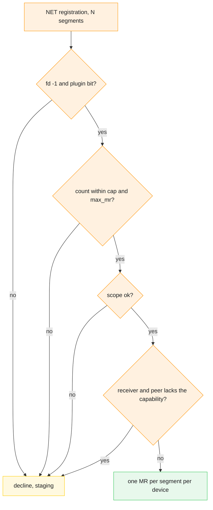

# IB-CAST P2P: the same wire format on the CAST engine

> [!NOTE]
> Old stack, layer 08 ([PR 10889](https://github.com/ROCm/rocm-systems/pull/10889)), at the wire tip `ba3ab26f30a7`. The 11-04 version of this note described a side table written for every slot, a 2 s side-table wait, a copied segmented builder in `p2p_multiseg_cast.cc` and a separate `rccl_reg_multiseg_cast.cc`; all of these are gone. In the planned design IB-CAST returns to develop and its multi-segment support is rebuilt inside the IB-MSEG plugin in forks 5 and 6, which are planned; see [the fork plugin](multi_segment_fork_plugin.md#fork-6-ib-cast-multi-segment-planned).

IB-CAST P2P (`net_ib_cast`) uses the design of [classic NET/IB P2P](multi_segment_netib_wire.md): one MR per segment, the layout prefix in the same write as the CTS, inline or referenced layouts, and one slice per QP per progress call. Both plugins share `transport/rccl_p2p_multiseg.{h,cc}`, `rccl_mseg.h`, `rccl_mseg_wr.h` and `rccl_mseg_reg.h`. This doc covers only what differs on IB-CAST: the multi-segment scope, one segmented group at a time, the BY_INDEX completion flag, the per-WR cap, and the open review items. IB-CAST GIN/RMA is a separate path with no CTS; see [IB-CAST GIN/RMA](multi_segment_netib_cast_gin.md).

## Differences from classic

| Aspect | Classic | IB-CAST |
|---|---|---|
| Scope | P2P, switch on, no resiliency (`ncclIbMultiSegOk`) | also no CTS offload, no BY_ORDER, no QP sharing (`IbCastMultiSegScopeOk`), cached as `multiSegScopeOk` |
| Receiver's CTS stride | from the peer's raw `caps` | from `peerCaps`, masked by its own scope (open item) |
| Segmented slots in flight | FIFO order through the send cursor | one segmented group at a time (`rcclIbCastHasOtherSegmentedSend`); a later slot returns `*request = NULL` |
| Referenced layouts | read before `ncclIbMultiSend` | slot deferred (`rcclIbCastSendDefer`) and posted from `rcclIbCastSendProgress` once read |
| Sizes WR | `nreqs > 1`, or split and not BY_INDEX | `nreqs > 1` or the request was split; under BY_INDEX a split sets `WR_IMM_SEGMENTED_FLAG` (bit 22) |
| Per-WR cap | none | slices split at `IbCastMaxPostSendBytes` (`IbCastPostDataWithinCap`) |
| Flush QP | 512 | 256, develop's depth |
| AINIC inline CTS | not used | not excluded from the scope (open item) |

## Scope

`IbCastMultiSegScopeOk(useCtsOffload, scheme, qpSharing, resiliency)` (`connect_cast.h`) is computed once per comm at connect, before the CTS allocation, and logged in one INFO line. Capability and CTS slots come from `IbCastMultiSegAdvertise(multiSegScopeOk, isRma)`, which also requires the switch and a non-RMA comm. `IbCastRegMrDmaBufMultiSeg` (`net_ib_cast/reg.cc`) declines a multi-segment registration with `ncclInvalidUsage` when:

- the count fails `rcclIbSegCountSupported` or `rcclIbCastMrAdmit`;
- the comm's scope fails, on either side;
- the comm is a receiver and the peer lacks the capability.

The scope exclusions exist because the segmented send cannot serve them:

- **CTS offload.** The NIC owns the CTS and never reads a layout.
- **BY_ORDER matching.** The receiver adds each immediate's `byte_len`, but a split send's size rides the sizes write. AINIC defaults to BY_ORDER, so multi-segment on AINIC needs `NCCL_IB_RECEIVER_SIDE_MATCHING_SCHEME=0`.
- **QP sharing.** Shared QPs need a `commId` in the immediate and a per-QP WR budget.
- **Resiliency.** Resiliency replays a whole slot, which a send resumed across progress calls cannot do yet.

`IbCastRegMrDmaBuf` routes `fd == -1` to `IbCastRegMrDmaBufFromRange`, which mirrors classic's walk, and registration goes through `rcclIbSegRegister` with `rcclIbCastMultiSegRegOne`. `rcclIbCastDeregMrMultiSeg` frees a multi-segment handle.

## Data path

**Receiver.** `rcclIbCastIrecvCheckHandle` validates every handle before taking a request. `rcclIbCastIrecvFillSideTable` fills each receive's layout prefix for a capable peer; `rcclIbCastCtsFlagLayout` sets bit 15 and `rcclIbCastPrepareCtsWrite` starts the CTS write at the prefix.

**Sender.** `IbCastIsend` bounds `nreqs` to 1 to `NCCL_NET_IB_MAX_RECVS`. A request is segmented when CTS offload is off and either the local handle or the remote layout spans more than one segment (`rcclIbCastSendIsSegmented`). A segmented request returns `*request = NULL` while another slot's segmented group is in flight. Once every request of the slot has matched, the slot posts through `IbCastMultiSend`, or defers until its referenced layouts are read.

**Builder.** Develop's `IbCastMultiSend` loop calls `rcclIbCastFillSendWrs` for every non-offload chain; only a segmented send writes the cursor (`rcclIbCastSendCursor`), and `rcclIbCastSendResume` posts later slices. The CAST scheduler still picks the per-QP chunk; the fill cuts it at local and remote boundaries with the shared cursor. `IbCastPostDataWithinCap` splits any WR above `IbCastMaxPostSendBytes` on the stack before posting.

**Completion size.** Under BY_INDEX the immediate holds `rxReqIndex`, `WR_IMM_SPLIT_DATA_FLAG` with more than one QP, and `WR_IMM_SEGMENTED_FLAG` when the request was split; the receiver skips adding `byte_len` for a single receive when `rcclIbCastImmSegmented` sees the flag.

**Flush.** `rcclIbCastIflushMultiSeg` posts one read per device: the scratchpad read when that flush is on, else the first byte of the last non-empty receive with its segment's rkey.

## Failure handling

- **Send.** A slice whose post failed drops the event it held on that QP (`rcclIbCastHoldSlice`), so the request fails through `Test()` instead of waiting. A deferred slot that fails to post records a fatal error.
- **Test.** A FAILED request reports `ncclSystemError`.
- **Close.** The layout cache's MRs are freed before their PDs (`rcclIbCastSendLayoutCacheFree`).

The connect and teardown hardening that layer 08 carried on 11-04 (PD reference only after a successful `ibv_alloc_pd`, a partly built base safe to destroy) is not on the 08 tip; it is the standalone branch `users/atulkulk/fix/ibcast-failed-pd-ref`.

## Open items

From the local Argus pass of 2026-11-14, still present at the wire tip. All three are carried to fork 6 instead of being fixed on 08:

1. **Inline CTS scope.** `IbCastMultiSegScopeOk` does not exclude AINIC inline CTS (`IbCastAinicCtsInlineData`). A P2P comm with offload off but inline CTS on can advertise and register multi-segment, while the inline CTS carries only segment 0's rkey and no prefix (`ctsFifoHasLayout` returns false).
2. **Receiver stride.** The receiver allocates combined slots only when `peerCaps` has the bit, and `peerCaps` is masked by the receiver's own scope. A sender that advertises facing a receiver whose scope fails writes at a 2048-byte stride the receiver does not use. Classic reads the stride from the peer's raw `caps`.
3. **Resume bound.** `rcclIbCastSendResume` reads `nreqs` from the peer-written CTS row without the 1 to 8 bound that `IbCastIsend` applies.

## File map

| File | Change |
|---|---|
| `net_ib_cast/ib_cast_multiseg.h` | CTS row and layout accessors, hook declarations |
| `net_ib_cast/common_cast.h` | `ncclIbCtsSlot`, `IB_CAST_CTS_SLOTS_BYTES`, `WR_IMM_SEGMENTED_FLAG`, `rcclIbCastSendCursor`, `multiSegScopeOk`, `peerCaps`, the layout cache, `rcclIbCastMrAdmit` declaration |
| `net_ib_cast/connect_cast.h`, `connect.cc` | `IbCastMultiSegScopeOk`, `IbCastMultiSegAdvertise`, `IbCastSendCommAllocCts`, `meta.caps`, CTS slots for a capable peer |
| `net_ib_cast/reg.cc` | `IbCastRegMrDmaBufFromRange`, `IbCastRegMrDmaBufMultiSeg`, `rcclIbCastMrAdmit`, layout publish, `rcclIbCastDeregMrMultiSeg` |
| `net_ib_cast/p2p.cc` | `rcclIbCastFillSendWrs`, send cursor and resume, defer and progress, CTS write, irecv hooks, `IbCastPostDataWithinCap`, `rcclIbCastIflushMultiSeg` |

The MPI helper `RegisterMultiSegmentMr(comm, buf, isCast, mhandle)` must pick `IbCastRegMrDmaBufMultiSeg` for IB-CAST, because the IB-CAST comm layout differs from classic. Tests and runner jobs for this path are in [testing](multi_segment_testing.md#classic-and-ib-cast-p2p).
