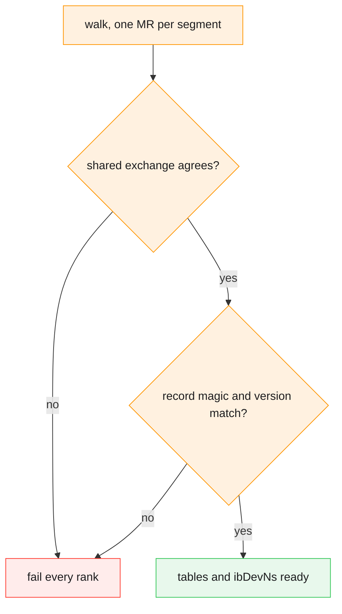

# IB-CAST GIN/RMA on IB-MSEG: fork 6 design

> [!NOTE]
> Planned, fork 6 ("IB-CAST on IB-MSEG"), not started. It waits on fork 5, which is paused while forks 1 to 4 are stabilized on IB and AINIC. Until then, AINIC runs GIN/RMA multi-segment on IB-MSEG's classic RMA backend when `NCCL_NET=IB` is set. See [the fork plugin](multi_segment_fork_plugin.md#fork-6-ib-cast-multi-segment-planned).

IB-CAST RMA multi-segment is not added to develop's `IbCastRmaIbProxy` again. IB-MSEG first takes develop's `net_ib` to `net_ib_cast` differences in [fork 5](multi_segment_fork_plugin.md#fork-5-ib-cast-base-planned), which brings CAST's RMA proxy behavior (per-peer QPs, the per-WR cap `IbCastMaxPostSendBytes` with develop's `IbCastPostDataChunks`, AINIC recovery) into the fork. Fork 6 then adds only what is specific to IB-CAST on top of the fork's RMA path from [fork 4](multi_segment_fork_plugin.md#fork-4-rma-and-gin): one MR per segment, the shared consensus exchange, the shared segment cursor and RMA rounds. Read [GIN/RMA](multi_segment_gin_rma.md) first for that shared design. This doc states what fork 6 must add: a versioned registration record with physical device numbers, rkey lookup by physical device, the per-WR cap over rounds, error-owner propagation in CAST's CQ poll, the AINIC recovery hook, and CAST's queue depths.

## What fork 6 builds on

GIN/RMA never touches the CTS, so none of the [IB-CAST P2P](multi_segment_netib_cast.md) work applies here. These pieces exist in the fork at fork 4 and fork 6 reuses them:

| Piece | Fork symbols (`net_ib_multiseg/gin.cc` unless noted) |
|---|---|
| Handle with tag and count first | `rcclRmaIbProxySegMrHandle` (`tag`, `nSegments`, `segOff`, `mrHandle`, `sym`, `flushSeg`), `rcclRmaSegMrTag` and `rcclRmaMrSegmentCount` (`seg_rma_mseg.h`) |
| Registration and consensus | `rcclRmaIbProxyRegMrSymDmaBuf`, `rcclRmaIbProxyConnectFinish`, `rcclRmaRegAllGather`, `rcclIbSegSymExchange` (`seg_sym_mseg.h`), `rcclIbSegRegister` (`seg_reg_mseg.h`), `rcclIbMrAdmit` (`reg.cc`) |
| Rounds | `rcclRmaRoundHooks` and the round queue (`seg_rma_round_mseg.h`), `rcclRmaIbRoundBuild`, `rcclRmaIbRoundPost`, `rcclRmaIbRoundRetire`, `rcclRmaIbRoundFailed`, `rcclRmaBuildSegmentedWrs`, `rcclRmaIbProxyPostChain`, `rcclRmaIbProxyEnqueue`, `rcclRmaIbProxySubmit` |
| Lookup | `rcclRmaSegOf`, `rcclRmaRangeOk`, `rcclRmaRemoteRkey` |
| Failed requests | `NCCL_NET_IB_REQ_FAILED`, `rcclRmaIbProxyTestFailed` |
| Queue depth | `RCCL_RMA_SEND_QP_WRS` (`seg_rma_mseg.h`), `rcclIbSendQpWrs` (`connect.cc`) |

The core sets `comm->rcclMultiSegRma` when IB-MSEG's RMA proxy is the comm's RMA backend, so the in-flight cap and window gates from fork 1 apply to the CAST-featured fork without change.

## Scope

| Surface | IB-CAST P2P | IB-CAST GIN/RMA |
|---|---|---|
| Entry point | the fork's net send and receive | the fork's RMA proxy vtable |
| Remote layout | CTS layout prefix | symmetric table gathered at registration |
| Connect check | `useMultiSeg` match | none; registration consensus instead |
| Switch | `rcclMultiSegOn` with the CAST scope | `rcclRmaMultiSegEnabled` |
| Split | the fill over the scheduler's chunk | rounds over the segment cursor, then the per-WR cap |

## Handle and indexing

Fork 6 keeps fork 4's handle and adds `ibDevNs`, the physical device number of every registration slot, as `[rank][slot]` (-1 unused), sized from the walked count. CAST registers through the comm's receive comm but may post on per-peer QPs whose device index names a different physical HCA, so a device-index lookup like fork 4's `rcclRmaRemoteRkey(h, rank, seg, remDevIdx)` is not enough. Fork 6 must map a physical `ibDevN` to a registration slot: data WRs use the remote QP's device and flush reads use the local one. A missing slot must be a WARN and `ncclInternalError`, not a wrong rkey. This lookup was proven on the superseded IB-CAST layer.

A known develop-side limit stays visible through that error: with `NCCL_IB_SUBNET_AWARE_ROUTING=1` on mixed rails, develop's routing can move the per-peer RMA comm to a NIC the window was not registered on, and the lookup then reports no registration slot.

## Registration

Fork 6 keeps fork 4's walk and registration: one DMA-BUF MR per segment within `max_mr` (`rcclIbMrAdmit`), the same count on every rank, and the shared exchange through `rcclIbSegSymExchange`, which fails every rank on a failed status or count mismatch before any table is used. After the exchange, fork 6 must gather one more record per rank, `{magic, version, ibDevNs[]}`, and fail every rank when any peer has a different magic or version, so ranks running different builds never read each other's device numbers. Connect allocates the per-rank records with the others in `rcclRmaIbProxyConnectFinish`; rollback deregisters only complete segments and frees the handle once, as in fork 4.

`NCCL_DMABUF_ENABLE=1` is checked by the core gate before any multi-segment window reaches the plugin.

## Data path

Operations go through fork 4's rounds. Fork 6 must keep fork 4's round hooks and change only the build and post steps:

- **Build.** The build hook emits slices with fork 4's `rcclIbSegAppendWrs` (`seg_wr_mseg.h`), built on the one-slice `rcclIbSegFillWr` that the P2P send shares, looks up device slots and keys by physical device, then splits any slice above `IbCastMaxPostSendBytes`. A round that runs out of WRs ends early and covers fewer bytes; a single chain that cannot fit is refused with `ncclInternalError`.
- **IPut, IGet.** Each round posts at most `RCCL_RMA_MAX_DATA_WRS` data WRs and signals only its last WR; the request completes only after every round.
- **IPutSignal.** The fetch-and-add on the segment holding the signal offset rides the last round.
- **IFlush.** One loopback read of one byte of `flushSeg`, the first device segment, with the rkey of the slot holding the local device. A window that is all host memory posts nothing.

## Queues

The CAST RMA sender data QP must be the larger of develop's `IbCastDataSendQueueDepth(IbCastMaxPostSendBytes)` and `RCCL_RMA_SEND_QP_WRS` (2080, the 32 in-flight requests of 65 WRs). Because a dead QP flushes every queued WR as a CQE, the RMA sender CQ must hold at least as many entries with the switch on, still clamped to the device `maxCqe` as develop's CQ creation does. The `max_qp_wr` check is in [QP depths](multi_segment_current.md#qp-depths). With the switch off, CAST RMA keeps develop's depths.

## Error completions

Any caller's CQ poll can retire any request on that CQ. Fork 4's `IbMsegRmaIbProxyTest` returns `ncclRemoteError` on the first error completion; fork 6's CAST CQ poll must instead route each error to the request that owns it:

- Log one WARN per error completion with the GID of the peer's device and mark the owner `NCCL_NET_IB_REQ_FAILED`. After a QP error every flushed WQE completes with the owner's `wr_id`; only the first owns the event.
- A failed post that accepted any WR keeps the request (its WRs reference the slot) marked FAILED, and `Test()` returns `ncclRemoteError` without draining; the error is fatal for the context. Nothing posted frees the slot.
- `Test()` on a FAILED request returns `done = 1` with an error through `rcclRmaIbProxyTestFailed`, even when another request's poll drained its CQE.
- **AINIC port recovery.** Develop's `IbCastPortRecoveryQpsRestoreAinic`, brought in by fork 5, must first abandon the device's RMA requests on a comm with the switch on: every in-use request with events on that device has its events zeroed and is marked FAILED. The rebuilt QPs go through the same create helpers as connect (`IbCastBuildDataQpCreateAttr` in develop), so they get the same depths.

## Tests

Planned with fork 6. `RmaMultiSegmentMPITest` and `RmaMultiSegmentPostMPITest` (`test/transport/RmaMPI/RmaMultiSegmentMPITests.cpp`) read the segment count through the handle tag, so they run on the CAST-featured fork unchanged. Fork 6 must add host tests against fake verbs for the record exchange and its rollback, the physical-device rkey and flush lookup, the per-WR cap over rounds, an error completion drained by another request, and AINIC restore with the switch on and off, plus runner jobs on the AINIC configs. See [forks 5 and 6 in the validation plan](multi_segment_validation_plan.md#forks-5-and-6-planned).

## Review checklist

- The handle's first two fields stay the tag and the count.
- Records are checked for status, count, magic and version on every rank before any table is used.
- rkeys and local MRs are found through the slot of the physical `ibDevN`.
- No slice exceeds `IbCastMaxPostSendBytes`.
- Rounds keep per-peer order; a FAILED request is reported even when another request drained its CQE.
- GDAKI `regMrSymDmaBuf` stays NULL; proxy RMA is the ROCm path.
