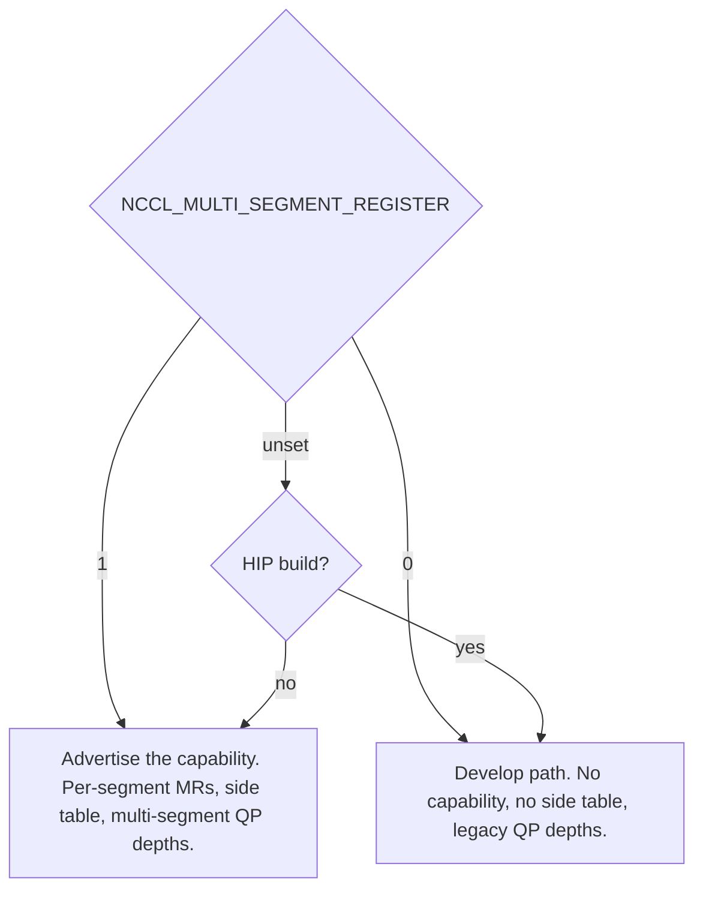
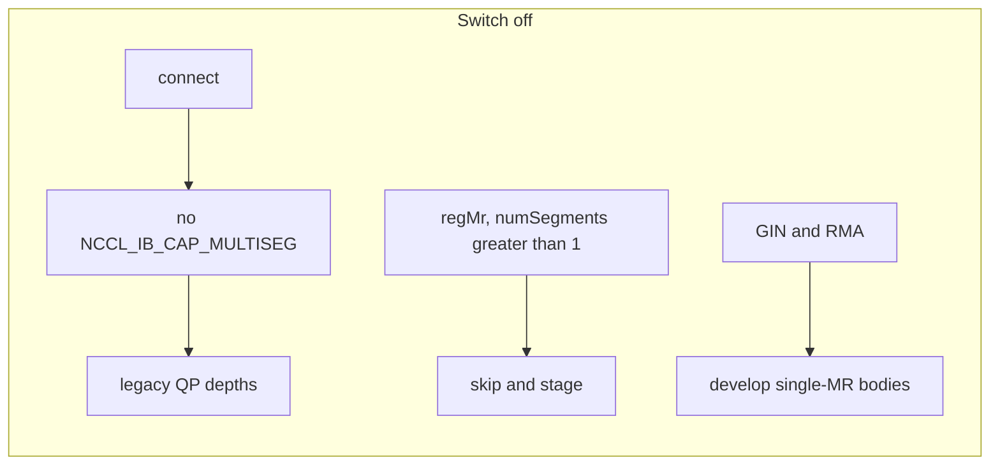
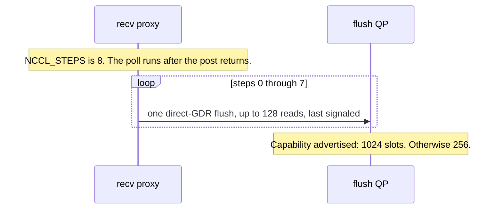
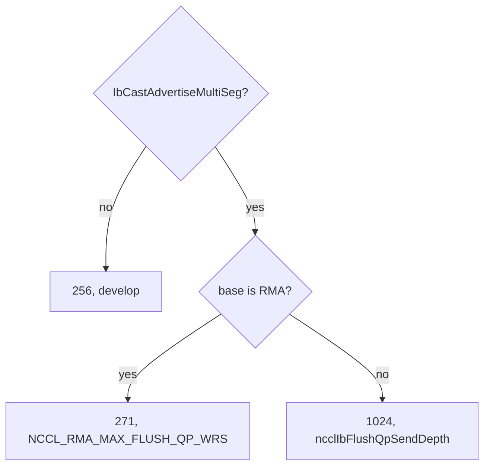
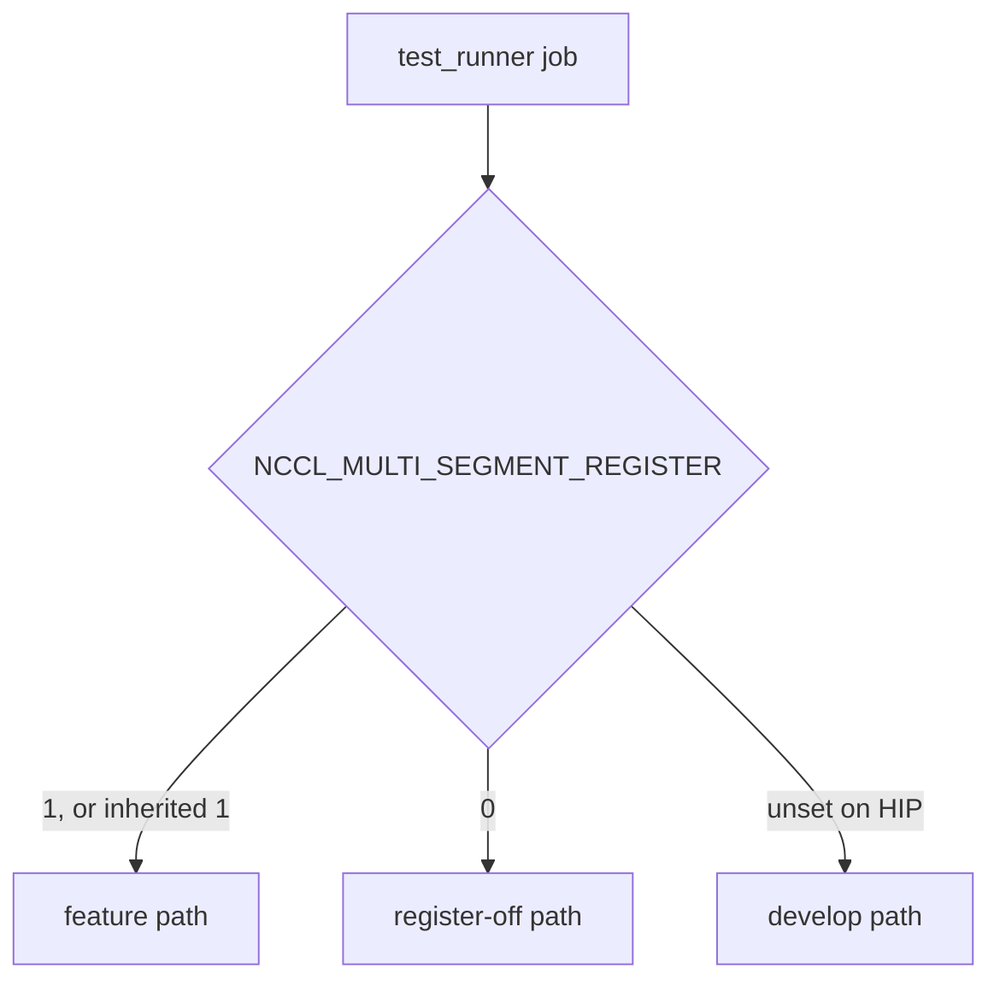
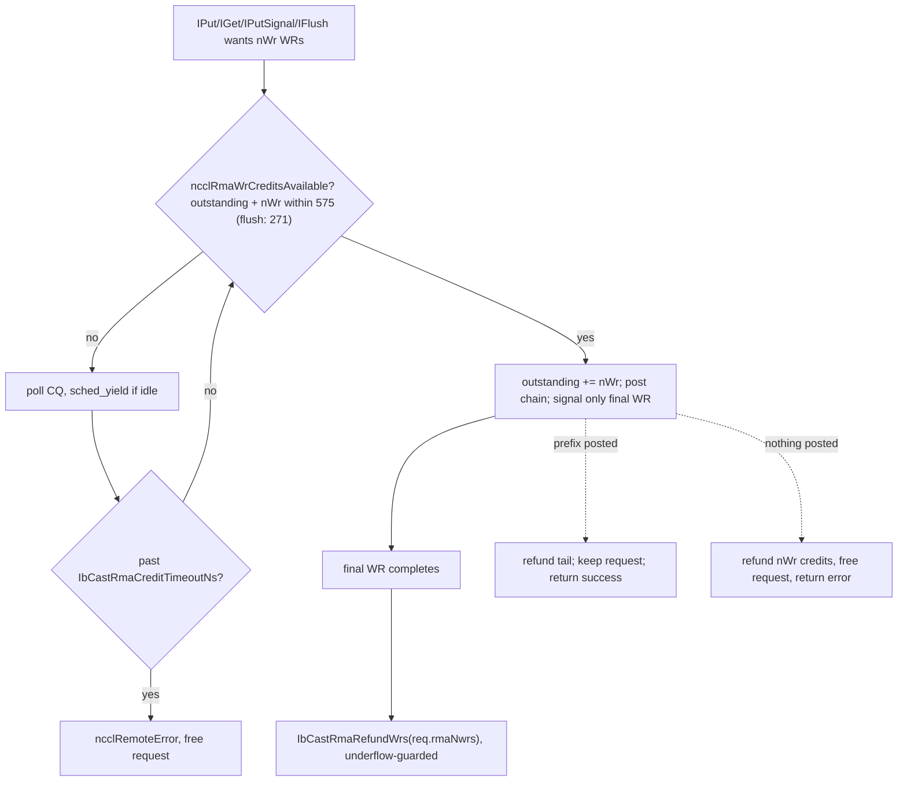
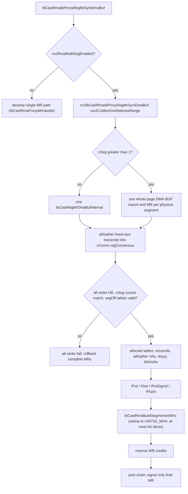

# Multi-Segment DMA-BUF for CAST GIN / RMA

> **Shared facts** (constants, v14 GIN/RMA split, credits/signaling, registration transcript, tests) are in the source-of-truth overview: [`multi_segment_dmabuf_gin_and_netib.md`](multi_segment_dmabuf_gin_and_netib.md) §4 / §8. This doc covers CAST GIN/RMA specifics.

**Last updated:** 2026-10-16, against the wire layer ([ROCm/rocm-systems#10888](https://github.com/ROCm/rocm-systems/pull/10888), branch `users/atulkulk/mseg/multi-segment-dmabuf-cast-gin`, the top of the stack), rebased on develop. It stacks on CAST P2P (layer 08, `users/atulkulk/mseg/08-cast-netib-multisegment`) and classic GIN/RMA (layer 05, `users/atulkulk/mseg/05-gin-rma-multisegment`).

**Status:** Implemented. CAST GIN/RMA ports the **same per-segment MR + segmented WR** contract as classic GIN/RMA ([`net_ib/gin.cc`](../../src/transport/net_ib/gin.cc), whose multi-segment bodies sit next to develop's in the same file), plus CAST-only **completion-driven WR credits** and a **collective-safe registration transcript** received into a **per-comm consensus buffer**. Equal `nSeg` across ranks; per-rank sizes may differ. It is **not** the CAST P2P wire option: there is no CTS slot, no side table, and no `NCCL_IB_CAP_MULTISEG`. Everything is gated by `NCCL_MULTI_SEGMENT_REGISTER` (HIP default 0, non-HIP default 1); with `=0` CAST GIN/RMA runs develop's single-MR path unchanged.

**v14 GIN/RMA split:** the data-path ops live on the `ncclRma_t` vtable (`IbCastRmaIbProxy` / `RMA_IB_PROXY`); proxy GIN is `ncclGinProxy` layered on this RMA backend. Classic twins are the `ncclRma*` symbols (renamed from `ncclGin*`).

**Plugin:** `IbCastRmaIbProxy` (`NCCL_NET=IB-CAST`). **Ticket:** AIRUNTIME-2351 (CAST GIN follow-up); JIRA AICOMRCCL-1526.

**Companion P2P docs:** [`multi_segment_netib_cast.md`](multi_segment_netib_cast.md) (CTS + side table). **Current contract:** [`multi_segment_current.md`](multi_segment_current.md).

## What changed on 2026-10-16

HIP now defaults `NCCL_MULTI_SEGMENT_REGISTER` to 0. The knob is still `ncclParamMultiSegmentRegister()` in `transport/generic.cc`. `NCCL_MULTI_SEGMENT_REGISTER=1` turns the feature on, on HIP and on every other build. An unset variable takes the develop path on a HIP build. A non-HIP build still defaults to 1. The commit is `9af53b9bca21` on `users/atulkulk/mseg/01-ce-recv-window-offset`, replayed through the stack.



With the switch off, connect does not advertise `NCCL_IB_CAP_MULTISEG` and does not append the side table, so the sender QP stays at `2 * NET_IB_MAX_REQUESTS`. NET, P2P IPC and NVLS leave a multi-segment buffer unregistered. GIN and RMA stay on develop's bodies and do not reserve credits. A device-only GIN window with more than one segment and no sysmem returns `ncclInvalidUsage` instead of registering only the first segment.



The direct-GDR flush QP is sized for one chain on every proxy step. `recvProxyProgress` posts `iflush` into `requests[step % NCCL_STEPS]` and returns before that flush is polled, so up to 8 flushes can be outstanding. With `RCCL_GDR_FLUSH_GPU_MEM_NO_RELAXED_ORDERING=0`, `rcclIbIflushMultiSeg` posts one RDMA read per receive per segment, at most `8 * 16 = 128` work requests, and signals only the last. Eight chains need `8 * 128 = 1024` slots. The previous depth, `NET_IB_MAX_REQUESTS + 128 = 384`, held three chains and the fourth post failed. `ncclIbFlushQpSendDepth` in `net_ib/multiseg.h` returns `NCCL_STEPS * NCCL_NET_IB_MAX_RECVS * NCCL_IB_MAX_SEGMENTS` when the peer advertised the capability, and `NET_IB_MAX_REQUESTS` (256) otherwise. Classic `ncclIbCreateFlushQp` calls it. `connect.cc` static-asserts that the multi-segment result holds at least one chain per step. The host test is `NetIbMultiSeg.FlushQpDepthCoversEveryOutstandingStep`.



CAST non-RMA comms use the same helper. CAST RMA comms keep `NCCL_RMA_MAX_FLUSH_QP_WRS` (271), because RMA credits wait until one chain completes before the next post. With the switch off every flush QP stays at 256.



The scratchpad flush (`RCCL_GDR_FLUSH_GPU_MEM_NO_RELAXED_ORDERING=1`, the default) posts one write and one read and does not fill 1024 slots. The enlarged depth is for the direct-GDR path. `net_ib_multisegment_flush` selects that path by setting the parameter to 0.

Jobs that test the feature set `NCCL_MULTI_SEGMENT_REGISTER=1` in the runner config, because an unset HIP job now takes the off path. Register-off jobs stay at 0. `cast_multisegment_opt_recv_2qp` inherits 1 from `cast_multisegment_opt_recv`. `net_ib_rma_multisegment_wrbatch` on the wire branch, and the hybrid nightly jobs on 09 including `net_ib_multisegment_hybrid_stress_nightly`, set 1 as well. The WR-batch job fails under `RCCL_TEST_RMA_MSEG_REQUIRE=1` when the per-segment registration log is missing, and the hybrid IGet stress skips. `multisegment_host_boundary_math` is host-only and does not read the switch.



## What changed on 2026-10-14

- `net_ib_cast/gin_multiseg_cast.h` was folded into `net_ib_cast/gin.cc`: the `rcclIbCastRmaIbProxy*` bodies, `IbCastRmaProxySegMrHandle`, the WR builder, credits and the transcript now sit after `struct IbCastRmaIbProxyCtx` in `gin.cc`, behind an `RCCL:` comment. Develop's entry points still dispatch to them with one line.
- The aliases `NCCL_IB_RMA_MAX_SEND_WRS` / `NCCL_IB_RMA_MAX_FLUSH_WRS` were removed from `common_cast.h`. CAST uses `NCCL_RMA_MAX_SEND_QP_WRS` (575) and `NCCL_RMA_MAX_FLUSH_QP_WRS` (271) from `rma_multiseg.h`, the same names classic uses.
- `rcclIbCastRmaIbProxyTest` on a FAILED request now carries a comment on why it releases the request's credits there: the owner's completion may have been drained by another request's `Test()`, so this is the only place they come back.

## What changed since the 2026-10-07 revision

- CAST `net_ib_cast/gin.cc` is now develop plus one-line dispatches. `IbCastRmaIbProxyRegMrSymDmaBuf`, `DeregMrSym`, `IPut`, `IGet`, `IPutSignal`, `Test` and `IFlush` each start with `if (rcclRmaMultiSegEnabled()) return rcclIbCastRmaIbProxy*(...)`, and `IbCastRmaIbProxyConnect` ends in `rcclIbCastRmaIbProxyConnectFinish`. The multi-segment bodies moved to a new header that `gin.cc` included once after `struct IbCastRmaIbProxyCtx` (folded back into `gin.cc` on 2026-10-14).
- The multi-segment handle is now its own type, `IbCastRmaProxySegMrHandle`, in `net_ib_cast/gin.cc`. Develop's single-MR `IbCastRmaProxyMrHandle` (`mrHandle`, `base_vas`, `rkeys`) is unchanged and is what the switch-off path uses.
- `CastIbGinCollComm::regConsensus` is allocated by `rcclIbCastRmaIbProxyConnectFinish` only when the switch is on; with the switch off it stays NULL. `IbCastGinIbCloseColl` frees it either way.
- QP depths are gated. With the switch off, CAST RMA keeps develop's depths (send `2 * NET_IB_MAX_REQUESTS`, flush `NET_IB_MAX_REQUESTS`). The 575 / 271 RMA depths apply only to RMA comms (`ncclIbNetCommBase::isRma`) with the switch on.
- AINIC port recovery gained `IbCastRmaAbandonDeviceRequests`, which runs only for RMA comms with the switch on. It fails the requests in flight on the recovered device and refunds their credits before the QPs are rebuilt.
- `ncclRmaTranscriptHeaderOk` was removed; the transcript checks `magic` / `version` inline against `IBCAST_RMA_REGISTRATION_MAGIC` / `IBCAST_RMA_REGISTRATION_VERSION`. `ncclRmaReleaseSeqId` moved from `net_ib/gin.h` into `net_ib/rma_multiseg.h`, which also gained `rcclRmaMultiSegEnabled()`, the classic `rcclRmaIbProxy*` declarations and `NCCL_RMA_SEND_QP_WRS` (the classic multi-segment sender depth). `gin_cast.h` no longer includes `rma_multiseg.h`; CAST gets it through `common_cast.h`.
- Tests: `RmaMultiSegmentMPITest.MultiSegmentRegisterOff_KeepsUpstreamPath` checks that `=0` keeps a multi-segment window on the single-MR path. `RCCL_TEST_RMA_MSEG_REQUIRE=1` turns "no rank took the multi-segment path" from a skip into a failure. The post-path fixture gained `ZeroSizeOpDone`, and the send-queue flood is now sized from `NCCL_RMA_SEND_QP_WRS`.

---

## 1. Why this is not the CAST P2P PR

GIN/RMA never looks at `ncclIbSendFifo`. Symmetric registration all-gathers per-segment VAs and rkeys into the RMA handle; IPut/IGet/IPutSignal/IFlush post work requests from that handle.

| Surface | CAST P2P wire option | CAST GIN / RMA |
| --- | --- | --- |
| Plugin | `netIbCast` send/recv | `IbCastRmaIbProxy` |
| Extra layout | `ncclIbSegLayout` side FIFO | handle `base_vas[]` / `rkeys[]` / `ibDevNs[]` / `rankSegOff` |
| Connect cap | `NCCL_IB_CAP_MULTISEG` | none |
| Switch accessor | `IbCastAdvertiseMultiSeg()` (`connect_cast.h`) | `rcclRmaMultiSegEnabled()` (`net_ib/rma_multiseg.h`) |
| Split | after CAST QP scheduler chunk | `IbCastRmaBuildSegmentedWrs` |
| CTS / AINIC 32 B | must stay 64 / 32 | n/a |
| GDAKI `regMrSymDmaBuf` | n/a | stays NULL (proxy RMA is the ROCm path) |

Both accessors read the same `ncclParamMultiSegmentRegister()`, so the value must match on every rank.

Do **not** include `net_ib/gin.h` from CAST: `net_ib_cast/gin_cast.h` uses the same include guard `_NCCL_NET_IB_GIN_H_`. Share only the dependency-free `net_ib/rma_multiseg.h`, which `common_cast.h` includes.

---

## 2. Problem this solved

On ROCm/HIP, `cuMemGetHandleForAddressRange` / `hsa_amd_portable_export_dmabuf` over a multi-segment VMM buffer describes **only the first physical segment**. Stock `IbCastRmaIbProxyRegMrSymDmaBuf` called `IbCastRegMrDmaBufInternal` on the **whole** VA range, so registration failed with `EINVAL`; a later IPut/IGet crossing a segment completed with `IBV_WC_REM_INV_REQ_ERR`. That stock path is still what runs with `NCCL_MULTI_SEGMENT_REGISTER=0`.

Classic GIN/RMA (`net_ib/gin.cc`, with develop's entry points dispatching into its multi-segment bodies) already:

- counts segments with `ncclCuMemGetAddressRange`
- registers one dma-buf MR per segment
- all-gathers `nSeg` and each rank's `segOff`, then per-segment VAs / per-device rkeys
- splits IPut/IGet at **local and remote** bounds with `ncclRmaBuildSegmentedWrs`
- fences **every** segment on IFlush
- posts IPutSignal atomics on the **segment that contains `signalOff`**
- signals only the **final** WR of each chain (`ncclRmaWrIsSignaled`)

Stock CAST `net_ib_cast/gin.cc` (without this work) still had a single `mrHandle`, `base_vas[nranks]`, `rkeys[nranks]`, one WR per op, and no credit accounting.

---

## 3. Selected design (port classic GIN)

### Code layout and the switch

`net_ib_cast/gin.cc` keeps develop's bodies. Each RMA proxy entry point checks `rcclRmaMultiSegEnabled()` first and, when it is true, returns the matching `static` function from `net_ib_cast/gin.cc`:

| Vtable entry | Multi-segment body |
| --- | --- |
| `IbCastRmaIbProxyConnect` (after `IbCastGinIbConnect`) | `rcclIbCastRmaIbProxyConnectFinish` (returns at once with the switch off) |
| `IbCastRmaIbProxyRegMrSymDmaBuf` (and `RegMrSym`, which calls it with `fd = -1`) | `rcclIbCastRmaIbProxyRegMrSymDmaBuf` |
| `IbCastRmaIbProxyDeregMrSym` | `rcclIbCastRmaIbProxyDeregMrSym` |
| `IbCastRmaIbProxyIPut` / `IGet` / `IPutSignal` | `rcclIbCastRmaIbProxyIPut` / `IGet` / `IPutSignal` |
| `IbCastRmaIbProxyTest` | `rcclIbCastRmaIbProxyTest` |
| `IbCastRmaIbProxyIFlush` | `rcclIbCastRmaIbProxyIFlush` |

Outside `gin.cc`, the switch also gates the RMA QP depths in `IbCastBuildDataQpCreateAttr` and `IbCastFlushQpSendDepth` (see the credits section) and the AINIC abandon hook. Because the switch selects both the handle type and the data path, a handle registered under one setting must not be used under the other; the value is fixed for the life of the process.

### Handle

```c
struct IbCastRmaProxySegMrHandle {
  int nSegments;
  size_t segOff[NCCL_RMA_MAX_SEGMENTS + 1];  // local map; segOff[0] == 0
  struct ncclIbMrHandle* mrHandle[NCCL_RMA_MAX_SEGMENTS];
  uintptr_t* base_vas;   // [rank * nSegments + seg]
  uint32_t* rkeys;       // [rank][seg][registration slot]
  int* ibDevNs;          // [rank][registration slot] = physical ibDevN, or -1
  size_t* rankSegOff;    // per-rank [nSegments + 1] after allgather
};
```

Registration stores MRs and rkeys in the recv comm's device-slot order, but a post uses a per-peer QP whose `devIndex` / `remDevIdx` may name a different physical HCA. `ncclRmaDevSlotOf` translates the physical `ibDevN` to the registration slot; `ncclRmaRkeyIbDevN` picks the remote QP's device for data WRs and the local device for flush reads.

`NCCL_RMA_MAX_SEGMENTS` is 16, defined in the **shared** header `net_ib/rma_multiseg.h` (equal to `NCCL_IB_MAX_SEGMENTS`) — **not** in `gin_cast.h`. WR budgets: `NCCL_RMA_MAX_DATA_WRS = 64`, `NCCL_RMA_MAX_SIGNAL_WRS = 65`, `NCCL_RMA_MAX_FLUSH_WRS = 16`. Shared helpers CAST uses: `ncclRmaWrIsSignaled`, `ncclRmaWrCreditsAvailable`, `ncclRmaSegmentSliceBytes`, `ncclRmaSignalOffsetValid`, `ncclRmaSegmentCountsMatch`, `ncclRmaSegOffTableValid`, `ncclRmaPeerSegOff`, `ncclRmaSegIndexOf`, `ncclRmaOffsetRangeOk`, `ncclRmaRegistrationHandleReady`, `ncclRmaPostedWrCount`, `ncclRmaCompletePostedRequest`, `ncclRmaDevSlotOf`, `ncclRmaRkeyIbDevN`, and `rcclRmaMultiSegEnabled`. See the overview for the 16-segment cap (a fixed 1 GiB window supports segments no smaller than 64 MiB).

### Per-comm consensus buffer

With the switch on, `rcclIbCastRmaIbProxyConnectFinish` allocates `cComm->regConsensus` with `ncclIbMalloc` (page-aligned) as `nranks * sizeof(struct IbCastRmaProxyRegistration)`, right after the GIN connect. If the allocation fails it closes the coll comm with `IbCastGinIbCloseColl`, clears `*collComm` and returns the error. With the switch off it returns `ncclSuccess` without allocating. `IbCastGinIbCloseColl` frees the buffer (a NULL free when it was never allocated). Every registration on that comm receives its transcript gathers into this buffer.

Why: the allGather registers whole pages of the receive buffer for remote write. An earlier revision received into a 64-entry array on the registration function's stack (with a heap fallback for larger comms), so peers could write into live stack frames next to it. Allocating at connect also means registration cannot fail on a local allocation before the transcript exchange. This mirrors the classic per-comm `ncclGinIbCollComm::regConsensus`.

### Registration (`rcclIbCastRmaIbProxyRegMrSymDmaBuf`) — collective-safe transcript

```text
registrations = cComm->regConsensus
calloc the handle (failure is recorded, not an early return)
nSeg = 1
if NCCL_PTR_CUDA and ncclCuMemEnable():
    ncclCuMemGetAddressRange → nSeg
if nSeg > NCCL_RMA_MAX_SEGMENTS: local failure
if nSeg == 1:
    IbCastRegMrDmaBufInternal(whole range, caller fd)   // fd==-1 → ibv_reg_mr
else:
    for each segment s:
        cuMemGetAddressRange → inSeg = (segBase==0) ? segSize : segSize-(segPtr-segBase)
        export a DMA-BUF covering the whole pages of [segPtr, segPtr+thisLen)
        IbCastRegMrDmaBufInternal(segPtr, thisLen, that fd, dmabuf offset 0); close(fd)
        segOff[s+1] = running total
    bytes left after nSeg segments: local failure
fill localRkeys[s][d] and localIbDevNs[d]; a missing MR is a local failure
# fixed-size transcript, exchanged even on local failure:
allGather IbCastRmaProxyRegistration{ magic=IBCAST_RMA_REGISTRATION_MAGIC (0x524d5347), version=1, status, nSegments, segOff[NCCL_RMA_MAX_SEGMENTS+1] }
every record: magic/version match, status ok → else all ranks fail
every record: ncclRmaSegmentCountsMatch (equal nSeg in [1, 16]) and ncclRmaSegOffTableValid
allocate rankSegOff (copy each rank's segOff into it), base_vas, rkeys, ibDevNs; allGather the record again with the allocation status and reconcile
allGather per-segment VAs, per-segment per-device rkeys, per-device ibDevNs
```

Why fixed-size: a variable-length gather could deadlock if one rank bails out mid-enumeration. Every rank always sends the same-sized record, so the collective completes and the failure is reconciled. The magic/version make the record self-describing.

Why validate `segOff`: the WR builder subtracts peer offsets as unsigned values (`rOffs[rs + 1] - rOff`, `rOff - rOffs[rs]`). A table that does not start at 0 or that decreases would wrap. Every rank sees the same gathered records, so every rank rejects the same table and the registration fails collectively.

Why whole pages: `IbCastRegMrDmaBufInternal` registers the segment's MR over whole pages starting at the page that holds `segPtr`, at DMA-BUF offset 0. Exporting only the exact byte range made `ibv_reg_dmabuf_mr` reject the first and last segments when the window started or ended inside a page.

Rollback: the `fail:` path deregisters only **complete** `ncclIbMrHandle` objects (the `registered` count) — a half-built handle is never handed to `deregMr` — then frees `base_vas`/`rkeys`/`ibDevNs`/`rankSegOff`/the handle. No leak, no double free. `IbCastRegMrDmaBufInternal` does not write `*mhandle` on failure. `rcclIbCastRmaIbProxyDeregMrSym` deregisters every segment's handle and frees the tables.

### Data path

`IbCastRmaBuildSegmentedWrs` is the CAST twin of classic `ncclRmaBuildSegmentedWrs`:

- **Paired mode** (`flushSge == NULL`): split `size` on both local and remote **per-rank** `segOff[]`, clamping each slice to `min(remaining, local bound, remote bound, UINT32_MAX)` via `ncclRmaSegmentSliceBytes`. Each WR has one local lkey and one remote rkey (looked up through the registration slot of the physical `ibDevN`). If a transfer would need more than `maxWr` slices (`NCCL_RMA_MAX_DATA_WRS = 64` for IPut/IGet/IPutSignal data), it is **rejected** before any WR is posted.
- **Flush mode** (`flushSge != NULL`): one loopback RDMA_READ per segment of the caller's own window; the SGE is the GDR flush scratch (`gpuFlush.sge`), length 1; array size `NCCL_RMA_MAX_FLUSH_WRS = 16` (per operation).

The builder does not set `wr_id` or `send_flags`; each op sets `wr_id` to its request index and signals only the final WR with `ncclRmaWrIsSignaled`.

| Op | WRs (per op) | Signaled |
| --- | --- | --- |
| IPut / IGet | up to `NCCL_RMA_MAX_DATA_WRS = 64` slices | **only the final WR** (`ncclRmaWrIsSignaled`) |
| IPutSignal | PUT slices + one ATOMIC (≤ `NCCL_RMA_MAX_SIGNAL_WRS = 65`) | **only the trailing atomic**; PUT slices unsignaled (RC order) |
| IFlush | one READ per segment (≤ `NCCL_RMA_MAX_FLUSH_WRS = 16`) | **only the final WR** |

**Zero-size ops.** `size == 0` builds no WR for IPut/IGet. The request is still returned, holds no event and no credits, and completes on its first `Test()`. It does not wait on the request posted before it. (Classic RMA instead gives a no-WR op its predecessor's sequence id, so it completes behind that request; classic also returns a freed request's id with `ncclRmaReleaseSeqId` only if no later request took one. CAST RMA requests are tracked by events, not sequence ids, so that helper is classic-only even though it lives in the shared header.) IPutSignal with `size == 0` posts only the atomic.

Range checks (`IbCastRmaRangeOk`, built on `ncclRmaOffsetRangeOk`) reject out-of-window offsets before any WR is posted. IPutSignal additionally requires (`ncclRmaSignalOffsetValid`) an **8-byte-aligned** atomic window at `signalOff` that is **fully contained in a single segment** — an atomic may not straddle a segment boundary.

### Completion-driven WR credits (CAST-only)

With the switch on, the RMA send/put/get QP is `NCCL_RMA_MAX_SEND_QP_WRS = 575` deep and the RMA flush QP (and the RMA recv comm's data-QP send queue) is `NCCL_RMA_MAX_FLUSH_QP_WRS = 271` deep. CAST uses the shared `rma_multiseg.h` names directly, and `common_cast.h` `static_assert`s `NET_IB_MAX_REQUESTS == NCCL_RMA_MAX_INFLIGHT_REQUESTS` (256):

```text
NCCL_RMA_MAX_SEND_QP_WRS  = 2 * NCCL_RMA_MAX_INFLIGHT_REQUESTS + NCCL_RMA_MAX_SIGNAL_WRS - 2 = 2*256 + 65 - 2 = 575
NCCL_RMA_MAX_FLUSH_QP_WRS =     NCCL_RMA_MAX_INFLIGHT_REQUESTS + NCCL_RMA_MAX_FLUSH_WRS  - 1 =   256 + 16 - 1 = 271
```

`rma_multiseg.h` also defines `NCCL_RMA_SEND_QP_WRS = 2*256 + 8*2*16 + 1 = 769`, the classic multi-segment sender depth (`NCCL_IB_MAX_SEND_WRS`, asserted equal in `net_ib/connect.cc`). CAST RMA does not use it; the tests use it to size the send-queue flood.

`IbCastBuildDataQpCreateAttr` applies the depths only when `base->isRma && rcclRmaMultiSegEnabled()`; `isRma` is set from the connect handle (`handle->isRMA` on the sender, `remMeta.isRMA` on the receiver). With the switch off, CAST RMA QPs keep develop's depths: send `2 * NET_IB_MAX_REQUESTS` (512), recv-side and flush `NET_IB_MAX_REQUESTS` (256).

Note the naming trap: **per-operation** `NCCL_RMA_MAX_FLUSH_WRS = 16` (the flush WR array) vs the flush **QP capacity** `NCCL_RMA_MAX_FLUSH_QP_WRS = 271`. They differ only by the `_QP` infix. `IbCastFlushQpSendDepth` (`connect_cast.h`) returns develop's 256 with the switch off; with it on, it returns 271 for RMA comms and `ncclIbFlushQpSendDepth` = 1024 for P2P comms. Connect and AINIC port recovery both size the flush QP through it.

- `ncclIbNetCommBase::rmaWrsOutstanding` tracks charged credits per comm.
- Before posting, `IbCastRmaReserveWrs` loops while `ncclRmaWrCreditsAvailable(outstanding, nWr, maxWrs)` is false, polling the CQ (which may retire other chains) and calling `sched_yield` when nothing completed. It then adds `nWr` and stores `req->rmaNwrs`.
- **Credit deadline.** The wait gives up with `ncclRemoteError` (and the request is freed) after `IbCastRmaCreditTimeoutNs()`: 4.096 µs × 2^`NCCL_IB_TIMEOUT` per attempt × (`NCCL_IB_RETRY_CNT` + 1) attempts, with the parameters clamped to 0..31 and 0..7, and never less than 2 s. That outlasts the HCA's own retries, so a recovering link does not abort a post. With the defaults (20 and 7) it is about 34 s.
- Because only the **final** WR of a chain is signaled, one completion retires the whole chain: when the request's event count reaches 0, `IbCastRmaAccountCompletion` refunds `req->rmaNwrs`.
- Every refund goes through `IbCastRmaRefundWrs`, which WARNs and returns `ncclInternalError` instead of letting either `req->rmaNwrs` or `rmaWrsOutstanding` go negative.
- On a prefix `ibv_post_send`, `IbCastRmaPostWrs` refunds credits for the unposted tail, and `ncclRmaCompletePostedRequest` keeps the request **and returns success** so callers that `NCCLCHECK` still reach `Test()`. If the signaled tail was not posted, the request is marked FAILED so `Test()` reports an error instead of polling forever. If nothing was posted, all credits are refunded, the slot is freed, and the error is returned.
- **AINIC port recovery.** Destroying a QP drops its outstanding WRs, so `IbCastPortRecoveryQpsRestoreAinic` first calls `IbCastRmaAbandonDeviceRequests` (RMA comms with the switch on only). For each in-use request with events on the recovered device, it zeroes those events, returns the request's `rmaNwrs` to `rmaWrsOutstanding` (clamped at 0) and marks the request `NCCL_NET_IB_REQ_FAILED`, so its next `Test()` fails instead of waiting for completions the new QP will never produce.

### Error completions

`IbCastRmaPollCq` handles completions for whichever request polls the CQ, not only the caller's:

- Each completion with a non-success status logs one WARN (peer, status, opcode, `vendor_err`, `wr_id`, request type). After a QP error the HCA flushes every outstanding WQE with an error status, so a failed chain can produce several WARNs, one per flushed WQE.
- The completion's owner (`base->reqs + wr_id`) is marked `NCCL_NET_IB_REQ_FAILED` unless the slot is unused. If another request's `Test()` drained the CQ, the owner's next `Test()` (`rcclIbCastRmaIbProxyTest`) still returns `ncclRemoteError` (and releases its credits, since nothing else will) instead of reporting success.
- A flushed error completion that arrives after the owner's event was already consumed is ignored for accounting; only the first one owns the event. A success completion with no matching event is still an internal error.





---

## 4. What this PR does not do

**Rejected:** key-selection-only on CAST GIN (pick one rkey, decline straddling ops). GIN already all-gathers the full table; declining a straddling IPut would break symmetric windows.

**Out of scope for GIN/RMA:**

- CAST P2P CTS / side table / `IbCastRegMrDmaBufMultiSeg` ([`multi_segment_netib_cast.md`](multi_segment_netib_cast.md)).
- `net_ib/gin.cc` / `ncclNetIb` (its own multi-seg implementation in `net_ib/gin.cc`).
- GDAKI `regMrSymDmaBuf` (remains NULL; proxy RMA is the ROCm path).

---

## 5. Test plan and results

Tests live in `test/transport/RmaMPI/RmaMultiSegmentMPITests.cpp` (with `RmaMPITestBase.hpp`, `RmaMultiSegmentHelpers.hpp`), the v14 rename of the earlier `GinMPI` suite. `RmaMPITestBase` resolves `IbCastRmaIbProxy` when `NCCL_NET=IB-CAST`. Two fixtures run under both backends: `RmaMultiSegmentMPITest` (registration, boundaries, signal, flush, DeepEP-style windows, switch off) and `RmaMultiSegmentPostMPITest` (post path: WR chains, aggregation, contexts, rejected-op slot accounting, registration churn, send-queue capacity). The tests include `net_ib/rma_multiseg.h` directly. When `RCCL_TEST_RMA_MSEG_REQUIRE=1`, a test that finds no rank on the multi-segment path fails instead of skipping. The shared helpers in `rma_multiseg.h` are covered on the host by `test/RmaSegmentMathTests.cpp`, including `ncclRmaSegOffTableValid` (`SegOffTableValidRequiresZeroStartAndOrder`), `ncclRmaSegIndexOf`, the prefix-post helpers, and the classic `ncclRmaReleaseSeqId` (`ReleaseSeqIdOnlyReturnsNewestId`).

**Runner configs:**

| Config | File | What runs |
| --- | --- | --- |
| `cast_rma_multisegment` | `net_ib_transport.json` | IB-CAST twin of `net_ib_rma_multisegment`: it `extends` that config, so it runs the same tests and filters (including the `NCCL_MULTI_SEGMENT_REGISTER=0` entries `NetIB_RMA_MultiSeg_RegisterOff_KeepsUpstreamPath` and `NetIB_RMA_MultiSeg_RegisterOff_SingleSegmentRegression`, and `RCCL_TEST_RMA_MSEG_REQUIRE=1`) with `NCCL_NET=IB-CAST`, `NCCL_MULTI_SEGMENT_REGISTER=1`, `RCCL_FORCE_ENABLE_DMABUF=1`, `NCCL_GIN_ENABLE=1`, `NCCL_GIN_TYPE=2`, so a fix made only in `net_ib` shows up as a CAST failure |
| `multisegment_cast_rma_multinode` | `mi300x_mellanox_ib.json` | `MultiSegment_CAST_RMA_All_MultiNode` (`RmaMultiSegmentMPITest.*` minus `DeepEP_Hybrid*`), `MultiSegment_CAST_RMA_PostPath` (`RmaMultiSegmentPostMPITest.*`), `MultiSegment_CAST_RMA_SendQueueOversubscribe` |
| `multisegment_cast_rma_multinode` | `mi300_mellanox_ib_func.json` | `MultiSegment_CAST_RMA_All_MultiNode` and `MultiSegment_CAST_RMA_PostPath` |

**Send-queue oversubscribe.** `RmaMultiSegmentPostMPITest.IPutSignalSendQueueOversubscribe` is opt-in: it skips unless `RCCL_MSEG_SQ_STRESS=1`, which `MultiSegment_CAST_RMA_SendQueueOversubscribe` sets. It posts `2 * NCCL_RMA_SEND_QP_WRS / (maxWrs + 1)` maximum-length putSignals on context 0 without calling `test()` (twice the classic multi-segment send queue's worth, which is more than CAST's 575), then checks that every accepted request ends and that context 1 still delivers a put into bytes the flood never touched. Under IB-CAST it additionally expects zero rejected and zero failed posts, because the post path waits for credits instead of overflowing the QP. Classic IB has no credits, so it is expected to reject posts once its queue fills.

**Results (2026-10-07 revision; not yet re-run on the reworked stack):** the wire tree passed 88/88 runner entries on two nodes on ROCm 7.0.2.2 and on TheRock 10.2, covering the transport and CAST RMA multinode configs, the hybrid configs (minus `UBR_MultiSegment_Symmetric_LsaGin`), and the NET-IB / CAST multi-segment and RMA groups. In the send-queue flood, IB-CAST accepted 48 posts and rejected 0; classic IB accepted 27 and rejected 21.

Known caveats: `UBR_MultiSegment_Symmetric_LsaGin` depends on ROCm/rocm-systems PR 12104 and fails on bare develop too. Hybrid tests no longer skip on ROCm 10.2: imported host segments register from the owner's DMA-BUF fd, and the CAST per-segment RMA walk (`net_ib_cast/gin.cc`) checks the same fd table before exporting a range.

1. Single-segment regression (`nSegments == 1`), with the switch on and off.
2. Multi-segment registration: N uniform VMM segments → N MRs; sub-page window bounds register (whole-page export).
3. IPut/IGet: intra-segment, **boundary-crossing**, whole-buffer, independent local/remote offsets, `UINT32_MAX` slicing, >64-slice rejection.
4. IPutSignal: atomic lands in the segment that contains `signalOff`, including later segments; rejects unaligned or segment-straddling atomics.
5. IFlush: one loopback READ per segment.
6. Cap: `nSeg > NCCL_RMA_MAX_SEGMENTS` fails.
7. Layout reconciliation: rank mismatch on `nSegments` fails collectively; per-rank `segOff` may differ; a `segOff` table that does not start at 0 or decreases is rejected. A single rank's registration failure fails all ranks without deadlock (`RankLocalRegistrationFailureRejectedCollectively`), and a later registration with a different segment count on the same comm still transfers (`RegistrationAfterCollectiveRejectionTransfers`), which exercises reuse of the per-comm consensus buffer.
8. Credits: an op that would exceed QP depth waits until completions free credits; post failure returns credits; the send-queue flood under IB-CAST rejects nothing.
9. Zero-size ops complete on their own under IB-CAST. `ZeroSizeOpsCompleteWithQueuedPredecessor` and `RejectedOpsLeaveNoSlotOrSequenceGap` check the zero-size op with `ZeroSizeOpDone` (done on the first test under IB-CAST, polled under classic) and its predecessor with `DoneBehindZeroSizeOp` (polled under IB-CAST, done on the first test under classic).
10. Switch off: `MultiSegmentRegisterOff_KeepsUpstreamPath` registers a multi-segment window with `NCCL_MULTI_SEGMENT_REGISTER=0` and expects no rank to log the per-segment marker.
11. Existing CAST GIN single-segment suites stay green.
