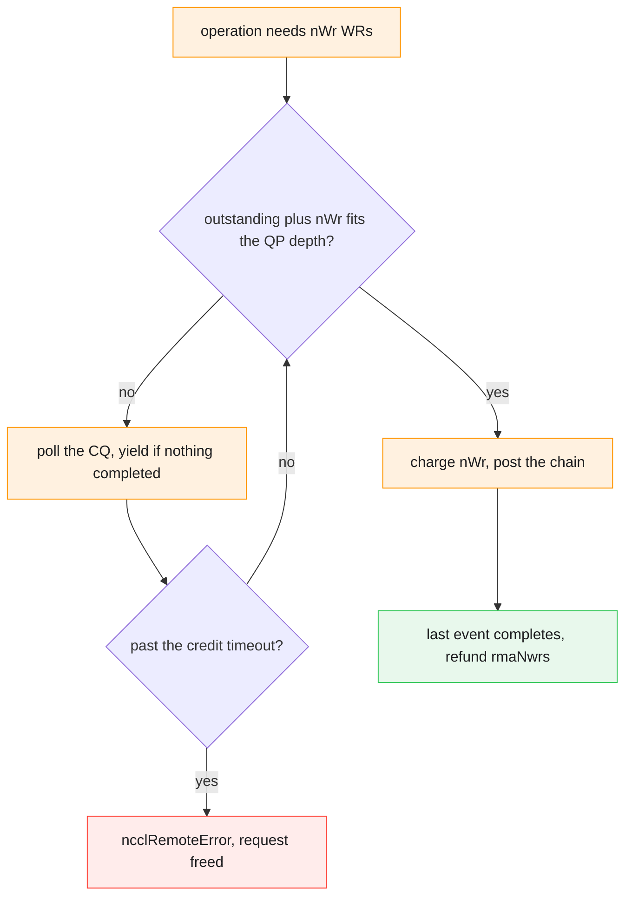

# IB-CAST GIN/RMA: per-segment MRs and completion-driven credits

The IB-CAST RMA backend `IbCastRmaIbProxy` (`net_ib_cast/gin.cc`, wire layer, [PR 10888](https://github.com/ROCm/rocm-systems/pull/10888)) ports the classic GIN/RMA design to IB-CAST: one MR per segment, the consensus gather, and the segmented WR builder. This doc covers what IB-CAST adds: a versioned consensus record, rkey lookup by physical device, completion-driven send-queue credits with a bounded wait, error-owner propagation, and an AINIC recovery hook. Read [GIN/RMA](multi_segment_gin_rma.md) first for the shared design.

## Scope

GIN/RMA never touches the CTS FIFO, so none of the [IB-CAST P2P](multi_segment_netib_cast.md) side-table work applies here.

| Surface | IB-CAST P2P | IB-CAST GIN/RMA |
|---|---|---|
| Entry point | `netIbCast` send and receive | `IbCastRmaIbProxy` vtable |
| Remote layout | side table per CTS slot | handle tables gathered at registration |
| Connect capability | `NCCL_IB_CAP_MULTISEG` | none |
| Switch accessor | `IbCastAdvertiseMultiSeg()` | `rcclRmaMultiSegEnabled()` |
| Split | after the CAST scheduler's chunk | `IbCastRmaBuildSegmentedWrs` |

Both accessors read the same parameter, so the value must match on every rank. IB-CAST `gin.cc` must not include `net_ib/gin.h`, because `gin_cast.h` uses the same include guard; it shares only `net_ib/rma_multiseg.h` through `common_cast.h`.

## Code layout

Develop's bodies stay in `net_ib_cast/gin.cc`. Each entry point returns the matching `rcclIbCastRmaIbProxy*` function when the switch is on: `RegMrSymDmaBuf` (and `RegMrSym`, which calls it with `fd = -1`), `DeregMrSym`, `IPut`, `IGet`, `IPutSignal`, `IFlush` and `Test`. `IbCastRmaIbProxyConnect` ends in `rcclIbCastRmaIbProxyConnectFinish`, which allocates `regConsensus` with the switch on; `IbCastGinIbCloseColl` frees it. Outside `gin.cc`, the switch also gates the RMA QP depths (`IbCastBuildDataQpCreateAttr`, `IbCastFlushQpSendDepth`) and the AINIC abandon hook, both only for `isRma` comms.

## Handle and indexing

`IbCastRmaProxySegMrHandle` has the classic fields plus `ibDevNs`:

| Table | Index | Value |
|---|---|---|
| `base_vas` | `rank * nSegments + seg` | VA of that rank's segment |
| `rkeys` | `(rank * nSegments + seg) * MAX_DEVS + slot` | rkey in registration slot `slot` |
| `ibDevNs` | `rank * MAX_DEVS + slot` | physical `ibDevN` of that slot, or -1 |
| `rankSegOff` | `rank * (NCCL_RMA_MAX_SEGMENTS + 1)` | that rank's `segOff` row |

IB-CAST registers through `cComm->recvComm` but posts on per-peer QPs whose device indices may name a different physical HCA. So `IbCastRmaDevSlot` maps a physical `ibDevN` to a registration slot with `ncclRmaDevSlotOf`: data WRs use the remote QP's device and flush reads use the local one (`ncclRmaRkeyIbDevN`). A missing slot is a WARN and `ncclInternalError`. `IbCastRmaSegOf` finds the half-open segment containing an offset in that rank's row (`ncclRmaSegIndexOf`).

## Registration

The walk is the classic one, including whole-page export, the `segBase == 0` guard and the host owner fd lookup. IB-CAST differences:

- The consensus record is `IbCastRmaProxyRegistration { magic 0x524d5347, version 1, status, nSegments, segOff[17] }`. Every record's magic and version are checked before its status, and a mismatch fails every rank with `ncclInvalidUsage`.
- `segOff` is copied into the record only when the local handle is ready (`ncclRmaRegistrationHandleReady`).
- After the second gather, three allgathers fill `localVas` (`nSegments` addresses), `localRkeys` (`nSegments * NCCL_IB_MAX_DEVS_PER_NIC`) and `localIbDevNs` (`NCCL_IB_MAX_DEVS_PER_NIC`).
- A failed `ncclCalloc` of the handle is recorded and still reaches the gather. Rollback deregisters only complete handles and frees `base_vas`, `rkeys`, `ibDevNs`, `rankSegOff` and the handle once.
- The handle carries `rcclRmaSegMrTag`, so tests read the segment count through `rcclRmaIbProxyMrSegmentCount` under IB-CAST as well.

## Data path

`IbCastRmaBuildSegmentedWrs` is the classic loop with device-slot lookup for both rkeys and lkeys:

- **IPut, IGet.** Paired mode on `qps[0]`, at most 64 data WRs; only the last WR is signaled. A zero-size operation builds no WR, carries no event or credits, and completes on its first `Test()` without waiting on the request posted before it, because IB-CAST has no sequence ids.
- **IPutSignal.** Put slices unsignaled, then one fetch-and-add on the segment holding `signalOff` (8-byte aligned, inside one segment); only the atomic is signaled. Size 0 posts only the atomic.
- **IFlush.** Flush mode on the receive comm's `gpuFlush` QP against the rank's own window, one read per segment (at most 16), only the last signaled. The flush QP's `devIndex` and `remDevIdx` are the local receive device.

## Credits

Every chain reserves send-queue credits before posting, through `IbCastRmaReservePostComplete`:

- **Capacity.** The per-comm counter `ncclIbNetCommBase::rmaWrsOutstanding` is checked against `NCCL_RMA_MAX_SEND_QP_WRS` = 575 on the send comm (put, get, signal) or `NCCL_RMA_MAX_FLUSH_QP_WRS` = 271 on the receive comm (flush). `IbCastBuildDataQpCreateAttr` creates the RMA data QPs at those depths only with the switch on; with it off, IB-CAST RMA keeps develop's 512 and 256.
- **Deadline.** `IbCastRmaCreditTimeoutNs` is `(4096 ns << clamp(NCCL_IB_TIMEOUT, 0, 31)) * (clamp(NCCL_IB_RETRY_CNT, 0, 7) + 1)`, read through `ncclParamIbCastTimeout` and `ncclParamIbCastRetryCnt`, and never less than 2 s (about 34 s with the defaults 20 and 7), so a link that is still retrying does not fail the post.
- **Post.** `IbCastRmaPostWrs` posts only when `nWr > 0`. On failure it counts the accepted prefix with `ncclRmaPostedWrCount` and refunds the unposted tail, or everything if nothing posted. `IbCastRmaCompletePostedRequest` then applies the [prefix-post rule](multi_segment_gin_rma.md#prefix-post-and-completion).
- **Refunds** all go through `IbCastRmaRefundWrs`, which WARNs about a credit underflow and returns `ncclInternalError` if a refund exceeds `req->rmaNwrs` or the counter.

## Error completions

Any caller's CQ poll can retire any request on that CQ, so errors must reach the request that owns them:

- `IbCastRmaPollCq` logs one WARN per error completion (peer, status, opcode, `vendor_err`, request type) and marks the owner `NCCL_NET_IB_REQ_FAILED` unless the slot is unused. After a QP error the HCA flushes every outstanding WQE with an error, so expect one WARN per flushed WQE.
- `IbCastRmaAccountCompletion` decrements the owner's event and refunds `rmaNwrs` when it reaches 0. An error completion that arrives after the owner's event is consumed is a flushed duplicate and is skipped; a success completion without an event is an internal error.
- `rcclIbCastRmaIbProxyTest` on a FAILED request returns `done = 1` with `ncclRemoteError` and releases its credits and slot, since no completion will return them.
- **AINIC port recovery.** `IbCastPortRecoveryQpsRestoreAinic` calls `IbCastRmaAbandonDeviceRequests` before destroying the QPs. For an RMA comm with the switch on, every in-use request with events on that device has its events zeroed, its credits subtracted (clamped at 0), and its type set to FAILED. The rebuilt flush QP takes `IbCastFlushQpSendDepth`.

## Tests

`RmaMultiSegmentMPITest` and `RmaMultiSegmentPostMPITest` run under IB-CAST through `RmaMPITestBase`, which resolves `IbCastRmaIbProxy` when `NCCL_NET=IB-CAST`. IB-CAST-specific expectations:

- Zero-size operations complete on their own: `ZeroSizeOpsCompleteWithQueuedPredecessor` and `RejectedOpsLeaveNoSlotOrSequenceGap` expect the zero-size op done on its first `test()` under IB-CAST and polled under classic, and the opposite for its predecessor.
- `IPutSignalSendQueueOversubscribe` (opt-in, `RCCL_MSEG_SQ_STRESS=1`) posts `2 * NCCL_RMA_SEND_QP_WRS / (maxWrs + 1)` maximum putSignals without `test()`. Under IB-CAST it expects zero rejected and zero failed posts; on both backends context 1 must still deliver into bytes the flood never touched.

Runner jobs are `cast_rma_multisegment`, `cast_rma_multisegment_hybrid` and the IB-CAST twins in the architecture configs; see [testing](multi_segment_testing.md#runner-jobs).

## Review checklist

- `gin.cc` differs from develop only by one-line dispatches, the connect-finish call, the `regConsensus` free and the multi-segment block.
- `regConsensus`, the RMA QP depths and the AINIC abandon hook are gated on the switch (and `isRma` where it applies).
- Limits and depths come from the shared `net_ib/rma_multiseg.h`; `net_ib/gin.h` is not included.
- Consensus records are fixed-size, checked for magic, version, status, equal counts and valid `segOff` on every rank.
- rkeys and local MRs are found through the slot of the physical `ibDevN`.
- Credits are reserved before posting and refunded only through `IbCastRmaRefundWrs`; the wait has the 2 s floor.
- An error completion marks its owner FAILED even when another request drained it; flushed duplicates are skipped.
- GDAKI `regMrSymDmaBuf` stays NULL; proxy RMA is the ROCm path.

## Symbol index

| Concern | Symbols (`net_ib_cast/gin.cc` unless noted) |
|---|---|
| Handle and lookup | `IbCastRmaProxySegMrHandle`, `IbCastRmaSegOf`, `IbCastRmaRangeOk`, `IbCastRmaDevSlot`, `IbCastRmaRemoteRkey` |
| Consensus | `IbCastRmaProxyRegistration`, `IBCAST_RMA_REGISTRATION_MAGIC`, `IBCAST_RMA_REGISTRATION_VERSION`, `rcclIbCastRmaIbProxyConnectFinish`, `CastIbGinCollComm::regConsensus` (`gin_cast.h`) |
| Builder | `IbCastRmaBuildSegmentedWrs` |
| Credits | `IbCastRmaReservePostComplete`, `IbCastRmaReserveWrs`, `IbCastRmaPostWrs`, `IbCastRmaRefundWrs`, `IbCastRmaCreditTimeoutNs`, `rmaWrsOutstanding`, `rmaNwrs` (`common_cast.h`) |
| Completions | `IbCastRmaPollCq`, `IbCastRmaAccountCompletion`, `IbCastRmaCompletePostedRequest`, `rcclIbCastRmaIbProxyTest` |
| Recovery | `IbCastRmaAbandonDeviceRequests` (`p2p_resiliency_recovery_ainic.cc`) |
| QP depths | `NCCL_RMA_MAX_SEND_QP_WRS` (575), `NCCL_RMA_MAX_FLUSH_QP_WRS` (271) in `net_ib/rma_multiseg.h`; `IbCastFlushQpSendDepth` (`connect_cast.h`) |
