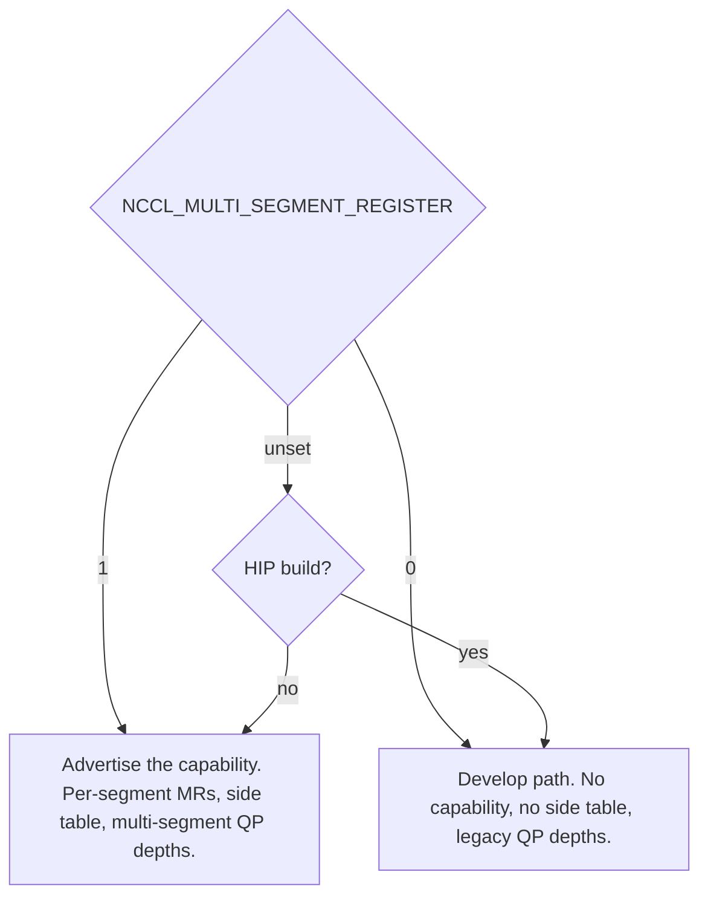
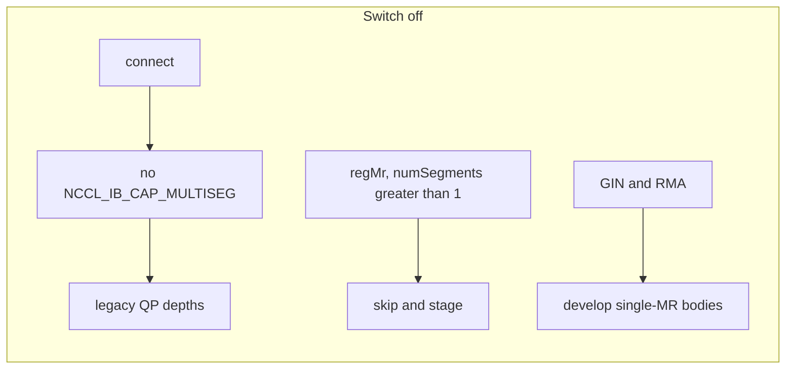
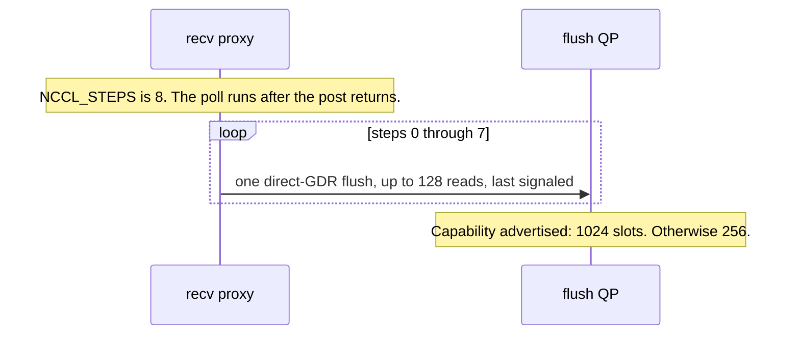
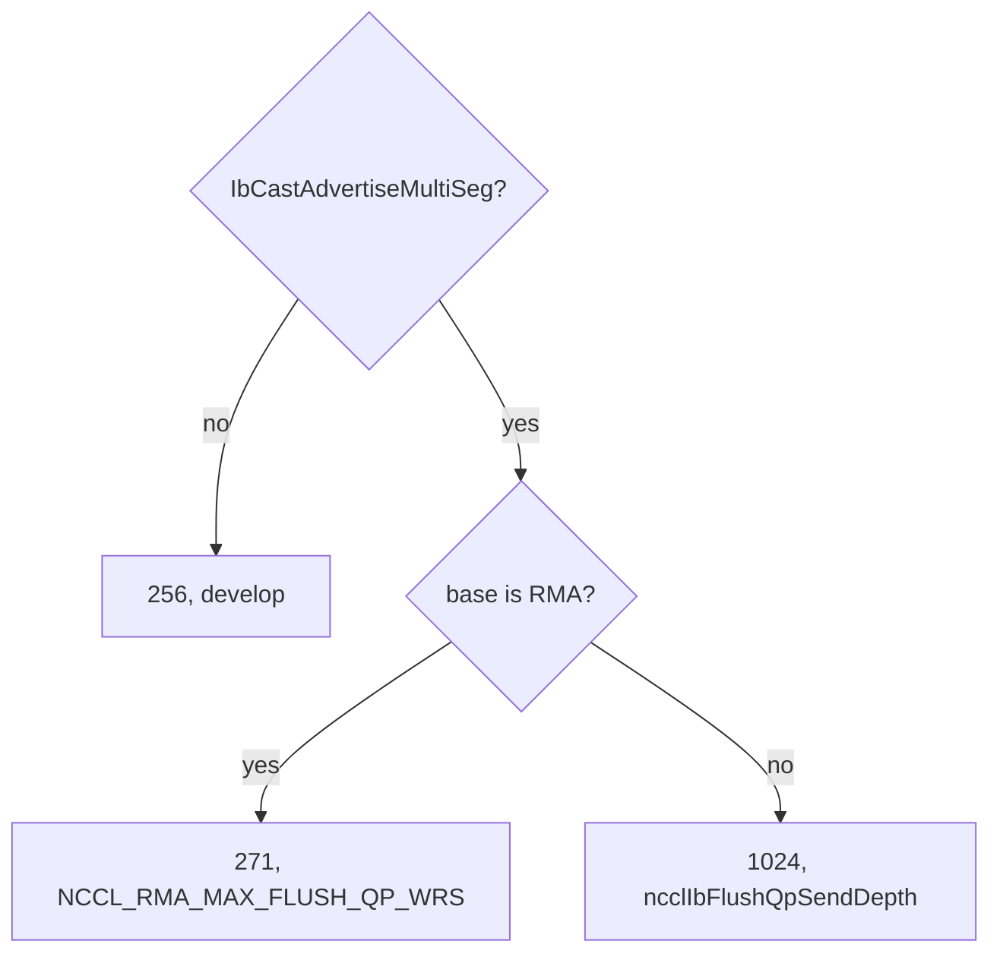
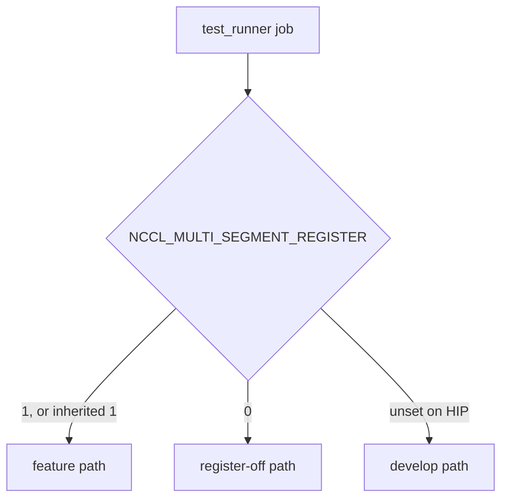
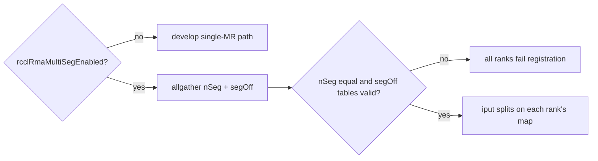
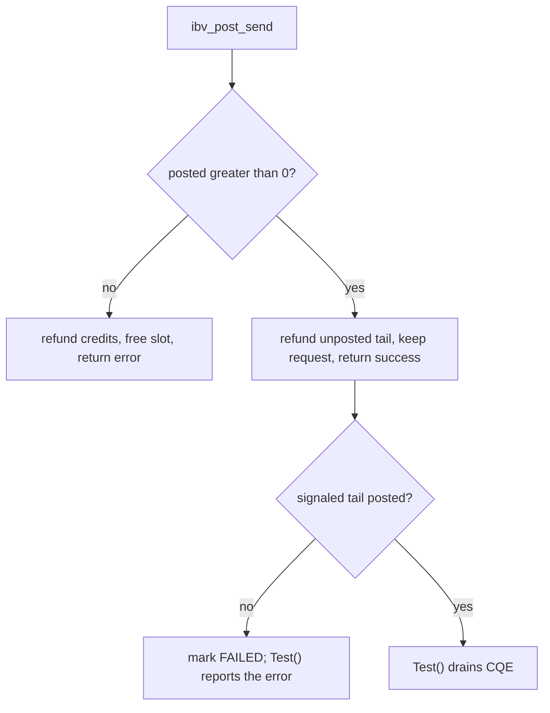

# Code Walkthrough — CAST GIN / RMA Multi-Segment

> **Shared facts** (constants, v14 GIN/RMA split, credits/signaling, registration transcript, tests) are in the overview: [`multi_segment_dmabuf_gin_and_netib.md`](multi_segment_dmabuf_gin_and_netib.md) §8.

**Audience:** RCCL reviewers implementing or reviewing CAST GIN/RMA multi-segment. **Last updated:** 2026-10-16. **Branch:** wire `users/atulkulk/mseg/multi-segment-dmabuf-cast-gin` ([ROCm/rocm-systems#10888](https://github.com/ROCm/rocm-systems/pull/10888)), the top of the stack. **Ticket:** AIRUNTIME-2351. **Design:** [`multi_segment_netib_cast_gin.md`](multi_segment_netib_cast_gin.md). **Current contract:** [`multi_segment_current.md`](multi_segment_current.md).

CAST GIN/RMA ports classic GIN/RMA (`net_ib/gin.cc`: composite handle + `ncclRmaBuildSegmentedWrs`) into `net_ib_cast/gin.cc`, on the v14 `ncclRma_t` vtable (`IbCastRmaIbProxy` / `RMA_IB_PROXY`), plus CAST-only completion-driven WR credits and a collective-safe registration transcript received into a per-comm buffer. Develop's functions in `net_ib_cast/gin.cc` gain only one-line dispatches on `rcclRmaMultiSegEnabled()` (`NCCL_MULTI_SEGMENT_REGISTER`, HIP default 0, non-HIP default 1). **No CTS. No side table. No connect cap.**

Classic GIN/RMA walkthrough: [`multi_segment_dmabuf_gin_and_netib.md`](multi_segment_dmabuf_gin_and_netib.md) §8.

## What changed on 2026-10-16

HIP now defaults `NCCL_MULTI_SEGMENT_REGISTER` to 0. The knob is still `ncclParamMultiSegmentRegister()` in `transport/generic.cc`. `NCCL_MULTI_SEGMENT_REGISTER=1` turns the feature on, on HIP and on every other build. An unset variable takes the develop path on a HIP build. A non-HIP build still defaults to 1. The commit is `9af53b9bca21` on `users/atulkulk/mseg/01-ce-recv-window-offset`, replayed through the stack.



With the switch off, connect does not advertise `NCCL_IB_CAP_MULTISEG` and does not append the side table, so the sender QP stays at `2 * NET_IB_MAX_REQUESTS`. NET, P2P IPC and NVLS leave a multi-segment buffer unregistered. GIN and RMA stay on develop's bodies and do not reserve credits. A device-only GIN window with more than one segment and no sysmem returns `ncclInvalidUsage` instead of registering only the first segment.



The direct-GDR flush QP is sized for one chain on every proxy step. `recvProxyProgress` posts `iflush` into `requests[step % NCCL_STEPS]` and returns before that flush is polled, so up to 8 flushes can be outstanding. With `RCCL_GDR_FLUSH_GPU_MEM_NO_RELAXED_ORDERING=0`, `rcclIbIflushMultiSeg` posts one RDMA read per receive per segment, at most `8 * 16 = 128` work requests, and signals only the last. Eight chains need `8 * 128 = 1024` slots. The previous depth, `NET_IB_MAX_REQUESTS + 128 = 384`, held three chains and the fourth post failed. `ncclIbFlushQpSendDepth` in `net_ib/multiseg.h` returns `NCCL_STEPS * NCCL_NET_IB_MAX_RECVS * NCCL_IB_MAX_SEGMENTS` when the peer advertised the capability, and `NET_IB_MAX_REQUESTS` (256) otherwise. Classic `ncclIbCreateFlushQp` calls it. `connect.cc` static-asserts that the multi-segment result holds at least one chain per step. The host test is `NetIbMultiSeg.FlushQpDepthCoversEveryOutstandingStep`.



CAST non-RMA comms use the same helper. CAST RMA comms keep `NCCL_RMA_MAX_FLUSH_QP_WRS` (271), because RMA credits wait until one chain completes before the next post. With the switch off every flush QP stays at 256.



The scratchpad flush (`RCCL_GDR_FLUSH_GPU_MEM_NO_RELAXED_ORDERING=1`, the default) posts one write and one read and does not fill 1024 slots. The enlarged depth is for the direct-GDR path. `net_ib_multisegment_flush` selects that path by setting the parameter to 0.

Jobs that test the feature set `NCCL_MULTI_SEGMENT_REGISTER=1` in the runner config, because an unset HIP job now takes the off path. Register-off jobs stay at 0. `cast_multisegment_opt_recv_2qp` inherits 1 from `cast_multisegment_opt_recv`. `net_ib_rma_multisegment_wrbatch` on the wire branch, and the hybrid nightly jobs on 09 including `net_ib_multisegment_hybrid_stress_nightly`, set 1 as well. The WR-batch job fails under `RCCL_TEST_RMA_MSEG_REQUIRE=1` when the per-segment registration log is missing, and the hybrid IGet stress skips. `multisegment_host_boundary_math` is host-only and does not read the switch.



## What changed on 2026-10-14

- §2: `net_ib_cast/gin_multiseg_cast.h` was folded into `net_ib_cast/gin.cc`; the bodies follow `struct IbCastRmaIbProxyCtx` in the same file.
- §2 and §5: `common_cast.h` no longer defines `NCCL_IB_RMA_MAX_SEND_WRS` / `NCCL_IB_RMA_MAX_FLUSH_WRS`; CAST uses `NCCL_RMA_MAX_SEND_QP_WRS` (575) and `NCCL_RMA_MAX_FLUSH_QP_WRS` (271) directly.
- §5: the FAILED branch of `rcclIbCastRmaIbProxyTest` documents why it releases credits.

## What changed since the 2026-10-07 revision

- §2: the multi-segment bodies were split from develop's in `gin.cc` as `static rcclIbCastRmaIbProxy*` functions (at the time in a separate header, folded back on 2026-10-14); `gin.cc` keeps develop's bodies behind a one-line `rcclRmaMultiSegEnabled()` dispatch in each entry point.
- §3: the multi-segment handle is `IbCastRmaProxySegMrHandle`; develop's `IbCastRmaProxyMrHandle` is unchanged and used with the switch off.
- §4: `regConsensus` is allocated by `rcclIbCastRmaIbProxyConnectFinish` only with the switch on. The transcript checks `magic` / `version` inline (`ncclRmaTranscriptHeaderOk` is gone).
- §5: RMA QP depths (575 / 271) and `IbCastFlushQpSendDepth` apply only with the switch on; the switch off keeps develop's depths. New AINIC hook `IbCastRmaAbandonDeviceRequests` fails and refunds in-flight RMA requests before QPs are rebuilt.
- §2: `ncclRmaReleaseSeqId`, `rcclRmaMultiSegEnabled()` and `NCCL_RMA_SEND_QP_WRS` now live in `net_ib/rma_multiseg.h`; `gin_cast.h` no longer includes it (CAST gets it through `common_cast.h`).
- §6 and §7: checklist and tests updated for the switch (`MultiSegmentRegisterOff_KeepsUpstreamPath`, `RCCL_TEST_RMA_MSEG_REQUIRE`), `ZeroSizeOpDone`, and the flood sized from `NCCL_RMA_SEND_QP_WRS`.

---

## 1. What this PR does

With `NCCL_MULTI_SEGMENT_REGISTER` on, register **one dma-buf MR per physical segment** on `IbCastRmaIbProxy`, all-gather `nSeg` and each rank's `segOff`, and split IPut/IGet/IPutSignal/IFlush at local **and** remote bounds. `nSegments == 1` still uses the caller fd and posts one WR per op (for sizes up to `UINT32_MAX`). With the switch off, every entry point runs develop's single-MR code.

Simple picture: [`multi_segment_current.md`](multi_segment_current.md).



---

## 2. File map

| File | Stock CAST GIN (before) | On the wire branch |
| --- | --- | --- |
| `net_ib/rma_multiseg.h` | n/a | **shared** limits (`NCCL_RMA_MAX_SEGMENTS 16`, `NCCL_RMA_MAX_DATA_WRS 64`, QP depths `NCCL_RMA_MAX_SEND_QP_WRS` / `NCCL_RMA_MAX_FLUSH_QP_WRS`, classic `NCCL_RMA_SEND_QP_WRS`) and helpers: slicing, signaling, credits, count / `segOff` validation, `ncclRmaSegIndexOf`, prefix-post (`ncclRmaPostedWrCount`, `ncclRmaCompletePostedRequest`), classic `ncclRmaReleaseSeqId`, device-slot lookup; `rcclRmaMultiSegEnabled()` and the classic `rcclRmaIbProxy*` declarations |
| `net_ib/gin.h` | classic | classic `ncclGinIbCollComm` (with `regConsensus`); CAST does not include it |
| `net_ib_cast/gin.cc` | single `mrHandle` / one rkey / one WR | develop's bodies plus one-line `rcclRmaMultiSegEnabled()` dispatches in `RegMrSymDmaBuf`, `DeregMrSym`, `IPut`, `IGet`, `IPutSignal`, `Test`, `IFlush`; `Connect` ends in `rcclIbCastRmaIbProxyConnectFinish`; `IbCastGinIbCloseColl` frees `regConsensus`; after `struct IbCastRmaIbProxyCtx`, the `RCCL:`-marked multi-segment code: `IbCastRmaProxySegMrHandle`, `IbCastRmaProxyRegistration`, `IbCastRmaBuildSegmentedWrs`, credits, completion handling, transcript, and the `rcclIbCastRmaIbProxy*` bodies |
| `net_ib_cast/gin_cast.h` | — | `CastIbGinCollComm::regConsensus` |
| `net_ib_cast/common_cast.h` | — | includes `net_ib/multiseg.h` and `net_ib/rma_multiseg.h`; uses the shared depths `NCCL_RMA_MAX_SEND_QP_WRS` (575) and `NCCL_RMA_MAX_FLUSH_QP_WRS` (271) directly, `static_assert(NET_IB_MAX_REQUESTS == NCCL_RMA_MAX_INFLIGHT_REQUESTS)`, `NCCL_NET_IB_REQ_FAILED`, `ncclIbNetCommBase::isRma` and `rmaWrsOutstanding`, `ncclIbRequest::rmaNwrs` |
| `net_ib_cast/connect_cast.h`, `connect.cc` | — | `IbCastFlushQpSendDepth` (256 with the switch off; 271 for RMA and 1024 for P2P with it on); `IbCastBuildDataQpCreateAttr` applies the RMA depths only when `isRma && rcclRmaMultiSegEnabled()`; `isRma` set from the connect handle |
| `net_ib_cast/p2p_resiliency_recovery_ainic.cc` | — | `IbCastRmaAbandonDeviceRequests` before QP rebuild; rebuilds the flush QP with `IbCastFlushQpSendDepth` |
| `test/transport/RmaMPI/RmaMultiSegmentMPITests.cpp` | classic `NCCL_NET=IB` | same fixtures with `NCCL_NET=IB-CAST`; IB-CAST-specific expectations for zero-size ops and the send-queue flood; switch-off test |
| `test/RmaSegmentMathTests.cpp` | — | host tests for the shared helpers (includes `net_ib/rma_multiseg.h`) |
| `tools/scripts/test_runner/configs/net_ib_transport.json` | — | `cast_rma_multisegment` (IB-CAST twin of `net_ib_rma_multisegment`) |
| `tools/scripts/test_runner/configs/mi300x_mellanox_ib.json`, `mi300_mellanox_ib_func.json` | — | `multisegment_cast_rma_multinode` (all, post path; send-queue oversubscribe in `mi300x_mellanox_ib.json` only) |
| `net_ib/gin.cc` | classic `ncclRma*` | not edited by CAST work |

Do not include `net_ib/gin.h` from CAST `gin.cc` (`gin_cast.h` uses the same include guard `_NCCL_NET_IB_GIN_H_`); share only the dependency-free `net_ib/rma_multiseg.h`.

---

## 3. Handle and indexing (`net_ib_cast/gin.cc`)

```c
struct IbCastRmaProxySegMrHandle {
  int nSegments;
  size_t segOff[NCCL_RMA_MAX_SEGMENTS + 1];
  struct ncclIbMrHandle* mrHandle[NCCL_RMA_MAX_SEGMENTS];
  uintptr_t* base_vas;
  uint32_t* rkeys;
  int* ibDevNs;
  size_t* rankSegOff;
};
```

```text
base_vas[rank * nSegments + seg]                     = VA of that rank's segment
rkeys[(rank * nSegments + seg) * MAX_DEVS + slot]    = rkey in registration slot `slot`
ibDevNs[rank * MAX_DEVS + slot]                      = physical ibDevN of that slot, or -1
rankSegOff[rank * (NCCL_RMA_MAX_SEGMENTS + 1)]       = that rank's segOff row
```

`IbCastRmaSegOf(h, rank, off)` returns `ncclRmaSegIndexOf(that rank's segOff, nSegments, off)`: the half-open bucket containing `off`, clamped to the last segment at or past the end. `IbCastRmaRangeOk` checks that rank's terminal size with `ncclRmaOffsetRangeOk`. `IbCastRmaDevSlot` maps a physical `ibDevN` to a registration slot with `ncclRmaDevSlotOf`; `IbCastRmaRemoteRkey` reads `rkeys` through `IbCastRmaRkeyIndex`.

Develop's `IbCastRmaProxyMrHandle` in `gin.cc` (`mrHandle`, `base_vas`, `rkeys`) is unchanged and only used with the switch off.

---

## 4. Registration

`IbCastRmaIbProxyConnect` (once per comm), after `IbCastGinIbConnect`, returns `rcclIbCastRmaIbProxyConnectFinish(collComm, nranks)`:

- With the switch off it returns `ncclSuccess` and `regConsensus` stays NULL.
- With it on, `ncclIbMalloc(&cComm->regConsensus, nranks * sizeof(struct IbCastRmaProxyRegistration))`. `ncclIbMalloc` returns page-aligned memory, which matters because the allGather registers whole pages of the receive buffer for remote write. On failure the coll comm is closed with `IbCastGinIbCloseColl`, `*collComm` is set to NULL and the error returned. `IbCastGinIbCloseColl` frees `regConsensus`.

`IbCastRmaIbProxyRegMrSymDmaBuf` → `rcclIbCastRmaIbProxyRegMrSymDmaBuf`:

1. `registrations = cComm->regConsensus`. `ncclCalloc` the handle; a failure is recorded and jumps to the transcript exchange, it does not return early.
2. If `NCCL_PTR_CUDA` and `ncclCuMemEnable()`, `ncclCuMemGetAddressRange` → `nSeg`.
3. `nSeg > NCCL_RMA_MAX_SEGMENTS` → recorded as a local failure (still exchanged below; not an early return).
4. `nSeg == 1`: `IbCastRegMrDmaBufInternal` on the whole range with the caller fd.
5. `nSeg > 1`: per segment, `inSeg = (segBase == 0) ? segSize : segSize - (segPtr - segBase)`. Export a DMA-BUF from `segPtr` rounded down to a page through `segPtr + thisLen` rounded up to a page (`ncclOsGetPageSize`, `ALIGN_SIZE`), register `[segPtr, segPtr + thisLen)` at DMA-BUF offset 0, `close(fd)`, record `segOff[s+1]`. Increment `registered` only after a complete handle. Bytes left after `nSeg` segments are a local failure.
6. Fill `localRkeys[s][d]` from `mrHandle[s]->mrs[d]` and `localIbDevNs[d]` from the recv comm. Null MR → local failure.
7. **Fixed-size transcript:** every rank allGathers `IbCastRmaProxyRegistration { magic=IBCAST_RMA_REGISTRATION_MAGIC (0x524d5347), version=IBCAST_RMA_REGISTRATION_VERSION (1), status, nSegments, segOff[NCCL_RMA_MAX_SEGMENTS+1] }` into `registrations`, even on local failure (`segOff` is copied only when `ncclRmaRegistrationHandleReady`). For every record: `magic` and `version` must match (else `ncclInvalidUsage`), then `status` (any failure fails all ranks). Then for every record: `ncclRmaSegmentCountsMatch` (equal `nSeg`; sizes may differ) and `ncclRmaSegOffTableValid` (starts at 0, never decreases); either failure returns `ncclInvalidUsage` on every rank.
8. Allocate `rankSegOff` (and copy every rank's row), `base_vas`, `rkeys`, `ibDevNs`; allGather the record again with the allocation status and reconcile, then allGather `localVas` (`nSeg` uintptr_t), `localRkeys` (`nSeg * NCCL_IB_MAX_DEVS_PER_NIC` uint32_t) and `localIbDevNs` (`NCCL_IB_MAX_DEVS_PER_NIC` int).
9. INFO `registered multi-segment buffer ... as N DMA-BUF MRs` when `nSeg > 1` (the tests read this marker to detect the per-segment path; correctness checks gate on handle `nSegments`).

Rollback: the `fail:` path deregisters only the `registered` count of **complete** handles, then frees `base_vas`/`rkeys`/`ibDevNs`/`rankSegOff`/handle — no leak, no double free. `rcclIbCastRmaIbProxyDeregMrSym` loops `s = 0 .. nSegments-1`, deregisters each segment's handle, and frees the tables.

---

## 5. Segmented WR builder

`IbCastRmaBuildSegmentedWrs(wr, sge, maxWr, &nWr, opcode, commBase, qp, localH, localRank, localOff, remoteH, remoteRank, remoteOff, size, flushSge)`:

```text
rkeyIbDevN = ncclRmaRkeyIbDevN(local qp ibDevN, remote qp ibDevN, flush?)
remote slot = IbCastRmaDevSlot(remoteH, remoteRank, rkeyIbDevN); local slot likewise (paired only)
missing slot: WARN, ncclInternalError
while rem > 0:
    if n >= maxWr: reject (WARN, ncclInternalError)         # 64-WR guard for data
    rs = IbCastRmaSegOf(remoteH, remoteRank, rOff); remote bound from that rank's map
    if not flush:
        ls = IbCastRmaSegOf(localH, localRank, lOff); local bound from that rank's map
        chunk = ncclRmaSegmentSliceBytes(rem, local bound, remote bound)  # also clamps to UINT32_MAX
    else:
        chunk = min(rem, remote bound)
    remote_addr = base_vas[remoteRank * nSeg + rs] + (rOff - that rank's segOff[rs])
    rkey = rkeys[remoteRank, rs, remote slot]
    if flush: sge = *flushSge; sge.length = 1
    else: lkey from mrHandle[ls]->mrs[local slot]; missing MR: WARN, ncclInternalError
    chain wr[n-1].next = &wr[n]
```

The caller then sets `wr[i].wr_id` to its request index and `send_flags = ncclRmaWrIsSignaled(i, nWr) ? IBV_SEND_SIGNALED : 0`, so only the final WR is signaled.

**QP depths.** `IbCastBuildDataQpCreateAttr` uses `NCCL_RMA_MAX_SEND_QP_WRS = 575` for the RMA sender's data QPs and `NCCL_RMA_MAX_FLUSH_QP_WRS = 271` for the RMA receiver's data-QP send queue only when `base->isRma && rcclRmaMultiSegEnabled()`. The recv comm's `gpuFlush` QP takes `IbCastFlushQpSendDepth` (271 for RMA with the switch on). With the switch off, CAST RMA keeps develop's `2 * NET_IB_MAX_REQUESTS` (512) send and `NET_IB_MAX_REQUESTS` (256) flush depths.

**Credits + signaling.** `IbCastRmaReservePostComplete` runs reserve, post, complete:

- `IbCastRmaReserveWrs` loops until `ncclRmaWrCreditsAvailable(rmaWrsOutstanding, nWr, maxWrs)`. `maxWrs` is `NCCL_RMA_MAX_SEND_QP_WRS = 575` on the send comm (put/get/signal) or `NCCL_RMA_MAX_FLUSH_QP_WRS = 271` on the recv comm (flush). Each iteration polls the CQ and calls `sched_yield` if nothing completed. After `IbCastRmaCreditTimeoutNs()` it returns `ncclRemoteError` and the request is freed. The deadline is `(4096 ns << clamp(NCCL_IB_TIMEOUT, 0, 31)) * (clamp(NCCL_IB_RETRY_CNT, 0, 7) + 1)` (read through `ncclParamIbCastTimeout` / `ncclParamIbCastRetryCnt`), never below 2 s (about 34 s with the defaults 20 and 7). Then it charges `nWr` and records `req->rmaNwrs`.
- `IbCastRmaPostWrs` posts only if `nWr > 0`. On failure it counts the accepted prefix with `ncclRmaPostedWrCount`; with nothing posted it refunds everything, otherwise it refunds the unposted tail.
- `IbCastRmaCompletePostedRequest` applies `ncclRmaCompletePostedRequest`: nothing posted and an error → free the slot and return the error; otherwise keep the request, add an event if anything posted, and return success so `Test()` drains; a prefix that lost the signaled tail marks the request FAILED.

All refunds go through `IbCastRmaRefundWrs(req, n)`, which WARNs `work-request credit underflow` and returns `ncclInternalError` if `n` exceeds `req->rmaNwrs` or `rmaWrsOutstanding`. Classic GIN (05) and classic/CAST P2P do not use this counter; see [`multi_segment_current.md`](multi_segment_current.md) §6a.

**AINIC port recovery.** `IbCastPortRecoveryQpsRestoreAinic` calls `IbCastRmaAbandonDeviceRequests(baseComm, devIndex)` before destroying the QPs. It returns at once unless `base->isRma && rcclRmaMultiSegEnabled()`. Otherwise, for each in-use request with `events[devIndex] > 0`, it zeroes that event count, subtracts `rmaNwrs` from `rmaWrsOutstanding` (clamped at 0), clears `rmaNwrs`, and sets the type to `NCCL_NET_IB_REQ_FAILED`. The rebuilt flush QP takes `IbCastFlushQpSendDepth`.



**Completions (`IbCastRmaPollCq`).** Any caller's poll can retire any request on that CQ:

- A non-success completion logs one WARN with the peer, status, opcode, `vendor_err` and request type, and marks the owner `NCCL_NET_IB_REQ_FAILED` unless the slot is unused. After a QP error the HCA flushes every outstanding WQE with an error, so expect one WARN per flushed WQE.
- `IbCastRmaAccountCompletion` decrements the owner's event and, at 0, refunds `rmaNwrs`. An error completion that arrives after the owner's event is already consumed is a flushed duplicate and is skipped; a success completion without an event is an internal error.
- `IbCastRmaIbProxyTest` → `rcclIbCastRmaIbProxyTest` on a FAILED request returns `done = 1` and `ncclRemoteError`, releasing its credits and slot. So an owner whose completion was drained by another request's `Test()` still fails, and its credits come back here because no completion will return them.

**Ops.**

- IPut/IGet: paired mode, `NCCL_RMA_MAX_DATA_WRS = 64` WR slots on `qps[0]`; only the last WR is signaled. With `size == 0` no WR is built: the request carries no event and no credits and completes on its first `Test()`, without waiting on the request posted before it. (Classic RMA ties a no-WR op to its predecessor's sequence id; CAST has no sequence ids.)
- IPutSignal: paired PUT slices **unsignaled**, then a single `IBV_WR_ATOMIC_FETCH_AND_ADD` on `IbCastRmaSegOf(signalMrHandle, rank, signalOff)` (which `ncclRmaSignalOffsetValid` requires to be 8-byte aligned and wholly inside one segment); only the atomic is signaled; slot bound `NCCL_RMA_MAX_SIGNAL_WRS = 65`. With `size == 0` only the atomic is posted.
- IFlush: flush mode on the recv comm's `gpuFlush` QP, remote handle = own window, `remoteRank = ginProxyCtx->rank`, `size = IbCastRmaMrBytes(h, rank)`, SGE = `gpuFlush.sge`, slot bound `NCCL_RMA_MAX_FLUSH_WRS = 16` (per op). One READ per segment; only the last is signaled.

---

## 6. Review checklist

- [ ] `gin.cc` differs from develop only by one-line `rcclRmaMultiSegEnabled()` dispatches, the `rcclIbCastRmaIbProxyConnectFinish` call, the `regConsensus` free and the `net_ib_cast/gin.cc` include; with the switch off develop's code runs unchanged.
- [ ] `regConsensus` is allocated only with the switch on; RMA QP depths and the AINIC abandon hook are gated on the switch and `isRma`.
- [ ] `NCCL_RMA_MAX_SEGMENTS` (16) and the QP depths come from the **shared** `net_ib/rma_multiseg.h`, not `gin_cast.h`. CAST does not include `net_ib/gin.h`.
- [ ] No CTS / side table / `NCCL_IB_CAP_MULTISEG` in this path.
- [ ] Registration gathers into the per-comm `regConsensus` buffer (page-aligned, allocated at connect); no stack array.
- [ ] Per-segment dma-buf export covers whole pages; fail path only deregisters complete handles (rollback, no double free).
- [ ] Fixed-size registration transcript (`magic`/`version`/`status`/`segOff[]`); `ncclRmaSegmentCountsMatch` and `ncclRmaSegOffTableValid` on every rank's record; per-rank `rankSegOff`; any rank's failure fails all ranks.
- [ ] rkeys and local MRs looked up through the registration slot of the physical `ibDevN` (`ncclRmaDevSlotOf`, `ncclRmaRkeyIbDevN`).
- [ ] Slices clamp to `min(local, remote, UINT32_MAX)`; >64-slice transfers rejected before posting.
- [ ] Only the **final** WR of each chain is signaled (`ncclRmaWrIsSignaled`).
- [ ] Credits reserved before posting against 575 (send) / 271 (flush); refunded only through `IbCastRmaRefundWrs` (on completion, on post failure, on a FAILED `Test`); underflow is an error. AINIC recovery refunds through `IbCastRmaAbandonDeviceRequests`.
- [ ] Credit wait deadline from `IbCastRmaCreditTimeoutNs` (2 s floor).
- [ ] Prefix post: keep the request **and return success** (`ncclRmaCompletePostedRequest`); a lost signaled tail marks FAILED.
- [ ] An error completion marks its owner FAILED even when drained by another request; flushed duplicates are skipped, not counted as errors.
- [ ] Host VMM: `inSeg` uses `segBase == 0 ? segSize : segSize - (segPtr - segBase)`.
- [ ] Flush QP `devIndex` / `remDevIdx` set to the local recv device at create; flush QP depth from `IbCastFlushQpSendDepth`.
- [ ] IPutSignal atomic is 8-byte aligned and contained in one segment (`ncclRmaSignalOffsetValid`).
- [ ] IFlush fences **every** segment, not only segment 0.
- [ ] `size == 0` IPut/IGet does not post an uninitialized WR and completes without waiting on its predecessor.
- [ ] GDAKI `regMrSymDmaBuf` still NULL.

## 7. Tests

```text
NCCL_NET=IB-CAST NCCL_CUMEM_ENABLE=1 NCCL_MULTI_SEGMENT_REGISTER=1 RCCL_FORCE_ENABLE_DMABUF=1 \
NCCL_GIN_ENABLE=1 NCCL_GIN_TYPE=2
mpirun -np 2 (one rank per node) rccl-UnitTestsMPI --gtest_filter='RmaMultiSegmentMPITest.*:RmaMultiSegmentPostMPITest.*'
```

These are the environment settings of `multisegment_cast_rma_multinode` (`mi300x_mellanox_ib.json` and `mi300_mellanox_ib_func.json`), which also sets `NCCL_LOCAL_REGISTER=1`, `NCCL_DEBUG_SUBSYS=REG`, `RCCL_MPI_LOG_ALL_RANKS=1`, `NCCL_IB_MERGE_NICS=1` and `NCCL_IB_MERGE_VFS=1` and excludes `RmaMultiSegmentMPITest.DeepEP_Hybrid*`. The `cast_rma_multisegment` config in `net_ib_transport.json` extends the classic `net_ib_rma_multisegment` config, so it runs the same tests and filters through IB-CAST, inherits `RCCL_TEST_RMA_MSEG_REQUIRE=1` (no rank on the multi-segment path is a failure, not a skip), and includes the two `NCCL_MULTI_SEGMENT_REGISTER=0` entries (`MultiSegmentRegisterOff_KeepsUpstreamPath`, `SingleSegmentRegression`).

Must prove boundary-crossing IPut/IGet complete, `UINT32_MAX`/>64-slice handling, IPutSignal atomic alignment/containment, credit gating, IFlush covering every segment, equal-count different-boundary puts, sub-page window bounds, collective rejection of bad layouts, registration after a rejected registration, and that the switch off keeps the develop path. Gate multi-seg correctness on handle `nSegments`; the INFO marker only tells the tests which path ran.

IB-CAST-specific expectations in the post-path fixture:

- `ZeroSizeOpsCompleteWithQueuedPredecessor` and `RejectedOpsLeaveNoSlotOrSequenceGap` check the zero-size op with `ZeroSizeOpDone` (done on its first `test()` under IB-CAST, polled under classic) and its predecessor with `DoneBehindZeroSizeOp` (done on its first `test()` under classic, polled under IB-CAST), because a no-WR op completes on its own under IB-CAST.
- `IPutSignalSendQueueOversubscribe` (opt-in with `RCCL_MSEG_SQ_STRESS=1`; runner entry `MultiSegment_CAST_RMA_SendQueueOversubscribe`) floods `2 * NCCL_RMA_SEND_QP_WRS / (maxWrs + 1)` putSignals without `test()`, twice the classic multi-segment send queue's worth. Under IB-CAST it expects zero rejected and zero failed posts; classic IB rejects posts. Both must then deliver a put on context 1 into bytes the flood did not touch. In the 2026-10-07 run (not yet repeated on the reworked stack), IB-CAST accepted 48 and rejected 0; classic IB accepted 27 and rejected 21.

`MultiSegmentRegisterOff_KeepsUpstreamPath` skips unless `NCCL_MULTI_SEGMENT_REGISTER=0`, registers a multi-segment window, and expects no rank to log the per-segment marker.

Host coverage for the shared helpers is `test/RmaSegmentMathTests.cpp` (for example `SegOffTableValidRequiresZeroStartAndOrder`, `SegIndexOfUsesHalfOpenOffsets`, `PrefixPostKeepsRequestOnlyWhenSomethingPosted`, and the classic `ReleaseSeqIdOnlyReturnsNewestId`).
