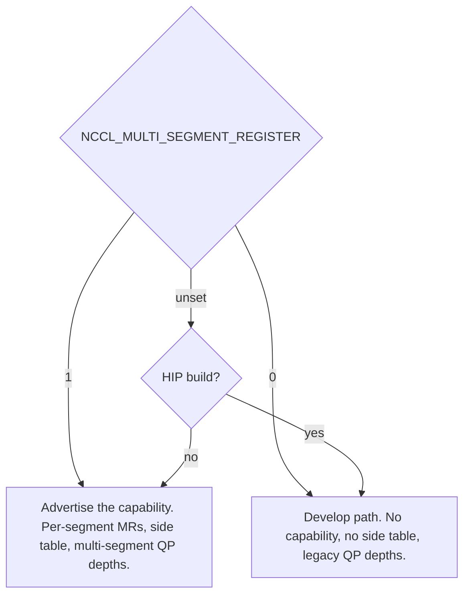
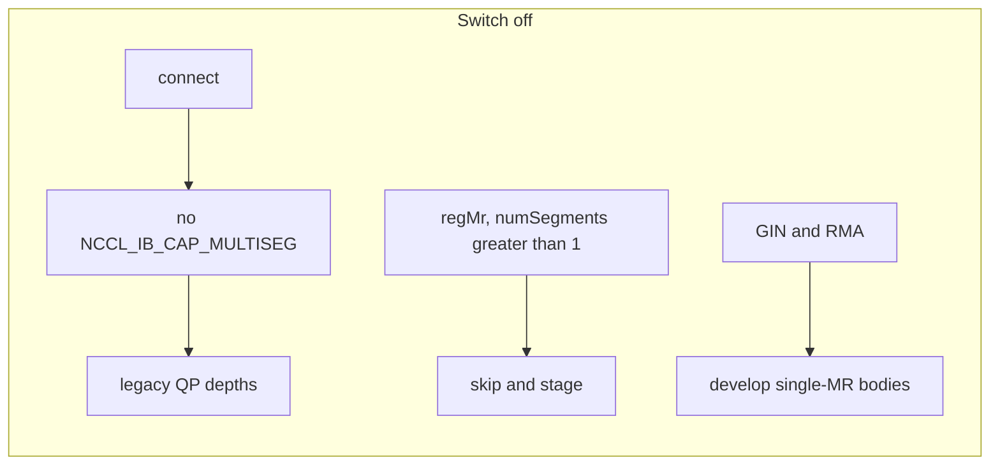
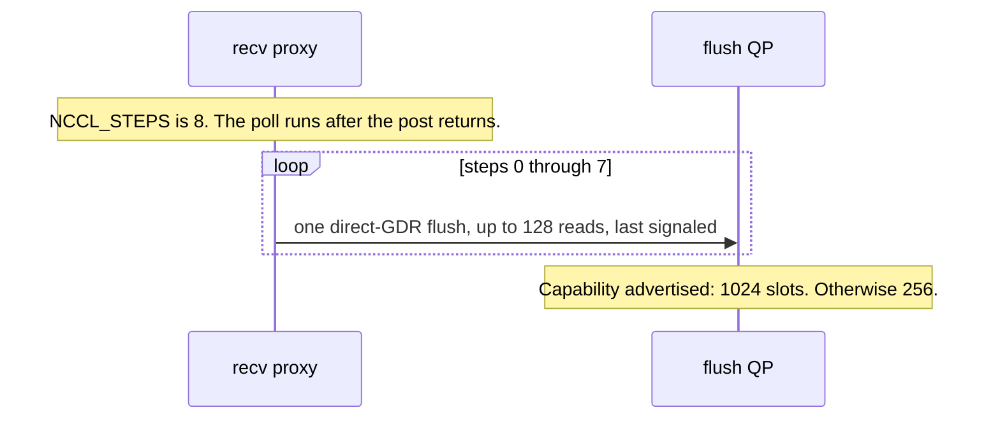
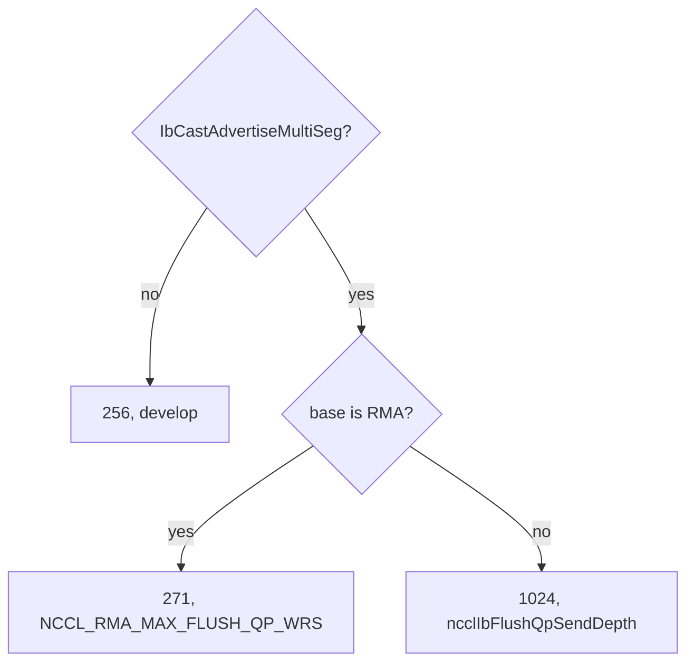
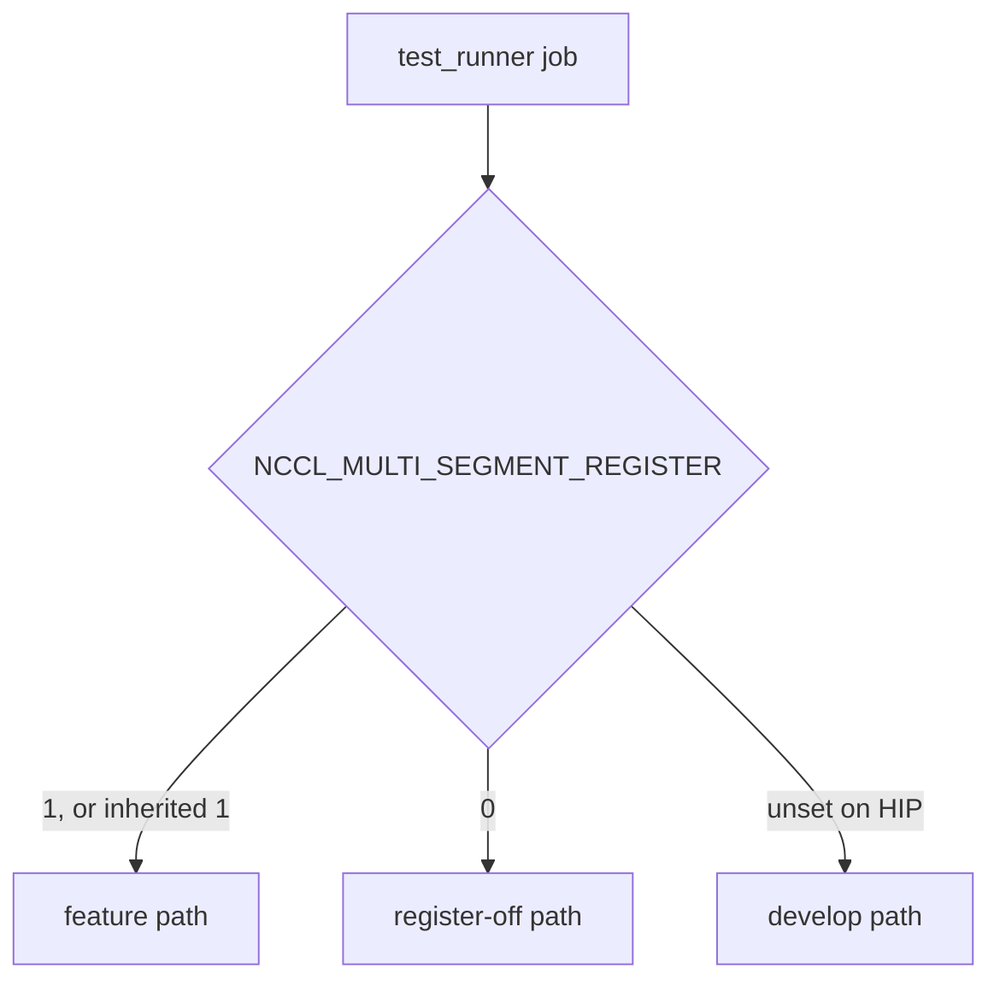
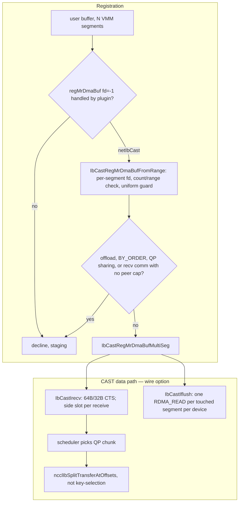

# Code Walkthrough — CAST NET/IB Multi-Segment (Wire Option)

> **Shared facts** (constants, v14 GIN/RMA split, capability trailer, tests) are in the overview: [`multi_segment_dmabuf_gin_and_netib.md`](multi_segment_dmabuf_gin_and_netib.md).

**Audience:** RCCL reviewers implementing or reviewing CAST P2P multi-segment. **Last updated:** 2026-10-16. **Branch:** stack layer 08 `users/atulkulk/mseg/08-cast-netib-multisegment` ([ROCm/rocm-systems#10889](https://github.com/ROCm/rocm-systems/pull/10889)); full stack tip (wire) `users/atulkulk/mseg/multi-segment-dmabuf-cast-gin`. **Ticket:** AIRUNTIME-2351 / AICOMRCCL-1526. **Design:** [`multi_segment_netib_cast.md`](multi_segment_netib_cast.md). **Status:** landed; the 2026-10-07 two-node validation of the wire tree (88/88 runner entries on ROCm 7.0.2.2 and TheRock 10.2) ran before the rework below and included the CAST P2P multi-segment configs that existed then.

CAST implements the **wire option** documented for `ncclNetIb` in [`multi_segment_netib_wire.md`](multi_segment_netib_wire.md) / [`multi_segment_netib_wire_walkthrough.md`](multi_segment_netib_wire_walkthrough.md): 64-byte CTS unchanged, `ncclIbSegLayout` side table, `NCCL_IB_CAP_MULTISEG`, `ncclIbSplitTransferAtOffsets`.

It does **not** implement key-selection-only (no side table; decline any WR that crosses a segment). CAST's QP scheduler already emits linear chunks that can straddle segments; those chunks must be **split**, not declined.

This is the wire-option port in `net_ib_cast` (P2P). CAST GIN/RMA lives on the wire layer in `net_ib_cast/gin.cc` ([`multi_segment_netib_cast_gin.md`](multi_segment_netib_cast_gin.md)); it is a distinct code path (no CTS FIFO, no side table).

## What changed on 2026-10-16

HIP now defaults `NCCL_MULTI_SEGMENT_REGISTER` to 0. The knob is still `ncclParamMultiSegmentRegister()` in `transport/generic.cc`. `NCCL_MULTI_SEGMENT_REGISTER=1` turns the feature on, on HIP and on every other build. An unset variable takes the develop path on a HIP build. A non-HIP build still defaults to 1. The commit is `9af53b9bca21` on `users/atulkulk/mseg/01-ce-recv-window-offset`, replayed through the stack.



With the switch off, connect does not advertise `NCCL_IB_CAP_MULTISEG` and does not append the side table, so the sender QP stays at `2 * NET_IB_MAX_REQUESTS`. NET, P2P IPC and NVLS leave a multi-segment buffer unregistered. GIN and RMA stay on develop's bodies and do not reserve credits. A device-only GIN window with more than one segment and no sysmem returns `ncclInvalidUsage` instead of registering only the first segment.



The direct-GDR flush QP is sized for one chain on every proxy step. `recvProxyProgress` posts `iflush` into `requests[step % NCCL_STEPS]` and returns before that flush is polled, so up to 8 flushes can be outstanding. With `RCCL_GDR_FLUSH_GPU_MEM_NO_RELAXED_ORDERING=0`, `rcclIbIflushMultiSeg` posts one RDMA read per receive per segment, at most `8 * 16 = 128` work requests, and signals only the last. Eight chains need `8 * 128 = 1024` slots. The previous depth, `NET_IB_MAX_REQUESTS + 128 = 384`, held three chains and the fourth post failed. `ncclIbFlushQpSendDepth` in `net_ib/multiseg.h` returns `NCCL_STEPS * NCCL_NET_IB_MAX_RECVS * NCCL_IB_MAX_SEGMENTS` when the peer advertised the capability, and `NET_IB_MAX_REQUESTS` (256) otherwise. Classic `ncclIbCreateFlushQp` calls it. `connect.cc` static-asserts that the multi-segment result holds at least one chain per step. The host test is `NetIbMultiSeg.FlushQpDepthCoversEveryOutstandingStep`.



CAST non-RMA comms use the same helper. CAST RMA comms keep `NCCL_RMA_MAX_FLUSH_QP_WRS` (271), because RMA credits wait until one chain completes before the next post. With the switch off every flush QP stays at 256.



The scratchpad flush (`RCCL_GDR_FLUSH_GPU_MEM_NO_RELAXED_ORDERING=1`, the default) posts one write and one read and does not fill 1024 slots. The enlarged depth is for the direct-GDR path. `net_ib_multisegment_flush` selects that path by setting the parameter to 0.

Jobs that test the feature set `NCCL_MULTI_SEGMENT_REGISTER=1` in the runner config, because an unset HIP job now takes the off path. Register-off jobs stay at 0. `cast_multisegment_opt_recv_2qp` inherits 1 from `cast_multisegment_opt_recv`. `net_ib_rma_multisegment_wrbatch` on the wire branch, and the hybrid nightly jobs on 09 including `net_ib_multisegment_hybrid_stress_nightly`, set 1 as well. The WR-batch job fails under `RCCL_TEST_RMA_MSEG_REQUIRE=1` when the per-segment registration log is missing, and the hybrid IGet stress skips. `multisegment_host_boundary_math` is host-only and does not read the switch.



## What changed on 2026-10-14

- §2: `net_ib_cast/p2p_multiseg_cast.h` was folded into `net_ib_cast/p2p.cc`, and `transport/rccl_ib_multiseg.cc` was removed. `net_ib_cast/reg.cc` gains the `fd == -1` route and `IbCastRegMrDmaBufFromRange`.
- §4.1: `net.cc` calls `regMrDmaBuf` with `fd = -1` and a packed count; the CAST plugin walks and exports the segments itself.
- §4.2: the peer-cap decline applies only to a recv comm. CTS offload, BY_ORDER and QP sharing still decline on both sides, with the reason for each.
- §3.4, §5.2 and §5.4: `remSegLayout` is allocated only for a capable peer; `rcclIbCastIrecvFillSideTable` returns early otherwise, and `IbCastMultiSendSegmented` bounds its own `nreqs` reload.
- §8: the CAST multi-segment runner jobs no longer set `RCCL_IB_P2P_DISABLE_CTS=1`; the register-off test expects only the receiver to decline, and the unsafe-mode test expects both sides to decline.

## What changed since the 2026-10-07 revision

- §2: the multi-segment bodies were split from develop's functions: the send, side-table, irecv and flush hooks (then in `net_ib_cast/p2p_multiseg_cast.h`, now in `net_ib_cast/p2p.cc`), and `IbCastRegMrDmaBufMultiSeg` and `rcclIbCastDeregMrMultiSeg` in `net_ib_cast/rccl_reg_multiseg_cast.cc`.
- §3.3: `ibCastCtsRemoteMultiSeg` in `p2p_cast.h` is now `IbCastCtsRemoteMultiSeg` in `net_ib_cast/p2p.cc`. The `ncclIbSegLayout` listing now shows `idx` as the last field, as in the code.
- §3.4 and §5.4: with `NCCL_MULTI_SEGMENT_REGISTER=0` the peer's capability is ignored (`peerCaps = 0`) and every QP depth stays develop's. The receiver's `segLayoutFifoMr` is registered only when the peer has the capability, with `IBV_ACCESS_LOCAL_WRITE` only.
- §4.1: the proxy dispatch moved from a file-local function in `net.cc` to `rcclNetIbRegMrMultiSeg` (superseded on 2026-10-14, see above).
- §4.2: `IbCastRegMrDmaBufMultiSeg` registers each segment through `IbCastRegMrDmaBufInternal`, which now uses `ncclCalloc` and unwinds partially registered devices.
- §5.1, §5.2, §5.5: a hardening commit fixes the PD refcount order, adds `IbCastDestroyBase` NULL guards, routes every `IbCastAccept` failure through `fail`, frees the scheduler remap entry when a post or injected fault fails, and makes the irecv error path record a fatal error and clear `*request`.
- §5.3: the GPU flush-memory path of the multi-segment flush is described, and the flush depth is tied to the switch.
- §8: new tests `MultiSegmentRegisterOff_DeclinesRegistration` and `CastUnsafeMode_DeclinesRegistration`, new jobs `cast_multisegment_register_off` and `cast_multisegment_unsafe_modes`, and the stricter `MultiRecvMixesSingleAndMultiSegmentHandles`.

---

## 1. What this PR does

Register **one dma-buf MR per physical segment** in CAST, keep **both** CTS sizes (64-byte `ncclIbSendFifo`, 32-byte `ncclIbSendFifoCtsInline`), publish the receiver layout on a **side table**, and after the scheduler chooses a QP chunk, **clip that chunk at local + remote segment bounds**. Single-segment receives still put only seg-0 rkeys in the CTS; when the peer advertised the capability, their side slot carries `nSegments = 0`. Everything is gated on `NCCL_MULTI_SEGMENT_REGISTER` through `IbCastAdvertiseMultiSeg()`.

---

## 2. File map

CAST sources plus the shared registration files (`net.cc` call sites, `rccl_ib_multiseg.h` declarations). `net_ib/p2p.cc` is not edited by the CAST layer.

| File | Stock CAST | At HEAD (wire option) |
|---|---|---|
| `src/transport/rccl_ib_multiseg.h` | `ncclIbRegMrDmaBufMultiSeg` | Adds `IbCastRegMrDmaBufMultiSeg` and `rcclIbCastDeregMrMultiSeg` |
| `src/transport/net.cc` | Calls `regMrDmaBuf` with `fd = -1` and a packed count for `numSegments > 1` | Unchanged by this layer |
| `net_ib_cast/common_cast.h` | `ncclIbMrHandle` is `mrs[]` only; CTS 64 B + inline 32 B; `ctsFifo` then small WR pool | Composite handle; includes `net_ib/multiseg.h`; `ncclIbSegLayout segLayoutFifo` immediately after `ctsFifo`; `NCCL_IB_MAX_WRS_PER_SEND` (256) WR pool; `NCCL_IB_MAX_SEND_WRS` (769); `peerCaps`; `segLayoutFifoMr`; `remSegLayout` (pointer, capable peer only); `WR_IMM_SEGMENTED_FLAG`; `NCCL_NET_IB_REQ_FAILED`; `IbCastRequestHasEvents` |
| `net_ib_cast/connect_cast.h` | `ncclIbConnectionMetadata` fixed size, `static_assert`ed | **Unchanged struct**; second `static_assert` pins the `devName` offset; `IbCastAdvertiseMultiSeg()`; `IbCastFlushQpSendDepth(base)` (1024 for P2P with the switch on, 271 for RMA, 256 off) |
| `net_ib_cast/connect.cc` | MR covers `ctsFifo` only | Covering MR `ctsFifo`+`segLayoutFifo`, `ncclIbSetConnectCaps` and `peerCaps` only when advertising; switch-gated data, CTS and flush QP depths; `remSegLayout` allocation and `segLayoutFifoMr` for a capable peer; PD refcount, `IbCastDestroyBase` and `IbCastAccept` failure fixes |
| `net_ib_cast/reg.cc` | `IbCastRegMrDmaBufInternal` one range | `ncclCalloc` handle with `nSegments = 1` and per-device unwind; `IbCastRegMrDmaBuf` routes `fd == -1` to `IbCastRegMrDmaBufFromRange` (segment walk, per-segment fds, coverage and uniform guards); `IbCastDeregMr` forwards multi-segment handles to `rcclIbCastDeregMrMultiSeg` |
| `net_ib_cast/rccl_reg_multiseg_cast.cc` | n/a | **New.** `IbCastRegMrDmaBufMultiSeg` with the decline rules; `rcclIbCastDeregMrMultiSeg` |
| `net_ib_cast/p2p.cc` | `IbCastIrecv` / `IbCastPostFifo` CTS only; `IbCastMultiSend` linear; `IbCastIflush` last recv | Develop plus hooks: handle check and side-table fill in irecv, side WR in `IbCastPostFifo`, `nreqs` bound and side-table wait in isend, segmented admission, segmented builder hand-off, multi-segment flush hand-off, `isendFail`, remap frees, `NCCL_NET_IB_REQ_FAILED` draining. New `RCCL:`-marked functions in the same file: `IbCastCtsRemoteMultiSeg`, `IbCastMultiSendSegmented`, `rcclIbCastMultiSendNeedsSegmented`, `rcclIbCastSendIsSegmented`, `IbCastHasOtherSegmentedSend`, `IbCastWaitSideTable`, `rcclIbCastIsendWaitSideTable`, `rcclIbCastPostFifoSideWr`, `rcclIbCastIrecvCheckHandle`, `rcclIbCastIrecvFillSideTable`, `rcclIbCastImmSegmented`, `rcclIbCastIflushNeedsMultiSeg`, `rcclIbCastIflushMultiSeg` |
| `net_ib_cast/p2p_cast.h` | 64 B vs 32 B CTS accessors | Unchanged |
| `net_ib/multiseg.h` | Used by `ncclNetIb` | **Included by CAST** (header-only): split, overlap, zero-length offset, decline and capability helpers |
| `net_ib_cast/p2p_resiliency.cc` | Replays `IbCastMultiSend` | Inherits split |
| `net_ib_cast/p2p_resiliency_recovery_ainic.cc` | Rebuilds the flush QP | Uses `IbCastFlushQpSendDepth()` |
| `net_ib_cast/gin.cc` | Single-range | **Out of scope here.** See [`multi_segment_netib_cast_gin_walkthrough.md`](multi_segment_netib_cast_gin_walkthrough.md) |
| `test/transport/NetIbMPI/NetIbMPITestBase.hpp` | Already lists `&netIbCast` | Run `NetIbMultiSegmentMPITest.*` with `NCCL_NET=IB-CAST` |
| `test/transport/NetIbMPI/NetIbMultiSegmentHelpers.hpp` | n/a | `RegisterMultiSegmentMr(comm, buf, isCast, mhandle)`: `isCast` → `IbCastRegMrDmaBufMultiSeg` |
| `test/transport/NetIbMPI/NetIbMultiSegmentMPITests.cpp` | n/a | Adds `OptRecvCompletionSegmentedSkipsImm`, `OptRecvInvalidRangeRejectedBeforeRequest`, `MultiSegmentRegisterOff_DeclinesRegistration`, `CastUnsafeMode_DeclinesRegistration` |
| `tools/scripts/test_runner/configs/net_ib_transport.json` | n/a | `cast_multisegment`, `cast_multisegment_opt_recv`, `cast_multisegment_opt_recv_2qp`, `cast_multisegment_register_off`, `cast_multisegment_unsafe_modes` |

---

## 3. Data structures

### 3.1 CTS stays 64 / 32 (`common_cast.h`)

Do **not** grow either struct. Seg-0 rkeys stay in CTS; the rest of the table is side-channel.

```c
struct alignas(64) ncclIbSendFifo {
  uint64_t addr;
  uint64_t size;
  uint32_t rkeys[NCCL_IB_MAX_DEVS_PER_NIC];
  uint32_t nreqs;
  uint32_t tag;
  uint32_t idx;
  uint16_t rxReqIndex;
  char padding[2];
};

struct alignas(32) ncclIbSendFifoCtsInline {
  uint64_t addr;
  uint32_t rkeys[1];
  int size;
  uint8_t nreqs;
  uint8_t rxReqIndex;
  uint16_t tag;
  uint32_t idx;
  char padding[8];
} __attribute__((packed));
```

`p2p_cast.h` indexes a slot as `ncclIbSendFifo*` or packed `ncclIbSendFifoCtsInline*` when `IbCastAinicCtsInlineData` (`ctsFifoNreqs`, `ctsFifoAddr`, `ctsFifoIdx`, ...). This work does not change those accessors or `max_inline_data`.

CAST does not use classic's `NCCL_IB_CTS_NREQS_SIDE_TABLE` bit in `nreqs`; with the capability negotiated, every receive gets a side slot.

### 3.2 Composite handle (wire option fields)

**Stock:** `struct ncclIbMrHandle { ibv_mr* mrs[NCCL_IB_MAX_DEVS_PER_NIC]; };`

**HEAD:** same fields as `ncclNetIb`'s wire-option handle: `nSegments` (1 for a legacy single MR), `segStart[]`, `segLen[]`, `segMrs[][]`, `mrs[]` aliases segment 0. Copied into CAST's type; CAST does not include `net_ib/common.h`. Each send request also keeps its handle in `send.mh` (for per-segment lkeys) and a `send.segmented` flag.

### 3.3 Side table immediately after CTS

**Stock** (`ncclIbSendComm`): `ctsFifo` then `sges[NCCL_NET_IB_MAX_RECVS]` / `wrs[NCCL_NET_IB_MAX_RECVS+1]`.

**HEAD (wire option layout):**

```c
struct ncclIbSendFifo ctsFifo[NET_IB_MAX_REQUESTS][NCCL_NET_IB_MAX_RECVS];
struct ncclIbSegLayout segLayoutFifo[NET_IB_MAX_REQUESTS][NCCL_NET_IB_MAX_RECVS];
struct ibv_sge sges[NCCL_IB_MAX_WRS_PER_SEND];
struct ibv_send_wr wrs[NCCL_IB_MAX_WRS_PER_SEND + 1];
...
uint32_t peerCaps;
```

```c
struct alignas(64) ncclIbSegLayout {
  uint32_t nSegments;
  uint32_t pad;
  uint64_t segStart[NCCL_IB_MAX_SEGMENTS];
  uint32_t segRkeys[NCCL_IB_MAX_SEGMENTS][NCCL_IB_MAX_DEVS_PER_NIC];
  uint64_t idx; // last store; sender waits on this as the slot arrival flag
};
```

`static_assert(offsetof(segLayoutFifo) == offsetof(ctsFifo) + sizeof(ctsFifo))`, plus a `static_assert` that `sizeof(ncclIbSegLayout)` is a multiple of 32.

The receive comm mirrors this with `remSegLayout` (a pointer to `ncclIbRemSegLayout`: `elems[NET_IB_MAX_REQUESTS][NCCL_NET_IB_MAX_RECVS]` and the remote `addr`), `peerCaps`, and a per-device `segLayoutFifoMr` that is the local source MR for the side write. `remSegLayout` is allocated in accept only when the peer advertised `NCCL_IB_CAP_MULTISEG`, so a recv comm to a legacy or switched-off peer saves about 1.44 MB; accept's fail path and `IbCastCloseRecv` free it. The send-side `segLayoutFifo` stays inline because the peer RDMA-writes it at `ctsFifo + sizeof(ctsFifo)` through the CTS MR.

AINIC 32-byte packing is **inside** the 64-byte-typed `ctsFifo` object. The covering MR uses C layout: whole `ctsFifo`, then `segLayoutFifo`. Never treat packed 32-byte traffic as shrinking `sizeof(ctsFifo)`.

CAST predicate (`net_ib_cast/p2p.cc`), same rule as classic `ncclIbCtsRemoteMultiSeg`:

```c
static inline bool IbCastCtsRemoteMultiSeg(const struct ncclIbSendComm* comm, int slot, int r) {
  if ((comm->peerCaps & NCCL_IB_CAP_MULTISEG) == 0) return false;
  volatile void* slotBase = (volatile void*)comm->ctsFifo[slot];
  const volatile struct ncclIbSegLayout* side = &comm->segLayoutFifo[slot][r];
  return side->nSegments > 1 && side->idx == (uint64_t)ctsFifoIdx(slotBase, r);
}
```

`ctsFifoIdx` reads `idx` through the 64-byte or 32-byte layout, so the comparison is correct with `IbCastAinicCtsInlineData`.

### 3.4 Connect metadata (capability trailer, no struct change)

Do **not** add a field. `ncclIbConnectionMetadata` keeps its exact size and offsets. Two `static_assert`s in `connect_cast.h` pin them: `ndevs` immediately follows `addr`, and `devName` starts right after `qpInfo`, `resiliencyInfo` and `devs` (the trailer at the end of `devName` is wire format, so its offset must not move).

When `IbCastAdvertiseMultiSeg()` is true, both sides call `ncclIbSetConnectCaps(meta.devName, sizeof(meta.devName), NCCL_IB_CAP_MULTISEG)`, which writes a `{magic=0x4d534547, caps}` record into the reserved tail of the fixed-size `devName` (the C-string is truncated one record earlier). With `NCCL_MULTI_SEGMENT_REGISTER=0`, nothing is written and the metadata is byte-identical to stock CAST. The peer value is recovered with `ncclIbGetConnectCaps(...)` into `comm->peerCaps`, but only when the local switch is on; with it off `peerCaps` is 0 even if the peer advertised, so neither side writes or waits on a side table. `ncclIbGetConnectCaps` returns `0` when the magic is absent, so an old peer transparently advertises no capability and multi-seg declines to staging. Mixed old/new peers interoperate because the wire layout never changed.

---

## 4. Registration

### 4.1 Proxy call (`net.cc`) and CAST range walk (`net_ib_cast/reg.cc`)

`net.cc`'s `sendProxyRegBuffer` / `recvProxyRegBuffer` call the active plugin's `regMrDmaBuf` with `fd = -1` and `offset = (export flags << 32) | numSegments` for `numSegments > 1`, and skip the whole-range HSA dma-buf fallback for such buffers. `net.cc` has no plugin check; stock CAST would reject the invalid fd and the collective would stage.

HEAD: `IbCastRegMrDmaBuf` routes `fd == -1` to `IbCastRegMrDmaBufFromRange` (built when `CUDA_VERSION >= 11070 || NCCL_CUMEM_DMABUF_EXPORT_GATE`). It unpacks the count and flags, exports one dma-buf fd per segment, fails a count/range mismatch, applies the uniform-segment guard `ncclIbSegmentsUniform` (interior segments equal the largest one, first and last may be shorter, so any two-segment layout passes), calls `IbCastRegMrDmaBufMultiSeg`, and closes the fds. It does not look at CTS offload; that decision is made in the CAST registration function below. The code mirrors classic's `rcclIbRegMrDmaBufFromRange` with CAST symbols.

### 4.2 CAST `rccl_reg_multiseg_cast.cc` and `reg.cc`

Stock `IbCastRegMrDmaBufInternal` (`reg.cc`) allocated `ncclIbMrHandle` with `malloc` and one MR per device. HEAD allocates it with `ncclCalloc`, sets `nSegments = 1`, and on a failed device deregisters the devices already registered before freeing the handle.

`IbCastRegMrDmaBufMultiSeg` (`rccl_reg_multiseg_cast.cc`) mirrors classic `net_ib/reg.cc`: for each segment it calls `IbCastRegMrDmaBufInternal` (one dma-buf MR per device), moves those MRs into `segMrs[s][]`, sets `mrs[i] = segMrs[0][i]`, and deregisters every segment MR on failure. It rejects `nSeg` outside `[1, NCCL_IB_MAX_SEGMENTS]`. For `nSeg > 1` it returns `ncclInvalidUsage`, logging one INFO line with every input, when any of these holds:

```c
// RCCL: the side table describes the receiver; a sender splits locally onto one remote rkey.
if (useCtsOffload || base->recvMatchingScheme == BY_ORDER || IbCastQpSharingEnabled() ||
    (!base->isSend && ncclIbDeclineMultiSegRegistration(peerCaps, nSeg)))
  return ncclInvalidUsage;   // net.cc falls back to staging
```

The first three rules apply on **both** sides, because they describe cases CAST's segmented send engine cannot handle:

- **CTS offload:** the NIC owns CTS and will not consume a side table. A sender under offload disables the segmented path and would post one SGE with segment 0's lkey over the whole buffer.
- **BY_ORDER:** the receiver adds each immediate's `byte_len`, and a segmented send's immediate rides the 4-byte-per-request completion-sizes write, so the receive size would come out wrong. Segmented writes carry no per-immediate `byte_len`.
- **QP sharing:** shared QPs need a `commId` in the immediate and a per-QP WR budget; segmented sends carry neither.

The last rule applies on the **receive** side only, as on classic:

- **Peer without `NCCL_IB_CAP_MULTISEG`:** the peer cannot read a side table, and the side table describes the receiver. A sender with a multi-segment source splits locally onto the receiver's single rkey, so it needs no peer cap. This also covers `NCCL_MULTI_SEGMENT_REGISTER=0` locally, because `peerCaps` is then 0: the receiver declines and the sender registers.

`IbCastDeregMr` forwards a handle with `nSegments > 1` to `rcclIbCastDeregMrMultiSeg`, which loops `nSegments × devices` and frees `mrs[]` only through `segMrs[0]`.

---

## 5. Data path — wire option on CAST

### 5.1 `IbCastIrecv` / `IbCastPostFifo`

Stock: fill CTS from `mrs[j]->rkey`, one RDMA write of 64-byte or 32-byte elements.

HEAD (same ordering as classic NET/IB):

- Before taking a request, `rcclIbCastIrecvCheckHandle` validates every handle: segment count in range, every `mrs[i]` present, and for multi-segment handles contiguous non-empty segments with every `segMrs[s][i]` present and the receive range inside the registered segments. Errors here return immediately with nothing posted.
- CTS still carries **seg-0** rkeys only (64-byte or 32-byte form).
- `rcclIbCastIrecvFillSideTable`: returns at once unless the peer has the cap (there is no `remSegLayout` otherwise); with CTS offload off it fills `remSegLayout->elems[slot][i]` (full layout when `nSegments > 1`, `nSegments = 0` otherwise) with `idx` as the last store. This happens for single-segment receives too, so the sender can wait on `idx`.
- `IbCastPostFifo` asks `rcclIbCastPostFifoSideWr` for the chain head: the side write (source `remSegLayout.elems[slot]` through `segLayoutFifoMr`, target `remSegLayout.addr` with the CTS rkey, unsignaled, never inline) chained before the CTS write, or the CTS write alone.
- With the switch on, the CTS QP send queue is sized for two WRs per slot.
- If filling or posting the CTS fails, no CTS reached the sender and no data completion can name the request, so the `err` path records a fatal error, frees the request, clears `*request` and returns the error.
- That is the wire option. It is **not** "pick one rkey and assert the recv fits in one segment."

### 5.2 `IbCastIsend` / `IbCastMultiSend` — scheduler then split

`IbCastIsend`, once CTS slot 0's `idx` is visible:

1. Reject `nreqs < 1 || nreqs > NCCL_NET_IB_MAX_RECVS` with `ncclInternalError` (this keeps a corrupt CTS from driving the side-table wait or the slice loops out of bounds).
2. Wait for the other CTS entries, then `rcclIbCastIsendWaitSideTable`: if the peer advertised the cap, `IbCastWaitSideTable` waits up to 2 s for every side slot's `idx` and returns `ncclRemoteError` on timeout.
3. Mark the request `segmented` with `rcclIbCastSendIsSegmented` (CTS offload off and either the local handle has `nSegments > 1` or `IbCastCtsRemoteMultiSeg` is true). Defer (`*request = NULL`) if `IbCastHasOtherSegmentedSend` finds another slot's segmented group in flight.
4. Reset `send.sentData` for every request (not only with resiliency); the failure path reads it. Store the handle in `send.mh`.

Stock `IbCastMultiSend`: one WR per recv, then for each QP: set rkey from CTS, choose chunk length, set lkey, `ibv_post_send`, advance addresses linearly.

**Wrong (key-selection-only):** after choosing the chunk, if it straddles, fail or shrink to one segment. CAST scheduler would then livelock or under-send.

**Wire option (`IbCastMultiSendSegmented`):** `IbCastMultiSend` hands the slot over when `rcclIbCastMultiSendNeedsSegmented` is true. For each QP the builder computes the same per-QP chunk length as the stock path, then:

```c
uint64_t localReqOff  = localBase  - mh->segStart[0];
uint64_t remoteReqOff = remoteBase - side[r].segStart[0];  // 0 with a single remote segment
ncclIbSplitTransferAtOffsets(nLocal, lVA, lOff, nRemote, rVA, rOff,
                             localReqOff + sendOffsets[r], remoteReqOff + sendOffsets[r], chunkLen[r],
                             slices, 2 * NCCL_IB_MAX_SEGMENTS);
// post one WR per slice; last WR of this QP keeps SIGNALED + wr_id remap
```

The remote layout is validated with `ncclIbCtsRemoteLayoutValid` before use. A **zero-length** chunk still posts one 0-byte write; for a remote multi-segment receive its rkey comes from `ncclIbSegmentForZeroLengthOffset(nRemote, rOff, remoteReqOff + sendOffsets[r])`, which picks the segment containing the offset and uses the last segment when the offset is exactly the end. CAST and classic choose the same key.

Independent offsets are required (wire.md "one shared offset is wrong"). CAST tests include mismatched local/remote start offsets, not only whole-buffer from segment 0.

**Completion size.** The segmented path always appends the completion-sizes write (`needSizesWr = true`, including a single receive) because the final data WR may carry only the last slice. That write carries the immediate; under BY_INDEX it holds `rxReqIndex`, `WR_IMM_SEGMENTED_FLAG`, and `WR_IMM_SPLIT_DATA_FLAG` when more than one QP is used. The receiver skips adding `byte_len` for a single receive when `rcclIbCastImmSegmented(wc)` sees `WR_IMM_SEGMENTED_FLAG`.

**Send failure.** If a builder fails, it has stopped at the first QP that failed and freed that QP's scheduler remap entry (the stock builder now does the same, also on an injected fault). `IbCastIsend` jumps to `isendFail`, which records a fatal error, walks each request's QPs and decrements `events[devIndex]` for every QP whose `sentData` is still false, since no completion will arrive for it. Requests that still have events (`IbCastRequestHasEvents`) become `NCCL_NET_IB_REQ_FAILED` so `Test` drains them; the others are freed.

### 5.3 `IbCastIflush`

Stock: one `IBV_WR_RDMA_READ` of `data[last]` with `mrs[i]->rkey`. HEAD keeps that path for single-segment handles.

HEAD: `IbCastIflush` hands the call to `rcclIbCastIflushMultiSeg` when `rcclIbCastIflushNeedsMultiSeg` finds a non-empty receive with `nSegments > 1`. That function validates every receive first, then posts one fence read per (receive × overlapping segment) via `ncclIbSegmentsOverlappingRange`, on **every device** (`ndevs`), with only the last read of each device's chain signaled. So flush covers all receives, all touched segments, and all devices — not just `data[last]`. When `RCCL_GDR_FLUSH_GPU_MEM_NO_RELAXED_ORDERING` is on (the default) and the device has GPU flush memory, it posts develop's write-then-read pair against that buffer instead.

If `ibv_post_send` fails on a device, even after a prefix, the flush goes to `iflushFail`: an unsignaled prefix never produces a completion there. The request is kept as `NCCL_NET_IB_REQ_FAILED` only if earlier devices already hold events; otherwise it is freed and the error returned.

The loopback flush QP is `IbCastFlushQpSendDepth(base)` deep. With the switch off it is develop's 256. With the switch on, an RMA comm is `NCCL_RMA_MAX_FLUSH_QP_WRS = 271` and a non-RMA comm is `ncclIbFlushQpSendDepth` = 1024. The AINIC recovery path rebuilds it with the same helper.

### 5.4 Connect covering MR and QP depths

Stock: `ibv_reg_mr(..., comm->ctsFifo, sizeof(comm->ctsFifo), ...)`.

HEAD: `sizeof(ctsFifo) + (IbCastAdvertiseMultiSeg() ? sizeof(segLayoutFifo) : 0)`. `meta.addr` remains `ctsFifo`; the receiver sets `remSegLayout.addr = remMeta.addr + sizeof(ctsFifo)`. Same rkeys. The capability is advertised through `ncclIbSetConnectCaps(meta.devName, ...)` under the same condition (no appended `caps` field). Develop already grew the CAST connect struct after `isRMA` with QP-sharing fields.

On the receiver, `remSegLayout` is allocated and `segLayoutFifoMr` is registered on each device only when `peerCaps & NCCL_IB_CAP_MULTISEG`, over `remSegLayout->elems` with `IBV_ACCESS_LOCAL_WRITE` only. The MR is deregistered in `IbCastCloseRecvCommDevResources` and the buffer freed in `IbCastCloseRecv`.

QP depths with the switch on, and develop's values with it off:

| QP | Switch on | Switch off |
|---|---|---|
| Sender data QP (`IbCastSenderQpsCreate`, `IbCastBuildDataQpCreateAttr`) | `NCCL_IB_MAX_SEND_WRS` = 769 | `2 * NET_IB_MAX_REQUESTS` = 512 |
| Receiver CTS QP (`IbCastReceiverQpsCreateToRts`, `IbCastBuildDataQpCreateAttr`) | `NET_IB_MAX_REQUESTS * (resiliency ? 1 : 2) * 2` | `NET_IB_MAX_REQUESTS * (resiliency ? 1 : 2)` (create) / `NET_IB_MAX_REQUESTS` (recovery attr) |
| Loopback flush QP | `IbCastFlushQpSendDepth(base)` = 1024 (271 on an RMA comm) | 256 |

### 5.5 Connect and teardown hardening

- `IbCastInitCommDevBase` increments `pdRefs` only after `wrap_ibv_alloc_pd` succeeds, so a failed allocation no longer leaves a reference without a PD.
- `IbCastDestroyBase` destroys the CQ only if it exists, returns early when the PD was never taken, and clears `cq`, `pd` and the device PD after release, so it is safe on a partially initialised base.
- `IbCastAccept` initialises the socket before publishing `rComm` to the stage and sends every failure (socket progress, device checks, link-layer mismatch, resiliency setup) through `fail`, which calls `IbCastCloseRecv` on a published comm and frees it otherwise.

---

## 6. End-to-end



Single-segment handles with a single-segment peer receive: stock CAST data path (one WR per request per QP, flush one read of the last receive).

---

## 7. Review checklist (wire option)

- [ ] `sizeof(ncclIbSendFifo) <= 64` and `sizeof(ncclIbSendFifoCtsInline) <= 32`. No `nSegments` in either CTS slot.
- [ ] Side table + connect cap + covering MR; **not** key-selection-only.
- [ ] Capability, `peerCaps`, the larger CTS MR and the larger QP depths only when `IbCastAdvertiseMultiSeg()`.
- [ ] `IbCastRegMrDmaBufMultiSeg` is not in `net.h` and is not named `ncclIbRegMrDmaBufMultiSeg`.
- [ ] `nSegments > 1` declines on both sides under CTS offload, BY_ORDER or QP sharing, and on the receive side for a peer without `NCCL_IB_CAP_MULTISEG`; otherwise registration proceeds.
- [ ] Side WR never `IBV_SEND_INLINE`. 32-byte packing stays inside the CTS row. `segLayoutFifoMr` is `IBV_ACCESS_LOCAL_WRITE` only.
- [ ] Split uses **independent** local/remote offsets (`ncclIbSplitTransferAtOffsets`); the remote layout passes `ncclIbCtsRemoteLayoutValid`.
- [ ] Zero-length chunk rkey from `ncclIbSegmentForZeroLengthOffset`.
- [ ] Boundary-crossing transfers complete under the CAST scheduler; they are not declined.
- [ ] Peer CTS `nreqs` bounded to `[1, NCCL_NET_IB_MAX_RECVS]` before the side-table wait and again on the segmented builder's reload; the wait is bounded (2 s).
- [ ] Signaled WR / `wr_id` remap still on the last WR of each QP chain; the remap entry is freed when the post fails.
- [ ] Only one segmented multi-recv group admitted at a time (`IbCastHasOtherSegmentedSend`); sender QP is `NCCL_IB_MAX_SEND_WRS = 769` deep.
- [ ] Flush QP depth from `IbCastFlushQpSendDepth(base)` (1024 for a non-RMA comm with the switch on, 271 for RMA, 256 with it off); eight 128-read flushes fit, one per proxy step.
- [ ] Segmented completions publish sizes through the completion-records write; the immediate has `WR_IMM_SEGMENTED_FLAG` and the receiver does not add `byte_len` for it.
- [ ] No request is left without a possible completion: irecv frees on CTS failure; isend releases events of unposted QPs; a partial flush post fails the flush; `NCCL_NET_IB_REQ_FAILED` requests drain.
- [ ] Capability rides the `devName` trailer (no appended `caps` field). `ndevs` follows `addr` and the `devName` offset is pinned, both by `static_assert`.
- [ ] Develop's functions in `p2p.cc` and `reg.cc` gain only one-line hooks; multi-segment bodies are separate `RCCL:`-marked functions in `net_ib_cast/p2p.cc` and `reg.cc`, plus `rccl_reg_multiseg_cast.cc`.
- [ ] CAST GIN/RMA is a distinct path (no CTS/side table): [`multi_segment_netib_cast_gin.md`](multi_segment_netib_cast_gin.md).

## 8. Tests

Must prove the **wire option**, including cases key-selection-only would refuse:

- Host: `test/NetIbMultiSegmentUnitTests.cpp` (shared `multiseg.h` math) and `test/RmaSegmentMathTests.cpp` (`rma_multiseg.h`).
- MPI: `test/transport/NetIbMPI/NetIbMultiSegmentMPITests.cpp` with `NCCL_NET=IB-CAST` — per-segment, **cross-boundary**, whole-buffer, independent offsets, multi-receive, flush, limits.
- Helper dispatch is required: `RegisterMultiSegmentMr` must select `IbCastRegMrDmaBufMultiSeg` for `IB-CAST` (`isCast = net_ == &netIbCast`); calling the classic helper against a CAST `comm` skips multi-seg registration and can SIGSEGV on the single-segment path.
- Connect-cap decline, CTS-offload decline, flush-every-segment, WRR boundary-crossing.
- Switch off: `MultiSegmentRegisterOff_DeclinesRegistration` expects `ncclInvalidUsage` and no handle for a 4-segment registration with `NCCL_MULTI_SEGMENT_REGISTER=0`.
- Unsafe modes: `CastUnsafeMode_DeclinesRegistration` expects the same under BY_ORDER (`NCCL_IB_RECEIVER_SIDE_MATCHING_SCHEME=2`) or `RCCL_IB_QP_SHARING_ENABLE=1`, and skips on classic NET/IB.
- Mixed multi-receive: `MultiRecvMixesSingleAndMultiSegmentHandles` puts its multi-segment entry across segments 1 and 2, so a flush through segment 0's MR would fault, and requires a flush request when direct flush is on (on IB-CAST this needs `RCCL_GDR_FLUSH_GPU_MEM_NO_RELAXED_ORDERING=0` and `NCCL_GDR_FLUSH_DISABLE=0`).
- Optional receive completion: `OptRecvCompletionSegmentedSkipsImm` (hinted single receive over the whole window reports size 0 and its data is checked only after the closing barrier, since the hinted receive can complete before the send does; two hinted receives report real sizes) and `OptRecvInvalidRangeRejectedBeforeRequest` (a hinted receive past the registered range fails without taking a request slot). Both skip collectively unless optional receive completion is active on the comm.
- Runner configs in `net_ib_transport.json`: `cast_multisegment` (`Cast_MultiSegment_All`, `UBR_MultiSegment_Generic`), `cast_multisegment_opt_recv` (1 QP), `cast_multisegment_opt_recv_2qp` (2 QPs, split data), `cast_multisegment_register_off` (`Cast_MultiSeg_RegisterOff_DeclinesRegistration`, `Cast_MultiSeg_RegisterOff_SingleSegmentRegression`) and `cast_multisegment_unsafe_modes` (`Cast_MultiSeg_ByOrder_DeclinesRegistration`, `Cast_MultiSeg_QpSharing_DeclinesRegistration`). All five use BY_INDEX matching (`NCCL_IB_RECEIVER_SIDE_MATCHING_SCHEME=0`) by default, because BY_ORDER declines multi-segment, and all set `NCCL_GDR_FLUSH_DISABLE=0` and `RCCL_GDR_FLUSH_GPU_MEM_NO_RELAXED_ORDERING=0`. None of them sets `RCCL_IB_P2P_DISABLE_CTS=1` any more; the register-off job expects the receiver to decline and the sender to register, and the unsafe-mode job expects both to decline.
- `CastTests.cpp` single-segment must not regress. CAST `StressMultiRound` is a known develop baseline failure, not caused by this stack.
