# Multi-Segment DMA-BUF for Classic NET/IB P2P — Design Comparison (HISTORICAL)

> **HISTORICAL / COMPARISON MATERIAL.** This document preserves the original *key-selection-only vs wire-option* trade-off analysis. The **wire option won and is the current design** — see [`multi_segment_netib_wire.md`](multi_segment_netib_wire.md) and the source-of-truth overview [`multi_segment_dmabuf_gin_and_netib.md`](multi_segment_dmabuf_gin_and_netib.md). Keep this file for the rationale; do not treat the "key-selection" path as implemented.

For current behavior read [`multi_segment_netib_wire.md`](multi_segment_netib_wire.md) and its walkthrough; this file is kept for the rationale and is corrected only where the code moved or changed.

## What changed on 2026-10-16

HIP now defaults `NCCL_MULTI_SEGMENT_REGISTER` to 0. The knob is still `ncclParamMultiSegmentRegister()` in `transport/generic.cc`. `NCCL_MULTI_SEGMENT_REGISTER=1` turns the feature on, on HIP and on every other build. An unset variable takes the develop path on a HIP build. A non-HIP build still defaults to 1. The commit is `9af53b9bca21` on `users/atulkulk/mseg/01-ce-recv-window-offset`, replayed through the stack.

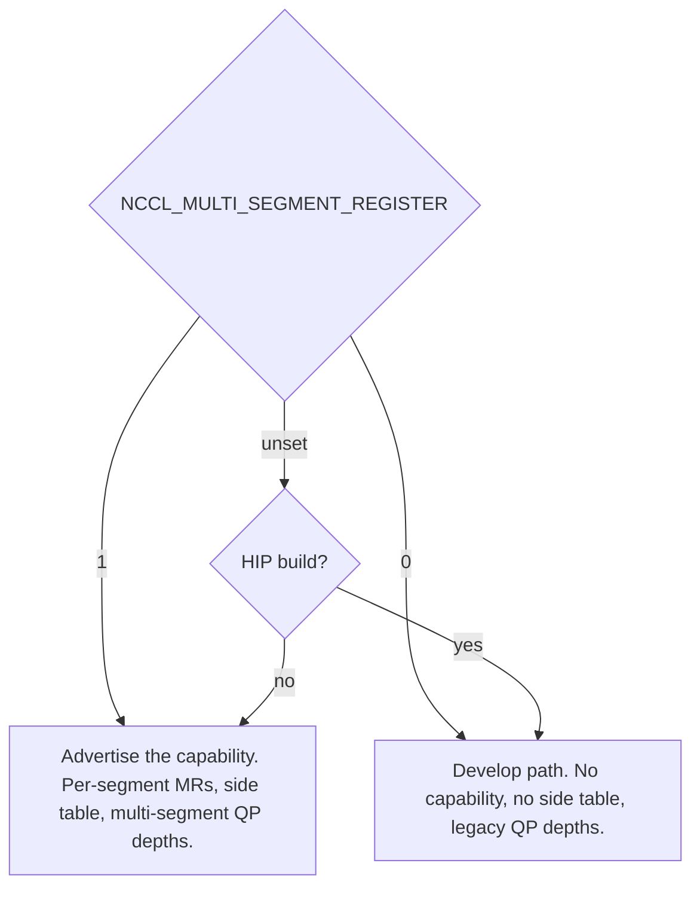

With the switch off, connect does not advertise `NCCL_IB_CAP_MULTISEG` and does not append the side table, so the sender QP stays at `2 * NET_IB_MAX_REQUESTS`. NET, P2P IPC and NVLS leave a multi-segment buffer unregistered. GIN and RMA stay on develop's bodies and do not reserve credits. A device-only GIN window with more than one segment and no sysmem returns `ncclInvalidUsage` instead of registering only the first segment.

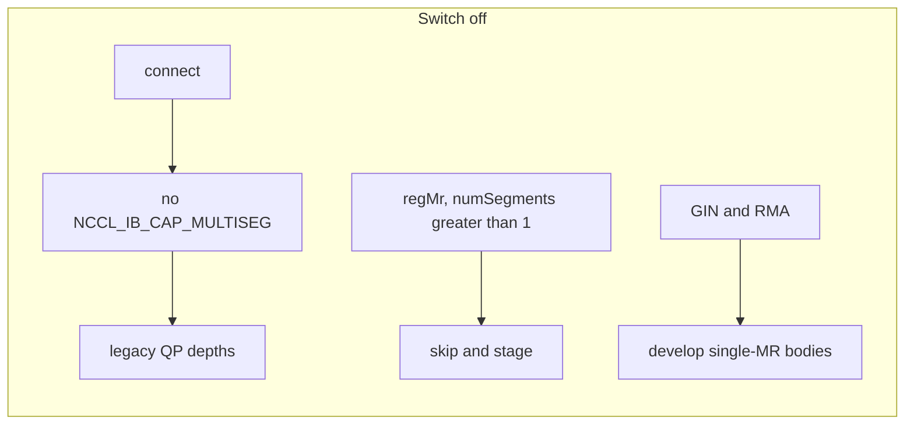

The direct-GDR flush QP is sized for one chain on every proxy step. `recvProxyProgress` posts `iflush` into `requests[step % NCCL_STEPS]` and returns before that flush is polled, so up to 8 flushes can be outstanding. With `RCCL_GDR_FLUSH_GPU_MEM_NO_RELAXED_ORDERING=0`, `rcclIbIflushMultiSeg` posts one RDMA read per receive per segment, at most `8 * 16 = 128` work requests, and signals only the last. Eight chains need `8 * 128 = 1024` slots. The previous depth, `NET_IB_MAX_REQUESTS + 128 = 384`, held three chains and the fourth post failed. `ncclIbFlushQpSendDepth` in `net_ib/multiseg.h` returns `NCCL_STEPS * NCCL_NET_IB_MAX_RECVS * NCCL_IB_MAX_SEGMENTS` when the peer advertised the capability, and `NET_IB_MAX_REQUESTS` (256) otherwise. Classic `ncclIbCreateFlushQp` calls it. `connect.cc` static-asserts that the multi-segment result holds at least one chain per step. The host test is `NetIbMultiSeg.FlushQpDepthCoversEveryOutstandingStep`.

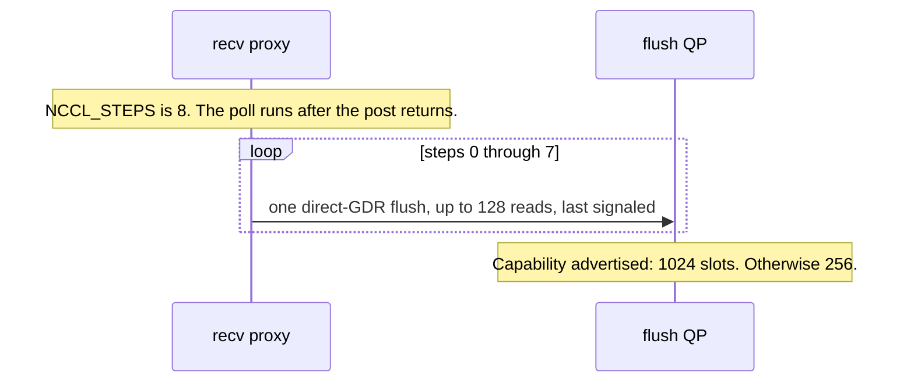

CAST non-RMA comms use the same helper. CAST RMA comms keep `NCCL_RMA_MAX_FLUSH_QP_WRS` (271), because RMA credits wait until one chain completes before the next post. With the switch off every flush QP stays at 256.

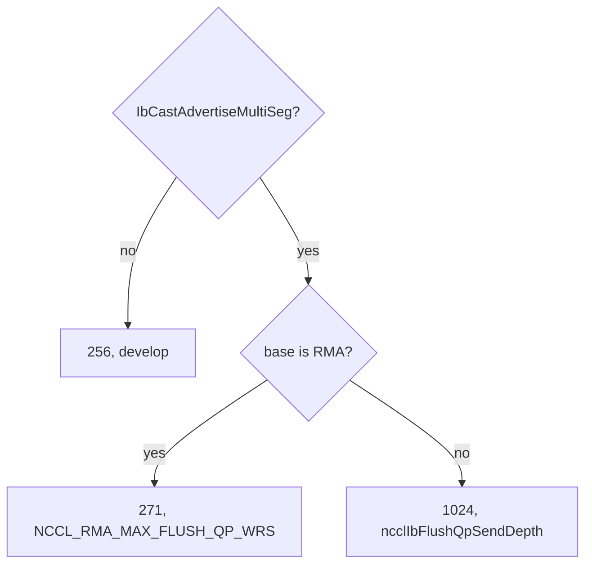

The scratchpad flush (`RCCL_GDR_FLUSH_GPU_MEM_NO_RELAXED_ORDERING=1`, the default) posts one write and one read and does not fill 1024 slots. The enlarged depth is for the direct-GDR path. `net_ib_multisegment_flush` selects that path by setting the parameter to 0.

Jobs that test the feature set `NCCL_MULTI_SEGMENT_REGISTER=1` in the runner config, because an unset HIP job now takes the off path. Register-off jobs stay at 0. `cast_multisegment_opt_recv_2qp` inherits 1 from `cast_multisegment_opt_recv`. `net_ib_rma_multisegment_wrbatch` on the wire branch, and the hybrid nightly jobs on 09 including `net_ib_multisegment_hybrid_stress_nightly`, set 1 as well. The WR-batch job fails under `RCCL_TEST_RMA_MSEG_REQUIRE=1` when the per-segment registration log is missing, and the hybrid IGet stress skips. `multisegment_host_boundary_math` is host-only and does not read the switch.

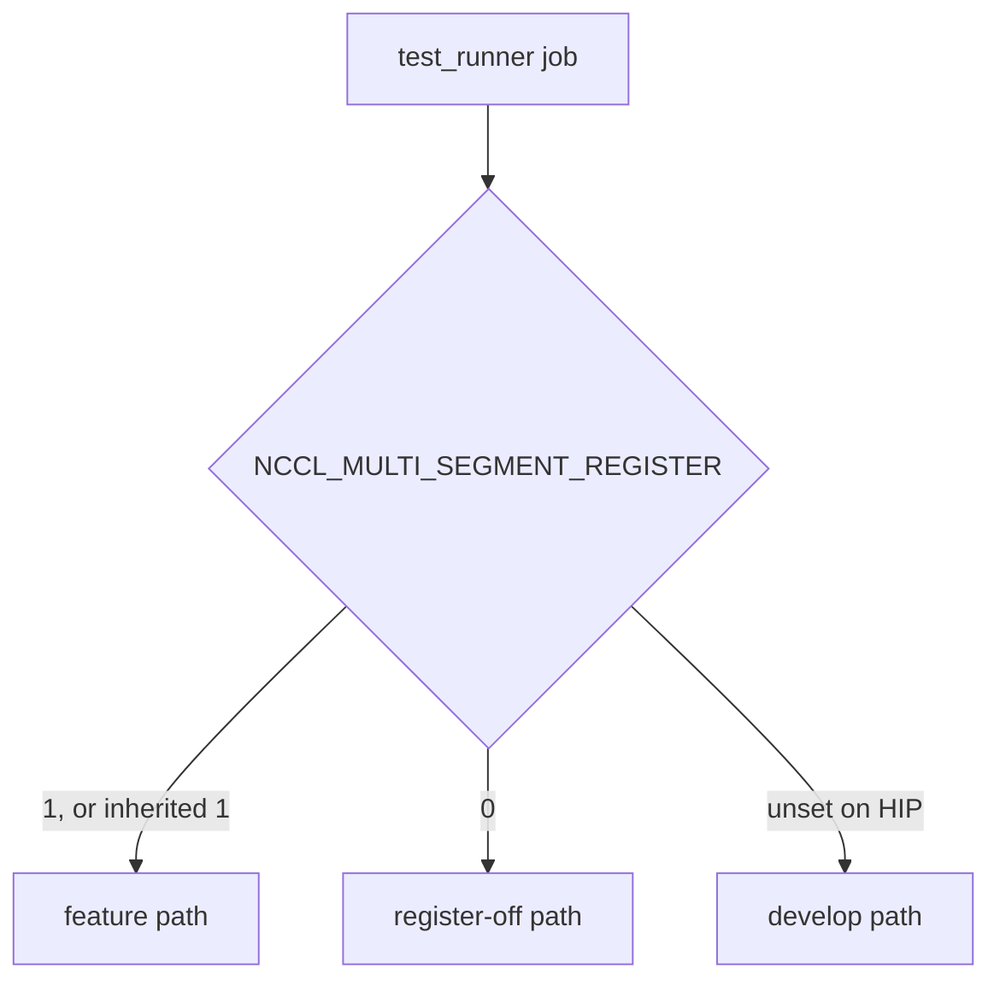

## What changed on 2026-10-14

- The multi-segment bodies that sat in `net_ib/p2p_multiseg.h`, `net_ib/rccl_reg_multiseg.cc` and `transport/rccl_ib_multiseg.cc` are back in `net_ib/p2p.cc`, `net_ib/reg.cc` and `transport/net.cc`, as separate `RCCL:`-marked functions next to develop's code.
- `net.cc` no longer exports per-segment fds. It calls `regMrDmaBuf` once with `fd = -1` and a packed segment count; `ncclIbRegMrDmaBuf` routes that to `rcclIbRegMrDmaBufFromRange` in `reg.cc`, which walks the range and calls `ncclIbRegMrDmaBufMultiSeg`.
- The peer-cap decline in `ncclIbRegMrDmaBufMultiSeg` applies only to recv comms: the side table describes the receiver, and a sender splits locally onto the receiver's single rkey. With the switch off, the receiver declines and the sender registers.
- `ncclIbRecvComm::remSegLayout` is a pointer, allocated (and its staging MR registered) only when the peer advertised `NCCL_IB_CAP_MULTISEG`; a recv comm to a legacy peer no longer carries the ~1.44 MB table. The send-side `segLayoutFifo` stays inline because the peer RDMA-writes it at `ctsFifo + sizeof(ctsFifo)` through the CTS MR.

## What changed since the 2026-10-07 revision

- The whole feature sits behind `NCCL_MULTI_SEGMENT_REGISTER` (`ncclParamMultiSegmentRegister()`). Classic NET/IB reads it through `ncclIbAdvertiseMultiSeg()` in `net_ib/connect.cc`. At `=0` no `NCCL_IB_CAP_MULTISEG` is advertised, the sender's CTS MR does not cover the side table, multi-segment registration is declined (staging fallback) and develop's QP depths apply.
- The multi-segment send, CTS side-table, irecv and flush paths became `static inline` functions in `net_ib/p2p.cc`, separate from develop's bodies (`rcclIbMultiSendNeedsSegmented`, `rcclIbIsendWaitSideTable`, `rcclIbPostFifoSideWr`, `rcclIbIrecvCheckHandle`, `rcclIbIrecvFillSideTable`, `rcclIbCtsFlagSideTable`, `rcclIbIflushNeedsMultiSeg`, `rcclIbIflushMultiSeg`, plus `ncclIbMultiSendSegmented` and `ncclIbMrForRange`). `p2p.cc` is develop plus one-line calls and keeps develop's inline per-QP chunk math; only the segmented builder uses `ncclIbQpChunkSize`.
- Per-segment registration is `ncclIbRegMrDmaBufMultiSeg` and `rcclIbDeregMrMultiSeg` in `net_ib/reg.cc`. The proxy-side export helper `netIbRegMrMultiSeg` is gone (see 2026-10-14 above).
- With the switch on, the sender QP is `NCCL_IB_MAX_SEND_WRS` (769), the receiver CTS QP adds `NET_IB_MAX_REQUESTS*(resiliency?1:2)` side-table WRs to develop's depth, and the flush QP is `ncclIbFlushQpSendDepth` (1024). `static_assert`s in `connect.cc` check that this holds one direct-GDR chain per proxy step and that the GIN signal and flush chains fit.
- New coverage: `MultiSegmentRegisterOff_DeclinesRegistration` and the `net_ib_multisegment_register_off` job; the flush tests run in `net_ib_multisegment_flush` with `RCCL_GDR_FLUSH_GPU_MEM_NO_RELAXED_ORDERING=0`. `MultiRecvMixesSingleAndMultiSegmentHandles` now starts its multi-segment entry in segment 1 and requires a flush request when direct GDR flush is on.

**Status:** The selected approach (wire option) is current on `users/atulkulk/mseg/06-classic-netib-multisegment`; the full stack tip is `users/atulkulk/mseg/multi-segment-dmabuf-cast-gin`. It splits transfers at segment boundaries rather than restricting a step to one segment. **Scope:** User-buffer (zero-copy) registration of multi-segment HIP VMM buffers over the *classic* NET/IB P2P transport (`ncclIbIsend`/`ncclIbIrecv`), the path used by ordinary collectives (AllReduce RING/SIMPLE, etc.). **Related:** The GIN/RMA proxy path also supports multi-segment via per-segment MRs + a segment-splitting WR builder (`net_ib/gin.cc`, `ncclRmaBuildSegmentedWrs`, AIRUNTIME-2351).

---

## 1. Problem statement

`UBR_MultiSegment.Generic`-style workloads register a user buffer that spans **multiple physical VMM segments** (`numSegments > 1`) and run a collective over inter-node NET/IB. On ROCm/HIP, a dma-buf export (`hipMemGetHandleForAddressRange` / `hsa_amd_portable_export_dmabuf`) describes **only the first physical segment**, so the original attempt to register the *entire* VA range as one MR failed:

```
ibvwrap.cc: Call to ibv_reg_dmabuf_mr failed with error Invalid argument
net.cc: "...not registered as DMABuf is not available. Non-DMABuf registration
         currently does not support multiple segments."
net.cc: rank 0 failed to NET register userbuff ... GDR flag 1
... IBV_WC_REM_INV_REQ_ERR / async fatal event on QP (hang)
```

### Root cause

Before the multi-segment implementation, the classic proxy-register path (`sendProxyRegBuffer` / `recvProxyRegBuffer` in `net.cc`) exported **one** dma-buf for the whole range and attempted to register **one** MR:

```c
// Historical pre-fix behavior, simplified
HSACHECKGOTO(hsa_amd_portable_export_dmabuf(info->buffer, info->size, &fd, &off), ...);
regMrDmaBuf(comm, info->buffer, info->size, NCCL_PTR_CUDA, off, fd, &handle); // EINVAL for >1 seg
...
if (numSegments > 1) { INFO("...does not support multiple segments"); goto fail; } // declines
```

ROCm therefore needs **one MR per physical segment**. The GIN proxy already used that model; the original classic path did not. The selected implementation now exports and registers each segment separately and falls back to staging when multi-segment zero-copy registration cannot be used.

### Why the classic path is hard

The classic NET/IB data plane is **single-MR by construction**. Its clear-to-send FIFO (`ncclIbSendFifo`) carries exactly one remote address + one rkey-per-device, and `ncclIbMultiSend` walks a single contiguous region linearly across QPs:

```c
struct alignas(64) ncclIbSendFifo {
  uint64_t addr;                            // ONE remote base address
  uint64_t size;
  uint32_t rkeys[NCCL_IB_MAX_DEVS_PER_NIC]; // ONE rkey per device (not per segment)
  uint32_t nreqs, tag; uint64_t idx;
};
```

There are two ways to make this work with per-segment MRs, traded off below.

---

## 2. Pre-fix architecture and failure mode (historical)

The diagrams in this section explain the defect that motivated the work. They do **not** describe the current implementation; the current side-table design starts in [Section 5](#5-full-segment-aware-data-path-selected-64-byte-cts--side-layout).

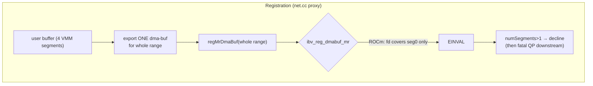

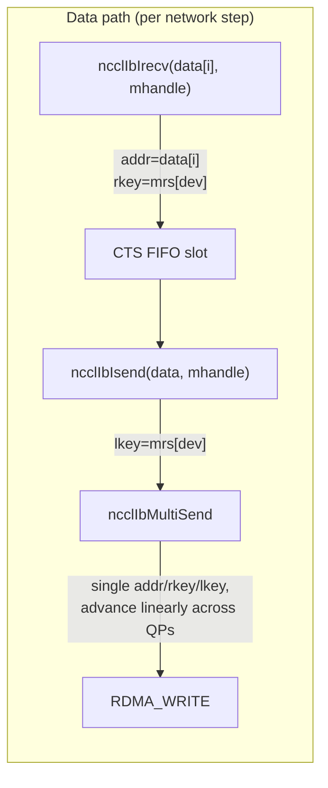

Both `mhandle->mrs[dev]` and the FIFO assume **one** MR spans the whole buffer.

### Failure timeline before the fix

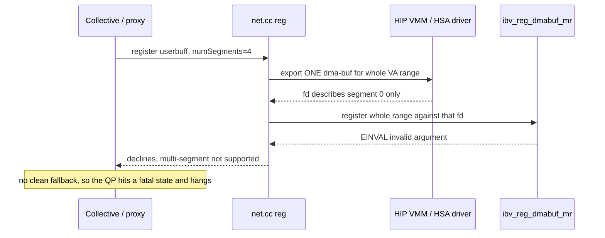

---

## 3. Shared building blocks

The current classic NET/IB paths reuse the GIN/RMA registration model: **one dma-buf MR per physical segment**, mirroring `rcclRmaIbProxyRegMrSymDmaBuf` in `net_ib/gin.cc` (which `ncclRmaIbProxyRegMrSymDmaBuf` in `gin.cc` dispatches to when `rcclRmaMultiSegEnabled()`). The composite handle is stored in an extended `ncclIbMrHandle`:

```c
// multiseg.h defines NCCL_IB_MAX_SEGMENTS; common.h uses it in ncclIbMrHandle
#define NCCL_IB_MAX_SEGMENTS 16   // same 16-segment cap as NCCL_RMA_MAX_SEGMENTS

struct ncclIbMrHandle {
  ibv_mr* mrs[NCCL_IB_MAX_DEVS_PER_NIC];        // segment 0 (legacy field; single-seg fast path)
  int nSegments;                                 // 1 = legacy single MR
  // Multi-segment (nSegments > 1) only:
  uintptr_t segStart[NCCL_IB_MAX_SEGMENTS];      // VA start of each segment
  size_t    segLen[NCCL_IB_MAX_SEGMENTS];        // bytes per segment
  ibv_mr*   segMrs[NCCL_IB_MAX_SEGMENTS][NCCL_IB_MAX_DEVS_PER_NIC];
};
```

Registration entry point in the IB plugin (called from `rcclIbRegMrDmaBufFromRange` in `reg.cc` after it has exported the per-segment fds):

```c
// net_ib/reg.cc — registers one DMA-BUF MR per segment (per device), builds composite handle.
ncclResult_t ncclIbRegMrDmaBufMultiSeg(
    void* comm, int nSeg, void** segAddrs, size_t* segLens,
    uint64_t* segOffsets, int* segFds, int type, void** mhandle);
```

The `net.cc` proxy register functions call the plugin's `regMrDmaBuf` with `fd = -1` and `offset = (export flags << 32) | numSegments`. `ncclIbRegMrDmaBuf` routes that to `rcclIbRegMrDmaBufFromRange` (`net_ib/reg.cc`), which exports one fd **per segment**, checks coverage and uniformity, and passes the arrays down. Segment boundaries come from `cuMemGetAddressRange`, as they do in the RMA path. The whole-range HSA export is skipped when `numSegments > 1`. On a recv comm `ncclIbRegMrDmaBufMultiSeg` declines when the peer did not advertise `NCCL_IB_CAP_MULTISEG`; a send comm registers regardless.

Deregistration: `ncclIbDeregMr` in `reg.cc` hands a handle with `nSegments > 1` to `rcclIbDeregMrMultiSeg`, which loops all segments × devices.

### Per-segment registration timeline

Each physical segment is a single HIP VMM allocation, so exporting it **alone** yields a complete fd — the fix is simply to export and register one segment at a time.

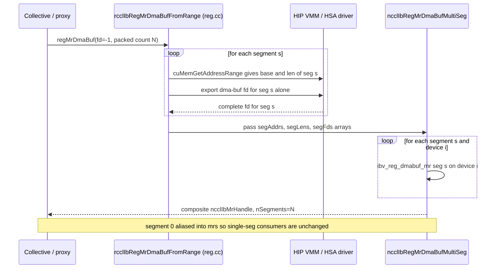

---

## 4. Rejected historical proposal: offset-based key selection only

### Idea

This proposal would have kept the CTS-FIFO wire protocol **unchanged** (one addr + one rkey per receive). Each network step's transfer `[data, data+size)` would have been required to stay **within a single physical segment**, with the data path selecting that segment's MR by VA. It was not selected because correctness would depend on `stepSize <= segmentSize` and uniform segment geometry.

### Proposed guards

- **Reg-time:** `nSeg <= NCCL_IB_MAX_SEGMENTS`; **uniform segment sizes**. Otherwise decline registration → collective falls back to staging buffers (no zero-copy, no crash).
- **Data-path (defensive):** if a single transfer would cross a segment boundary (violating the documented `stepSize <= segmentSize` assumption), `WARN` + return `ncclInternalError` (fail loudly, never corrupt). This mirrors the GIN review's "defensive single-segment assert" recommendation.

### Proposed segment-selection helper

```c
// common.h — pick the MR covering [addr, addr+len) for device devIndex.
// Returns NULL if the range is not fully contained in one segment.
static inline ibv_mr* ncclIbMrForRange(const struct ncclIbMrHandle* h,
                                       uintptr_t addr, size_t len, int devIndex) {
  if (h->nSegments <= 1) return h->mrs[devIndex];        // legacy fast path
  for (int s = 0; s < h->nSegments; s++) {
    uintptr_t b = h->segStart[s], e = b + h->segLen[s];
    if (addr >= b && addr < e)
      return (addr + len <= e) ? h->segMrs[s][devIndex] : NULL; // NULL = crosses boundary
  }
  return NULL;
}
```

### Proposed data-path changes

Under this rejected proposal, `ncclIbMultiSend` would need **no change** because every request would be constrained to one segment. The following snippets are historical pseudocode, not the selected implementation.

```c
// ncclIbIsend: select the segment ONCE for this request's data VA.
for (int i = 0; i < comm->base.vProps.ndevs; i++) {
  ibv_mr* mr = ncclIbMrForRange(mhandleWrapper, (uintptr_t)data, size, i);
  if (!mr) { WARN("NET/IB: send %p+%zu crosses a segment boundary", data, size);
             ret = ncclInternalError; goto isendFail; }
  req->send.lkeys[i] = mr->lkey;
}
```

```c
// ncclIbIrecv: advertise the rkey of the segment containing data[i].
for (int j = 0; j < comm->base.vProps.ndevs; j++) {
  ibv_mr* mr = ncclIbMrForRange(mhandleWrapper, (uintptr_t)data[i], sizes[i], j);
  if (!mr) { WARN(...); ret = ncclInternalError; goto irecvFail; }
  localElem[i].rkeys[j] = mr->rkey;
}
```

```c
// ncclIbIflush: 4-byte read always within one segment.
ibv_mr* mr = ncclIbMrForRange(mhandle, (uintptr_t)data[last], sizeof(int), i);
wr.wr.rdma.rkey = mr->rkey;
```

### Registration flow

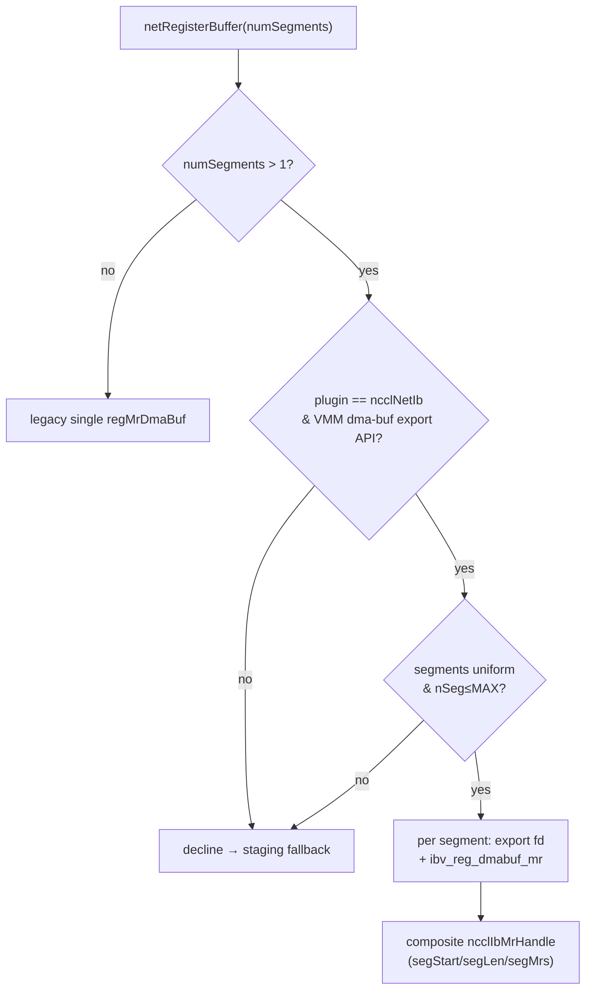

### Single-segment data path

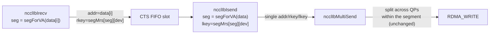

Timeline for one network step (each step stays inside one segment):

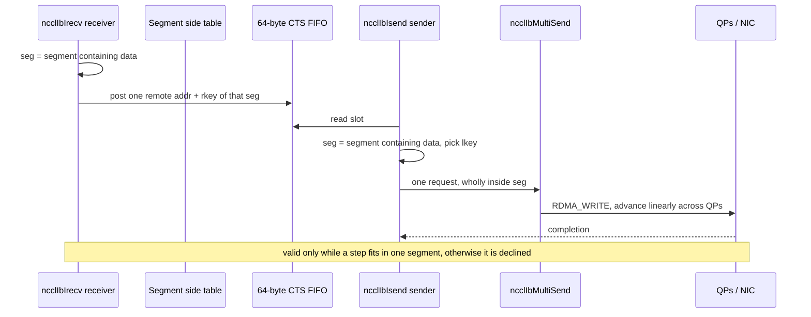

### Proposed benefits and reasons for rejection

- ✅ Would have avoided a wire-protocol change and left `ncclIbMultiSend` untouched.
- ✅ Would have provided a clean staging fallback when its preconditions were not met.
- ❌ Correctness would depend on `stepSize <= segmentSize`; a larger or differently aligned step would be rejected.
- ❌ It could not support a logical transfer that crossed a physical boundary, so it did not satisfy the general workload requirement.

---

## 5. Full segment-aware data path (selected: 64-byte CTS + side layout)

The selected design is documented in [`multi_segment_netib_wire.md`](multi_segment_netib_wire.md):

- Keep the historical **64-byte** `ncclIbSendFifo` slot. Do **not** inline `nSegments` / `segStart` / `segRkeys` in the CTS element (~712 B) and do **not** version a large FIFO.
- Publish the receiver layout in a **side table** (same slot index as CTS), gated by a **capability bit** carried in the fixed-size `devName` magic trailer (`NCCL_IB_CAP_MULTISEG`, not a new metadata field — see the overview). A slot with only `nSegments <= 1` receives writes only the 64-byte slot (bit-compatible with stock classic).
- Split RDMA WRs at local and remote segment boundaries in `ncclIbMultiSend` (independent registration-relative cursors).
- `ncclIbRegMrDmaBufMultiSeg` is IB-private (declared in `src/transport/rccl_ib_multiseg.h`, implemented in `net_ib/reg.cc`), **not** `src/include/net.h`.
- The data-path bodies are `static inline` functions in `net_ib/p2p.cc`, separate from develop's functions, which keep develop's code and gain one-line calls into them.

### Runtime switch and queue depths

`NCCL_MULTI_SEGMENT_REGISTER` gates the whole path. `ncclIbAdvertiseMultiSeg()` in `net_ib/connect.cc` decides whether to write the `NCCL_IB_CAP_MULTISEG` trailer, whether the sender's CTS MR also covers `segLayoutFifo`, and which QP depths to use. At `=0` nothing is advertised, `net.cc` declines multi-segment registration so the collective stages, and develop's depths apply. With the switch on:

| QP | Depth |
| --- | --- |
| Sender data QP | `NCCL_IB_MAX_SEND_WRS` = `2*NET_IB_MAX_REQUESTS + NCCL_IB_MAX_WRS_PER_SEND + 1` = 769 |
| Receiver CTS QP | develop's value plus `NET_IB_MAX_REQUESTS*(resiliency ? 1 : 2)` for the side-table WRs |
| Flush QP | `ncclIbFlushQpSendDepth` = 1024 when the cap is advertised, else 256 |

`static_assert`s in `connect.cc` check that the sender and flush depths also cover the GIN signal and flush WR counts from `net_ib/rma_multiseg.h`.

The in-FIFO enlargement below is the **rejected** alternative (kept only so the trade-off is visible). Do not implement it.

### Rejected alternative: enlarge the CTS FIFO

Remove the `stepSize <= segmentSize` assumption by stuffing **all** segment rkeys into the FIFO element:

### Wire-protocol change

```c
struct alignas(64) ncclIbSendFifo {
  uint64_t addr;
  uint64_t size;
  uint32_t rkeys[NCCL_IB_MAX_DEVS_PER_NIC];               // seg 0 (compat)
  uint32_t nreqs, tag; uint64_t idx;
  // NEW (multi-segment):
  uint32_t nSegments;
  uint64_t segStart[NCCL_IB_MAX_SEGMENTS];                // remote VA per segment
  uint32_t segRkeys[NCCL_IB_MAX_SEGMENTS][NCCL_IB_MAX_DEVS_PER_NIC];
};
```

> This enlarges the FIFO element and changes the wire format: **both endpoints must run the same build.** Element size must remain a 32-byte multiple (`static_assert` in `common.h`).

### Send-engine change (`ncclIbMultiSend`)

Replace the single-WR-per-request/QP construction with a boundary-splitting builder that, for the QP's chunk `[off, off+len)`, emits one WR per segment slice — each with that segment's remote addr/rkey and local lkey:

```c
// pseudo — analogous to ncclRmaBuildSegmentedWrs
size_t off = qpStartOffset, rem = qpLen;
while (rem) {
  int ls = segForOffset(localH, localBase + off);
  int rs = segForOffset(remoteFifo, off);                 // from FIFO seg table
  size_t chunk = min3(rem, segEnd(localH,ls)-off, segEnd(remoteFifo,rs)-off);
  wr->sg_list->addr   = localH->segStart[ls]  + (off - localSegOff[ls]);
  wr->sg_list->lkey   = localH->segMrs[ls][dev]->lkey;
  wr->wr.rdma.remote_addr = remoteFifo->segStart[rs] + (off - remoteSegOff[rs]);
  wr->wr.rdma.rkey        = remoteFifo->segRkeys[rs][dev];
  chain(wr); off += chunk; rem -= chunk;
}
```

### Data-path timeline for a boundary-crossing send

The receiver publishes the **whole** segment table; the sender splits one logical transfer into per-segment WR slices, each carrying that segment's remote VA + rkey.

```mermaid
sequenceDiagram
  participant Rc as ncclIbIrecv receiver
  participant F as CTS FIFO
  participant Sn as ncclIbIsend sender
  participant M as ncclIbMultiSend
  participant Q as QP / NIC
  participant Rem as Remote segments
  Rc->>Side: publish nSegments + segment VAs/rkeys with matching idx
  Rc->>F: publish unchanged CTS; idx makes side entry visible
  Sn->>F: read CTS slot
  Sn->>Side: if peer capability and idx match, read segment layout
  Sn->>M: one request covering the whole buffer
  loop until the QP chunk is drained
    M->>M: ncclIbMultiSendSegmented selects local/remote segments for current offsets
    M->>M: chunk = bytes up to the nearer segment boundary
    M->>Q: post WR slice, local lkey of seg ls
    Q->>Rem: RDMA_WRITE into seg rs VA, rkey of seg rs
    M->>M: advance offset by chunk
  end
  Q-->>Sn: completion after all slices
  Note over M,Rem: no step-size assumption; each registered handle must still satisfy the accepted layout constraints
```

### Segment-aware registration flow

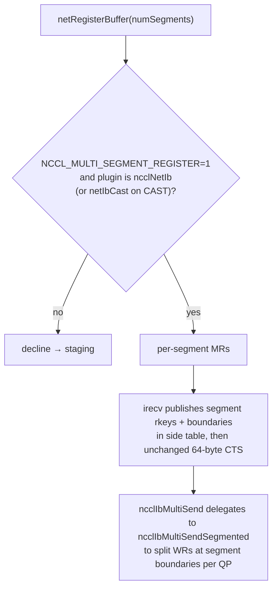

### Pros / Cons

- ✅ Handles boundary-crossing transfers and independent local/remote offsets within the accepted registration layout.
- ✅ Preserves the historical 64-byte CTS wire format; segment metadata uses a capability-gated side table.
- ✅ Keeps the single-segment fast path unchanged; only multi-segment requests enter the segmented send builder.
- ✅ Validated end to end on two-node RoCE/IB hardware, including asymmetric cross-boundary stress.
- ❌ Currently accepts only layouts whose interior segments all equal the largest segment; the first and last segments may be shorter.
- ❌ Multi-segment traffic requires an extra side-table publication and can generate additional send WRs.

---

## 6. Comparison

| Aspect                   | Key-selection-only path                   | 64-byte CTS + side layout (selected) |
| ------------------------ | ----------------------------------------- | ------------------------------------ |
| 64-byte CTS slot         | Unchanged                                 | Unchanged                            |
| Extra layout             | None                                      | Side table + connect cap             |
| `ncclIbMultiSend`        | Untouched                                 | Delegates to `ncclIbMultiSendSegmented` when nSeg > 1 |
| Boundary-crossing step   | Declined at reg / asserted                | Handled                              |
| Assumption               | `stepSize <= segmentSize`, uniform segs   | Uniform segs at registration         |
| Interop, `nSegments <= 1`| Yes                                       | Yes (same 64-byte slot)              |
| Interop, `nSegments > 1` | Staging                                   | Requires peer cap; else staging      |
| AINIC inline CTS         | Safe (32-byte inline / 64-byte slot)      | Safe (does not enlarge CTS)          |
| Rejected alternative     | —                                         | In-FIFO `nSegments`/`segRkeys` (~712 B) |

**Decision:** ship WR splitting, but **keep the 64-byte CTS slot**. Put the segment table in a side structure with a connect capability bit. See [`multi_segment_netib_wire.md`](multi_segment_netib_wire.md). Do not enlarge `ncclIbSendFifo`. Keep `ncclIbRegMrDmaBufMultiSeg` out of `net.h`.

---

## 7. Validation coverage

The current host and two-node MPI suites cover:

1. **Single-segment regression** — unchanged behavior (`nSegments == 1`).
2. **Multi-segment registration** — N uniform segments register N MRs; handle populated.
3. **Segment selection** — VA at segment start / mid / last-byte maps to the right MR.
4. **Boundary alignment** — a segment-aligned multi-segment transfer enters the segmented builder but needs only one boundary-contained WR; only single-segment buffers use the unchanged fast path.
5. **Unsupported-layout decline** — layouts outside the registration contract decline cleanly to staging.
6. **Cross-boundary handling** — transfer straddling a boundary splits into correct per-segment WRs.
7. **`> NCCL_IB_MAX_SEGMENTS`** — rejected/declined cleanly.
8. **Zero-size / 1-byte** transfers at and around boundaries.
9. **Deregistration** — all per-segment MRs freed (no leak, no double-free).
10. **Asymmetric local/remote offsets and boundaries** — the selected splitter advances independent cursors and chooses the correct MR/key on each side.
11. **Switch off** — with `NCCL_MULTI_SEGMENT_REGISTER=0`, `MultiSegmentRegisterOff_DeclinesRegistration` (job `net_ib_multisegment_register_off`) expects the receiver's multi-segment registration to be declined and the sender's to succeed, while single-segment registrations still transfer.
12. **Per-segment flush** — the flush tests run in `net_ib_multisegment_flush` with `RCCL_GDR_FLUSH_GPU_MEM_NO_RELAXED_ORDERING=0`, because the default scratchpad flush never reaches the per-segment branch.

The selected path has completed two-node RoCE/IB validation, including whole-buffer, asymmetric-offset, cross-boundary, multi-receive, completion-size, flush, maximum-segment, and single-segment regression cases. The key-selection-only proposal remains historical and is not a second runtime mode.

---

## 8. Hybrid DeepEP parity coverage

This coverage belongs primarily to the symmetric-window/GIN path, not to the classic NET/IB wire-path decision.

A hybrid VMM allocation is one continuous virtual address range backed by separate GPU and host memory objects:

```text
+------------------+------------------+-----+------------------+
| private GPU VMM  | host VMM owner 0 | ... | host VMM owner N-1 |
+------------------+------------------+-----+------------------+
```

The application uses one base pointer, but RCCL registers `1 + N` backing segments. CI uses **8 ranks on 2 nodes (4 ranks per node)**; each process owns its private GPU segment and one 2 MiB-aligned host segment:

```text
local rank k: [GPU k][CPU 0][CPU 1][CPU 2][CPU 3]
              CPU k is local; the other three host segments are imported
```

Local ranks exchange segment sizes over `MPI_COMM_TYPE_SHARED`, transfer POSIX DMA-BUF FDs through RCCL's Unix-domain IPC socket API (`SCM_RIGHTS`), and map the handles in local-rank order. Every segment receives GPU access; host segments also receive CPU access. The range is registered with `NCCL_WIN_STRICT_ORDERING` and `NCCL_SYM_REUSE_SYSMEM_HANDLES=1`, then used for LSA creation and cross-node GIN IGet from a remote CPU segment into a different local GPU offset. GIN uses DMA-BUF registration for every VMM segment, including CPU-backed segments.

Positive registration/IGet, negative elastic-gating and bounds cases, and a 32-iteration offset/size/CPU-owner stress test are included. Capability failures skip collectively, and MRs/windows are released before the imported VMM.

**Supported contract:** `NCCL_ELASTIC_BUFFER_REGISTER=1` and `NCCL_SYM_REUSE_SYSMEM_HANDLES=1`. The 8-rank/two-node (4 ranks per node) hybrid symmetric-window/GIN tier in the architecture JSONs (`ubr_multisegment_lsagin_multinode`) is the primary coverage.
