# Code Walkthrough: Multi-Segment DMA-BUF on Classic NET/IB P2P

> **CURRENT WALKTHROUGH WITH HISTORICAL COMPARISON.** Sections explicitly labeled “historical key-selection-only” describe the rejected proposal. The implemented path preserves the 64-byte CTS FIFO, publishes segment metadata through a capability-gated side table, and splits WRs at local and remote boundaries. For shared GIN, classic, and CAST facts, see [`multi_segment_dmabuf_gin_and_netib.md`](multi_segment_dmabuf_gin_and_netib.md).

**Companion to:** [`multi_segment_netib_wire.md`](./multi_segment_netib_wire.md) (design and implementation comparison). **Audience:** reviewers and maintainers who want a file-by-file, function-by-function tour of the *implemented* code (not pseudo-code). **Ticket:** AIRUNTIME-2351 (classic-path follow-up to the GIN/RMA multi-segment fix).

For current behavior also read [`multi_segment_netib_wire_walkthrough.md`](multi_segment_netib_wire_walkthrough.md), which has the current commit map. This file is kept for comparison and is corrected where the code moved or changed.

## What changed on 2026-10-16

HIP now defaults `NCCL_MULTI_SEGMENT_REGISTER` to 0. The knob is still `ncclParamMultiSegmentRegister()` in `transport/generic.cc`. `NCCL_MULTI_SEGMENT_REGISTER=1` turns the feature on, on HIP and on every other build. An unset variable takes the develop path on a HIP build. A non-HIP build still defaults to 1. The commit is `9af53b9bca21` on `users/atulkulk/mseg/01-ce-recv-window-offset`, replayed through the stack.

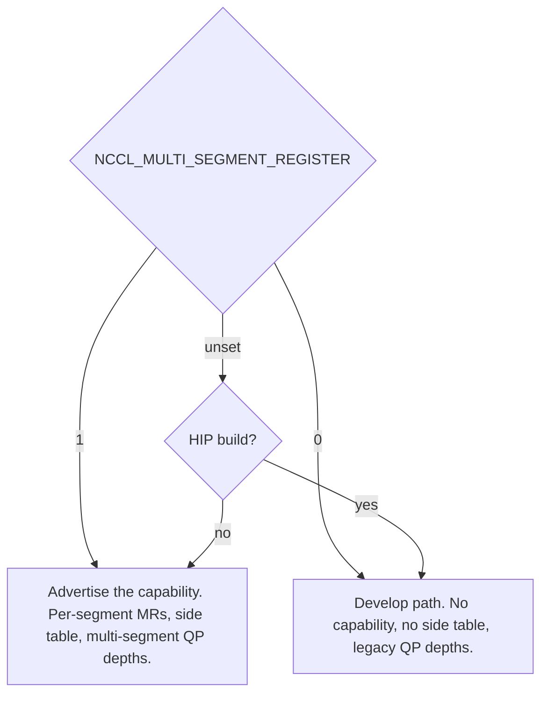

With the switch off, connect does not advertise `NCCL_IB_CAP_MULTISEG` and does not append the side table, so the sender QP stays at `2 * NET_IB_MAX_REQUESTS`. NET, P2P IPC and NVLS leave a multi-segment buffer unregistered. GIN and RMA stay on develop's bodies and do not reserve credits. A device-only GIN window with more than one segment and no sysmem returns `ncclInvalidUsage` instead of registering only the first segment.

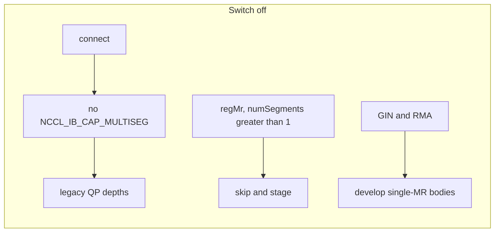

The direct-GDR flush QP is sized for one chain on every proxy step. `recvProxyProgress` posts `iflush` into `requests[step % NCCL_STEPS]` and returns before that flush is polled, so up to 8 flushes can be outstanding. With `RCCL_GDR_FLUSH_GPU_MEM_NO_RELAXED_ORDERING=0`, `rcclIbIflushMultiSeg` posts one RDMA read per receive per segment, at most `8 * 16 = 128` work requests, and signals only the last. Eight chains need `8 * 128 = 1024` slots. The previous depth, `NET_IB_MAX_REQUESTS + 128 = 384`, held three chains and the fourth post failed. `ncclIbFlushQpSendDepth` in `net_ib/multiseg.h` returns `NCCL_STEPS * NCCL_NET_IB_MAX_RECVS * NCCL_IB_MAX_SEGMENTS` when the peer advertised the capability, and `NET_IB_MAX_REQUESTS` (256) otherwise. Classic `ncclIbCreateFlushQp` calls it. `connect.cc` static-asserts that the multi-segment result holds at least one chain per step. The host test is `NetIbMultiSeg.FlushQpDepthCoversEveryOutstandingStep`.

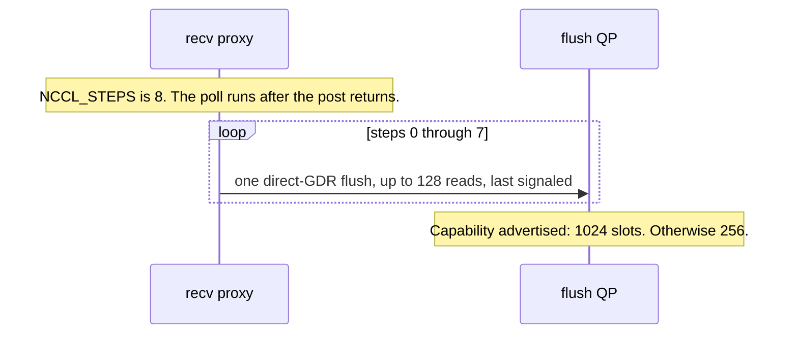

CAST non-RMA comms use the same helper. CAST RMA comms keep `NCCL_RMA_MAX_FLUSH_QP_WRS` (271), because RMA credits wait until one chain completes before the next post. With the switch off every flush QP stays at 256.

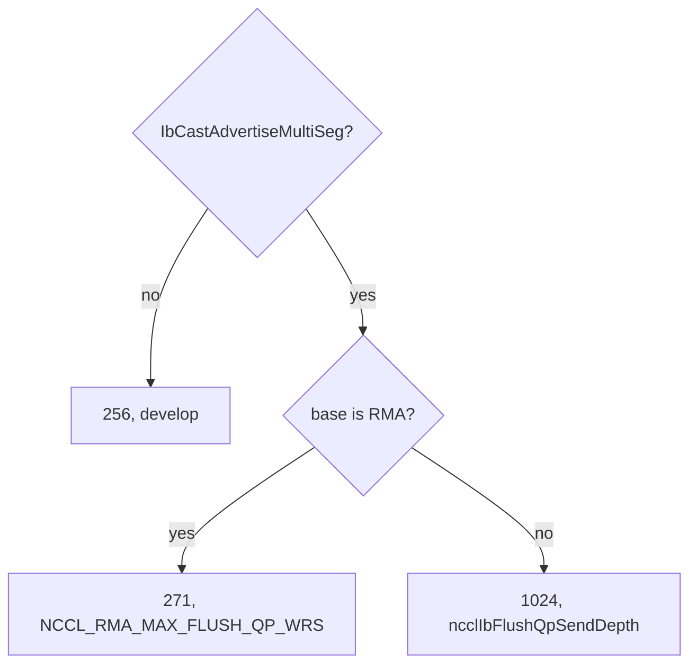

The scratchpad flush (`RCCL_GDR_FLUSH_GPU_MEM_NO_RELAXED_ORDERING=1`, the default) posts one write and one read and does not fill 1024 slots. The enlarged depth is for the direct-GDR path. `net_ib_multisegment_flush` selects that path by setting the parameter to 0.

Jobs that test the feature set `NCCL_MULTI_SEGMENT_REGISTER=1` in the runner config, because an unset HIP job now takes the off path. Register-off jobs stay at 0. `cast_multisegment_opt_recv_2qp` inherits 1 from `cast_multisegment_opt_recv`. `net_ib_rma_multisegment_wrbatch` on the wire branch, and the hybrid nightly jobs on 09 including `net_ib_multisegment_hybrid_stress_nightly`, set 1 as well. The WR-batch job fails under `RCCL_TEST_RMA_MSEG_REQUIRE=1` when the per-segment registration log is missing, and the hybrid IGet stress skips. `multisegment_host_boundary_math` is host-only and does not read the switch.

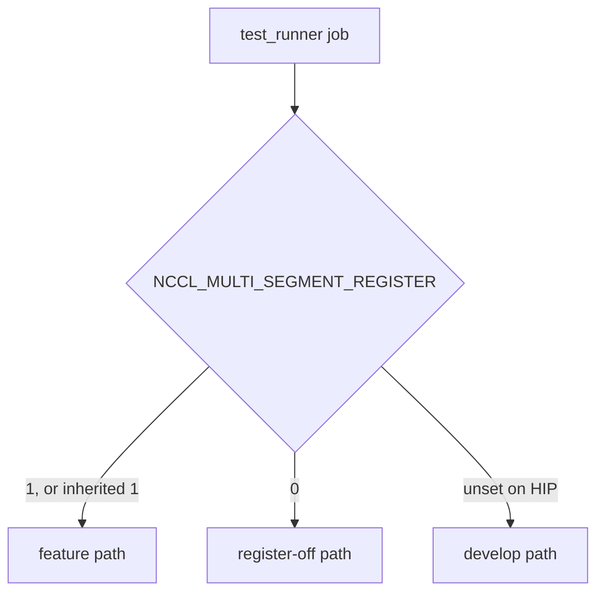

## What changed on 2026-10-14

- The multi-segment bodies are back in the files they hook: the P2P functions in `net_ib/p2p.cc`, registration in `net_ib/reg.cc`, and the proxy call in `transport/net.cc`. `net_ib/p2p_multiseg.h`, `net_ib/rccl_reg_multiseg.cc` and `transport/rccl_ib_multiseg.cc` no longer exist.
- Section 4.1: `net.cc` calls `regMrDmaBuf` with `fd = -1` and a packed segment count; `rcclIbRegMrDmaBufFromRange` in `reg.cc` does the per-segment walk and export that `rcclNetIbRegMrMultiSeg` used to do on the proxy side.
- Section 4.2: the peer-cap decline applies only to a recv comm. A sender splits locally onto the receiver's single rkey, so it registers without the peer cap; with the switch off, the receiver declines and the sender registers.
- Section 6: `ncclIbRecvComm::remSegLayout` is allocated (and its MR registered) only for a capable peer; the sender's `segLayoutFifo` stays inline.

## What changed since the 2026-10-07 revision

- `NCCL_MULTI_SEGMENT_REGISTER` (`ncclParamMultiSegmentRegister()`) gates the whole classic path through `ncclIbAdvertiseMultiSeg()` in `net_ib/connect.cc`. At `=0` the capability trailer is not written, the sender's CTS MR covers only `ctsFifo`, `net.cc` declines multi-segment registration and develop's QP depths apply (Sections 4 and 6.5).
- The data-path bodies became `static inline` functions in `net_ib/p2p.cc`, separate from develop's: `ncclIbMultiSendSegmented`, `rcclIbMultiSendNeedsSegmented`, `rcclIbIsendWaitSideTable`, `rcclIbPostFifoSideWr`, `rcclIbIrecvCheckHandle`, `rcclIbIrecvFillSideTable`, `rcclIbCtsFlagSideTable`, `rcclIbIflushNeedsMultiSeg` and `rcclIbIflushMultiSeg`. `ncclIbMrForRange` and `ncclIbQpChunkSize` are there too. `p2p.cc` is develop plus one-line calls, and `ncclIbMultiSend` keeps develop's inline chunk math; only the segmented builder uses `ncclIbQpChunkSize`.
- Registration is `ncclIbRegMrDmaBufMultiSeg` and `rcclIbDeregMrMultiSeg` in `net_ib/reg.cc`; develop's `ncclIbDeregMr` keeps a one-line dereg hook. The proxy-side helper is gone (see 2026-10-14 above).
- With the switch on, the receiver CTS QP adds `NET_IB_MAX_REQUESTS*(resiliency?1:2)` side-table WRs and the flush QP is `NET_IB_MAX_REQUESTS + NCCL_NET_IB_MAX_RECVS*NCCL_IB_MAX_SEGMENTS`. `static_assert`s cover the GIN signal and flush WRs.
- New test `MultiSegmentRegisterOff_DeclinesRegistration` and job `net_ib_multisegment_register_off`. The flush tests run in `net_ib_multisegment_flush` with `RCCL_GDR_FLUSH_GPU_MEM_NO_RELAXED_ORDERING=0`. `MultiRecvMixesSingleAndMultiSegmentHandles` now starts its multi-segment entry in segment 1 and requires a flush request when direct GDR flush is on.

The implemented classic path is stacked in `users/atulkulk/mseg/06-classic-netib-multisegment`; CAST P2P (`users/atulkulk/mseg/08-cast-netib-multisegment`) and CAST GIN/RMA (`users/atulkulk/mseg/multi-segment-dmabuf-cast-gin`) build on it. The key-selection-only branch is retained solely to explain the rejected alternative.

| Branch                                                | Status                    | What it does                                                                                                                                                                                               |
| ----------------------------------------------------- | ------------------------- | ---------------------------------------------------------------------------------------------------------------------------------------------------------------------------------------------------------- |
| `users/atulkulk/mseg/06-classic-netib-multisegment`                 | **Selected / implemented** | 64-byte CTS, `ncclIbSegLayout` side table, `NCCL_IB_CAP_MULTISEG`, per-segment MRs, RDMA-write splitting at local + remote bounds.                                                                         |
| Pre-stack wire prototype                              | Historical                | Earlier form of the selected 64-byte CTS + side-table option.                                                                                                                                               |
| Pre-stack key-selection prototype                     | **Rejected / reference**  | Per-segment MRs, offset-based key selection, no side table. A transfer that crosses a segment is declined. Not the implemented path.                                                                        |

Sections 1–4 cover the shared registration and boundary helpers. Section 5 preserves the rejected key-selection-only proposal for comparison. Section 6 walks the implemented 64-byte CTS + side-table path.

> Code excerpts below are lightly trimmed for readability (error-check macros, tracing). See the cited file/function for the authoritative source.

---

## 1. The end-to-end picture

Two phases are involved: **registration** (once per user buffer, on the proxy thread) and the **data path** (every network step, on the send/recv engines).

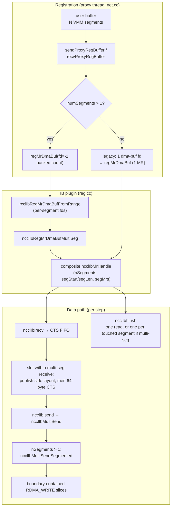

The composite `ncclIbMrHandle` is the object that ties the two phases together: registration fills it in, and the data path reads it to pick the right key for each virtual address. The `numSegments > 1` branch is reached only when `NCCL_MULTI_SEGMENT_REGISTER` is on; at `=0`, `ncclNetLocalRegisterBuffer` and `ncclNetGraphRegisterBuffer` in `net.cc` skip NET registration for a multi-segment buffer, so the collective stages.

---

## 2. The composite MR handle (`net_ib/common.h`)

The single-MR assumption used to live in the type itself. We extend it so a handle can describe *N* physical segments while keeping the single-segment layout as a fast path.

```c
// net_ib/multiseg.h defines the bound; net_ib/common.h uses it.
#define NCCL_IB_MAX_SEGMENTS 16

struct ncclIbMrHandle {
  ibv_mr* mrs[NCCL_IB_MAX_DEVS_PER_NIC];
  int nSegments;                                             // 1 = legacy single MR
  uintptr_t segStart[NCCL_IB_MAX_SEGMENTS];                  // VA start of each segment
  size_t    segLen[NCCL_IB_MAX_SEGMENTS];                    // bytes per segment
  ibv_mr*   segMrs[NCCL_IB_MAX_SEGMENTS][NCCL_IB_MAX_DEVS_PER_NIC];
};
```

Key invariants:

- `nSegments == 1` → only `mrs[]` is meaningful (unchanged behavior for every existing caller).
- `nSegments > 1` → `segStart[s]/segLen[s]` describe the VA layout, `segMrs[s][dev]` is the MR for segment `s` on device `dev`, and **`mrs[]` aliases segment 0** so any code that still reads `mrs[]` sees a valid MR.

### Selecting a key by address

`ncclIbMrForRange` supports the legacy fast path and operations that need one containing MR. It returns the MR that fully contains the range, or `NULL` when the range straddles a boundary. The segmented send path does not force the whole request through this helper; it resolves each boundary-contained slice directly. The helper now lives in `net_ib/p2p.cc`, next to its only callers:

```c
// net_ib/p2p.cc
static inline ibv_mr* ncclIbMrForRange(const struct ncclIbMrHandle* h,
                                       uintptr_t addr, size_t len, int devIndex) {
  if (h == NULL) return NULL;
  if (h->nSegments <= 1) return h->mrs[devIndex];          // hot path: one compare + index
  int s = ncclIbSegmentIndexForRange(h->nSegments, h->segStart, h->segLen, addr, len);
  return (s < 0) ? NULL : h->segMrs[s][devIndex];
}
```

The `nSegments <= 1` branch is the hot path for all normal buffers — one comparison and an array index, identical cost to the old `mhandle->mrs[dev]`.

---

## 3. The pure boundary math (`net_ib/multiseg.h`)

The actual segment arithmetic is factored into a **dependency-free** header (no ibverbs, no RCCL types) so it can be unit-tested on the host without IB hardware or a GPU.

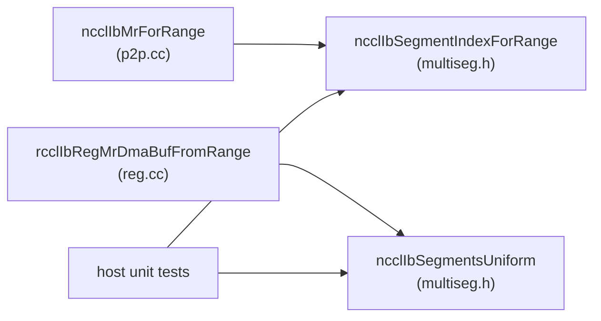

`ncclIbSegmentIndexForRange` finds the containing segment, with three explicit rejection cases — outside all segments, address overflow, and boundary crossing:

```c
// net_ib/multiseg.h
static inline int ncclIbSegmentIndexForRange(int nSegments,
                                             const uintptr_t* segStart,
                                             const size_t* segLen,
                                             uintptr_t addr, size_t len) {
  for (int s = 0; s < nSegments; s++) {
    uintptr_t b = segStart[s];
    uintptr_t e = b + segLen[s];
    if (addr >= b && addr < e) {
      if (len == 0) return s;
      uintptr_t end = addr + len;
      if (end < addr) return -1;       // address overflow
      return (end <= e) ? s : -1;      // -1 => crosses a segment boundary
    }
  }
  return -1;
}
```

`ncclIbSegmentsUniform` requires every interior segment to equal the largest segment and allows a shorter first or last segment, so any two-segment layout passes. This was a prerequisite of the historical key-selection-only proposal, but it was not sufficient for arbitrary request starts: even a request smaller than a segment can straddle a boundary. The selected path keeps the conservative registration gate and handles crossing explicitly by splitting:

```c
// net_ib/multiseg.h
static inline bool ncclIbSegmentsUniform(int nSegments, const size_t* segLen) {
  if (nSegments <= 1) return true;
  size_t stride = 0;
  for (int s = 0; s < nSegments; s++) {
    if (segLen[s] > stride) stride = segLen[s];
  }
  if (stride == 0) return false;
  for (int s = 1; s < nSegments - 1; s++) {
    if (segLen[s] != stride) return false;
  }
  return segLen[0] <= stride && segLen[nSegments - 1] <= stride;
}
```

---

## 4. Registration path

### 4.1 Proxy call (`transport/net.cc`) and range walk (`net_ib/reg.cc`)

The proxy no longer exports fds for a multi-segment buffer. `sendProxyRegBuffer` / `recvProxyRegBuffer` add a `numSegments > 1` branch ahead of develop's single-fd export that calls the plugin's own `regMrDmaBuf` once with `fd = -1` and the segment count and export flags packed into `offset`. `net.cc` stays plugin-neutral: a plugin that does not understand `fd = -1` fails the call and the collective stages. If the registration **fails**, `needReg` stays `true`; the whole-range HSA export is skipped for `numSegments > 1` and non-DMA-BUF `regMr` refuses multiple segments, so the buffer is left unregistered and the collective transparently falls back to staging buffers — no crash:

```c
// transport/net.cc — sendProxyRegBuffer (recv side is symmetric)
// RCCL: fd < 0 asks the plugin to register one MR per physical segment.
// offset is (export flags << 32) | segment count. Failure stages.
if (numSegments > 1) {
  uint64_t packed = (uint64_t)(uint32_t)numSegments |
                    ((uint64_t)(uint32_t)getHandleForAddressRangeFlags(resources->useGdr) << 32);
  if (proxyState->ncclNet->regMrDmaBuf &&
      proxyState->ncclNet->regMrDmaBuf(resources->netSendComm, (void*)info->buffer, info->size, NCCL_PTR_CUDA,
                                       packed, -1, &handle) == ncclSuccess)
    needReg = false;
  goto peermem;
}
// ... develop's single-fd cuMemGetHandleForAddressRange + regMrDmaBuf ...
```

In the plugin, `ncclIbRegMrDmaBuf` routes `fd == -1` to `rcclIbRegMrDmaBufFromRange` (`net_ib/reg.cc`, built when `CUDA_VERSION >= 11070 || NCCL_CUMEM_DMABUF_EXPORT_GATE`). It unpacks the count and flags, rejects a count outside `1..NCCL_IB_MAX_SEGMENTS`, walks the VA range one physical segment at a time with `cuMemGetAddressRange`, exports **one dma-buf fd per segment** (each fd is complete because it describes a single physical allocation), declines if the walk does not cover exactly the expected segments and bytes, applies the uniform-segment guard, and calls `ncclIbRegMrDmaBufMultiSeg`:

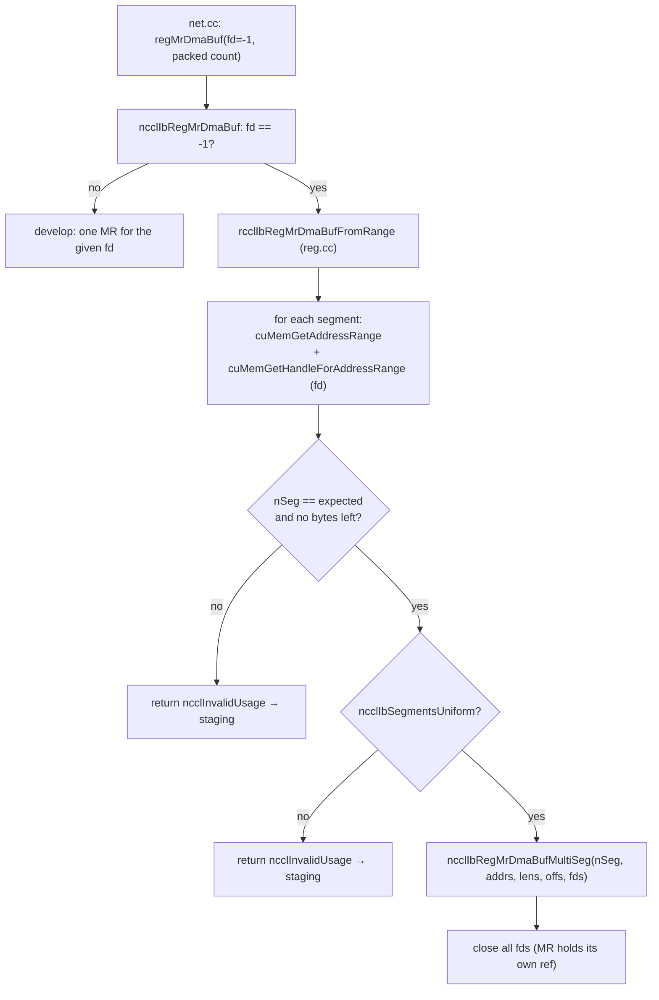

The segment-splitting loop is the heart of it:

```c
// net_ib/reg.cc — rcclIbRegMrDmaBufFromRange
const int nExpect = (int)(packed & 0xffffffffu);
const int handleFlags = (int)(packed >> 32);
uintptr_t segPtr = (uintptr_t)data;
for (int s = 0; s < nExpect && remaining > 0; s++) {
  CUdeviceptr segBase = 0; size_t segSize = 0;
  CUCHECKGOTO(cuMemGetAddressRange(&segBase, &segSize, (CUdeviceptr)segPtr), ret, fail);
  size_t inSeg = ncclIbBytesRemainingInSegment(segPtr, (uintptr_t)segBase, segSize);
  size_t thisLen = remaining < inSeg ? remaining : inSeg;
  int fd = -1;
  CUCHECKGOTO(cuMemGetHandleForAddressRange((void*)&fd, (CUdeviceptr)segPtr, thisLen,
              CU_MEM_RANGE_HANDLE_TYPE_DMA_BUF_FD, handleFlags), ret, fail);
  segAddrs[s] = (void*)segPtr; segLens[s] = thisLen; segOffsets[s] = 0ULL; segFds[s] = fd;
  segPtr += thisLen; remaining -= thisLen; nSeg++;
}
```

Before the proxy is asked at all, `ncclNetLocalRegisterBuffer` and `ncclNetGraphRegisterBuffer` return early for `numSegments > 1` when `NCCL_MULTI_SEGMENT_REGISTER=0`, and cache the segment count on the registration record through `rcclNetRegSegmentCount` / `rcclNetGraphRegSegmentCount` and `rcclNetRegCommit`.

### 4.2 Plugin side (`net_ib/reg.cc`)

`ncclIbRegMrDmaBufMultiSeg` rejects a segment count outside `1..NCCL_IB_MAX_SEGMENTS`, declines **on a recv comm** when the peer did not advertise `NCCL_IB_CAP_MULTISEG` (the peer could not read the side table that describes this receive; a send comm registers regardless, because the sender only splits its own buffer onto the receiver's single rkey), allocates the composite handle (with `ncclCalloc`, so all MR pointers start `NULL` for clean rollback), registers one MR per segment per device via `ncclIbRegMrDmaBufInternal2`, and aliases segment 0 into `mrs[]`:

```c
// net_ib/reg.cc — ncclIbRegMrDmaBufMultiSeg
if (nSeg < 1 || nSeg > NCCL_IB_MAX_SEGMENTS) return ncclInvalidUsage;
uint32_t peerCaps =
  base->isSend ? ((struct ncclIbSendComm*)comm)->peerCaps : ((struct ncclIbRecvComm*)comm)->peerCaps;
// RCCL: the side table describes the receiver. A sender splits locally onto
// one remote rkey, so only recv registration requires the peer cap.
if (!base->isSend && ncclIbDeclineMultiSegRegistration(peerCaps, nSeg)) return ncclInvalidUsage;
struct ncclIbMrHandle* mhandleWrapper = NULL;
NCCLCHECK(ncclCalloc(&mhandleWrapper, 1));
mhandleWrapper->nSegments = nSeg;
for (int s = 0; s < nSeg; s++) {
  mhandleWrapper->segStart[s] = (uintptr_t) segAddrs[s];
  mhandleWrapper->segLen[s]   = segLens[s];
  for (int i = 0; i < base->vProps.ndevs; i++) {
    struct ncclIbNetCommDevBase* devComm = ncclIbGetNetCommDevBase(base, i);
    NCCLCHECKGOTO(ncclIbRegMrDmaBufInternal2(devComm, segAddrs[s], segLens[s], type, segOffsets[s], segFds[s], 0ULL,
                                             &mhandleWrapper->segMrs[s][i]), ret, fail);
  }
}
// Alias segment 0 into mrs[] so single-segment consumers keep working.
for (int i = 0; i < base->vProps.ndevs; i++) mhandleWrapper->mrs[i] = mhandleWrapper->segMrs[0][i];
```

The `ncclCalloc` + `NULL`-checked cleanup loop (label `fail:`) means a partial failure at segment *k* frees exactly the `k·ndevs` MRs already created — no leaks, no double-frees. In `reg.cc`, develop's single-segment `ncclIbRegMrDmaBufInternal` now uses `ncclCalloc`, sets `nSegments = 1`, and deregisters the MRs it already created if a later device fails.

### 4.3 Deregistration (`net_ib/reg.cc`)

`ncclIbDeregMr` gains a one-line hook that hands a multi-segment handle to the `static` `rcclIbDeregMrMultiSeg` in the same file. Because `mrs[]` *aliases* `segMrs[0]`, that function frees strictly through `segMrs[][]` to avoid double-freeing segment 0:

```c
// net_ib/reg.cc — ncclIbDeregMr
if (mhandleWrapper->nSegments > 1) return rcclIbDeregMrMultiSeg(comm, mhandle);
// ... develop: free mrs[i] per device ...

// net_ib/reg.cc — rcclIbDeregMrMultiSeg
// mrs[] aliases segment 0, so it is freed via segMrs[0] here (do not double-free).
for (int s = 0; s < mhandleWrapper->nSegments; s++) {
  for (int i = 0; i < base->vProps.ndevs; i++) {
    struct ncclIbNetCommDevBase* devComm = ncclIbGetNetCommDevBase(base, i);
    NCCLCHECK(ncclIbDeregMrInternal(devComm, mhandleWrapper->segMrs[s][i]));
  }
}
free(mhandleWrapper);
```

---

## 5. Historical key-selection-only data path — rejected

This section describes the rejected proposal, not a selectable runtime mode. Its CTS FIFO carried one remote address + one rkey per device. `isend`, `irecv`, and `iflush` selected one segment's key and rejected a straddling transfer. `ncclIbMultiSend` would have remained untouched and walked one contiguous range inside the selected segment. The implemented path in §6 removes that restriction.

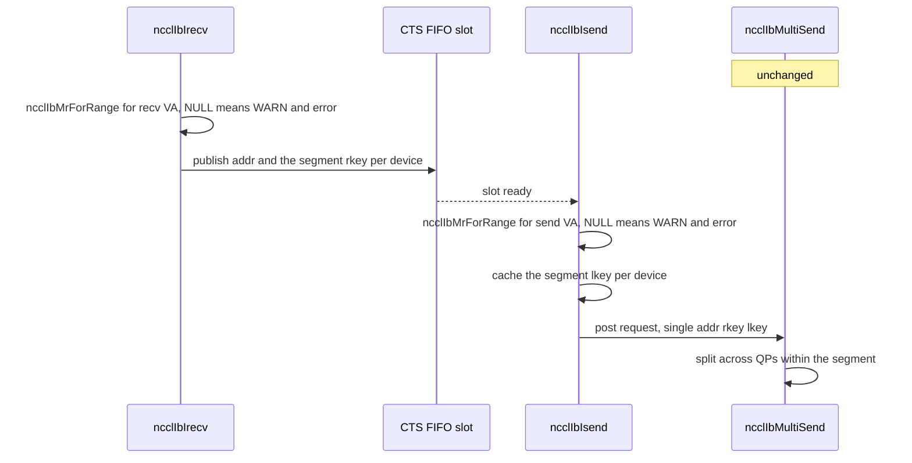

### 5.1 `ncclIbIsend`

First a defensive guard, then per-device lkey selection:

```c
// net_ib/p2p.cc — ncclIbIsend
if (mhandleWrapper->nSegments > 1 &&
    ncclIbMrForRange(mhandleWrapper, (uintptr_t)data, size, 0) == NULL) {
  WARN("NET/IB: send buffer %p size %ld crosses a segment boundary (multi-segment registration)", data, size);
  return ncclInternalError;
}
// ...
for (int i = 0; i < comm->base.vProps.ndevs; i++) {
  req->send.lkeys[i] = ncclIbMrForRange(mhandleWrapper, (uintptr_t)data, size, i)->lkey;
}
```

### 5.2 `ncclIbIrecv`

The receiver validates every region, then advertises the containing segment's rkey into the CTS FIFO element:

```c
// net_ib/p2p.cc — ncclIbIrecv
for (int i = 0; i < n; i++) {
  struct ncclIbMrHandle* mw = (struct ncclIbMrHandle*) mhandles[i];
  if (mw->nSegments > 1 && ncclIbMrForRange(mw, (uintptr_t)data[i], sizes[i], 0) == NULL) {
    WARN("NET/IB: recv buffer %p size %ld crosses a segment boundary (multi-segment registration)", data[i], sizes[i]);
    ret = ncclInternalError; goto irecvFail;
  }
}
// ... later, publishing the CTS element:
for (int j = 0; j < comm->base.vProps.ndevs; j++) {
  localElem[i].rkeys[j] = ncclIbMrForRange(mhandleWrapper, (uintptr_t)data[i], sizes[i], j)->rkey;
}
```

### 5.3 `ncclIbIflush`

The GDR flush issues a tiny RDMA read that fences the DMA; it reads the first bytes of `data[last]`, so it selects that segment's MR:

```c
// net_ib/p2p.cc — ncclIbIflush
struct ibv_mr* flushMr = ncclIbMrForRange(mhandle, (uintptr_t)data[last], sizeof(int), i);
if (flushMr == NULL) {
  WARN("NET/IB: flush buffer %p crosses a segment boundary (multi-segment registration)", data[last]);
  ret = ncclInternalError; goto iflushFail;
}
wr.wr.rdma.rkey = flushMr->rkey;
```

---

## 6. Implemented segment-aware path: unchanged CTS + side layout

The selected design does **not** enlarge `ncclIbSendFifo`. The historical CTS slot remains exactly 64 bytes. A separate `ncclIbSegLayout` slot publishes the full remote layout only for CTS slots that contain a multi-segment receive, and `ncclIbMultiSendSegmented` splits the scheduled transfer at local and remote boundaries.

### 6.1 Why the CTS slot stays 64 bytes

Inlining 16 segment addresses and rkeys for as many as 8 devices would grow one CTS slot from 64 bytes to roughly 712 bytes. That would change the peer-visible size and stride, expand every request even when it has one segment, and conflict with CAST/AINIC's 32-byte inline CTS assumptions.

The selected channels are:

| Channel | Contents | Frequency |
| --- | --- | --- |
| Existing 64-byte CTS | request address/size, segment-0 rkeys, request metadata (`nreqs` bit 31 flags a side table), `idx` | Every receive |
| `ncclIbSegLayout` side slot | segment count, segment VAs, per-device rkeys, `idx` | Every entry of a slot that has a multi-segment receive, toward a capable peer |
| Connection metadata trailer | `NCCL_IB_CAP_MULTISEG` capability | Once during connect |

The side structure is indexed with the same request and receive-slot coordinates as CTS:

```c
struct alignas(64) ncclIbSegLayout {
  uint32_t nSegments;
  uint32_t pad;
  uint64_t segStart[NCCL_IB_MAX_SEGMENTS];
  uint32_t segRkeys[NCCL_IB_MAX_SEGMENTS][NCCL_IB_MAX_DEVS_PER_NIC];
  uint64_t idx; // last store
};
```

The sender's `segLayoutFifo` sits immediately after `ctsFifo` in `ncclIbSendComm` (a `static_assert` pins this and the 704-byte slot size), so when the sender advertises the capability one covering `ctsFifoMr` registers both; at `NCCL_MULTI_SEGMENT_REGISTER=0` the MR covers only `ctsFifo`. The sender's table must stay inline because the peer RDMA-writes it at `ctsFifo + sizeof(ctsFifo)` through that covering MR. The receiver's staging copy is different: `ncclIbRecvComm::remSegLayout` is a pointer, allocated in accept (with `addr` set to the peer's `ctsFifo` address plus `sizeof(ctsFifo)`) and registered as `segLayoutFifoMr` with `IBV_ACCESS_LOCAL_WRITE` only when the peer advertised `NCCL_IB_CAP_MULTISEG`. A recv comm to a legacy or switched-off peer carries no table (256 × 8 × 704 B, about 1.44 MB); accept's fail path and close free it.

The `p2p.cc` hooks are one line each. In `ncclIbIrecv`, `rcclIbIrecvCheckHandle` rejects a NULL handle or missing per-device MR, `rcclIbIrecvFillSideTable` fills each side entry, and `rcclIbCtsFlagSideTable` sets `NCCL_IB_CTS_NREQS_SIDE_TABLE` in every CTS entry's `nreqs` when the slot has a multi-segment receive. `ncclIbPostFifo` then posts the chain returned by `rcclIbPostFifoSideWr`: the side slot first (an unsignaled write tagged with the CTS `wr_id`) and the ordinary CTS slot second. RC QP ordering makes CTS the publication point. In `ncclIbIsend`, `rcclIbIsendWaitSideTable` waits, for a flagged slot only, until every side `idx` equals the CTS `idx`. `ncclIbCtsRemoteMultiSeg` treats an entry as remote multi-segment only when the peer has the capability, the flag is set, the `idx` values match, and the side `nSegments` is above 1; this prevents a stale multi-segment layout from being reused when the same slot later carries single-segment traffic. The sender also validates the copied layout with `ncclIbCtsRemoteLayoutValid` before building WRs.

### 6.2 Capability negotiation without changing metadata size

`NCCL_IB_CAP_MULTISEG` is not an appended field in `ncclIbConnectionMetadata` (a `static_assert` in `connect.h` forbids trailing fields). When `ncclIbAdvertiseMultiSeg()` is true, `ncclIbSetConnectCaps` writes a magic-tagged `{magic=0x4d534547, flags}` trailer into reserved bytes at the end of the fixed `devName` array while preserving its C-string termination. The peer calls `ncclIbGetConnectCaps`; an absent or invalid magic yields zero capabilities.

```mermaid
sequenceDiagram
  participant A as New peer A
  participant B as Peer B
  Note over A,B: metadata size and field offsets remain unchanged
  A->>A: set MULTISEG in devName trailer
  A->>B: exchange legacy-sized connection metadata
  B->>B: validate magic and recover flags
  alt B advertises MULTISEG
    B-->>A: multi-segment side layout may be used
  else B is old or lacks the capability
    B-->>A: capability is zero; decline to staging
  end
```

This preserves fixed classic metadata size and allows old peers to complete the same connection exchange. It does not claim that arbitrary metadata changes from future upstream syncs are wire compatible. With `NCCL_MULTI_SEGMENT_REGISTER=0` the trailer is not written, so a peer with the switch on sees zero capabilities and declines its own multi-segment registrations.

### 6.3 Independent-offset splitting (`net_ib/multiseg.h`)

`ncclIbSplitTransferAtOffsets` receives separate local and remote registration-relative starting offsets. It advances both by each emitted slice, but resolves each cursor against its own segment table. A single shared offset is incorrect when source and destination request bases occupy different positions in their registrations.


The pure splitter supports asymmetric boundary tables and independent starts. Classic P2P registration remains intentionally more conservative: every interior segment must equal the largest segment, and the first and last segments may be shorter. Unsupported layouts decline to staging even though the arithmetic helper can represent them.

### 6.4 Segmented send engine (`net_ib/p2p.cc`)

`ncclIbMultiSend` in `p2p.cc` strips the side-table flag with `ncclIbCtsNreqs` and then asks `rcclIbMultiSendNeedsSegmented`. Any request for which the local handle (`req->send.mh`, set in `ncclIbIsend`) or the remote side-table entry has more than one segment delegates to `ncclIbMultiSendSegmented`, including a segment-aligned request that ultimately needs only one WR. Only the true single-segment case uses develop's unchanged fast path, including its inline per-QP chunk math; `ncclIbQpChunkSize` in `net_ib/p2p.cc` restates that formula for the segmented builder.

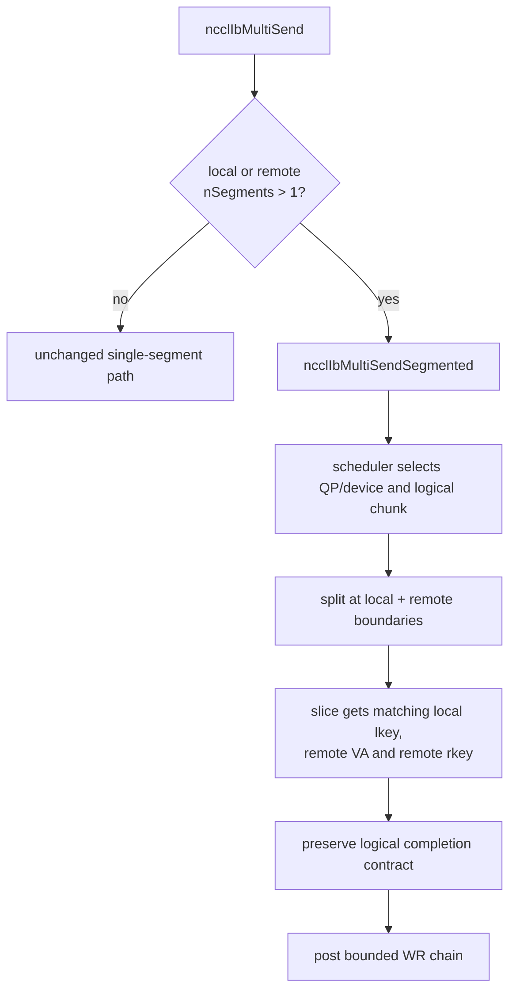

Splitting happens after QP scheduling, so weighted/multi-QP policy still decides which logical bytes and device belong to each QP. Segment handling changes only the number and keys of WRs needed to realize that scheduled chunk.

### 6.5 Completion size and bounded send resources

Classic index-based matching puts the complete logical size in immediate data for one receive. For multi-receive, the receiver already ignores that one size: the sender publishes every logical request size through the existing completion records, then uses a dedicated final `WRITE_WITH_IMM`. Segmentation preserves that contract; the final immediate-bearing WR is not treated as the byte count of its preceding physical slice. When the receiver matches by ID instead of by index, one receive sums CQE byte counts, so the segmented sender also writes the size record for a single non-empty receive. (`WR_IMM_SEGMENTED_FLAG` is a CAST-specific encoding and is not part of the classic wire format.)

WR/SGE capacity is also bounded explicitly:

- the per-send builder rejects a chain that exceeds `NCCL_IB_MAX_WRS_PER_SEND` (256 slices + the trailing IMM WR = **257** WQEs);
- with `NCCL_MULTI_SEGMENT_REGISTER` on, the classic **send QP** is `NCCL_IB_MAX_SEND_WRS` = `2*NET_IB_MAX_REQUESTS + NCCL_IB_MAX_WRS_PER_SEND + 1` = **769** (`net_ib/common.h`), the same depth as the CAST P2P send QP; at `=0`, `ncclIbSenderQpsCreate` keeps develop's `2*NET_IB_MAX_REQUESTS`;
- classic has no CAST-style one-group admission, so 769 covers the ordinary budget plus one maximum chain, not several maximum chains in flight at once;
- only the chain's final WR is signaled, so those 257 slots stay occupied until the tail CQE;
- the receiver **CTS QP** adds `NET_IB_MAX_REQUESTS*(resiliency ? 1 : 2)` to develop's depth for the unsignaled side-table WR chained before each CTS WR;
- the **flush QP** is `ncclIbFlushQpSendDepth` = **1024** when the peer advertised the capability, so one direct-GDR chain fits on each of the 8 proxy steps (develop's `NET_IB_MAX_REQUESTS` at `=0`);
- `static_assert`s in `net_ib/connect.cc` check that `NCCL_RMA_SEND_QP_WRS` in `net_ib/rma_multiseg.h` equals `NCCL_IB_MAX_SEND_WRS`, that the send QP fits `NCCL_RMA_MAX_SIGNAL_WRS`, and that the flush QP fits `NCCL_RMA_MAX_FLUSH_WRS`, because GIN reuses these QPs.

Reserving `NCCL_IB_MAX_WRS_PER_SEND` for all 256 request slots would exceed provider `max_qp_wr`. Both classic and CAST P2P size for ordinary request capacity plus **one** maximum segmented chain. Diagrams: [`multi_segment_current.md`](multi_segment_current.md) §6a.

### 6.6 Multi-receive flush and validation

One fence read from `data[last]` is insufficient when a multi-segment handle spans several MRs. `ncclIbIflush` first calls `rcclIbIflushNeedsMultiSeg`; when no non-empty receive in the request has a multi-segment handle, develop's `ncclIbIflush` body posts one read as before. Otherwise it returns `rcclIbIflushMultiSeg` (`net_ib/p2p.cc`). With the RO=0 scratchpad flush (the default, `RCCL_GDR_FLUSH_GPU_MEM_NO_RELAXED_ORDERING=1`) that function still posts one read per device. With the direct GDR flush it builds, for each device, a chain that fences every non-zero receive entry and every physical segment its range overlaps (`ncclIbSegmentsOverlappingRange`), validating overlap and MR availability while constructing the chain, and signals only the final read. If a post accepts only a prefix of the chain, or a later device fails after an earlier device posted, the request is marked `NCCL_NET_IB_REQ_FAILED` and returned so already posted completions can be drained safely. Develop's `ncclIbIflush` also now returns the post error stored in `iflushRet` instead of the still-successful `ret`.

### 6.7 End-to-end publication timeline

```mermaid
sequenceDiagram
  participant Rc as ncclIbIrecv
  participant Side as Segment side table
  participant F as 64-byte CTS FIFO
  participant Sn as ncclIbIsend
  participant M as ncclIbMultiSendSegmented
  participant Q as QP / NIC
  alt slot has only single-segment receives
    Rc->>F: publish unchanged CTS only
  else slot has a multi-segment receive and peer capable
    Rc->>Side: publish count, VAs, rkeys, idx last
    Rc->>F: publish CTS with flagged nreqs after side write
  end
  Sn->>F: observe CTS idx, bound nreqs
  Sn->>Side: flagged slot only, wait for matching idx
  Sn->>M: local/remote bases + scheduled QP chunk
  loop until chunk is drained
    M->>M: resolve independent offsets and nearer boundary
    M->>Q: post boundary-contained WR with matching keys
  end
  M->>Q: multi-recv size records when needed; final completion
```

---

## 7. Testing map

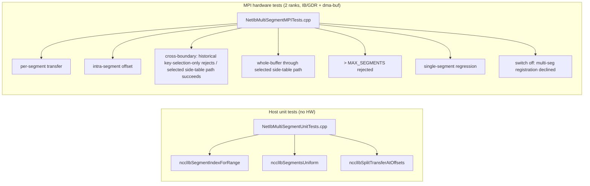

On `users/atulkulk/mseg/06-classic-netib-multisegment` the host suite (`NetIbMultiSegmentUnitTests.cpp`) has 45 cases covering selection, uniformity, symmetric/asymmetric splitting, independent starts, zero-length and overflow handling, `UINT32_MAX` slicing, side-table layout validation, and DeepEP geometry. The classic MPI suite (`test/transport/NetIbMPI/NetIbMultiSegmentMPITests.cpp`) has 16 cases, including whole-buffer, asymmetric-offset, cross-boundary, mixed single- and multi-segment multi-receive, concurrent pairs, flush, maximum-segment, switch-off, and single-segment regression cases; the GIN/RMA suite (`RmaMultiSegmentMPITests.cpp`) has 44. The full-stack per-suite counts and the validation run are in [`multi_segment_netib_wire_walkthrough.md`](multi_segment_netib_wire_walkthrough.md) Section 9.

The classic MPI tests run in four jobs in `net_ib_transport.json`:

| Job | Contents |
| --- | --- |
| `net_ib_multisegment` | the main suite on 2 nodes, plus a rerun of the cross-boundary, whole-buffer, asymmetric and concurrent-pair cases under receiver-side matching by ID |
| `net_ib_multisegment_register_off` | `NCCL_MULTI_SEGMENT_REGISTER=0`: `MultiSegmentRegisterOff_DeclinesRegistration` expects `ncclInvalidUsage` and no handle on the receiver and a successful registration on the sender, and the single-segment regressions still transfer |
| `net_ib_multisegment_scale_2x4` | `ConcurrentPairsMoveEverySegmentBoundary` on 8 ranks across 2 nodes |
| `net_ib_multisegment_flush` | the four flush tests with `RCCL_GDR_FLUSH_GPU_MEM_NO_RELAXED_ORDERING=0`, which selects the direct per-segment GDR read; under the default scratchpad flush they skip |

`MultiRecvMixesSingleAndMultiSegmentHandles` places its multi-segment entry so it starts in segment 1 and crosses into segment 2, so a flush that wrongly used segment 0's MR would fault; when direct GDR flush is on it also requires `iflush` to return a request. The eight-rank/two-node (4 ranks per node) tier adds hybrid positive, bounds-negative, and stress coverage; UBR tests keep the symmetric-LSA before/after control, and `Generic_Reuse` runs without a before control.

---

## 8. Where to look (quick index)

| Concern                       | File                  | Symbol                                                                                 |
| ----------------------------- | --------------------- | -------------------------------------------------------------------------------------- |
| Composite handle | `net_ib/common.h`   | `ncclIbMrHandle`                                               |
| Key lookup | `net_ib/p2p.cc` | `ncclIbMrForRange` |
| Pure boundary math + capability trailer | `net_ib/multiseg.h` | `ncclIbSegmentIndexForRange`, `ncclIbSegmentsUniform`, `ncclIbSplitTransferAtOffsets`, `ncclIbSegmentsOverlappingRange`, `ncclIbCtsRemoteLayoutValid`, `ncclIbSetConnectCaps`, `ncclIbGetConnectCaps`, `ncclIbDeclineMultiSegRegistration` |
| Runtime switch | `net_ib/connect.cc`, `transport/net.cc` | `ncclIbAdvertiseMultiSeg()`, `ncclParamMultiSegmentRegister()` (`NCCL_MULTI_SEGMENT_REGISTER`) |
| Proxy multi-segment call      | `transport/net.cc` | `sendProxyRegBuffer`, `recvProxyRegBuffer` (`regMrDmaBuf` with `fd = -1`) |
| Plugin range walk + per-segment export | `net_ib/reg.cc` | `rcclIbRegMrDmaBufFromRange`, routed from `ncclIbRegMrDmaBuf` |
| Plugin per-segment reg/dereg  | `net_ib/reg.cc` | `ncclIbRegMrDmaBufMultiSeg`, `rcclIbDeregMrMultiSeg`; `ncclIbDeregMr` |
| Historical key-selection-only path | (not implemented) | `ncclIbIsend`, `ncclIbIrecv`, `ncclIbIflush` as sketched in Section 5; would reject boundary-crossing transfers |
| Selected segment-aware send path | `net_ib/p2p.cc` | `rcclIbMultiSendNeedsSegmented`, `ncclIbMultiSendSegmented`, `ncclIbQpChunkSize`; splits boundary-crossing transfers |
| Selected 64-byte CTS + side-table publication | `net_ib/common.h`, `net_ib/p2p.cc` | unchanged `ncclIbSendFifo` plus separate `ncclIbSegLayout`; `rcclIbIrecvCheckHandle`, `rcclIbIrecvFillSideTable`, `rcclIbCtsFlagSideTable`, `rcclIbPostFifoSideWr`, `rcclIbIsendWaitSideTable`, `ncclIbCtsRemoteMultiSeg` |
| Completion records + queue depths | `net_ib/common.h`, `net_ib/p2p.cc`, `net_ib/connect.cc` | logical multi-receive size records, final signaled WR, send QP 769 (`NCCL_IB_MAX_SEND_WRS`), CTS and flush QP additions |
| Multi-receive flush | `net_ib/p2p.cc` | `rcclIbIflushNeedsMultiSeg`, `rcclIbIflushMultiSeg`; one read without a multi-segment handle, otherwise fences every touched receive/segment/device |

---

## 9. Hybrid DeepEP test walkthrough

`test/common/HybridVmmHelpers.hpp` is workload-independent. The DeepEP tests use it to reproduce `HybridElasticSymmetricMemory`.

In simple terms, each process reserves one large virtual address range and maps a private GPU allocation plus one host allocation per local rank:

```text
+------------------+------------------+-----+------------------+
| private GPU VMM  | host VMM owner 0 | ... | host VMM owner N-1 |
+------------------+------------------+-----+------------------+
```

The caller sees one pointer. RCCL sees `1 + N` registration segments (five when N = 4). Each process owns its GPU allocation and one 2 MiB-aligned host allocation, then imports the other local ranks' host allocations:

```text
local rank k: [GPU k][CPU 0][CPU 1][CPU 2][CPU 3]
              CPU k is local; the other three host segments are imported
```

The helper exchanges sizes within `MPI_COMM_TYPE_SHARED`, transfers POSIX DMA-BUF FDs through RCCL's Unix-domain IPC socket API (`SCM_RIGHTS`), reserves the full VA, and maps GPU then host handles in local-rank order. It grants GPU access to all segments and CPU access to host segments before registration.


`RegistrationMPITests.cpp` (hybrid cases added on `users/atulkulk/mseg/07-hybrid-stress-ci`) registers the range with `NCCL_WIN_STRICT_ORDERING`, requires `NCCL_SYM_REUSE_SYSMEM_HANDLES=1`, creates an LSA pointer, and checks the five-segment registration (1 GPU + 4 host). Its negative invocation disables `NCCL_ELASTIC_BUFFER_REGISTER` and requires clean rejection.

`test/transport/RmaMPI/RmaMultiSegmentMPITests.cpp` performs remote CPU-to-local GPU IGet, rejects a final-segment overrun without changing the destination, and runs 32 iterations alternating remote CPU owners, offsets, and sizes with sentinel protection. From `users/atulkulk/mseg/07-hybrid-stress-ci` on, all six architecture configs run these in an eight-rank/two-node (4 ranks per node) tier. Because each mapping is VMM-backed, GIN/RMA registers CPU and GPU segments through DMA-BUF rather than treating a CPU-backed VMM mapping as ordinary host memory.

**Supported contract:** `NCCL_ELASTIC_BUFFER_REGISTER=1` and `NCCL_SYM_REUSE_SYSMEM_HANDLES=1`. The 8-rank hybrid symmetric-window/GIN tier in the architecture JSONs (`ubr_multisegment_lsagin_multinode`) is the primary coverage; `DeepEP_ElasticWindowRegistration` on the same tier validates non-hybrid `[GPU][CPU]` elastic registration.
