# Multi-Segment DMA-BUF Registration for the Classic NET/IB P2P Transport (selected design)

> **Shared facts** (constants, the v14 GIN/RMA split, the capability trailer, credits/signaling, tests) live in the source-of-truth overview: [`multi_segment_dmabuf_gin_and_netib.md`](multi_segment_dmabuf_gin_and_netib.md). This doc covers the classic **NET/IB P2P** specifics only. The CAST counterpart is [`multi_segment_netib_cast.md`](multi_segment_netib_cast.md).

**Last updated:** 2026-10-16, against the restacked branches on develop.

**Status:** Implemented on stack PR 06 ([ROCm/rocm-systems#10886](https://github.com/ROCm/rocm-systems/pull/10886), branch `users/atulkulk/mseg/06-classic-netib-multisegment`). It builds on PR 03 ([#10885](https://github.com/ROCm/rocm-systems/pull/10885), `users/atulkulk/mseg/03-registration-range`), which owns the NET segment count cache. CAST P2P lands on `users/atulkulk/mseg/08-cast-netib-multisegment`, and the full feature, including CAST GIN, is on the wire branch `users/atulkulk/mseg/multi-segment-dmabuf-cast-gin` ([#10888](https://github.com/ROCm/rocm-systems/pull/10888)). The design splits transfers at segment boundaries rather than requiring a step to fit in one segment. Historical user branches (`users/atulkulk/multi-segment-dmabuf-netib-wire`, `...-netib-classic`) are superseded.

**Switch:** `NCCL_MULTI_SEGMENT_REGISTER` (`ncclParamMultiSegmentRegister()`) gates the whole feature. Classic NET/IB reads it through `ncclIbAdvertiseMultiSeg()` (`net_ib/connect.cc`), CAST P2P through `IbCastAdvertiseMultiSeg()` (`net_ib_cast/connect_cast.h`), and GIN/RMA through `rcclRmaMultiSegEnabled()` (`net_ib/rma_multiseg.h`). With the switch at `0` no capability is advertised, multi-segment registration is declined, the CTS MR keeps its legacy size, and develop's QP depths apply.

**CTS:** keep the historical **64-byte** `ncclIbSendFifo` slot. Publish extra layout in a **side structure** (`ncclIbSegLayout`) gated by a **capability bit** and filled from the receiver MR handle at irecv. On classic, the side table is sent only for a CTS slot that contains at least one multi-segment receive; such a slot is marked by bit 31 of `nreqs` (`NCCL_IB_CTS_NREQS_SIDE_TABLE`). Do **not** enlarge the FIFO element, and do **not** invent a versioned ~712-byte CTS slot.

**Capability negotiation:** `NCCL_IB_CAP_MULTISEG` is **not** a new metadata field. It is written into a magic-tagged trailer in the reserved tail of the fixed-size `devName` field (`ncclIbSetConnectCaps`/`ncclIbGetConnectCaps` in `net_ib/multiseg.h`); `ncclIbConnectionMetadata` keeps its exact legacy size and field offsets (a `static_assert` in `net_ib/connect.h` forbids trailing wire fields), so old and new peers complete the same exchange. A peer advertises the bit only when `NCCL_MULTI_SEGMENT_REGISTER` is on. See the overview for the full rationale.

**Plugin API:** `ncclIbRegMrDmaBufMultiSeg` is IB-private (declared in `src/transport/rccl_ib_multiseg.h`, implemented in `net_ib/reg.cc`). It must **not** live in `src/include/net.h` (that header is synced with upstream). `net.cc` stays plugin-neutral: on a multi-segment buffer it calls the plugin's `regMrDmaBuf` with `fd = -1` and `offset = (export flags << 32) | numSegments`. The classic plugin's `reg.cc` (`rcclIbRegMrDmaBufFromRange`) and, from the CAST branch on, the CAST plugin's `reg.cc` (`IbCastRegMrDmaBufFromRange`) enumerate the segments and call the private helper (`ncclIbRegMrDmaBufMultiSeg` / `IbCastRegMrDmaBufMultiSeg`).

**Scope:** User-buffer (zero-copy) registration of multi-segment HIP VMM buffers over the *classic* NET/IB proxy transport (`ncclIbIsend`/`ncclIbIrecv`). **Related:** GIN/RMA already splits at per-segment MRs (`net_ib/gin.cc`). This document extends that idea to classic NET/IB **without** changing the CTS slot size.

---

## What changed on 2026-10-16

HIP now defaults `NCCL_MULTI_SEGMENT_REGISTER` to 0. The knob is still `ncclParamMultiSegmentRegister()` in `transport/generic.cc`. `NCCL_MULTI_SEGMENT_REGISTER=1` turns the feature on, on HIP and on every other build. An unset variable takes the develop path on a HIP build. A non-HIP build still defaults to 1. The commit is `9af53b9bca21` on `users/atulkulk/mseg/01-ce-recv-window-offset`, replayed through the stack.

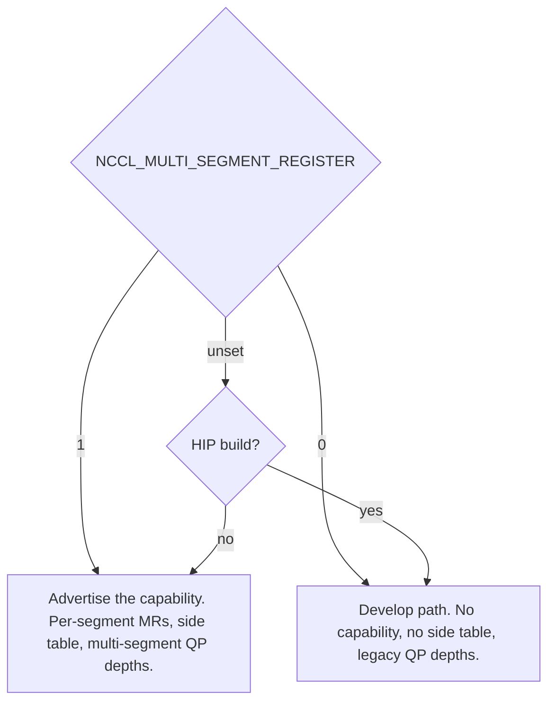

With the switch off, connect does not advertise `NCCL_IB_CAP_MULTISEG` and does not append the side table, so the sender QP stays at `2 * NET_IB_MAX_REQUESTS`. NET, P2P IPC and NVLS leave a multi-segment buffer unregistered. GIN and RMA stay on develop's bodies and do not reserve credits. A device-only GIN window with more than one segment and no sysmem returns `ncclInvalidUsage` instead of registering only the first segment.

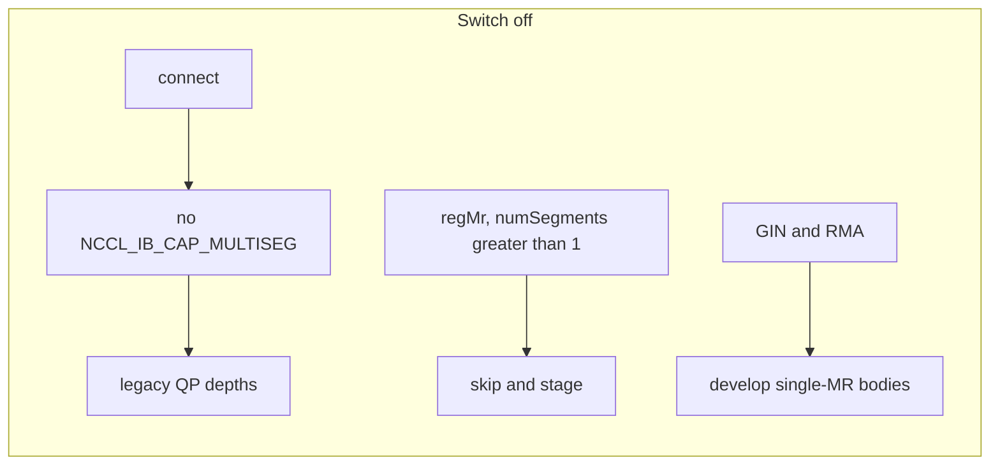

The direct-GDR flush QP is sized for one chain on every proxy step. `recvProxyProgress` posts `iflush` into `requests[step % NCCL_STEPS]` and returns before that flush is polled, so up to 8 flushes can be outstanding. With `RCCL_GDR_FLUSH_GPU_MEM_NO_RELAXED_ORDERING=0`, `rcclIbIflushMultiSeg` posts one RDMA read per receive per segment, at most `8 * 16 = 128` work requests, and signals only the last. Eight chains need `8 * 128 = 1024` slots. The previous depth, `NET_IB_MAX_REQUESTS + 128 = 384`, held three chains and the fourth post failed. `ncclIbFlushQpSendDepth` in `net_ib/multiseg.h` returns `NCCL_STEPS * NCCL_NET_IB_MAX_RECVS * NCCL_IB_MAX_SEGMENTS` when the peer advertised the capability, and `NET_IB_MAX_REQUESTS` (256) otherwise. Classic `ncclIbCreateFlushQp` calls it. `connect.cc` static-asserts that the multi-segment result holds at least one chain per step. The host test is `NetIbMultiSeg.FlushQpDepthCoversEveryOutstandingStep`.

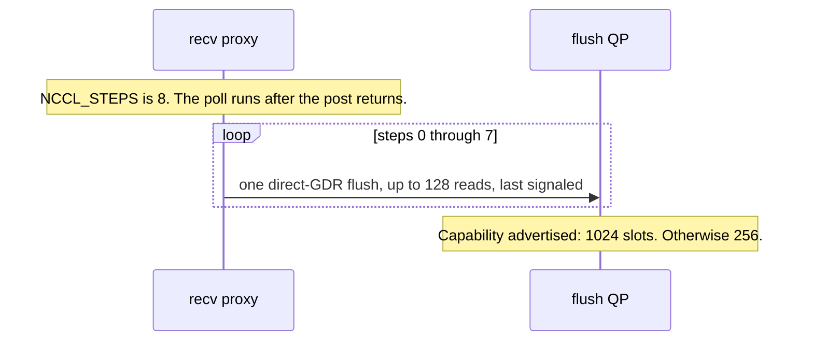

CAST non-RMA comms use the same helper. CAST RMA comms keep `NCCL_RMA_MAX_FLUSH_QP_WRS` (271), because RMA credits wait until one chain completes before the next post. With the switch off every flush QP stays at 256.

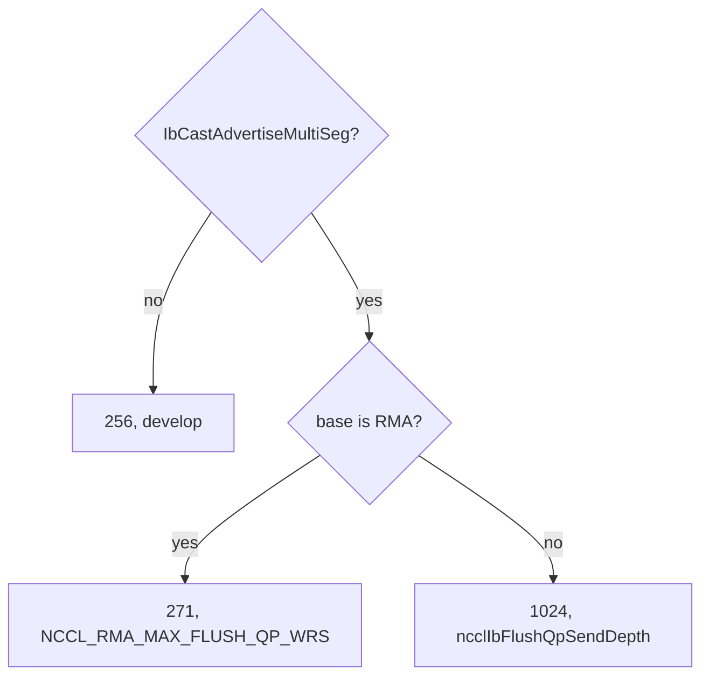

The scratchpad flush (`RCCL_GDR_FLUSH_GPU_MEM_NO_RELAXED_ORDERING=1`, the default) posts one write and one read and does not fill 1024 slots. The enlarged depth is for the direct-GDR path. `net_ib_multisegment_flush` selects that path by setting the parameter to 0.

Jobs that test the feature set `NCCL_MULTI_SEGMENT_REGISTER=1` in the runner config, because an unset HIP job now takes the off path. Register-off jobs stay at 0. `cast_multisegment_opt_recv_2qp` inherits 1 from `cast_multisegment_opt_recv`. `net_ib_rma_multisegment_wrbatch` on the wire branch, and the hybrid nightly jobs on 09 including `net_ib_multisegment_hybrid_stress_nightly`, set 1 as well. The WR-batch job fails under `RCCL_TEST_RMA_MSEG_REQUIRE=1` when the per-segment registration log is missing, and the hybrid IGet stress skips. `multisegment_host_boundary_math` is host-only and does not read the switch.

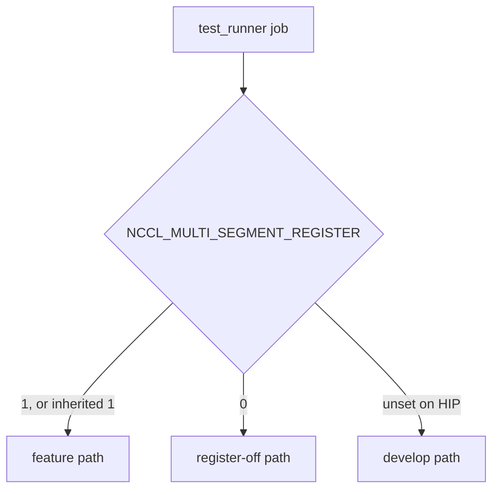

## What changed on 2026-10-14

- **Bodies folded back.** `net_ib/p2p_multiseg.h`, `net_ib/rccl_reg_multiseg.cc` and `transport/rccl_ib_multiseg.cc` were removed; their functions are in `net_ib/p2p.cc`, `net_ib/reg.cc` and `transport/net.cc`, next to the develop functions that call them. `rccl_ib_multiseg.h` keeps only declarations.
- **No proxy-side export.** `net.cc` passes `fd = -1` with a packed segment count to `regMrDmaBuf`, and the plugin's `reg.cc` walks the range, exports per-segment fds and checks coverage and uniformity. This is the "loop in the plugin behind the existing hook" option from the placement table below, so no RCCL symbol is called from `net.cc`.
- **Receive-only peer-cap decline.** `ncclIbRegMrDmaBufMultiSeg` declines for a peer without `NCCL_IB_CAP_MULTISEG` only on a recv comm. The side table describes the receiver; a sender with a multi-segment source splits locally onto the receiver's single rkey. With the switch off, the receiver declines and the sender registers.
- **Receive side table on demand.** `ncclIbRecvComm::remSegLayout` is a pointer, allocated and registered only for a capable peer (about 1.44 MB per recv comm otherwise saved). The sender's `segLayoutFifo` stays inline after `ctsFifo`, because the peer writes it through the CTS MR.
- **CAST.** The CAST twin follows the same registration path and receive-only peer-cap rule, keeps CTS offload, BY_ORDER and QP sharing declines on both sides, and uses `NCCL_RMA_MAX_SEND_QP_WRS` / `NCCL_RMA_MAX_FLUSH_QP_WRS` directly (Section 5).

## What changed since the 2026-10-07 revision

- **Multi-segment bodies split from develop's.** The classic send, CTS side-table, irecv and flush paths became `static inline` functions in `net_ib/p2p.cc` (`ncclIbMultiSendSegmented`, `rcclIbMultiSendNeedsSegmented`, `rcclIbIsendWaitSideTable`, `rcclIbPostFifoSideWr`, `rcclIbIrecvCheckHandle`, `rcclIbIrecvFillSideTable`, `rcclIbCtsFlagSideTable`, `rcclIbIflushNeedsMultiSeg`, `rcclIbIflushMultiSeg`, plus `ncclIbMrForRange`, `ncclIbCtsRemoteMultiSeg` and `ncclIbQpChunkSize`). `p2p.cc` is develop plus one-line hooks and keeps develop's inline chunk math in `ncclIbMultiSend`. Registration is `ncclIbRegMrDmaBufMultiSeg` and `rcclIbDeregMrMultiSeg` in `net_ib/reg.cc`, and the proxy export loop `net.cc:netIbRegMrMultiSeg` was removed (see 2026-10-14).
- **The switch gates the QP depths.** With `NCCL_MULTI_SEGMENT_REGISTER=0`, the send, CTS and flush QPs keep develop's depths (512, develop's CTS depth, 256). With it on they are 769, develop's CTS depth plus one side-table WR per CTS WR, and 1024. `static_assert`s in `connect.cc` tie these depths to the GIN signal and flush chains.
- **Segment count caching.** `rcclNetRegSegmentCount` now caches the count on the registration record as soon as the walk succeeds; `rcclNetRegCommit` only sets `rcclNet.allPeers`. The graph path uses `rcclNetGraphRegSegmentCount`, which drops the graph registration when the count fails or when a multi-segment record is seen with the switch off.
- **Flush routing.** `ncclIbIflush` is develop's code unless a non-zero receive has a multi-segment handle, in which case it hands off to `rcclIbIflushMultiSeg`. The flush QP records its loopback `devIndex`/`remDevIdx`, and a failed flush post now returns the post error.
- **Single-segment registration hardening.** `ncclIbRegMrDmaBufInternal` zero-allocates the handle, sets `nSegments = 1`, and deregisters already-registered device MRs on failure.
- **CAST and RMA on the wire branch.** The CAST plugin implements the same `fd = -1` registration. `NCCL_RMA_MAX_SEGMENTS` is now defined from `NCCL_IB_MAX_SEGMENTS`, and `rma_multiseg.h` adds the CAST RMA depths `NCCL_RMA_MAX_SEND_QP_WRS` and `NCCL_RMA_MAX_FLUSH_QP_WRS` next to the classic `NCCL_RMA_SEND_QP_WRS`. A short comparison of the classic and CAST wire behavior is in Section 5.
- **Tests.** New `MultiSegmentRegisterOff_DeclinesRegistration` and the `net_ib_multisegment_register_off` runner job cover the switch at `0`; `net_ib_multisegment_flush` now also runs `MultiRecvMixesSingleAndMultiSegmentHandles`, whose multi-segment entry starts in segment 1 and which requires a flush request when direct GDR flush is on. The UBR suite adds `MultiSegmentRegisterOff_SliceSkipsNet` and `MultiSegmentRegisterOff_GraphSliceSkipsNet`. The hybrid fixture is now `AllocHybridCollective` in `test/common/HybridVmmHelpers.hpp`.

---

## 1. Problem statement

`UBR_MultiSegment.Generic`-style workloads register a user buffer that spans **multiple physical VMM segments** (`numSegments > 1`) and run a collective over inter-node NET/IB. On ROCm/HIP, a dma-buf export (`hipMemGetHandleForAddressRange` / `hsa_amd_portable_export_dmabuf`) describes **only the first physical segment**, so registering the *entire* VA range as one MR fails:

```
ibvwrap.cc: Call to ibv_reg_dmabuf_mr failed with error Invalid argument
net.cc: "...not registered as DMABuf is not available. Non-DMABuf registration
         currently does not support multiple segments."
net.cc: rank 0 failed to NET register userbuff ... GDR flag 1
... IBV_WC_REM_INV_REQ_ERR / async fatal event on QP (hang)
```

### Root cause

Before this feature, the classic proxy-register path (`sendProxyRegBuffer` / `recvProxyRegBuffer` in `net.cc`) exported **one** dma-buf for the whole range and registered **one** MR:

```c
// net.cc before the multi-segment work, simplified
HSACHECKGOTO(hsa_amd_portable_export_dmabuf(info->buffer, info->size, &fd, &off), ...);
regMrDmaBuf(comm, info->buffer, info->size, NCCL_PTR_CUDA, off, fd, &handle); // EINVAL for >1 seg
...
if (numSegments > 1) { INFO("...does not support multiple segments"); goto fail; } // declines
```

Because a HIP dma-buf export covers only one physical allocation, ROCm needs **one MR per physical segment**. The GIN proxy got that treatment first; the classic path did not. The failed registration then did not fall back cleanly, and the connection ended in a fatal QP state.

### Why the classic path is hard

The classic NET/IB data plane is **single-MR by construction**. Its clear-to-send FIFO (`ncclIbSendFifo`) carries exactly one remote address + one rkey-per-device, and `ncclIbMultiSend` walks a single contiguous region linearly across QPs:

```c
struct alignas(64) ncclIbSendFifo {
  uint64_t addr;                            // ONE remote base address
  uint64_t size;
  uint32_t rkeys[NCCL_IB_MAX_DEVS_PER_NIC]; // ONE rkey per device (not per segment)
  uint32_t nreqs, tag; uint64_t idx;
};
```

There are two ways to make this work with per-segment MRs, traded off below.

---

## 2. Architecture before the fix

These diagrams show the pre-fix code path that motivated the work. They do not describe the current implementation.

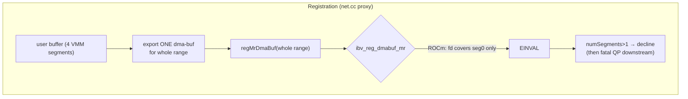

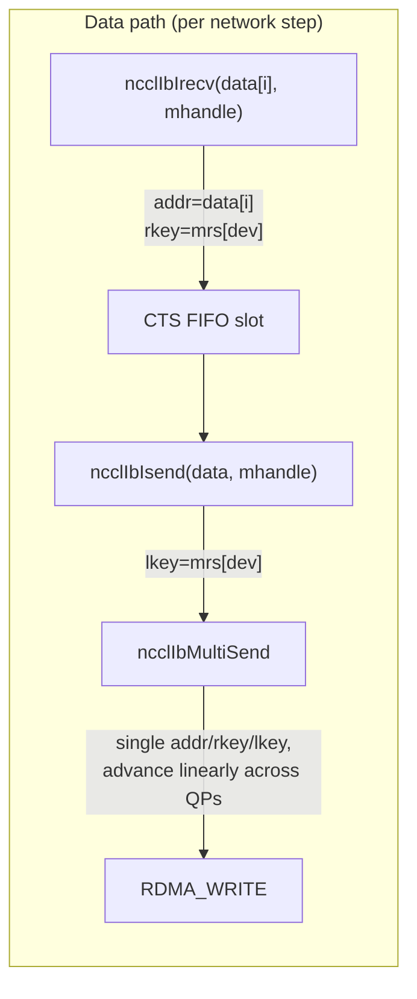

Both `mhandle->mrs[dev]` and the FIFO assumed **one** MR spans the whole buffer.

### Failure timeline before the fix (multi-segment buffer)

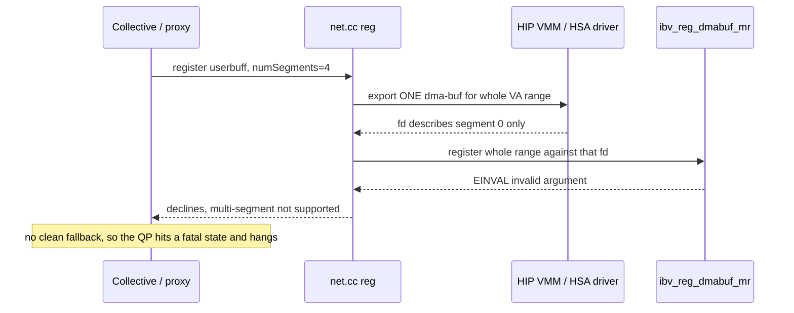

---

## 3. Shared building blocks

The classic NET/IB paths reuse the GIN/RMA registration pattern: **one dma-buf MR per physical segment**, mirroring `rcclRmaIbProxyRegMrSymDmaBuf` (`net_ib/gin.cc`, reached from `ncclRmaIbProxyRegMrSymDmaBuf` when the switch is on). The composite handle is stored in an extended `ncclIbMrHandle`:

```c
// net_ib/multiseg.h
#define NCCL_IB_MAX_SEGMENTS 16   // NCCL_RMA_MAX_SEGMENTS (net_ib/rma_multiseg.h) is defined from it on the wire branch

// net_ib/common.h
struct ncclIbMrHandle {
  ibv_mr* mrs[NCCL_IB_MAX_DEVS_PER_NIC];        // segment 0 (legacy field; single-seg fast path)
  int nSegments;                                 // 1 = legacy single MR
  // Multi-segment (nSegments > 1) only:
  uintptr_t segStart[NCCL_IB_MAX_SEGMENTS];      // VA start of each segment
  size_t    segLen[NCCL_IB_MAX_SEGMENTS];        // bytes per segment
  ibv_mr*   segMrs[NCCL_IB_MAX_SEGMENTS][NCCL_IB_MAX_DEVS_PER_NIC];
};
```

Registration entry points are **IB-private** helpers declared in `src/transport/rccl_ib_multiseg.h`, never in `src/include/net.h`. The classic helper is implemented in `net_ib/reg.cc`; the CAST twin `IbCastRegMrDmaBufMultiSeg` is in `net_ib_cast/rccl_reg_multiseg_cast.cc` (distinct symbols, because both plugins link into librccl). `net.cc` calls only the plugin's `regMrDmaBuf` (with `fd = -1`); each IB plugin's `ncclIbRegMrDmaBuf` / `IbCastRegMrDmaBuf` routes that to its own range walk, which enumerates segments and dma-buf fds and calls its helper. A plugin that does not handle `fd = -1` fails the call and the collective stages. Do not copy the prototypes into every `net_ib_*.h`.

```c
// rccl_ib_multiseg.h — private. Not a ncclNet_t hook; not part of net.h.
ncclResult_t ncclIbRegMrDmaBufMultiSeg(
    void* comm, int nSeg, void** segAddrs, size_t* segLens,
    uint64_t* segOffsets, int* segFds, int type, void** mhandle);
ncclResult_t IbCastRegMrDmaBufMultiSeg(
    void* comm, int nSeg, void** segAddrs, size_t* segLens,
    uint64_t* segOffsets, int* segFds, int type, void** mhandle);
ncclResult_t rcclIbCastDeregMrMultiSeg(void* comm, void* mhandle);
// Classic rcclIbDeregMrMultiSeg is static in net_ib/reg.cc.
```

`ncclIbRegMrDmaBufMultiSeg` also refuses a multi-segment handle on a **recv** comm whose peer did not advertise `NCCL_IB_CAP_MULTISEG` (`ncclIbDeclineMultiSegRegistration`), so a receive layout can never be advertised to a peer that cannot read the side table. A send comm registers regardless: its segments are local, and it writes each slice to the receiver's single CTS rkey. With the switch at `0` neither side advertises the bit, so a direct call declines with `ncclInvalidUsage` on the receiver and succeeds on the sender (`MultiSegmentRegisterOff_DeclinesRegistration`); `net.cc` still stages at `0` because it does not ask for the registration.

The composite handle is built inside the plugin, behind the existing `regMrDmaBuf` hook. The private symbols are needed only between files of the same plugin (`reg.cc` and `rccl_reg_multiseg_cast.cc` on CAST) and by host tests.

`rcclIbRegMrDmaBufFromRange` (`net_ib/reg.cc`) exports one fd **per segment**, passes the arrays down, and closes the fds afterwards. Segment boundaries come from `cuMemGetAddressRange`, the same way the RMA proxy enumerates them (`net_ib/gin.cc:rcclRmaIbProxyRegMrSymDmaBuf`). `ncclIbBytesRemainingInSegment` guards the case where host VMM reports a segment base of 0. The export flags come from the caller in the upper 32 bits of `offset` (`getHandleForAddressRangeFlags(resources->useGdr)`), so multi-segment export uses the same flags as the single-segment path.

Deregistration (`ncclIbDeregMr`) hands a handle with `nSegments > 1` to `rcclIbDeregMrMultiSeg`, which loops all segments × devices.

### Registration-range invariant

The segment count must describe the same VA range that the proxy registers. This matters when a user explicitly registers a large allocation and a collective operates on only a subrange:

```text
ncclCommRegister: [seg0][seg1][seg2][seg3][seg4][seg5][seg6][seg7]
send operation:   [seg0][seg1][seg2][seg3]
recv operation:                              [seg4][seg5][seg6][seg7]
```

`netRegisterBuffer` sends the complete `ncclCommRegister` record to the proxy:

```c
struct netRegInfo info = {
  regRecord->begAddr,
  regRecord->endAddr - regRecord->begAddr,
  numSegments
};
```

RCCL uses the count to allocate arrays and to bound the per-segment export loop, so it must count over the complete registration record rather than over the operation subrange. The count lives in an RCCL-only helper (`src/rccl_wrap.cc:rcclNetRegSegmentCount`):

```c
// rccl_wrap.cc — rcclNetRegSegmentCount
if (regRecord->rcclNet.nSegments != 0) {        // cached by an earlier count of this record
  *numSegments = regRecord->rcclNet.nSegments;
  return ncclSuccess;
}
// endAddr is page-rounded but hipMalloc reports its unrounded size; stop inside the last page.
const size_t walkSize = regRecord->endAddr - regRecord->begAddr - comm->regCache.pageSize + 1;
NCCLCHECK(ncclCuMemGetAddressRange((CUdeviceptr)regRecord->begAddr, walkSize, &base, &baseSize, numSegments));
regRecord->rcclNet.nSegments = *numSegments;
```

Using the four-segment operation count with the eight-segment registration previously created only four MRs. The CTS entry for the receive half then paired an address at or beyond the final MR with that MR's rkey, producing `IBV_WC_REM_ACCESS_ERR`.

Three rules keep the count honest:

- **The walk ends inside the last registered page.** The registration cache rounds `endAddr` up to a page, but HIP reports a `hipMalloc` extent at its requested size. Walking to `endAddr` queried past an odd-sized allocation; that error was dropped by the caller, and the buffer silently lost NET registration. `UBR_MultiSegment.NetSegmentCountOddSizedHipMalloc` registers 1000001-byte and 2 MiB + 1 buffers and requires one segment.
- **The graph path counts over the reused record.** `ncclNetGraphRegisterBuffer` first counts over the operation buffer to pick the range for `ncclCommGraphRegister`. `ncclRegister` can hand back a wider existing record, so the path then calls `rcclNetGraphRegSegmentCount` on that record. That helper drops the graph registration if the count fails or if the record is multi-segment while the switch is off (`MultiSegmentRegisterOff_GraphSliceSkipsNet`).
- **All-peer completion is separate from the count.** `NET_REG_COMPLETE` is set as soon as the first peer registers, so it does not prove every peer did. `rcclNetRegCommit` runs only when `netRegisterBuffer` succeeded for every peer, and it sets `rcclNet.allPeers`; a later-peer failure leaves that flag unset. The count itself depends only on the record, so `rcclNetRegSegmentCount` caches it directly. Both fields sit in an RCCL block at the end of `ncclReg`, so upstream's state enum and `netRegisterBuffer` stay as upstream has them.

`rcclIbRegMrDmaBufFromRange` also enforces the invariant defensively. After enumeration, both the count and byte coverage must be exact:

```c
if (remaining != 0 || nSeg != nExpect) {
  WARN("NET/IB: enumerated %d/%d segments for buffer %p but %zu/%zu bytes remain unregistered", ...);
  ret = ncclInvalidUsage;
  goto fail;
}
```

No partially registered composite handle may reach the CTS/data path.

### Per-segment registration timeline

Each physical segment is a single VMM allocation, so exporting it **alone** yields a complete fd — the fix is simply to export and register one segment at a time.

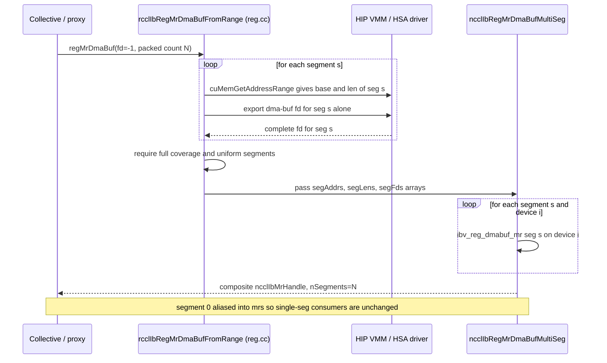

---

## 4. Option not selected: per-segment MRs with offset-based key selection

This option was considered and rejected. The code in this section is design pseudocode; it is not in the tree. The selected design is Section 5.

### Idea

Keep the CTS-FIFO wire protocol **unchanged** (one addr + one rkey per receive). Each network step's transfer `[data, data+size)` is required to stay **within a single physical segment**; the data-path picks that segment's MR by VA. This holds whenever `stepSize <= segmentSize` and segments are uniformly sized (true in practice: 256 KB steps, ≥2 MB VMM segments; the failing case had 32 MB segments).

### Guards

- **Reg-time:** `nSeg <= NCCL_IB_MAX_SEGMENTS`; **uniform segment sizes**. Otherwise decline registration → collective falls back to staging buffers (no zero-copy, no crash).
- **Data-path (defensive):** if a single transfer would cross a segment boundary (violating the documented `stepSize <= segmentSize` assumption), `WARN` + return `ncclInternalError` (fail loudly, never corrupt). This mirrors the GIN review's "defensive single-segment assert" recommendation.

### Segment selection helper

```c
// common.h — pick the MR covering [addr, addr+len) for device devIndex.
// Returns NULL if the range is not fully contained in one segment.
static inline ibv_mr* ncclIbMrForRange(const struct ncclIbMrHandle* h,
                                       uintptr_t addr, size_t len, int devIndex) {
  if (h->nSegments <= 1) return h->mrs[devIndex];        // legacy fast path
  for (int s = 0; s < h->nSegments; s++) {
    uintptr_t b = h->segStart[s], e = b + h->segLen[s];
    if (addr >= b && addr < e)
      return (addr + len <= e) ? h->segMrs[s][devIndex] : NULL; // NULL = crosses boundary
  }
  return NULL;
}
```

(`ncclIbMrForRange` does exist in the tree, in `net_ib/p2p.cc`; the selected design uses it for flush MR lookup.)

### Data-path changes (localized to isend / irecv / iflush)

Because each request stays within one segment, `ncclIbMultiSend` needs **no change** — it already uses the per-request `lkeys[]` / `slots[r].rkeys[]` and advances the address linearly *within* the request (hence within the segment).

```c
// ncclIbIsend: select the segment ONCE for this request's data VA.
for (int i = 0; i < comm->base.vProps.ndevs; i++) {
  ibv_mr* mr = ncclIbMrForRange(mhandleWrapper, (uintptr_t)data, size, i);
  if (!mr) { WARN("NET/IB: send %p+%zu crosses a segment boundary", data, size);
             ret = ncclInternalError; goto isendFail; }
  req->send.lkeys[i] = mr->lkey;
}
```

```c
// ncclIbIrecv: advertise the rkey of the segment containing data[i].
for (int j = 0; j < comm->base.vProps.ndevs; j++) {
  ibv_mr* mr = ncclIbMrForRange(mhandleWrapper, (uintptr_t)data[i], sizes[i], j);
  if (!mr) { WARN(...); ret = ncclInternalError; goto irecvFail; }
  localElem[i].rkeys[j] = mr->rkey;
}
```

```c
// ncclIbIflush: 4-byte read always within one segment.
ibv_mr* mr = ncclIbMrForRange(mhandle, (uintptr_t)data[last], sizeof(int), i);
wr.wr.rdma.rkey = mr->rkey;
```

### Registration flow

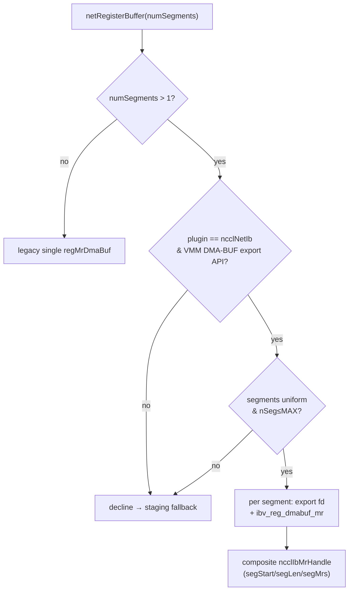

### Single-segment data path

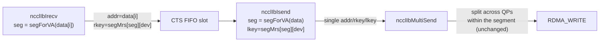

Timeline for one network step (each step stays inside one segment):

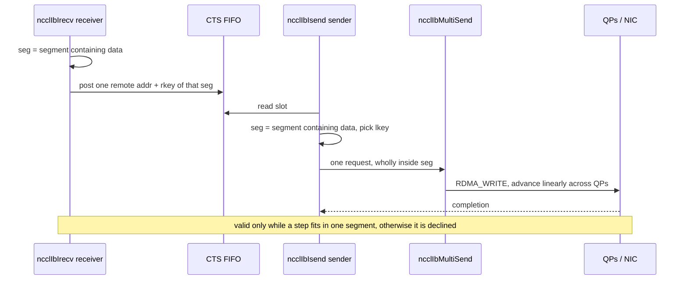

### Pros / Cons

- ✅ No wire-protocol change; interoperates with unmodified peers on the same build.
- ✅ Small, reviewable diff; `ncclIbMultiSend` (hot path) untouched.
- ✅ Fixes the crash; clean staging fallback when preconditions aren't met.
- ⚠️ Correct only while `stepSize <= segmentSize` (documented, guarded, asserted).
- ⚠️ Non-uniform segment layouts fall back to staging (no zero-copy).

---

## 5. Segment-aware data path (64-byte CTS + side layout) — selected

### Idea

Remove the `stepSize <= segmentSize` assumption by **splitting RDMA WRs at segment boundaries** inside the send engine — the same technique as GIN's `ncclRmaBuildSegmentedWrs` (`net_ib/gin.cc`). Local and remote request bases may start at different offsets within their registrations, so the splitter uses two independent registration-relative cursors.

The receiver still has to publish its segment table to the sender. That table does **not** go in the CTS FIFO element.

### Why the FIFO element stays 64 bytes

The historical classic slot is exactly one cache line:

```c
struct alignas(64) ncclIbSendFifo {
  uint64_t addr;
  uint64_t size;
  uint32_t rkeys[NCCL_IB_MAX_DEVS_PER_NIC]; // one rkey per device, not per segment
  uint32_t nreqs;                            // bit 31 = NCCL_IB_CTS_NREQS_SIDE_TABLE
  uint32_t tag;
  uint64_t idx;
};
static_assert(sizeof(struct ncclIbSendFifo) == 64, "CTS slot is one cache line");
static_assert((sizeof(struct ncclIbSendFifo) % 32) == 0, "");
```

Stuffing `nSegments + segStart[16] + segRkeys[16][ndevs]` into that struct grows it to ~712 bytes per slot. That would:

- change the CTS-FIFO wire format versus older peers (mixed `nSegments <= 1` traffic would no longer parse);
- blow up `ctsFifo[NET_IB_MAX_REQUESTS][NCCL_NET_IB_MAX_RECVS]` and inline-send sizing (`max_inline_data`);
- collide with the AINIC 32-byte inline CTS and stride (the CAST plugin's `ncclIbSendFifoCtsInline` is 32 bytes). Same class of bug as RCCL #2185.

A versioned 712-byte FIFO is also rejected: this path has never versioned the CTS element, and versioning a large slot still would not be 64 bytes.

**Selected split:**

| Channel | What it carries | When |
| --- | --- | --- |
| 64-byte CTS slot | `addr`, `size`, seg-0 `rkeys[]`, `nreqs` (with the side-table flag), `tag`, `idx` | every irecv; byte-identical to stock unless the slot has a multi-segment receive |
| Side table | `nSegments`, `segStart[]`, `segRkeys[][]`, matching `idx` (last) | only for a slot with at least one `nSegments > 1` receive, and only to a peer that advertised the connect cap |
| Connect metadata | capability bit in the `devName` trailer | once per connection setup, only with the switch on |

### Side structure

The layout lives in the composite `ncclIbMrHandle` at registration. On the data path the receiver copies it into a **side FIFO** with the same `[NET_IB_MAX_REQUESTS][NCCL_NET_IB_MAX_RECVS]` indexing as CTS. The sender's send comm owns the registered side buffer (same pattern as `ctsFifo`); the receiver RDMA-writes it from its staging copy `ncclIbRecvComm::remSegLayout`.

```c
// net_ib/common.h
struct alignas(64) ncclIbSegLayout {
  uint32_t nSegments;
  uint32_t pad;
  uint64_t segStart[NCCL_IB_MAX_SEGMENTS];
  uint32_t segRkeys[NCCL_IB_MAX_SEGMENTS][NCCL_IB_MAX_DEVS_PER_NIC];
  uint64_t idx; // last store; sender waits on this as the slot arrival flag
};
static_assert(sizeof(struct ncclIbSegLayout) == 704, "side slot size is the RDMA write length");
```

`idx` is the last field so that, when it matches, the rest of the slot has already landed; an `idx`-first layout let stale rkeys reach the wire.

`segLayoutFifo` sits immediately after `ctsFifo` on `ncclIbSendComm` (pinned by a `static_assert`), and one covering MR registers both: the receiver sets `remSegLayout.addr = remMeta.addr + sizeof(ctsFifo)` and uses the CTS rkeys. The sender extends the CTS MR over the side table only when it advertises the capability (`ncclIbAdvertiseMultiSeg` in `net_ib/connect.cc`); otherwise the CTS MR keeps its legacy size. The receiver allocates its local side-table staging buffer (`remSegLayout`, a pointer on `ncclIbRecvComm`) and registers it (`segLayoutFifoMr`, `IBV_ACCESS_LOCAL_WRITE` only) only for a peer that advertised the capability; a recv comm to a legacy peer carries no table. The sender's copy cannot be allocated the same way, because the peer RDMA-writes it at a fixed offset behind `ctsFifo` through one covering MR.

The capability rides the **`devName` trailer**, not a new metadata field. `ncclIbSetConnectCaps(meta.devName, sizeof(meta.devName), NCCL_IB_CAP_MULTISEG)` writes a `{magic=0x4d534547, caps}` record into the reserved tail of `devName` (truncating the C-string one byte earlier); the peer recovers it with `ncclIbGetConnectCaps`, which returns `0` unless the magic matches. Because `ncclIbConnectionMetadata` keeps its exact legacy size and offsets, mixed old/new peers still complete the same wire exchange — an old peer simply advertises caps `0` and multi-segment registration declines to staging. There is **no** appended `uint32_t caps` field and no metadata-size bump.

With the switch off, classic writes no trailer. It still records a peer's bit, but it never builds a multi-segment handle, so no slot is flagged and no side-table WR is posted. CAST goes further and ignores the peer's bit entirely (`peerCaps = 0`).

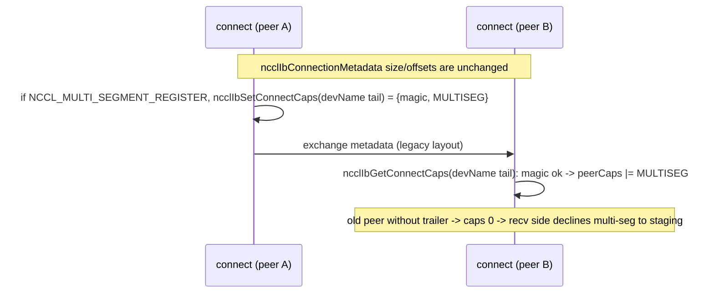

### Irecv / Isend contract

The hooks below live in `net_ib/p2p.cc`; `p2p.cc` calls each one from a single line.

```text
ncclIbIrecv, every entry i of the slot:
  rcclIbIrecvCheckHandle: NULL handle or NULL per-device MR -> fail
  write the 64-byte CTS entry (addr, seg-0 rkeys, nreqs, size, tag, idx last)
  rcclIbIrecvFillSideTable:
    if the peer advertised NCCL_IB_CAP_MULTISEG:
      side[i].nSegments = mh->nSegments > 1 ? mh->nSegments : 0
      if multi-segment: side[i].segStart / segRkeys from the handle (NULL MR -> fail)
      side[i].idx = CTS idx (last store)
    else: side[i].nSegments = 0, side[i].idx = 0

ncclIbIrecv, after the loop:
  rcclIbCtsFlagSideTable if any entry is multi-segment: set NCCL_IB_CTS_NREQS_SIDE_TABLE in every entry's nreqs

ncclIbPostFifo -> rcclIbPostFifoSideWr:
  if the peer has the cap and the slot is flagged:
    post the side-table RDMA_WRITE first (unsignaled, never inline, wr_id = CTS wr_id)
    chained to the CTS RDMA_WRITE
  else:
    post the CTS RDMA_WRITE alone (identical to stock)
  RC ordering: when the sender observes CTS idx, the side slot is already there

ncclIbIsend, after CTS idx is visible:
  nreqs = ncclIbCtsNreqs(slots[0].nreqs)          // mask off the flag
  reject nreqs > NCCL_NET_IB_MAX_RECVS             // before any further spin
  wait for slots[1..nreqs-1].idx
  rcclIbIsendWaitSideTable: if the peer has the cap and the slot is flagged, wait for side[r].idx == idx for every r

ncclIbMultiSend -> rcclIbMultiSendNeedsSegmented, per request r:
  remoteMulti = ncclIbCtsRemoteMultiSeg(comm, slot, r)
             // cap && flagged && side.idx == cts.idx && side.nSegments > 1
  if remoteMulti or the local handle has nSegments > 1:
      ncclIbMultiSendSegmented (split using side.segStart / side.segRkeys)
  else:
      unchanged single-segment path using cts.rkeys[]
```

A multi-segment **receive** handle cannot exist on a comm whose peer lacks the cap: registration already declined it. A multi-segment send handle can, and needs no side table, because the remote layout is the receiver's single CTS entry. Matching `side.idx` to `cts.idx` ignores a stale side slot after a later single-segment reuse of the same CTS index. The side-table WR carries the CTS `wr_id` because flushed unsignaled WRs still complete on a QP error, and resiliency maps `wr_id` to a slot; with `wr_id` 0 the flushed completion was resolved as receive request 0.

The CTS send queue keeps develop's depth, `NET_IB_MAX_REQUESTS * (resiliency ? 1 : 2)` (+1 with remote event-based load balancing), and adds another `NET_IB_MAX_REQUESTS * (resiliency ? 1 : 2)` for the side-table WRs when the switch is on (`net_ib/connect.cc:ncclIbReceiverQpsCreateToRts`).

### Send-engine change (`ncclIbMultiSendSegmented`)

`ncclIbMultiSend` delegates to `ncclIbMultiSendSegmented` (`net_ib/p2p.cc`) when any request's local or remote buffer is multi-segment. The builder keeps the same QP iteration and resiliency skip, computes the per-QP chunk with `ncclIbQpChunkSize` (the same formula as develop's inline math in `ncclIbMultiSend`), and for the QP's request-relative chunk `[sendOff, sendOff+len)` emits one WR per segment slice — each with that segment's remote addr/rkey and local lkey. Before splitting, the builder converts the request bases into offsets from each registration's segment 0:

```c
// pseudo — analogous to ncclRmaBuildSegmentedWrs
uint64_t localOff  = (localBase  - localSeg0)  + qpStartOffset;
uint64_t remoteOff = (remoteBase - remoteSeg0) + qpStartOffset;
size_t rem = qpLen;
while (rem) {
  int ls = segForOffset(localSegOff, localOff);
  int rs = segForOffset(remoteSegOff, remoteOff);
  size_t chunk = min3(rem,
                      localSegEnd[ls]  - localOff,
                      remoteSegEnd[rs] - remoteOff);
  wr->sg_list->addr   = localH->segStart[ls] + (localOff - localSegOff[ls]);
  wr->sg_list->lkey   = localH->segMrs[ls][dev]->lkey;
  wr->wr.rdma.remote_addr = remoteLayout->segStart[rs] + (remoteOff - remoteSegOff[rs]);
  wr->wr.rdma.rkey        = remoteLayout->segRkeys[rs][dev];
  chain(wr);
  localOff += chunk; remoteOff += chunk; rem -= chunk;
}
```

Other rules the builder enforces:

- **Validate a snapshot of the peer layout.** The builder copies the peer's segment starts and rkeys once, checks them with `ncclIbCtsRemoteLayoutValid` (count in range, device index in range, strictly increasing starts, nonzero rkeys), and posts from the snapshot rather than re-reading the volatile side table.
- **Zero-length WRs pick the rkey by offset.** A request with nothing to send on this QP still posts a zero-length write to keep the chain; its remote address can sit in a later segment, so `ncclIbSegmentForZeroLengthOffset` picks that segment's rkey.
- **Fail loudly on overflow.** A split failure or a chain longer than `NCCL_IB_MAX_WRS_PER_SEND` returns `ncclInternalError`.

The send QP is `NCCL_IB_MAX_SEND_WRS = 2 * NET_IB_MAX_REQUESTS + NCCL_IB_MAX_WRS_PER_SEND + 1` = 769 with the switch on and develop's `2 * NET_IB_MAX_REQUESTS` = 512 with it off. `connect.cc` asserts that 769 equals `NCCL_RMA_SEND_QP_WRS` (`rma_multiseg.h`) and also covers `2 * NET_IB_MAX_REQUESTS + NCCL_RMA_MAX_SIGNAL_WRS`, so the same sender QP fits a GIN iput-signal chain.

### Completion size

The segmented send puts the immediate data only on the final WR. That matters for a receive whose completion size comes from the CQE:

- With index matching (`BY_INDEX`, the default), the immediate carries the size for one receive, so nothing changes.
- With ID matching (`BY_ID`), the immediate carries the request ID. For one receive, the receiver sums `wc->byte_len` unless a size record was written. On the segmented path only the last slice produces a CQE, so that sum would report only the last slice. `BY_ID` is selected by `NCCL_IB_RECEIVER_SIDE_MATCHING_SCHEME=1` and is forced when the out-of-order receive queue or resiliency port failover is on.

The builder therefore writes the size record (the trailing WR that `ncclIbMultiSend` already uses for multi-recv) when

```c
needSizesWr = (nreqs > 1) || (recvMatchingScheme != BY_INDEX && reqs[0]->send.size > 0);
```

A zero-size send does not write the record, because its 4-byte record would itself be counted.

### Flush

`ncclIbIflush` first asks `rcclIbIflushNeedsMultiSeg` whether any non-zero receive has a multi-segment handle. If none does, develop's flush runs unchanged; otherwise `rcclIbIflushMultiSeg` builds the reads. The result is one of three read patterns per device:

- **Scratchpad (default).** With `RCCL_GDR_FLUSH_GPU_MEM_NO_RELAXED_ORDERING=1`, the flush writes and reads back a dedicated scratchpad; segments do not matter.
- **Single read.** With direct GDR reads and no multi-segment handle in the request, develop's single read of the last non-zero receive with `mrs[dev]`.
- **Per-segment chain.** With direct GDR reads and at least one multi-segment handle, one read per non-zero receive and per segment that receive overlaps (`ncclIbSegmentsOverlappingRange`), posted as one chain with only the last read signaled. A single-segment handle in the same request gets one read with `ncclIbMrForRange`.

The flush QP is `ncclIbFlushQpSendDepth(NCCL_STEPS, NCCL_NET_IB_MAX_RECVS, NCCL_IB_MAX_SEGMENTS, NET_IB_MAX_REQUESTS, multiSeg)`: 1024 when the peer advertised the capability and develop's 256 otherwise. `connect.cc` asserts that 1024 holds one chain per proxy step, and that the per-flush chain is at least `NCCL_RMA_MAX_FLUSH_WRS`. If a post fails after a prefix of the chain was accepted, the request is kept as `NCCL_NET_IB_REQ_FAILED` so `ncclIbTest` can drain it.

### Correctness issue found after the rebase: one shared offset is wrong

The first implementation passed one `off` to both segment tables. That is only correct when `localBase-localSeg0 == remoteBase-remoteSeg0`. A legal transfer can start in segment 1 locally and near the end of segment 0 remotely; using one cursor then selects the wrong segment, address, and key on one side. Whole-buffer tests starting at segment 0 did not expose this.

The fix is `ncclIbSplitTransferAtOffsets(localOff, remoteOff, len, ...)` in `net_ib/multiseg.h`. It advances both cursors by the same slice length but resolves each cursor against its own boundary table. `ncclIbMultiSendSegmented` computes `localReqOff` and `remoteReqOff` independently, makes remote offsets relative to `segStart[0]`, trims segment starts beyond the advertised receive, and caps the final remote boundary at `remoteReqOff + size`. (The same-offset convenience wrapper was removed so tests exercise the function production calls.)

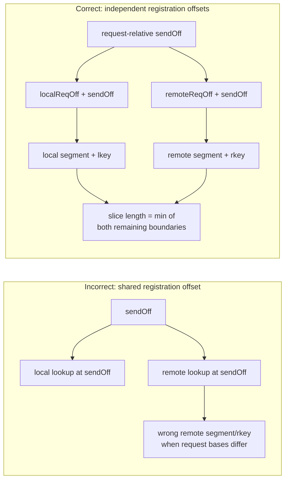

### Data-path timeline for a boundary-crossing send

The receiver publishes the **whole** segment table on the **side channel**; the 64-byte CTS slot still only carries addr / size / seg-0 rkeys / idx. The sender splits one logical transfer into per-segment WR slices.

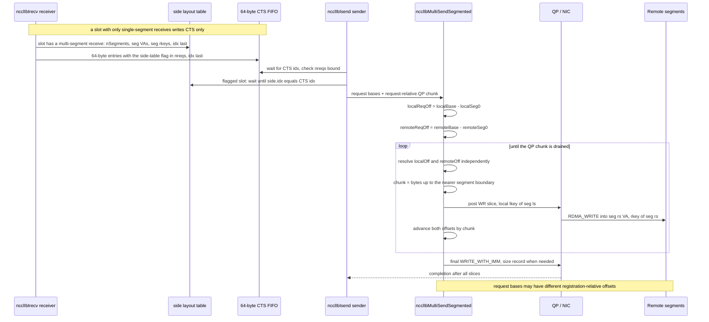

### Segment-aware registration flow

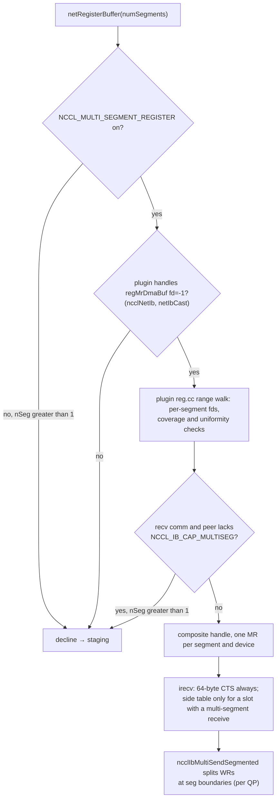

### Classic and CAST wire behavior

CAST uses the same CTS slot, side-table layout, capability trailer and composite handle, but its send and receive rules differ in a few places. The full CAST description is in [`multi_segment_netib_cast.md`](multi_segment_netib_cast.md).

| Aspect | Classic (`net_ib`) | CAST (`net_ib_cast`) |
| --- | --- | --- |
| Switch helper | `ncclIbAdvertiseMultiSeg()` (`connect.cc`) | `IbCastAdvertiseMultiSeg()` (`connect_cast.h`) |
| Peer bit with the switch off | recorded, but no slot is ever flagged | ignored (`peerCaps = 0`) |
| When the side table is written | only for a slot flagged with `NCCL_IB_CTS_NREQS_SIDE_TABLE` | for every CTS slot to a capable peer without CTS offload, including single-segment slots |
| Sender wait for the side table | spins on `side[r].idx` for a flagged slot | `IbCastWaitSideTable`, bounded at 2 s, then `ncclRemoteError` |
| Registration declines | recv only: peer lacks the cap | recv only: peer lacks the cap; both sides: CTS offload, `BY_ORDER` matching, or QP sharing |
| Segmented admission | none; the send QP holds one maximum chain over the ordinary budget | one segmented group at a time (`IbCastHasOtherSegmentedSend`) |
| Completion size | size record when `nreqs > 1` or (`BY_ID` and size > 0) | size record always; under `BY_INDEX` the immediate carries `WR_IMM_SEGMENTED_FLAG` so the receiver does not add `byte_len` |
| Send / CTS / flush QP with the switch on | 769 / develop + side-table WRs / 1024 | 769 (575 on RMA comms) / develop × 2 / `IbCastFlushQpSendDepth(base)` (1024, or 271 on RMA comms) |
| Partly posted send or flush | request kept as `NCCL_NET_IB_REQ_FAILED` and drained | the same (isendFail/iflushFail) |

The CAST RMA depths come from `rma_multiseg.h`: `NCCL_RMA_MAX_SEND_QP_WRS = 2 * NCCL_RMA_MAX_INFLIGHT_REQUESTS + NCCL_RMA_MAX_SIGNAL_WRS - 2` and `NCCL_RMA_MAX_FLUSH_QP_WRS = NCCL_RMA_MAX_INFLIGHT_REQUESTS + NCCL_RMA_MAX_FLUSH_WRS - 1`, applied only when `rcclRmaMultiSegEnabled()`. Classic GIN/RMA instead shares the classic sender and flush QPs, sized by `NCCL_IB_MAX_SEND_WRS` (restated as `NCCL_RMA_SEND_QP_WRS`) and the 1024-WR flush depth.

### Pros / Cons

- ✅ Handles any step size and independent local/remote request offsets within an accepted registration.
- ✅ Split math supports asymmetric local/remote boundaries; registration still conservatively requires uniform interior segments.
- ✅ Handles boundary-crossing transfers correctly.
- ✅ 64-byte CTS slot unchanged: slots without a multi-segment receive are bit-compatible with stock classic peers; AINIC 32-byte inline stride stays valid.
- ✅ Mixed multi-seg requires a **connect capability bit**, not a versioned FIFO.
- ✅ One switch turns the whole option off and restores develop's QP depths and CTS MR size.
- ❌ Side table + extra RDMA write (`nreqs * 704` bytes) on flagged slots only.
- ❌ Touches `ncclIbMultiSend` when either side is multi-segment (one hook line in `p2p.cc`).
- ❌ Highest risk; requires 2-node RoCE/IB hardware for end-to-end validation (the asymmetric cross-boundary stress and concurrent-pair tests provide that validation).

---

## 6. Comparison

| Aspect                   | Key-selection-only path                   | 64-byte CTS + side layout (selected) |
| ------------------------ | ----------------------------------------- | ------------------------------------ |
| 64-byte CTS slot         | Unchanged                                 | Unchanged size; flag bit in `nreqs` for side-table slots |
| Extra layout             | None                                      | Side table + connect cap             |
| `ncclIbMultiSend`        | Untouched                                 | Delegates to `ncclIbMultiSendSegmented` when nSeg > 1 |
| Boundary-crossing step   | Declined at reg / asserted                | Handled                              |
| Assumption               | `stepSize <= segmentSize`, uniform segs   | Uniform interior segs at registration |
| Interop, `nSegments <= 1`| Yes                                       | Yes (same 64-byte slot)              |
| Interop, `nSegments > 1` | Staging                                   | Requires peer cap; else staging      |
| AINIC inline CTS         | Safe (32-byte inline / 64-byte slot)      | Safe (does not enlarge CTS)          |
| Rejected alternative     | —                                         | In-FIFO `nSegments`/`segRkeys` (~712 B) |

**Decision:** ship WR splitting **and** keep the 64-byte CTS slot. Put the segment table in a side structure. Keep `ncclIbRegMrDmaBufMultiSeg` out of `net.h`.

### Plugin helper — do not copy into every net-ib header

`src/include/net.h` is plugin-facing and synced with upstream. A classic-only `ncclIbRegMrDmaBufMultiSeg` there fights every upstream `net.h` merge.

| Placement | Verdict |
| --- | --- |
| `src/include/net.h` | **No.** Public and synced with upstream. |
| Every `net_ib_*.h` | **No.** Six declarations, one implementation. |
| Existing `regMrDmaBuf` hook with `fd = -1`, segment walk inside the plugin | **Selected (2026-10-14).** `net.cc` calls no RCCL symbol; the plugin composes the N MRs into one `mhandle`. |
| Tiny `src/transport/rccl_ib_multiseg.h` | **Kept for declarations.** Included by `net_ib/reg.cc`, `net_ib_cast/reg.cc`, `net_ib_cast/rccl_reg_multiseg_cast.cc` and `NetIbMultiSegmentHelpers.hpp`. |
| That plugin's `common.h` only | OK if the helper stays fully inside the classic plugin. |

Today `net.cc` calls `regMrDmaBuf(..., packed, -1, ...)` from `sendProxyRegBuffer`/`recvProxyRegBuffer` when `numSegments > 1`, and skips the whole-range HSA DMA-BUF fallback in that case. No plugin-pointer check is needed: `ncclIbRegMrDmaBuf` and `IbCastRegMrDmaBuf` each route `fd == -1` to their own range walk, and any other plugin rejects the invalid fd.

---

## 7. Test plan

Unit tests (`test/transport/...`, MPI + single-process where possible), including negative/edge cases:

1. **Single-segment regression** — unchanged behavior (`nSegments == 1`). `sizeof(ncclIbSendFifo) == 64`. Mixed new-receiver / old-sender still works for this case.
2. **Multi-segment registration** — N uniform segments register N MRs; handle populated. A registered range larger than the current operation must still register all N segments, and incomplete enumeration must be rejected.
3. **Segment selection** — VA at segment start / mid / last-byte maps to the right MR.
4. **Boundary alignment** — step-sized, segment-aligned transfers stay on the fast path.
5. **Cross-boundary decline** — non-uniform segments → registration declines (fallback), no crash.
6. **Cross-boundary handling** — transfer straddling a boundary splits into correct per-segment WRs.
7. **`> NCCL_IB_MAX_SEGMENTS`** — rejected/declined cleanly.
8. **Zero-size / 1-byte** transfers at and around boundaries.
9. **Deregistration** — all per-segment MRs freed (no leak, no double-free).
10. **Asymmetric layout** — peers with differing segment boundaries split using independent local/remote indices.
11. **Independent start offsets** — local and remote request bases at different registration-relative offsets select the correct segment/key on both sides.
12. **Connect cap** — a receiver whose peer lacks `NCCL_IB_CAP_MULTISEG` declines multi-seg NET registration (staging) and never posts a 712-byte CTS slot; the sender still registers and splits locally.
13. **Mixed handles in one multi-recv** — a single-segment and a multi-segment receive share one CTS slot, in both orders.
14. **Completion size under ID matching** — a single segmented receive reports its full size.
15. **Switch off** — with `NCCL_MULTI_SEGMENT_REGISTER=0` a multi-segment registration declines and single-segment buffers still transfer.

### Implemented validation

- **Host tests** (`test/NetIbMultiSegmentUnitTests.cpp`, 45 cases on the classic branch): 25 `NetIbMultiSeg.*` cases (connect-caps trailer, peer-cap decline, segment selection, overlap ranges for flush, zero-length rkey choice, the uniformity rule including any two-segment layout, and the host-VMM base-0 guard), 11 `NetIbSplit.*` cases that call `ncclIbSplitTransferAtOffsets` with distinct local and remote offsets (including DeepEP CPU-to-GPU geometry), and 9 `NetIbCtsLayout.*` side-table validation cases. The wire branch adds the RMA queue-credit case `NetIbMultiSeg.RmaQueueCreditsBoundSegmentedChains` (46 cases).
- **Classic NET/IB MPI tests** (`test/transport/NetIbMPI/NetIbMultiSegmentMPITests.cpp`, 16 cases on the classic branch, sharing VMM helpers with the RMA suite through `test/common/MultiSegmentVmmHelpers.hpp`): registration, offsets, boundary crossing, whole-buffer transfers, the segment cap, `MultiSegmentRegisterOff_DeclinesRegistration`, single-segment regressions, three flush cases, `MultiRecvMixesSingleAndMultiSegmentHandles` (its multi-segment entry starts in segment 1 so a flush through segment 0's MR would fault, and it requires a flush request when direct GDR flush is on), `ConcurrentPairsMoveEverySegmentBoundary` (rank r receives from r + N/2 and checks the reported size and the untouched bytes before each chunk), and the opt-in `SendQueueFatChainOversubscribe` (`RCCL_MSEG_SQ_STRESS=1`). The CAST branch adds `CastUnsafeMode_DeclinesRegistration` and two CAST-only optional-receive-completion cases that skip on classic IB (19 cases).
- **Runner configs** (`tools/scripts/test_runner/configs/net_ib_transport.json`): `net_ib_multisegment` (2 nodes, 1 rank each) runs the classic cases, the send-queue stress, and `NetIB_MultiSeg_ReceiverSideMatchingById` (`NCCL_IB_RECEIVER_SIDE_MATCHING_SCHEME=1` over the boundary, whole-buffer, asymmetric-offset and concurrent-pair cases). `net_ib_multisegment_register_off` runs the decline test and the single-segment regressions with `NCCL_MULTI_SEGMENT_REGISTER=0`. `net_ib_multisegment_scale_2x4` runs the concurrent pairs with 4 ranks on each of 2 nodes. `net_ib_multisegment_flush` sets `RCCL_GDR_FLUSH_GPU_MEM_NO_RELAXED_ORDERING=0` so the per-segment flush chain runs, including the mixed-handle case. The CAST branch adds `cast_multisegment`, `cast_multisegment_opt_recv`, `cast_multisegment_opt_recv_2qp`, `cast_multisegment_register_off` and `cast_multisegment_unsafe_modes`. The architecture configs (for example `mi300x_mellanox_ib.json`) run the whole suite in `multisegment_transport_multinode`, including a `MultiSegment_Transport_RegisterOff_MultiNode` entry with the switch off.
- **GIN/RMA MPI tests** (`test/transport/RmaMPI/RmaMultiSegmentMPITests.cpp`, 43 cases) cover IPut/IGet, signals, flushes, bounds, asymmetric layouts, the switch at `0`, the two-node DeepEP Engram mixed `[GPU][CPU]` window stress, send-queue capacity, and eight-rank hybrid imported-host-segment positive/negative/stress coverage.
- **UBR/symmetric-window tests** (`test/RegistrationMPITests.cpp`, 14 `UBR_MultiSegment` cases on the classic branch, 17 from layer 07 on) cover generic and graph registration, the switch-off slice and graph-slice cases, reuse, the odd-sized `hipMalloc` count, the clipped final segment, LSA, LSA+GIN, elastic windows, the CE receive-offset before/after controls and, from layer 07, the DeepEP elastic and hybrid window cases.
- **Validation.** The last recorded hardware run was on 2026-10-07 against the previous branch heads: on the wire tree, multinode on two nodes, 88 of 88 runner entries passed on ROCm 7.0.2.2 and on TheRock 10.2. This revision has not been re-run on hardware.

`UBR_MultiSegment.Generic` and `GenericGraph` gate on `NET_REG_COMPLETE`, then assert `rcclNet.allPeers` and an 8-segment `rcclNet.nSegments`. Gating on the all-peer flag instead would let a dropped commit skip green. `NetProxyPartialFinalSegment` registers 2.5 segments of a 3-segment mapping, requires NET registration on some rank across two nodes, checks a cached count of 3, and verifies the unregistered tail is untouched.

The registration-reuse test (`Generic_Reuse`) runs with `RCCL_CE_ALLREDUCE=0`, `NCCL_ALGO=Ring`, and `NCCL_PROTO=Simple` in the runner; otherwise CE may reuse its collective plan without revisiting the IPC/NET registration cache. The symmetric-LSA regression uses a receive buffer at a non-zero offset inside its window. CE AllReduce must resolve peer destinations with:

```c
(recvbuff - recvWin->userPtr) + rank * chunkBytes
```

Test-only fault injection restores the legacy `rank * chunkBytes` calculation to prove that the before control detects corruption.

### Known limitations

- **Uniform interior segments only.** `ncclIbSegmentsUniform` requires every interior segment to equal the largest; the first and last may be shorter. Other layouts decline to staging even though the splitter can represent them.
- **16 segments per registration** (`NCCL_IB_MAX_SEGMENTS`). Larger buffers decline to staging.
- **Classic sends have no one-group admission gate.** The send QP holds the ordinary request budget plus one maximum segmented chain (`NCCL_IB_MAX_SEND_WRS` = 2 × 256 + 256 + 1 = 769). `SendQueueFatChainOversubscribe` posts three ~249-WQE chains without draining and expects them all to fit and complete.
- **Side-table cost.** A flagged slot adds an `nreqs * 704`-byte RDMA write before the CTS.
- **Lazy intra-node IPC registration before HIP 7.17.** A peer proxy's `hipMemMap` waits for kernels on blocking streams, so such a test must run its collective on a non-blocking stream (see below).
- **`UBR_MultiSegment.Symmetric_LsaGin`** depends on [ROCm/rocm-systems#12104](https://github.com/ROCm/rocm-systems/pull/12104) (launch GIN RailA2A with 512 threads on wave64); it also fails on bare develop.
- **Hybrid tests run on ROCm 10.2 and 7.0.2.2.** RCCL registers imported host segments from the owner's DMA-BUF fd instead of re-exporting them (see the GIN design doc, "Imported host segments use the owner's DMA-BUF"), so the former ROCM-29815 skip is gone. `RCCL_TEST_HYBRID_VMM_REQUIRE=1` turns the ROCM-29812 and host-gate skips into failures.

### Hybrid DeepEP scope and coverage

“Hybrid” describes one virtual address range backed by more than one kind of memory. It is not one physical allocation. Each process first reserves one contiguous virtual range, then maps a private GPU allocation plus one host allocation per local rank:

```text
one pointer returned to the application
│
▼
+------------------+------------------+-----+------------------+
| private GPU VMM  | host VMM owner 0 | ... | host VMM owner N-1 |
+------------------+------------------+-----+------------------+
        GPU memory       CPU memory              CPU memory
```

CI uses **8 ranks on 2 nodes (4 ranks per node)**. Both nodes build the same ordered shape; ownership of the host segments is local-rank-specific:

```text
node A, local rank k: [private GPU k][CPU A0][CPU A1][CPU A2][CPU A3]
node B, local rank k: [private GPU k][CPU B0][CPU B1][CPU B2][CPU B3]
                      CPU k is local; the other three host segments are imported
```

Each process creates its private GPU segment and one 2 MiB-aligned host segment. Local peers exchange host-segment sizes with `MPI_COMM_TYPE_SHARED` and pass POSIX DMA-BUF FDs through RCCL's Unix-domain IPC socket API (`SCM_RIGHTS`). Every process then maps the host handles in local-rank order. All mappings receive GPU access; the host mappings also receive CPU access.

This gives the application one pointer and one total size, while registration still sees `1 + N` backing segments (five when N = 4). LSA reuses the host segment from its owner instead of exporting every imported copy. GIN registers every AMD VMM segment, including a CPU-backed one, through the DMA-BUF path. An imported VMM mapping is a DMA-BUF object and must not be treated as ordinary host memory for `ibv_reg_mr`.

The complete range is registered with `NCCL_WIN_STRICT_ORDERING` and `NCCL_SYM_REUSE_SYSMEM_HANDLES=1`.

Coverage includes strict-window/LSA registration with handle reuse (`DeepEP_HybridWindowRegistrationAndHandleReuse`), a remote CPU-to-local GPU GIN IGet, a disabled-elastic-registration rejection, an out-of-range IGet rejection, and 32 iterations alternating remote CPU owners, offsets, and transfer sizes with sentinel protection. Unsupported host VMM, GIN, or topology causes a collective skip; registration is torn down before mappings.

How the tests skip and clean up (helpers in `test/common/HybridVmmHelpers.hpp` and the fixture in `test/RegistrationMPITests.cpp`):

- `AllocHybridCollective` is the entry point. Outside `NCCL_CUMEM_HOST_GATE` it returns a skip reason on every rank without running a collective.
- `CheckHybridVmmRuntimeSupport` always runs as a collective and skips on all ranks with "ROCM-29812: imported host VMM CPU access is unsupported" when any rank lacks the capability. It does not probe re-export of an imported handle, because RCCL never re-exports one. With `RCCL_TEST_HYBRID_VMM_REQUIRE=1` (set in the hybrid CI job) the ROCM-29812 case and the host-gate case fail instead of skipping.
- If `AllocHybridForLocalRanks` fails on any rank, `FreeHybridVmm` releases what was mapped on every rank before returning, and each test installs its cleanup guard before any later collective skip, so a skip never leaks a mapping or hangs a peer.
- `UBR_MultiSegment.GenericGraph` runs in the two-node `ubr_multisegment_lsagin_multinode` job on every site config.

**Non-blocking test stream (07 opt-in).** Before HIP 7.17, `hipMemMap` in a peer proxy waits for kernels on blocking streams. Lazy intra-node IPC registration can then deadlock against a collective already running on the test stream. `MPITestCore` (`test/common/MPITestCore.hpp`) has a `test_stream_flags_` member, default `hipStreamDefault` (blocking); a test sets it before `createTestCommunicator()`, which creates the stream. `RCCL_TEST_STREAM_NONBLOCKING=1` or `0`, when set, overrides the member for every test. `UBR_MultiSegment.NetProxyPartialFinalSegment` opts in (`hipStreamNonBlocking`) instead of skipping when it has an intra-node peer.

**Supported contract:** `NCCL_ELASTIC_BUFFER_REGISTER=1` and `NCCL_SYM_REUSE_SYSMEM_HANDLES=1`. The 8-rank/two-node (4 ranks per node) hybrid symmetric-window/GIN tier in the architecture JSONs (`ubr_multisegment_lsagin_multinode`) is the primary coverage; `DeepEP_ElasticWindowRegistration` on the same tier validates non-hybrid `[GPU][CPU]` elastic registration. The segment-aware wire path remains broader classic NET/IB functionality, not a hybrid-parity requirement.

All four coverage tiers (host, single-node UBR, two-node NET/IB+GIN, and eight-rank/two-node LSA+GIN) are enabled in the comprehensive and functional MI300, MI355, and MI455 test-runner configurations.
