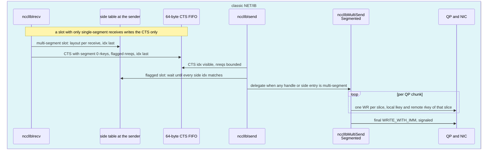
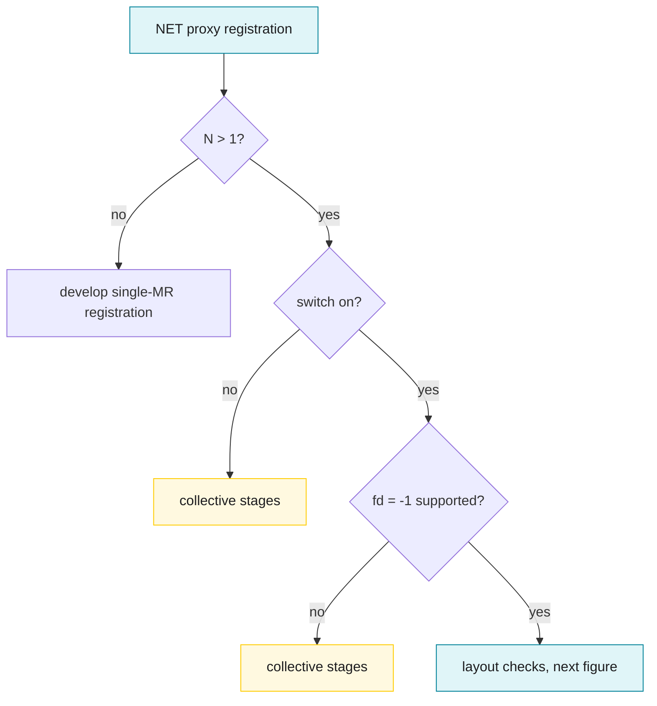
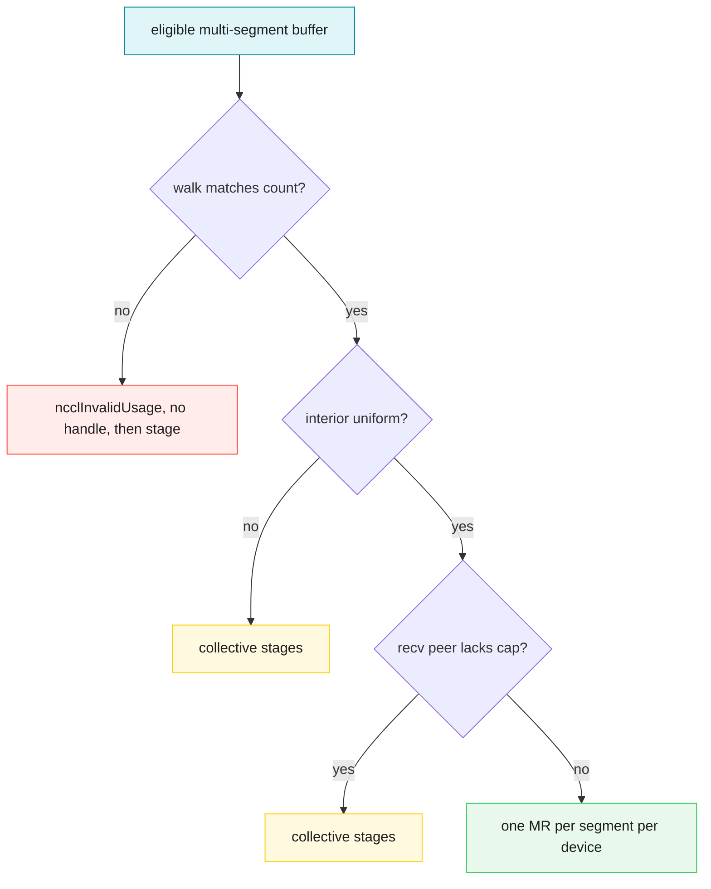
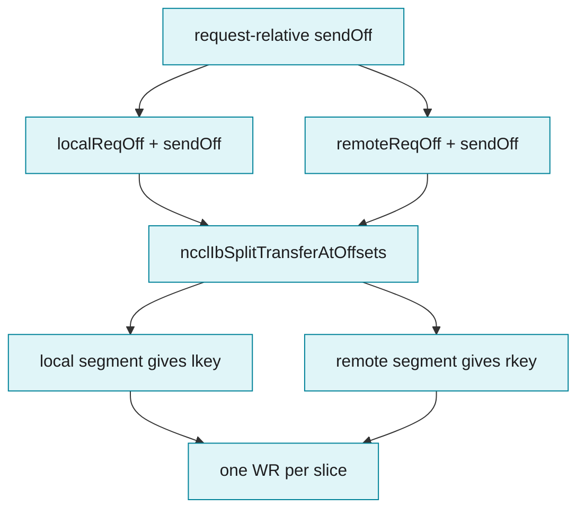
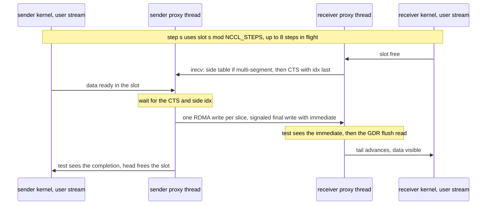

# Classic NET/IB P2P: side table and segmented send

Classic NET/IB P2P (`net_ib`, layer 06, [PR 10886](https://github.com/ROCm/rocm-systems/pull/10886)) registers one MR per segment and splits each RDMA write at local and remote segment boundaries. The 64-byte CTS entry is unchanged: a receiver that holds a multi-segment buffer also RDMA-writes its segment table into a side table next to the sender's CTS FIFO, behind a connect capability carried in the `devName` trailer. This doc covers the data structures, registration, the send and flush paths, wire compatibility, and the alternatives that were rejected. IB-CAST uses the same wire format with the differences in [IB-CAST P2P](multi_segment_netib_cast.md).

## Why the classic path needs a new wire element

The classic data plane was single-MR by construction. The receiver's CTS entry (`ncclIbSendFifo`) carries one remote address and one rkey per NIC device, and `ncclIbMultiSend` walks one contiguous region across QPs. A boundary-crossing write with segment 0's rkey is rejected by the responder, so the sender must learn every remote segment's address and rkey, and must cut its writes at both its own and the receiver's boundaries.



## Data structures

**Composite MR handle** (`net_ib/common.h`). `mrs[]` aliases segment 0, so single-segment code is unchanged:

```c
struct ncclIbMrHandle {
  ibv_mr* mrs[NCCL_IB_MAX_DEVS_PER_NIC];                 // segment 0
  int nSegments;                                         // 1 = legacy single MR
  uintptr_t segStart[NCCL_IB_MAX_SEGMENTS];
  size_t segLen[NCCL_IB_MAX_SEGMENTS];
  ibv_mr* segMrs[NCCL_IB_MAX_SEGMENTS][NCCL_IB_MAX_DEVS_PER_NIC];
};
```

**CTS entry and side table.** The CTS entry stays one 64-byte cache line with segment 0's rkeys. The side table has the same `[NET_IB_MAX_REQUESTS][NCCL_NET_IB_MAX_RECVS]` indexing and sits right after `ctsFifo`, so one covering MR registers both:

```c
struct alignas(64) ncclIbSendFifo {
  uint64_t addr; uint64_t size;
  uint32_t rkeys[NCCL_IB_MAX_DEVS_PER_NIC];   // segment 0
  uint32_t nreqs;                             // bit 31: NCCL_IB_CTS_NREQS_SIDE_TABLE
  uint32_t tag; uint64_t idx;
};                                            // static_assert size 64

struct alignas(64) ncclIbSegLayout {
  uint32_t nSegments; uint32_t pad;
  uint64_t segStart[NCCL_IB_MAX_SEGMENTS];
  uint32_t segRkeys[NCCL_IB_MAX_SEGMENTS][NCCL_IB_MAX_DEVS_PER_NIC];
  uint64_t idx;                               // last store; the sender waits on it
};                                            // static_assert size 704
```

The receiver stages its copy in `ncclIbRecvComm::remSegLayout` (256 × 8 × 704 bytes, about 1.44 MB) and writes it through `segLayoutFifoMr` (`IBV_ACCESS_LOCAL_WRITE` only). Both are created in accept only when the peer advertised the capability, and freed on the accept failure path and on close. The sender's `segLayoutFifo` stays inline because the peer writes it at `ctsFifo + sizeof(ctsFifo)` through the CTS MR. Deferring both to the first multi-segment registration is a [separate design](multi_segment_sidetable_first_reg.md).

**Capability trailer.** `ncclIbSetConnectCaps` and `ncclIbGetConnectCaps` (`net_ib/multiseg.h`) write and read `{magic 0x4d534547, caps}` in the reserved tail of the fixed-size `devName`, so `ncclIbConnectionMetadata` keeps its size and offsets (`net_ib/connect.h` asserts no trailing field was added). `ncclIbAdvertiseMultiSeg` writes `NCCL_IB_CAP_MULTISEG` only with the switch on; both sides store the peer's bit in `peerCaps`. A peer without the trailer reads as caps 0.

**Send request.** `req->send.mh` keeps the local handle so the builder can find per-segment lkeys. `sges[]` holds `NCCL_IB_MAX_WRS_PER_SEND` (256) entries and `wrs[]` one more for the immediate; these sizes do not depend on the switch.

## Registration

`net.cc` stays plugin-neutral. `rcclNetRegSegmentCount` (`rccl_wrap.cc`, layer 03) returns the cached count or walks the registration; with the switch off a multi-segment buffer skips NET and stages. For `numSegments > 1`, `sendProxyRegBuffer` and `recvProxyRegBuffer` call the plugin's own `regMrDmaBuf` with `fd = -1` and `offset = (export flags << 32) | numSegments`, and skip the whole-range HSA DMA-BUF fallback. A plugin that does not understand `fd = -1` fails the call and the collective stages.

`ncclIbRegMrDmaBuf` (`net_ib/reg.cc`) routes `fd == -1` to `rcclIbRegMrDmaBufFromRange`, which walks the range one segment at a time:

```c
for (int s = 0; s < numSegments && remaining > 0; s++) {
  cuMemGetAddressRange(&segBase, &segSize, segPtr);
  size_t thisLen = min(remaining, ncclIbBytesRemainingInSegment(segPtr, segBase, segSize));
  cuMemGetHandleForAddressRange(&fd, segPtr, thisLen, CU_MEM_RANGE_HANDLE_TYPE_DMA_BUF_FD, flags);
  segAddrs[s] = segPtr; segLens[s] = thisLen; segFds[s] = fd;
  segPtr += thisLen; remaining -= thisLen; nSeg++;
}
// remaining != 0 or nSeg != numSegments: ncclInvalidUsage, no partial handle
// !ncclIbSegmentsUniform(nSeg, segLens): decline to staging
// then ncclIbRegMrDmaBufMultiSeg, and close every fd
```

`ncclIbRegMrDmaBufMultiSeg` declines with `ncclInvalidUsage` on a receive comm whose peer lacks the capability (`ncclIbDeclineMultiSegRegistration`); a send comm registers regardless, because it only splits its own buffer onto the receiver's single rkey. It `calloc`s the handle, registers one MR per segment per device into `segMrs[s][i]`, aliases segment 0 into `mrs[]`, and unwinds exactly the MRs made on failure. `ncclIbDeregMr` forwards a multi-segment handle to `rcclIbDeregMrMultiSeg`, which frees only through `segMrs[][]`. Develop's single-MR registration now also `calloc`s its handle and unwinds a partial registration.



An eligible buffer then goes through the layout checks in `rcclIbRegMrDmaBufFromRange` and `ncclIbRegMrDmaBufMultiSeg`:



## Data path

`net_ib/p2p.cc` keeps develop's code, including the inline chunk math in `ncclIbMultiSend`. Develop's functions call `RCCL:`-marked functions in the same file at fixed points:

| Hook | Called from | Role |
|---|---|---|
| `rcclIbIrecvCheckHandle` | `ncclIbIrecv` | reject a NULL handle or a missing per-device MR |
| `rcclIbIrecvFillSideTable` | `ncclIbIrecv` | fill each receive's side entry and report whether any is multi-segment |
| `rcclIbCtsFlagSideTable` | `ncclIbIrecv` | set `NCCL_IB_CTS_NREQS_SIDE_TABLE` in every CTS entry of the slot |
| `rcclIbPostFifoSideWr` | `ncclIbPostFifo` | chain the side-table write before the CTS write |
| `rcclIbIsendWaitSideTable` | `ncclIbIsend` | wait until every side entry's `idx` matches the CTS |
| `rcclIbMultiSendNeedsSegmented` | `ncclIbMultiSend` | delegate to `ncclIbMultiSendSegmented` |
| `rcclIbIflushNeedsMultiSeg`, `rcclIbIflushMultiSeg` | `ncclIbIflush` | segment-aware flush |

**Receiver.** `ncclIbIrecv` always writes the 64-byte CTS (address, size, segment 0 rkeys, `idx` last). For a capable peer each receive's side entry gets its layout, or `nSegments = 0` for a single-segment receive, plus the slot's `idx`. Only if some receive in the slot is multi-segment does the receiver flag every CTS entry and RDMA-write the side table, as an unsignaled WR chained before the CTS WR. The side WR carries the CTS WR's `wr_id`, because flushed unsignaled WRs still complete on error and resiliency maps `wr_id` to a slot. With the switch on, the CTS QP adds `NET_IB_MAX_REQUESTS * (resiliency ? 1 : 2)` WRs for these writes.

**Sender.** `ncclIbIsend` strips the flag (`ncclIbCtsNreqs`) and rejects `nreqs` above `NCCL_NET_IB_MAX_RECVS` before waiting on anything. For a flagged slot it waits until every side entry's `idx` matches, because the side table and the CTS are separate writes. A request is remote multi-segment only when all of these hold:

```c
(comm->peerCaps & NCCL_IB_CAP_MULTISEG) && ncclIbCtsHasSideTable(cts->nreqs) &&
side->idx == cts->idx && side->nSegments > 1
```

**Segmented builder.** `ncclIbMultiSend` delegates when any local handle has more than one segment or any request is remote multi-segment. `ncclIbMultiSendSegmented` snapshots the remote starts and rkeys once, validates them (`ncclIbCtsRemoteLayoutValid`: count in 1..16, device index in range, strictly increasing starts, nonzero rkeys), clips the remote table to the request end, computes the per-QP chunk with `ncclIbQpChunkSize`, and posts one WR per slice:

```c
for (int k = 0; k < ns; k++) {
  wr->opcode = IBV_WR_RDMA_WRITE;
  wr->wr.rdma.remote_addr = slices[k].remoteAddr;
  wr->wr.rdma.rkey = remoteMulti ? remoteRkeys[slices[k].remoteSeg] : slots[r].rkeys[remDevIdx];
  sge->addr = slices[k].localAddr; sge->length = slices[k].len;
  sge->lkey = (mh && mh->nSegments > 1) ? mh->segMrs[slices[k].localSeg][devIndex]->lkey
                                        : reqs[r]->send.lkeys[devIndex];
}
```

A zero-length chunk still posts one 0-byte write; its rkey comes from `ncclIbSegmentForZeroLengthOffset`, which maps the end of the last segment to that segment. The final WR carries the immediate. A sizes WR is added when `nreqs > 1`, or when the receiver does not match by index (for example BY_ID) and the size is nonzero, so a single segmented receive reports its full size.

**Failed posts.** If a segmented send posted a prefix, the request is kept for `Test()` to drain; events for QPs that posted nothing are dropped, because no completion will come for them. `NetIbSegmentedSendPrefixTests.cpp` covers these cases on the host.

### Independent offsets

> [!CAUTION]
> The local and remote request bases can start at different offsets within their registrations: local data can begin in segment 1 while the CTS address begins near the end of segment 0. An earlier splitter used one shared offset, which worked for whole-buffer transfers and picked the wrong segment and key otherwise.

The builder converts the request-relative send offset into two registration-relative cursors and lets `ncclIbSplitTransferAtOffsets` advance them independently:



`NetIbSplit.IndependentLocalAndRemoteStartOffsets` locks this on the host; the MPI offset and boundary tests check it through real MRs.

## Step pipeline and streams

The kernels run on the user stream; a host proxy progress thread runs both `sendProxyProgress` and `recvProxyProgress`. Each step uses slot `step % NCCL_STEPS`, so up to 8 steps per connection are in flight, and each slot carries its own CTS, side-table entries and segmented chain. That is why the [queue sizing](#queue-sizing) reserves one worst-case chain per step.



## Flush

The GDR flush is a loopback read that fences earlier writes on the PCIe path. `ncclIbIflush` runs develop's flush unless some non-empty receive has a multi-segment handle. Then `rcclIbIflushMultiSeg` rejects `n > NCCL_NET_IB_MAX_RECVS` and, per device:

- with the scratchpad flush (`RCCL_GDR_FLUSH_GPU_MEM_NO_RELAXED_ORDERING=1`, the default), posts develop's write and single read of the scratchpad;
- otherwise posts one read per segment each receive overlaps (`ncclIbSegmentsOverlappingRange`), at `max(data[r], segStart)` with that segment's rkey, and one read through `ncclIbMrForRange` for a single-segment receive; all reads form one chain with only the last signaled.

A prefix post keeps the request as `NCCL_NET_IB_REQ_FAILED` so `Test()` drains it. The flush QP is created lazily on the first flush (`ncclIbCreateFlushQp`) with `devIndex` and `remDevIdx` set to the receive device, and is 1024 deep when the peer advertised the capability, else 512. Develop's `ncclIbIflush` also now returns its stored post error instead of success. Dropping duplicate reads is a [separate design](multi_segment_flush_read_collapse.md).

## Queue sizing

A maximum segmented send is 257 WRs and only its tail is signaled, so the chain holds 257 send-queue slots until its completion. Classic has no admission gate, so the sender QP is `2 * NET_IB_MAX_REQUESTS + NCCL_STEPS * 257` = 2568, one worst-case chain per proxy step on top of the ordinary budget. All depths and their switch-off values are in [QP depths](multi_segment_current.md#qp-depths). The opt-in `SendQueueFatChainOversubscribe` test (`RCCL_MSEG_SQ_STRESS=1`) drives three maximum chains on one QP.

## Compatibility

- A slot without a multi-segment receive is bit-identical to stock classic. Only a flagged slot sets bit 31 of `nreqs`, and only toward a peer that advertised the capability.
- A peer without the capability, an older build, or a peer with the switch off reads caps 0. The receiver's multi-segment registration declines and stages; a multi-segment sender still splits onto the single rkey (`net_ib_multisegment_old_peer` checks this).
- With the switch off nothing is advertised, the CTS MR is `sizeof(ctsFifo)`, and the send, CTS and flush QPs have develop's depths.
- AINIC keeps the 64-byte CTS and the 32-byte inline slot.
- `ncclIbRegMrDmaBufMultiSeg` is declared in `src/transport/rccl_ib_multiseg.h`, not `src/include/net.h`.

## Alternatives not taken

**Key selection only.** Register one MR per segment but leave `ncclIbMultiSend` and the CTS alone: `isend`, `irecv` and `iflush` pick the one segment that contains the request (`ncclIbMrForRange`) and reject a request that straddles a boundary. It avoided a wire change but was correct only while each network step fit inside one segment (`stepSize <= segmentSize`) with uniform segments, so it could not serve a transfer that crosses a boundary. What remains of it is `ncclIbMrForRange`, used for single-segment receives inside a multi-segment flush.

**Enlarge the CTS entry.** Put `nSegments`, `segStart[16]` and `segRkeys[16][devs]` into `ncclIbSendFifo`, about 712 bytes per entry. Every CTS write would grow for every buffer, the AINIC 32-byte inline CTS could not hold it, and mixing with old peers would need a versioned FIFO. The side table keeps the 64-byte entry and pays only for slots that need it.

| Aspect | Key selection only | Enlarged CTS | Side table (selected) |
|---|---|---|---|
| CTS entry | 64 bytes | about 712 bytes | 64 bytes |
| Boundary-crossing transfer | declined | handled | handled |
| Old peer | compatible; multi-segment stages | needs a versioned FIFO | compatible; receiver stages, sender splits |
| `ncclIbMultiSend` | untouched | segmented | delegates for multi-segment only |

## Review checklist

- `sizeof(ncclIbSendFifo) == 64` and `sizeof(ncclIbSegLayout) == 704`; `idx` stays last in the side entry.
- Side table only for flagged slots; side WR unsignaled, chained before the CTS, with the CTS `wr_id`.
- Peer `nreqs` bounded before any wait; side entry validated and snapshotted once.
- Independent local and remote cursors; zero-length rkey from `ncclIbSegmentForZeroLengthOffset`.
- Prefix posts keep the request; QPs that posted nothing drop their events.
- Flush reads every overlapped segment on direct GDR, a single read with the scratchpad.
- With the switch off, connect metadata, CTS MR and QP depths match develop.
- Only `ncclNetIb` and `netIbCast` handle `regMrDmaBuf` with `fd = -1`; other plugins stage.
- `getHandleForAddressRangeFlags` never sets the PCIe flag on the 7.0.2.2 backport; the multi-segment path inherits the single-segment guard.

Tests for this path are listed in [testing](multi_segment_testing.md#classic-and-ib-cast-p2p).

## Symbol index

| Concern | Symbols |
|---|---|
| Boundary math, trailer, CTS rules (`net_ib/multiseg.h`) | `ncclIbSegmentIndexForRange`, `ncclIbSegmentsUniform`, `ncclIbSplitTransferAtOffsets`, `ncclIbSegmentForOffset`, `ncclIbSegmentForZeroLengthOffset`, `ncclIbSegmentsOverlappingRange`, `ncclIbCtsRemoteLayoutValid`, `ncclIbDeclineMultiSegRegistration`, `ncclIbCtsNreqs`, `ncclIbCtsHasSideTable`, `ncclIbBytesRemainingInSegment`, `ncclIbSetConnectCaps`, `ncclIbGetConnectCaps`, `ncclIbFlushQpSendDepth` |
| Handle and CTS (`net_ib/common.h`) | `ncclIbMrHandle`, `ncclIbSendFifo`, `ncclIbSegLayout`, `segLayoutFifo`, `remSegLayout`, `segLayoutFifoMr`, `NCCL_IB_MAX_SEND_WRS`, `NCCL_IB_MAX_WRS_PER_SEND` |
| Connect (`net_ib/connect.cc`) | `ncclIbAdvertiseMultiSeg`, `ncclIbSendCommAllocCts`, `ncclIbCreateFlushQp` |
| Registration | `sendProxyRegBuffer`, `recvProxyRegBuffer` (`net.cc`); `rcclNetRegSegmentCount`, `rcclNetRegCommit` (`rccl_wrap.cc`); `rcclIbRegMrDmaBufFromRange`, `ncclIbRegMrDmaBufMultiSeg`, `rcclIbDeregMrMultiSeg` (`net_ib/reg.cc`) |
| Data path (`net_ib/p2p.cc`) | the hooks above, `ncclIbMultiSendSegmented`, `ncclIbQpChunkSize`, `ncclIbCtsRemoteMultiSeg`, `ncclIbMrForRange` |
