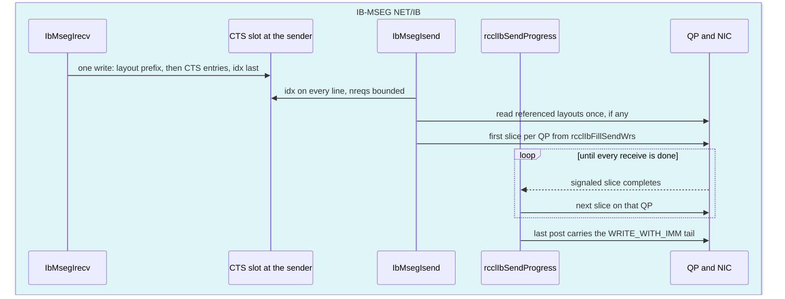
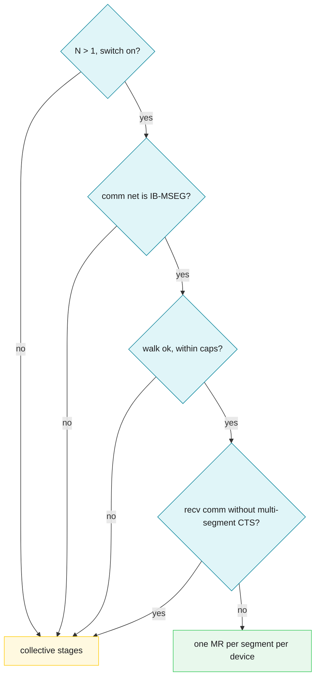
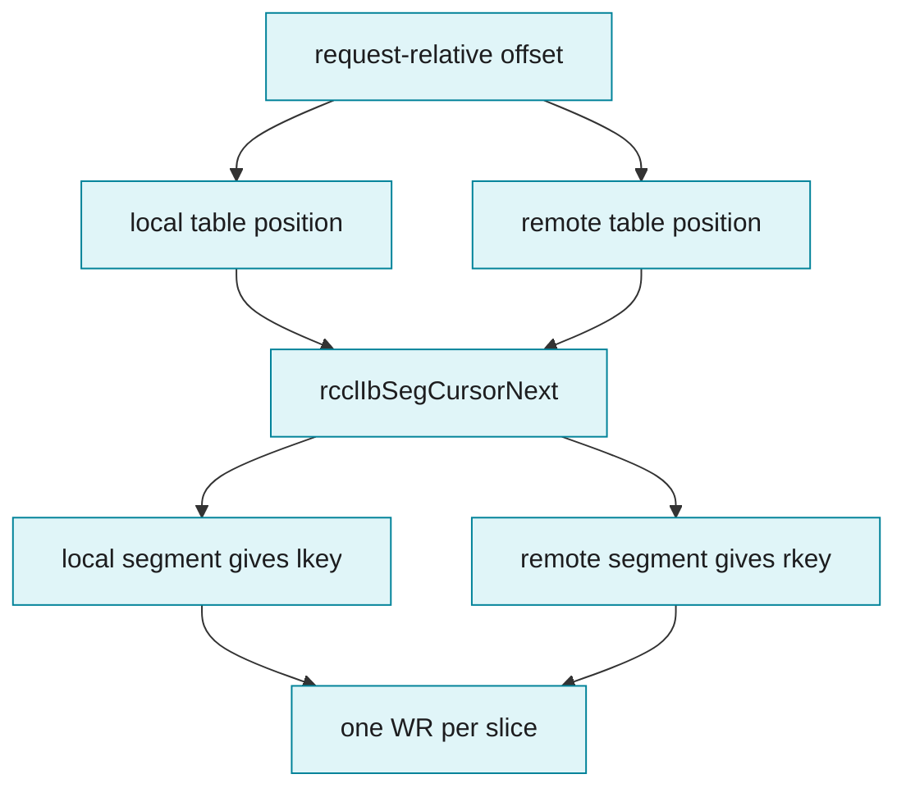
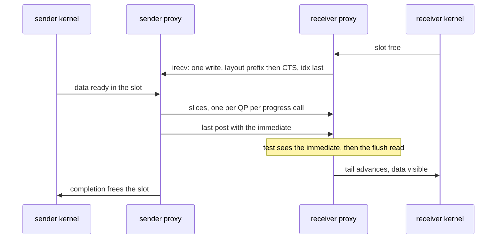

# IB-MSEG NET/IB P2P: one-write CTS and sliced send

> [!NOTE]
> Fork 3 (`users/atulkulk/netib-mseg/03-registration-p2p-multiseg`), checked against fork 4. All code is in the IB-MSEG plugin (`src/transport/net_ib_multiseg/`); `net_ib` and `net_ib_cast` stay develop code. The old-stack P2P layer that edited `net_ib` in place is superseded by fork 3. See [the fork plugin](multi_segment_fork_plugin.md#fork-3-registration-and-p2p).

IB-MSEG NET/IB P2P registers one MR per segment and splits each RDMA write at local and remote segment boundaries. A receiver that holds a multi-segment buffer sends its layout in front of the CTS entries, in the same RDMA write. The sender posts one slice per QP per progress call, so its queues keep develop's depths. Both ends decide at connect time whether the comm uses the multi-segment CTS, and the connect fails when they disagree. This doc covers the data structures, registration, the send and flush paths, the connect-time match, and the alternatives that were rejected.

## Why P2P needs a new wire element

The develop data plane is single-MR by construction. The receiver's CTS entry (`IbMsegSendFifo` in the fork) carries one remote address and one rkey per NIC device, and `IbMsegMultiSend` walks one contiguous region across QPs. A boundary-crossing write with segment 0's rkey is rejected by the responder, so the sender must learn every remote segment's address and rkey, and must cut its writes at both its own and the receiver's boundaries.



## Data structures

The shared structures are in `net_ib_multiseg/seg_p2p_mseg.h` and `seg_p2p.cc`, written without plugin-specific symbols; the plugin's comm and slot types are in `net_ib_multiseg/common_mseg.h`.

**Composite MR handle.** `IbMsegMrHandle` (`common_mseg.h`) embeds a `rcclIbSegMr`; `mrs[]` aliases segment 0, so single-segment code is unchanged. The arrays are sized from the walked count:

```c
struct rcclIbSegMr {
  int nSegments;            // 1 (or 0) is one MR
  uintptr_t* segStart;      // VA start of each segment
  size_t* segLen;
  uint64_t* segOff;         // nSegments + 1 offsets from segStart[0]
  void** segMrs;            // [s * RCCL_IB_MSEG_MAX_DEVS + dev]
  void* layoutBlob;         // receive side, nSegments > RCCL_IB_CTS_INLINE_SEGS only
  size_t layoutBytes;
  uint64_t layoutGen;
  struct ibv_mr* layoutMrs[RCCL_IB_MSEG_MAX_DEVS];
};
```

**CTS slot.** The 64-byte CTS entry is unchanged. A multi-segment comm uses `IbMsegCtsSlot` (`common_mseg.h`): eight `IbMsegSegLayout` entries followed by eight CTS entries, 2048 bytes per slot, 256 slots (`NCCL_IB_CTS_SLOTS_BYTES`, 512 KiB). Asserts pin the CTS entries right after the prefix and 64-byte aligned. A slot of `nreqs` receives packs its layouts immediately before the CTS row (`rcclIbCtsLayout`), so one RDMA write that covers the prefix ends at `idx`.

```c
struct alignas(64) IbMsegSegLayout {      // 192 bytes, three 64-byte lines, asserted
  uint32_t nSegments;                     // inline records; 0 when byRef
  uint32_t byRef;
  uint64_t segStart[RCCL_IB_CTS_INLINE_SEGS];
  uint32_t rkeyHead[RCCL_IB_LAYOUT_RKEYS_HEAD];
  uint64_t idx0;                          // each line ends with the CTS idx
  union {
    uint32_t rkeyMid[RCCL_IB_LAYOUT_RKEYS_LINE];
    struct rcclIbSegLayoutRef ref;        // addr, gen, nSegments, ndevs, rkeys[devs]
  };
  uint64_t idx1;
  uint32_t rkeyTail[RCCL_IB_LAYOUT_RKEYS_LINE];
  uint64_t idx2;
};
```

**Line stamps.** The layout lines are not in the CTS rows' cache lines, so a long write can land out of order. The receiver stamps each layout line with the slot's `idx` (`rcclIbCtsFlagLayout`, `rcclIbLayoutStamp`), and the sender waits until every line of the slot's layouts carries it (`rcclIbCtsLayoutsArrived`) before it reads them.

**Inline or by reference.** A receive inside one segment of a multi-segment registration needs no prefix: its CTS entry carries that segment's rkeys. A receive that spans several segments carries them inline, starting with the one holding its first byte, up to `RCCL_IB_CTS_INLINE_SEGS` (4); the inline rkeys are spread over the three lines (`rcclIbLayoutRkey`, `rcclIbLayoutSetRkey`). A receive that overlaps more sends a `rcclIbSegLayoutRef` to the registration's published layout blob `{va0, off[nSeg + 1], rkeys[ndevs][nSeg]}` (`rcclIbSegMrPublishLayout`, registered per device). The sender reads a referenced blob with one RDMA read into a 16-entry cache (`rcclIbLayoutCache`, `RCCL_IB_LAYOUT_CACHE_ENTRIES`), keyed by address and generation, and validates it (`rcclIbLayoutBlobValid`) before use.

**Layout bit.** Bit 15 of the 16-bit `nreqs` (`NCCL_IB_CTS_NREQS_LAYOUT`) marks a write that includes the layout prefix. `IbMsegCtsNreqs` strips it and `IbMsegCtsHasLayout` tests it; a `static_assert` keeps the bit above any receive count.

## Connect-time match

Each comm caches `useMultiSeg` once at connect (`IbMsegResolveUseMultiSeg` in `connect.cc`). It is set when `IbMsegUseMultiSeg(rcclMultiSegOn(true), forGin, resilient)` holds (`ib_multiseg_mseg.h`): the core's fd -1 gate is on (`NCCL_MULTI_SEGMENT_REGISTER=1` and `NCCL_DMABUF_ENABLE=1`), the comm is not a GIN comm (`rcclIbMarkGinListen` marks the listener), and resiliency is off. The value travels in `IbMsegConnectionMetadata::useMultiSeg`, and `IbMsegCheckPeerUseMultiSeg` fails the connect with `ncclInvalidUsage` and a WARN naming both switches when the two ends differ. Both ends then use the same CTS stride, so there is no capability negotiation and no fallback for a peer with other settings.

With `useMultiSeg` set, the sender allocates the combined slots (`IbMsegSendCommAllocCts`) and publishes the first CTS row as its CTS address; the receiver allocates its own slot array and sets `ctsSlotStride` to `sizeof(IbMsegCtsSlot)`. Without it, both ends keep develop's FIFO and stride.

## Registration

`net.cc` stays plugin-neutral. `rcclNetRegSegmentCount` (`rccl_wrap.cc`, develop) returns the cached count or walks the registration; with the switch off a multi-segment buffer skips NET and stages. For `numSegments > 1`, `sendProxyRegBuffer` and `recvProxyRegBuffer` call `rcclNetRegMultiSeg`, which passes `fd = -1` to the plugin's `regMrDmaBuf` only when `proxyState->rcclMultiSegNet` is set (fork 1); `offset` carries only the export flags. `init.cc` sets `comm->rcclMultiSegNet` only when the comm's net is IB-MSEG (`ncclNetIbMseg`), so any other plugin keeps develop's call and the collective stages.

`IbMsegRegMrDmaBuf` (`reg.cc`) routes `fd == -1` to `rcclIbRegMrDmaBufFromRange`, which counts the segments (`rcclIbCountRangeSegments`), binds one walk allocation (`rcclIbSegWalkBind`, `seg_reg_mseg.h`) and walks the range one segment at a time. The walk must cover every byte, and the count must pass `rcclIbSegCountSupported` (at most `RCCL_IB_REG_SEG_DEFAULT`, in `transport/rccl_mseg.h`). `IbMsegRegMrDmaBufMultiSeg` then declines when the MRs would pass the device's `max_mr` (`rcclIbMrAdmit`), on a resilient comm, and on a receive comm without the multi-segment CTS; it registers one MR per segment per device through `rcclIbSegRegister`, publishes the layout blob for a receive registration of more than four segments, and unwinds exactly the MRs made on failure. Every exported fd is closed and a failure leaves `*mhandle` untouched. Non-uniform layouts register.



## Data path

`net_ib_multiseg/p2p.cc` keeps develop's functions under their fork names; the multi-segment bodies live in `net_ib_multiseg/p2p_multiseg.cc`, declared in `p2p_multiseg_mseg.h` and included first in `p2p.cc`. The table, layout and cursor helpers are in `seg_p2p_mseg.h`, `seg_p2p.cc`, `seg_mseg.h` and `seg_wr_mseg.h`.

| Hook | Called from | Role |
|---|---|---|
| `rcclIbIrecvCheckHandle` | `IbMsegIrecv` | reject a NULL handle or a missing per-device MR |
| `rcclIbIrecvFillLayout` | `IbMsegIrecv` | fill each receive's layout prefix and report whether any is multi-segment |
| `rcclIbCtsFlagLayout` | `IbMsegIrecv` | set bit 15 in every CTS entry of the slot and stamp each layout line with `idx` |
| `rcclIbPrepareCtsWrite` | `IbMsegPostFifo` | one CTS WR that starts at the prefix when the slot carries one |
| `rcclIbCtsLayoutsArrived` | `IbMsegIsend` | wait until every layout line carries `idx` |
| `rcclIbSendLayoutsReady` | `IbMsegIsend`, `rcclIbSendProgress` | start and wait for the reads of referenced layouts |
| `rcclIbFillSendWrs` | `IbMsegMultiSend`, `rcclIbSendResume` | build every send chain, one WR when each side is one segment |
| `rcclIbSendSliceDone` | completion handling | mark a QP's signaled slice done |
| `rcclIbSendProgress` | `IbMsegTest` | post the next slices of the active slot, then the queued slots |
| `IbMsegMrForRange` | `IbMsegIflush` | one-read flush with the rkey of the segment holding the byte |

**Receiver.** `IbMsegIrecv` always fills the 64-byte CTS (address, size, rkeys, `idx` last). On a `useMultiSeg` comm each receive's layout is filled; only if some receive in the slot is multi-segment does the receiver flag the entries and start the write at the prefix, so a slot of single-segment receives keeps the legacy 64-byte-per-entry write.

**Sender.** `IbMsegIsend` strips the flag (`IbMsegCtsNreqs`) and rejects `nreqs` above `NCCL_NET_IB_MAX_RECVS`; `IbMsegMultiSend` uses the validated count, not a re-read of the peer-written row, and rejects a count outside 1 to 8. When the flag is set, the sender waits for the layout line stamps. A request is remote multi-segment when its layout carries more than one segment inline or by reference (`IbMsegCtsRemoteMultiSeg`). Before posting, the sender starts any layout reads the slot still needs and returns not ready until they complete.

### Send progress

Every IB-MSEG send goes through `rcclIbFillSendWrs`, called from `IbMsegMultiSend`. Per QP, `IbMsegMultiSend` computes develop's chunk and stores `[off, end)` per receive in `comm->sendCursor` (`rcclIbSendCursor`, `common_mseg.h`). Each fill moves at most one slice per receive, a slice being the run inside one local and one remote segment (`rcclIbSegCursor`, `rcclIbSegAppendWrs`). The post that finishes every receive ends with develop's tail (sizes write, flush flag write, or the last data WR with the immediate); an earlier post signals its last write instead. While a QP's slice is outstanding the requests hold one extra event on that device (`rcclIbSendHoldSlice`); `rcclIbSendSliceDone` clears it on completion and `rcclIbSendProgress` posts the next slice. Slots post in FIFO order, so a later slot waits (`sendCursor.queued`) until the active one has posted its last slice.

A send whose buffers are one segment on both sides finishes in the first fill, as on develop. A zero-length receive posts one 0-byte write in the first fill; its rkey comes from `IbMsegSegmentForZeroLengthOffset`. A sizes WR is added when `nreqs > 1`, or when the send is split and the receiver does not match by index, so a single segmented receive reports its full size.

**Failed posts.** If a slice post fails, the held event of that QP is dropped, so the request fails through `Test()` instead of waiting for a completion that will not come. `NetIbSegmentedSendPrefixTests` covers these cases on the host.

### Independent offsets

> [!CAUTION]
> The local and remote request bases can start at different offsets within their registrations: local data can begin in segment 1 while the CTS address begins near the end of segment 0. A splitter with one shared offset works for whole-buffer transfers and picks the wrong segment and key otherwise.

`rcclIbSegCursor` (`seg_mseg.h`) keeps a local and a remote table and advances both from the same request-relative offset; each slice ends at the nearer of the two boundaries:



The host boundary-math tests and the MPI offset and boundary tests (`NetIbMultiSegmentMPITests.cpp`) check this through real MRs.

## Step pipeline and streams

The kernels run on the user stream; a host proxy progress thread runs both `sendProxyProgress` and `recvProxyProgress`. Each step uses slot `step % NCCL_STEPS`, so up to 8 steps per connection are in flight. Because the sender posts only one slice per QP per progress call and one segmented slot at a time, the queues do not reserve a worst-case chain per step.



## Flush

`IbMsegIflush` posts one read per device, using the last non-empty receive. With the scratchpad flush on (`RCCL_GDR_FLUSH_GPU_MEM_NO_RELAXED_ORDERING=1`, the default) it chains develop's scratchpad write and read. Otherwise it reads the first byte of that receive with the rkey of the segment holding that byte (`IbMsegMrForRange`, which returns `mrs[dev]` for a single-segment handle). One read fences the device, so the flush QP keeps develop's `2 * NET_IB_MAX_REQUESTS` entries. The flush QP is a loopback QP, created with `devIndex` and `remDevIdx` set to the receive device.

## Queue sizing

A P2P send post is at most one slice per receive plus the tail, so the sender QP keeps `2 * NET_IB_MAX_REQUESTS` (512). Only RMA comms (`isRma`, connected with `nQpsPerDev > 0`) with the switch on take `RCCL_RMA_SEND_QP_WRS` (2080) through `rcclIbSendQpWrs(isRma)` in `connect.cc`; see [GIN/RMA](multi_segment_gin_rma.md#rounds). The CTS QP keeps develop's depth, because the layout travels in the CTS write. All depths are in [QP depths](multi_segment_current.md#qp-depths).

## Switch-off and memory cost

- A slot without a multi-segment receive writes only the CTS entries, as on develop.
- With `useMultiSeg` set, the sender's 128 KiB CTS FIFO (`NCCL_IB_CTS_FIFO_BYTES`) becomes a 512 KiB slot array, and the receiver allocates a 512 KiB slot array next to the legacy shadow in its comm. GIN, RMA and resilient comms never set `useMultiSeg`.
- With the switch off, `useMultiSeg` is 0 on both ends and every buffer and QP depth matches develop.
- Ranks with different `NCCL_MULTI_SEGMENT_REGISTER` or `NCCL_DMABUF_ENABLE` settings fail the connect instead of reading each other's CTS in the wrong layout.

## Rejected alternatives

**Key selection only.** Register one MR per segment but leave `IbMsegMultiSend` and the CTS alone, and reject a request that straddles a boundary. Correct only while each network step fits inside one segment.

**Enlarge the CTS entry.** Put the whole segment table into `IbMsegSendFifo`. Every CTS write would grow for every buffer, and an inline CTS could not hold it.

**Side table next to the CTS FIFO.** A second array of layout entries, written as a separate unsignaled WR before the CTS, with the sender spinning on each entry's `idx`. It cost a second write, its own MR and more memory per comm. Aleksandr's review replaced it with the layout prefix in the same write (see [review feedback](multi_segment_review_feedback.md#fork-3-registration-and-p2p)).

**A copied segmented send.** A second send function next to `IbMsegMultiSend` would duplicate develop's chunking and tail logic. The fork keeps one send function, which calls the fill for every chain.

**A worst-case chain per step.** Posting a whole segmented send at once needs a send QP sized for the largest chain in every in-flight step. Posting one slice per QP per progress call keeps develop's depth.

## Review checklist

- `sizeof(IbMsegSendFifo) == 64`, `sizeof(IbMsegSegLayout) == 192` with each line ending in an `idx` stamp, and the CTS entries follow the prefix with no gap.
- Only P2P comms with the switch on, not GIN and not resilient, set `useMultiSeg`; the connect fails when the two ends differ.
- Peer `nreqs` bounded before use; layout line stamps checked; inline and referenced layouts validated.
- Independent local and remote tables; zero-length rkey from `IbMsegSegmentForZeroLengthOffset`.
- A slice post holds one event per QP; a failed post drops it.
- Flush posts one read per device.
- With the switch off, connect metadata, CTS memory and QP depths match develop.
- `net.cc` passes fd -1 only when `rcclMultiSegNet` is set, which needs IB-MSEG.

Tests for this path are listed in [testing](multi_segment_testing.md).

## Symbol index

| Concern | Symbols |
|---|---|
| Handle and layout | `rcclIbSegMr`, `rcclIbSegLayoutRef`, `rcclIbSegMrPublishLayout`, `rcclIbSegLayoutFill`, `rcclIbLayoutBlob*`, `IbMsegSegLayout`, `RCCL_IB_CTS_INLINE_SEGS` (`seg_p2p_mseg.h`, `seg_p2p.cc`); `IbMsegMrHandle`, `IbMsegCtsSlot`, `NCCL_IB_CTS_SLOTS_BYTES` (`common_mseg.h`) |
| Connect-time match | `IbMsegUseMultiSeg` (`ib_multiseg_mseg.h`); `IbMsegResolveUseMultiSeg`, `IbMsegCheckPeerUseMultiSeg`, `IbMsegSendCommAllocCts` (`connect.cc`); `IbMsegConnectionMetadata::useMultiSeg` (`connect_mseg.h`); `NCCL_IB_CTS_NREQS_LAYOUT`, `IbMsegCtsNreqs`, `IbMsegCtsHasLayout` (`seg_p2p_mseg.h`) |
| Registration | `rcclIbRegMrDmaBufFromRange`, `IbMsegRegMrDmaBufMultiSeg`, `rcclIbMrAdmit` (`reg.cc`); `rcclIbSegWalkBind`, `rcclIbSegRegister`, `rcclIbSegDeregister` (`seg_reg_mseg.h`); `rcclIbSegCountSupported`, `RCCL_IB_REG_SEG_DEFAULT` (`transport/rccl_mseg.h`); `rcclNetRegMultiSeg` (`transport/net.cc`) |
| Send | `rcclIbFillSendWrs`, `rcclIbAppendSegmentedRequestWrs`, `rcclIbAppendSegmentedTailWr`, `rcclIbSendSliceDone`, `rcclIbCtsLayoutsArrived` (`p2p_multiseg.cc`); `rcclIbSendCursor` (`common_mseg.h`); `rcclIbSendProgress`, `rcclIbSendResume`, `rcclIbSendHoldSlice` (`p2p.cc`); `rcclIbSegCursor` (`seg_mseg.h`); `rcclIbSegAppendWrs` (`seg_wr_mseg.h`) |
| Layout reads | `rcclIbLayoutCache`, `rcclIbLayoutsReady`, `rcclIbLayoutReadDone`, `rcclIbSegTableReferenced` (`seg_p2p.cc`); `rcclIbSendLayoutsReady` (`p2p_multiseg.cc`) |
| Flush | `IbMsegIflush` (`p2p.cc`); `IbMsegMrForRange` (`p2p_multiseg.cc`); `rcclIbSegMrForRange` (`seg_p2p.cc`) |
