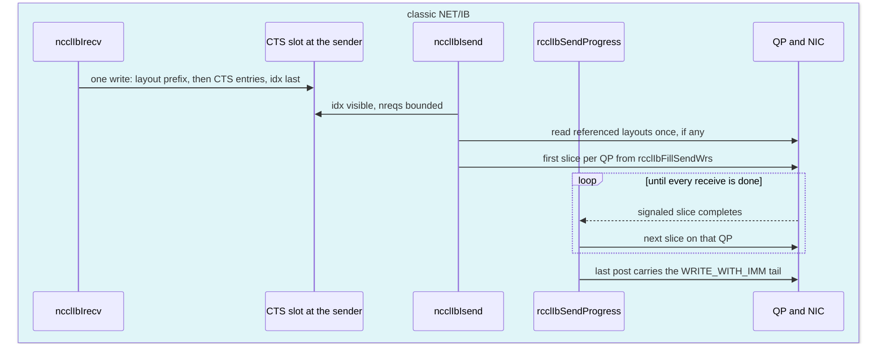
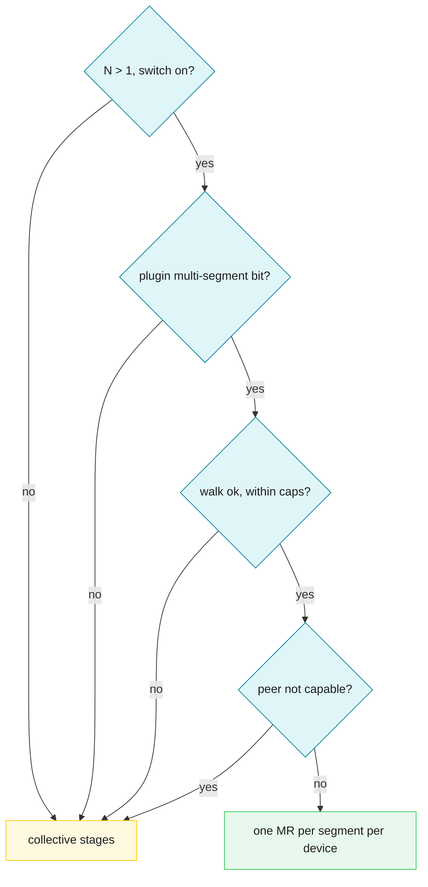
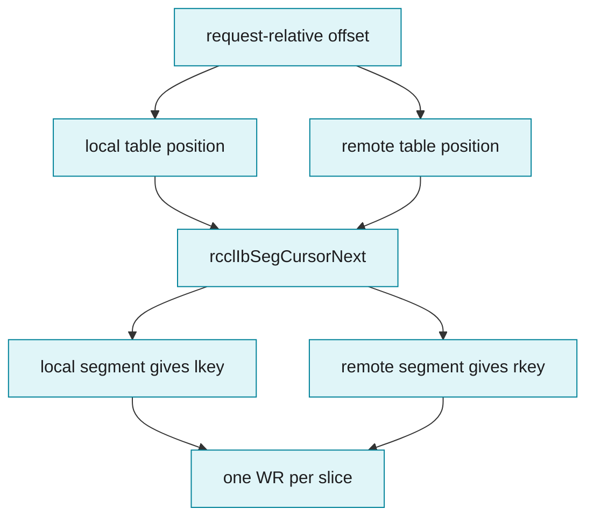
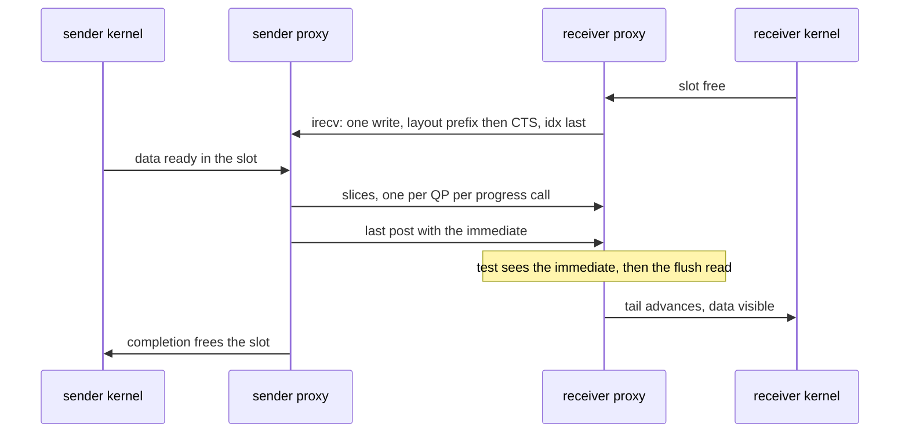

# Classic NET/IB P2P: one-write CTS and sliced send

> [!NOTE]
> Old stack, layer 06 ([PR 10886](https://github.com/ROCm/rocm-systems/pull/10886)), at the wire tip `ba3ab26f30a7`. The 11-04 version of this note described a side table next to the CTS FIFO, a capability trailer in `devName`, a 16-segment cap and one flush read per segment; all four are gone. The planned design ports this code into the IB-MSEG fork and returns classic `net_ib` to develop; the fork keeps the layouts, slicing and one-read flush but drops the capability bit and the old-peer fallback, so both ranks must run the same settings; see [the fork plugin](multi_segment_fork_plugin.md#fork-3-registration-and-p2p).

Classic NET/IB P2P (`net_ib`) registers one MR per segment and splits each RDMA write at local and remote segment boundaries. A receiver that holds a multi-segment buffer sends its layout in front of the CTS entries, in the same RDMA write, to a peer that advertised the capability. The sender posts one slice per QP per progress call, so its queues keep develop's depths. This doc covers the data structures, registration, the send and flush paths, wire compatibility, and the alternatives that were rejected. IB-CAST uses the same format with the differences in [IB-CAST P2P](multi_segment_netib_cast.md).

## Why the classic path needs a new wire element

The classic data plane was single-MR by construction. The receiver's CTS entry (`ncclIbSendFifo`) carries one remote address and one rkey per NIC device, and `ncclIbMultiSend` walks one contiguous region across QPs. A boundary-crossing write with segment 0's rkey is rejected by the responder, so the sender must learn every remote segment's address and rkey, and must cut its writes at both its own and the receiver's boundaries.



## Data structures

**Composite MR handle.** `ncclIbMrHandle` (`net_ib/common.h`) embeds a `rcclIbSegMr` (`transport/rccl_p2p_multiseg.h`); `mrs[]` aliases segment 0, so single-segment code is unchanged. The arrays are sized from the walked count:

```c
struct rcclIbSegMr {
  int nSegments;            // 1 (or 0) is one MR
  uintptr_t* segStart;      // VA start of each segment
  size_t* segLen;
  uint64_t* segOff;         // nSegments + 1 offsets from segStart[0]
  void** segMrs;            // [s * RCCL_IB_MSEG_MAX_DEVS + dev]
  void* layoutBlob;         // receive side, nSegments > 4 only
  size_t layoutBytes;
  uint64_t layoutGen;
  struct ibv_mr* layoutMrs[RCCL_IB_MSEG_MAX_DEVS];
};
```

**CTS slot.** The 64-byte CTS entry is unchanged. An advertising comm uses `ncclIbCtsSlot` (`net_ib/common.h`): eight `ncclIbSegLayout` entries followed by eight CTS entries, 2048 bytes per slot, 256 slots (`NCCL_IB_CTS_SLOTS_BYTES`, 512 KiB). Asserts pin the CTS entries right after the prefix and 64-byte aligned, so one RDMA write that covers the prefix ends at `idx`.

```c
struct alignas(64) ncclIbSegLayout {   // 192 bytes, asserted
  uint32_t nSegments;                  // inline records; 0 when byRef
  uint32_t byRef;
  union {
    struct { uint64_t segStart[4]; uint32_t segRkeys[4][RCCL_IB_MSEG_MAX_DEVS]; } inl;
    struct rcclIbSegLayoutRef ref;     // addr, gen, nSegments, ndevs, rkeys[devs]
  };
};
```

**Inline or by reference.** A layout carries the segments overlapping the receive inline, starting with the one holding its first byte, up to `RCCL_IB_CTS_INLINE_SEGS` (4). A receive that overlaps more sends a `rcclIbSegLayoutRef` to the registration's published layout blob `{va0, off[nSeg + 1], rkeys[ndevs][nSeg]}` (`rcclIbSegMrPublishLayout`, registered per device). The sender reads a referenced blob with one RDMA read into a 16-entry cache (`rcclIbLayoutCache`, `RCCL_IB_LAYOUT_CACHE_ENTRIES`), keyed by address and generation, and validates it (`rcclIbLayoutBlobValid`) before use.

**Capability.** `ncclIbConnectionMetadata::caps` carries `RCCL_IB_CAP_MULTISEG`. Each comm caches `multiSegOk = ncclIbMultiSegOk(switch, forGin, resilient)` once (`ncclIbCacheMultiSegOk`), so only P2P comms with the switch on and no resiliency advertise. The sender allocates the combined slots when it advertises; the receiver allocates them when the peer's raw `caps` has the bit, because the sender's bit selects the stride. Bit 15 of the 16-bit `nreqs` (`NCCL_IB_CTS_NREQS_SIDE_TABLE`) marks a write that includes the layout prefix.

## Registration

`net.cc` stays plugin-neutral. `rcclNetRegSegmentCount` (`rccl_wrap.cc`, layer 03) returns the cached count or walks the registration; with the switch off a multi-segment buffer skips NET and stages. For `numSegments > 1`, `sendProxyRegBuffer` and `recvProxyRegBuffer` call the plugin's `regMrDmaBuf` with `fd = -1` only when the plugin sets `NCCL_PTR_DMABUF_MULTISEG` in its properties (`rcclNetPluginMultiSeg`); `offset` carries only the export flags. Any other plugin keeps develop's call and the collective stages.

`ncclIbRegMrDmaBuf` (`net_ib/reg.cc`) routes `fd == -1` to `rcclIbRegMrDmaBufFromRange`, which binds one walk allocation (`rcclIbSegWalkBind`) and walks the range one segment at a time. The walk must cover every byte; the count must pass `rcclIbSegCountSupported` and the device's `max_mr` (`rcclIbMrAdmit`). `ncclIbRegMrDmaBufMultiSeg` then declines a receive comm whose peer lacks the capability (`ncclIbDeclineMultiSegRegistration`), registers one MR per segment per device through `rcclIbSegRegister` (`transport/rccl_mseg_reg.h`), publishes the layout blob for more than four segments, and unwinds exactly the MRs made on failure. Every exported fd is closed and a failure leaves `*mhandle` untouched. Non-uniform layouts register.



## Data path

`net_ib/p2p.cc` keeps develop's functions; the multi-segment bodies live in `net_ib/p2p_multiseg.cc`, declared in `net_ib/p2p_multiseg.h` and included once at the top of `p2p.cc`. The table and cursor helpers shared with IB-CAST are in `transport/rccl_p2p_multiseg.{h,cc}`, `rccl_mseg.h` and `rccl_mseg_wr.h`.

| Hook | Called from | Role |
|---|---|---|
| `rcclIbIrecvCheckHandle` | `ncclIbIrecv` | reject a NULL handle or a missing per-device MR |
| `rcclIbIrecvFillSideTable` | `ncclIbIrecv` | fill each receive's layout prefix and report whether any is multi-segment |
| `rcclIbCtsFlagSideTable` | `ncclIbIrecv` | set bit 15 in every CTS entry of the slot |
| `rcclIbPrepareCtsWrite` | `ncclIbPostFifo` | one CTS WR that starts at the prefix when the slot carries one |
| `rcclIbSendLayoutsReady` | `ncclIbIsend`, `rcclIbSendProgress` | start and wait for the reads of referenced layouts |
| `rcclIbFillSendWrs` | `ncclIbMultiSend`, `rcclIbSendResume` | build every send chain, one WR when each side is one segment |
| `rcclIbSendSliceDone` | completion handling | mark a QP's signaled slice done |
| `rcclIbSendProgress` | `ncclIbTest` | post the next slices of the active slot |
| `rcclIbIflushNeedsMultiSeg`, `rcclIbIflushMultiSeg` | `ncclIbIflush` | one-read flush with the right rkey |

**Receiver.** `ncclIbIrecv` always fills the 64-byte CTS (address, size, segment 0 rkeys, `idx` last). For a capable peer each receive's layout is filled; only if some receive in the slot is multi-segment does the receiver flag the entries and start the write at the prefix, so a slot of single-segment receives keeps the legacy 64-byte-per-entry write.

**Sender.** `ncclIbIsend` strips the flag (`ncclIbCtsNreqs`) and rejects `nreqs` outside 1 to `NCCL_NET_IB_MAX_RECVS`. A request is remote multi-segment when its layout carries more than one segment inline or by reference (`ncclIbCtsRemoteMultiSeg`). Before posting, the sender starts any layout reads the slot still needs and returns not ready until they complete.

### Send progress

Every classic send goes through `rcclIbFillSendWrs`, called from develop's `ncclIbMultiSend`. Per QP, `ncclIbMultiSend` computes develop's chunk and stores `[off, end)` per receive in `comm->sendCursor` (`rcclIbSendCursor`). Each fill moves at most one slice per receive, a slice being the run inside one local and one remote segment (`rcclIbSegCursor`, `rcclIbSegAppendWrs`). The post that finishes every receive ends with develop's tail (sizes write, flush flag write, or the last data WR with the immediate); an earlier post signals its last write instead. While a QP's slice is outstanding the requests hold one extra event on that device (`rcclIbSendHoldSlice`); `rcclIbSendSliceDone` clears it on completion and `rcclIbSendProgress` posts the next slice. Slots post in FIFO order, so a later slot waits until the active one has posted its last slice.

A send whose buffers are one segment on both sides finishes in the first fill, as on develop. A zero-length receive posts one 0-byte write in the first fill; its rkey comes from `ncclIbSegmentForZeroLengthOffset`. A sizes WR is added when `nreqs > 1`, or when the send is split and the receiver does not match by index, so a single segmented receive reports its full size.

**Failed posts.** If a slice post fails, the held event of that QP is dropped, so the request fails through `Test()` instead of waiting for a completion that will not come. `NetIbSegmentedSendPrefixTests` covers these cases on the host.

### Independent offsets

> [!CAUTION]
> The local and remote request bases can start at different offsets within their registrations: local data can begin in segment 1 while the CTS address begins near the end of segment 0. An earlier splitter used one shared offset, which worked for whole-buffer transfers and picked the wrong segment and key otherwise.

`rcclIbSegCursor` keeps a local and a remote table and advances both from the same request-relative offset; each slice ends at the nearer of the two boundaries:



The host boundary-math tests and the MPI offset and boundary tests check this through real MRs.

## Step pipeline and streams

The kernels run on the user stream; a host proxy progress thread runs both `sendProxyProgress` and `recvProxyProgress`. Each step uses slot `step % NCCL_STEPS`, so up to 8 steps per connection are in flight. Because the sender posts only one slice per QP per progress call and one segmented slot at a time, the queues no longer reserve a worst-case chain per step.



## Flush

`ncclIbIflush` runs develop's flush unless some non-empty receive has a multi-segment handle. Then `rcclIbIflushMultiSeg` posts one read per device: develop's scratchpad write and read when the scratchpad flush is on (`RCCL_GDR_FLUSH_GPU_MEM_NO_RELAXED_ORDERING=1`, the default), otherwise a read of the first byte of the last non-empty receive with that byte's segment rkey (`rcclIbIflushAppendReads`). One read fences the device, so the flush QP keeps develop's 512 entries. The flush QP is created with `devIndex` and `remDevIdx` set to the receive device.

## Queue sizing

A P2P send post is at most one slice per receive plus the tail, so the sender QP keeps `2 * NET_IB_MAX_REQUESTS` (512). Only RMA comms (`isRma`, `nQpsPerDev > 0`) with the switch on take `NCCL_RMA_SEND_QP_WRS` (2080) through `rcclIbSendQpWrs(isRma)`; see [GIN/RMA](multi_segment_gin_rma.md#rounds). The CTS QP keeps develop's depth, because the layout travels in the CTS write. All depths are in [QP depths](multi_segment_current.md#qp-depths).

## Compatibility

- A slot without a multi-segment receive writes only the CTS entries, as on stock classic.
- A peer without the capability, an older build, or a peer with the switch off reads caps 0. The receiver's multi-segment registration declines and stages; a multi-segment sender still splits onto the single rkey (`net_ib_multisegment_old_peer` checks this).
- The memory cost with the switch on is 384 KiB more CTS memory per advertising side; GIN and RMA comms never advertise.
- With the switch off, connect metadata carries caps 0 and every buffer and QP depth matches develop.

## Alternatives not taken

**Key selection only.** Register one MR per segment but leave `ncclIbMultiSend` and the CTS alone, and reject a request that straddles a boundary. Correct only while each network step fits inside one segment.

**Enlarge the CTS entry.** Put the whole segment table into `ncclIbSendFifo`. Every CTS write would grow for every buffer, and the AINIC inline CTS could not hold it.

**Side table next to the CTS FIFO.** The 11-04 design: a second array of 704-byte entries, written as a separate unsignaled WR before the CTS, behind a `devName` trailer, with the sender spinning on each entry's `idx`. It cost about 1.4 MiB per comm and a second write, and needed its own MR. Aleksandr's review replaced it with the layout prefix in the same write (see [review feedback](multi_segment_review_feedback.md#aleksandr)).

**A copied segmented send.** The 11-04 `rcclIbMultiSendSegmented` duplicated `ncclIbMultiSend`. It is gone; develop's function calls the fill for every chain.

## Review checklist

- `sizeof(ncclIbSendFifo) == 64`, `sizeof(ncclIbSegLayout) == 192`, and the CTS entries follow the prefix with no gap.
- Only P2P comms with the switch on and no resiliency advertise; the receiver's stride follows the peer's raw `caps`.
- Peer `nreqs` bounded before use; inline and referenced layouts validated.
- Independent local and remote tables; zero-length rkey from `ncclIbSegmentForZeroLengthOffset`.
- A slice post holds one event per QP; a failed post drops it.
- Flush posts one read per device.
- With the switch off, connect metadata, CTS memory and QP depths match develop.
- `net.cc` passes fd -1 only to a plugin with `NCCL_PTR_DMABUF_MULTISEG`.

Tests for this path are listed in [testing](multi_segment_testing.md#classic-and-ib-cast-p2p).

## Symbol index

| Concern | Symbols |
|---|---|
| Handle and layout | `rcclIbSegMr`, `ncclIbSegLayout`, `rcclIbSegLayoutRef`, `rcclIbSegMrPublishLayout`, `rcclIbLayoutBlob*` (`rccl_p2p_multiseg.h`); `ncclIbCtsSlot`, `NCCL_IB_CTS_SLOTS_BYTES` (`net_ib/common.h`) |
| Capability | `RCCL_IB_CAP_MULTISEG`, `NCCL_IB_CTS_NREQS_SIDE_TABLE`, `ncclIbDeclineMultiSegRegistration` (`rccl_p2p_multiseg.h`); `ncclIbMultiSegOk` (`net_ib/ib_multiseg.h`); `ncclIbCacheMultiSegOk`, `ncclIbSendCommAllocCts` (`net_ib/connect.cc`) |
| Registration | `rcclIbRegMrDmaBufFromRange`, `ncclIbRegMrDmaBufMultiSeg`, `rcclIbMrAdmit` (`net_ib/reg.cc`); `rcclIbSegWalkBind`, `rcclIbSegRegister`, `rcclIbSegDeregister` (`rccl_mseg_reg.h`); `rcclNetPluginMultiSeg` (`transport/net.cc`) |
| Send | `rcclIbFillSendWrs`, `rcclIbAppendSegmentedRequestWrs`, `rcclIbAppendSegmentedTailWr`, `rcclIbSendSliceDone` (`net_ib/p2p_multiseg.cc`); `rcclIbSendCursor` (`net_ib/common.h`); `rcclIbSendProgress`, `rcclIbSendResume`, `rcclIbSendHoldSlice` (`net_ib/p2p.cc`); `rcclIbSegCursor` (`rccl_mseg.h`); `rcclIbSegAppendWrs` (`rccl_mseg_wr.h`) |
| Layout reads | `rcclIbLayoutCache`, `rcclIbLayoutsReady`, `rcclIbLayoutReadDone`, `rcclIbSegTableReferenced` (`rccl_p2p_multiseg.cc`); `rcclIbSendLayoutsReady` (`net_ib/p2p_multiseg.cc`) |
| Flush | `rcclIbIflushMultiSeg`, `rcclIbIflushAppendReads`, `rcclIbIflushScratchpadWrite` (`net_ib/p2p_multiseg.cc`) |
