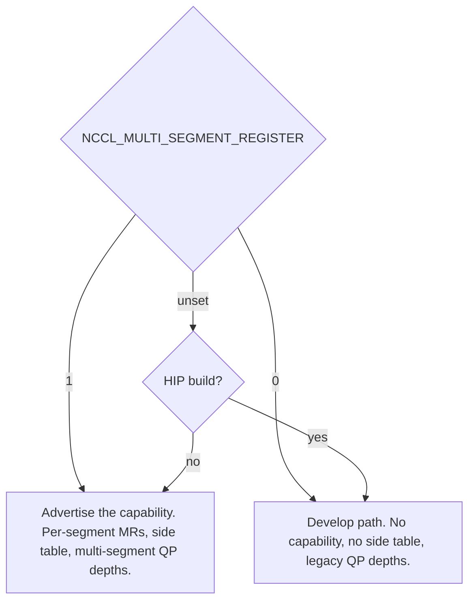
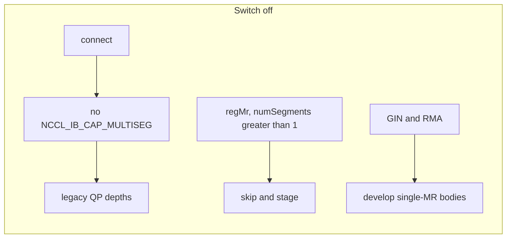
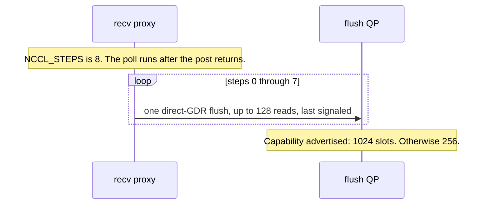
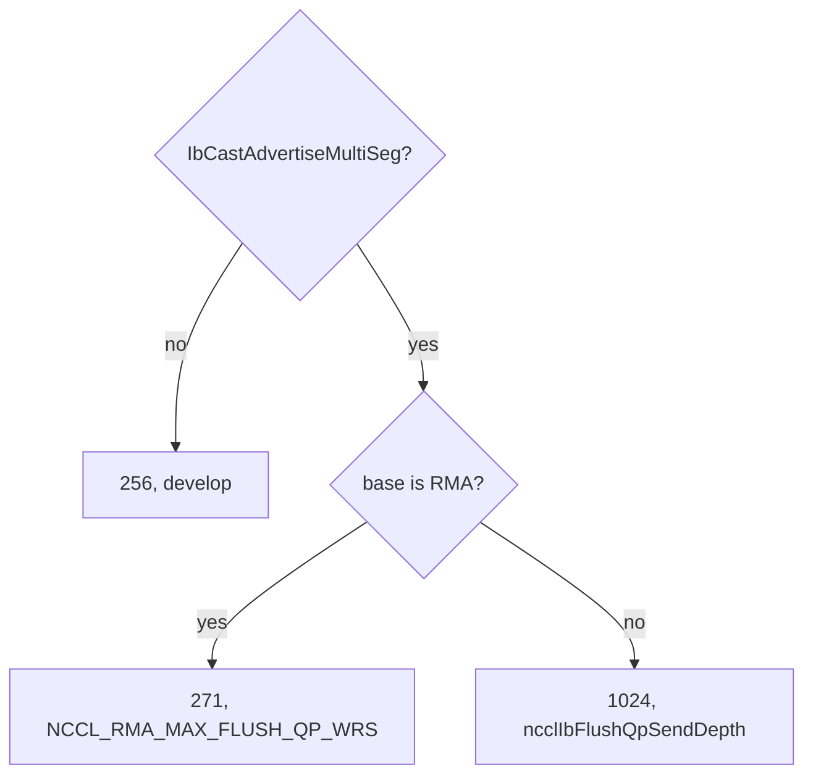
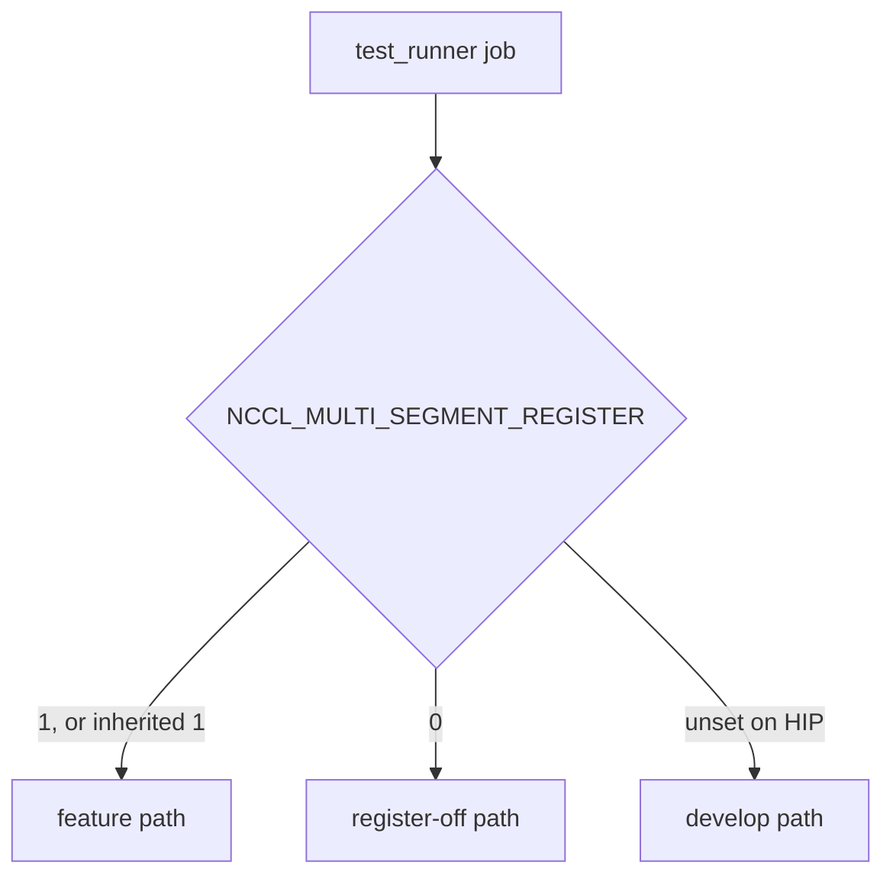
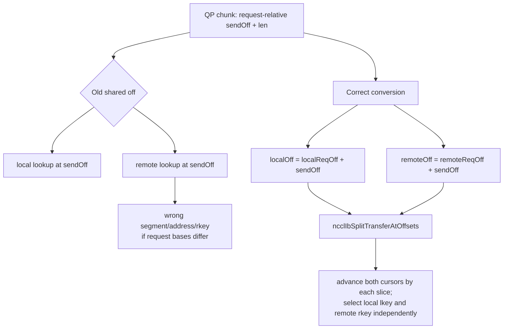
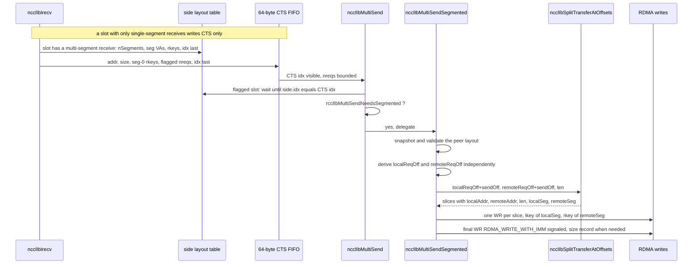
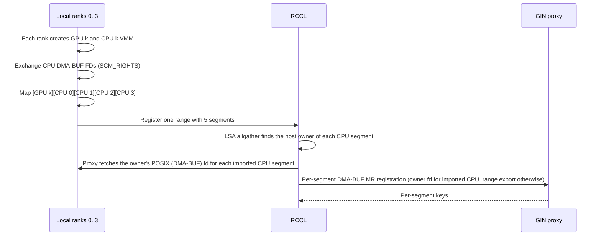

# Code Walkthrough — Multi-Segment DMA-BUF on the Classic NET/IB Transport

> **Shared facts** (constants, v14 GIN/RMA split, capability trailer, credits/signaling, tests) are in the overview: [`multi_segment_dmabuf_gin_and_netib.md`](multi_segment_dmabuf_gin_and_netib.md).

**Audience:** RCCL reviewers and maintainers picking up the classic NET/IB P2P multi-segment work. **Last updated:** 2026-10-16, against the restacked branches on develop. **Branches:** stack PR 06 ([ROCm/rocm-systems#10886](https://github.com/ROCm/rocm-systems/pull/10886)) `users/atulkulk/mseg/06-classic-netib-multisegment`, on top of PR 03 ([#10885](https://github.com/ROCm/rocm-systems/pull/10885)) `users/atulkulk/mseg/03-registration-range`. CAST P2P is on `users/atulkulk/mseg/08-cast-netib-multisegment`, and the full stack is on `users/atulkulk/mseg/multi-segment-dmabuf-cast-gin` ([#10888](https://github.com/ROCm/rocm-systems/pull/10888)). **Ticket:** AIRUNTIME-2351 / AICOMRCCL-1526. **Companion design doc:** [`multi_segment_netib_wire.md`](multi_segment_netib_wire.md) (problem statement, 64-byte CTS + side layout, plugin API, classic versus CAST wire behavior).

This document walks the implementation in the tree: 64-byte CTS, side table, `NCCL_IB_CAP_MULTISEG`, the `NCCL_MULTI_SEGMENT_REGISTER` switch, and the private helpers in `src/transport/rccl_ib_multiseg.h`. Code excerpts are trimmed; each is labeled with its `path:symbol`.

---

## What changed on 2026-10-16

HIP now defaults `NCCL_MULTI_SEGMENT_REGISTER` to 0. The knob is still `ncclParamMultiSegmentRegister()` in `transport/generic.cc`. `NCCL_MULTI_SEGMENT_REGISTER=1` turns the feature on, on HIP and on every other build. An unset variable takes the develop path on a HIP build. A non-HIP build still defaults to 1. The commit is `9af53b9bca21` on `users/atulkulk/mseg/01-ce-recv-window-offset`, replayed through the stack.



With the switch off, connect does not advertise `NCCL_IB_CAP_MULTISEG` and does not append the side table, so the sender QP stays at `2 * NET_IB_MAX_REQUESTS`. NET, P2P IPC and NVLS leave a multi-segment buffer unregistered. GIN and RMA stay on develop's bodies and do not reserve credits. A device-only GIN window with more than one segment and no sysmem returns `ncclInvalidUsage` instead of registering only the first segment.



The direct-GDR flush QP is sized for one chain on every proxy step. `recvProxyProgress` posts `iflush` into `requests[step % NCCL_STEPS]` and returns before that flush is polled, so up to 8 flushes can be outstanding. With `RCCL_GDR_FLUSH_GPU_MEM_NO_RELAXED_ORDERING=0`, `rcclIbIflushMultiSeg` posts one RDMA read per receive per segment, at most `8 * 16 = 128` work requests, and signals only the last. Eight chains need `8 * 128 = 1024` slots. The previous depth, `NET_IB_MAX_REQUESTS + 128 = 384`, held three chains and the fourth post failed. `ncclIbFlushQpSendDepth` in `net_ib/multiseg.h` returns `NCCL_STEPS * NCCL_NET_IB_MAX_RECVS * NCCL_IB_MAX_SEGMENTS` when the peer advertised the capability, and `NET_IB_MAX_REQUESTS` (256) otherwise. Classic `ncclIbCreateFlushQp` calls it. `connect.cc` static-asserts that the multi-segment result holds at least one chain per step. The host test is `NetIbMultiSeg.FlushQpDepthCoversEveryOutstandingStep`.



CAST non-RMA comms use the same helper. CAST RMA comms keep `NCCL_RMA_MAX_FLUSH_QP_WRS` (271), because RMA credits wait until one chain completes before the next post. With the switch off every flush QP stays at 256.



The scratchpad flush (`RCCL_GDR_FLUSH_GPU_MEM_NO_RELAXED_ORDERING=1`, the default) posts one write and one read and does not fill 1024 slots. The enlarged depth is for the direct-GDR path. `net_ib_multisegment_flush` selects that path by setting the parameter to 0.

Jobs that test the feature set `NCCL_MULTI_SEGMENT_REGISTER=1` in the runner config, because an unset HIP job now takes the off path. Register-off jobs stay at 0. `cast_multisegment_opt_recv_2qp` inherits 1 from `cast_multisegment_opt_recv`. `net_ib_rma_multisegment_wrbatch` on the wire branch, and the hybrid nightly jobs on 09 including `net_ib_multisegment_hybrid_stress_nightly`, set 1 as well. The WR-batch job fails under `RCCL_TEST_RMA_MSEG_REQUIRE=1` when the per-segment registration log is missing, and the hybrid IGet stress skips. `multisegment_host_boundary_math` is host-only and does not read the switch.



## What changed on 2026-10-14

- **Commit map.** Layer 06 adds four commits (Section 2): the bodies fold back into the files they hook, registration goes through the existing `regMrDmaBuf` hook, the duplicated sender-QP `static_assert`s are dropped, and the switch-off test expects only the receiver to decline.
- **Registration path (Section 5.1).** `net.cc` passes `fd = -1` and a packed count to `regMrDmaBuf`; `rcclIbRegMrDmaBufFromRange` in `net_ib/reg.cc` does the walk. `transport/rccl_ib_multiseg.cc` and `rcclNetIbRegMrMultiSeg` no longer exist, and `rccl_ib_multiseg.h` keeps only declarations.
- **Receive-only peer-cap decline (Section 5.2).** The side table describes the receiver, so only a recv comm needs the peer cap; a sender splits locally onto the receiver's single rkey.
- **Receive side table on demand (Section 3.2).** `ncclIbRecvComm::remSegLayout` is allocated and registered only for a capable peer.
- **Files.** `net_ib/p2p_multiseg.h` and `net_ib/rccl_reg_multiseg.cc` were folded into `net_ib/p2p.cc` and `net_ib/reg.cc` (Sections 5 and 6).

## What changed since the 2026-10-07 revision

- **Commit map refreshed** for the restacked branches. SHAs are no longer listed, because the branches are being restacked; commits are identified by date and subject. New rows cover the 2026-10-08 and 2026-10-09 commits on layers 03 and 06 and the 2026-10-10 commit on layer 07.
- **Multi-segment bodies split from develop's.** The send builder, side-table, irecv and flush paths are `static inline` functions in `net_ib/p2p.cc`, and develop's functions there gain one-line calls (Sections 6.1 to 6.6). Registration is in `net_ib/reg.cc` (Section 5.2). `ncclIbMrForRange`, `ncclIbCtsRemoteMultiSeg` and `ncclIbQpChunkSize` moved from `common.h` to `net_ib/p2p.cc`; `ncclIbMultiSend` keeps develop's inline chunk math. (The interim RCCL-only files of this revision were folded back on 2026-10-14.)
- **The switch gates QP depths and the CTS MR.** `ncclIbAdvertiseMultiSeg()` returns `NCCL_MULTI_SEGMENT_REGISTER != 0`; with it off the send, CTS and flush QPs keep develop's depths. Section 3.3 has both sets of numbers and the `static_assert`s that tie them to GIN/RMA.
- **Segment count caching.** `rcclNetRegSegmentCount` caches the count when its walk succeeds; `rcclNetRegCommit` only sets `rcclNet.allPeers`; the graph path uses `rcclNetGraphRegSegmentCount` (Section 5.1).
- **Flush routing.** `ncclIbIflush` hands off to `rcclIbIflushMultiSeg` only when a non-zero receive has a multi-segment handle (Section 6.6).
- **Tests.** `MultiSegmentRegisterOff_DeclinesRegistration`, the `net_ib_multisegment_register_off` job, the mixed-handle case in `net_ib_multisegment_flush`, updated case counts, and the `AllocHybridCollective` hybrid fixture with `RCCL_TEST_HYBRID_VMM_REQUIRE` (Sections 9 and 11).

---

## 1. What this change does, in one paragraph

On ROCm/HIP a dma-buf export (`cuMemGetHandleForAddressRange` / `hsa_amd_portable_export_dmabuf`) over a multi-segment VMM buffer describes **only the first physical segment**. The classic NET/IB proxy path registered the whole VA range as a *single* MR, which fails with `EINVAL` for `numSegments > 1`, does not fall back cleanly, and ends in a fatal QP (`IBV_WC_REM_INV_REQ_ERR`). The implementation fixes this by (a) registering **one dma-buf MR per physical segment**, (b) keeping the **64-byte** clear-to-send (CTS) FIFO slot unchanged and publishing the receiver’s full segment layout on a **side table** (connect capability bit; filled from the MR handle at irecv; sent only for slots that contain a multi-segment receive), and (c) **splitting each RDMA write at local + remote segment boundaries** in the send engine. The split tracks local and remote registration-relative offsets independently, which is required when the two request bases start at different positions in their registrations. A CTS slot with only single-segment receives is byte-identical to the historical 64-byte slot. `NCCL_MULTI_SEGMENT_REGISTER=0` turns the whole option off and restores develop's QP depths.

---

## 2. Commit map

Commits in `git log --reverse` for layer 03 (`users/atulkulk/mseg/03-registration-range`, on top of layer 02) and layer 06 (`users/atulkulk/mseg/06-classic-netib-multisegment`, on top of layer 05). Rows dated 2026-10-08 or later are new since the previous revision of this doc.

**Layer 03 — NET registration range and segment count cache**

| Date | Subject |
|---|---|
| 2026-08-21 | register: count the complete NET registration range |
| 2026-08-22 | test: assert NET counts the complete registration range |
| 2026-08-27 | test: require NET registration-range coverage |
| 2026-09-14 | test: make NET Generic multi-segment coverage reachable |
| 2026-09-14 | test: assert Generic NET registration from the cache |
| 2026-09-14 | register: cache the full-range NET segment count |
| 2026-09-17 | test: skip Generic NET asserts when no rank took NET |
| 2026-09-20 | register: cache netNSegments only after every peer registers |
| 2026-09-28 | register: separate all-peer NET completion from the cached count |
| 2026-10-01 | register: stop the NET segment walk inside the last registered page |
| 2026-10-01 | test: coordinate the Generic asserts that precede anyRankTrue |
| 2026-10-01 | test: count NET segments for odd-sized hipMalloc registrations |
| 2026-10-01 | register: keep the NET segment cache out of upstream code paths |
| 2026-10-01 | test: skip Symmetric_LsaGin until per-segment GIN registration (lifted again in layer 05) |
| 2026-10-03 | register: count graph NET segments over the reused registration record |
| 2026-10-06 | test: gate UBR_MultiSegment.Generic on NET registration completion |
| 2026-10-08 | register: shrink the NET segment-count hooks and test NCCL_MULTI_SEGMENT_REGISTER=0 |

**Layer 06 — classic NET/IB P2P multi-segment**

| Date | Subject |
|---|---|
| 2026-08-21 | net-ib: support classic multi-segment transfers |
| 2026-08-21 | build: expose the multi-segment helper after hipify |
| 2026-08-22 | net-ib: clang-format classic multi-segment path |
| 2026-08-22 | net-ib: flush every touched segment and null-check irecv rkeys |
| 2026-08-23 | net-ib: keep CTS at 64 bytes and move the multi-seg helper |
| 2026-08-24 | net-ib: align remSegLayout to 64 bytes and drop review-ID comments |
| 2026-08-26 | test: cover clipped NET proxy registration |
| 2026-08-27 | net-ib: harden multi-segment compatibility and flushes |
| 2026-09-14 | net: do not HSA-fallback a failed multi-segment MR |
| 2026-09-14 | test: stop multi-seg NetIB setup after a failed connect |
| 2026-09-14 | net-ib: validate CTS side-table segment layouts |
| 2026-09-14 | test: cover CTS side-table rejects and use ncclCalloc for multi-seg MRs |
| 2026-09-14 | test: cover trailing-larger uniform rejects and CTS cap bounds |
| 2026-09-14 | net-ib: wait for the CTS side table and size the CTS SQ for two WRs |
| 2026-09-17 | net-ib: compile the segmented send and keep side-table idx last |
| 2026-09-17 | net-ib: stamp segmented WQEs and pin the side-table slot size |
| 2026-09-17 | test: share SetupRegistered preamble and drop unused GTest macros |
| 2026-09-18 | net-ib: keep a prefix-posted flush request |
| 2026-09-20 | net-ib: do not wrap host-VMM segment length when base is 0 |
| 2026-09-22 | test: wire classic multi-segment suites and peer-cap decline |
| 2026-09-23 | test: drop a review-tool name from classic multi-seg comments (subject paraphrased) |
| 2026-09-23 | net-ib: zero each flush WR as it is filled |
| 2026-09-23 | net-ib: start profiler events on segmented send |
| 2026-09-23 | net-ib: grow classic send QP for a segmented multi-recv chain |
| 2026-09-23 | net-ib: drop review wording from send-queue comments |
| 2026-10-01 | test: read the NET segment cache from rcclNet in the partial-segment test |
| 2026-10-02 | net-ib: send the CTS side table only for multi-segment slots |
| 2026-10-02 | net-ib: restore the single flush read for single-segment receives |
| 2026-10-02 | net-ib: tag the side-table WR with the CTS wr_id |
| 2026-10-02 | test: skip classic multi-seg MPI tests that cannot run |
| 2026-10-02 | test: mix single- and multi-segment handles in one classic multi-recv |
| 2026-10-02 | net-ib: test the multi-seg rules production actually uses |
| 2026-10-02 | net-ib: share the per-QP chunk size in the segmented send |
| 2026-10-02 | test: share the multi-segment VMM helpers between NET/IB and RMA |
| 2026-10-06 | test: run classic NET/IB multi-segment pairs concurrently at 2x4 scale |
| 2026-10-06 | test: add the 2x4 runner config for concurrent NET/IB multi-segment pairs |
| 2026-10-06 | net-ib: report full size for single segmented recv, bound CTS nreqs |
| 2026-10-08 | multiseg: shrink: move NET/IB multi-segment bodies into RCCL files |
| 2026-10-09 | net-ib: keep develop's QP depths and chunk math when multi-segment is off; test =0 |
| 2026-10-13 | net-ib: keep classic multi-segment bodies in the upstream files they hook |
| 2026-10-14 | net-ib: register one MR per segment through the existing regMrDmaBuf hook |
| 2026-10-14 | net-ib: drop the duplicated sender QP static_asserts |
| 2026-10-14 | test: expect only the receiver to decline multi-segment registration when the switch is off |

**Layer 07 commits referenced in Section 11** (`users/atulkulk/mseg/07-hybrid-stress-ci`): "test: skip NetProxyPartialFinalSegment with an intra-node peer before HIP 7.17" (2026-10-06), "test: fix hybrid VMM skip ordering and run GenericGraph on two nodes" (2026-10-06), "test: let MPI tests opt into a non-blocking test stream" (2026-10-07, replaces the skip from the first one), and "test: assert hybrid handle reuse, cover =0 and CTS layout in CI, fail hybrid on old runtimes" (2026-10-10).

(Older `users/atulkulk/multi-segment-dmabuf-netib-wire` hashes and the SHAs in earlier revisions of this doc are superseded by the restacked branches.)

Core files:

| File | Role |
|---|---|
| `src/transport/rccl_ib_multiseg.h` | **private** declaration of `ncclIbRegMrDmaBufMultiSeg` (plus `IbCastRegMrDmaBufMultiSeg` and `rcclIbCastDeregMrMultiSeg` from the CAST branch on). **Not** `src/include/net.h`. |
| `src/transport/net.cc` | proxy register calls `regMrDmaBuf` with `fd = -1` and a packed count for `numSegments > 1` and skips the whole-range HSA fallback; local and graph registration call the count helpers |
| `src/rccl_wrap.cc`, `src/include/register.h` | `rcclNetRegSegmentCount`, `rcclNetGraphRegSegmentCount`, `rcclNetRegCommit`, and the RCCL-only `rcclNet` block at the end of `ncclReg` |
| `src/transport/net_ib/reg.cc` | develop plus the `nSegments` initialisation, the single-segment failure unwind, the `fd == -1` route and one-line dereg hook; `rcclIbRegMrDmaBufFromRange` (segment walk and per-segment export), `ncclIbRegMrDmaBufMultiSeg` (with the recv-only peer-cap decline) and `static` `rcclIbDeregMrMultiSeg` |
| `src/transport/net_ib/common.h` | `ncclIbMrHandle`, **64-byte** `ncclIbSendFifo`, `ncclIbSegLayout` side table (inline `segLayoutFifo` on the send comm), `ncclIbRemSegLayout` (a pointer on the recv comm), `peerCaps`, WR-pool and send-QP sizing |
| `src/transport/net_ib/connect.cc`, `connect.h` | `ncclIbAdvertiseMultiSeg`, the capability trailer, CTS MR sizing, the receiver's side-table allocation and staging MR (capable peer only), send/CTS/flush QP depths, the metadata-size `static_assert` |
| `src/transport/net_ib/multiseg.h` | pure, unit-testable helpers: capability trailer, side-table flag, boundary math, layout validation |
| `src/transport/net_ib/p2p.cc` | develop plus one-line calls, the `nreqs` mask and bound, and `req->send.mh`; `ncclIbMrForRange`, `ncclIbCtsRemoteMultiSeg`, `ncclIbQpChunkSize`, `ncclIbMultiSendSegmented`, and the `rcclIb*` send, side-table, irecv and flush bodies |
| `src/transport/net_ib/rma_multiseg.h` | `rcclRmaMultiSegEnabled()`, `NCCL_RMA_SEND_QP_WRS` and the GIN/RMA WR limits the classic QP depths are checked against |
| `test/NetIbMultiSegmentUnitTests.cpp` | host unit tests |
| `test/transport/NetIbMPI/NetIbMultiSegmentMPITests.cpp`, `NetIbMultiSegmentHelpers.hpp` | 2-node hardware tests and their helpers |

---

## 3. Data structures

### 3.1 Composite MR handle (`common.h`)

`ncclIbMrHandle` grew per-segment fields. `mrs[]` still exists and **aliases segment 0**, so every single-segment consumer keeps working unchanged.

```c
// src/transport/net_ib/common.h:ncclIbMrHandle
struct ncclIbMrHandle {
  ibv_mr* mrs[NCCL_IB_MAX_DEVS_PER_NIC];
  int nSegments;                             // 1 = legacy single MR
  uintptr_t segStart[NCCL_IB_MAX_SEGMENTS];  // VA start of each segment
  size_t segLen[NCCL_IB_MAX_SEGMENTS];       // bytes per segment
  ibv_mr* segMrs[NCCL_IB_MAX_SEGMENTS][NCCL_IB_MAX_DEVS_PER_NIC];
};
```

`ncclIbMrForRange` resolves a per-device MR for a VA range; it returns the legacy `mrs[devIndex]` on the fast path and `NULL` when a range straddles a boundary. The multi-segment flush path uses it for a single-segment handle inside a mixed request.

```c
// src/transport/net_ib/p2p.cc:ncclIbMrForRange
static inline ibv_mr* ncclIbMrForRange(const struct ncclIbMrHandle* h, uintptr_t addr, size_t len, int devIndex) {
  if (h == NULL) return NULL;
  if (h->nSegments <= 1) return h->mrs[devIndex];
  int s = ncclIbSegmentIndexForRange(h->nSegments, h->segStart, h->segLen, addr, len);
  return (s < 0) ? NULL : h->segMrs[s][devIndex];
}
```

### 3.2 64-byte CTS slot + side layout

The CTS FIFO element stays the historical **64-byte** slot. Do **not** put `nSegments` / `segStart` / `segRkeys` in it (that ~712-byte enlargement is the rejected approach).

```c
// src/transport/net_ib/common.h:ncclIbSendFifo
struct alignas(64) ncclIbSendFifo {
  uint64_t addr;
  uint64_t size;
  uint32_t rkeys[NCCL_IB_MAX_DEVS_PER_NIC]; // seg 0 only
  uint32_t nreqs;                           // bit 31: NCCL_IB_CTS_NREQS_SIDE_TABLE
  uint32_t tag;
  uint64_t idx;
};
static_assert(sizeof(struct ncclIbSendFifo) == 64, "CTS slot is one cache line");
```

The full receiver layout lives in a **side table** with the same `[NET_IB_MAX_REQUESTS][NCCL_NET_IB_MAX_RECVS]` indexing, placed immediately after `ctsFifo` on `ncclIbSendComm` so one covering MR registers both. The receiver stages its copy in `ncclIbRecvComm::remSegLayout` (`ncclIbRemSegLayout`, which also holds the remote `addr`). That member is a pointer: accept allocates it and registers its `segLayoutFifoMr` only when the peer advertised `NCCL_IB_CAP_MULTISEG`, and accept's fail path and close free it, so a recv comm to a legacy or switched-off peer saves the 256 × 8 × 704 B (about 1.44 MB) table. The send-side `segLayoutFifo` cannot be allocated on demand, because the peer RDMA-writes it at `ctsFifo + sizeof(ctsFifo)` through the CTS MR.

```c
// src/transport/net_ib/common.h:ncclIbSegLayout
struct alignas(64) ncclIbSegLayout {
  uint32_t nSegments;
  uint32_t pad;
  uint64_t segStart[NCCL_IB_MAX_SEGMENTS];
  uint32_t segRkeys[NCCL_IB_MAX_SEGMENTS][NCCL_IB_MAX_DEVS_PER_NIC];
  uint64_t idx; // last store; sender waits on this as the slot arrival flag
};
static_assert(sizeof(struct ncclIbSegLayout) == 704, "side slot size is the RDMA write length");
```

A slot that carries a side table is flagged in every CTS entry's `nreqs`:

```c
// src/transport/net_ib/multiseg.h
#define NCCL_IB_CTS_NREQS_SIDE_TABLE (1u << 31)
static inline uint32_t ncclIbCtsNreqs(uint32_t nreqs) { return nreqs & ~NCCL_IB_CTS_NREQS_SIDE_TABLE; }
static inline bool ncclIbCtsHasSideTable(uint32_t nreqs) { return (nreqs & NCCL_IB_CTS_NREQS_SIDE_TABLE) != 0; }
```

Capability negotiation uses the **`devName` trailer**, not a new metadata field: `ncclIbSetConnectCaps`/`ncclIbGetConnectCaps` (`net_ib/multiseg.h`) write/read a `{magic=0x4d534547, caps}` record in the reserved tail of the fixed-size `devName`, so `ncclIbConnectionMetadata` keeps its exact legacy size and offsets (`net_ib/connect.h` asserts that no trailing wire field was added). `net_ib/connect.cc:ncclIbAdvertiseMultiSeg` advertises the bit only when `NCCL_MULTI_SEGMENT_REGISTER` is on; with it off, the sender's CTS MR stays at `sizeof(ctsFifo)`. Both sides store the peer's bit in `peerCaps` after the metadata exchange. The receiver registers its local side-table staging MR (`segLayoutFifoMr`, `IBV_ACCESS_LOCAL_WRITE` only) only for a peer that advertised the bit, and points `remSegLayout.addr` at the peer's CTS address plus `sizeof(ctsFifo)`.

The sender treats request `r` as remote multi-segment only when all four checks hold:

```c
// src/transport/net_ib/p2p.cc:ncclIbCtsRemoteMultiSeg
return (comm->peerCaps & NCCL_IB_CAP_MULTISEG) && ncclIbCtsHasSideTable(cts->nreqs) && side->idx == cts->idx &&
       side->nSegments > 1;
```

A peer that never wrote the trailer reads back caps `0`, so `ncclIbRegMrDmaBufMultiSeg` declines multi-segment registration on that recv comm and the collective stages; the recv comm also skips allocating `remSegLayout`. AINIC inline CTS stays 32 bytes; the 64-byte slot is not enlarged.

### 3.3 Send request, WR pool, and queue sizing

A send request stores its **local** MR handle so the builder can resolve the per-segment lkey; `ncclIbIsend` sets `req->send.mh` before it stores the `lkeys[]`:

```c
// src/transport/net_ib/common.h:ncclIbRequest (send member)
      uint32_t lkeys[NCCL_IB_MAX_DEVS_PER_NIC];
      // Local MR handle for this send; used by the multi-segment WR builder to
      // resolve the per-segment local lkey. NULL/single-segment
      // handles use lkeys[] directly on the fast path.
      struct ncclIbMrHandle* mh;
```

Worst case, one request's per-QP chunk splits at every local **and** remote boundary, so the WR/SGE pools are sized accordingly (single-segment sends still post exactly one WR per request):

```c
// src/transport/net_ib/common.h
#define NCCL_IB_MAX_WRS_PER_SEND (NCCL_NET_IB_MAX_RECVS * 2 * NCCL_IB_MAX_SEGMENTS)
// 2*MAX request budget plus one worst-case segmented send. Matches CAST P2P.
#define NCCL_IB_MAX_SEND_WRS (2 * NET_IB_MAX_REQUESTS + NCCL_IB_MAX_WRS_PER_SEND + 1)
```

`ncclIbSendComm.sges[]` holds `NCCL_IB_MAX_WRS_PER_SEND` (256) entries and `wrs[]` holds one more (257) for the trailing imm/sizes WR. These arrays are sized unconditionally; only the QP depths depend on the switch.

Queue depths in `net_ib/connect.cc`, with `NET_IB_MAX_REQUESTS` = 256:

| Queue | Switch on | Switch off (develop) | Why |
|---|---|---|---|
| Send QP (`ncclIbSenderQpsCreate`) | `NCCL_IB_MAX_SEND_WRS` = 769 | `2 * NET_IB_MAX_REQUESTS` = 512 | ordinary 2 × 256 budget plus one maximum segmented chain (257) |
| CTS QP (`ncclIbReceiverQpsCreateToRts`) | develop's depth + `NET_IB_MAX_REQUESTS * (resiliency ? 1 : 2)` | `NET_IB_MAX_REQUESTS * (resiliency ? 1 : 2)` (+1 with remote event-based load balancing) | one side-table WR chained before each CTS WR |
| Flush QP (`ncclIbCreateFlushQp`) | `ncclIbFlushQpSendDepth(...)` = 1024 | `NET_IB_MAX_REQUESTS` = 256 | one direct-GDR chain per proxy step |

The same file asserts that the multi-segment depths also cover GIN/RMA on the shared classic QPs:

```c
// src/transport/net_ib/connect.cc
static_assert(NCCL_RMA_SEND_QP_WRS == NCCL_IB_MAX_SEND_WRS, "rma_multiseg.h restates NCCL_IB_MAX_SEND_WRS");
static_assert(NCCL_IB_MAX_SEND_WRS >= 2 * NET_IB_MAX_REQUESTS + NCCL_RMA_MAX_SIGNAL_WRS,
              "multi-segment sender QP must also fit GIN iput signal WRs");
static_assert(NCCL_NET_IB_MAX_RECVS * NCCL_IB_MAX_SEGMENTS >= NCCL_RMA_MAX_FLUSH_WRS,
              "multi-segment flush QP must also fit GIN flush WRs");
static_assert(ncclIbFlushQpSendDepth(NCCL_STEPS, NCCL_NET_IB_MAX_RECVS, NCCL_IB_MAX_SEGMENTS, NET_IB_MAX_REQUESTS, 1) >=
              NCCL_STEPS * NCCL_NET_IB_MAX_RECVS * NCCL_IB_MAX_SEGMENTS,
              "multi-segment flush QP must hold one chain per proxy step");
```

`NCCL_RMA_SEND_QP_WRS` (`rma_multiseg.h`) spells the same 769 without including `common.h`. CAST RMA does not use it; it uses `NCCL_RMA_MAX_SEND_QP_WRS` and `NCCL_RMA_MAX_FLUSH_QP_WRS` (see the companion doc).

Classic has no CAST-style "one segmented group at a time" gate, so the send QP must absorb an in-flight maximum chain on top of the ordinary budget. Before the 2026-09-23 send-queue commit it was 529, which left room for only 17 WRs beyond the ordinary 512 and so could not hold a 257-WR chain on top of a full ordinary budget. Diagrams: [`multi_segment_current.md`](multi_segment_current.md) §6a.

---

## 4. Pure helpers (`multiseg.h`)

Kept free of ibverbs/RCCL types so it is host-unit-testable without a NIC:

- `ncclIbSetConnectCaps` / `ncclIbGetConnectCaps` — the `devName` trailer.
- `ncclIbCtsNreqs` / `ncclIbCtsHasSideTable` — mask and test the side-table flag in `nreqs`.
- `ncclIbDeclineMultiSegRegistration(peerCaps, nSegments)` — a multi-segment handle needs the peer cap; single-segment handles never decline. Registration applies it to recv comms only.
- `ncclIbSegmentIndexForRange(...)` — segment containing `[addr, addr+len)`, or `-1` if it straddles a boundary / overflows. Backs `ncclIbMrForRange`.
- `ncclIbSegmentsUniform(...)` — every interior segment equals the largest; the first and last may be shorter, so any two-segment layout passes (for example DeepEP `[GPU][CPU]`). Gate for zero-copy registration (non-uniform ⇒ decline ⇒ staging).
- `ncclIbCtsRemoteLayoutValid(...)` — peer side table is usable only if the count is in `[1, NCCL_IB_MAX_SEGMENTS]`, the device index is in range, starts strictly increase, and every rkey is nonzero.
- `ncclIbSegmentsOverlappingRange(...)` — segments a flush must fence.
- `ncclIbSegmentForOffset(...)` / `ncclIbSegmentForZeroLengthOffset(...)` — offset to segment; the zero-length variant maps the exclusive end of the last segment to that segment.
- `ncclIbBytesRemainingInSegment(...)` — bytes left in a segment, guarding a host-VMM base of 0.
- `ncclIbSplitTransferAtOffsets(...)` — the heart of the segmented data path. Decomposes local `[localOff, localOff+len)` and remote `[remoteOff, remoteOff+len)` ranges into slices that each stay within one **local** and one **remote** segment. The request bases may start at different registration-relative offsets, so the helper resolves and advances two independent cursors:

```c
// src/transport/net_ib/multiseg.h:ncclIbSplitTransferAtOffsets (loop)
  while (rem > 0) {
    int ls = ncclIbSegmentForOffset(nLocal, localSegOff, localOff);
    int rs = ncclIbSegmentForOffset(nRemote, remoteSegOff, remoteOff);
    if (ls < 0 || rs < 0) return -1;              // outside a registered segment
    uint64_t localAvail = localSegOff[ls + 1] - localOff;
    uint64_t remoteAvail = remoteSegOff[rs + 1] - remoteOff;
    uint64_t sliceLen = rem;
    if (localAvail < sliceLen) sliceLen = localAvail;
    if (remoteAvail < sliceLen) sliceLen = remoteAvail;
    if (sliceLen == 0 || sliceLen > UINT32_MAX) return -1;
    if (n >= maxSlices) return -1;
    out[n].localAddr = localSegVA[ls] + (localOff - localSegOff[ls]);
    out[n].remoteAddr = remoteSegVA[rs] + (remoteOff - remoteSegOff[rs]);
    out[n].len = (uint32_t)sliceLen;
    out[n].localSeg = ls;
    out[n].remoteSeg = rs;
    n++;
    localOff += sliceLen;
    remoteOff += sliceLen;
    rem -= sliceLen;
  }
```

This is the classic-path analogue of the GIN/RMA proxy's `ncclRmaBuildSegmentedWrs` (`net_ib/gin.cc`). The former same-offset wrapper, which forced `localOff == remoteOff`, was removed so the split tests call the function production uses.

`net_ib/multiseg.h` also defines `NCCL_IB_MAX_SEGMENTS` (16). On the wire branch `rma_multiseg.h` defines `NCCL_RMA_MAX_SEGMENTS` from it and asserts the two stay equal.

---

## 5. Registration path

### 5.1 Proxy call, segment count and range walk (`net.cc`, `rccl_wrap.cc`, `net_ib/reg.cc`)

The local-registration path first finds the `ncclReg` containing the current collective buffer. A collective may use only part of an explicitly registered allocation, but the proxy request uses the complete record:

```c
// src/transport/net.cc:netRegisterBuffer
struct netRegInfo info = {regRecord->begAddr, regRecord->endAddr - regRecord->begAddr, numSegments};
```

RCCL therefore counts segments over the same complete record rather than over the current `userbuff`/`buffSize` operation subrange. The count and its cache live in RCCL-only helpers so `netRegisterBuffer` stays as upstream has it:

```c
// src/transport/net.cc:ncclNetLocalRegisterBuffer
int numSegments = 0;
NCCLCHECK(ncclCuMemGetAddressRange((CUdeviceptr)userbuff, buffSize, (CUdeviceptr*)&base, &baseSize,
                                   &numSegments));
NCCLCHECK(rcclNetRegSegmentCount(comm, regRecord, &numSegments));
if (numSegments > 1 && !ncclParamMultiSegmentRegister()) goto exit;
NCCLCHECKGOTO(netRegisterBuffer(comm, userbuff, buffSize, peerConns, nPeers, regRecord, outRegBufFlag, outHandle,
                                numSegments), ret, fail);
if (*outRegBufFlag) rcclNetRegCommit(comm, regRecord, numSegments);
```

```c
// src/rccl_wrap.cc:rcclNetRegSegmentCount
if (regRecord->rcclNet.nSegments != 0) {
  *numSegments = regRecord->rcclNet.nSegments;
  return ncclSuccess;
}
// endAddr is page-rounded but hipMalloc reports its unrounded size; stop inside the last page.
const size_t walkSize = regRecord->endAddr - regRecord->begAddr - comm->regCache.pageSize + 1;
NCCLCHECK(ncclCuMemGetAddressRange((CUdeviceptr)regRecord->begAddr, walkSize, &base, &baseSize, numSegments));
regRecord->rcclNet.nSegments = *numSegments;

// src/rccl_wrap.cc:rcclNetRegCommit — reached only when every peer registered
regRecord->rcclNet.allPeers = true;
```

Points to keep in mind:

- **Why the full record.** RCCL exports and registers one DMA-BUF per segment, so the count is a hard bound on the registration loop and must cover every byte the proxy registers.
- **Why the walk stops inside the last page.** The registration cache rounds `endAddr` up to a page, while HIP reports a `hipMalloc` extent at its requested size. Walking to `endAddr` queried past an odd-sized allocation; the error was dropped by the caller and the buffer silently lost NET registration.
- **Graph path.** `ncclNetGraphRegisterBuffer` counts over the operation buffer to choose the range for `ncclCommGraphRegister`, then calls `rcclNetGraphRegSegmentCount` on the record it got back (which may be a wider existing record). That helper drops the graph registration with `ncclCommGraphDeregister` if the count fails or if the record is multi-segment while the switch is off; on success the path commits like the local one.
- **All-peer completion vs. count.** `NET_REG_COMPLETE` is set when the first peer registers. `rcclNet.allPeers` is set only by `rcclNetRegCommit`, after every peer succeeded; a later-peer failure leaves it unset. The count depends only on the record, so `rcclNetRegSegmentCount` caches it as soon as the walk succeeds. `rcclNet` (`src/include/register.h`) is an RCCL block at the end of `ncclReg`, so upstream's state enum is untouched.

For example, `UBR_MultiSegment.Generic` calls `ncclCommRegister` on eight segments but uses four-segment send and receive halves:

```text
registration: [seg0][seg1][seg2][seg3][seg4][seg5][seg6][seg7]
send half:    [seg0][seg1][seg2][seg3]
recv half:                                [seg4][seg5][seg6][seg7]
```

Counting the send half produced `numSegments=4` while the proxy still requested all eight segments. Only the first four MRs were created. The receive CTS metadata then advertised a receive-half address with an rkey from that truncated MR set, so the remote write failed with `IBV_WC_REM_ACCESS_ERR`.

When `numSegments > 1`, send and recv proxy registration call the plugin's own `regMrDmaBuf` once with `fd = -1` and `offset = (export flags << 32) | numSegments` instead of the single-MR export. (With the switch off, the local and graph paths have already returned before `netRegisterBuffer`, so the proxy never sees such a request.) `net.cc` calls no RCCL symbol here and has no plugin-pointer check; a plugin that does not handle `fd = -1` fails the call and the collective stages.

```c
// src/transport/net.cc:sendProxyRegBuffer (recvProxyRegBuffer passes resources->netRecvComm)
// RCCL: fd < 0 asks the plugin to register one MR per physical segment.
// offset is (export flags << 32) | segment count. Failure stages.
if (numSegments > 1) {
  uint64_t packed = (uint64_t)(uint32_t)numSegments |
                    ((uint64_t)(uint32_t)getHandleForAddressRangeFlags(resources->useGdr) << 32);
  if (proxyState->ncclNet->regMrDmaBuf &&
      proxyState->ncclNet->regMrDmaBuf(resources->netSendComm, (void*)info->buffer, info->size, NCCL_PTR_CUDA,
                                       packed, -1, &handle) == ncclSuccess)
    needReg = false;
  goto peermem;
}
...
// HSA DMA-BUF is whole-range (first VMM segment only); skip it for multi-seg.
if (needReg && numSegments <= 1 && resources->useDmaBuf && pfn_hsa_amd_portable_export_dmabuf) { ... }
```

In the plugin, `ncclIbRegMrDmaBuf` routes `fd == -1` to `rcclIbRegMrDmaBufFromRange` (`net_ib/reg.cc`; CAST's `IbCastRegMrDmaBuf` routes to `IbCastRegMrDmaBufFromRange` in `net_ib_cast/reg.cc`). It exports **one fd per physical segment** by walking the range with `cuMemGetAddressRange` (segment size) and `cuMemGetHandleForAddressRange` (per-segment fd), then applies the coverage and uniform-segment guards before calling the **private** helper declared in `src/transport/rccl_ib_multiseg.h` (**not** `src/include/net.h`). Do not copy the prototypes into every `net_ib_*.h`.

```text
ncclIbRegMrDmaBuf(comm, data, size, type, offset = packed, fd = -1, &handle)
  └─ rcclIbRegMrDmaBufFromRange(comm, data, size, type, packed, &handle)
       ├─ nExpect = packed & 0xffffffff; handleFlags = packed >> 32
       ├─ require 1 <= nExpect <= NCCL_IB_MAX_SEGMENTS
       ├─ for each segment s:
       │     cuMemGetAddressRange(&segBase, &segSize, segPtr)          // physical seg bounds
       │     inSeg   = ncclIbBytesRemainingInSegment(segPtr, segBase, segSize)
       │     thisLen = min(remaining, inSeg)
       │     cuMemGetHandleForAddressRange(&fd, segPtr, thisLen,       // seg-only fd is complete
       │                                   DMA_BUF_FD, handleFlags)
       │     record segAddrs[s]/segLens[s]/segOffsets[s]=0/segFds[s]=fd
       ├─ require remaining == 0 and nSeg == nExpect
       │     (else reject the incomplete handle before publishing CTS metadata)
       ├─ ncclIbSegmentsUniform (interior == max stride; first and last may be shorter) else decline
       ├─ ncclIbRegMrDmaBufMultiSeg(comm, nSeg, segAddrs, segLens, segOffsets, segFds, type, &handle)
       └─ close every exported fd
```

The post-loop coverage check is a safety invariant: every byte in `size` must have an MR, and the actual count must match the advertised count. A count or range mismatch returns `ncclInvalidUsage`; a truncated composite handle cannot reach the wire data path.

The range walk is compiled under `#if CUDA_VERSION >= 11070 || NCCL_CUMEM_DMABUF_EXPORT_GATE`, the centralized VMM DMA-BUF export capability gate. Failure of any step returns an error; the caller leaves `needReg` set, skips the whole-range HSA DMA-BUF fallback for `numSegments > 1`, and the collective falls back to staging buffers rather than crashing.

### 5.2 Plugin registration (`net_ib/reg.cc`)

`ncclIbRegMrDmaBufMultiSeg` registers one dma-buf MR **per segment per device** into `segMrs[s][i]`, records the VA layout, and aliases segment 0 into `mrs[]`. On any failure it unwinds all MRs registered so far (no leak):

```text
ncclIbRegMrDmaBufMultiSeg(comm, nSeg, segAddrs, segLens, segOffsets, segFds, type, &mhandle)
  ├─ reject nSeg < 1 || nSeg > NCCL_IB_MAX_SEGMENTS
  ├─ recv comm only: decline if ncclIbDeclineMultiSegRegistration(peerCaps, nSeg)   // peer lacks NCCL_IB_CAP_MULTISEG
  ├─ ncclCalloc handle; handle->nSegments = nSeg
  ├─ for s in [0,nSeg): segStart[s]=segAddrs[s]; segLen[s]=segLens[s]
  │     for i in devices: ncclIbRegMrDmaBufInternal2(dev, segAddrs[s], segLens[s],
  │                                                  type, segOffsets[s], segFds[s], 0, &segMrs[s][i])
  ├─ for i in devices: mrs[i] = segMrs[0][i]     // alias seg 0
  └─ fail: dereg every non-NULL segMrs[s][i], free handle
```

The decline applies only when `base->isSend` is false. The side table describes the receiver's layout, so a receiver must not hand out a multi-segment handle to a peer that cannot read it; a sender only splits its own buffer and writes each slice to the receiver's single CTS rkey, so it needs no peer cap. With `NCCL_MULTI_SEGMENT_REGISTER=0` neither peer advertises the bit, so a direct call declines with `ncclInvalidUsage` on the receiver and succeeds on the sender; `MultiSegmentRegisterOff_DeclinesRegistration` checks both.

`ncclIbRegMrDmaBufInternal` (single-segment, `reg.cc`) also `ncclCalloc`s the handle and sets `nSegments = 1`, so the new fields are always well-defined; on a failure it now deregisters the device MRs it already registered before freeing the handle.

### 5.3 Deregistration (`net_ib/reg.cc`)

`ncclIbDeregMr` hands a handle with `nSegments > 1` to the `static` `rcclIbDeregMrMultiSeg` in the same file, which frees every `segMrs[s][i]`; because `mrs[]` only *aliases* segment 0, it is **not** freed separately (avoids a double-free). The single-segment path is develop's.

---

## 6. Data path

All multi-segment logic in this section lives in `net_ib/p2p.cc`, as `RCCL:`-marked functions separate from develop's. Each develop function gains at most a one-line hook.

### 6.1 Receiver publishes layout (`ncclIbIrecv` and `ncclIbPostFifo`)

Every posted receive fills the **64-byte** CTS entry exactly as stock classic does (addr, size, seg-0 rkeys, nreqs, tag, idx). `rcclIbIrecvCheckHandle` first rejects a NULL handle or a NULL per-device MR, since the CTS rkey would dereference it. The request base `localElem[i].addr` may be greater than `segStart[0]`; the segmented sender recovers that registration-relative offset before splitting.

`rcclIbIrecvFillSideTable` fills the side-table entry with the same index when the peer advertised `NCCL_IB_CAP_MULTISEG`. If any entry in the slot is multi-segment, `rcclIbCtsFlagSideTable` gives every CTS entry of the slot the side-table flag:

```text
for i in n:
  rcclIbIrecvCheckHandle(mh)                         // NULL handle or MR -> fail
  localElem[i].addr     = data[i]
  localElem[i].rkeys[j] = mh->mrs[j]->rkey          // seg-0 only, 64-byte CTS
  localElem[i].nreqs    = n
  localElem[i].idx      = fifoHead + 1              // last store in the CTS entry
  rcclIbIrecvFillSideTable:
    if (peerHasMultisegCap):
      if (mh->nSegments > 1):
        anyMultiSeg = true
        side[i].nSegments = mh->nSegments
        side[i].segStart[s], side[i].segRkeys[s][j] from the handle   // NULL MR -> fail
      else:
        side[i].nSegments = 0
      side[i].idx = localElem[i].idx                // last store
    else:
      side[i].nSegments = 0; side[i].idx = 0
if (anyMultiSeg):
  rcclIbCtsFlagSideTable: localElem[i].nreqs |= NCCL_IB_CTS_NREQS_SIDE_TABLE for every i
```

`ncclIbPostFifo` then asks `rcclIbPostFifoSideWr` for the chain to post:

```text
postSide = peerHasMultisegCap && ncclIbCtsHasSideTable(localElem[0].nreqs)
if postSide:
  wrSide: RDMA_WRITE of nreqs * sizeof(ncclIbSegLayout) to remSegLayout.addr + slot offset,
          lkey = segLayoutFifoMr, rkey = the peer's CTS rkey,
          unsignaled, never inline, wr_id = CTS wr_id, next = CTS WR
post (postSide ? wrSide : CTS WR)
```

The side-table WR takes the CTS `wr_id` because flushed unsignaled WRs still complete after a QP error, and resiliency maps `wr_id` to a slot; with `wr_id` 0 the flushed completion was resolved as receive request 0 and could repost an unrelated request.

If the peer has no cap, the receiver's multi-seg NET registration is already declined (staging) and `remSegLayout` was never allocated, so the slot is never flagged. Never enlarge the CTS element.

### 6.2 Sender waits and dispatches (`ncclIbIsend`, `ncclIbMultiSend`)

```text
ncclIbIsend (p2p.cc):
  if slots[0].idx != idx: not ready
  nreqs = ncclIbCtsNreqs(slots[0].nreqs)
  if nreqs > NCCL_NET_IB_MAX_RECVS: WARN, fail          // before any further spin
  wait slots[1..nreqs-1].idx == idx
  rcclIbIsendWaitSideTable:
    if peerCaps has MULTISEG and ncclIbCtsHasSideTable(slots[0].nreqs):
      wait side[r].idx == idx for every r                // a late side table is not single-segment
  ... match tag, store req->send.mh = mhandle, lkeys[] = mrs[]->lkey ...

ncclIbMultiSend (p2p.cc):
  nreqs = ncclIbCtsNreqs(slots[0].nreqs)
  if rcclIbMultiSendNeedsSegmented(comm, slot, nreqs):
    // any r with (send.mh && mh->nSegments > 1) || ncclIbCtsRemoteMultiSeg(comm, slot, r)
    return ncclIbMultiSendSegmented(comm, slot)
  ... develop's single-segment engine, unchanged ...
```

Bounding `nreqs` first matters because the value comes from the peer: a corrupt or hostile count above the receive limit would otherwise index past the CTS and side-table rows while spinning.

### 6.3 Segment-aware builder (`ncclIbMultiSendSegmented`)

Mirrors `ncclIbMultiSend`'s QP iteration, chunking (`ncclIbQpChunkSize`, the same formula as develop's inline math), resiliency skip, and trailing imm/sizes WR — the new logic is per-request WR construction. For each QP and each request it builds local/remote segment offset tables, then calls `ncclIbSplitTransferAtOffsets` on the request's current chunk and posts **one WR per slice** with the correct per-segment lkey/rkey:

```text
for each QP i (nqps):
  chunkLen[r] = min(size - sendOffsets[r], ncclIbQpChunkSize(size, splitDataThreshold, i, weight, qpsPerDev))
  skip QP if resiliency says already-sent (advance offsets)
  for r in nreqs:
    build local table:  lVA[s]=mh->segStart[s], lOff[s]=segStart[s]-segStart[0]
    localReqOff = localBase - mh->segStart[0]
    if ncclIbCtsRemoteMultiSeg(comm, slot, r):
      snapshot side[r].segStart[] and side[r].segRkeys[][remDevIdx]
      require ncclIbCtsRemoteLayoutValid(snapshot)          // else WARN, ncclInternalError
      rVA[s]=start[s], rOff[s]=start[s]-start[0]
      remoteReqOff = remoteBase - start[0]
      trim remote starts beyond remoteReqOff+size; cap final boundary at that end
    else:
      single-segment view of the CTS slot
    if chunkLen[r]==0: one zero-length WR; remote rkey from
                       ncclIbSegmentForZeroLengthOffset(remote table, remoteReqOff+sendOffsets[r])
    else:
      ns = ncclIbSplitTransferAtOffsets(
          local, remote,
          localReqOff+sendOffsets[r], remoteReqOff+sendOffsets[r],
          chunkLen[r], slices, 2*NCCL_IB_MAX_SEGMENTS)
      for k in ns:
        wr.remote_addr = slices[k].remoteAddr
        wr.rkey        = remoteMulti ? snapshotRkeys[slices[k].remoteSeg] : slots[r].rkeys[remDevIdx]
        sge.addr       = slices[k].localAddr
        sge.length     = slices[k].len
        sge.lkey       = mh->nSegments>1 ? segMrs[slices[k].localSeg][devIndex]->lkey : lkeys[devIndex]
  final WR: RDMA_WRITE_WITH_IMM (+ sizes record when needSizesWr), IBV_SEND_SIGNALED
  chain wrs[0..w-1]; stamp latency monitor; wrap_ibv_post_send(qp, wrs)
  advance sendOffsets[r]; mark sentData[qpIndex]
```

Key correctness points:
- `sendOffsets[r]` is request-relative, while segment tables are registration-relative. Adding `localReqOff` and `remoteReqOff` independently is mandatory before looking up either segment.
- The **remote** segment index selects the rkey; the **local** segment index selects the lkey — they are resolved independently per slice, which is why asymmetric local/remote layouts work.
- The builder posts from a validated snapshot of the peer layout, never from a second read of the volatile side table.
- WR-pool overflow (`w >= NCCL_IB_MAX_WRS_PER_SEND`) and split failure (`ns <= 0`) both `WARN` + return `ncclInternalError` (fail loud, never corrupt).
- `wr_id` is the same cumulative per-slot value as in `ncclIbMultiSend`, on the signaled final WR, so `ncclIbTest` needs no change. Profiler QP events start for the segmented post too.

### 6.4 Completion size

The segmented builder puts the immediate data only on the final WR, so the receiver's per-CQE size accounting changes meaning for one receive:

```c
// src/transport/net_ib/p2p.cc:ncclIbMultiSendSegmented
// Non-BY_INDEX receivers sum byte_len for nreqs==1, but the imm rides only the last
// slice here, so write the size record. Not for size 0: its 4-byte record is summed.
bool needSizesWr =
  (nreqs > 1) || (comm->base.recvMatchingScheme != BY_INDEX && reqs[0]->send.size > 0);
```

On the receiver (`ncclIbCompletionEventProcess`), a single receive under `BY_INDEX` takes its size from the immediate. Under `BY_ID` (the immediate carries the request ID) it adds `wc->byte_len` to `aggSize` unless a size record was written. `ncclIbRequestComplete` reports the size record when `nreqs > 1` or `sizes[0] > 0`, otherwise `aggSize`. Without the record, a segmented single receive under `BY_ID` reported only the last slice. `BY_ID` is selected with `NCCL_IB_RECEIVER_SIDE_MATCHING_SCHEME=1` and is forced when the out-of-order receive queue or resiliency port failover is enabled.

### 6.5 Correctness issue and fix

The original splitter used one `off` for both registrations. It worked for whole-buffer transfers because both requests began at segment 0, but corrupted data when one side's request began at a different offset. For example, local `data` can begin in segment 1 while the remote CTS `addr` begins near the end of segment 0. A shared cursor chooses the wrong segment/key for one side.



The host regression `NetIbSplit.IndependentLocalAndRemoteStartOffsets` fixes this contract in place. The classic MPI offset and boundary tests validate the same behavior through actual DMA-BUF MRs and RDMA writes.

### 6.6 Flush (`ncclIbIflush`, `rcclIbIflushMultiSeg`)

GDR flush issues a loopback read to fence prior writes on the PCIe path. `ncclIbIflush` first calls `rcclIbIflushNeedsMultiSeg`; if no non-zero receive has a multi-segment handle, develop's flush runs unchanged. Otherwise `rcclIbIflushMultiSeg` rejects `n > NCCL_NET_IB_MAX_RECVS` (its WR array is sized from it) and builds the reads per device:

```text
ncclIbIflush:
  if rcclIbIflushNeedsMultiSeg(n, sizes, mhandles): return rcclIbIflushMultiSeg(...)
  develop's path:
    scratchpad flush (RCCL_GDR_FLUSH_GPU_MEM_NO_RELAXED_ORDERING=1, the default):
      RDMA_WRITE the scratchpad, then one RDMA_READ of it
    otherwise: one RDMA_READ of data[last] with mhandles[last]->mrs[dev]

rcclIbIflushMultiSeg:
  scratchpad flush: same write + single read
  otherwise, for each non-zero receive r:
    multi-segment handle: one read per segment from ncclIbSegmentsOverlappingRange,
                          at max(data[r], segStart) with segMrs[seg][dev]
    single-segment handle: one read at data[r] with ncclIbMrForRange(...)
  all reads share one tail: chain, signal only the last, post
  on a failed post: if a prefix was accepted, keep the request as NCCL_NET_IB_REQ_FAILED so Test can drain it
```

The single-read case was restored on 2026-10-02; before that, every non-zero receive got its own read even when no handle was multi-segment. The flush QP holds 1024 WRs when the peer advertised the capability and 256 otherwise (Section 3.3), and `ncclIbCreateFlushQp` sets its loopback `devIndex`/`remDevIdx` to the receive device. The flush SGE (local sink) is unchanged — only the remote address and rkey are segment-aware. Develop's `ncclIbIflush` also now returns the stored post error from its fail path instead of success.

---

## 7. Sequence diagram (data path)



---

## 8. Wire / build compatibility

- The 64-byte CTS slot is **unchanged** in size. A slot without a multi-segment receive is bit-compatible with stock classic peers (same `addr`/`size`/`rkeys[]`/`nreqs`/`tag`/`idx`); only a flagged slot sets bit 31 of `nreqs`, and only toward a peer that advertised the capability.
- A multi-seg (`nSegments > 1`) receive requires the peer's connect **capability bit**. Without it, the receiver's NET user-buffer registration declines and the collective stages; a multi-seg send registers and splits locally. There is no versioned ~712-byte FIFO.
- `NCCL_MULTI_SEGMENT_REGISTER=0` stops advertising the bit, keeps the CTS MR at its legacy size, and restores develop's send (512), CTS and flush (256) QP depths. The peer's bit is still recorded, but without a multi-segment handle no slot is flagged.
- `ncclIbConnectionMetadata` keeps its legacy size; `net_ib/connect.h` asserts that no field follows `isP2p`.
- AINIC: keep `sizeof(ncclIbSendFifo) == 64` and the 32-byte inline slot.
- `ncclIbRegMrDmaBufMultiSeg` is **not** in `src/include/net.h`. It is declared in `src/transport/rccl_ib_multiseg.h`.
- CAST uses the same slot, side table and trailer but writes the side table for every slot to a capable peer and bounds the sender's wait; see the classic-versus-CAST table in [`multi_segment_netib_wire.md`](multi_segment_netib_wire.md).

---

## 9. Test coverage

- **Host unit tests** (`test/NetIbMultiSegmentUnitTests.cpp`, 45 cases on the classic branch, no NIC needed): `NetIbMultiSeg.*` (25) covers the connect-caps trailer, the peer-cap decline, segment selection, flush overlap ranges, the zero-length rkey rule (`ncclIbSegmentForZeroLengthOffset`), the uniformity rule (including `AnyTwoSegmentLayoutIsUniform` and `ShortLeadingSegmentAccepted`), and the host-VMM base-0 guard. `NetIbSplit.*` (11) calls `ncclIbSplitTransferAtOffsets` directly with distinct local and remote offsets, plus `UINT32_MAX`, overflow, full-buffer and DeepEP CPU-to-GPU geometry. `NetIbCtsLayout.*` (9) covers `ncclIbCtsRemoteLayoutValid` accepts and rejects. The wire branch adds `NetIbMultiSeg.RmaQueueCreditsBoundSegmentedChains` (46 cases).
- **MPI hardware tests** (`test/transport/NetIbMPI/NetIbMultiSegmentMPITests.cpp`, 16 cases on the classic branch; VMM helpers shared with the RMA suite via `test/common/MultiSegmentVmmHelpers.hpp`): per-segment transfer, intra-segment offset, **boundary-crossing transfer**, **whole-buffer transfer**, over-cap rejection, `MultiSegmentRegisterOff_DeclinesRegistration` (skips unless the switch is `0`, then requires `ncclInvalidUsage` and no handle), single-segment regressions, three flush cases, `MultiRecvMixesSingleAndMultiSegmentHandles` (a single-segment handle and a 4-segment handle whose entry starts in segment 1 and crosses into segment 2, in one multi-recv, both orders, then flush; it requires a flush request when direct GDR flush is on), DeepEP asymmetric offsets, a 32-iteration two-node asymmetric cross-boundary stress, `ConcurrentPairsMoveEverySegmentBoundary` (rank r receives from r + N/2; checks the reported size and that bytes before each chunk are untouched; collective-safe asserts), and the opt-in `SendQueueFatChainOversubscribe` (`RCCL_MSEG_SQ_STRESS=1`; three 8-receive 16-segment chains of about 249 WQEs each on one send QP). The CAST branch adds `CastUnsafeMode_DeclinesRegistration` and two optional-receive-completion cases that run only under IB-CAST (19 cases).
- **Runner groups** (`tools/scripts/test_runner/configs/net_ib_transport.json`): `net_ib_multisegment` (2 nodes, 1 rank each) including `NetIB_MultiSeg_ReceiverSideMatchingById` with `NCCL_IB_RECEIVER_SIDE_MATCHING_SCHEME=1`; `net_ib_multisegment_register_off` (`NCCL_MULTI_SEGMENT_REGISTER=0`: the decline test plus the host/device and single-segment regressions); `net_ib_multisegment_scale_2x4` (4 ranks on each of 2 nodes, concurrent pairs); `net_ib_multisegment_flush` with `RCCL_GDR_FLUSH_GPU_MEM_NO_RELAXED_ORDERING=0` so the per-segment chain runs, including `NetIB_MultiSeg_FlushMixedSingleAndMultiSegmentHandles`. In the architecture configs (for example `mi300x_mellanox_ib.json`), `multisegment_transport_multinode` runs `NetIbMultiSegmentMPITest.*` with RMA (direct GDR flush), a `MultiSegment_Transport_RegisterOff_MultiNode` entry with the switch off, plus `UBR_MultiSegment.Generic` and `UBR_MultiSegment.NetProxyPartialFinalSegment`.
- **GIN/RMA hardware tests** (`test/transport/RmaMPI/RmaMultiSegmentMPITests.cpp`, 43 cases; the v14 rename of the former GIN multi-segment MPI suite): registration, IPut/IGet/IPutSignal, flush, bounds, the switch at `0`, send-queue capacity and stress cases, including a two-node DeepEP Engram mixed `[GPU][CPU]` IGet stress with independent remote and local offsets and eight-rank hybrid positive/negative/stress coverage.
- **UBR integration tests** (`test/RegistrationMPITests.cpp`, 14 `UBR_MultiSegment` cases on the classic branch, 17 from layer 07 on). `Generic` verifies that the complete eight-segment `ncclCommRegister` range is registered even though the send and receive halves each touch four segments: it gates on `NET_REG_COMPLETE` and then asserts `rcclNet.allPeers` and `rcclNet.nSegments == 8` (gating on `allPeers` would let a dropped commit skip). `GenericGraph` does the same for a graph capture that reuses a wider record. `MultiSegmentRegisterOff_SliceSkipsNet` and `MultiSegmentRegisterOff_GraphSliceSkipsNet` check that a one-segment slice of an eight-segment registration skips NET with the switch off and that the graph slice drops its reference. `NetSegmentCountOddSizedHipMalloc` calls `rcclNetRegSegmentCount` on 1000001-byte and 2 MiB + 1 `hipMalloc` buffers and requires one segment. `NetProxyPartialFinalSegment` registers two complete mappings plus half of a third on two nodes, requires a cached count of 3 on ranks that took the NET path, and verifies the mapped but unregistered tail is untouched. `Generic_Reuse` runs with `RCCL_CE_ALLREDUCE=0`, `NCCL_ALGO=Ring`, `NCCL_PROTO=Simple` in the runner. Symmetric LSA has a test-only legacy receive-offset control and an after test using a non-zero receive-window offset.
- **Validation.** The last recorded hardware run was on 2026-10-07 against the previous branch heads: wire tree, multinode on two nodes, 88 of 88 runner entries passed on ROCm 7.0.2.2 and on TheRock 10.2 (transport and CAST RMA multinode, hybrid except LsaGin, NET-IB / CAST multi-segment and RMA groups). This revision has not been re-run on hardware.

---

## 10. Review checklist / known limitations

- [ ] Confirm `getHandleForAddressRangeFlags(useGdr)` never sets the PCIe flag on the 7.0.2.2 backport (that flag is unimplemented there — see the VMM version-gate work). Multi-segment export receives the same flags as single-segment, so this is inherited, not re-introduced.
- [ ] `sizeof(ncclIbSendFifo) == 64` and `sizeof(ncclIbSegLayout) == 704` still hold. No `nSegments` field in the CTS slot; `idx` stays last in the side slot.
- [ ] `ncclIbRegMrDmaBufMultiSeg` is **not** declared in `src/include/net.h`.
- [ ] Only `ncclNetIb` (and `netIbCast` on the CAST branch) handle `regMrDmaBuf` with `fd = -1`; other plugins fail the call and stage. Verify the staging fallback path for your collective.
- [ ] With `NCCL_MULTI_SEGMENT_REGISTER=0`, the send, CTS and flush QPs match develop and the CTS MR is `sizeof(ctsFifo)`.
- [ ] Non-uniform segment layouts (an interior segment different from the largest) are declined at registration (staging), *not* handled — the split engine itself supports them, but the registration guard is conservative. Relaxing the guard is a follow-up if such a layout ever appears in practice.
- [ ] Classic sends have no one-group admission gate. The send QP (769) fits the ordinary budget plus one maximum chain; more in-flight maximum chains than that rely on the ordinary budget being partly free.
- [ ] Earlier revisions recorded that DMA-BUF GDR flush failed on one system with an invalid-request local work-queue error for single- and multi-segment MRs. This was not re-checked for this revision; the flush cases run with direct GDR reads in `net_ib_multisegment_flush` and `multisegment_transport_multinode`.
- [ ] `UBR_MultiSegment.Symmetric_LsaGin` depends on [ROCm/rocm-systems#12104](https://github.com/ROCm/rocm-systems/pull/12104) (GIN RailA2A with 512 threads on wave64); it also fails on bare develop.
- [ ] Re-run the multinode runner set on the restacked branches; the last recorded pass predates this revision.
- [x] Registration-range validation: `UBR_MultiSegment.Generic` asserts an 8-segment cached count for four-segment operation halves, and the odd-sized `hipMalloc` count test covers the page-tail walk.
- [x] Side-table protocol: flag bit, `wr_id` tagging, `idx`-last layout, and peer `nreqs` bound are in place, and the mixed-handle and ID-matching runner entries exercise them.
- [x] Switch-off coverage: the classic decline test, the `net_ib_multisegment_register_off` job, the UBR slice tests and the architecture-config `RegisterOff` entry.
- [x] Architecture coverage: the host, UBR, two-node transport, and eight-rank LSA+GIN tiers are enabled in the MI300, MI355, and MI455 comprehensive and functional test-runner configurations.

---

## 11. Hybrid DeepEP test walkthrough (supported stack contract)

**Required env:** `NCCL_ELASTIC_BUFFER_REGISTER=1` and `NCCL_SYM_REUSE_SYSMEM_HANDLES=1`.

### 11.1 What “hybrid VMM” means

A normal allocation has one pointer backed by one memory object. A hybrid VMM allocation reserves one continuous virtual address range and fills it with several separately created memory objects:

```text
base pointer
│
▼
+------------------+------------------+-----+------------------+
| private GPU VMM  | host VMM owner 0 | ... | host VMM owner N-1 |
+------------------+------------------+-----+------------------+
offset 0           offset gpuBytes
```

Pointer arithmetic works across the whole range, but registration must preserve the real segment boundaries. “Hybrid” means that the first segment is GPU-backed and the remaining segments are CPU-backed.

### 11.2 What each local process owns

CI launches **8 ranks on 2 nodes (4 ranks per node)**. Each process creates its own GPU segment and one host segment, then imports the other local ranks' host segments:

```text
local rank k: [GPU k private][CPU 0][CPU 1][CPU 2][CPU 3]
              CPU k is local; the other three host segments are imported
```

The same pattern is built independently on the second node. The segment order and sizes match on every rank even though the backing allocations and virtual addresses are process-local. With four local ranks RCCL registers **five** segments.

### 11.3 Allocation and registration sequence

`test/common/HybridVmmHelpers.hpp` performs these steps (`AllocHybridCollective` runs the support check and then `AllocHybridForLocalRanks`):

1. Split `MPI_COMM_WORLD` into node-local communicators.
2. Each local rank creates one 2 MiB-aligned host VMM allocation and exports a POSIX DMA-BUF FD.
3. Local ranks exchange sizes with MPI and FDs with `SCM_RIGHTS`. Descriptor integers are process-local, so sending the integer with MPI would be wrong.
4. Each process reserves one VA range large enough for one GPU segment plus all node-local host segments.
5. It maps its private GPU handle first, then maps local/imported host handles in local-rank order.
6. It grants the GPU access to every segment and grants the CPU access to each host segment.
7. RCCL discovers the `1 + N` mappings and registers the full range as one symmetric window.



LSA uses `NCCL_SYM_REUSE_SYSMEM_HANDLES=1` so an imported host segment reuses this rank's local system-memory handle during flat VA setup (no proxy re-export for host segments). GIN registers every AMD VMM segment through DMA-BUF. CPU-backed VMM must not use ordinary host `ibv_reg_mr` (it fails with `EFAULT` on ROCm).

An importing process cannot get a DMA-BUF for an imported host segment from the runtime: `hipMemGetHandleForAddressRange` on the imported range and `hipMemExportToShareableHandle` on the imported handle both return invalid argument on ROCm 10.2 (CUDA does not re-export imported handles either). The owner's POSIX fd, however, is already a DMA-BUF and `ibv_reg_dmabuf_mr` accepts it in any process. So RCCL does not re-export:

1. `symMemoryMapLsaTeam` already identifies the one LSA rank that reports a host location for each segment (the ROCM-29810 type propagation). For every segment this rank imported from another owner, `symMemoryGetHostOwnerFd` fetches the owner's fd with `ncclProxyClientGetFdBlocking`, the same proxy call LSA uses to import device handles, and stores it in `ncclDevrMemory::hostOwnerFds`.
2. `symMemoryPublishHostOwnerFds` records each fd by local VA in a process-wide table (`rcclHostSegmentFdRegister`, `rccl_dev_runtime.cc`).
3. GIN registration passes the fd to `ncclGinRegister`, which calls the backend's `regMrSymDmaBuf` (the GIN proxy now implements it and forwards to the RMA backend). The segment is also marked `CU_MEM_LOCATION_TYPE_HOST_NUMA`, because the imported handle reads as device (ROCM-29810).
4. The per-segment RMA walk (`rcclRmaIbProxyRegMrSymDmaBuf` in `net_ib/gin.cc`, and the CAST twin in `net_ib_cast/gin.cc`) calls `rcclHostSegmentFdLookup` first and only exports the range when no entry covers it. The MR offset is the page-aligned distance from the segment base.
5. The fds stay open for the life of the backing memory (a later GIN enable re-registers through `symMemoryRegisterGin`) and are deregistered and closed in `symMemoryDestroy`.

Plugin-level tests that call `regMrSym` directly have no window, so the RMA fixture publishes the fds it received over `SCM_RIGHTS` with `rcclHostSegmentFdRegister`, as an application that drives the plugin itself would.

### 11.4 Gates, skips, and cleanup order

- **Compile-time gate.** `AllocHybridCollective` returns a skip reason without any collective when the build is outside `NCCL_CUMEM_HOST_GATE`, so every rank skips the same way.
- **Runtime capability probe.** `CheckHybridVmmRuntimeSupport` always runs as a collective, even if `hipGetDevice` failed, and skips on all ranks with "ROCM-29812: imported host VMM CPU access is unsupported". It no longer probes re-export of an imported handle (the former ROCM-29815 skip): RCCL registers imported host segments from the owner's fd, so the hybrid tests run on ROCm 10.2 as well as 7.0.2.2.
- **Fail instead of skip in CI.** The `ubr_multisegment_lsagin_multinode` job sets `RCCL_TEST_HYBRID_VMM_REQUIRE=1`; `HYBRID_VMM_SKIP_OR_FAIL` then fails the test for the ROCM-29812 and host-gate cases.
- **Allocation failure.** If `AllocHybridForLocalRanks` fails on any rank, `FreeHybridVmm` releases what was mapped on every rank before returning the skip.
- **Cleanup before skips.** Each test installs its VMM cleanup guard right after allocation, before any later collective skip, and registration (MRs and windows) is torn down before mappings are released.

### 11.5 Non-blocking test stream (layer 07 opt-in)

Before HIP 7.17, `hipMemMap` in a peer proxy waits for kernels on blocking streams. When lazy intra-node IPC registration happens while a collective is already running on a blocking test stream, the proxy and the collective deadlock.

- `MPITestCore` (`test/common/MPITestCore.hpp`) has `unsigned int test_stream_flags_ = hipStreamDefault;`. A test sets it before `createTestCommunicator()`, which creates `test_stream_` with those flags.
- `RCCL_TEST_STREAM_NONBLOCKING=1` or `0`, when set, forces a non-blocking or blocking stream for every test.
- `UBR_MultiSegment.NetProxyPartialFinalSegment` sets `test_stream_flags_ = hipStreamNonBlocking`. It used to skip when it had an intra-node peer (2026-10-06 commit); the 2026-10-07 commit replaced that skip with the opt-in.

### 11.6 What the tests prove

The UBR positive (`DeepEP_HybridWindowRegistrationAndHandleReuse`) registers the complete range with `NCCL_WIN_STRICT_ORDERING`, requires `NCCL_SYM_REUSE_SYSMEM_HANDLES=1`, creates an LSA pointer, verifies the five-segment path (1 GPU + 4 host) on the registered window, and asserts that the host handles are reused. Negative gate disables elastic registration (`DeepEP_HybridElasticRegistrationDisabled`, expects `ncclInvalidArgument`). GIN tests (`RmaMultiSegmentMPITest.DeepEP_HybridImportedCpuSegmentIGet`, `DeepEP_HybridOutOfRangeIGetRejected`, `DeepEP_HybridMultiNodeIGetStress`) cover remote CPU-to-local GPU IGet, out-of-range rejection, and 32-iteration stress. `DeepEP_ElasticWindowRegistration` covers non-hybrid `[GPU][CPU]` elastic registration on the same tier.

The six MI300/MI355/MI455 comprehensive and functional configs run this in the eight-rank/two-node (4 ranks per node) `ubr_multisegment_lsagin_multinode` tier, which also runs `UBR_MultiSegment.GenericGraph` on two nodes, and exclude the hybrid tests from the two-rank wildcard.

Cleanup is the reverse of setup: deregister GIN MRs and the symmetric window, unmap each segment, release local/imported handles, and finally free the reserved VA. Registration must be removed first because it still refers to the mapped segments.
