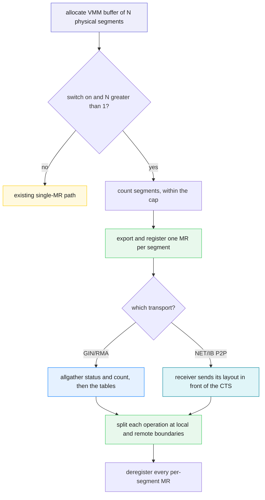
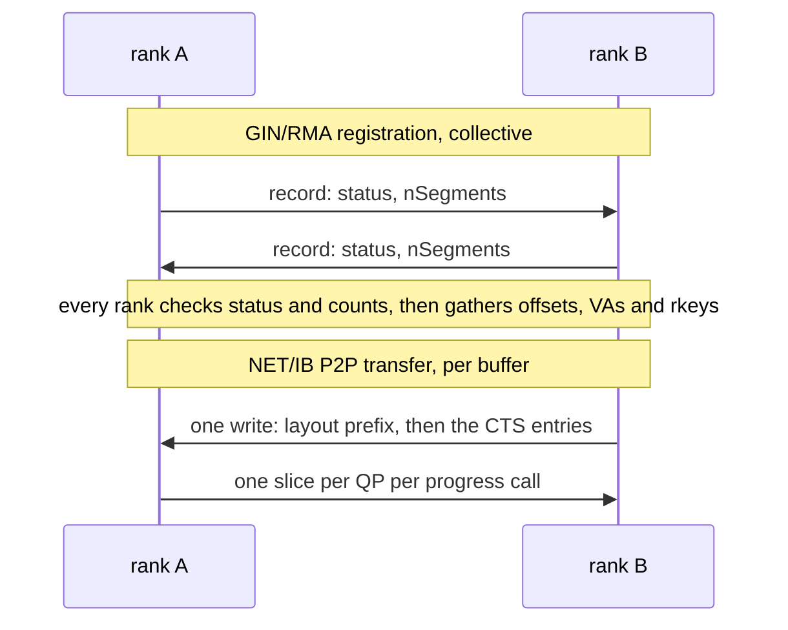
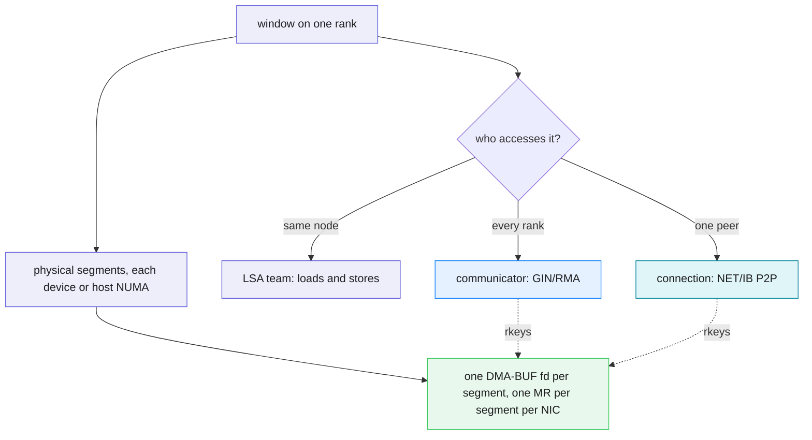
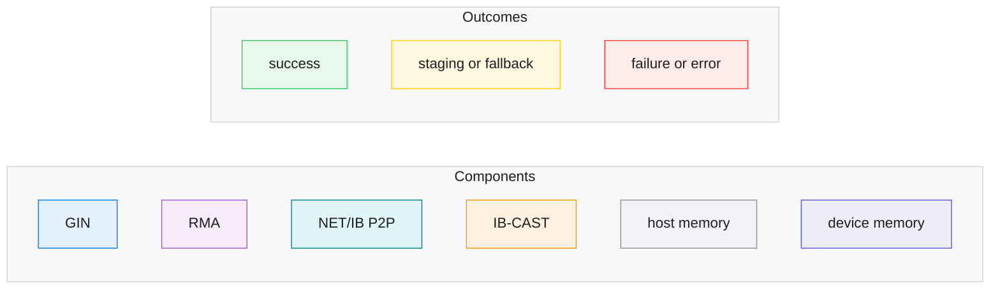

# Multi-segment DMA-BUF registration: overview

This is the entry point to the multi-segment design docs. It explains why RCCL registers one memory region per physical segment on ROCm, what the IB-MSEG fork stack implements on each path, and how it serves DeepEP-style workloads. It also defines the terms the other docs use and maps each doc to its readers.

## Executive summary

**The problem.** A virtual memory (VMM, `cuMem`/`hipMem`) buffer is one contiguous virtual address range backed by one or more physical allocations. To let the NIC reach it directly, RCCL exports a DMA-BUF file descriptor for the range and registers it with `ibv_reg_dmabuf_mr`. On ROCm, the DMA-BUF exported for a range that spans several physical allocations describes only the first one. Registering the whole range then fails with `EINVAL`, and an RDMA operation that crosses into a later allocation fails with `IBV_WC_REM_INV_REQ_ERR` or `IBV_WC_REM_ACCESS_ERR`, which can leave the queue pair (QP) in a fatal state and hang the collective.

**What was implemented.** The multi-segment InfiniBand plugin IB-MSEG (`src/transport/net_ib_multiseg/`, a renamed copy of `net_ib`) registers one DMA-BUF memory region (MR) per physical segment, up to the fixed cap `RCCL_IB_REG_SEG_DEFAULT`, because a DMA-BUF exported for a single segment is complete. Its data paths then split each transfer at segment boundaries on both the local and the remote side, so each work request uses the keys of the segment it touches. The work is split by path: fork 1 adds the core gates for GIN/RMA windows and NET registration, fork 3 adds IB-MSEG per-segment registration and NET/IB point-to-point (P2P), fork 4 adds IB-MSEG GIN/RMA, and fork 6 (not started) would bring the same support to IB-CAST. Classic `net_ib` and `net_ib_cast` stay at develop. Single-segment buffers keep the existing code path, and the whole feature is behind the runtime switch `NCCL_MULTI_SEGMENT_REGISTER`, which is off by default on HIP and which also selects IB-MSEG.

**Why DeepEP needs it.** DeepEP-style workloads allocate elastic symmetric windows that mix GPU and host memory in one address range, for example `[GPU][CPU]` or `[GPU k][CPU 0]…[CPU N-1]` with one host segment per local rank. They use LSA for peers on the same node and GIN for peers on other nodes, through the RMA proxy, and they move bulk data with NET/IB P2P. Without per-segment registration those windows cannot be registered for GIN at all, and P2P buffers built from several allocations fall back to slow host staging. With it, a remote CPU segment can be read straight into a local GPU segment at independent offsets.

**Status.** Layers 01 to 03 are in develop. Forks 1 to 4 and a tests-only change on top are on develop as of 2026-11-26, validated on two MI355X Thor2 nodes (242 of 242 units on ROCm 7.0.2.1 and 10.3) and on two MI355X AINIC nodes on TensorWave (74 of 75 suites on ROCm 10.3, all 23 multi-segment suites passing; the one failure also fails on develop). Forks 2 to 4 also define their IB-MSEG jobs on the MI455 AINIC configs with `NCCL_NET=IB`, which selects IB-MSEG on AINIC with the switch on; those have not run on MI455 yet. Fork 5 is paused and fork 6 is not started. Validation results are in [testing](multi_segment_testing.md#results) and review status is in [review feedback](multi_segment_review_feedback.md).

**Where it is going.** Forks 1 to 4 are stabilized on IB and AINIC first. Then fork 5 replays develop's `net_ib` to `net_ib_cast` differences onto the fork, so AINIC gets IB-CAST's features in the fork and AINIC autodetect selects it, and fork 6 adds the IB-CAST-specific multi-segment pieces on top. See [the fork plugin](multi_segment_fork_plugin.md) for the forks, the compile-twice host tests and how the code can later move back into `net_ib`.

## Design at a glance

A buffer goes through five stages. Allocation decides how many physical segments it has. Registration counts them, registers one MR per segment, and (for symmetric GIN windows) makes every rank agree on the layout. The data path splits each operation at segment boundaries. Deregistration frees every per-segment MR.

The two transports differ in how the remote side learns the layout. GIN/RMA registers a symmetric window collectively, so every rank learns every peer's per-segment addresses and rkeys at registration time. NET/IB P2P registers each buffer locally, so the receiver sends the segments a receive overlaps in front of its clear-to-send (CTS) entries, in the same RDMA write, or a reference the sender reads once.

The details are in [GIN/RMA on IB-MSEG and core](multi_segment_gin_rma.md) and [IB-MSEG NET/IB P2P](multi_segment_netib_wire.md); the planned IB-CAST work is in the fork 6 design for [P2P](multi_segment_netib_cast.md) and [GIN/RMA](multi_segment_netib_cast_gin.md). The rules every path must keep are in the [current contract](multi_segment_current.md).

## Memory spaces and scopes

Each rank's window is backed by one or more physical segments, each on the device or in host NUMA memory. Every segment gets its own DMA-BUF fd and one MR per NIC device. Who may touch the window sets the scope: the rank itself, the LSA team of same-node peers through loads and stores, every rank of the communicator through GIN/RMA, or one connection through NET/IB P2P.

## Terms

These terms are used the same way in every multi-segment doc.

| Term | Meaning |
|---|---|
| Segment | One physical VMM allocation (`cuMemCreate` handle) mapped inside a contiguous virtual address range. A buffer of N segments has N-1 internal boundaries. |
| DMA-BUF | A Linux file descriptor that exports device or host memory to another driver, here the RDMA NIC. |
| MR | Memory region: a range registered with the NIC (`ibv_reg_dmabuf_mr`). A multi-segment buffer has one MR per segment per NIC device. |
| lkey, rkey | The local and remote keys of an MR. A work request must use the keys of the segment its bytes are in. |
| Slice | The part of a transfer that stays inside one local and one remote segment. Each slice becomes one work request (WR). |
| Consensus record | The record `{status, nSegments}` (`rcclIbSegSymRecord`, `seg_sym_mseg.h`) every rank allgathers during GIN/RMA registration, even after a local failure, so all ranks succeed or fail together. The offsets, VAs and rkeys follow in later gathers. The IB-CAST record with a magic number and a version is planned for fork 6. |
| `segOff` | A rank's table of segment start offsets within its window: `segOff[0] = 0` and `segOff[nSegments]` is the window size. |
| CTS | Clear-to-send: the 64-byte FIFO entry a NET/IB receiver RDMA-writes to the sender to describe one receive buffer. Its size does not change. |
| Layout prefix | The `IbMsegSegLayout` entries (192 bytes each) in front of a slot's CTS entries, written in the same RDMA write and marked by bit `NCCL_IB_CTS_NREQS_LAYOUT` of `nreqs`. Each carries up to four overlapping segments inline, or a reference to the registration's published layout. |
| `useMultiSeg` | IB-MSEG has no capability bit. Each side decides at connect time whether the comm uses the multi-segment CTS layout and sends that decision as `useMultiSeg` in `IbMsegConnectionMetadata`; when the two ends differ, the accepting side fails with `ncclInvalidUsage` and its peer sees the connection close. |
| Segment cap | The fixed per-registration limit `RCCL_IB_REG_SEG_DEFAULT` (`transport/rccl_mseg.h`), checked by `rcclIbSegCountSupported`. |
| RMA round | One post of at most 64 data WRs for an RMA operation; a wider operation posts several rounds in order. |
| IB-MSEG | The multi-segment plugin `net_ib_multiseg` (net name `IB-MSEG`), a renamed copy of `net_ib`; see [the fork plugin](multi_segment_fork_plugin.md). |
| Staging | The fallback in which a collective copies through RCCL's own registered buffers instead of registering the user buffer. |
| LSA | Load/store accessible: peers on the same node that map each other's window and access it with GPU loads and stores. |
| GIN | GPU-initiated networking: device-side put, get and signal operations on a symmetric window to peers on other nodes. The host-proxy type (`NCCL_GIN_TYPE=2`) runs them through an RMA backend. |
| RMA | The host-side remote memory access backend (`ncclRma_t`) that posts GIN operations as IB work requests. The multi-segment backend is IB-MSEG's `IbMsegRmaIbProxy` (`net_ib_multiseg/gin.cc`); develop's `ncclRmaIbProxy` (`net_ib`) and `IbCastRmaIbProxy` (IB-CAST) are unchanged. |
| Classic, IB-CAST | The develop InfiniBand plugins, both unchanged by the stack: classic `net_ib` (`NCCL_NET=IB`) and RCCL's `net_ib_cast` (`NCCL_NET=IB-CAST`), which adds a QP scheduler, inline CTS on AINIC, and RCCL-specific recovery. IB-MSEG is the multi-segment plugin. |
| Final-WR signaling | Only the last WR of a chain asks for a completion, so one completion retires the whole chain. |
| Prefix post | `ibv_post_send` accepted the first part of a chain and rejected the rest. |
| Switch on, switch off | `NCCL_MULTI_SEGMENT_REGISTER=1` or `=0`. Off restores the develop code path except for a few switch-independent pieces, listed in [switch-off behavior](multi_segment_current.md#switch-off-behavior). See [the switch](#the-switch). |

## The switch

`NCCL_MULTI_SEGMENT_REGISTER` (`ncclParamMultiSegmentRegister`, `transport/generic.cc`) gates every multi-segment path. It defaults to 0 on HIP and to 1 elsewhere, and it must have the same value on every rank.

On HIP builds the switch also selects IB-MSEG and its RMA backend `IbMsegRmaIbProxy`; the rules are in [the fork plugin](multi_segment_fork_plugin.md#selection).

The core then reads the switch through `rcclMultiSegOn` (`rccl_dev_runtime.cc`), which is true only when the comm's plugin registers per segment, the switch is on and `NCCL_DMABUF_ENABLE=1`. `init.cc` stores the result per comm in `comm->rcclMultiSegNet` (the net is IB-MSEG) and `comm->rcclMultiSegRma` (the RMA backend is `IbMsegRmaIbProxy`). The first gates NET registration of multi-segment buffers in `transport/net.cc`; the second gates multi-segment GIN and RMA windows (`rcclDevrGinRegistersMultiSegment`, `rcclDevrRmaRegistersMultiSegment`) and the RMA in-flight cap. Inside IB-MSEG, `IbMsegResolveUseMultiSeg` (`connect.cc`) makes the per-comm P2P decision `useMultiSeg`, and `rcclRmaMultiSegEnabled` (`seg_rma_mseg.h`) gates the multi-segment RMA operations and the deeper RMA send queue. Both call `rcclMultiSegOn`, so `NCCL_NET=IB-MSEG` with the switch off behaves like develop's `net_ib`.

With the switch off, the multi-segment paths run develop code. A few fork 1 pieces are not gated by the switch: the host owner fd path (with `NCCL_SYM_REUSE_SYSMEM_HANDLES=1`), the NULL-handle checks before an RMA put or hierarchical CE, and an INFO line when RMA registration is skipped. The full list is in [the current contract](multi_segment_current.md#switch-off-behavior).

## Stack and pull requests

The stack is linear on develop, one fork per pull request on [ROCm/rocm-systems](https://github.com/ROCm/rocm-systems). Each fork is described in [the fork plugin](multi_segment_fork_plugin.md#forks).

| Fork | Scope | State |
|---|---|---|
| 1: core gate | comm-level plugin multi-segment flags in core, GIN/RMA window gates, RMA in-flight cap, host owner fd borrowed only when exactly one rank can export it | implemented |
| 2: net_ib copy | renamed copy of `net_ib` as IB-MSEG plus `rename_map.txt`; plugin selection, RMA backend choice, P2P policy, RAS list; `*_mseg` runner jobs | implemented |
| 3: registration and P2P | per-segment registration and multi-segment P2P in IB-MSEG: one-write CTS with the layout prefix, sliced send, one-read flush; connect-time `useMultiSeg` match | implemented |
| 4: RMA and GIN | IB-MSEG GIN and RMA windows: one MR per physical segment, consensus, RMA rounds, RMA send-queue depth; compile-twice host tests | implemented |
| 5: IB-CAST base | develop's `net_ib` to `net_ib_cast` differences replayed onto the fork, so AINIC autodetect selects it with IB-CAST's features | paused since 2026-11-24; no commits |
| 6: IB-CAST multi-segment | IB-CAST-specific pieces: BY_INDEX immediate flag, one segmented group at a time, CAST CQ poll, IB-CAST RMA record with magic and version | not started |

Already in develop: layer 01 ([PR 10887](https://github.com/ROCm/rocm-systems/pull/10887), CE AllReduce receive-window offset and bounds fixes), layer 02 ([PR 10891](https://github.com/ROCm/rocm-systems/pull/10891), host VMM location type, mixed host window classification, probe-kind allgather) and layer 03 ([PR 10885](https://github.com/ROCm/rocm-systems/pull/10885), NET segment-count cache, last-page walk fix, graph NET segments).

The older multi-segment pull requests (layers 05 to 09 and the IB-CAST GIN/RMA layer) are superseded by the fork pull requests; [review feedback](multi_segment_review_feedback.md) maps their review items to the forks.

## Reading guide

- [Overview](multi_segment_overview.md) (this doc): problem, design, terms, stack and color legend; start here.
- [Current contract](multi_segment_current.md): invariants, limits, QP depths, switch-off behavior, version gates and open follow-ups; the checklist for any change.
- [Fork plugin](multi_segment_fork_plugin.md): why IB-MSEG is a fork, plugin selection, what each fork changes, compile-twice host tests, phases and fold-back.
- [GIN/RMA on IB-MSEG and core](multi_segment_gin_rma.md): per-segment window registration, consensus, rounds, in-flight cap, window gates and host owner DMA-BUF.
- [IB-MSEG NET/IB P2P](multi_segment_netib_wire.md): connect-time `useMultiSeg` match, one-write CTS with layouts, sliced send, one-read flush and rejected alternatives.
- [IB-CAST P2P, fork 6 design](multi_segment_netib_cast.md): planned IB-CAST P2P scope, scheduler, BY_INDEX flag, per-WR cap and requirements from review.
- [IB-CAST GIN/RMA, fork 6 design](multi_segment_netib_cast_gin.md): planned IB-CAST RMA record, physical-device lookup, queues and error propagation.
- [rocSHMEM GDA and Anvil SDMA](multi_segment_gin_rocshmem_gda_and_anvil_sdma.md): proposed support in the device-initiated GIN backends.
- [Testing](multi_segment_testing.md): test strategy, coverage, hybrid DeepEP tests, runner jobs, how to run, results and known failures.
- [Validation plan](multi_segment_validation_plan.md): per-fork test inventory, job and config matrix, and known gaps.
- [Code map](multi_segment_code_map.md): the symbols each fork adds or changes, per file.
- [Review feedback](multi_segment_review_feedback.md): every review item, what changed for it, and what is open.

The code paths of each fork, in execution order, are in the separate code walkthrough book (`walkthrough/` next to these docs), one part per fork.

## Color legend

Every diagram and callout in the multi-segment docs uses this scheme. Component colors mark the transport or memory a node belongs to. Outcome colors mark how a decision ends, and they take precedence over component colors on outcome nodes. Sequence diagrams group participants in a box of the component color and shade outcome messages with a region of the outcome color. Uncolored nodes are steps shared by several components.

| Class | Meaning | Stroke | Fill |
|---|---|---|---|
| `gin` | GIN | `#007aff` | `#e5f1ff` |
| `rma` | RMA | `#af52de` | `#f5ebfb` |
| `netib` | NET/IB P2P (IB-MSEG) | `#008299` | `#e0f5f8` |
| `ibcast` | IB-CAST | `#ff9500` | `#fff1e0` |
| `hostmem` | host memory (sysmem, `HOST_NUMA`) | `#8e8e93` | `#f2f2f7` |
| `devmem` | device memory segment | `#5856d6` | `#eeeefb` |
| `okpath` | per-segment registration or success | `#34c759` | `#e8f8ec` |
| `stagepath` | staging, fallback or skip | `#ffcc00` | `#fff9e0` |
| `failpath` | failure: `ncclInvalidUsage`, WARN, error return | `#ff3b30` | `#ffeceb` |
| `neutral` | grouping subgraph | `#d1d1d6` | `#f9f9fb` |

Text callouts use GitHub alerts, which render as colored boxes:

| Callout | Color | Meaning |
|---|---|---|
| `> [!NOTE]` | blue | background and context |
| `> [!TIP]` | green | how to enable it, what to set |
| `> [!IMPORTANT]` | purple | a contract or invariant that must hold |
| `> [!WARNING]` | amber | fallback, staging or a limitation |
| `> [!CAUTION]` | red | failure modes, data corruption risk |
