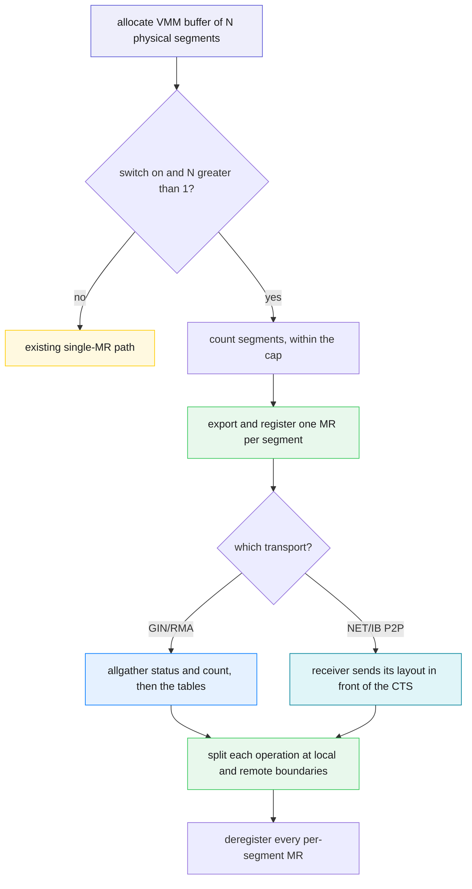
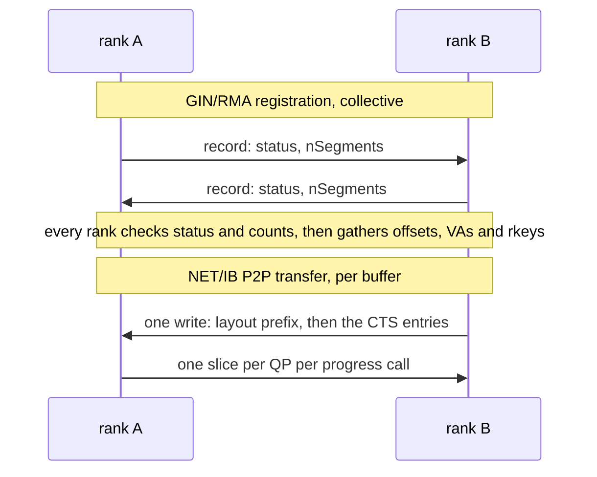
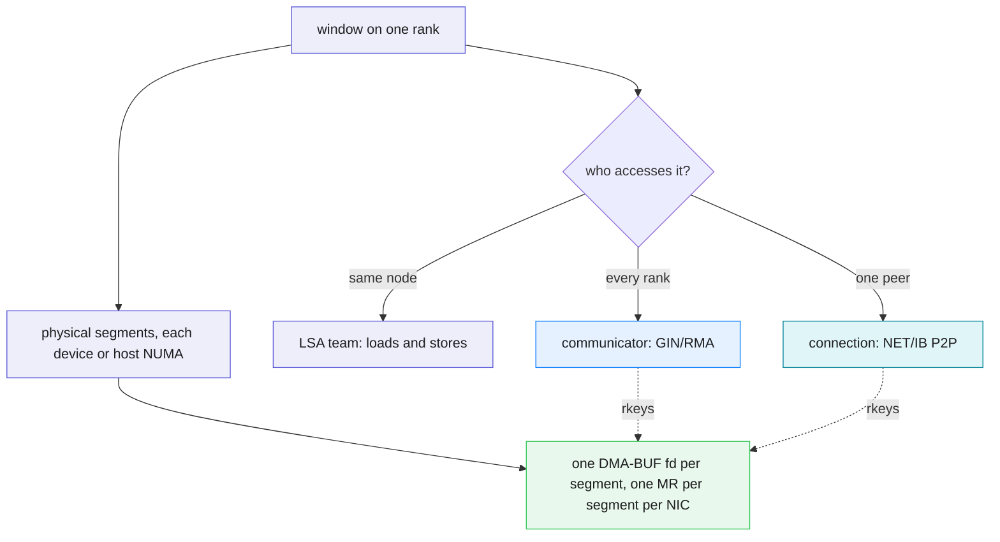
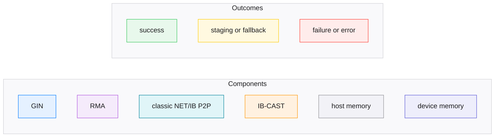

# Multi-segment DMA-BUF registration: overview

This is the entry point to the multi-segment design docs. It explains why RCCL registers one memory region per physical segment on ROCm, what the stack implements on each InfiniBand path, and how it serves DeepEP-style workloads. It also defines the terms the other docs use, lists the pull requests, and maps each doc to its readers.

## Executive summary

**The problem.** A virtual memory (VMM, `cuMem`/`hipMem`) buffer is one contiguous virtual address range backed by one or more physical allocations. To let the NIC reach it directly, RCCL exports a DMA-BUF file descriptor for the range and registers it with `ibv_reg_dmabuf_mr`. On ROCm, the DMA-BUF exported for a range that spans several physical allocations describes only the first one. Registering the whole range then fails with `EINVAL`, and an RDMA operation that crosses into a later allocation fails with `IBV_WC_REM_INV_REQ_ERR` or `IBV_WC_REM_ACCESS_ERR`, which can leave the queue pair (QP) in a fatal state and hang the collective.

**What was implemented.** Every InfiniBand path now registers one DMA-BUF memory region (MR) per physical segment, up to a local cap of 1024 segments (8192 at most), because a DMA-BUF exported for a single segment is complete. The data paths then split each transfer at segment boundaries on both the local and the remote side, so each work request uses the keys of the segment it touches. The same idea is applied four times: classic GIN/RMA, classic NET/IB point-to-point (P2P), IB-CAST P2P, and IB-CAST GIN/RMA. Single-segment buffers keep the existing code path, and the whole feature is behind the runtime switch `NCCL_MULTI_SEGMENT_REGISTER`, which is off by default on HIP.

**Why DeepEP needs it.** DeepEP-style workloads allocate elastic symmetric windows that mix GPU and host memory in one address range, for example `[GPU][CPU]` or `[GPU k][CPU 0]…[CPU N-1]` with one host segment per local rank. They use LSA for peers on the same node and GIN for peers on other nodes, through the RMA proxy, and they move bulk data with NET/IB P2P. Without per-segment registration those windows cannot be registered for GIN at all, and P2P buffers built from several allocations fall back to slow host staging. With it, a remote CPU segment can be read straight into a local GPU segment at independent offsets.

**Status.** Layers 01 to 03 are merged. Layers 05, 06, 08 and the IB-CAST GIN/RMA "wire" layer are open pull requests, with layer 07 folded into 05 and 06, and a coverage pull request (09) adds tests on top. The old-stack branches were rebased onto develop `c43b4a9e7307` on 2026-11-19 and carry every review fix to date (see [review feedback](multi_segment_review_feedback.md)); the last full hardware run on the wire tip passed 220 of 221 units per ROCm version, and the one failure was fixed in the tests commits. None of this is pushed.

**Where it is going.** The old stack edits classic `net_ib` and `net_ib_cast` in place. The planned replacement leaves both at develop and puts multi-segment support into one separate plugin, IB-MSEG (`net_ib_multiseg`), a renamed copy of `net_ib` that `NCCL_MULTI_SEGMENT_REGISTER=1` selects. Forks 1 to 4 of that plan are committed locally, forks 5 and 6 are planned. See [the fork plugin](multi_segment_fork_plugin.md); the old-stack notes stay as the record of the behaviour the fork ports.

## Design at a glance

A buffer goes through five stages. Allocation decides how many physical segments it has. Registration counts them, registers one MR per segment, and (for symmetric GIN windows) makes every rank agree on the layout. The data path splits each operation at segment boundaries. Deregistration frees every per-segment MR.

The two transports differ in how the remote side learns the layout. GIN/RMA registers a symmetric window collectively, so every rank learns every peer's per-segment addresses and rkeys at registration time. NET/IB P2P registers each buffer locally, so the receiver sends the segments a receive overlaps in front of its clear-to-send (CTS) entries, in the same RDMA write, or a reference the sender reads once.

The details are in [GIN/RMA](multi_segment_gin_rma.md), [classic NET/IB P2P](multi_segment_netib_wire.md), [IB-CAST P2P](multi_segment_netib_cast.md) and [IB-CAST GIN/RMA](multi_segment_netib_cast_gin.md). The rules every path must keep are in the [current contract](multi_segment_current.md).

## Memory spaces and scopes

Each rank's window is backed by one or more physical segments, each on the device or in host NUMA memory. Every segment gets its own DMA-BUF fd and one MR per NIC device. Who may touch the window sets the scope: the rank itself, the LSA team of same-node peers through loads and stores, every rank of the communicator through GIN/RMA, or one connection through NET/IB P2P.

## Terms

These terms are used the same way in every multi-segment doc.

| Term | Meaning |
|---|---|
| Segment | One physical VMM allocation (`cuMemCreate` handle) mapped inside a contiguous virtual address range. A buffer of N segments has N-1 internal boundaries. |
| DMA-BUF | A Linux file descriptor that exports device or host memory to another driver, here the RDMA NIC. |
| MR | Memory region: a range registered with the NIC (`ibv_reg_dmabuf_mr`). A multi-segment buffer has one MR per segment per NIC device. |
| lkey, rkey | The local and remote keys of an MR. A work request must use the keys of the segment its bytes are in. |
| Slice | The part of a transfer that stays inside one local and one remote segment. Each slice becomes one work request (WR). |
| Consensus record | The record `{status, nSegments}` (`rcclIbSegSymRecord`) every rank allgathers during GIN/RMA registration, even after a local failure, so all ranks succeed or fail together. The offsets, VAs and rkeys follow in later gathers. IB-CAST adds a record with a magic number, a version and the physical device numbers. |
| `segOff` | A rank's table of segment start offsets within its window: `segOff[0] = 0` and `segOff[nSegments]` is the window size. |
| CTS | Clear-to-send: the 64-byte FIFO entry a NET/IB receiver RDMA-writes to the sender to describe one receive buffer. Its size does not change. |
| Layout prefix | The `ncclIbSegLayout` entries (192 bytes each) in front of a slot's CTS entries, written in the same RDMA write. Each carries up to four overlapping segments inline, or a reference to the registration's published layout. The 11-04 design used a separate "side table" instead; the bit and some function names still say "side table". |
| Capability | `RCCL_IB_CAP_MULTISEG` in `ncclIbConnectionMetadata::caps`. The 11-04 design carried it in a `devName` trailer. |
| Segment cap | The local registration limit `rcclIbRegSegCap`: 1024 by default, `RCCL_IB_MAX_REG_SEGMENTS` moves it up to the protocol ceiling of 8192. |
| RMA round | One post of at most 64 data WRs for an RMA operation; a wider operation posts several rounds in order. |
| IB-MSEG | The planned multi-segment plugin `net_ib_multiseg`, a renamed copy of `net_ib`; see [the fork plugin](multi_segment_fork_plugin.md). |
| Staging | The fallback in which a collective copies through RCCL's own registered buffers instead of registering the user buffer. |
| LSA | Load/store accessible: peers on the same node that map each other's window and access it with GPU loads and stores. |
| GIN | GPU-initiated networking: device-side put, get and signal operations on a symmetric window to peers on other nodes. The host-proxy type (`NCCL_GIN_TYPE=2`) runs them through an RMA backend. |
| RMA | The host-side remote memory access backend (`ncclRma_t`) that posts GIN operations as IB work requests: `ncclRmaIbProxy` (classic) or `IbCastRmaIbProxy` (IB-CAST). |
| Classic, IB-CAST | The two InfiniBand plugins: classic `net_ib` (`NCCL_NET=IB`) and RCCL's fork `net_ib_cast` (`NCCL_NET=IB-CAST`), which adds a QP scheduler, inline CTS on AINIC, and RCCL-specific recovery. |
| Final-WR signaling | Only the last WR of a chain asks for a completion, so one completion retires the whole chain. |
| Prefix post | `ibv_post_send` accepted the first part of a chain and rejected the rest. |
| Switch on, switch off | `NCCL_MULTI_SEGMENT_REGISTER=1` or `=0`. Off restores the develop code path everywhere. See [the switch](#the-switch). |

## The switch

`NCCL_MULTI_SEGMENT_REGISTER` (`ncclParamMultiSegmentRegister`, `transport/generic.cc`) gates every multi-segment path. It defaults to 0 on HIP and to 1 elsewhere, and it must have the same value on every rank. Classic NET/IB caches it per comm in `multiSegOk`, IB-CAST P2P reads it through `IbCastAdvertiseMultiSeg`, and both RMA backends through `rcclRmaMultiSegEnabled`. In the fork design the switch also selects the IB-MSEG plugin.

With the switch off, no capability is advertised, develop's QP depths and GIN/RMA bodies run, the RMA in-flight cap does not apply, multi-segment NET buffers stage, and a device-only multi-segment GIN window fails registration. The full list is in [the current contract](multi_segment_current.md#switch-off-behavior).

## Stack and pull requests

The stack is linear on `develop`, one pull request per layer on [ROCm/rocm-systems](https://github.com/ROCm/rocm-systems). Branch names share the prefix `users/atulkulk/mseg/`. There is no layer 04.

| Layer | Pull request | Branch | Scope | State |
|---|---|---|---|---|
| 01 | [PR 10887](https://github.com/ROCm/rocm-systems/pull/10887) | `01-ce-recv-window-offset` | CE AllReduce receive-window offset and bounds fixes | merged |
| 02 | [PR 10891](https://github.com/ROCm/rocm-systems/pull/10891) | `02-amd-host-vmm-compat` | host VMM location type, mixed host window classification, probe-kind allgather | merged |
| 03 | [PR 10885](https://github.com/ROCm/rocm-systems/pull/10885) | `03-registration-range` | NET segment-count cache, last-page walk fix, graph NET segments | merged |
| 05 | [PR 10884](https://github.com/ROCm/rocm-systems/pull/10884) | `05-gin-rma-multisegment` | shared `rccl_mseg*` headers, classic GIN/RMA per-segment MRs, consensus, rounds, in-flight cap, host owner DMA-BUF | open, local tip not pushed |
| 06 | [PR 10886](https://github.com/ROCm/rocm-systems/pull/10886) | `06-classic-netib-multisegment` | classic NET/IB P2P: capability in the metadata, one-write CTS, sliced send, one-read flush | open, local tip not pushed |
| 07 | [PR 10890](https://github.com/ROCm/rocm-systems/pull/10890) | `07-hybrid-stress-ci` | hybrid DeepEP tests, stress tests, runner configs | folded into 05 and 06 |
| 08 | [PR 10889](https://github.com/ROCm/rocm-systems/pull/10889) | `08-cast-netib-multisegment` | IB-CAST P2P on the shared builder, scope, one group at a time | open, local tip not pushed |
| wire | [PR 10888](https://github.com/ROCm/rocm-systems/pull/10888) | `multi-segment-dmabuf-cast-gin` | IB-CAST GIN/RMA per-segment MRs and rounds | open, local tip not pushed |
| 09 | coverage pull request from `users/bdoganca/mseg/09-mseg-tests-coverage` | `09-tests-local` (local copy) | multi-segment test reorganization and coverage tests | open |

Each open old-stack branch is two commits, code then tests. Local tips (code, tests) on develop `c43b4a9e7307`: 05 `50c1ef7c04d5`, `8dadbe3b4f7e`; 06 `af3802bba83c`, `91e146e60904`; 08 `59a4eab86e0a`, `355962aca436`; wire `ac1de99e4627`, `ba3ab26f30a7`. The 16-segment cap is gone (AICOMRCCL-3124). The multi-segment code sits in RCCL-only files (`transport/rccl_mseg*.h`, `rccl_p2p_multiseg.{h,cc}`, `net_ib/p2p_multiseg.{h,cc}`, `net_ib/ib_multiseg.h`, `net_ib_cast/ib_cast_multiseg.h`) and in `RCCL:`-marked blocks of the upstream-derived files, reached through one-line calls; [sync and removal](multi_segment_sync_and_removal.md) measures that footprint. The fork branches `users/atulkulk/netib-mseg/01` to `04` are listed in [the fork plugin](multi_segment_fork_plugin.md#forks).

## Reading guide

| Doc | Covers | Read it if you |
|---|---|---|
| [Overview](multi_segment_overview.md) (this doc) | problem, design, terms, stack, color legend | are new to the feature |
| [Review feedback](multi_segment_review_feedback.md) | every reviewer's items, what changed for each, what is open or superseded | answer a review thread or check what is still open |
| [Fork plugin](multi_segment_fork_plugin.md) | the IB-MSEG plugin design, forks 1 to 6 and their status, compile-twice host tests, fold-back | work on the replacement of the old stack |
| [Current contract](multi_segment_current.md) | invariants, switch-off behavior, limits, QP depths, version gates, code map, open items | review or change any multi-segment code |
| [GIN/RMA](multi_segment_gin_rma.md) | shared per-segment registration, consensus, rounds, in-flight cap, flush, host owner DMA-BUF, window gates | work on GIN, RMA or DeepEP windows |
| [Classic NET/IB P2P](multi_segment_netib_wire.md) | capability, one-write CTS with inline or referenced layouts, sliced send, one-read flush, rejected alternatives | work on `net_ib` P2P |
| [IB-CAST P2P](multi_segment_netib_cast.md) | IB-CAST differences: scope, one group at a time, BY_INDEX flag, per-WR cap, open items | work on `net_ib_cast` P2P |
| [IB-CAST GIN/RMA](multi_segment_netib_cast_gin.md) | IB-CAST RMA handle, record with magic and version, rounds, error propagation | work on `net_ib_cast` GIN |
| [Code map](multi_segment_code_map.md) | the symbols each layer adds or changes, per file, with line numbers at the wire tip | look for where a behavior lives or which pull request owns it |
| [Testing](multi_segment_testing.md) | test strategy, coverage, hybrid DeepEP tests, runner jobs, how to run, known failures | run, add or debug tests |
| [Validation plan](multi_segment_validation_plan.md) | every test per layer and category, runner configs, the coverage pull request's tests, gaps and proposed tests | plan a validation run or review test coverage |
| [rocSHMEM GDA and Anvil SDMA](multi_segment_gin_rocshmem_gda_and_anvil_sdma.md) | proposed support in the device-initiated GIN backends | plan GIN types 6 or 7 |
| [Sync and removal](multi_segment_sync_and_removal.md) | upstream-sync footprint and how to remove the workaround once the driver exports whole ranges | plan an upstream sync or a driver-fix rollout |
| [Past 16 segments](multi_segment_varseg.md) | the original design to drop the 16-segment cap; implemented in a different form | want the history of the cap removal |
| [Side table on first registration](multi_segment_sidetable_first_reg.md) | superseded: the side table is gone | want the history of the connect memory cost |
| [Flush read collapse](multi_segment_flush_read_collapse.md) | superseded: the flush is one read | want the history of the flush cost |

## Color legend

Every diagram and callout in the multi-segment docs uses this scheme. Component colors mark the transport or memory a node belongs to. Outcome colors mark how a decision ends, and they take precedence over component colors on outcome nodes. Sequence diagrams group participants in a box of the component color and shade outcome messages with a region of the outcome color. Uncolored nodes are steps shared by several components.

| Class | Meaning | Stroke | Fill |
|---|---|---|---|
| `gin` | GIN | `#007aff` | `#e5f1ff` |
| `rma` | RMA | `#af52de` | `#f5ebfb` |
| `netib` | classic NET/IB P2P | `#008299` | `#e0f5f8` |
| `ibcast` | IB-CAST | `#ff9500` | `#fff1e0` |
| `hostmem` | host memory (sysmem, `HOST_NUMA`) | `#8e8e93` | `#f2f2f7` |
| `devmem` | device memory segment | `#5856d6` | `#eeeefb` |
| `okpath` | per-segment registration or success | `#34c759` | `#e8f8ec` |
| `stagepath` | staging, fallback or skip | `#ffcc00` | `#fff9e0` |
| `failpath` | failure: `ncclInvalidUsage`, WARN, error return | `#ff3b30` | `#ffeceb` |
| `neutral` | grouping subgraph | `#d1d1d6` | `#f9f9fb` |

Text callouts use GitHub alerts, which render as colored boxes:

| Callout | Color | Meaning |
|---|---|---|
| `> [!NOTE]` | blue | background and context |
| `> [!TIP]` | green | how to enable it, what to set |
| `> [!IMPORTANT]` | purple | a contract or invariant that must hold |
| `> [!WARNING]` | amber | fallback, staging or a limitation |
| `> [!CAUTION]` | red | failure modes, data corruption risk |
