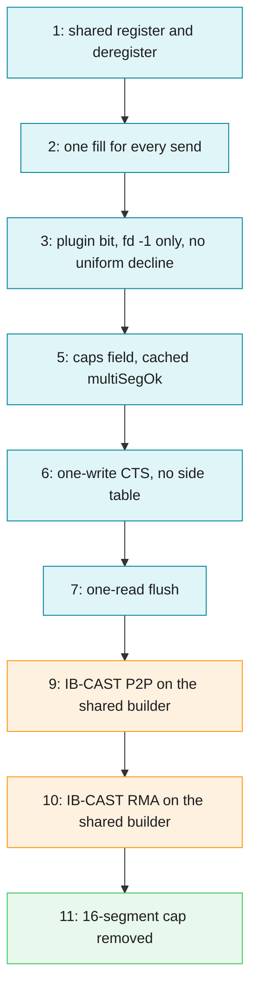

# Multi-segment: review feedback and what changed

This doc records the review feedback on the multi-segment stack and what each item changed. For every item it gives the reviewer, the request, the branch where the response landed, and whether the item is fixed, superseded or still open. It covers the old stack (layers 05, 06, 07, 08, the IB-CAST GIN/RMA "wire" layer and the coverage layer 09) and the local Argus passes on the IB-MSEG fork branches. The fork design itself is in the [fork plugin](multi_segment_fork_plugin.md) note.

Statuses were checked against the old-stack tips on develop `c43b4a9e7307`: 05 `50c1ef7c04d5` (code) and `8dadbe3b4f7e` (tests), 06 `af3802bba83c` and `91e146e60904`, 08 `59a4eab86e0a` and `355962aca436`, wire `ac1de99e4627` and `ba3ab26f30a7`. Layer 07 ([PR 10890](https://github.com/ROCm/rocm-systems/pull/10890)) is folded into 05 and 06. Each branch has two commits, code then tests. The intermediate fix commits named below (for example 06 `3bb9cfba72d6`) were squashed into the branch's code commit during the restacks, so they are history, not branch tips. None of the old-stack tips or fork commits is pushed.

Status words:

- **fixed**: the code the item points at is changed or gone on the tip, and the step's tests passed.
- **superseded**: a later design change removed the code the item was about, so the request no longer applies.
- **open**: no code change, or no reply on the review thread yet.
- **not verified**: the record says it was done but this pass did not re-check it on the tip.

## Summary

| Source | Items | Fixed | Superseded | Open | Not verified |
|---|---|---|---|---|---|
| Aleksandr, [PR 10886](https://github.com/ROCm/rocm-systems/pull/10886) and [PR 10889](https://github.com/ROCm/rocm-systems/pull/10889) | 24 comments, 2 Jira tasks | 18 | 3 | 5 | 0 |
| Vadim, [PR 10886](https://github.com/ROCm/rocm-systems/pull/10886) | 2 requests in 1 comment | 1 | 1 | 0 | 0 |
| Bertan, nikitaxgusev, amd-arozanov, nusislam, garzaran, alexander-sannikov | 13 | 7 | 2 | 4 | 0 |
| GitHub Argus and Copilot, by defect class | 15 classes | 12 | 3 | 0 | 0 |
| Local Argus passes 2026-10-30, 11-04 and 11-14 on the old stack | 33 | 18 | 6 | 6 | 3 |
| Local Argus passes on fork branches 1 to 4 | 4 reports | see [fork reviews](#local-argus-passes-on-the-fork-branches) | | | |

The items that are still open on the old stack:

1. Aleksandr 4467318519 on [PR 10889](https://github.com/ROCm/rocm-systems/pull/10889): why the BY_INDEX completion protocol exists only on IB-CAST. Reply not posted.
2. Aleksandr 4466504452 and 4466738828 on [PR 10886](https://github.com/ROCm/rocm-systems/pull/10886): where the 16-segment limit comes from. The cap is gone; the reply is not posted.
3. Aleksandr 4465933531 (`numSegments < 1`) and 4466591874 (`ncclIbMalloc` alignment) on [PR 10886](https://github.com/ROCm/rocm-systems/pull/10886): replies not posted.
4. Local Argus 2026-11-14, 08 High: the IB-CAST multi-segment scope does not exclude AINIC inline CTS (`IbCastAinicCtsInlineData`).
5. Local Argus 2026-11-14, 08 High: the IB-CAST receiver picks the CTS stride from `peerCaps`, which its own scope masks, so a sender that advertises facing a receiver whose scope fails can hang after slot 0.
6. Local Argus 2026-11-14, 08 Medium: `rcclIbCastSendResume` re-reads `nreqs` from the peer-written CTS row without the 1 to 8 bound that `IbCastIsend` applies.
7. Local Argus 2026-11-14, 06 Medium: every classic send, single-segment included, now builds through `rcclIbFillSendWrs`, and no switch-off latency or bandwidth comparison is on record.
8. Local Argus 2026-11-04, 05: the `reg.cc` unwind is tested only by develop's disabled AICOMRCCL-3112 test, which stays disabled by decision.
9. nusislam, [PR 10884](https://github.com/ROCm/rocm-systems/pull/10884) issue comment: check the RMA send depth against the HCA `max_qp_wr`. The depth is now 2080, on RMA comms only; no `max_qp_wr` check is recorded.
10. nusislam 4126266662, alexander-sannikov 4136961982 and garzaran 4309321625 on the merged layer 01 ([PR 10887](https://github.com/ROCm/rocm-systems/pull/10887)): no reply on the thread.

Items 4 to 6 are IB-CAST P2P items. The fork design replaces IB-CAST multi-segment P2P with the fork's own copy in planned fork 6, so they are carried to fork 6 rather than fixed on 08; see [fork plugin, fork 6](multi_segment_fork_plugin.md#fork-6-ib-cast-multi-segment-planned).

## Aleksandr

Aleksandr's comments on [PR 10886](https://github.com/ROCm/rocm-systems/pull/10886) (06) and [PR 10889](https://github.com/ROCm/rocm-systems/pull/10889) (08) asked for one shared implementation instead of per-plugin copies, a simpler wire format, and no fixed 16-segment cap. [PR 10888](https://github.com/ROCm/rocm-systems/pull/10888) (wire) has no comments from him; the 06 and 08 items apply there when the wire branch takes the shared builder. The fixes landed in eleven steps:

Step 4 (AICOMRCCL-3125, side table on first registration) and step 8 (rename the cap-derived WR budgets) were skipped, because steps 6 and 11 removed the code they would have changed.

| Step | Comment | PR | Request | Branch and change | Status |
|---|---|---|---|---|---|
| 1 | 4466075968 | 10886 | Failure cleanup should call the deregister helper | 05, 06: registration goes through `rcclIbSegRegister` and `rcclIbSegDeregister` (`transport/rccl_mseg_reg.h`); a failed register releases the partial MRs | fixed |
| 1 | 4466103032 | 10886 | One allocation instead of four `calloc`s | 06: `rcclIbSegWalkBind` binds one walk block sized from the count; the handle arrays in `rcclIbSegMr` are sized from the walked count | fixed |
| 2, 9, 10 | 4466846579 | 10886 | One splitter, one lookup and one table for RMA and P2P | 05 and 06: RMA and classic P2P slices use `rcclIbSegAppendWrs` (`rccl_mseg_wr.h`) over `rcclIbSegCursor` (`rccl_mseg.h`); 08: IB-CAST P2P uses the shared `rccl_p2p_multiseg.{h,cc}`; wire: IB-CAST RMA uses `rcclIbSegAppendWrs`, `rcclIbSegRegister` and `rcclIbSegDeregister` | fixed |
| 2, 9 | 4466941047 | 10886 | Do not copy `ncclIbMultiSend`; build the WRs from the develop function | 06: develop's `ncclIbMultiSend` calls `rcclIbFillSendWrs` for every chain; 08: `rcclIbCastMultiSendSegmented` is deleted and `IbCastMultiSend` calls `rcclIbCastFillSendWrs` | fixed |
| 2 | 4466000659 | 10886 | Move a test-only header into the test tree | 06: `rccl_ib_multiseg.h` is deleted; `ncclIbRegMrDmaBufMultiSeg` is declared in `rccl_mseg_reg.h`, because `ncclIbRegMrDmaBuf` calls it | fixed |
| 3 | 4465923772 | 10886 | Do not hand a packed offset to a plugin that does not understand it | 06: `NCCL_PTR_DMABUF_MULTISEG` (`include/plugin/nccl_net.h`); `net.cc` calls `regMrDmaBuf` with fd -1 only when the plugin sets the bit (`rcclNetPluginMultiSeg`) | fixed |
| 3 | 4466886680 | 10886 | fd -1 is enough; do not pass `nExpect` | 06: the plugin walk counts the segments; `offset` carries only the export flags | fixed |
| 3 | 4466498776 | 10886 | The uniform-segment decline is artificial | 06: the decline is gone; `NonUniformLayoutRegisters` expects such a layout to register | fixed |
| 4 | AICOMRCCL-3125 | task | Allocate the CTS side tables on first multi-segment use | none | superseded by step 6 |
| 5 | 4466191539 | 10886 | Put the capability in the metadata, not in the `devName` tail | 06: `ncclIbConnectionMetadata::caps`; the trailer and its size assert are gone | fixed |
| 5 | 4466713360 | 10886 | Check cuMem and the switch once and cache the result | 06: `multiSegOk` is computed once per comm by `ncclIbMultiSegOk(switch, forGin, resilient)`; cuMem is not in the gate, because registration keys on the switch alone | fixed |
| 5 | 4466746471 | 10886 | The `connect.h` size assert is wrong | 06: removed with the trailer | fixed |
| 6 | 4466697539 | 10886 | One CTS that carries the layout, not a side table plus a CTS | 06 (then 08): an advertising slot is the layout prefix followed by the CTS entries, posted as one RDMA write | fixed |
| 6 | 4466734379 | 10886 | No separate MR for the side table | 06: one MR covers the combined slot array | fixed |
| 7 | 4466483903 | 10886 | One flush read, not one per segment | 06 (then 08): one read of the first byte of the last non-empty receive, or the scratchpad read | fixed |
| 8 | 4466041034, 4466043272 | 10886 | No magic numbers in the RMA WR budget | the cap-derived budgets were removed in step 11; the RMA limits are named macros in `rccl_mseg_rma.h` | superseded by step 11 |
| 9 | 4467040965 | 10889 | IB-CAST registration should live where classic registration lives | 08: `rccl_reg_multiseg_cast.cc` and `p2p_multiseg_cast.cc` are deleted; `IbCastRegMrDmaBufMultiSeg` is in `net_ib_cast/reg.cc` | fixed |
| 9 | 4467649873 | 10889 | The receiver sizes write looks profiler-only | 08: kept, posted only when the request was split or `nreqs > 1`; `WR_IMM_SEGMENTED_FLAG` is set only for a split BY_INDEX send | fixed |
| 9 | 5767701446 | 10889 | Apply the 06 comments, limit multi-segment to the validated scope, check it at init | 08: one cached `multiSegScopeOk` (no CTS offload, BY_ORDER, QP sharing or resiliency) gates registration on both sides; the CTS layout and the capability come from it at connect | fixed |
| 9 | 4467318519 | 10889 | Why is this protocol only on IB-CAST | reply: BY_INDEX uses the immediate for the request index, classic puts the size there | open, reply not posted |
| 11 | AICOMRCCL-3124 | task | Register whatever segment count the walk returns | 05, 06, 08, wire: dynamic tables, `rcclIbSegCountSupported` as the one check, RMA in rounds, P2P one slice per progress call, overlap-only and by-reference CTS layouts; see [limits](multi_segment_current.md#limits) | fixed |
| 11 | 4466504452, 4466738828 | 10886 | Where does the 16-segment limit come from | reply: no 16 remains; the protocol ceiling is 8192 and the default local cap 1024 | open, reply not posted |
| any | 4465933531 | 10886 | Does `numSegments < 1` mean anything | reply: every branch keys on `> 1` | open, reply not posted |
| any | 4466591874 | 10886 | Is the `ncclIbMalloc` buffer still page aligned | reply: `posix_memalign` already is | open, reply not posted |

A side result of step 11: per-segment GIN windows for device-only windows were tried on 05 and dropped, because the default device `bufType` does not split and `Symmetric_LsaGin` returned wrong data. 05 keeps the split in the plugin on the proxy backend.

## Vadim

Vadim's comment on [PR 10886](https://github.com/ROCm/rocm-systems/pull/10886) (2026-11-02, `net_ib/p2p.cc`) asked for two things: split `ncclIbMultiSendSegmented` into named helpers so it reads as an orchestration loop, and move the multi-segment code into its own `p2p_multiseg.cc` for clarity and easier upstream sync.

| Request | What changed | Status |
|---|---|---|
| Separate file | 06: the classic multi-segment bodies are in `net_ib/p2p_multiseg.cc`, declared in `net_ib/p2p_multiseg.h`, included once at the top of `p2p.cc`; develop's functions call one-line hooks | fixed |
| Helper split | Done first on 06 and 08 (`rcclIbSegSendPlanInit`, `rcclIbBuildLocalSegmentLayout`, `rcclIbAppendSegmentedRequestWrs` and the rest). Aleksandr's step 2 then deleted the segmented copy of the send; develop's `ncclIbMultiSend` calls `rcclIbFillSendWrs` for every chain, so those helpers no longer exist. IB-CAST's `p2p_multiseg_cast.cc` was created for this and deleted in step 9 | superseded |

## Other human reviewers

| Reviewer | Thread | PR | Request | What changed | Status |
|---|---|---|---|---|---|
| Bertan | 4350033709, 4350104900 | 10884 | The host owner fd fallback picks `hostOwner` from rewritten types | 05: no fallback. Ranks agree on the owner-fd status (`hostOwnerFdStatus`, gathered as `ownerFdStatus`) before the collective registration, and an importer borrows the fd of the first rank with `hostExportable`; fork 1 tightens this to "exactly one rank can export" | fixed |
| Bertan | 4351936076 | 10886 | The classic sender QP (769) overflows with three maximum chains | 06: a segmented send posts one slice per QP per progress call (`rcclIbSendCursor`, `rcclIbSendProgress`), so P2P keeps develop's 512 send WRs; only RMA comms get `NCCL_RMA_SEND_QP_WRS` (2080) | superseded |
| Bertan | 4351967080 | 10886 | The classic segmented send ignores `bad_wr` | 06: a failed slice post drops the held event (`rcclIbSendHoldSlice`), and QPs that will not complete drop theirs; covered by `NetIbSegmentedSendPrefix` | fixed |
| Bertan | 4352193108 | 10889 | IB-CAST sets `sentData` for a prefix QP | 08: a QP that posted only a slice drops its event so the failed request completes (`net_ib_cast/p2p.cc`) | fixed |
| nikitaxgusev | 4259441268, 4335727847 | 10886 | 1.4 MiB side table per comm, paid eagerly | 06: the side table is gone. An advertising P2P comm uses 2048-byte CTS slots, 384 KiB more per side than the legacy FIFO, and GIN and RMA comms never advertise | superseded |
| nikitaxgusev | 4335727853 | 10886 | Deduplicate flush reads | 06: the flush posts one read per device | superseded |
| nikitaxgusev | 4259327158 | 10886 | Generic `net.cc` builds IB per-segment MRs | 06: `net.cc` only calls the plugin's `regMrDmaBuf` with fd -1, behind `NCCL_PTR_DMABUF_MULTISEG`; the plugin walks and registers | fixed |
| nikitaxgusev | review body | 10886 | Enablement plan, and how PyTorch fits under 16 segments | answered in an issue comment; the cap is removed (AICOMRCCL-3124) | fixed |
| amd-arozanov | 4258921622 | 10886 | RCCL-only code in upstream files needs `// RCCL:` markers | markers added on every branch | fixed |
| nusislam | issue comment | 10884 | Cap outstanding chains against the HCA `max_qp_wr` | the in-flight cap is 32 requests per peer and context (`rcclRmaInflightRequestsCap`); the 2080-entry RMA send QP has no recorded `max_qp_wr` check | open |
| nusislam | 4126266662 | 10887 | World rank and LSA rank treated as one index in the CE slow path | none | open, no reply |
| alexander-sannikov | 4136961982 | 10887 | Descriptive test comments | none | open, no reply |
| garzaran | 4309321625 | 10887 | Document the new env variable | `env.rst` landed in `d70f5e480a09` | open, no reply pointing to it |

## GitHub Argus and Copilot, by defect class

The 2026-10-22 compilation in `~/ginocc/sw/REVIEW_FEEDBACK.md` grouped about 350 root threads from Argus and Copilot into 15 defect classes. Their status on the old-stack tips:

| Class | Typical finding | Status on the tips |
|---|---|---|
| 1. Rank-local failure before a collective | an early `goto fail` or skip before an allgather leaves peers waiting | fixed; the last case, the owner-fd fetch, is agreed collectively on 05 |
| 2. Queue depth sized for one chain | send and flush QPs sized for one maximum chain | superseded: one slice per progress call for P2P, RMA in rounds of at most 65 WRs with 32 requests in flight; the credit scheme was removed |
| 3. Partial posts | events armed for WRs that never post | fixed on RMA (`rcclRmaCompletePostedRequest`), classic and IB-CAST sends and flushes |
| 4. Default-on features | every comm paid for multi-segment | fixed: the switch defaults to 0 on HIP, and capabilities, CTS slots and depths are gated |
| 5. Selector predicates (layer 01) | CE selector arms drift | fixed in the merged layer |
| 6. CI that does not run the test | filters that match nothing, missing switch | fixed; the IB-CAST RMA handle gap closed when the handle gained the tag |
| 7. Probe and version gating | forced probe macros in tests | fixed; `test/host/dev-runtime-test.cc` no longer defines `RCCL_HIP_MEM_LOCATION_HOST_SUPPORTED` |
| 8. Tests that pass with the fix reverted | log greps, tautologies | fixed: tests read the segment count from the handle (`rcclRmaMrSegmentCount`); the IB-CAST RMA handle carries `rcclRmaSegMrTag` |
| 9. Symbols across stacked layers | fakes with stale signatures | fixed |
| 10. Build consumers of moved paths | rocSHMEM build dir | fixed |
| 11. Peer-written fields | unbounded CTS and bootstrap fields | fixed for the listed threads; the 08 resume re-read is open (summary item 6) |
| 12. Page rounding | export and registration rounded differently | fixed |
| 13. Memory and wire overhead | 1.4 MiB side table, per-segment flush reads | superseded by the one-write CTS and the one-read flush |
| 14. Duplication between plugins | IB-CAST copies of the builder and registration (Argus 4007302241) | fixed on the old stack by the shared `rccl_mseg*` and `rccl_p2p_multiseg` code; the fork design then makes the duplication structural (one renamed copy kept in sync by tooling) |
| 15. Docs and PR text | env docs, CHANGELOG | fixed: `env.rst` states the 8192-segment ceiling and the ranks times segments table limit |

Argus 4161145011 on [PR 10888](https://github.com/ROCm/rocm-systems/pull/10888) (a reported double refund of `rmaNwrs`) is superseded: the IB-CAST credit counters were removed. It never had a reply.

## Local Argus passes on the old stack

Local passes ran the Argus lenses on each branch against its parent. Reports: `~/ginocc/sw/argus_local_1030/`, `argus_local_1104/`, `argus-local-1114/`; the 05 category fixes are in `~/ginocc/sw/argusfix/`.

**2026-10-30 (mostly Mediums).**

| Finding | Status |
|---|---|
| 05 M1: a rank whose owner-fd fetch fails returns alone after the LSA barrier | fixed: owner-fd status agreed before registration |
| 05 M2: no test fails if the WR credit reservation is reverted | superseded: credits removed |
| 06 M1: every comm with the switch on allocates and registers a 1.4 MiB side table, GIN included | superseded: one-write CTS, P2P only |
| 06 M2: the fd -1 call goes to any loaded plugin | fixed: `NCCL_PTR_DMABUF_MULTISEG` |
| 06 M3: MPI tests skip the production entry `rcclIbRegMrDmaBufFromRange` | not verified |
| 07 F1: `ubr_multisegment_ce_before` names a test that does not exist | fixed: the job is gone from every config |
| 07 F2: the three `net_ib_multisegment_*` jobs are missing from the AINIC configs | fixed: enabled in `mi455_ainic_roce` and `mi455_ainic_roce_func` (the flush job is disabled there with a reason) |
| 07 F3, F4: hybrid require knob and `hipMemLocationTypeHost` shim placement | not verified |
| 08 M1: `RmaCommsDoNotAdvertiseMultiSeg` checks only the predicate | superseded: the side table is gone; connect tests check the CTS slots |
| 08 M2, wire M2 and M3: IB-CAST jobs missing from several configs | fixed: every IB-CAST multi-segment job is enabled in all six architecture configs |
| wire M4: no test fails if the IB-CAST RMA post-path error handling is reverted | fixed: `NetIbCastGinPostPathMicrotest` and `NetIbCastGinRoundMicrotest` |
| wire M1: CHANGELOG placement | not verified |

**2026-11-04 (all Mediums were coverage gaps).**

| Finding | Status |
|---|---|
| R05-M1: `reg.cc` unwind tested only by develop's disabled AICOMRCCL-3112 test | open, left disabled by decision |
| R05-M2: no test reaches the GIN owner-fd branch | fixed: `GinHostProxyRegMrMicrotest`, `GinHostRegisterMicrotest` |
| R06-1: no enabled test covers the iflush read-post error | fixed: develop's test became a one-post check |
| R06-2: GIN side-table skip covered by a boolean test only | superseded: no side table |
| R06-3: `NetIbMultiSegmentMPITest` jobs only in `net_ib_transport` | fixed: in every architecture config |
| R07-1, RW-1: RMA multi-node jobs without `RCCL_TEST_RMA_MSEG_REQUIRE=1` | fixed: set on `multisegment_transport_multinode`, `cast_rma_multisegment` and `ubr_multisegment_lsagin_multinode` |
| R08-01: no test drains a partly posted IB-CAST send through a real completion | open |

**2026-11-14 (after the cap removal).**

| Finding | Status |
|---|---|
| 05 High: owner-fd failure skips the collective registration on one rank | fixed: `hostOwnerFdStatus` gathered before registration (05 category 1) |
| 05 Medium: with the switch on, every NET/IB sender QP grows to 2080 and the in-flight cap silently lowers `NCCL_GIN_PROXY_QUEUE_SIZE` | fixed: the deep QP applies only to RMA comms (`base.isRma`), the proxies log an INFO line when the cap lowers the queue, and `env.rst` documents both (05 category 2) |
| 06 Medium: four helpers used only by tests | fixed: removed, tests use the production cursor and builder (05 category 3a) |
| 06 Medium: every classic send goes through `rcclIbFillSendWrs`, no perf evidence | open |
| 08 High: CTS stride from masked `peerCaps` | open on the old stack, carried to fork 6 |
| 08 High: scope does not exclude AINIC inline CTS | open on the old stack, carried to fork 6 |
| 08 Medium: `nreqs` re-read on resume without the bound | open on the old stack, carried to fork 6 |
| wire Medium: IB-CAST RMA registration lacks the `NCCL_DMABUF_ENABLE` reject | superseded: `rcclDevrRmaRegistersMultiSegment` already requires `NCCL_DMABUF_ENABLE=1` before any multi-segment registration reaches the plugin; the plugin has no own check |
| wire Medium: in-flight cap and 2080-entry SQ even for single-segment windows | fixed as for 05: documented and logged |
| Low: `env.rst` still says 16 segments | fixed (05 category 4) |
| Low: RMA `Enqueue` publishes the request before the batch error | fixed: the proxy rings its pending batch before it publishes a queued request (05 category 1) |
| Low: a fd -1 handle that walks to one segment leaks its arrays on deregistration | not verified on the old stack; also fork 3 finding V14 |

## Local Argus passes on the fork branches

The fork branches were reviewed locally before each commit. Reports are under `~/ginocc/sw/oneplugin/fork{1,2,3,4}/`.

| Fork | Report | Findings | What landed |
|---|---|---|---|
| 1 | `argus-fork1-7b7be09.md` | 1 latent High (the GIN proxy read the RMA flag before it was set), Lows and Nits | all except restoring the removed `TODO(ROCM-29810)`, which stays removed by decision; the High is fixed by the setter `rcclGinProxySetMultiSeg`, which fork 4 calls from `ginDevCommSetupWithBackend` |
| 2 | `argus-fork2-4336d05.md` | 10, no Medium or High | all 10 in the code and tests commits of `users/atulkulk/netib-mseg/02-net-ib-multiseg-copy`, plus `RCCL_IB_GDR_FLUSH_FLAG` on IB-MSEG through `rcclIbGdrFlushOpsFor` |
| 3 | `argus-fork3-local.md` | 29 (V1 to V29), no High after verification | V1 (per-line idx stamp in the layout), V4, V5, V6, V7, V8, V9, V10, V12, V13 and V16 are in the code and tests commits of `users/atulkulk/netib-mseg/03-registration-p2p-multiseg`; V23 (copied host tests) is superseded by the compile-twice host tests in fork 4; the rest are recorded follow-ups, not re-checked here |
| 4 | `argus-fork4-local.md` | 10 (F4-1 to F4-10): 2 Medium, 6 Low, 2 Nit | F4-1, F4-2, F4-3, F4-7 and F4-9 in the code and tests commits of `users/atulkulk/netib-mseg/04-rma-gin-multiseg`; F4-4, F4-5, F4-6, F4-8 and F4-10 in its review-fix commit |

## Where to look

- Raw comment dumps and per-thread notes: `~/ginocc/sw/review_feedback_1022/`, `~/ginocc/sw/aleks_dedup_1106/` (Aleksandr's PR JSON and `aleks_comment_status.md`), `~/ginocc/sw/vadim_1102/`.
- The pre-push checklist that came out of the defect classes is at the end of `~/ginocc/sw/REVIEW_FEEDBACK.md`.
