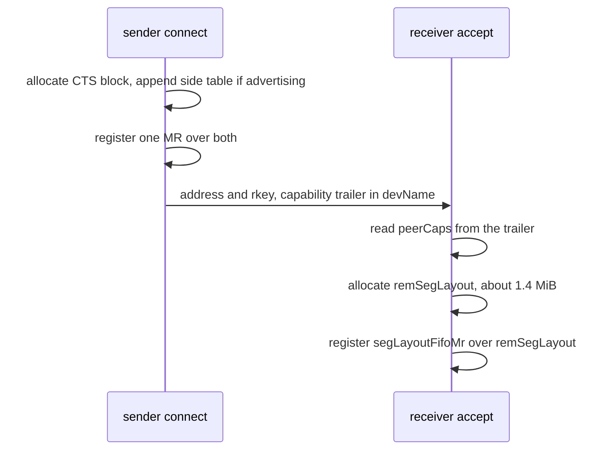
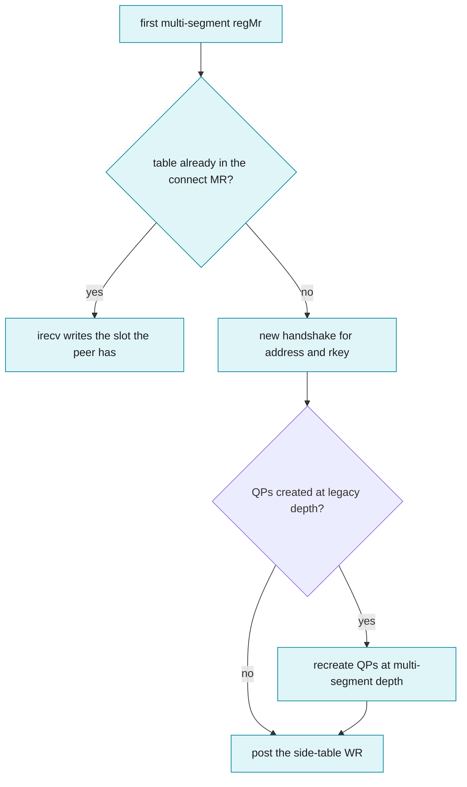
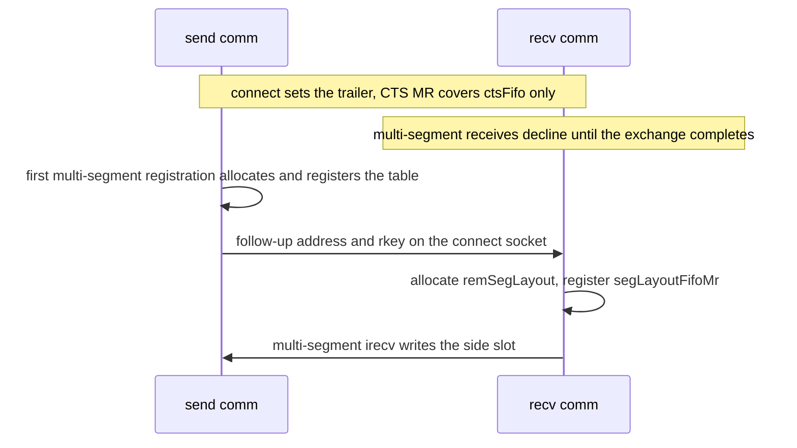

# Follow-up: allocate the side table on first registration

With the switch on, every advertising NET/IB connection reserves a side table of about 1.4 MiB on each side at connect, even if it only ever moves single-segment buffers. This design moves that cost to the first multi-segment registration. That turns out to be a connect-path change with a follow-up handshake, not an edit to `reg.cc` alone, because the address, rkey and QP depths are all fixed at connect. It is design only and is not implemented.

*Terms, diagram colors and callout boxes follow the [overview](multi_segment_overview.md#color-legend).*

> [!NOTE]
> **Status:** design only. The tree reserves the side table at connect whenever the rank advertises `NCCL_IB_CAP_MULTISEG`. The classic commit would go on layer 06 (`users/atulkulk/mseg/06-classic-netib-multisegment`) and the CAST commit on 08 (`users/atulkulk/mseg/08-cast-netib-multisegment`), followed by a restack.

## What connect does today

The side-table layout and the CTS rules are in [classic NET/IB P2P](multi_segment_netib_wire.md#data-structures). The parts that matter here are the following.

- **Classic sender.** `ncclIbSendCommAllocCts` (`net_ib/connect.cc`) allocates one page-aligned block of `NCCL_IB_CTS_FIFO_BYTES`. When `ncclIbAdvertiseMultiSeg()` is true it appends `NCCL_IB_SEG_LAYOUT_FIFO_BYTES` and points `segLayoutFifo` at the second part. One MR covers the block, and its rkey goes in `ncclIbConnectionMetadata`.
- **CAST sender.** In the docs worktree source, `segLayoutFifo` is a member embedded right after `ctsFifo` (a `static_assert` in `common_cast.h`). The covering MR extends over it only when `IbCastAdvertiseMultiSeg()` is true. The wire tip has since moved CAST to the same heap block as classic.
- **Receiver.** Only if the peer advertised, accept allocates `remSegLayout` (256 slots by 8 receives of 704 bytes, about 1.4 MiB). It sets `remSegLayout->addr` to the peer's CTS address plus the CTS size and registers `segLayoutFifoMr` over `remSegLayout->elems` with `IBV_ACCESS_LOCAL_WRITE`. That MR is the local source of the side-table RDMA write. Classic reads `peerCaps` from the trailer unmasked. CAST forces `peerCaps` to 0 when the local switch is off, so a switched-off rank neither writes nor waits on a side table.
- **Depths.** The sender data QP depth, the extra CTS WRs (`NET_IB_MAX_REQUESTS * (resiliency ? 1 : 2)`) and the flush QP depth are chosen in the same connect, from the advertise bit.

## Why first registration is still connect

1. **The rkey is in the connect metadata.** The receiver writes the side slot with the covering CTS MR's rkey. A table created later has a new address and a new MR, and the peer still holds the old rkey. Publishing the new one is another handshake.
2. **The address is fixed at accept.** `remSegLayout->addr` is the peer's CTS address plus the CTS size. If the sender's block did not include the table, the first multi-segment `irecv` would write past the end of the CTS MR.
3. **QP depth is fixed at create.** A QP in RTS does not grow on the first `regMr`. A connect that used the legacy depths cannot later post a side-table WR plus a 16-segment chain.
4. **The first irecv can be the first use.** The receiver fills the slot inside `irecv`, which can race the sender's first `isend`. The write target has to exist when connect completes.

## Options

**Keep today's reservation.** This is the code on 06 and 08. Each side pays about 1.4 MiB even if every buffer stays single-segment. The switch defaults to 0 on HIP, so a default job pays nothing.

**Reserve the address at connect and touch the bytes on first registration.** The MR, rkey, address, capability bit and QP depths stay as they are. The only thing deferred is initializing slot contents, which `ncclIbMalloc` already zeroes. There is no memory saving, so do not implement this.

**Allocate on first multi-segment use and re-handshake.** This is the only option that saves the 1.4 MiB on both sides of a connection that never registers a multi-segment buffer.

- Connect with the switch on still sends the capability trailer, so the peer knows a table may appear. The CTS MR covers only `ctsFifo`. The receiver does not allocate `remSegLayout` or register `segLayoutFifoMr`. QP depths stay at the multi-segment values, because they cannot grow later.
- Add one helper, `ncclIbEnsureSegLayout` (CAST `IbCastEnsureSegLayout`). On the send comm, the first multi-segment registration allocates `segLayoutFifo`, registers its MR and sends `{addr, rkey}` on the existing connect socket. On the receive comm, the first caller allocates `remSegLayout`, registers `segLayoutFifoMr` and installs the exchanged address; it does not use the CTS address plus the CTS size. A second caller on either side returns without allocating.
- Until the exchange completes, a multi-segment receive registration returns `ncclInvalidUsage`, the same decline as a missing capability, and the collective stages. A single-segment buffer never waits. The send side still succeeds, matching `OldPeer_SingleRkeyCrossBoundaryTransfer`: the decline is receive-only.
- Close and the connect error path free a late sender block and a late `remSegLayout` and deregister any MR that was created. CAST's embedded array needs no free, only the late MR and the follow-up.
- Mark the helper and both call sites with `// RCCL:` comments.

## Unchanged

- The 64-byte CTS slot, `NCCL_IB_CTS_NREQS_SIDE_TABLE` and the `ncclIbConnectionMetadata` layout. The address goes in a follow-up message on the connect socket, not in a new metadata field.
- `ncclIbSegLayout` (704 bytes) and the capability trailer, which still means "advertises" and not "table already registered".
- GIN and RMA, which have no CTS side table.
- Flush reads, which stay one per overlapped segment until [flush read collapse](multi_segment_flush_read_collapse.md) lands.
- The HIP default of `NCCL_MULTI_SEGMENT_REGISTER`, the hybrid `hipMemUnmap` teardown and the host-owner DMA-BUF fd path.

## Tests

- Host: an advertising send comm with no multi-segment registration has a CTS MR of `NCCL_IB_CTS_FIFO_BYTES` and a null `segLayoutFifo`, and its recv comm has a null `remSegLayout` and `segLayoutFifoMr`. After the first registration both sides have their table, and a second registration allocates nothing.
- Two-node: the first multi-segment transfer waits for the follow-up and then matches the bytes of `CrossBoundaryTransferSucceeds`; a single-segment transfer on the same comm completes without it.
- Decline: a receiver whose peer has not finished the follow-up returns `ncclInvalidUsage`, and the collective stages.
- Close before and after the first registration deregisters each created MR exactly once.
- CAST: the same sequence with `NCCL_NET=IB-CAST`, including the local-switch-off mask.
- Keep `OldPeer_SingleRkeyCrossBoundaryTransfer` as the case where the sender never advertises. Run on ROCm 7.0.2.2 and 10.2, classic and CAST.
