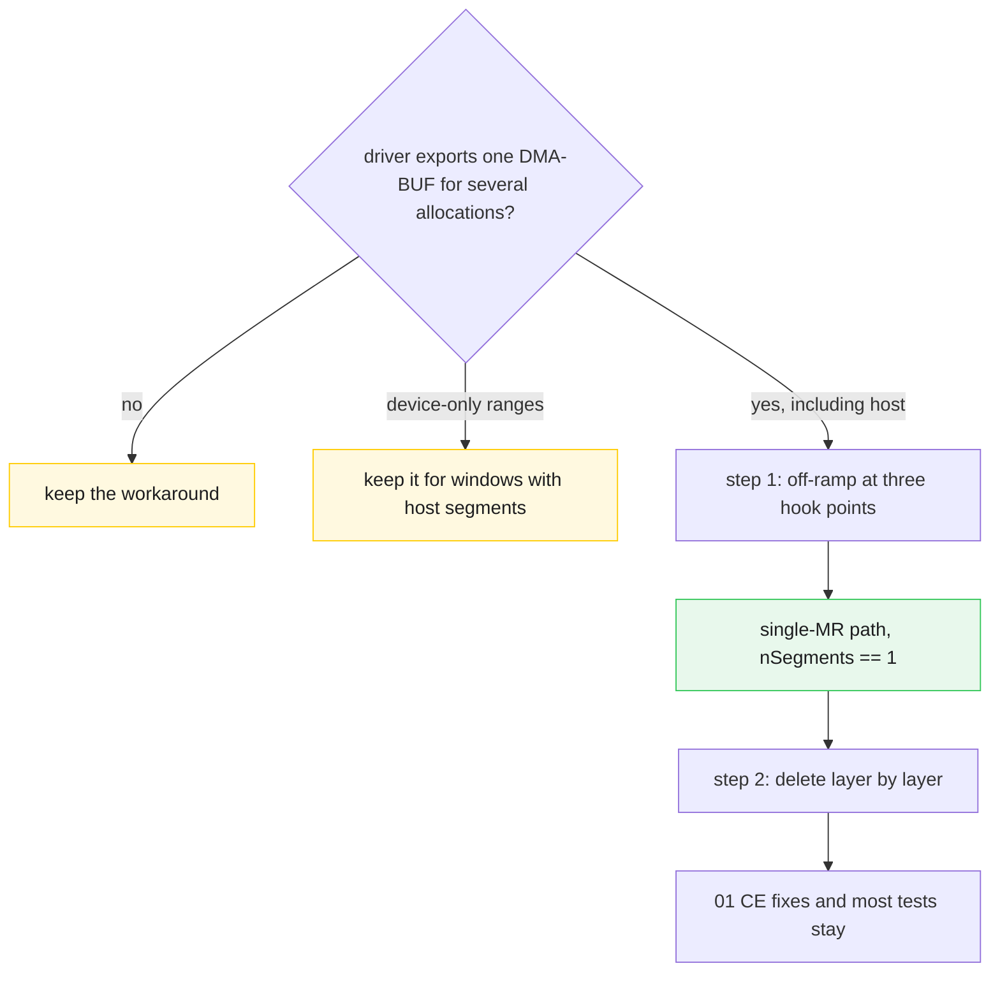

# Upstream sync impact and removal plan

This doc measures how much the multi-segment stack touches files that come from upstream, explains how to resolve a sync conflict in each one, and describes how to switch the workaround off and then delete it once the driver can export one DMA-BUF for a range of several allocations. The RCCL-only bodies sit in contiguous `RCCL:`-marked blocks reached through one-line hooks, so most conflicts are re-adding a hook. Terms follow the [overview](multi_segment_overview.md#terms).

> [!NOTE]
> Line and hunk counts were measured on the wire branch `users/atulkulk/mseg/multi-segment-dmabuf-cast-gin` and the branches below it, rebased onto develop, as `git diff` against that develop base. Later fixes changed a few lines, not the shape.

## Summary

- The stack adds about 15,900 lines in 89 files. About 11,350 are tests, runner configs and tools, and most of the remaining non-source lines are docs; these rarely conflict with an upstream sync.
- Source adds about 4,540 lines in 37 files. 1,834 added lines in 134 hunks land in the 17 source files that come from upstream. Hunks cost effort on every sync; 37 of them are in two files that layers 01 and 02 edit in place (`ce_coll.cc` and `dev_runtime.cc`).
- In the upstream-derived transport files, develop's functions gain only one-line hooks. The bodies are one `RCCL:` block each in `net_ib/gin.cc` (+687, 11 hunks; the block is 671 lines) and `net_ib/p2p.cc` (+590, 14 hunks; 560 lines), and two in `net_ib/reg.cc` (+172, 9 hunks; 79 lines for the range walk, 72 for the per-segment registration). `net.cc` gains 32 lines in 8 hunks.
- IB-CAST (`net_ib_cast/*`) has no upstream counterpart, so it does not affect the sync. It does double the maintenance, because classic and IB-CAST carry parallel copies of the same logic in parallel file pairs.
- If the driver gains multi-allocation export, the workaround can be switched off at three hook points without deleting anything, and then removed layer by layer. Layer 01 is not part of the workaround and stays, and most tests stay as regression tests.

## Where the stack touches upstream-derived code

Source files only. "Hunks" counts `git diff -U0` hunks from develop to the wire branch; sync conflicts scale with hunks more than with lines.

| File | Added / removed | Hunks | Layers | Shape of the change |
|---|---|---|---|---|
| `dev_runtime.cc` | +100 / −39 | 17 | 01, 02, 05 | host VMM location handling and owner propagation (TODO ROCM-29810), the GIN fail-closed check for the switch off, one-line calls to `rcclDevrProbeNonSymWindow`, `rcclDevrGinSegmentRegType` and `rcclDevrRmaRegistersMultiSegment` |
| `ce_coll.cc` | +89 / −34 | 20 | 01 | CE AllReduce receive-window bounds and selector gates, spread across the AllReduce path |
| `transport/net_ib/common.h` | +57 / −2 | 12 | 06 | struct fields (`peerCaps`, `segLayoutFifo`, `segLayoutFifoMr`, `remSegLayout`, segment arrays in `ncclIbMrHandle`, `req->send.mh`), `ncclIbSegLayout`, wider SGE and WR pools |
| `transport/net_ib/connect.cc` | +45 / −5 | 15 | 05, 06 | `ncclIbAdvertiseMultiSeg`, capability trailer, CTS MR sizing, `remSegLayout` allocation, QP depths with their `static_assert`s, lazy flush QP indices |
| `transport/net_ib/p2p.cc` | +590 / −4 | 14 | 06 | one-line `rcclIb*` hooks, the CTS `nreqs` bound in `ncclIbIsend`, one `RCCL:` block with `ncclIbMultiSendSegmented` and the P2P bodies |
| `transport/net.cc` | +32 / −2 | 8 | 03, 06 | `rcclNetRegSegmentCount`, `rcclNetGraphRegSegmentCount`, `rcclNetRegCommit`, the `numSegments > 1` branch that calls `regMrDmaBuf` with `fd = -1` in both proxy register functions, the HSA skip |
| `include/alloc.h` | +19 / −11 | 12 | 02 | host VMM location type on HIP |
| `transport/net_ib/gin.cc` | +687 / −0 | 11 | 05 | include of `rma_multiseg.h`, one-line `rcclRmaIbProxy*` dispatches, `free(regConsensus)`, one `RCCL:` block with the handle, WR builder and bodies |
| `transport/net_ib/reg.cc` | +172 / −1 | 9 | 05, 06 | `calloc` and partial unwind in the single-MR registration, the `fd == -1` route and dereg hook, `rcclIbRegMrDmaBufFromRange`, `ncclIbRegMrDmaBufMultiSeg`, `rcclIbDeregMrMultiSeg` |
| eight more files | +45 / −22 | 16 | 01, 02, 03, 05, 06 | `enqueue.cc`, `ce_coll.h`, `comm.h`, `dev_runtime.h`, `hip_compat.h`, `register.h`, `net_ib/gin.h` (`regConsensus`), `net_ib/connect.h` (a metadata `static_assert`); one to three small hunks each |

RCCL-only source files the stack adds, with no sync cost:

| File | Lines | Layer | Contents |
|---|---|---|---|
| `rccl_dev_runtime.cc` | 125 | 02 | `rcclDevrProbeNonSymWindow`, `rcclDevrGinSegmentRegType`, `rcclDevrRmaRegistersMultiSegment` |
| `transport/net_ib/rma_multiseg.h` | 220 | 05 | shared RMA limits, QP depths, helpers, `rcclRmaMultiSegEnabled` |
| `transport/net_ib/multiseg.h` | 238 | 06 | boundary math, capability trailer, CTS side-table rules |
| `transport/rccl_ib_multiseg.h` | 22 | 06 | private declarations of the classic and IB-CAST multi-segment registration and deregistration |
| `transport/net_ib_cast/rccl_reg_multiseg_cast.cc` | 95 | 08 | `IbCastRegMrDmaBufMultiSeg` with the IB-CAST declines, `rcclIbCastDeregMrMultiSeg` |

The stack also changes RCCL-only files that already existed: `rccl_wrap.cc` (the NET segment-count cache), `rccl_common.h`, `rocmwrap.*`, `CMakeLists.txt`, `ce_fault_inject.h`, and the rest of `net_ib_cast/*` (`p2p.cc` +733, `reg.cc` +99, `gin.cc` +853, plus `common_cast.h`, `connect.cc`, `connect_cast.h` and the AINIC recovery file).

## How the footprint is kept small

- Each GIN and RMA entry point in `net_ib/gin.cc` (and `net_ib_cast/gin.cc`) runs develop's body after a one-line `if (rcclRmaMultiSegEnabled()) return rcclRmaIbProxy...(...)`. The range, zero-size, sequence-id and WR-budget fixes live only in the multi-segment bodies.
- The segmented send and multi-segment flush are `static inline` functions in one `RCCL:` block of `net_ib/p2p.cc`, because they need that file's static helpers; a separate header included mid-file was tried and folded back. `ncclIbMultiSend` keeps develop's chunk math, and `ncclIbQpChunkSize` is used only by the segmented send.
- The NET export walk left `net.cc`: `net.cc` calls the existing `regMrDmaBuf` hook with `fd = -1` and a packed count, and each plugin's `reg.cc` walks the range.
- The host VMM probe and the GIN registration type live in `rccl_dev_runtime.cc`. The owner-propagation block in `symMemoryMapLsaTeam` stays inline because it edits the exchanged segment messages.
- The inline helpers moved to `multiseg.h`; the struct fields are still separate members.

> [!NOTE]
> What cannot move: the 01 CE fixes edit upstream logic rather than add functions, the capability bit and side-table FIFO need fields in upstream structs, and the QP depths are set where develop creates the QPs. For 01 the cheapest option is to offer the receive-window fix upstream, since the bug is not AMD-specific.

## How to resolve a sync conflict

- In `net_ib/gin.cc`, `net_ib/p2p.cc` and `net_ib/reg.cc`, keep each `RCCL:` block as a unit; the blocks do not interleave with develop's functions.
- In `net_ib/gin.cc`, take upstream's body and re-add the one-line dispatch at the top of each RMA entry point, the `rcclRmaIbProxyConnectFinish` call, the `NCCL_NET_IB_REQ_FAILED` check in `Test`, and the `free(regConsensus)` in close. If upstream changes a signature, update the matching declaration in `rma_multiseg.h`.
- In `net_ib/p2p.cc`, take upstream's body and re-add the `rcclIb*` calls at the points listed in the [classic data path](multi_segment_netib_wire.md#data-path). If upstream changes the chunk math in `ncclIbMultiSend`, mirror it in `ncclIbQpChunkSize`.
- In `net.cc`, re-add the `numSegments > 1` branch before the DMA-BUF export in both proxy register functions, and the segment-count and commit calls.
- In `net_ib/reg.cc`, re-add the `fd == -1` route at the top of `ncclIbRegMrDmaBuf` and the dereg hook in `ncclIbDeregMr`.
- In `net_ib/connect.cc` and `net_ib/common.h`, keep the QP-depth expressions and their `static_assert`s; they tie `NCCL_IB_MAX_SEND_WRS` to `NCCL_RMA_SEND_QP_WRS`.

## Removal once the driver exports multi-allocation ranges

### What the driver has to provide

The workaround exists because ROCm's DMA-BUF export for an address range describes only the first physical allocation. Removal needs `hipMemGetHandleForAddressRange` (through `cuMemGetHandleForAddressRange`) to return one DMA-BUF covering the whole range, so one `ibv_reg_dmabuf_mr` registers it. That must hold for the DeepEP layouts, which mix device and host segments in one window. If the driver fixes only device-only ranges, keep the workaround for windows with host segments.

### Step 1: switch it off without deleting code

`NCCL_MULTI_SEGMENT_REGISTER=0` already removes every multi-segment path ([switch-off behavior](multi_segment_current.md#switch-off-behavior)). It is not enough on its own, because develop treats a multi-segment buffer as unregistrable: NET stages it and `symMemoryRegisterGin` rejects a device-only multi-segment window. With driver support those buffers should take develop's single-MR path instead. Each of the three hook points already has a branch that is exactly the develop path:

| Site | Today | With driver support |
|---|---|---|
| `transport/net.cc`, `sendProxyRegBuffer` and `recvProxyRegBuffer` | `if (numSegments > 1)` calls `regMrDmaBuf` with `fd = -1` and a packed count | add `&& !rcclDmaBufRangeExportSupported()` (proposed name) so the range goes to develop's export and `regMrDmaBuf`, and allow the HSA fallback again |
| `net_ib/rma_multiseg.h`, `rcclRmaMultiSegEnabled()` | returns the switch; gates every GIN dispatch, the consensus buffer and the RMA QP depths | return false when supported, so `gin.cc` runs develop's single-MR registration |
| `rccl_dev_runtime.cc` and `dev_runtime.cc`, the window gates and the GIN fail-closed check | multi-segment windows need the per-segment backend, a DMA-BUF MR and the switch | accept a multi-segment window on any backend and drop the fail-closed check |

With one MR per buffer, everything downstream sees `nSegments == 1`: no side table is sent, the segmented send and WR builder are not entered, and the IB-CAST declines never trigger. The capability bit can stay advertised; it costs only the larger CTS MR and QP depths. The predicate should be a runtime probe or a HIP version gate so one build still runs on older drivers. This is one small commit and can ship before any deletion.

### Step 2: delete the code, layer by layer

| Layer | Branch | Source added / removed | Removal trigger | Effort |
|---|---|---|---|---|
| 01 CE receive window | `01-ce-recv-window-offset` | +164 / −44 | none: CE AllReduce bug fixes, not part of the workaround | keep |
| 02 Host VMM compat | `02-amd-host-vmm-compat` | +259 / −77 | ROCM-29810 (imported VMM keeps its location type) for owner propagation; minimum supported HIP for the host location shim | small: delete the owner-propagation block and the shim; keep the probe-kind allgather while host VMM cannot use IPC |
| 03 Registration range | `03-registration-range` | +46 / −0 | multi-segment export | small; the page-tail walk fix is correct on its own and can stay |
| 05 Classic GIN/RMA | `05-gin-rma-multisegment` | +916 / −7 | multi-segment export | small: delete the `RCCL:` block in `net_ib/gin.cc` and the dispatches; remove `rma_multiseg.h` together with the wire layer |
| 06 Classic NET/IB P2P | `06-classic-netib-multisegment` | +1,135 / −18 | multi-segment export | medium: `multiseg.h`, `rccl_ib_multiseg.h`, the `RCCL:` blocks in `p2p.cc` and `reg.cc`, the `fd = -1` branch, the hooks, side-table FIFO, capability trailer and QP depths |
| 07 Tests and CI | `07-hybrid-stress-ci` | tests only (+2,088 / −167) | HIP 7.17 for the non-blocking test stream | keep the hybrid and stress tests as regression tests |
| 08 IB-CAST P2P | `08-cast-netib-multisegment` | +1,087 / −52 | multi-segment export | medium, RCCL-only; keep the hardening fixes (PD refcount, `IbCastDestroyBase` NULL guards, accept and irecv error paths) |
| wire IB-CAST GIN | `multi-segment-dmabuf-cast-gin` | +958 / −41 | multi-segment export | small: the `RCCL:` block in `net_ib_cast/gin.cc` and the dispatches; remove with 05 |

> [!IMPORTANT]
> Mixed versions during removal fall back safely: a rank without the code sends no capability trailer, so a peer that still has it reads `peerCaps == 0` and declines multi-segment receives on that connection, while its sends still split locally onto the single rkey. GIN registration is collective, so every rank in a communicator must run the same build anyway.

### What happens to the tests

Most multi-segment tests keep their value, because DeepEP still builds windows from several allocations; with driver support they run through the single-MR path. Tests that assert the workaround's internals must change or go:

- assertions on the per-segment MR count, such as the NET segment count of 8 in `UBR_MultiSegment.Generic`;
- `RmaSegmentMathTests` and `NetIbMultiSegmentUnitTests`, which test the boundary math directly;
- side-table, capability-bit and decline checks in the NET/IB and IB-CAST MPI suites, including `MultiSegmentRegisterOff_DeclinesRegistration` and `CastUnsafeMode_DeclinesRegistration`;
- the send-queue oversubscribe tests (`SendQueueFatChainOversubscribe`, `IPutSignalSendQueueOversubscribe`), whose long chains exist only because each 16-segment buffer splits into one WR per segment.

## Recommendation

1. Add the off-ramp predicate now as a no-op returning false at the three hook points, so a driver fix is a one-line change.
2. Keep new multi-segment code in the `RCCL:` block of the file it hooks, or in `multiseg.h` and `rma_multiseg.h`, and reach it through one-line hooks.
3. Offer the 01 receive-window fix upstream.
4. Revisit the 02 owner-propagation block and the struct-field grouping when ROCM-29810 is fixed.
