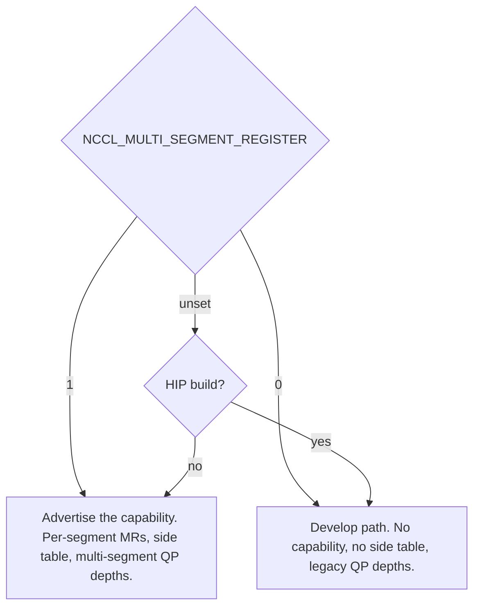
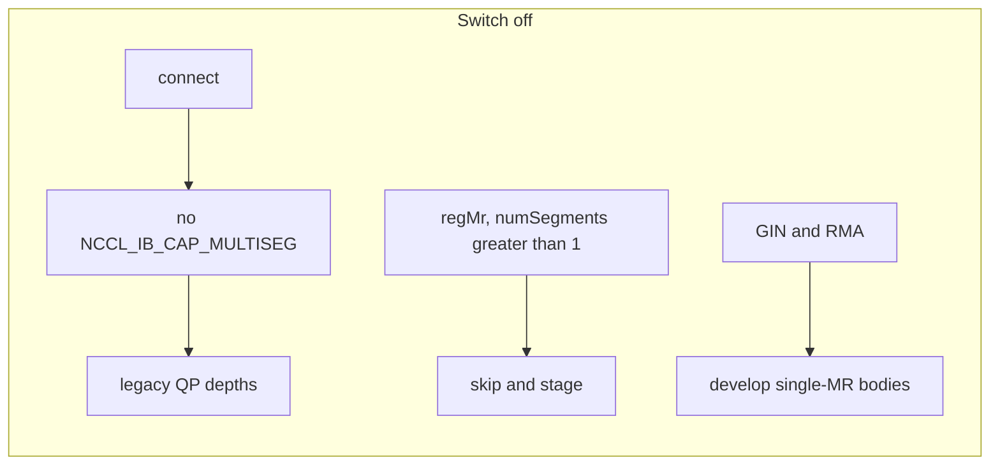
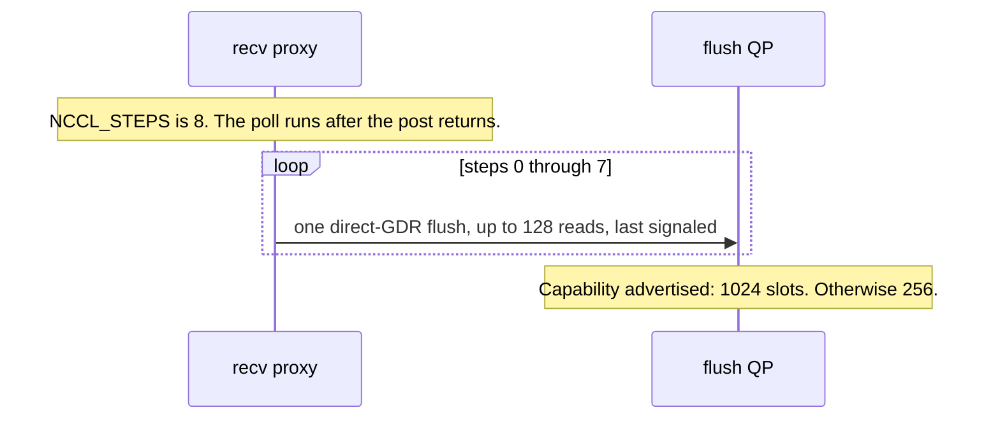
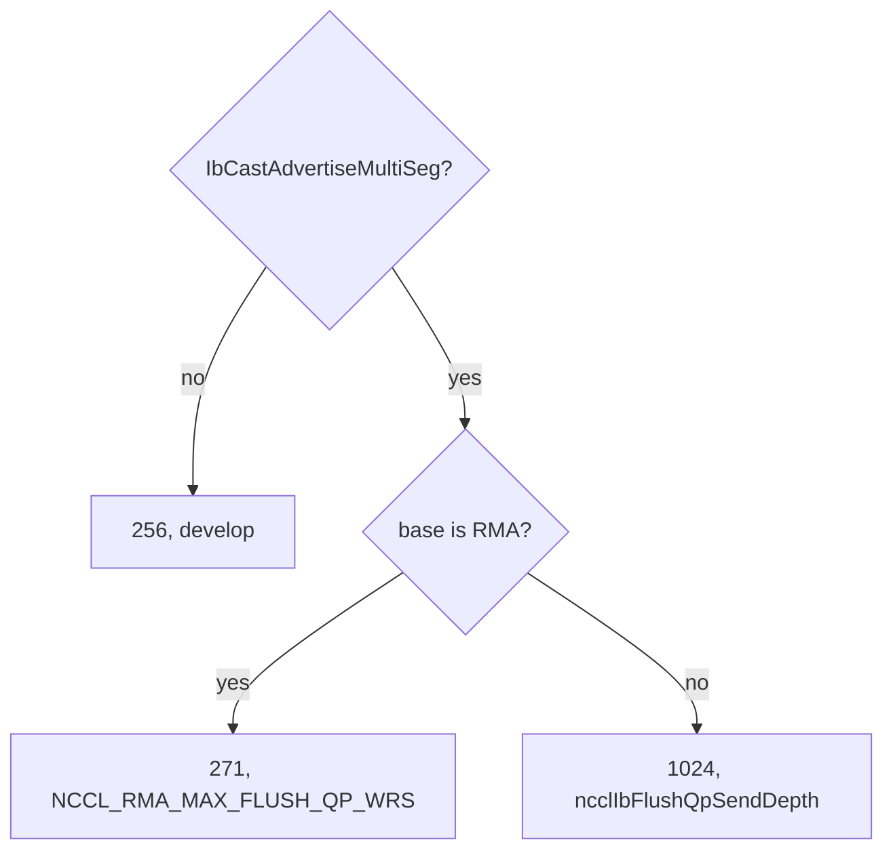
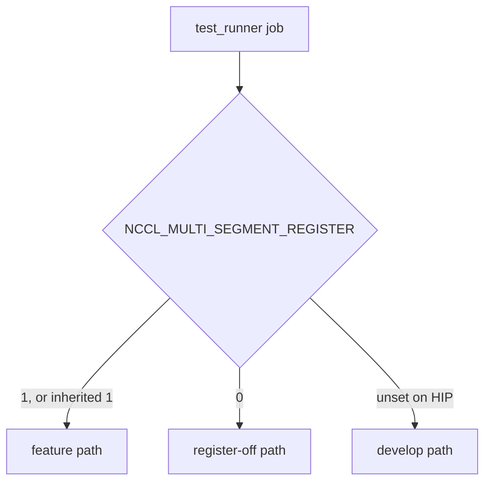

# Multi-segment DMA-BUF — upstream sync impact and removal plan

Last updated 2026-10-14. Measured on the wire branch `users/atulkulk/mseg/multi-segment-dmabuf-cast-gin` (`3a5b9893274d`) and the stacked branches below it, rebased onto `develop` (`93bd837e4d64`). Line counts are `git diff` against that develop base.

## What changed on 2026-10-16

HIP now defaults `NCCL_MULTI_SEGMENT_REGISTER` to 0. The knob is still `ncclParamMultiSegmentRegister()` in `transport/generic.cc`. `NCCL_MULTI_SEGMENT_REGISTER=1` turns the feature on, on HIP and on every other build. An unset variable takes the develop path on a HIP build. A non-HIP build still defaults to 1. The commit is `9af53b9bca21` on `users/atulkulk/mseg/01-ce-recv-window-offset`, replayed through the stack.

With the switch off, connect does not advertise `NCCL_IB_CAP_MULTISEG` and does not append the side table, so the sender QP stays at `2 * NET_IB_MAX_REQUESTS`. NET, P2P IPC and NVLS leave a multi-segment buffer unregistered. GIN and RMA stay on develop's bodies and do not reserve credits. A device-only GIN window with more than one segment and no sysmem returns `ncclInvalidUsage` instead of registering only the first segment.

The direct-GDR flush QP is sized for one chain on every proxy step. `recvProxyProgress` posts `iflush` into `requests[step % NCCL_STEPS]` and returns before that flush is polled, so up to 8 flushes can be outstanding. With `RCCL_GDR_FLUSH_GPU_MEM_NO_RELAXED_ORDERING=0`, `rcclIbIflushMultiSeg` posts one RDMA read per receive per segment, at most `8 * 16 = 128` work requests, and signals only the last. Eight chains need `8 * 128 = 1024` slots. The previous depth, `NET_IB_MAX_REQUESTS + 128 = 384`, held three chains and the fourth post failed. `ncclIbFlushQpSendDepth` in `net_ib/multiseg.h` returns `NCCL_STEPS * NCCL_NET_IB_MAX_RECVS * NCCL_IB_MAX_SEGMENTS` when the peer advertised the capability, and `NET_IB_MAX_REQUESTS` (256) otherwise. Classic `ncclIbCreateFlushQp` calls it. `connect.cc` static-asserts that the multi-segment result holds at least one chain per step. The host test is `NetIbMultiSeg.FlushQpDepthCoversEveryOutstandingStep`.

CAST non-RMA comms use the same helper. CAST RMA comms keep `NCCL_RMA_MAX_FLUSH_QP_WRS` (271), because RMA credits wait until one chain completes before the next post. With the switch off every flush QP stays at 256.

The scratchpad flush (`RCCL_GDR_FLUSH_GPU_MEM_NO_RELAXED_ORDERING=1`, the default) posts one write and one read and does not fill 1024 slots. The enlarged depth is for the direct-GDR path. `net_ib_multisegment_flush` selects that path by setting the parameter to 0.

Jobs that test the feature set `NCCL_MULTI_SEGMENT_REGISTER=1` in the runner config, because an unset HIP job now takes the off path. Register-off jobs stay at 0. `cast_multisegment_opt_recv_2qp` inherits 1 from `cast_multisegment_opt_recv`. `net_ib_rma_multisegment_wrbatch` on the wire branch, and the hybrid nightly jobs on 09 including `net_ib_multisegment_hybrid_stress_nightly`, set 1 as well. The WR-batch job fails under `RCCL_TEST_RMA_MSEG_REQUIRE=1` when the per-segment registration log is missing, and the hybrid IGet stress skips. `multisegment_host_boundary_math` is host-only and does not read the switch.

## What changed on 2026-10-14

- The RCCL-only bodies were folded back into the files they hook: `net_ib/gin_multiseg.h` into `net_ib/gin.cc`, `net_ib/p2p_multiseg.h` into `net_ib/p2p.cc`, `net_ib/rccl_reg_multiseg.cc` into `net_ib/reg.cc`, `net_ib_cast/p2p_multiseg_cast.h` into `net_ib_cast/p2p.cc`, and `net_ib_cast/gin_multiseg_cast.h` into `net_ib_cast/gin.cc`. `transport/rccl_ib_multiseg.cc` was removed: `net.cc` now calls the plugin's `regMrDmaBuf` with `fd = -1` and a packed segment count, and each plugin's `reg.cc` walks the range.
- Develop's functions still carry one-line hooks, and the hunk count in upstream-derived files is nearly unchanged (134, was 131). The added-line count there rose from 429 to 1,834, because the bodies now sit in those files, as contiguous `RCCL:`-marked blocks rather than interleaved edits. A sync conflict in a hook file is resolved by keeping that block and re-adding the hooks (§2). The gain is one file per hook: no second file to keep in step, and no header included from the middle of an upstream file.
- §1 and §3 have the new measurements.

## What changed since the 2026-10-07 revision

- The 2026-10-07 revision was a set of proposals. The reworked stack implements the main ones: multi-segment bodies are separate from develop's functions (then in RCCL-only files, folded back on 2026-10-14), and develop's functions carry one-line hooks. §1 has the new measurements and §2 maps each proposal to what shipped.
- The upstream-file footprint dropped from about 2,000 added lines in 174 hunks to 429 added lines in 131 hunks (1,834 lines in 134 hunks after the 2026-10-14 fold).
- `NCCL_MULTI_SEGMENT_REGISTER=0` now turns off every multi-segment path and restores develop's behavior, so §3 uses it as the first off switch. It is still not the same as driver support, because it stages multi-segment NET buffers and rejects device-only multi-segment GIN windows.
- The proposed names `ncclRmaIsMultiSeg`, `ncclRmaIbProxyIPutMultiSeg` and `net_ib/rccl_multiseg_p2p.cc` were not used. The shipped names are `rcclRmaMultiSegEnabled()`, `rcclRmaIbProxyIPut` and friends, with the bodies in `net_ib/gin.cc`, `net_ib/p2p.cc` and `net_ib/reg.cc`. The off-ramp predicate (proposed name `rcclDmaBufRangeExportSupported`) is still not implemented.

## Summary

- The stack adds about 15,900 lines in 89 files. About 11,350 are tests, runner configs and tools, and most of the rest of the non-source lines are docs; these rarely conflict with an upstream sync.
- Source adds about 4,540 lines in 37 files. 1,834 added lines in 134 hunks land in the 17 source files that come from upstream. Hunks are what cost effort on every sync; 37 of them are in two files that layers 01 and 02 edit in place (`ce_coll.cc` and `dev_runtime.cc`).
- In the upstream-derived transport files, develop's functions gain only one-line hooks, and the multi-segment bodies sit in contiguous `RCCL:`-marked blocks: one each in `net_ib/gin.cc` (+687, 11 hunks; the block is 671 lines) and `net_ib/p2p.cc` (+590, 14 hunks; 560 lines), and two in `net_ib/reg.cc` (+172, 9 hunks; 79 lines for the range walk before `ncclIbRegMrDmaBuf`, 72 for the per-segment registration). `net.cc` gains 32 lines in 8 hunks.
- IB-CAST (`net_ib_cast/*`) has no upstream counterpart, so its code does not affect the sync. It does double the maintenance, because classic and CAST carry parallel copies of the same logic, in parallel file pairs (`net_ib/p2p.cc` / `net_ib_cast/p2p.cc`, `net_ib/reg.cc` / `net_ib_cast/reg.cc` plus `rccl_reg_multiseg_cast.cc`, `net_ib/gin.cc` / `net_ib_cast/gin.cc`).
- If the driver gains DMA-BUF export for a range that spans several physical allocations, the workaround can be switched off at three hook points without deleting anything, and then removed layer by layer. 01 is not part of the workaround and stays. Most tests should stay as regression tests.

## 1. Where the stack touches upstream-derived code

Source files only. "Hunks" counts `git diff -U0` hunks from develop to the wire branch; sync conflicts scale with hunks more than with lines.

| File | Added / removed | Hunks | Layers | Shape of the change |
|---|---|---|---|---|
| `dev_runtime.cc` | +100 / −39 | 17 | 01, 02, 05 | Host VMM location handling and owner propagation (TODO ROCM-29810), the GIN fail-closed check for `NCCL_MULTI_SEGMENT_REGISTER=0`, and one-line calls to `rcclDevrProbeNonSymWindow`, `rcclDevrGinSegmentRegType` and `rcclDevrRmaRegistersMultiSegment` |
| `ce_coll.cc` | +89 / −34 | 20 | 01 | CE AllReduce receive-window bounds and selector gates; spread across the AllReduce path |
| `transport/net_ib/common.h` | +57 / −2 | 12 | 06 | Struct fields (`peerCaps`, `segLayoutFifo`, `segLayoutFifoMr`, the `remSegLayout` pointer, segment arrays in `ncclIbMrHandle`, `req->send.mh`), `ncclIbSegLayout`, wider SGE/WR pools |
| `transport/net_ib/connect.cc` | +45 / −5 | 15 | 05, 06 | `ncclIbAdvertiseMultiSeg`, capability trailer, CTS MR sizing, `remSegLayout` allocation for a capable peer, QP depths with their `static_assert`s, lazy flush QP indices |
| `transport/net_ib/p2p.cc` | +590 / −4 | 14 | 06 | One-line `rcclIb*` hooks, the CTS `nreqs` bound in `ncclIbIsend`, and one `RCCL:` block with `ncclIbMultiSendSegmented` and the `rcclIb*` P2P bodies |
| `transport/net.cc` | +32 / −2 | 8 | 03, 06 | `rcclNetRegSegmentCount` / `rcclNetGraphRegSegmentCount` / `rcclNetRegCommit` calls, the `numSegments > 1` branch that calls `regMrDmaBuf` with `fd = -1` in both proxy register functions, the HSA skip for multi-segment |
| `include/alloc.h` | +19 / −11 | 12 | 02 | Host VMM location type on HIP |
| `transport/net_ib/gin.cc` | +687 / −0 | 11 | 05 | Include of `rma_multiseg.h`, one-line `rcclRmaIbProxy*` dispatches, `free(regConsensus)`, and one `RCCL:` block with the classic GIN multi-segment handle, WR builder and `rcclRmaIbProxy*` bodies |
| `transport/net_ib/reg.cc` | +172 / −1 | 9 | 05, 06 | `calloc` and partial unwind in develop's single-MR registration, the `fd == -1` route and dereg hook, and the `RCCL:` functions `rcclIbRegMrDmaBufFromRange`, `ncclIbRegMrDmaBufMultiSeg` and `rcclIbDeregMrMultiSeg` |
| Eight more files | +45 / −22 | 16 | 01, 02, 03, 05, 06 | `enqueue.cc`, `ce_coll.h`, `comm.h`, `dev_runtime.h`, `hip_compat.h`, `register.h`, `net_ib/gin.h` (the `regConsensus` field), `net_ib/connect.h` (a metadata `static_assert`); one to three small hunks each |

RCCL-only source files the stack adds (no sync cost):

| File | Lines | Layer | Contents |
|---|---|---|---|
| `rccl_dev_runtime.cc` | 125 | 02 | `rcclDevrProbeNonSymWindow`, `rcclDevrGinSegmentRegType`, `rcclDevrRmaRegistersMultiSegment` |
| `transport/net_ib/rma_multiseg.h` | 220 | 05 | shared RMA limits, QP depths, helpers, `rcclRmaMultiSegEnabled` |
| `transport/net_ib/multiseg.h` | 238 | 06 | boundary math, capability trailer, CTS side-table rules |
| `transport/rccl_ib_multiseg.h` | 22 | 06 | private declarations of `ncclIbRegMrDmaBufMultiSeg`, `IbCastRegMrDmaBufMultiSeg`, `rcclIbCastDeregMrMultiSeg` |
| `transport/net_ib_cast/rccl_reg_multiseg_cast.cc` | 95 | 08 | `IbCastRegMrDmaBufMultiSeg` (with the CAST declines), `rcclIbCastDeregMrMultiSeg` |

The stack also changes RCCL-only files that already existed: `rccl_wrap.cc` (the NET segment-count cache), `rccl_common.h`, `rocmwrap.*`, `CMakeLists.txt`, `ce_fault_inject.h`, and the rest of `net_ib_cast/*` (`common_cast.h`, `connect.cc`, `connect_cast.h`, `p2p.cc` +733, `reg.cc` +99, `gin.cc` +853, the AINIC recovery file).

## 2. Sync-footprint proposals and what shipped

| # | Proposal (2026-10-07) | What shipped |
|---|---|---|
| 1 | Restore develop's IPut / IGet / IPutSignal / IFlush bodies in `net_ib/gin.cc` and branch early into RCCL code | Done. `gin.cc` runs develop's bodies; each entry point starts with `if (rcclRmaMultiSegEnabled()) return rcclRmaIbProxy...(...)`, and the bodies are one `RCCL:` block in the same file. The range, zero-size, sequence-id and WR-budget fixes stay in the multi-segment bodies only. CAST `net_ib_cast/gin.cc` has the same shape. |
| 2 | Move the segmented send and the multi-segment flush out of `net_ib/p2p.cc` | Done as separate `static inline` functions in one `RCCL:` block of `net_ib/p2p.cc`, because they need `p2p.cc`'s static helpers (a header included by `p2p.cc` was tried and folded back on 2026-10-14). `ncclIbMultiSend` keeps develop's inline chunk math; `ncclIbQpChunkSize` is used only by the segmented send. CAST mirrors it in `net_ib_cast/p2p.cc`. |
| 3 | Move the NET export walk and the plugin multi-segment registration into RCCL files | Done differently. The export walk left `net.cc` entirely: `net.cc` calls the existing `regMrDmaBuf` hook with `fd = -1` and a packed count, and the walk is `rcclIbRegMrDmaBufFromRange` in `net_ib/reg.cc` (CAST `IbCastRegMrDmaBufFromRange` in `net_ib_cast/reg.cc`). `ncclIbRegMrDmaBufMultiSeg` and `rcclIbDeregMrMultiSeg` are in `net_ib/reg.cc`; CAST's are in `net_ib_cast/rccl_reg_multiseg_cast.cc`. |
| 4 | Move the host VMM probe and classification out of `dev_runtime.cc` | Done for the probe (`rcclDevrProbeNonSymWindow`) and the GIN registration type (`rcclDevrGinSegmentRegType`) in `rccl_dev_runtime.cc`. The owner-propagation block in `symMemoryMapLsaTeam` stays inline because it edits the exchanged segment messages. |
| 5 | Move the `net_ib/common.h` helpers into `multiseg.h` and group the new struct fields | Partly done. The inline helpers moved to `multiseg.h` and the `RCCL:` block of `net_ib/p2p.cc`; the struct fields are still separate members. |
| 6 | Keep each hook to one line | Done for the transport hooks; most hooks are one statement or one `if` with a `return`. |

What cannot move: the 01 CE fixes are edits to upstream logic, not new functions; the capability bit and side-table FIFO need fields in upstream structs; and the QP depths are set where develop creates the QPs. For 01 the lowest-cost option is to offer the receive-window fix upstream, since the bug is not AMD-specific.

### How to resolve a sync conflict

- In `net_ib/gin.cc`, `net_ib/p2p.cc` and `net_ib/reg.cc`, keep each `RCCL:` block of multi-segment functions as a unit; the blocks do not interleave with develop's functions.
- In `net_ib/gin.cc`, take upstream's body and re-add the one-line dispatch at the top of each RMA entry point, the `rcclRmaIbProxyConnectFinish` call, the `NCCL_NET_IB_REQ_FAILED` check in `Test`, and the `free(regConsensus)` in close. If upstream changes a signature, update the matching `rcclRmaIbProxy*` declaration in `rma_multiseg.h`.
- In `net_ib/p2p.cc`, take upstream's body and re-add the `rcclIb*` calls at the same points (§9.4 of [`multi_segment_dmabuf_gin_and_netib.md`](multi_segment_dmabuf_gin_and_netib.md) lists them). If upstream changes `ncclIbMultiSend`'s chunk math, mirror it in `ncclIbQpChunkSize`.
- In `net.cc`, re-add the `numSegments > 1` branch (the `regMrDmaBuf` call with `fd = -1`) before the DMA-BUF export in both proxy register functions, and the segment-count and commit calls.
- In `net_ib/reg.cc`, re-add the `fd == -1` route at the top of `ncclIbRegMrDmaBuf` and the dereg hook in `ncclIbDeregMr`.
- In `net_ib/connect.cc` and `net_ib/common.h`, keep the QP-depth expressions and their `static_assert`s; they tie `NCCL_IB_MAX_SEND_WRS` to `NCCL_RMA_SEND_QP_WRS`.

## 3. What removal looks like if the driver handles multi-segment export

### What the driver has to provide

The workaround exists because ROCm's DMA-BUF export for an address range describes only the first physical allocation. Removal needs `hipMemGetHandleForAddressRange` (through `cuMemGetHandleForAddressRange`) to return one DMA-BUF that covers the whole range, so one `ibv_reg_dmabuf_mr` registers it. That must hold for the DeepEP layouts, which mix device and host segments in one window (`[GPU][CPU]` and `[GPU][CPU x local ranks]`). If the driver only fixes device-only ranges, keep the workaround for windows that contain host segments.

### Step 1: switch it off without deleting code

`NCCL_MULTI_SEGMENT_REGISTER=0` already removes every multi-segment code path: no capability is advertised, develop's QP depths and GIN/RMA bodies run, and no consensus buffer is allocated. It is not enough on its own, because develop treats a multi-segment buffer as unregistrable: NET stages it, and `symMemoryRegisterGin` rejects a device-only multi-segment window. With driver support the switch should instead let those buffers take develop's single-MR path. There are three hook points, and each already has a branch that is exactly the develop path:

| Site | Today | With driver support |
|---|---|---|
| `transport/net.cc`, `sendProxyRegBuffer` / `recvProxyRegBuffer` | `if (numSegments > 1)` calls `regMrDmaBuf` with `fd = -1` and a packed count | Add `&& !rcclDmaBufRangeExportSupported()` (proposed name) so the range goes to develop's `cuMemGetHandleForAddressRange` + `regMrDmaBuf` branch, and allow the HSA fallback again |
| `net_ib/rma_multiseg.h`, `rcclRmaMultiSegEnabled()` | Returns the switch; gates every classic and CAST GIN dispatch, the consensus buffer and the RMA QP depths | Return false when supported, so `gin.cc` runs develop's single-MR registration on the whole range |
| `rccl_dev_runtime.cc` and `dev_runtime.cc`, `rcclDevrRmaRegistersMultiSegment` / `rcclDevrGinSegmentRegType` / the GIN fail-closed check | Multi-segment windows need the per-segment backend, a DMA-BUF MR, and the switch | Accept a multi-segment window for any backend and drop the fail-closed check when supported |

With one MR per buffer, everything downstream sees `nSegments == 1`. The CTS side table is sent only for multi-segment slots, the segmented send and the segmented WR builder are not entered, and CAST's multi-segment declines no longer trigger. The capability bit can stay advertised; it costs only the larger CTS MR and QP depths. The predicate should be a runtime probe or a HIP version gate, so one RCCL build still runs on older drivers. This is one small commit, and it can ship before any deletion.

### Step 2: delete the code, layer by layer

| Layer | Branch | Source added / removed | Removal trigger | Removal effort |
|---|---|---|---|---|
| 01 CE receive window | `01-ce-recv-window-offset` | +164 / −44 | None. These are CE AllReduce bug fixes, not part of the workaround | Keep |
| 02 Host VMM compat | `02-amd-host-vmm-compat` | +259 / −77 | ROCM-29810 (imported VMM keeps its location type) for owner propagation; minimum supported HIP for the host location shim | Small. Delete the owner-propagation block (marked with a TODO) and the shim; keep the probe-kind allgather while host VMM cannot use IPC |
| 03 Registration range | `03-registration-range` | +46 / −0 | Multi-segment export. The NET segment count only feeds the per-segment path | Small. The page-tail walk fix is correct on its own and can stay |
| 05 Classic GIN/RMA | `05-gin-rma-multisegment` | +916 / −7 | Multi-segment export | Small. Delete the `RCCL:` block in `net_ib/gin.cc` and the dispatches; `rma_multiseg.h` goes together with the wire layer |
| 06 Classic NET/IB P2P | `06-classic-netib-multisegment` | +1,135 / −18 | Multi-segment export | Medium. Delete `multiseg.h`, `rccl_ib_multiseg.h`, the `RCCL:` blocks in `net_ib/p2p.cc` and `net_ib/reg.cc`, the `fd = -1` branch in `net.cc`, the hooks, the side-table FIFO, the capability trailer and the QP-depth changes |
| 07 Tests and CI | `07-hybrid-stress-ci` | tests only (+2,088 / −167) | HIP 7.17 for the non-blocking test stream; nothing for the rest | Keep the hybrid and stress tests as regression tests |
| 08 CAST P2P | `08-cast-netib-multisegment` | +1,087 / −52 | Multi-segment export | Medium. RCCL-only code, no sync risk while doing it; keep the hardening fixes (PD refcount, `IbCastDestroyBase` NULL guards, accept and irecv error paths) |
| wire CAST GIN | `multi-segment-dmabuf-cast-gin` | +958 / −41 | Multi-segment export | Small. Delete the `RCCL:` block in `net_ib_cast/gin.cc` and the dispatches; shares `rma_multiseg.h` with 05, so remove the two together |

Wire compatibility during removal: a rank without the code does not send the capability trailer, so a peer that still has the code reads `peerCaps == 0` and declines multi-segment receives for that connection (its sends still split locally onto the single rkey). Mixed versions therefore fall back safely. GIN registration is collective, so every rank in a communicator must run the same build anyway.

### What happens to the tests

Most multi-segment tests keep their value after removal, because they exercise windows built from several allocations, which DeepEP still uses. With driver support they pass through the single-MR path. Tests that assert the workaround's internals have to change or go:

- assertions on the per-segment MR count, such as the NET segment count equal to 8 in `UBR_MultiSegment.Generic`;
- `RmaSegmentMathTests` and `NetIbMultiSegmentUnitTests`, which test the boundary math directly;
- side-table, capability-bit and decline checks in the NET/IB and CAST MPI suites, including `MultiSegmentRegisterOff_DeclinesRegistration` and `CastUnsafeMode_DeclinesRegistration`;
- the send-queue oversubscribe tests (`SendQueueFatChainOversubscribe`, `IPutSignalSendQueueOversubscribe`), whose long WR chains exist only because each 16-segment buffer splits into one WR per segment.

## 4. Recommendation

1. Add the off-ramp predicate now, as a no-op returning false, at the three hook points in §3, so a driver fix is a one-line change and is easy to test.
2. Keep new multi-segment code in the `RCCL:` blocks of the file it hooks (or in the shared `multiseg.h` / `rma_multiseg.h`), and reach it through one-line hooks, so the hunk count in upstream-derived files stays at its current size.
3. Offer the 01 receive-window fix upstream.
4. Revisit the 02 owner-propagation block and the struct-field grouping when ROCM-29810 is fixed.
