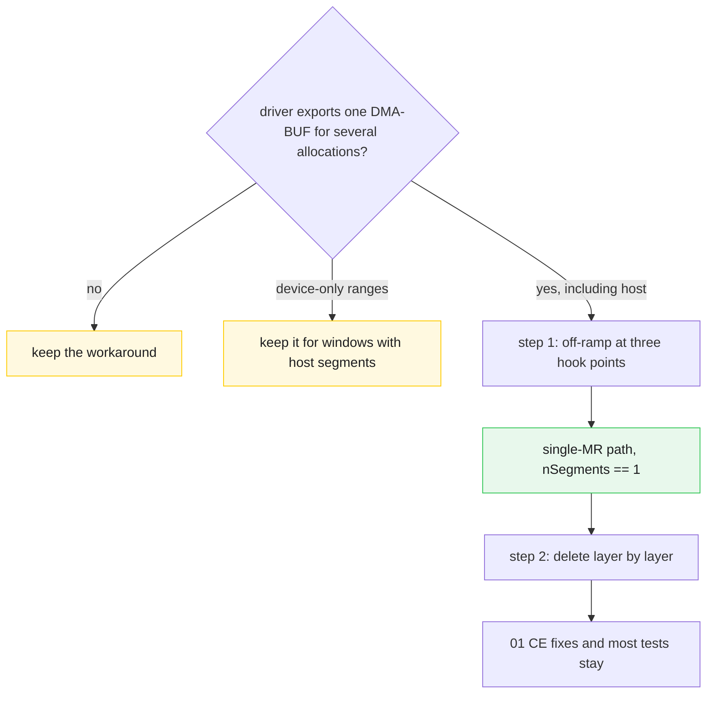

# Upstream sync impact and removal plan

This doc measures how much the multi-segment stack touches files that come from upstream, explains how to resolve a sync conflict in each one, and describes how to switch the workaround off and then delete it once the driver can export one DMA-BUF for a range of several allocations. The RCCL-only bodies sit in RCCL-only files or contiguous `RCCL:`-marked blocks reached through one-line hooks, so most conflicts are re-adding a hook. Terms follow the [overview](multi_segment_overview.md#terms).

> [!NOTE]
> Line and hunk counts were measured on 2026-11-23 as `git diff` from develop `c43b4a9e7307` to the old-stack wire tip (code `ac1de99e4627`, tests `ba3ab26f30a7`). Layers 01 to 03 are already in develop, so their changes are not counted. The 11-04 version of this doc counted 94 files and about 24,700 lines. The [IB-MSEG fork](multi_segment_fork_plugin.md) is the plan to move almost all of this out of `net_ib` into a renamed copy, which changes the sync picture; see [the fork plugin](multi_segment_fork_plugin.md#why-a-fork).

## Summary

- The open layers (05 to the wire layer) add 29,082 lines and remove 1,151 in 114 files. Tests are 13,030 lines in 50 files and runner configs and tools 10,027 lines in 13 files; these rarely conflict with an upstream sync.
- Source adds 6,004 lines and removes 456 in 46 files. 1,569 added lines in 168 hunks land in 17 source files that come from upstream. 115 of those hunks are in `net_ib/p2p.cc`, `net_ib/connect.cc`, `dev_runtime.cc` and `net_ib/gin.cc`.
- `net_ib/gin.cc` gains 711 lines in 22 hunks, of which one 656-line hunk is the `RCCL:` block. `net_ib/reg.cc` gains 236 lines in 9 hunks, with a 118-line and an 89-line block. `net.cc` gains 32 lines in 5 hunks.
- Classic `net_ib/p2p.cc` is no longer only hooks: it gains 193 lines and loses 113 in 46 hunks, because `ncclIbMultiSend` now posts every send through `rcclIbFillSendWrs` and the slice cursor (largest hunk 50 lines). The bodies stay in the RCCL-only `net_ib/p2p_multiseg.cc` and the shared `rccl_p2p_multiseg.cc`.
- IB-CAST (`net_ib_cast/*`) has no upstream counterpart, so it does not affect the sync. It shares the P2P builder (`rccl_p2p_multiseg.{h,cc}`) and the RMA headers (`rccl_mseg*.h`) with classic, so the parallel copies of the 11-04 tree are mostly gone; the transport glue is still duplicated.
- If the driver gains multi-allocation export, the workaround can be switched off at three hook points without deleting anything, and then removed layer by layer. Layer 01 is not part of the workaround and stays, and most tests stay as regression tests.

## Where the stack touches upstream-derived code

Source files only. "Hunks" counts `git diff -U0` hunks from develop to the wire code tip; sync conflicts scale with hunks more than with lines.

| File | Added / removed | Hunks | Layers | Shape of the change |
|---|---|---|---|---|
| `transport/net_ib/gin.cc` | +711 / −8 | 22 | 05, 06, wire | one-line `rcclRmaIbProxy*` dispatches, the GIN listen marks, the connect-finish call that allocates the record buffer, and one `RCCL:` block with the handle, the registration, the WR builder and the round hooks; the wire layer moved shared parts out to `rccl_mseg_rma*.h` |
| `transport/net_ib/reg.cc` | +236 / −1 | 9 | 05, 06 | the `fd == -1` route and dereg hook, the per-segment registration with unwinding, `rcclIbMrAdmit` |
| `transport/net_ib/p2p.cc` | +193 / −113 | 46 | 06 | include of `p2p_multiseg.h`, the send loop through `rcclIbFillSendWrs` and the cursor, the CTS write with the layout prefix, the `nreqs` bound, the one-read flush call |
| `dev_runtime.cc` | +146 / −9 | 23 | 05, wire | the GIN fail-closed check, the host owner fd and its status allgather, one-line calls to the window gates in `rccl_dev_runtime.cc` |
| `transport/net_ib/connect.cc` | +102 / −8 | 24 | 05, 06 | the cached `multiSegOk`, `RCCL_IB_CAP_MULTISEG` in `meta.caps`, combined CTS slot allocation and MR sizing, the RMA send depth `rcclIbSendQpWrs(isRma)`, GIN listen marks |
| `transport/net_ib/common.h` | +64 / −5 | 18 | 05, 06 | struct fields (`peerCaps`, `multiSegOk`, the slot pointers, segment arrays in `ncclIbMrHandle`, send cursor state), `ncclIbCtsSlot`, the CTS byte macros |
| `transport/net.cc` | +32 / −2 | 5 | 06 | the `numSegments > 1` branch that calls `regMrDmaBuf` with `fd = -1` in both proxy register functions, the HSA skip |
| `include/alloc.h` | +26 / −18 | 3 | 05 | `ncclCuMemIsSysmemSegment`, the host-memory check factored out of `ncclCuMemGetAddressRange` |
| nine more files | +59 / −5 | 18 | 05, 06 | `gin/gin_host.cc`, `gin/gin_host_proxy.cc` (the owner fd, the in-flight cap and its INFO line), `rma/rma_proxy.cc`, `rma/rma_proxy_launch.cc`, `dev_runtime_internal.h`, `net_ib/init.cc` (`RCCL_IB_MAX_REG_SEGMENTS`, `maxMr`, `NCCL_PTR_DMABUF_MULTISEG`), `net_ib/gin.h`, `net_ib/connect.h` (the `caps` field), `include/plugin/nccl_net.h` (`NCCL_PTR_DMABUF_MULTISEG`); one to five small hunks each |

RCCL-only source files the stack adds, with no sync cost:

| File | Lines | Layers | Contents |
|---|---|---|---|
| `transport/rccl_mseg.h` | 104 | 05 | the switch, protocol ceiling and local cap, `rcclIbSegCountSupported` |
| `transport/rccl_mseg_export.h`, `rccl_mseg_reg.h`, `rccl_mseg_sym.h` | 132, 88, 108 | 05, 06, wire | segment walk and export, per-segment registration helpers, the consensus record and exchange |
| `transport/rccl_mseg_rma.h`, `rccl_mseg_rma_round.h`, `rccl_mseg_wr.h` | 134, 273, 73 | 05, wire | RMA limits and in-flight cap, rounds and per-peer queues, the segmented WR builder |
| `transport/rccl_p2p_multiseg.cc`, `rccl_p2p_multiseg.h` | 338, 251 | 06 | the P2P builder both transports share: layouts, cursor, slice math |
| `transport/net_ib/p2p_multiseg.cc`, `p2p_multiseg.h`, `ib_multiseg.h` | 515, 71, 52 | 05, 06 | classic P2P send progress, layout reads, flush, hooks |
| `transport/net_ib_cast/ib_cast_multiseg.h` | 62 | 08 | IB-CAST scope, advertising and helpers |

The stack also changes RCCL-only files that already existed: `rccl_dev_runtime.cc` (+69, the window gates), `include/rccl_common.h`, the CMake lists, and `net_ib_cast/*` (`gin.cc` +807, `p2p.cc` +799/−227, `reg.cc` +239, `connect.cc` +135/−45, `common_cast.h` +104, plus `connect_cast.h`, `gin_cast.h`, `p2p_cast.h`, `init.cc` and the AINIC recovery file).

Per layer, source only, between adjacent branches: 05 +1,945 / −37 in 24 files; 06 +1,815 / −132 in 18; 08 +1,352 / −259 in 11; wire +974 / −110 in 14.

## How the footprint is kept small

- Each GIN and RMA entry point in `net_ib/gin.cc` (and `net_ib_cast/gin.cc`) runs develop's body after a one-line `if (rcclRmaMultiSegEnabled()) return rcclRmaIbProxy...(...)`. The range, zero-size, sequence-id and WR-budget fixes live only in the multi-segment bodies.
- The RMA pieces both backends need (segment table, record, WR builder, rounds) are header-only in `transport/rccl_mseg*.h`; each backend keeps only its glue.
- P2P slice math and layouts live in the shared `rccl_p2p_multiseg.cc`; classic progress and hooks in `net_ib/p2p_multiseg.cc`. The send loop in `ncclIbMultiSend` is the one place where develop's function body changed shape.
- The NET export walk left `net.cc`: `net.cc` calls the existing `regMrDmaBuf` hook with `fd = -1` and a packed count, and each plugin's `reg.cc` walks the range.
- The host VMM probe and the GIN registration type live in `rccl_dev_runtime.cc`. The owner-propagation block in `symMemoryMapLsaTeam` stays inline because it edits the exchanged segment messages.

> [!NOTE]
> What cannot move: the 01 CE fixes edit upstream logic rather than add functions, the capability bit and CTS slot layout need fields in upstream structs, and the QP depths are set where develop creates the QPs. For 01 the cheapest option is to offer the receive-window fix upstream, since the bug is not AMD-specific.

## How to resolve a sync conflict

- In `net_ib/gin.cc` and `net_ib/reg.cc`, keep each `RCCL:` block as a unit; the blocks do not interleave with develop's functions.
- In `net_ib/gin.cc`, take upstream's body and re-add the one-line dispatch at the top of each RMA entry point, the `rcclIbMarkGinListen` calls in the GIN and RMA listens, the `rcclRmaIbProxyConnectFinish` call, the `NCCL_NET_IB_REQ_FAILED` check in `Test`, and the record free in close. If upstream changes a signature, update the matching declaration in `rccl_mseg_rma.h`.
- In `net_ib/p2p.cc`, take upstream's body and re-add the `p2p_multiseg.h` include, the send loop through `rcclIbFillSendWrs`, and the `rcclIb*` calls at the points listed in the [classic data path](multi_segment_netib_wire.md#data-path). If upstream changes the chunk math in `ncclIbMultiSend`, mirror it in the slice math in `rccl_p2p_multiseg.cc`.
- In `net.cc`, re-add the `numSegments > 1` branch before the DMA-BUF export in both proxy register functions, and the segment-count and commit calls.
- In `net_ib/reg.cc`, re-add the `fd == -1` route at the top of `ncclIbRegMrDmaBuf` and the dereg hook in `ncclIbDeregMr`.
- In `net_ib/connect.cc` and `net_ib/common.h`, keep the CTS slot sizing and `rcclIbSendQpWrs(isRma)`; only RMA comms change the send depth.

## Removal once the driver exports multi-allocation ranges

### What the driver has to provide

The workaround exists because ROCm's DMA-BUF export for an address range describes only the first physical allocation. Removal needs `hipMemGetHandleForAddressRange` (through `cuMemGetHandleForAddressRange`) to return one DMA-BUF covering the whole range, so one `ibv_reg_dmabuf_mr` registers it. That must hold for the DeepEP layouts, which mix device and host segments in one window. If the driver fixes only device-only ranges, keep the workaround for windows with host segments.

With the IB-MSEG fork, removal is simpler: stop selecting `net_ib_multiseg` and delete its directory; see [migration and fold-back](multi_segment_fork_plugin.md#migration-and-fold-back).

### Step 1: switch it off without deleting code

`NCCL_MULTI_SEGMENT_REGISTER=0` already removes every multi-segment path ([switch-off behavior](multi_segment_current.md#switch-off-behavior)). It is not enough on its own, because develop treats a multi-segment buffer as unregistrable: NET stages it and `symMemoryRegisterGin` rejects a device-only multi-segment window. With driver support those buffers should take develop's single-MR path instead. Each of the three hook points already has a branch that is exactly the develop path:

| Site | Today | With driver support |
|---|---|---|
| `transport/net.cc`, `sendProxyRegBuffer` and `recvProxyRegBuffer` | `if (numSegments > 1)` calls `regMrDmaBuf` with `fd = -1` and a packed count | add `&& !rcclDmaBufRangeExportSupported()` (proposed name) so the range goes to develop's export and `regMrDmaBuf`, and allow the HSA fallback again |
| `transport/rccl_mseg_rma.h`, `rcclRmaMultiSegEnabled()` | returns the switch; gates every GIN dispatch, the record buffer, the RMA send depth and the in-flight cap | return false when supported, so `gin.cc` runs develop's single-MR registration |
| `rccl_dev_runtime.cc` and `dev_runtime.cc`, the window gates and the GIN fail-closed check | multi-segment windows need the per-segment backend, a DMA-BUF MR and the switch | accept a multi-segment window on any backend and drop the fail-closed check |

With one MR per buffer, everything downstream sees `nSegments == 1`: no layout prefix is sent, the segmented WR builder is not entered, and the IB-CAST scope never matters. The capability bit can stay advertised; it costs only the larger CTS slots. The predicate should be a runtime probe or a HIP version gate so one build still runs on older drivers. This is one small commit and can ship before any deletion.

### Step 2: delete the code, layer by layer

| Layer | Branch | Source added / removed | Removal trigger | Effort |
|---|---|---|---|---|
| 01 CE receive window | `01-ce-recv-window-offset` (in develop) | +164 / −44 | none: CE AllReduce bug fixes, not part of the workaround | keep |
| 02 Host VMM compat | `02-amd-host-vmm-compat` (in develop) | +259 / −77 | ROCM-29810 (imported VMM keeps its location type) for owner propagation; minimum supported HIP for the host location shim | small: delete the owner-propagation block and the shim; keep the probe-kind allgather while host VMM cannot use IPC |
| 03 Registration range | `03-registration-range` (in develop) | +46 / −0 | multi-segment export | small; the page-tail walk fix is correct on its own and can stay |
| 05 Classic GIN/RMA | `05-gin-rma-multisegment` | +1,945 / −37 | multi-segment export | small to medium: the `RCCL:` block in `net_ib/gin.cc`, the dispatches, the window gates, the in-flight cap; remove `rccl_mseg*.h` together with the wire layer |
| 06 Classic NET/IB P2P | `06-classic-netib-multisegment` | +1,815 / −132 | multi-segment export | medium: `rccl_p2p_multiseg.*`, `p2p_multiseg.*`, `ib_multiseg.h`, the `RCCL:` blocks in `reg.cc`, the `fd = -1` branch, the send loop in `ncclIbMultiSend`, the combined CTS slots and capability |
| 07 Tests and CI | folded into 05 and 06 | tests only | none | keep the hybrid and stress tests as regression tests; keep the non-blocking test stream while a peer's `hipMemMap` waits for kernels on blocking streams |
| 08 IB-CAST P2P | `08-cast-netib-multisegment` | +1,352 / −259 | multi-segment export | medium, RCCL-only: `ib_cast_multiseg.h`, the multi-segment parts of `net_ib_cast/p2p.cc`, `reg.cc` and `connect.cc` |
| wire IB-CAST GIN | `multi-segment-dmabuf-cast-gin` | +974 / −110 | multi-segment export | small: the `RCCL:` block in `net_ib_cast/gin.cc`, the dispatches and the RMA CQ floor; remove with 05 |

Sizes for 01 to 03 are from before they merged. Sizes for 05 to the wire layer are source-only `git diff` between adjacent branches, measured on 2026-11-23.

> [!IMPORTANT]
> Mixed versions during removal fall back safely: a rank without the code sends `caps == 0`, so a peer that still has it declines multi-segment receives on that connection, while its sends still split locally onto the single rkey. GIN registration is collective, so every rank in a communicator must run the same build anyway.

### What happens to the tests

Most multi-segment tests keep their value, because DeepEP still builds windows from several allocations; with driver support they run through the single-MR path. Tests that assert the workaround's internals must change or go:

- assertions on the per-segment MR count, such as the NET segment count of 8 in `UBR_MultiSegment.Generic`;
- `RmaSegmentMathTest`, `RmaRoundTest`, `NetIbMultiSeg`, `NetIbCtsLayout` and `NetIbLayoutBlob`, which test the boundary math and layouts directly;
- capability and decline checks in the NET/IB and IB-CAST MPI suites, including `MultiSegmentRegisterOff_DeclinesRegistration` and `CastUnsafeMode_DeclinesRegistration`;
- the send-queue tests (`SendQueueFatChainOversubscribe`, `IPutSignalSendQueueOversubscribe`, `IPutSignalAtProxyInflightCapFitsSendQueue`), whose long chains exist only because each multi-segment buffer splits into one WR per segment.

## Recommendation

1. Add the off-ramp predicate now as a no-op returning false at the three hook points, so a driver fix is a one-line change.
2. Keep new multi-segment code in an RCCL-only file (`rccl_mseg*.h`, `rccl_p2p_multiseg.cc`, `p2p_multiseg.cc`) or the `RCCL:` block of the file it hooks, and reach it through one-line hooks. The IB-MSEG fork takes this further by moving the hooks out of `net_ib` entirely.
3. Offer the 01 receive-window fix upstream.
4. Revisit the 02 owner-propagation block and the struct-field grouping when ROCM-29810 is fixed.
