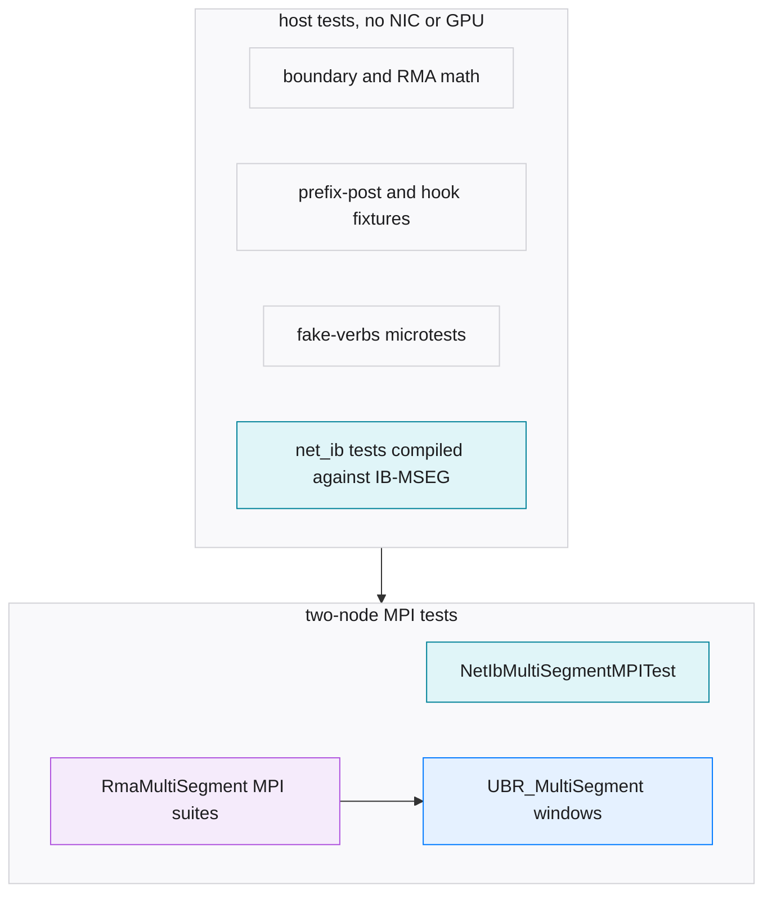
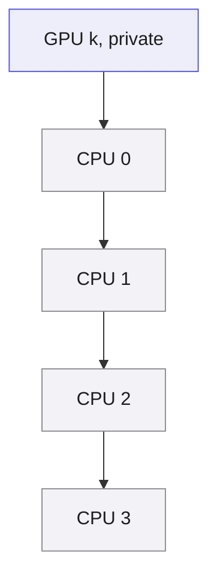

# Multi-segment testing

The tests put the correctness burden on pure boundary math and fake-verbs microtests that run on the host without a NIC or GPU, compile develop's `net_ib` host tests a second time against the IB-MSEG fork, and use two-node MPI hardware tests for the ibverbs wiring, the collective agreement, the queue limits and the DeepEP window shapes. This doc lists the suites, what they cover, the hybrid DeepEP tests, the runner jobs, how to run them, and the known failures. The per-fork inventory with every test, its category, the jobs and platforms that run it, and the open gaps is the [validation plan](multi_segment_validation_plan.md). Behavior under test is described in the transport docs linked from the [overview](multi_segment_overview.md#reading-guide).

> [!NOTE]
> Updated 2026-11-23 for the fork stack at fork 4 (branch `users/atulkulk/netib-mseg/04-rma-gin-multiseg`) on develop. Every test and job named here exists in fork 4. Forks 5 and 6 (IB-CAST) are planned and add no tests yet, so there are no IB-CAST multi-segment tests in the stack.

## Strategy



The splitters, segment selectors, CTS layout rules and RMA helpers are pure integer functions, so every tricky case is deterministic on the host: different local and remote starts, asymmetric layouts, zero length, address overflow, slicing at the verbs length limit, round pumping and the in-flight cap, atomic alignment, malformed peer `segOff` tables, and the consensus exchange with a local or remote failure. Fake-verbs microtests drive the fork's connect, registration, P2P and GIN units and the core gates. Because the fork is a renamed copy of `net_ib`, four IB-MSEG host binaries also compile every `net_ib` host test against the fork (see [IB-MSEG fork tests](#ib-mseg-fork-tests)). Hardware tests then prove the same rules through real DMA-BUF MRs and RDMA, and protect untouched memory with sentinels.

## Suites

Counts are the tests each suite adds at fork 4; the fork column says which fork adds them.

| Suite (tests) | File (binary) | Fork | Covers |
|---|---|---|---|
| `NetIbMultiSeg` (8), `NetIbCtsLayout` (10), `NetIbLayoutBlob` (2) | `test/NetIbMultiSegmentUnitTests.cpp` (`rccl-UnitTestsFixtures`) | 3 | segment selection, zero-length WRs, host VMM base 0, address overflow, layout count against the cap, inline and referenced layouts, blob packing and validation |
| `RmaSegmentMathTest` (27), `RmaRoundTest` (6) | `test/RmaSegmentMathTests.cpp` (`rccl-UnitTests`) | 1 (3), 4 (30) | the one count check `rcclIbSegCountSupported` against `RCCL_IB_REG_SEG_DEFAULT`, the segment-table bound, the in-flight cap; slicing, cursor, WR budget, signaling, prefix post, segment index, consensus exchange, deregistration; round pump, queue order, failed rounds |
| `NetIbSegmentedSendPrefix` (30), `NetIbSegmentedFlushPrefix` (8), `NetIbSegmentedHooks` (19) | `test/transport/NetIb/NetIbSegmentedSendPrefixTests.cpp` (`rccl-UnitTestsFixturesDebug`) | 3 | slice posts, resume after a held slice, the one-read flush, the CTS layout bit, and every P2P hook |
| `NetIbMultiSegmentMPITest` (18) | `test/transport/NetIbMPI/NetIbMultiSegmentMPITests.cpp` (`rccl-UnitTestsMPI`) | 3 | P2P per-segment, boundary-crossing, whole-buffer, offsets, multi-receive, flush, GDR flush flag, cap, switch off, stress |
| `RmaMultiSegmentMPITest` (32), `RmaMultiSegmentPostMPITest` (13) | `test/transport/RmaMPI/RmaMultiSegmentMPITests.cpp` (`rccl-UnitTestsMPI`) | 4 | GIN/RMA registration, put, get, signal, flush, bounds, collective rejection, DeepEP Engram and hybrid windows, post path, send-queue flood |
| `UBR_MultiSegment` (5 added) | `test/RegistrationMPITests.cpp` (`rccl-UnitTestsMPI`) | 3 (1), 4 (4) | `NetProxyPartialFinalSegment`; `DeepEP_ElasticWindowRegistration`, `DeepEP_HybridWindowRegistrationAndHandleReuse`, `DeepEP_HybridElasticRegistrationDisabled`, `Symmetric_Elastic_RmaRegistration`; the jobs also run develop's `UBR_MultiSegment` cases with the switch on |
| `NetIbMPITest.DefaultPluginIsIbMsegUnderMultiSegmentRegister`, `NetPluginSelection.IbFollowsTheMultiSegmentSwitch` | `test/transport/NetIbMPI/GeneralTests.cpp` (`rccl-UnitTestsMPI`) | 2 | the switch selects IB-MSEG when `NCCL_NET` is unset or `IB` |

Host microtests are separate `rccl-UnitTestsMicro*` binaries under `test/host/`, built and run by `test/host/run_host_tests.sh` against fake verbs and HIP:

| Suite (tests) | File under `test/host/` | Fork | Covers |
|---|---|---|---|
| `SymMemoryMapLsaTest` (14), `SymMemoryObtainRegisterTest` (5) | `dev-runtime-test.cc` | 1 | host owner fd: exactly one exporter publishes, importers fetch, several owners or a failed export import nothing; owner fd lifetime and agreement |
| `SymMemoryRegisterGinTest` (4), `SymMemoryRegisterGinElasticTest` (2), `SymMemoryRegisterRmaTest` (9), `RmaProxyInflightCapTest` (2) | `dev-runtime-test.cc` | 1 | window gates on the comm flag, DMA-BUF and backend; the in-flight cap needs the plugin, the switch and DMA-BUF |
| `GinHostRegisterMicrotest` (2), `GinHostProxyRegMrMicrotest` (3), `GinHostProxyContextMicrotest` (1) | `gin/gin-host-test.cc`, `gin/gin-host-proxy-test.cc` | 1 | the owner fd reaches `regMrSymDmaBuf`; fallback without DMA-BUF; the queue size under the cap |
| `NetProxyRegBufferMicrotest` (2), `NetProxyRegBufferCuMemMicrotest` (4) | `transport/net-test.cc` | 1 | the `fd = -1` call to a per-segment plugin and its declines |
| `ProxyServiceFixture` (1), `RmaProxyAllocGraphTest` (1), `RmaProxyDescriptorTest` (1), `HierCeAvailableMicrotest` (1) | `proxy-test.cc`, `rma/rma-proxy-test.cc`, `rma/rma-proxy-launch-test.cc`, `ce-coll-test.cc` | 1 | the proxy copies the comm flag; the cap sizes the graph pool; a window without RMA registration fails the put and makes hierarchical CE fall back |
| `PluginNetMicrotest` (6), `RmaPluginListTest` (1), `InitMicrotest` (2), `RasDiagnosticsCommonMicrotest` (1), `NetProxySetupMicrotest` (1), `NetRecvProgressMicrotest` (2), `NetRecvProxyConnectMicrotest` (1) | `plugin/plugin-net-test.cc`, `plugin/rma-plugin-init-test.cc`, `init-test.cc`, `ras/ras-diagnostics-common-test.cc`, `transport/net-test.cc` | 2 | plugin selection, RMA backend choice, RAS treats IB-MSEG as verbs, the GDR flush flag through the fork |
| `NetIbMsegConnectMicrotest` (5), `NetIbMsegConnectMultiSegMicrotest` (7), `NetIbMsegConnectUseMultiSeg` (1) | `transport/net_ib_multiseg/connect-test.cc` | 3 (8), 4 (5) | classic comms size the combined CTS slots, GIN comms keep the legacy FIFO, a peer with the other setting fails, the device max MR, RMA send-queue depth, peer device index bounds |
| `NetIbMsegGinMicrotest` (25), `NetIbMsegGinRmaSeqId` (1) | `transport/net_ib_multiseg/gin-test.cc` | 3 (2), 4 (24) | RMA listen marks, segmented WR building, per-segment registration and consensus, rounds, prefix posts, sequence-id release |
| `NetIbMsegP2pMicrotest` (9) | `transport/net_ib_multiseg/net-ib-p2p-test.cc` | 3 | the fork's versions of eight `net_ib` P2P tests (its `ctsFifo` is a pointer) and the flush write and read in one post |
| `NetIbMsegRegMicrotest` (7), `NetIbMsegRegRangeMicrotest` (3) | `transport/net_ib_multiseg/reg-test.cc` | 3 | per-segment MR failures unwind and leave the handle untouched, resilient comms and past-the-max-MR counts decline, deregistration keeps going after an error, layout publishing |
| `InitMicrotest` (3), `AllocMicrotest` (1), `GinHostDevCommSetupMicrotest` (1) | `init-test.cc`, `alloc-test.cc`, `gin/gin-host-test.cc` | 3 (2), 4 (3) | the comm flags follow the IB-MSEG plugin and RMA proxy; the address-range walk releases its retained handle; the RMA flag is set before each GIN context |

Shared helpers are `test/common/MultiSegmentVmmHelpers.hpp`, `test/common/HybridVmmHelpers.hpp`, `test/common/MultiSegmentTestSupport.hpp` and `test/common/IbFakePostSend.hpp`. The hybrid helper builds on the segmented one: `AllocHybridVmm` maps its host and device segments through `AllocSegmentedVmm`.

## Coverage

| Scenario | Host | P2P MPI | GIN/RMA MPI |
|---|---|---|---|
| Single-segment regression, switch on and off | — | yes | yes |
| N segments register N MRs; deregistration keeps going after an error | yes | yes | yes |
| Boundary-crossing transfer | split and cursor math | splits and completes | completes |
| Independent local and remote offsets | yes | yes | yes, including DeepEP Engram |
| Count past the cap rejected | yes | yes | yes |
| Non-uniform segment sizes register and transfer | unequal-segment math | `NonUniformLayoutRegisters` | equal counts with different boundaries |
| Layout validation | CTS layout and blob | via transfers | n/a |
| Peer with the other switch setting fails at connect | connect microtests | — | n/a |
| Unequal counts rejected collectively | consensus exchange | n/a | yes |
| One flush read | fixtures | direct GDR only | `IFlush*` tests |
| Mixed single- and multi-segment handles in one multi-receive | — | yes, transfer and flush | n/a |
| Concurrent pairs across every boundary | — | 2 ranks and 2 × 4 | all-pairs and many-to-one at 1 × 2 and 2 × 4 |
| Send-queue oversubscription | round and in-flight math | opt-in fat chain | at the in-flight cap, plus an opt-in flood |
| Partial posts | prefix fixtures | — | prefix helpers |
| DeepEP `[GPU][CPU]` and hybrid `[GPU k][CPU 0..N-1]` | — | — | positive, negative, stress |
| Core gates: switch, DMA-BUF, backend, owner fd | yes | n/a | via the window tests |

Tests for the capability word and for old peers have no counterpart, because the fork has no capability negotiation.

### P2P

- **Switch off.** `MultiSegmentRegisterOff_DeclinesRegistration` runs with `NCCL_NET=IB-MSEG` and `NCCL_MULTI_SEGMENT_REGISTER=0`: both ends keep the legacy CTS, the receiver's 4-segment registration fails with `ncclInvalidUsage`, and the sender still registers because it splits locally onto the receiver's single rkey.
- **Connect-time mismatch.** `NetIbMsegConnectMultiSegMicrotest.ConnectAndAccept_PeerWithTheOtherSettingFails` checks that connect and accept fail with `ncclInvalidUsage` when the two ends disagree on `useMultiSeg`; there is no MPI test for it.
- **Flush.** `MultiSegmentFlushSelectsSegmentMr`, `MultiSegmentFlushTouchesEverySegment` and `MultiRecvFlushTouchesEveryHandle` need direct GDR reads (`RCCL_GDR_FLUSH_GPU_MEM_NO_RELAXED_ORDERING=0`), because the default scratchpad flush never reads a receive buffer. `MultiRecvMixesSingleAndMultiSegmentHandles` starts its multi-segment entry in segment 1, so a flush through segment 0's MR would fault. These tests check bytes, not rkeys.
- **GDR flush flag.** `GdrFlushFlag_SegmentedSendWritesFlag` runs with `RCCL_IB_GDR_FLUSH_FLAG=1` on the default QP count and on 4 split QPs, and checks that a segmented send writes each QP's flush flag.
- **Stress.** `DeepEP_MultiNodeAsymmetricCrossBoundaryStress`, `ConcurrentPairsMoveEverySegmentBoundary`, and the opt-in `SendQueueFatChainOversubscribe` (`RCCL_MSEG_SQ_STRESS=1` with `NCCL_IB_QPS_PER_CONNECTION=1`: three groups of 8 receives queued on one send QP before any test call; the sliced send keeps each progress call to one slice per QP).
- **Prerequisites.** `UT_NET_IB_MSEG_REQUIRE_DMABUF=1`, set by every `net_ib_multisegment*` job, turns a missing DMA-BUF, VMM or export API into a failure instead of a skip.

### GIN/RMA

- **Layouts.** `RegisterEqualCountDifferentBoundariesTransfer` passes; `RegisterAsymmetricSegmentCountRejected` fails collectively; `RankLocalRegistrationFailureRejectedCollectively` fails every rank without deadlock; `RegistrationAfterCollectiveRejectionTransfers` reuses the consensus buffer with a different count.
- **Operations.** Boundary-crossing put and get, size sweeps from zero and at a boundary offset, signal atomics in later segments and rejection of out-of-range ones, sub-page window bounds, the one-read flush and a flush after a partial put.
- **Post path.** WR batching at sizes 8 and 2 (`ChainsAroundWrBatchSizeLandIntact` under `NCCL_RMA_IB_WR_BATCHSIZE`), context isolation, rejected-op slot accounting, zero-size ops, registration churn, all-pairs and many-to-one.
- **Send queue.** `IPutSignalFillsSendQueueWithoutTest` and `IPutSignalAtProxyInflightCapFitsSendQueue` post worst-case putSignals up to the in-flight cap without calling test, and all must land. The opt-in `IPutSignalSendQueueOversubscribe` (`RCCL_MSEG_SQ_STRESS=1`) posts twice the send queue: rejected posts return no request and accepted ones finish. With `RCCL_TEST_RMA_MSEG_REQUIRE=1`, a test that finds no rank on the multi-segment path fails instead of skipping.
- **Switch off.** `MultiSegmentRegisterOff_KeepsSingleRegistration` runs on IB-MSEG with the switch off and expects no handle to report more than one segment (`rcclRmaIbProxyMrSegmentCount`); the same job reruns develop's `RmaMPITest` suites with the switch on and off.

### Registration and core gates

- `UBR_MultiSegment.NetProxyPartialFinalSegment` registers two whole mappings and half of a third through the NET proxy and checks the unregistered tail is untouched; `multisegment_netproxy_intranode_multinode` repeats it with an intra-node peer.
- `Symmetric_Elastic_RmaRegistration` runs twice in `ubr_multisegment_lsagin_multinode`, with `NCCL_SYM_REUSE_SYSMEM_HANDLES=1` (registers) and `=0` (skips RMA registration).
- `DeepEP_ElasticWindowRegistration` runs in its own job entry, because it runs out of memory after `Symmetric_Elastic_Lsa` in the same process; `UBR_MultiSegment_All_Core` excludes it.
- Develop's `UBR_MultiSegment` cases (`Generic`, `GenericGraph`, `Generic_Reuse`, the slice-skip tests, `Symmetric_LsaGin`) run in the fork jobs with the switch on; `Generic_Reuse` runs with `RCCL_CE_ALLREDUCE=0`, `NCCL_ALGO=Ring`, `NCCL_PROTO=Simple`, so it deterministically enters the registration path whose reuse log it asserts.
- The fork 1 microtests pin the core: a multi-segment window registers on GIN or RMA only when the comm's plugin flag, the switch and DMA-BUF are on and the backend registers per segment; the host owner fd is borrowed only when exactly one rank can export it.

## Hybrid DeepEP windows

A hybrid window is one VMM range with a private GPU segment followed by one 2 MiB-aligned host segment per local rank. CI runs 8 ranks on 2 nodes, 4 per node, so each window has five segments:



Host segment k is local to rank k; the other three are imported. Local ranks exchange host sizes with MPI and POSIX DMA-BUF fds over RCCL's Unix-domain IPC socket (`SCM_RIGHTS`), map every host handle in local-rank order, give every segment GPU access and host segments CPU access, and register one window with `NCCL_WIN_STRICT_ORDERING`. LSA reuses the owner's host handle; GIN registers every segment through DMA-BUF, imported ones from the owner's fd ([how](multi_segment_gin_rma.md#host-owner-dma-buf)).

> [!IMPORTANT]
> Supported contract: `NCCL_ELASTIC_BUFFER_REGISTER=1` and `NCCL_SYM_REUSE_SYSMEM_HANDLES=1`. The 8-rank LSA+GIN job `ubr_multisegment_lsagin_multinode` is the primary coverage, and `net_ib_rma_multisegment_hybrid` runs the RMA cases on their own.

The tier covers strict-window registration and handle reuse (`DeepEP_HybridWindowRegistrationAndHandleReuse`), cross-node GIN IGet from an imported remote CPU segment (`DeepEP_HybridImportedCpuSegmentIGet`), negative elastic gating (`DeepEP_HybridElasticRegistrationDisabled`) and an out-of-range IGet that must not post (`DeepEP_HybridOutOfRangeIGetRejected`), and a stress run that varies the remote CPU owner, the size and independent offsets (`DeepEP_HybridMultiNodeIGetStress`). The helper (`AllocHybridCollective` in `HybridVmmHelpers.hpp`) skips collectively when host VMM, DMA-BUF, GIN or the topology is missing; `CheckHybridVmmRuntimeSupport` skips with "ROCM-29812: imported host VMM CPU access is unsupported" on runtimes without that fix. `RCCL_TEST_HYBRID_VMM_REQUIRE=1` (set by `ubr_multisegment_lsagin_multinode` and `net_ib_rma_multisegment_hybrid`) turns those skips into failures. Cleanup is installed before any skip, and MRs and windows are released before the imported mappings. The RMA tests call the plugin directly, so the helper publishes the fds it received with `rcclHostSegmentFdRegister`.

**Non-blocking test stream.** A peer proxy's `hipMemMap` waits for kernels on blocking streams, so lazy IPC registration can deadlock against a collective on the test stream. A test can set `test_stream_flags_ = hipStreamNonBlocking` (`test/common/MPITestCore.hpp`); `NetProxyPartialFinalSegment` does. There is no environment override.

## Runner jobs

At fork 4 the four Mellanox IB and Thor2 configs (`mi300x_mellanox_ib`, `mi300_mellanox_ib_func`, `mi355x_thor2_roce`, `mi355x_thor2_roce_func`) define and enable the same block, and `net_ib_transport` holds the NET-IB subset. The AINIC configs (`mi455_ainic_roce`, `mi455_ainic_roce_func`) get these jobs with fork 5, once IB-MSEG carries AINIC support; `mi455_roce_func` has none of them.

| Job | Ranks | Runs |
|---|---|---|
| `multisegment_host_boundary_math` | 1 | `NetIbMultiSeg.*:NetIbCtsLayout.*:NetIbLayoutBlob.*` from `rccl-UnitTestsFixtures` |
| `multisegment_rma_segment_math` | 1 | `RmaSegmentMathTest.*:RmaRoundTest.*` from `rccl-UnitTests`; also in `net_ib_transport` |
| `unit_tests_fixtures_debug` entries `A20_NetIb_SegmentedSendPrefix`, `A20_NetIb_SegmentedFlushPrefix`, `A20_NetIb_SegmentedHooks` | 1 | the P2P prefix, flush and hook fixtures |
| `ubr_multisegment_comprehensive` | 2 on 1 node | `UBR_MultiSegment_All_Core`, `Generic_Reuse`, elastic gating |
| `multisegment_netproxy_multinode` | 2 on 2 nodes | `UBR_MultiSegment.Generic`, `NetProxyPartialFinalSegment`, and the P2P switch-off and single-segment tests on IB-MSEG with the switch off |
| `multisegment_netproxy_intranode_multinode` | 4 on 2 nodes | `NetProxyPartialFinalSegment` with an intra-node peer |
| `ubr_multisegment_lsagin_multinode` | 8 on 2 nodes | `Generic`, `GenericGraph`, the slice-skip tests with the switch off, `Symmetric_LsaGin`, `Symmetric_Elastic_RmaRegistration` with reuse on and off, the DeepEP hybrid registration and RMA cases, `DeepEP_ElasticWindowRegistration` on its own; `RCCL_TEST_RMA_MSEG_REQUIRE=1` and `RCCL_TEST_HYBRID_VMM_REQUIRE=1` |
| `net_ib_multisegment` | 2 on 2 nodes | the P2P suite, ID matching (`NCCL_IB_RECEIVER_SIDE_MATCHING_SCHEME=1`) and the opt-in fat chain |
| `net_ib_multisegment_register_off` | 2 on 2 nodes | `NCCL_NET=IB-MSEG` with the switch off: decline and single-segment regression |
| `net_ib_multisegment_flush` | 2 on 2 nodes | direct-GDR flush tests |
| `net_ib_multisegment_scale_2x4` | 8 on 2 nodes | concurrent pairs, 4 ranks on each of 2 nodes |
| `net_ib_multisegment_gdr_flush_flag` | 2 on 2 nodes | segmented send with `RCCL_IB_GDR_FLUSH_FLAG=1`, default and 4 split QPs |
| `net_ib_rma_multisegment` | 2 on 2 nodes in `net_ib_transport`; 2 on 1 node in the architecture configs, whose `net_ib_base` is single-node | every `RmaMultiSegmentMPITest` case by name except the three hybrid ones and the `BuildSkipped` placeholder, the post-path suite at the default WR batch and at 8 and 2, the send-queue flood under `RCCL_MSEG_SQ_STRESS=1`, the switch-off entries on IB-MSEG, and develop's `RmaMPITest` suites with the switch on and off; `RCCL_TEST_RMA_MSEG_REQUIRE=1` |
| `net_ib_rma_multisegment_hybrid` | 8 on 2 nodes | the three DeepEP hybrid RMA cases with `RCCL_TEST_HYBRID_VMM_REQUIRE=1` |
| `net_ib_rma_multisegment_scale_1x2`, `net_ib_rma_multisegment_scale_2x4` | 2 on 1 node, 8 on 2 nodes | the post-path suite without the flood |
| `net_ib_initialization_mseg`, `net_ib_properties_mseg`, `net_ib_connection_mseg`, `net_ib_memory_mseg`, `net_ib_transfer_mseg`, `net_ib_gdr_flush_mseg`, `net_ib_gdr_flush_flag_mseg` | as the base job | fork 2: develop's NET-IB whitebox suites rerun with `NCCL_MULTI_SEGMENT_REGISTER=1`, so they drive IB-MSEG; the initialization job also asserts the default plugin is IB-MSEG |
| `net_plugin_selection_mseg`, `net_ib_wqe_lat_mseg`, `net_ib_gin_peermem_mseg` | as the base job | fork 2, `net_ib_transport` only: plugin selection, WQE latency monitor and GIN peer-mem on IB-MSEG |

`net_ib_transport` defines the `*_mseg` jobs, the five `net_ib_multisegment*` jobs, `multisegment_rma_segment_math` and the four `net_ib_rma_multisegment*` jobs; it has no single-node fixture, UBR or NET-proxy jobs. The job matrix with one column per config is in the [validation plan](multi_segment_validation_plan.md#runner-jobs-and-configs).

The MPI tiers in `test_categories_mpi.yaml` leave the switch at the build default; the `standard_env_multi_segment_register` and `standard_env_multi_segment_register_off` entries pin it on and off, and `NetIbMultiSegmentMPITest` (IB-MSEG only) skips in the tiers that leave it off. Perf-only configs do not run these tests.

## How to run

The runner applies each job's environment from the JSON configs and is the recommended way to reproduce CI. For manual runs:

```bash
# Build with MPI tests; a debug build exposes the internal symbols the MPI tests use.
# Build once per ROCm: 7.0.2.1 build 55 (the default) and 10.3, with PATH and ROCM_PATH pointing at each.
MPI_PATH=/opt/sre-tools/ompi ./install.sh --debug --enable-mpi-tests -t -l

# Host unit tests and fixtures
./build/test/rccl-UnitTestsFixtures --gtest_filter='NetIbMultiSeg.*:NetIbCtsLayout.*:NetIbLayoutBlob.*'
./build/test/rccl-UnitTests --gtest_filter='RmaSegmentMathTest.*:RmaRoundTest.*'
./build/test/rccl-UnitTestsFixturesDebug --gtest_filter='NetIbSegmented*'

# Host microtests (fake verbs and HIP), including the four IB-MSEG binaries, as CI runs them
./test/host/run_host_tests.sh

# Two-node P2P and RMA on IB-MSEG
NCCL_MULTI_SEGMENT_REGISTER=1 mpirun -np 2 --map-by ppr:1:node ./build/test/rccl-UnitTestsMPI \
  --gtest_filter='NetIbMultiSegmentMPITest.*:RmaMultiSegmentMPITest.*:RmaMultiSegmentPostMPITest.*-RmaMultiSegmentMPITest.DeepEP_Hybrid*'

# Opt-in send-queue stress
NCCL_MULTI_SEGMENT_REGISTER=1 RCCL_MSEG_SQ_STRESS=1 mpirun -np 2 --map-by ppr:1:node ./build/test/rccl-UnitTestsMPI \
  --gtest_filter='RmaMultiSegmentPostMPITest.IPutSignalSendQueueOversubscribe'

# Switch off on IB-MSEG
NCCL_NET=IB-MSEG NCCL_MULTI_SEGMENT_REGISTER=0 mpirun -np 2 --map-by ppr:1:node ./build/test/rccl-UnitTestsMPI \
  --gtest_filter='NetIbMultiSegmentMPITest.MultiSegmentRegisterOff_*:NetIbMultiSegmentMPITest.HostAndDeviceSingleSegmentRegression'

# Eight-rank hybrid LSA+GIN, 4 ranks per node
NCCL_MULTI_SEGMENT_REGISTER=1 mpirun -np 8 --map-by ppr:4:node ./build/test/rccl-UnitTestsMPI \
  --gtest_filter='UBR_MultiSegment.DeepEP_Hybrid*:RmaMultiSegmentMPITest.DeepEP_Hybrid*'
```

Validate multi-segment changes on ROCm 7.0.2.1 build 55 and on 10.3; the version gates differ between them. The [validation plan](multi_segment_validation_plan.md#how-to-run) lists the wrapper scripts that run the host tests and the runner configs over both versions.

## Results

| Run | Tree | Result |
|---|---|---|
| Hostval (7.0.2.1 build 55, 10.3, pytest, gate-off build) | fork 3 before the tool split | clean; gate-off build 13,197 tests passed |
| Hostval | fork 4 before the tool split | clean; pytest 167 passed; gate-off build 13,272 tests passed |
| Hostval | fork 2 after the tool split | passed; pytest 156 passed; gate-off build 193 binaries, 13,003 tests passed |
| Hostval | fork 3 after the test reductions | passed; 0 failed binaries on 7.0.2.1 build 55 and 10.3; gate-off build 197 binaries, 13,197 tests passed |
| Hostval | fork 4 after the test reductions | passed; 0 failed binaries on 7.0.2.1 build 55 and 10.3; pytest 156 passed; gate-off build 197 binaries, 13,272 tests passed |
| Hardware, two MI355X Thor2 nodes | fork 4 before the fork 3 mismatch-check amend | 214 of 214 units on 7.0.2.1 build 55 and on 10.3 (`~/ginocc/sw/fork4-hw5-final/status`) |
| Hardware, two MI355X Thor2 nodes | fork 4 after the test reductions, ROCm 7.0.2.1 build 55 and 10.3 | 214 of 214 units on each ROCm version; gtest 23,702 passed and 13 skipped on 10.3, 23,622 passed and 75 skipped on 7.0.2.1 build 55; 0 failed (`~/ginocc/sw/fork4-hw6-reduce/summary.txt`) |

The Mellanox IB configs have not run any fork. The full record, including earlier fork runs, is in [the fork plugin](multi_segment_fork_plugin.md#validation).

## Known failures and dependencies

- `ubr_multisegment_lsagin_multinode` exists at fork 4 in the four Mellanox IB and Thor2 configs and runs `Symmetric_LsaGin`; it passed on both ROCm versions in the 214-unit fork 4 run. The AINIC configs get it with fork 5.
- The hierarchical CE multi-segment tests (`MultiNodeHierarchicalMultiSegment`) are not ported to the fork yet, so there is no hierarchical CE multi-segment job at fork 4 (no `ce_hierarchical_multisegment_8node` in any config). The only hierarchical CE check is the fork 1 microtest that falls back when a window has no RMA registration.
- Two shared-math tests are not ported yet: `OffsetRangeOkRejectsPastEnd` and `RmaRoundTest.DropUnlinksTheMiddleTailAndHead`.
- The `reg.cc` unwind after a later device fails is covered by develop's disabled AICOMRCCL-3112 test, which the IB-MSEG registration binary re-enables (`DISABLED_RegMr_MultiDeviceFailureUnwindsEarlierRegistrations`), by decision.
- The RMA send-queue depth of 2080 fits Thor2's `max_qp_wr` of 4351; Mellanox is not checked, and only a `static_assert` guards the size.
- IB-CAST RMA with `NCCL_IB_SUBNET_AWARE_ROUTING=1` and mixed rails fails with "no registration slot": develop's subnet routing moves the per-peer RMA comm to a NIC on which the window was not registered. It is a develop failure, not caused by this stack.
- Failures that are present on develop and not caused by this stack: IB-CAST `StressMultiRound`, `CE_AllReduce_3Ranks` and its pipelined variant, HostApi `GraphCaptureReplayPutWait`, MemManager AnyRanks CuMem0/1, `Resiliency_GidChangeRefresh`, the symmetric ReduceScatter group, and develop's order-dependent `NetSharedHostHugePagesMicrotest`.
- Runtime dependencies: ROCM-29812 (CPU access to imported host VMM; the hybrid tests skip collectively without it), AIRUNTIME-2638 (`HostNuma` rejected) and AIRUNTIME-2351 (the original single-segment export limitation).

## IB-MSEG fork tests

The [fork plugin](multi_segment_fork_plugin.md) is selected by the switch, so the MPI suites above run on IB-MSEG with `NCCL_MULTI_SEGMENT_REGISTER=1`, and the switch-off entries pin `NCCL_NET=IB-MSEG` to test the fork with its multi-segment CTS off.

- **Compile-twice host tests.** Four IB-MSEG binaries (`rccl-UnitTestsMicroTransportNetIbMseg{Connect,Gin,P2p,Reg}`) include the `net_ib` host test files (`connect-test.cc`, `gin-test.cc`, `net-ib-p2p-test.cc`, `reg-test.cc`, 180 tests together) and compile them against the fork through an alias header generated from `rename_map.txt`, then add the fork-only tests from `test/host/transport/net_ib_multiseg/`. The P2P binary excludes eight base tests as `replaced` and one as `lagging`, and the registration binary re-enables one disabled base test. A self-check suite in each binary (`NetIbMsegBaseTestExclusions`) fails on a stale or wrong exclusion, and CMake configure fails when a seam unit does not reverse its rename-map entry. Details are in [compile-twice host tests](multi_segment_fork_plugin.md#compile-twice-host-tests).
- **Developer rule.** When a `net_ib` change breaks one of these binaries, add the test to that binary's `EXCLUDE_BASE_TESTS` in `test/host/transport/net_ib_multiseg/host_tests.cmake` as `lagging` with a reason; the fork owner ports the change.
- **Runner jobs.** Fork 2 adds the `*_mseg` jobs; forks 3 and 4 add the multi-segment P2P, RMA and registration jobs with the switch on. All are in the Mellanox IB and Thor2 configs and `net_ib_transport`; the AINIC configs get them with fork 5.
- **Results.** See [Results](#results) and [fork validation](multi_segment_fork_plugin.md#validation).

## Regression guards

1. `net_ib` and `net_ib_cast` stay develop code; all fork changes are in `net_ib_multiseg/`, and with the switch off the plugin list picks develop's `IB` and the core takes develop's paths (no per-segment registration, base send depths, no in-flight cap).
2. Both ends of an IB-MSEG connection compare `useMultiSeg` at connect and accept; a mismatch WARNs and fails with `ncclInvalidUsage`. There is no capability negotiation and no old-peer fallback. GIN and resilient comms always keep the legacy CTS.
3. A receive without a layout looks as before: the CTS sets bit 15 of `nreqs` (`NCCL_IB_CTS_NREQS_LAYOUT`) only on receives that carry one, and the send rejects a peer-written `nreqs` above 8 before it waits on the data.
4. P2P frees per-segment MRs only through `segMrs`, never through the `mrs[]` alias of segment 0.
5. A split failure, invalid peer layout, out-of-range device index or straddle WARNs and returns an error instead of posting a bad WR.
6. An RMA prefix post keeps the request only when something posted, and marks it FAILED when the signaled tail was lost.
7. Host VMM `segBase == 0` does not wrap the segment length.
8. A multi-segment NET registration reaches the plugin with `fd = -1` only when the comm's plugin registers per segment (`rcclMultiSegNet`); otherwise it stages.
9. P2P sends post one slice per QP per progress call, so the base send depth of 512 holds them. Only RMA comms raise the send depth, to 2080 (`RCCL_RMA_SEND_QP_WRS`).
10. GIN exports cover whole pages from the segment pointer's page.
11. GIN consensus is collective: the record buffer is allocated before registration starts, reached even after a local failure, and the peer tables are validated.
12. The host owner fd is borrowed only when exactly one rank can export it.
13. Hierarchical CE falls back when either window has no RMA registration.
