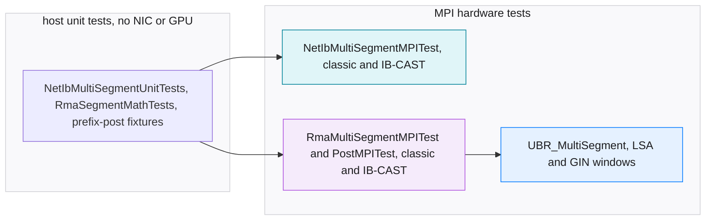

# Multi-segment testing

The tests put the correctness burden on pure boundary math that runs on the host without a NIC or GPU, and use two-node MPI hardware tests for the ibverbs wiring, the collective agreement, the queue limits and the DeepEP window shapes. This doc lists the suites, what they cover, the hybrid DeepEP tests, the runner jobs, how to run them, and the known failures. Behavior under test is described in the transport docs linked from the [overview](multi_segment_overview.md#reading-guide).

## Strategy



The splitters, segment selectors, CTS layout rules and RMA helpers are pure integer functions, so every tricky case is deterministic on the host: different local and remote starts, asymmetric layouts, zero length, address and slice-count overflow, `UINT32_MAX` slicing, credit exhaustion, atomic alignment, malformed peer `segOff` tables, and the DeepEP CPU-to-GPU geometry. Hardware tests then prove the same rules through real DMA-BUF MRs and RDMA, and protect untouched memory with sentinels.

## Suites

| Suite | File | Covers |
|---|---|---|
| `NetIbMultiSeg`, `NetIbSplit`, `NetIbCtsLayout` | `test/NetIbMultiSegmentUnitTests.cpp` (`rccl-UnitTestsFixtures`) | capability trailer, peer-cap decline, segment selection, flush overlap, zero-length rkey, uniform-layout rule, host VMM base 0, independent split offsets, side-entry validation, at-cap count |
| `RmaSegmentMathTest` | `test/RmaSegmentMathTests.cpp` (`rccl-UnitTests`) | slicing, WR budget, signaling, credits, signal offset, count and `segOff` checks, segment index, prefix post, sequence-id release |
| `NetIbSegmentedSendPrefix` | `test/transport/NetIb/NetIbSegmentedSendPrefixTests.cpp` | classic partial posts of a segmented send |
| `NetIbCastSegmentedSendPrefix` and side-table fixtures | `test/transport/NetIbCast/NetIbCastMultiplaneTests.cpp` | IB-CAST partial posts and side table |
| `NetIbMultiSegmentMPITest` | `test/transport/NetIbMPI/NetIbMultiSegmentMPITests.cpp` | P2P per-segment, boundary-crossing, whole-buffer, offsets, multi-receive, flush, caps, switch off, stress |
| `RmaMultiSegmentMPITest`, `RmaMultiSegmentPostMPITest` | `test/transport/RmaMPI/RmaMultiSegmentMPITests.cpp` | GIN/RMA registration, put, get, signal, flush, bounds, DeepEP and hybrid windows, post path, send-queue flood |
| `UBR_MultiSegment` | `test/RegistrationMPITests.cpp` | NET segment-count cache, registration reuse, graph capture, symmetric LSA and GIN windows, DeepEP elastic windows |
| `CeMPI_*` receive-offset and hierarchical cases | CE MPI tests | CE symmetric-window offset (layer 01), hierarchical AllGather and AlltoAll on multi-segment buffers |

Shared VMM helpers are `test/common/MultiSegmentVmmHelpers.hpp` and `test/common/HybridVmmHelpers.hpp`.

## Coverage

| Scenario | Host | P2P MPI | GIN/RMA MPI |
|---|---|---|---|
| Single-segment regression, switch on and off | — | yes | yes |
| N segments register N MRs; deregistration has no leak or double free | — | yes | yes |
| Boundary-crossing transfer | split math | splits and completes | completes |
| Independent local and remote offsets | yes | yes | yes, including DeepEP Engram |
| Over 16 segments rejected, 16 accepted | yes | yes | yes |
| Non-uniform interior segments declined | yes | yes | n/a |
| Side-entry validation and peer-cap decline | yes | yes, including an old peer | n/a |
| Equal counts with different boundaries; unequal counts rejected collectively | yes | n/a | yes |
| Flush fences every segment | overlap math | direct GDR only | per-segment reads |
| Mixed single- and multi-segment handles in one multi-receive | — | yes, transfer and flush | n/a |
| Concurrent pairs across every boundary | — | 2 ranks and 2 × 4 | all-pairs and many-to-one at 2 × 4 |
| Send-queue oversubscription | credit math | opt-in fat chain | opt-in flood |
| Partial posts | prefix fixtures | — | prefix helpers |
| DeepEP `[GPU][CPU]` and hybrid `[GPU k][CPU 0..N-1]` | geometry | — | positive, negative, stress |
| IB-CAST declines under BY_ORDER and QP sharing | — | yes | n/a |

### Classic and IB-CAST P2P

- **Old peer.** `OldPeer_SingleRkeyCrossBoundaryTransfer`: the receiver declines because the peer did not advertise, and a boundary-crossing write still completes on one rkey.
- **Switch off.** `MultiSegmentRegisterOff_DeclinesRegistration` registers a 4-segment window on both ranks with neither peer advertising: the receiver gets `ncclInvalidUsage` and no handle, the sender succeeds.
- **IB-CAST unsafe modes.** `CastUnsafeMode_DeclinesRegistration` runs under BY_ORDER (`NCCL_IB_RECEIVER_SIDE_MATCHING_SCHEME=2`) and under `RCCL_IB_QP_SHARING_ENABLE=1`, and expects both ranks to decline; it skips on classic.
- **Flush.** `MultiSegmentFlushSelectsSegmentMr`, `MultiSegmentFlushTouchesEverySegment` and `MultiRecvFlushTouchesEveryHandle` need direct GDR reads (`RCCL_GDR_FLUSH_GPU_MEM_NO_RELAXED_ORDERING=0`; IB-CAST also `NCCL_GDR_FLUSH_DISABLE=0`), because the default scratchpad flush posts a single read. `MultiRecvMixesSingleAndMultiSegmentHandles` starts its multi-segment entry in segment 1, so a flush through segment 0's MR would fault. These tests check bytes, not rkeys.
- **Optional receive completion (IB-CAST).** `OptRecvCompletionSegmentedSkipsImm` and `OptRecvInvalidRangeRejectedBeforeRequest`; both skip collectively unless optional receive completion is active.
- **Stress.** A 32-iteration asymmetric cross-boundary stress, `ConcurrentPairsMoveEverySegmentBoundary`, and the opt-in `SendQueueFatChainOversubscribe` (`RCCL_MSEG_SQ_STRESS=1`, three 8-receive 16-segment chains on one send QP).
- **Helper dispatch.** `RegisterMultiSegmentMr` must select `IbCastRegMrDmaBufMultiSeg` under IB-CAST; see [IB-CAST P2P](multi_segment_netib_cast.md#file-map).

### GIN/RMA

- **Layouts.** `RegisterEqualCountDifferentBoundariesTransfer` passes; `RegisterAsymmetricSegmentCountRejected` fails collectively; `RankLocalRegistrationFailureRejectedCollectively` fails every rank without deadlock; `RegistrationAfterCollectiveRejectionTransfers` reuses the consensus buffer with a different count.
- **Operations.** Boundary-crossing put and get, `UINT32_MAX` slicing, rejection past 64 slices, signal atomics in later segments and rejection of unaligned or straddling ones, sub-page window bounds, one flush read per segment.
- **Post path.** WR batching at sizes 8 and 2, context isolation, rejected-op slot accounting, zero-size ops, registration churn, all-pairs and many-to-one.
- **Send-queue flood.** `IPutSignalSendQueueOversubscribe` (opt-in). Under IB-CAST it expects zero rejected posts; on both backends context 1 must still deliver into bytes the flood never touched. With `RCCL_TEST_RMA_MSEG_REQUIRE=1`, a test that finds no rank on the multi-segment path fails instead of skipping.
- **Switch off.** `MultiSegmentRegisterOff_KeepsUpstreamPath` expects no handle to report more than one segment (`rcclRmaIbProxyMrSegmentCount`).

### Registration and CE

- `UBR_MultiSegment.Generic` gates on NET registration completion and asserts the cached count is 8 for the whole registration, not "greater than 1". `GenericGraph` does the same under graph capture. `NetSegmentCountOddSizedHipMalloc` checks the last-page walk. `NetProxyPartialFinalSegment` registers two whole mappings and half of a third and checks the unregistered tail is untouched.
- `MultiSegmentRegisterOff_SliceSkipsNet` and `MultiSegmentRegisterOff_GraphSliceSkipsNet` check that a one-segment slice of a multi-segment registration skips NET with the switch off.
- `Generic_Reuse` runs with `RCCL_CE_ALLREDUCE=0`, `NCCL_ALGO=Ring`, `NCCL_PROTO=Simple`, so it deterministically enters the registration path whose reuse log it asserts.
- `DeepEP_ElasticWindowRegistration` runs in its own process, because it runs out of memory after `Symmetric_Elastic_Lsa` in the same process; `UBR_MultiSegment_All_Core` excludes it on every architecture config.
- The CE receive-offset suite (`ce_allreduce_recv_offset`) uses the test-only fault bit `CE_FAULT_LEGACY_RECV_OFFSET` to show the legacy offset corrupts a receive buffer inside its symmetric window, then checks the fix.

## Hybrid DeepEP windows

A hybrid window is one VMM range with a private GPU segment followed by one 2 MiB-aligned host segment per local rank. CI runs 8 ranks on 2 nodes, 4 per node, so each window has five segments:


Host segment k is local to rank k; the other three are imported. Local ranks exchange host sizes with MPI and POSIX DMA-BUF fds over RCCL's Unix-domain IPC socket (`SCM_RIGHTS`), map every host handle in local-rank order, give every segment GPU access and host segments CPU access, and register one window with `NCCL_WIN_STRICT_ORDERING`. LSA reuses the owner's host handle; GIN registers every segment through DMA-BUF, imported ones from the owner's fd ([how](multi_segment_gin_rma.md#host-owner-dma-buf)).

> [!IMPORTANT]
> Supported contract: `NCCL_ELASTIC_BUFFER_REGISTER=1` and `NCCL_SYM_REUSE_SYSMEM_HANDLES=1`. The 8-rank LSA+GIN job `ubr_multisegment_lsagin_multinode` is the primary coverage.

The tier covers strict-window registration and LSA pointer creation, cross-node GIN IGet from an imported remote CPU segment, negative elastic gating and an out-of-range IGet that must not post, and 32 stress iterations that vary the remote CPU owner, the size and independent offsets. The helper (`AllocHybridCollective` in `HybridVmmHelpers.hpp`) skips collectively when host VMM, DMA-BUF, GIN or the topology is missing; `CheckHybridVmmRuntimeSupport` skips with "ROCM-29812: imported host VMM CPU access is unsupported" on runtimes without that fix. `RCCL_TEST_HYBRID_VMM_REQUIRE=1` (set by the LsaGin job) turns those skips into failures. Cleanup is installed before any skip, and MRs and windows are released before the imported mappings. The RMA fixture calls the plugin directly, so it publishes the fds it received with `rcclHostSegmentFdRegister`.

**Non-blocking test stream.** Before HIP 7.17 a peer proxy's `hipMemMap` waits for kernels on blocking streams, so lazy IPC registration can deadlock against a collective on the test stream. A test can set `test_stream_flags_ = hipStreamNonBlocking` (`test/common/MPITestCore.hpp`), and `RCCL_TEST_STREAM_NONBLOCKING=1` or `0` overrides it for any run; `NetProxyPartialFinalSegment` opts in.

## Runner jobs

All six architecture configs (`mi300x_mellanox_ib`, `mi300_mellanox_ib_func`, `mi355x_thor2_roce`, `mi355x_thor2_roce_func`, `mi455_ainic_roce`, `mi455_ainic_roce_func`) enable the same block:

| Job | Ranks | Runs |
|---|---|---|
| `multisegment_host_boundary_math` | 1 | host boundary helpers |
| `ubr_multisegment_comprehensive` | 2 on 1 node | `UBR_MultiSegment_All_Core`, `Generic_Reuse`, elastic gating |
| `multisegment_transport_multinode` | 2 on 2 nodes | classic P2P and RMA suites except hybrid, the switch-off entry, `UBR_MultiSegment_Generic`, `NetProxyPartialFinalSegment` |
| `multisegment_netproxy_intranode_multinode` | 4 on 2 nodes | `NetProxyPartialFinalSegment` with an intra-node peer |
| `ubr_multisegment_lsagin_multinode` | 8 on 2 nodes | `GenericGraph`, the slice-skip tests, DeepEP hybrid jobs, `DeepEP_ElasticWindowRegistration` in its own process, and the IB-CAST twins |
| `ubr_multisegment_lsagin_rs_multinode` | 8 on 2 nodes | disabled: `Symmetric_LsaGin` and its IB-CAST twin (see below) |
| `ce_allreduce_recv_offset` | — | `CE_RecvOffset_*` |
| `ce_hierarchical_multisegment_multinode` | 8 on 2 nodes | `CeMPI_AllGather` and `CeMPI_AlltoAll` `MultiNodeHierarchical*` over one- and two-segment windows; the AINIC configs leave `NCCL_NET` unset, as their other jobs do |

The MI300 IB configs also define `multisegment_cast_rma_multinode` (IB-CAST RMA suites, plus the opt-in send-queue flood in `mi300x_mellanox_ib`). `net_ib_transport.json` holds the per-transport jobs:

| Job | Scope |
|---|---|
| `net_ib_multisegment` | classic P2P on 2 nodes, including ID matching and the opt-in fat chain |
| `net_ib_multisegment_flush` | direct-GDR flush chain |
| `net_ib_multisegment_old_peer` | receiver declines, boundary-crossing write completes on one rkey |
| `net_ib_multisegment_register_off` | switch off: decline and single-segment regressions |
| `net_ib_multisegment_scale_2x4` | concurrent pairs, 4 ranks on each of 2 nodes |
| `cast_multisegment`, `cast_multisegment_opt_recv`, `cast_multisegment_opt_recv_2qp` | IB-CAST P2P suite on BY_INDEX matching, with direct flush on; optional receive completion on 1 and 2 QPs |
| `cast_multisegment_register_off`, `cast_multisegment_unsafe_modes` | IB-CAST switch off; declines under BY_ORDER and QP sharing |
| `net_ib_rma_multisegment`, `net_ib_rma_multisegment_wrbatch` | classic RMA suite with `RCCL_TEST_RMA_MSEG_REQUIRE=1` and the switch-off entries; WR batch sizes 8 and 2 |
| `cast_rma_multisegment` | extends `net_ib_rma_multisegment` with `NCCL_NET=IB-CAST`, so a fix made only in `net_ib` shows up as an IB-CAST failure |
| `net_ib_rma_multisegment_hybrid`, `cast_rma_multisegment_hybrid` | 8-rank hybrid RMA on classic and IB-CAST |
| `net_ib_rma_multisegment_scale_1x2`, `net_ib_rma_multisegment_scale_2x4` | RMA scale variants |

None of the IB-CAST P2P jobs sets `RCCL_IB_P2P_DISABLE_CTS=1`. Perf-only configs do not run these tests. `tools/scripts/test_runner/check_test_filters.py` flags `test_filter` clauses that match no test.

## How to run

The runner applies each job's environment from the JSON configs and is the recommended way to reproduce CI. For manual runs:

```bash
# Build with MPI tests; a debug build exposes the internal symbols the MPI tests use.
MPI_PATH=/opt/sre-tools/ompi ./install.sh --debug --enable-mpi-tests -t -l

# Host unit tests
./build/test/rccl-UnitTestsFixtures --gtest_filter='NetIbMultiSeg.*:NetIbSplit.*:NetIbCtsLayout.*'
./build/test/rccl-UnitTests --gtest_filter='RmaSegmentMathTest.*'

# Two-node P2P and RMA, classic
mpirun -np 2 --map-by ppr:1:node ./build/test/rccl-UnitTestsMPI \
  --gtest_filter='NetIbMultiSegmentMPITest.*:RmaMultiSegmentMPITest.*-RmaMultiSegmentMPITest.DeepEP_Hybrid*'

# RMA on IB-CAST
NCCL_NET=IB-CAST mpirun -np 2 --map-by ppr:1:node ./build/test/rccl-UnitTestsMPI \
  --gtest_filter='RmaMultiSegmentMPITest.*:RmaMultiSegmentPostMPITest.*-RmaMultiSegmentMPITest.DeepEP_Hybrid*'

# Opt-in send-queue stress
RCCL_MSEG_SQ_STRESS=1 mpirun -np 2 --map-by ppr:1:node ./build/test/rccl-UnitTestsMPI \
  --gtest_filter='RmaMultiSegmentPostMPITest.IPutSignalSendQueueOversubscribe'

# Switch off
NCCL_MULTI_SEGMENT_REGISTER=0 mpirun -np 2 --map-by ppr:1:node ./build/test/rccl-UnitTestsMPI \
  --gtest_filter='NetIbMultiSegmentMPITest.MultiSegmentRegisterOff_DeclinesRegistration'

# Eight-rank hybrid LSA+GIN, 4 ranks per node
mpirun -np 8 --map-by ppr:4:node ./build/test/rccl-UnitTestsMPI \
  --gtest_filter='UBR_MultiSegment.DeepEP_Hybrid*:RmaMultiSegmentMPITest.DeepEP_Hybrid*'
```

Validate multi-segment changes on ROCm 7.0.2.2 and on a 10.x runtime; the version gates differ between them.

## Results

The latest recorded run is on the wire branch, on two MI355X (gfx950) nodes with Thor2 RoCE NICs, `ENABLE_ROCSHMEM_GIN=ON` and `NCCL_GIN_TYPE=2`. All 58 runner units passed on ROCm 10.3 (TheRock 10.3.0a20261023, 7709 tests). On ROCm 7.0.2.2 Build 19, 57 of 58 passed (7676 tests); the failure is `Symmetric_LsaGin`. `cast_rma_multisegment` passed 156 of 156 and both hybrid RMA jobs passed 3 of 3; without the owner-fd lookup all three IB-CAST hybrid tests fail on Build 19.

## Known failures and dependencies

- `UBR_MultiSegment.Symmetric_LsaGin` and its IB-CAST twin fail on ROCm 7.0.2.x: the cross-node ReduceScatter selects `ReduceScatter_RailA2A`, whose 1024-thread GIN launch does not complete on gfx950. They pass on 10.3. Both entries sit in the disabled suite `ubr_multisegment_lsagin_rs_multinode` until a launch fix lands; the earlier fix, PR 12104, was closed without merging.
- Failures that are present on develop and not caused by this stack: IB-CAST `StressMultiRound` (`CastStressMultiRoundTwoConns`), `CE_AllReduce_3Ranks` and its pipelined variant, HostApi `GraphCaptureReplayPutWait`, MemManager AnyRanks CuMem0/1, `Resiliency_GidChangeRefresh`, and the symmetric ReduceScatter group (same cause as above).

## Regression guards

1. The single-segment path stays byte-identical: same WRs, same completion, no side table, a single flush read.
2. P2P frees only through `segMrs[][]`, never the `mrs[]` alias.
3. A split failure, WR-pool overflow, invalid peer layout or straddle WARNs and returns an error instead of posting a bad WR.
4. A prefix post keeps the request; a lost signaled tail marks it FAILED.
5. Host VMM `segBase == 0` does not wrap the segment length.
6. The NET segment count is cached for the full registration, after every peer registered, and the walk ends inside the last page.
7. CE peer destinations include `recvbuff - recvWin->userPtr` before the shard offset.
8. Reuse tests select the registration path with Ring/Simple and CE off.
9. P2P send queues hold the chains in flight: classic one per proxy step, IB-CAST one group at a time; never `32 × 257`.
10. GIN exports cover whole pages from the segment pointer's page.
11. GIN consensus is collective: allocated at connect, reached even after a local failure, tables validated.
12. Classic writes the side table only for flagged slots; peer `nreqs` is bounded before any wait.
13. IB-CAST declines on both sides under CTS offload, BY_ORDER or QP sharing; classic declines only the receiver of a peer without the capability.
14. Host-window classification allgathers a fixed-size kind array.
15. The switch off restores develop: no capability, develop's depths and bodies, no consensus buffer.
16. Develop's functions carry only one-line hooks.
