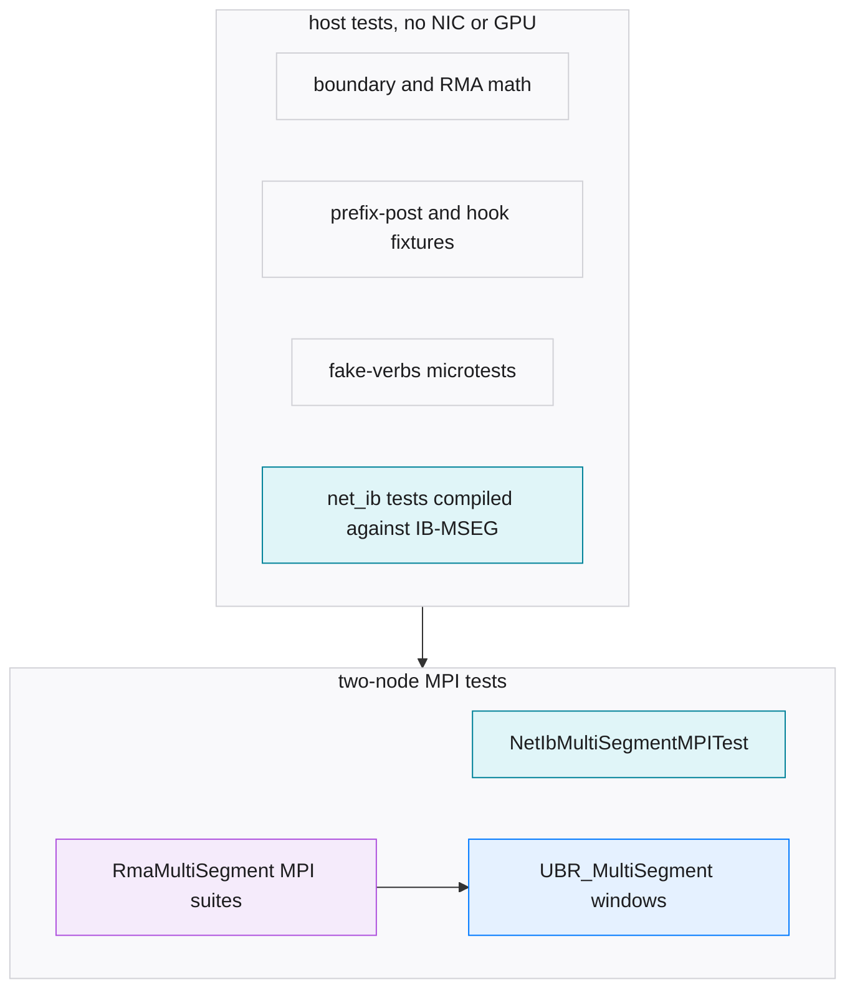
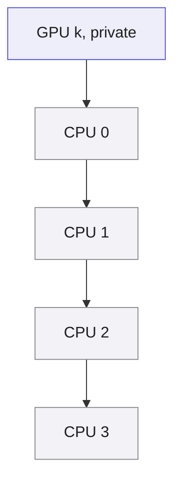

# Multi-segment testing

The tests put the correctness burden on pure boundary math and fake-verbs microtests that run on the host without a NIC or GPU, compile develop's `net_ib` host tests a second time against the IB-MSEG fork, and use two-node MPI hardware tests for the ibverbs wiring, the collective agreement, the queue limits and the DeepEP window shapes. This doc covers the strategy, what the tests check, the hybrid DeepEP tests, the tests pull request that sits on top of fork 4, the runner jobs, how to run them, the results and the known failures. Every test per fork, the job and config matrix and the open gaps are in the [validation plan](multi_segment_validation_plan.md). Forks 5 and 6 (IB-CAST) are planned and add no tests yet.

The code paths these tests drive are in the code walkthrough book: [fork 1](walkthrough/multi_segment_walkthrough_fork1_core.md), [fork 2](walkthrough/multi_segment_walkthrough_fork2_copy.md), [fork 3](walkthrough/multi_segment_walkthrough_fork3_p2p.md) and [fork 4](walkthrough/multi_segment_walkthrough_fork4_gin_rma.md).

## Strategy



The splitters, segment selectors, CTS layout rules and RMA helpers are pure integer functions, so every tricky case is deterministic on the host: different local and remote starts, asymmetric layouts, zero length, address overflow, slicing at the verbs length limit, round pumping and the in-flight cap, atomic alignment, malformed peer `segOff` tables, and the consensus exchange with a local or remote failure. Fake-verbs microtests drive the fork's connect, registration, P2P and GIN units and the core gates. Because the fork is a renamed copy of `net_ib`, four IB-MSEG host binaries also compile every `net_ib` host test against the fork ([compile-twice host tests](multi_segment_fork_plugin.md#compile-twice-host-tests)). Hardware tests then prove the same rules through real DMA-BUF MRs and RDMA, and protect untouched memory with sentinels.

The tests live in four kinds of binaries: host unit tests in `rccl-UnitTestsFixtures` (`test/NetIbMultiSegmentUnitTests.cpp`) and in the host-only `rccl-HostUnitTests` (`test/RmaSegmentMathTests.cpp`, built by `test/host/run_host_tests.sh`), hook fixtures in `rccl-UnitTestsFixturesDebug` (`test/transport/NetIb/NetIbSegmentedSendPrefixTests.cpp`), MPI tests in `rccl-UnitTestsMPI` (`NetIbMultiSegmentMPITests.cpp`, `RmaMultiSegmentMPITests.cpp`, `RegistrationMPITests.cpp`, `GeneralTests.cpp`), and the `rccl-UnitTestsMicro*` host microtests under `test/host/`, built and run by `test/host/run_host_tests.sh` against fake verbs and HIP. Shared helpers are `test/common/MultiSegmentVmmHelpers.hpp`, `HybridVmmHelpers.hpp`, `MultiSegmentTestSupport.hpp` and `IbFakePostSend.hpp`; `AllocHybridVmm` maps its host and device segments through `AllocSegmentedVmm`. The tests pull request moves the `UBR_MultiSegment` tests out of `RegistrationMPITests.cpp` into `test/multisegment/` and splits the RMA file ([layout](#tests-pull-request)).

## Coverage

| Scenario | Host | P2P MPI | GIN/RMA MPI |
|---|---|---|---|
| Single-segment regression, switch on and off | — | yes | yes |
| N segments register N MRs; deregistration keeps going after an error | yes | yes | yes |
| Boundary-crossing transfer | split and cursor math | splits and completes | completes |
| Independent local and remote offsets | yes | yes | yes, including DeepEP Engram |
| Count past the cap rejected | yes | yes | yes |
| Non-uniform segment sizes register and transfer | unequal-segment math | `NonUniformLayoutRegisters` | equal counts with different boundaries |
| Layout validation | CTS layout and blob | via transfers | n/a |
| Peer with the other switch setting fails at connect | connect microtests | — | n/a |
| Unequal counts rejected collectively | consensus exchange | n/a | yes |
| One flush read | fixtures | direct GDR only | `IFlush*` tests |
| Mixed single- and multi-segment handles in one multi-receive | — | yes, transfer and flush | n/a |
| Concurrent pairs across every boundary | — | 2 ranks and 2 × 4 | all-pairs and many-to-one at 1 × 2 and 2 × 4 |
| Send-queue oversubscription | round and in-flight math | opt-in fat chain | at the in-flight cap, plus an opt-in flood |
| Partial posts | prefix fixtures | — | prefix helpers |
| DeepEP `[GPU][CPU]` and hybrid `[GPU k][CPU 0..N-1]` | — | — | positive, negative, stress |
| Core gates: switch, DMA-BUF, backend, owner fd | yes | n/a | via the window tests |

Tests for the capability word and for old peers have no counterpart, because the fork has no capability negotiation.

### P2P

- **Switch off.** `MultiSegmentRegisterOff_DeclinesRegistration` runs with `NCCL_NET=IB-MSEG` and `NCCL_MULTI_SEGMENT_REGISTER=0`: both ends keep the legacy CTS, the receiver's 4-segment registration fails with `ncclInvalidUsage`, and the sender still registers because it splits locally onto the receiver's single rkey.
- **Connect-time mismatch.** `NetIbMsegConnectMultiSegMicrotest.ConnectAndAccept_PeerWithTheOtherSettingFails` checks that connect and accept fail with `ncclInvalidUsage` when the two ends disagree on `useMultiSeg`; there is no MPI test for it.
- **Per-comm CTS state.** `ConnectAndAccept_MultiSegStateFollowsUseMultiSeg` checks that only a `useMultiSeg` comm allocates the send cursor and layout cache, and that only a legacy receiver allocates `remCtsFifo.elems` under its CTS MR; `NetIbMsegConnectResilientMicrotest` checks that resilient connect and accept keep the legacy CTS with the switch on; the `NetIbSegmentedSendPrefix.LegacyCtsComm*` fixtures check that a legacy-CTS comm allocates a cursor on its first segmented send and none for a single-segment send.
- **Parameter copies.** The fork binaries link no `net_ib` unit, so `test/host/fakes/net_ib_mseg_params*.cc` hand-copy `net_ib`'s parameter definitions; `NetIbMsegParamCopies.EveryCopiedStatementMatchesItsNetIbSource` fails when a copied statement no longer appears in the `net_ib` source its header names.
- **Scratchpad flush.** `NetIbSegmentedFlushPrefix.ScratchpadChainsOneWriteAndOneReadInOnePost` checks that the scratchpad write is posted inline, as develop's `net_ib` now does, and chained with the read in one post.
- **Flush.** `MultiSegmentFlushSelectsSegmentMr`, `MultiSegmentFlushTouchesEverySegment` and `MultiRecvFlushTouchesEveryHandle` need direct GDR reads (`RCCL_GDR_FLUSH_GPU_MEM_NO_RELAXED_ORDERING=0`), because the default scratchpad flush never reads a receive buffer. `MultiRecvMixesSingleAndMultiSegmentHandles` starts its multi-segment entry in segment 1, so a flush through segment 0's MR would fault. These tests check bytes, not rkeys.
- **GDR flush flag.** `GdrFlushFlag_SegmentedSendWritesFlag` runs with `RCCL_IB_GDR_FLUSH_FLAG=1` on the default QP count and on 4 split QPs, and checks that a segmented send writes each QP's flush flag.
- **Stress.** `DeepEP_MultiNodeAsymmetricCrossBoundaryStress`, `ConcurrentPairsMoveEverySegmentBoundary`, and the opt-in `SendQueueFatChainOversubscribe` (`RCCL_MSEG_SQ_STRESS=1` with `NCCL_IB_QPS_PER_CONNECTION=1`: three groups of 8 receives queued on one send QP before any test call; the sliced send keeps each progress call to one slice per QP).
- **Data checks.** With the tests pull request, the NET IB multi-segment MPI tests fill buffers with a pattern of period 251 (`test/common/SegPattern.hpp`). The period is prime, so data moved by a segment or a page reads differently; with a period of 256 a slice taken from the wrong segment would still match. The receiver fills its whole buffer with a sentinel byte first and checks that every byte outside the received range still holds it. The sender reads `rcclIbSendCommSegStats` before and after each send on a multi-segment buffer: the send must have gone through the segmented builder, and it must count a later-segment post exactly when the transfer reaches a segment past the first on either side. The host test `SegPattern_DetectsWholeSegmentShiftsAndNeverHitsTheSentinel` checks the pattern itself, and fork 3's `SendCommSegStats_ReadsTheCommCountersAndRejectsNull` checks the counter reader.
- **Prerequisites.** `UT_NET_IB_MSEG_REQUIRE_DMABUF=1`, set by every `net_ib_multisegment*` job and by the `standard_env_multi_segment_register` tier in `test_categories_mpi.yaml`, turns a missing IB-MSEG net, DMA-BUF, VMM or export API into a failure instead of a skip.

### GIN/RMA

- **Layouts.** `RegisterEqualCountDifferentBoundariesTransfer` passes; `RegisterAsymmetricSegmentCountRejected` fails collectively; `RankLocalRegistrationFailureRejectedCollectively` fails every rank without deadlock; `RegistrationAfterCollectiveRejectionTransfers` reuses the consensus buffer with a different count.
- **Operations.** Boundary-crossing put and get, size sweeps from zero and at a boundary offset, signal atomics in later segments and rejection of out-of-range ones, sub-page window bounds, the one-read flush and a flush after a partial put.
- **Post path.** WR batching at sizes 8 and 2 (`ChainsAroundWrBatchSizeLandIntact` under `NCCL_RMA_IB_WR_BATCHSIZE`), context isolation, rejected-op slot accounting, zero-size ops, registration churn, all-pairs and many-to-one.
- **Failed doorbell.** The host microtest `NetIbMsegGinMicrotest.IPut_BatchDoorbellFailure_FailsTheAggregatedRequests` queues two aggregated puts, fails the doorbell, and checks that both report `ncclRemoteError` even after a later request on the same QP completes.
- **Send queue.** `IPutSignalFillsSendQueueWithoutTest` and `IPutSignalAtProxyInflightCapFitsSendQueue` post worst-case putSignals up to the in-flight cap without calling test, and all must land. The opt-in `IPutSignalSendQueueOversubscribe` (`RCCL_MSEG_SQ_STRESS=1`) posts twice the send queue: rejected posts return no request and accepted ones finish. With `RCCL_TEST_RMA_MSEG_REQUIRE=1`, a test that finds no rank on the multi-segment path fails instead of skipping.
- **Round counters.** With the tests pull request, the RMA multi-segment MPI tests use the same period-251 pattern and compare the per-context, per-peer round counters (`rcclRmaIbProxySegStats`) with a plan computed from the operations and the window layout: at least one round per operation, and a round ending past the first segment exactly when an operation reaches a later segment. Fork 4's host test `IPut_WiderThanOneRound` checks three rounds, 138 data WRs and three later-segment rounds, and that an out-of-range peer is rejected.
- **Switch off.** `MultiSegmentRegisterOff_KeepsSingleRegistration` runs on IB-MSEG with the switch off and expects no handle to report more than one segment (`rcclRmaIbProxyMrSegmentCount`); the same job reruns develop's `RmaMPITest` suites with the switch on and off.

### Registration and core gates

- `UBR_MultiSegment.NetProxyPartialFinalSegment` registers two whole mappings and half of a third through the NET proxy and checks the unregistered tail is untouched; `multisegment_netproxy_intranode_multinode` repeats it with an intra-node peer.
- `Symmetric_Elastic_RmaRegistration` runs twice in `ubr_multisegment_lsagin_multinode`, with `NCCL_SYM_REUSE_SYSMEM_HANDLES=1` (registers) and `=0` (skips RMA registration).
- `DeepEP_ElasticWindowRegistration` runs in its own job entry, because it runs out of memory after `Symmetric_Elastic_Lsa` in the same process; `UBR_MultiSegment_All_Core` excludes it.
- Develop's `UBR_MultiSegment` cases (`Generic`, `GenericGraph`, `Generic_Reuse`, the slice-skip tests, `Symmetric_LsaGin`) run in the fork jobs with the switch on; `Generic_Reuse` runs with `RCCL_CE_ALLREDUCE=0`, `NCCL_ALGO=Ring`, `NCCL_PROTO=Simple`, so it deterministically enters the registration path whose reuse log it asserts.
- The fork 1 microtests pin the core: a multi-segment window registers on GIN or RMA only when the comm's plugin flag, the switch and DMA-BUF are on and the backend registers per segment; the host owner fd is borrowed only when exactly one rank can export it; hierarchical CE falls back when a window has no RMA registration.

The rules these tests guard are the invariants in the [current contract](multi_segment_current.md#invariants).

## Hybrid DeepEP windows

A hybrid window is one VMM range with a private GPU segment followed by one 2 MiB-aligned host segment per local rank. CI runs 8 ranks on 2 nodes, 4 per node, so each window has five segments:



Host segment k is local to rank k; the other three are imported. Local ranks exchange host sizes with MPI and POSIX DMA-BUF fds over RCCL's Unix-domain IPC socket (`SCM_RIGHTS`), map every host handle in local-rank order, give every segment GPU access and host segments CPU access, and register one window with `NCCL_WIN_STRICT_ORDERING`. LSA reuses the owner's host handle; GIN registers every segment through DMA-BUF, imported ones from the owner's fd ([how](multi_segment_gin_rma.md#host-owner-dma-buf)).

> [!IMPORTANT]
> Supported contract: `NCCL_ELASTIC_BUFFER_REGISTER=1` and `NCCL_SYM_REUSE_SYSMEM_HANDLES=1`. The 8-rank LSA+GIN job `ubr_multisegment_lsagin_multinode` is the primary coverage, `net_ib_rma_multisegment_hybrid` runs the RMA cases on their own, and `ubr_multisegment_hybrid_reuse_sysmem` runs the owner fd export and allgather with 2 ranks on one node.

The tier covers strict-window registration and handle reuse (`DeepEP_HybridWindowRegistrationAndHandleReuse`), cross-node GIN IGet from an imported remote CPU segment (`DeepEP_HybridImportedCpuSegmentIGet`), negative elastic gating (`DeepEP_HybridElasticRegistrationDisabled`) and an out-of-range IGet that must not post (`DeepEP_HybridOutOfRangeIGetRejected`), and a stress run that varies the remote CPU owner, the size and independent offsets (`DeepEP_HybridMultiNodeIGetStress`). The helper (`AllocHybridCollective` in `HybridVmmHelpers.hpp`) skips collectively when host VMM, DMA-BUF, GIN or the topology is missing; `CheckHybridVmmRuntimeSupport` skips with "ROCM-29812: imported host VMM CPU access is unsupported" on runtimes without that fix. `RCCL_TEST_HYBRID_VMM_REQUIRE=1` (set by `ubr_multisegment_lsagin_multinode`, `net_ib_rma_multisegment_hybrid` and, with the tests pull request, `ubr_multisegment_hybrid_singlenode`) turns those skips into failures. Cleanup is installed before any skip, and MRs and windows are released before the imported mappings. The RMA tests call the plugin directly, so the helper publishes the fds it received with `rcclHostSegmentFdRegister`.

**Non-blocking test stream.** A peer proxy's `hipMemMap` waits for kernels on blocking streams, so lazy IPC registration can deadlock against a collective on the test stream. A test can set `test_stream_flags_ = hipStreamNonBlocking` (`test/common/MPITestCore.hpp`); `NetProxyPartialFinalSegment` does. There is no environment override.

## Tests pull request

A tests-only pull request on top of fork 4 adds multi-segment coverage for elastic `[GPU][CPU]` and hybrid windows, the symmetric and normal collective paths on multi-segment buffers, and CE dispatch and gating on multi-segment windows. It changes no library code. It has two commits: an adapted contributor commit that adds the coverage, then a commit that aligns the jobs and makes the result checks rank-collective.

| File | What it holds |
|---|---|
| `test/multisegment/MultiSegmentRegistrationMPITests.cpp` | IPC and NET registration, cache reuse, partial NET registration, register-off slices, DeepEP and hybrid registration, elastic gating |
| `test/multisegment/MultiSegmentCollectiveMPITests.cpp` | LSA, LSA+GIN, elastic and hybrid collectives, receive-range tests |
| `test/multisegment/MultiSegmentCeMPITests.cpp` | `CE_RecvOffset`, its fault twin, CE elastic gating on one node and hierarchical |
| `test/multisegment/MultiSegmentTestFixture.hpp` | the shared `UBR_MultiSegment` fixture, path checks and the receive-range runner |
| `test/common/DevrWindowTestHelpers.hpp` | the segment-count and sysmem check on a registered window |
| `test/common/RegistrationTestSupport.hpp` | the registration fixture and `REGLogChecker` |
| `test/transport/RmaMPI/RmaMultiSegmentFixture.hpp`, `RmaMultiSegmentMPITests.cpp`, `RmaMultiSegmentElasticMPITests.cpp` | the RMA fixture, core put, get, flush and signal tests, and the DeepEP and hybrid `iget` tests |
| `test/ce/CeMPITests.cpp` | `CeMPI_MultiSegment`, single-node and hierarchical CE on multi-segment windows |

The 18 `UBR_MultiSegment` tests that fork 4 has in `RegistrationMPITests.cpp` move to `test/multisegment/` with the same names, except that the fault test `Symmetric_Lsa_BeforeLegacyRecvOffsetCorruptsResult` becomes `CE_RecvOffset_BeforeLegacyCorruptsResult` next to `CE_RecvOffset`, the test it is the fault twin of; it is compiled only with `ENABLE_FAULT_INJECTION` and checks the exact corrupted result. The four `UBR_MultiSegment` CE tests live in `MultiSegmentCeMPITests.cpp` instead of `test/ce/CeMPITests.cpp`, which keeps only `CeMPI_MultiSegment`. The RMA tests keep their names across the split.

The new tests, by topology:

- **One node, GPU windows.** Symmetric AllGather and ReduceScatter on the symmetric kernel; two receive-range tests (a range past the window that overflows staging, and a range inside the window whose shards cross segments, taking the registered pipelined path); `Generic_Reuse_BeforeCePlanBypassesRegistrationCache`, where forced CE skips IPC and NET registration; `CE_RecvOffset`, CE AllReduce with the receive window one segment in; the six single-node `CeMPI_MultiSegment` cases.
- **One node, elastic and hybrid.** Elastic AllGather, AlltoAll and ReduceScatter on the normal algorithm; `CE_Elastic_Gating`, where CE selects the GPU window and rejects the elastic one; 4-rank hybrid registration and handle reuse without a GIN leg, elastic-off rejection, and AllGather, AllReduce and ReduceScatter whose receive window includes the imported CPU tail.
- **Two nodes.** GPU LSA+GIN AllGather (symmetric only with LSA multimem, so it skips on RCCL, plus its legacy-fallback twin that runs) and AllReduce; elastic LSA+GIN AllGather, AllReduce and ReduceScatter; 8-rank hybrid AllGather, AllReduce and ReduceScatter that write, and for AllReduce also read, the CPU tail.
- **Eight or more nodes.** `CeMPI_MultiSegment.HierarchicalAllGather`, `HierarchicalAlltoAll` and `UBR_MultiSegment.CE_Elastic_HierarchicalGating`.

How the tests check results:

- **Rank-collective checks.** Result checks use `ASSERT_MPI_TRUE`, so a mismatch on one rank fails every rank instead of leaving the others waiting in the next collective. Helper calls go through `ASSERT_MPI_HELPER` (`test/common/TestChecks.hpp`), which also returns when the helper skipped the test on every rank.
- **Per-rank fill.** Buffers are filled with a per-rank pattern of period 7, so ReduceScatter, AllGather and AlltoAll are checked at each rank's own offset. Every rank maps a hybrid window's host segments, so the hybrid ReduceScatter keeps the host-segment output the same on every rank and checks the shard only in the GPU segment.
- **Path assertions.** Positive tests assert the path they take: the window's segment count and sysmem flag, the symmetric kernel on the `Symmetric_Lsa` paths, and for the receive-range tests the CE containment result and that CE AllReduce was selected. `Generic` asserts IPC on one node (`numSegments == 8` on every recorded peer) and NET on two or more (`netNSegments == 8`). An elastic or hybrid window is a CE gate, not a CE collective: `ncclCeAvailable` and `ncclHierCeAvailable` reject sysmem. `Symmetric_Elastic_Gating` expects `ncclInvalidArgument` and no window.
- **Require knobs.** `RCCL_TEST_HYBRID_VMM_REQUIRE=1` turns the collective hybrid skip into a failure; `RCCL_TEST_NET_MSEG_REQUIRE=1` does the same for the `Generic` tests when no rank completed NET registration of the full range; `RCCL_TEST_SYM_KERNEL_OPTIONAL=1` turns off the symmetric-kernel check on platforms without that kernel (no job sets it).

Counted from the `TEST_F` and `TEST` definitions in the tests pull request's sources:

| Suite | Tests |
|---|---|
| `UBR_MultiSegment` | 43: 15 registration, 24 collective, 4 CE (one of them only with `ENABLE_FAULT_INJECTION`) |
| `CeMPI_MultiSegment` | 8 |
| `RmaMultiSegmentMPITest` | 31 (26 core, 5 DeepEP and hybrid), plus the `BuildSkipped` placeholder in builds without the IB RMA proxy |
| `RmaMultiSegmentPostMPITest` | 14, unchanged |

Against fork 4, that is 33 new tests: 25 in `UBR_MultiSegment` and 8 in `CeMPI_MultiSegment`.

## Runner jobs

The four Mellanox IB and Thor2 configs (`mi300x_mellanox_ib`, `mi300_mellanox_ib_func`, `mi355x_thor2_roce`, `mi355x_thor2_roce_func`) define and enable the same block, and `net_ib_transport` holds the NET-IB subset. The AINIC configs (`mi455_ainic_roce`, `mi455_ainic_roce_func`) define the same block plus `net_plugin_selection_mseg`: forks 2, 3 and 4 each end by adding their jobs there with `NCCL_NET=IB`, which selects IB-MSEG for net and RMA on AINIC under `NCCL_MULTI_SEGMENT_REGISTER=1` (with `NCCL_NET` unset, the switch selects IB-CAST there). The comm-level jobs are enabled on both AINIC configs; each whitebox job takes the enabled state and skip reason of its develop NET-IB suite, so all of them are disabled in `mi455_ainic_roce`, and the GDR flush and GDR flush flag twins are disabled in `mi455_ainic_roce_func`. None of the AINIC entries has run on AINIC hardware yet. Which config has which job is in the [job and config matrix](multi_segment_validation_plan.md#runner-jobs-and-configs).

| Job | Ranks | Runs |
|---|---|---|
| `unit_tests_fixtures_debug` entries `A20_NetIb_SegmentedSendPrefix`, `A20_NetIb_SegmentedFlushPrefix`, `A20_NetIb_SegmentedHooks` | 1 | the P2P prefix, flush and hook fixtures |
| `ubr_multisegment_comprehensive` | 2 on 1 node | `UBR_MultiSegment_All_Core`, `Generic_Reuse`, elastic gating |
| `ubr_multisegment_hybrid_reuse_sysmem` | 2 on 1 node | `UBR_MultiSegment.Symmetric_Elastic_Lsa` with `NCCL_SYM_REUSE_SYSMEM_HANDLES=1`, so the host owner fd export and allgather run on hardware |
| `multisegment_netproxy_multinode` | 2 on 2 nodes | `UBR_MultiSegment.Generic` and `NetProxyPartialFinalSegment` |
| `multisegment_netproxy_intranode_multinode` | 4 on 2 nodes | `NetProxyPartialFinalSegment` with an intra-node peer |
| `ubr_multisegment_lsagin_multinode` | 8 on 2 nodes | `Generic`, `GenericGraph`, the slice-skip tests with the switch off, `Symmetric_LsaGin`, `Symmetric_Elastic_RmaRegistration` with reuse on and off, the DeepEP hybrid registration and RMA cases, `DeepEP_ElasticWindowRegistration` on its own; `RCCL_TEST_RMA_MSEG_REQUIRE=1` and `RCCL_TEST_HYBRID_VMM_REQUIRE=1` |
| `net_ib_multisegment` | 2 on 2 nodes | the P2P suite, ID matching (`NCCL_IB_RECEIVER_SIDE_MATCHING_SCHEME=1`) and the opt-in fat chain |
| `net_ib_multisegment_register_off` | 2 on 2 nodes | `NCCL_NET=IB-MSEG` with the switch off: decline and single-segment regression |
| `net_ib_multisegment_flush` | 2 on 2 nodes | direct-GDR flush tests |
| `net_ib_multisegment_scale_2x4` | 8 on 2 nodes | concurrent pairs, 4 ranks on each of 2 nodes |
| `net_ib_multisegment_gdr_flush_flag` | 2 on 2 nodes | segmented send with `RCCL_IB_GDR_FLUSH_FLAG=1`, default and 4 split QPs |
| `net_ib_rma_multisegment` | 2 on 2 nodes in `net_ib_transport`; 2 on 1 node in the architecture configs, whose `net_ib_base` is single-node | every `RmaMultiSegmentMPITest` case by name except the three hybrid ones and the `BuildSkipped` placeholder, the post-path suite at the default WR batch and at 8 and 2, the send-queue flood under `RCCL_MSEG_SQ_STRESS=1`, the switch-off entries on IB-MSEG, and develop's `RmaMPITest` suites with the switch on and off; `RCCL_TEST_RMA_MSEG_REQUIRE=1` |
| `net_ib_rma_multisegment_hybrid` | 8 on 2 nodes | the three DeepEP hybrid RMA cases with `RCCL_TEST_HYBRID_VMM_REQUIRE=1` |
| `net_ib_rma_multisegment_scale_1x2`, `net_ib_rma_multisegment_scale_2x4` | 2 on 1 node, 8 on 2 nodes | the post-path suite without the flood |
| `net_ib_initialization_mseg`, `net_ib_properties_mseg`, `net_ib_connection_mseg`, `net_ib_memory_mseg`, `net_ib_transfer_mseg`, `net_ib_gdr_flush_mseg`, `net_ib_gdr_flush_flag_mseg` | as the base job | develop's NET-IB whitebox suites rerun with `NCCL_MULTI_SEGMENT_REGISTER=1`, so they drive IB-MSEG; the initialization job also asserts the default plugin is IB-MSEG |
| `net_plugin_selection_mseg` | as the base job | plugin selection under the switch, in `net_ib_transport`, `mi455_ainic_roce` and `mi455_ainic_roce_func` |
| `net_ib_wqe_lat_mseg`, `net_ib_gin_peermem_mseg` | as the base job | `net_ib_transport` only: WQE latency monitor and GIN peer-mem on IB-MSEG |

The [tests pull request](#tests-pull-request) adds or changes these jobs in the Mellanox IB, Thor2 and AINIC configs; `mi455_roce_func` gains `ubr_multisegment_comprehensive` and `ubr_multisegment_hybrid_singlenode` and has no multi-node jobs.

| Job | Ranks | What the tests pull request adds | Enabled |
|---|---|---|---|
| `ubr_multisegment_comprehensive` | 2 on 1 node | symmetric AllGather and ReduceScatter, elastic AllGather, AlltoAll and ReduceScatter; `All_Core` excludes the tests that have their own job | yes |
| `ubr_multisegment_ce_before` | 2 on 1 node, forced CE | `Generic_Reuse_BeforeCePlanBypassesRegistrationCache` | yes, new |
| `ubr_multisegment_hybrid_singlenode` | 4 on 1 node | hybrid registration, collectives and elastic-off rejection, with `RCCL_TEST_HYBRID_VMM_REQUIRE=1` | yes, new |
| `ce_allreduce_recv_offset` | 2 on 1 node, `RCCL_CE_ALLREDUCE=1` | `CE_RecvOffset`, its fault twin and the four receive-range tests, each in its own process; no other job runs them | yes |
| `ce_2rank` | 2 on 1 node | the five single-node `CeMPI_MultiSegment` collectives; AllReduce and `CE_Elastic_Gating` in their own processes with `RCCL_CE_ALLREDUCE=1` | yes |
| `ubr_multisegment_hybrid_reuse_sysmem` | 2 on 1 node | `NCCL_DEBUG_SUBSYS` gains `TUNING` for the `Symmetric_Elastic_Lsa` scheduler check | yes |
| `ubr_multisegment_lsagin_multinode` | 8 on 2 nodes | GPU LSA+GIN AllGather (symmetric and legacy fallback) and AllReduce, elastic LSA+GIN and hybrid collectives; `RCCL_TEST_NET_MSEG_REQUIRE=1` | yes |
| `multisegment_netproxy_multinode` | 2 on 2 nodes | `RCCL_TEST_NET_MSEG_REQUIRE=1`, so the NET proxy tests fail instead of skipping without NET registration | yes |
| `multisegment_hier_ce_8node` | 16 on 8 nodes, 2 GPUs per node | hierarchical CE and `CE_Elastic_HierarchicalGating` | no; enable on an allocation of at least 8 nodes |
| `multisegment_stress_nightly`, `multisegment_hybrid_stress_nightly` | 2 on 2 nodes, 8 on 2 nodes | queue and boundary stress, and hybrid `iget` stress | no |
| `net_ib_multisegment_stress_nightly`, `net_ib_multisegment_hybrid_stress_nightly` | 2 on 2 nodes, 8 on 2 nodes | `net_ib_transport` only: the same stress cases, moved out of `net_ib_multisegment`, `net_ib_rma_multisegment` and `net_ib_rma_multisegment_hybrid`, with `NCCL_MULTI_SEGMENT_REGISTER=1` | no |

The P2P boundary-math host unit tests (`NetIbMultiSeg`, `NetIbCtsLayout`, `NetIbLayoutBlob`) have no job of their own; the unfiltered `unit_tests_fixtures` job runs them. The RMA math suites (`RmaSegmentMathTest`, `RmaRoundTest`) have no runner job either: they are built only into `rccl-HostUnitTests`, which `run_host_tests.sh` runs. The MPI tiers in `test_categories_mpi.yaml` leave the switch at the build default; the `standard_env_multi_segment_register` and `standard_env_multi_segment_register_off` entries pin it on and off, and `NetIbMultiSegmentMPITest` (IB-MSEG only) skips in the tiers that leave it off. Perf-only configs do not run these tests.

## How to run

The runner applies each job's environment from the JSON configs and is the recommended way to reproduce CI. Validate multi-segment changes on ROCm 7.0.2.x and on 10.3, because the [version gates](multi_segment_current.md#version-gates-and-runtime-tickets) differ between them.

```bash
# Host tests as CI runs them: configure, hipify, build and run every host binary,
# including the four IB-MSEG compile-twice binaries
test/host/run_host_tests.sh all

# The test_runner's own pytest suite
(cd tools/scripts/test_runner && python3 -m pytest -q tests)

# Host tests with the cuMem host gate off, as on a HIP version outside the gate
cmake -S test/host -B build/host-gateoff -DCMAKE_BUILD_TYPE=Debug -DHIP_MEM_LOCATION_TYPE_HOST=0
cmake --build build/host-gateoff
(cd build/host-gateoff && for b in $(cat host_test_binaries.txt); do ./$b || exit 1; done)

# Runner jobs from a platform config: --suite-name picks the test_suites entries (each
# entry's "config" names its job), --test-name narrows to test entries inside the jobs
cd tools/scripts/test_runner
python test_runner.py --config configs/<config>.json --suite-name "<suite glob>" [--test-name "<test glob>"]
```

For manual runs outside the runner:

```bash
# Build with MPI tests; a debug build exposes the internal symbols the MPI tests use
MPI_PATH=<Open MPI install> ./install.sh --debug --enable-mpi-tests -t -l

# Host unit tests and fixtures
./build/test/rccl-UnitTestsFixtures --gtest_filter='NetIbMultiSeg.*:NetIbCtsLayout.*:NetIbLayoutBlob.*'
./test/host/build/rccl-HostUnitTests --gtest_filter='RmaSegmentMathTest.*:RmaRoundTest.*'
./build/test/rccl-UnitTestsFixturesDebug --gtest_filter='NetIbSegmented*'

# Two-node P2P and RMA on IB-MSEG
NCCL_MULTI_SEGMENT_REGISTER=1 mpirun -np 2 --map-by ppr:1:node ./build/test/rccl-UnitTestsMPI \
  --gtest_filter='NetIbMultiSegmentMPITest.*:RmaMultiSegmentMPITest.*:RmaMultiSegmentPostMPITest.*-RmaMultiSegmentMPITest.DeepEP_Hybrid*'

# Opt-in send-queue stress
NCCL_MULTI_SEGMENT_REGISTER=1 RCCL_MSEG_SQ_STRESS=1 mpirun -np 2 --map-by ppr:1:node ./build/test/rccl-UnitTestsMPI \
  --gtest_filter='RmaMultiSegmentPostMPITest.IPutSignalSendQueueOversubscribe'

# Switch off on IB-MSEG
NCCL_NET=IB-MSEG NCCL_MULTI_SEGMENT_REGISTER=0 mpirun -np 2 --map-by ppr:1:node ./build/test/rccl-UnitTestsMPI \
  --gtest_filter='NetIbMultiSegmentMPITest.MultiSegmentRegisterOff_*:NetIbMultiSegmentMPITest.HostAndDeviceSingleSegmentRegression'

# Eight-rank hybrid LSA+GIN, 4 ranks per node
NCCL_MULTI_SEGMENT_REGISTER=1 mpirun -np 8 --map-by ppr:4:node ./build/test/rccl-UnitTestsMPI \
  --gtest_filter='UBR_MultiSegment.DeepEP_Hybrid*:RmaMultiSegmentMPITest.DeepEP_Hybrid*'
```

A full validation is: the host tests (both ROCm versions, the pytest suite and the gate-off build) on each fork from 1 to 4; the fork suites of `mi355x_thor2_roce` and `net_ib_transport` at the top of the stack on both ROCm versions; the Mellanox IB configs on an MI300X allocation; the AINIC configs on an MI455 AINIC allocation; the multinode jobs on at least two nodes; and `multisegment_hier_ce_8node` on at least eight. When a runner change adds a job, define and enable it in every config whose GPU and NIC can run it, with the reason in the suite's `description` where a config skips it on purpose.

## Results

| Run | Tree | Result |
|---|---|---|
| Host tests (ROCm 7.0.2.1 build 55 and 10.3, test_runner pytest, gate-off build) | forks 1 to 4 and the tests pull request | `run_host_tests.sh` on both ROCm versions: every binary passed; pytest 156 passed, 12 skipped; gate-off build 207 binaries, 13,645 tests passed |
| Host tests, same set | each of forks 1 to 4 | every binary passed; gate-off builds ran 13,342, 13,360, 13,562 and 13,643 tests |
| Hardware, two MI355X Thor2 nodes, ROCm 7.0.2.1 build 55 and 10.3 | forks 1 to 4 and the tests pull request | 242 of 242 units on each ROCm version; gtest 24,426 passed and 96 skipped on 7.0.2.1, 24,508 passed and 32 skipped on 10.3; 0 failed |
| Hardware, two MI355X AINIC nodes (TensorWave, `mi355x_ainic_tw_roce`), ROCm 10.3 | forks 1 to 4 and the tests pull request | 74 of 75 suites; all 23 multi-segment suites passed (525 gtests, 18 skipped, 0 failed); the one failure, `a_cast_multithread`, also fails on develop |

All runs are on develop as of 2026-11-26. The fixture binaries were rerun after the last test fix: develop now posts the flush scratchpad write inline, and the segmented-flush fixture expected no flags. The Thor2 run covers the multi-segment jobs of `mi355x_thor2_roce` and `net_ib_transport`, including fork 2's `*_mseg` jobs, fork 1's hybrid owner-fd job and the jobs the tests pull request adds, plus the GPU unit and fixture binaries. The skips come from single-node runs of multi-node tests and from the multimem-only AllGather. The TensorWave run covers the 24 multi-segment jobs of `mi355x_ainic_tw_roce` (IB-MSEG selected with `NCCL_NET=IB`) and develop's AINIC suites on IB-CAST. Not run yet: ROCm 7.0.2.1 on TensorWave, the Mellanox IB configs, the MI455 AINIC configs and the 8-node `multisegment_hier_ce_8node` job.

## Known failures and dependencies

- Failures that are present on develop and not caused by this stack: IB-CAST `StressMultiRound` (on AINIC RoCE an unset receiver-side matching scheme resolves to BY_ORDER, so the test's weighted round-robin tokens are never spent; it passes with `NCCL_IB_RECEIVER_SIDE_MATCHING_SCHEME=0`), `CE_AllReduce_3Ranks` and its pipelined variant, HostApi `GraphCaptureReplayPutWait`, MemManager AnyRanks CuMem0/1, `Resiliency_GidChangeRefresh`, the symmetric ReduceScatter group, develop's order-dependent `NetSharedHostHugePagesMicrotest`, and IB-CAST RMA under `NCCL_IB_SUBNET_AWARE_ROUTING=1` on mixed rails ("no registration slot", see [known gaps](multi_segment_validation_plan.md#known-gaps)).
- Runtime dependencies are listed in [version gates and runtime tickets](multi_segment_current.md#version-gates-and-runtime-tickets); without ROCM-29812 the hybrid tests skip collectively.
- Coverage gaps and unported tests are in [known gaps](multi_segment_validation_plan.md#known-gaps).
