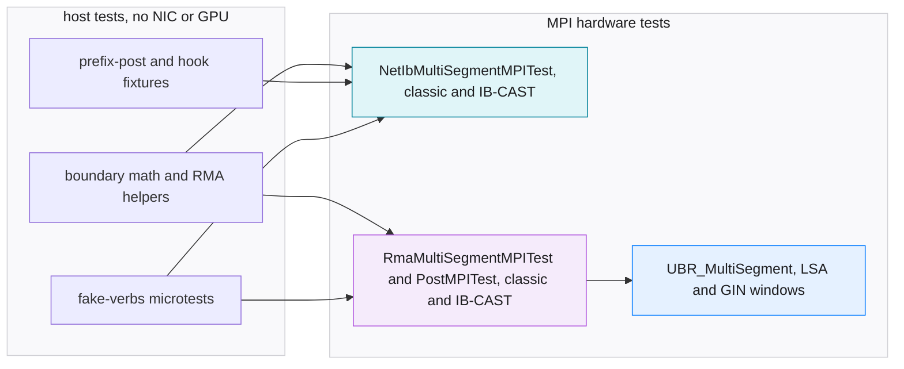

# Multi-segment testing

The tests put the correctness burden on pure boundary math and fake-verbs microtests that run on the host without a NIC or GPU, and use two-node MPI hardware tests for the ibverbs wiring, the collective agreement, the queue limits and the DeepEP window shapes. This doc lists the suites, what they cover, the hybrid DeepEP tests, the runner jobs, how to run them, and the known failures. The per-area inventory with every test name, its category, the configs that run it, and the open gaps is the [validation plan](multi_segment_validation_plan.md). Behavior under test is described in the transport docs linked from the [overview](multi_segment_overview.md#reading-guide).

> [!NOTE]
> Updated 2026-11-23 to the old stack at the wire tests tip `ba3ab26f30a7` on develop `c43b4a9e7307`. The 07 tests are folded into 05 and 06. The side-table, capability-trailer and credit tests became CTS-layout, layout-blob, round and in-flight-cap tests. The IB-MSEG fork runs the classic host tests twice, once per plugin; see [compile-twice host tests](multi_segment_fork_plugin.md#compile-twice-host-tests).

## Strategy



The splitters, segment selectors, CTS layout rules and RMA helpers are pure integer functions, so every tricky case is deterministic on the host: different local and remote starts, asymmetric layouts, zero length, address and slice-count overflow, `UINT32_MAX` slicing, round splitting and the in-flight cap, atomic alignment, malformed peer `segOff` tables, and the DeepEP CPU-to-GPU geometry. Hardware tests then prove the same rules through real DMA-BUF MRs and RDMA, and protect untouched memory with sentinels.

## Suites

| Suite | File (binary) | Covers |
|---|---|---|
| `NetIbMultiSeg`, `NetIbCtsLayout`, `NetIbLayoutBlob` | `test/NetIbMultiSegmentUnitTests.cpp` (`rccl-UnitTestsFixtures`) | peer-cap decline, segment selection, zero-length rkey, host VMM base 0, layout count against the cap, inline and referenced layouts, blob packing and validation |
| `RmaSegmentMathTest`, `RmaRoundTest` | `test/RmaSegmentMathTests.cpp` (`rccl-UnitTests`) | slicing, WR budget, signaling, cursor, the one count check and `RCCL_IB_MAX_REG_SEGMENTS`, the in-flight cap, offsets past the end, segment index, prefix post, sequence-id release, IB-CAST device slots; round pump, queue order, failed rounds |
| `NetIbSegmentedSendPrefix`, `NetIbSegmentedFlushPrefix`, `NetIbSegmentedHooks` | `test/transport/NetIb/NetIbSegmentedSendPrefixTests.cpp` (`rccl-UnitTestsFixturesDebug`) | classic slice posts, resume after a held slice, the one-read flush, the GDR flush flag tail, and every P2P hook |
| `NetIbCastSegmentedSendPrefix`, `NetIbCastFlushPrefix`, `NetIbCastSegmentedFlush`, `NetIbCastSegmentedHooks`, `NetIbCastSideTable` | `test/transport/NetIbCast/NetIbCastMultiSegTests.cpp` (`rccl-UnitTestsFixturesDebug`) | IB-CAST partial posts, BY_INDEX remap, deferred slots, flush, hooks; `NetIbCastSideTable` keeps its old name but tests the cached scope and the combined CTS slots |
| `NetIbMultiSegmentMPITest` | `test/transport/NetIbMPI/NetIbMultiSegmentMPITests.cpp` (`rccl-UnitTestsMPI`) | P2P per-segment, boundary-crossing, whole-buffer, offsets, multi-receive, flush, GDR flush flag, caps, switch off, stress |
| `RmaMultiSegmentMPITest`, `RmaMultiSegmentPostMPITest` | `test/transport/RmaMPI/RmaMultiSegmentMPITests.cpp` and `RmaMultiSegmentElasticMPITests.cpp` (`rccl-UnitTestsMPI`) | GIN/RMA registration, put, get, signal, flush, bounds, DeepEP and hybrid windows, post path, send-queue flood |
| `UBR_MultiSegment` | `test/RegistrationMPITests.cpp` (`rccl-UnitTestsMPI`) | NET segment-count cache, registration reuse, graph capture, symmetric LSA and GIN windows, DeepEP elastic and hybrid windows |
| `CeMPI_AllGather`, `CeMPI_AlltoAll` `MultiNodeHierarchicalMultiSegment` | `test/ce/CeMPITests.cpp` (`rccl-UnitTestsMPI`) | hierarchical CE AllGather and AlltoAll on multi-segment buffers |

Host microtests are separate `rccl-UnitTestsMicro*` binaries under `test/host/`, built and run by `test/host/run_host_tests.sh` against fake verbs and HIP:

| Suite | File under `test/host/` | Covers |
|---|---|---|
| `SymMemoryRegisterGinTest`, `SymMemoryRegisterRmaTest`, `SymMemoryRegisterGinElasticTest`, `SymMemoryMapLsaTeamTest` | `dev-runtime-test.cc` | window gates with the switch, DMA-BUF and backend; host owner fd export, fetch, publish and failure |
| `GinHostRegisterMicrotest`, `GinHostProxyRegMrMicrotest` | `gin-host-test.cc`, `gin-host-proxy-test.cc` | the owner fd reaches `regMrSymDmaBuf`; fallback without DMA-BUF |
| `NetProxyRegBufferMicrotest`, `NetProxyRegBufferCuMemMicrotest` | `transport/net-test.cc` | the `fd = -1` call and its declines |
| `NetIbRegMicrotest`, `NetIbRegRangeMicrotest` | `transport/net_ib/reg-test.cc` | range walk and per-segment MR failures close every fd, unwind, and leave the handle untouched; deregistration keeps going after an error |
| `NetIbConnectMultiSegMicrotest`, `NetIbConnectMultiSegOk`, `NetIbGinMicrotest`, `NetIbP2pMicrotest` | `transport/net_ib/connect-test.cc`, `gin-test.cc`, `net-ib-p2p-test.cc` | classic P2P comms advertise and size the combined CTS slots, GIN comms do not; the cached `multiSegOk`; listen marks; flush post error |
| `RmaProxyInflightCapTest`, `RegisterSegmentWalkMicrotest`, `P2pMultiSegmentMicrotest` | `dev-runtime-test.cc`, `register/register-test.cc`, `transport/p2p-test.cc` | the RMA in-flight cap and its INFO line, the registration walk, P2P registration of multi-segment buffers |
| `NetIbCastConnectMultiSegMicrotest`, `NetIbCastGinSegRegMicrotest`, `NetIbCastGinRoundMicrotest` | `transport/net_ib_cast/net-ib-cast-connect-test.cc`, `net-ib-cast-gin-test.cc` | IB-CAST advertising and scope, RMA per-segment registration and record, rounds |
| `NetIbCastRegMultiSegMicrotest`, `NetIbCastRegFromRangeMicrotest` | `transport/net_ib_cast/net-ib-cast-reg-test.cc` | IB-CAST per-segment registration, declines, unwinding |
| `NetIbCastP2pIsendMicrotest`, `NetIbCastP2pTestMicrotest`, `NetIbCastP2pFailedDrainMicrotest` | `transport/net_ib_cast/net-ib-cast-p2p-test.cc` | `nreqs` bounds, multi-receive post failure, FAILED requests drain and fail |
| `NetIbCastConnectTest` | `transport/net_ib_cast/net-ib-cast-connect-test.cc` (`rccl-UnitTestsMicroTransportNetIbCastConnect`) | P2P and RMA connect pairs, RMA depths, CQ floor, link-layer mismatch |
| `NetIbCastGinPostPathMicrotest`, `NetIbCastGinErrorLogMicrotest` | `transport/net_ib_cast/net-ib-cast-gin-test.cc` | IB-CAST RMA post path, rkey slots, per-WR cap splits, refused chains, timeout on a fake clock |
| `P2pResiliencyRecoveryAinicRmaMicrotest` | `p2p-resiliency-recovery-ainic-test.cc` | AINIC restore with the switch on and off |

Shared VMM helpers are `test/common/MultiSegmentVmmHelpers.hpp` and `test/common/HybridVmmHelpers.hpp`. The coverage PR (`09-tests-local`) moves the `UBR_MultiSegment` cases into `test/multisegment/` and adds collective, CE and hybrid single-node tests; see the [validation plan](multi_segment_validation_plan.md#coverage-pr-tests).

## Coverage

| Scenario | Host | P2P MPI | GIN/RMA MPI |
|---|---|---|---|
| Single-segment regression, switch on and off | — | yes | yes |
| N segments register N MRs; deregistration has no leak or double free | — | yes | yes |
| Boundary-crossing transfer | split math | splits and completes | completes |
| Independent local and remote offsets | yes | yes | yes, including DeepEP Engram |
| Count past the cap rejected, count at the cap accepted | yes | yes | yes |
| Non-uniform segment sizes register and transfer | unequal-segment math | `NonUniformLayoutRegisters` | equal counts with different boundaries |
| Layout validation and peer-cap decline | yes | yes, including an old peer | n/a |
| Equal counts with different boundaries; unequal counts rejected collectively | yes | n/a | yes |
| One flush read | fixtures | direct GDR only | one read of the first device segment |
| Mixed single- and multi-segment handles in one multi-receive | — | yes, transfer and flush | n/a |
| Concurrent pairs across every boundary | — | 2 ranks and 2 × 4 | all-pairs and many-to-one at 2 × 4 |
| Send-queue oversubscription | round and in-flight math | opt-in fat chain | at the in-flight cap, plus an opt-in flood |
| Partial posts | prefix fixtures | — | prefix helpers |
| DeepEP `[GPU][CPU]` and hybrid `[GPU k][CPU 0..N-1]` | geometry | — | positive, negative, stress |
| IB-CAST declines under BY_ORDER and QP sharing | — | yes | n/a |

### Classic and IB-CAST P2P

- **Old peer.** `OldPeer_SingleRkeyCrossBoundaryTransfer`: the receiver declines because the peer did not advertise, and a boundary-crossing write still completes on one rkey.
- **Switch off.** `MultiSegmentRegisterOff_DeclinesRegistration` registers a 4-segment window on both ranks with neither peer advertising: the receiver gets `ncclInvalidUsage` and no handle, the sender succeeds.
- **IB-CAST unsafe modes.** `CastUnsafeMode_DeclinesRegistration` runs under BY_ORDER (`NCCL_IB_RECEIVER_SIDE_MATCHING_SCHEME=2`) and under `RCCL_IB_QP_SHARING_ENABLE=1`, and expects both ranks to decline; it skips on classic.
- **Flush.** `MultiSegmentFlushSelectsSegmentMr`, `MultiSegmentFlushTouchesEverySegment` and `MultiRecvFlushTouchesEveryHandle` need direct GDR reads (`RCCL_GDR_FLUSH_GPU_MEM_NO_RELAXED_ORDERING=0`; IB-CAST also `NCCL_GDR_FLUSH_DISABLE=0`), because the default scratchpad flush posts a single read. `MultiRecvMixesSingleAndMultiSegmentHandles` starts its multi-segment entry in segment 1, so a flush through segment 0's MR would fault. These tests check bytes, not rkeys.
- **GDR flush flag (classic).** `GdrFlushFlag_SegmentedSendWritesFlag` runs with `RCCL_IB_GDR_FLUSH_FLAG=1` on the default QP count and on 4 split QPs, and checks that a segmented send writes each QP's flush flag.
- **Optional receive completion (IB-CAST).** `OptRecvCompletionSegmentedSkipsImm` and `OptRecvInvalidRangeRejectedBeforeRequest`; both skip collectively unless optional receive completion is active, and `RCCL_TEST_OPT_RECV_REQUIRE=1` (set by the opt-recv jobs) turns that skip into a failure.
- **Stress.** A 32-iteration asymmetric cross-boundary stress, `ConcurrentPairsMoveEverySegmentBoundary`, and the opt-in `SendQueueFatChainOversubscribe` (`RCCL_MSEG_SQ_STRESS=1`, three 8-receive 16-segment sends posted on one send QP without calling test; the sliced send keeps each progress call to one slice per QP).
- **Helper dispatch.** `RegisterMultiSegmentMr` must select `IbCastRegMrDmaBufMultiSeg` under IB-CAST; see [IB-CAST P2P](multi_segment_netib_cast.md#file-map).

### GIN/RMA

- **Layouts.** `RegisterEqualCountDifferentBoundariesTransfer` passes; `RegisterAsymmetricSegmentCountRejected` fails collectively; `RankLocalRegistrationFailureRejectedCollectively` fails every rank without deadlock; `RegistrationAfterCollectiveRejectionTransfers` reuses the consensus buffer with a different count.
- **Operations.** Boundary-crossing put and get, `UINT32_MAX` slicing, operations wider than one 64-WR round, signal atomics in later segments and rejection of unaligned or straddling ones, sub-page window bounds, the one-read flush.
- **Post path.** WR batching at sizes 8 and 2 (`ChainsAroundWrBatchSizeLandIntact`), context isolation, rejected-op slot accounting, zero-size ops, registration churn, all-pairs and many-to-one.
- **Send queue.** `IPutSignalFillsSendQueueWithoutTest` and `IPutSignalAtProxyInflightCapFitsSendQueue` post worst-case putSignals up to the in-flight cap without calling test, and all must land. The opt-in `IPutSignalSendQueueOversubscribe` posts twice the send queue: rejected posts return no request, accepted ones finish, and context 1 must still deliver into bytes the flood never touched. With `RCCL_TEST_RMA_MSEG_REQUIRE=1`, a test that finds no rank on the multi-segment path fails instead of skipping.
- **Switch off.** `MultiSegmentRegisterOff_KeepsUpstreamPath` expects no handle to report more than one segment (`rcclRmaIbProxyMrSegmentCount`).

### Registration and CE

- `UBR_MultiSegment.Generic` gates on NET registration completion and asserts the cached count is 8 for the whole registration, not "greater than 1". `GenericGraph` does the same under graph capture. `NetSegmentCountOddSizedHipMalloc` checks the last-page walk. `NetProxyPartialFinalSegment` registers two whole mappings and half of a third and checks the unregistered tail is untouched.
- `MultiSegmentRegisterOff_SliceSkipsNet` and `MultiSegmentRegisterOff_GraphSliceSkipsNet` check that a one-segment slice of a multi-segment registration skips NET with the switch off.
- `Generic_Reuse` runs with `RCCL_CE_ALLREDUCE=0`, `NCCL_ALGO=Ring`, `NCCL_PROTO=Simple`, so it deterministically enters the registration path whose reuse log it asserts.
- `DeepEP_ElasticWindowRegistration` runs in its own process, because it runs out of memory after `Symmetric_Elastic_Lsa` in the same process; `UBR_MultiSegment_All_Core` excludes it on every architecture config.
- The CE receive-offset suite (`ce_allreduce_recv_offset`) uses the test-only fault bit `CE_FAULT_LEGACY_RECV_OFFSET` to show the legacy offset corrupts a receive buffer inside its symmetric window, then checks the fix.

## Hybrid DeepEP windows

A hybrid window is one VMM range with a private GPU segment followed by one 2 MiB-aligned host segment per local rank. CI runs 8 ranks on 2 nodes, 4 per node, so each window has five segments:


Host segment k is local to rank k; the other three are imported. Local ranks exchange host sizes with MPI and POSIX DMA-BUF fds over RCCL's Unix-domain IPC socket (`SCM_RIGHTS`), map every host handle in local-rank order, give every segment GPU access and host segments CPU access, and register one window with `NCCL_WIN_STRICT_ORDERING`. LSA reuses the owner's host handle; GIN registers every segment through DMA-BUF, imported ones from the owner's fd ([how](multi_segment_gin_rma.md#host-owner-dma-buf)).

> [!IMPORTANT]
> Supported contract: `NCCL_ELASTIC_BUFFER_REGISTER=1` and `NCCL_SYM_REUSE_SYSMEM_HANDLES=1`. The 8-rank LSA+GIN job `ubr_multisegment_lsagin_multinode` is the primary coverage.

The tier covers strict-window registration and LSA pointer creation, cross-node GIN IGet from an imported remote CPU segment, negative elastic gating and an out-of-range IGet that must not post, and 32 stress iterations that vary the remote CPU owner, the size and independent offsets. The helper (`AllocHybridCollective` in `HybridVmmHelpers.hpp`) skips collectively when host VMM, DMA-BUF, GIN or the topology is missing; `CheckHybridVmmRuntimeSupport` skips with "ROCM-29812: imported host VMM CPU access is unsupported" on runtimes without that fix. `RCCL_TEST_HYBRID_VMM_REQUIRE=1` (set by the LsaGin jobs and `net_ib_rma_multisegment_hybrid`) turns those skips into failures. Cleanup is installed before any skip, and MRs and windows are released before the imported mappings. The RMA fixture calls the plugin directly, so it publishes the fds it received with `rcclHostSegmentFdRegister`.

**Non-blocking test stream.** A peer proxy's `hipMemMap` waits for kernels on blocking streams, so lazy IPC registration can deadlock against a collective on the test stream. A test can set `test_stream_flags_ = hipStreamNonBlocking` (`test/common/MPITestCore.hpp`); `NetProxyPartialFinalSegment` does. There is no environment override.

## Runner jobs

The six architecture configs (`mi300x_mellanox_ib`, `mi300_mellanox_ib_func`, `mi355x_thor2_roce`, `mi355x_thor2_roce_func`, `mi455_ainic_roce`, `mi455_ainic_roce_func`) define the same block. `mi455_roce_func` defines it too but enables only the single-node jobs; its multi-node and NET-IB entries are disabled with a reason, as its other NET-IB suites are.

| Job | Ranks | Runs |
|---|---|---|
| `multisegment_host_boundary_math` | 1 | `NetIbMultiSeg`, `NetIbCtsLayout`; the filter still names the removed `NetIbSplit` and `NetIbSideTable` and does not name `NetIbLayoutBlob` |
| `multisegment_rma_segment_math` | 1 | `RmaSegmentMathTest` from `rccl-UnitTests`; also in `net_ib_transport` |
| `unit_tests_fixtures_debug` entries `A20_NetIb_*` and `A20_Cast_*` | 1 | classic `NetIbSegmentedSendPrefix`, `NetIbSegmentedFlushPrefix`, `NetIbSegmentedHooks`; IB-CAST `NetIbCastFlushPrefix`, `NetIbCastSegmentedSendPrefix`, `NetIbCastSegmentedFlush`, `NetIbCastSegmentedHooks`, `NetIbCastSideTable` |
| `ubr_multisegment_comprehensive` | 2 on 1 node | `UBR_MultiSegment_All_Core`, `Generic_Reuse`, elastic gating |
| `multisegment_transport_multinode` | 2 on 2 nodes | classic P2P and RMA suites except hybrid and concurrent pairs, the classic `RmaMultiSegmentPostMPITest` suite with the send-queue flood as its own entry under `RCCL_MSEG_SQ_STRESS=1`, the switch-off entry, `UBR_MultiSegment_Generic`, `NetProxyPartialFinalSegment`; `RCCL_TEST_RMA_MSEG_REQUIRE=1` |
| `multisegment_netproxy_intranode_multinode` | 4 on 2 nodes | `NetProxyPartialFinalSegment` with an intra-node peer |
| `cast_rma_multisegment`, `cast_rma_multisegment_hybrid` | 2 on 2 nodes, 8 on 2 nodes | IB-CAST RMA: all `RmaMultiSegmentMPITest` cases by name, the register-off runs, the post-path suite and the send-queue flood, and the DeepEP hybrid cases; `RCCL_TEST_RMA_MSEG_REQUIRE=1`; each platform keeps its own job environment, and `mi455_roce_func` disables both |
| `ubr_multisegment_lsagin_multinode` | 8 on 2 nodes | `GenericGraph`, the slice-skip tests, `Symmetric_LsaGin`, DeepEP hybrid tests, `DeepEP_ElasticWindowRegistration` in its own process, and the IB-CAST twins; `RCCL_TEST_RMA_MSEG_REQUIRE=1` and `RCCL_TEST_HYBRID_VMM_REQUIRE=1` |
| `ce_allreduce_recv_offset` | 2 | `CE_RecvOffset_*` |
| `ce_hierarchical_multisegment_8node` | 16 | disabled in every architecture config: the hierarchical CE cases over two-segment windows need at least 8 nodes and skip on smaller jobs |
| `net_ib_multisegment` | 2 on 2 nodes | classic P2P, including ID matching and the opt-in fat chain |
| `net_ib_multisegment_flush` | 2 on 2 nodes | direct-GDR flush chain |
| `net_ib_multisegment_register_off` | 2 on 2 nodes | switch off: decline and single-segment regressions |
| `net_ib_multisegment_old_peer` | 2 on 2 nodes | receiver declines, boundary-crossing write completes on one rkey |
| `net_ib_multisegment_scale_2x4` | 8 on 2 nodes | concurrent pairs, 4 ranks on each of 2 nodes |
| `net_ib_multisegment_gdr_flush_flag` | 2 on 2 nodes | segmented send with `RCCL_IB_GDR_FLUSH_FLAG=1`, default and 4 split QPs |
| `cast_multisegment`, `cast_multisegment_opt_recv`, `cast_multisegment_opt_recv_2qp` | 2 on 2 nodes | IB-CAST P2P suite on BY_INDEX matching, with direct flush on; optional receive completion on 1 and 2 QPs with `RCCL_TEST_OPT_RECV_REQUIRE=1` |
| `cast_multisegment_register_off`, `cast_multisegment_unsafe_modes` | 2 on 2 nodes | IB-CAST switch off; declines under BY_ORDER and QP sharing |

Configs disable some of these on purpose, with the reason in the suite description:

| Config | Disabled | Reason |
|---|---|---|
| `mi455_ainic_roce` | `net_ib_multisegment`, `_flush`, `_register_off` | develop's convention for this config: every classic NET-IB suite is disabled ("Broadcom Thor Ultra has no matching OFED/verbs userspace"); 07's `_old_peer`, `_scale_2x4` and `_gdr_flush_flag` are still enabled there |
| `mi455_ainic_roce_func` | `net_ib_multisegment_flush` | the ionic NIC runs with `NCCL_GDR_FLUSH_DISABLE=1` |
| `mi455_roce_func` | every multi-node and NET-IB job | NET-IB suites stay disabled on this config |
| all architecture configs | `ce_hierarchical_multisegment_8node` | needs an allocation of at least 8 nodes |

The job matrix at the wire tip, one row per job and one column per config, is generated in `~/ginocc/sw/docs_update_1123/oldstack_runner_jobs.md`. Several config descriptions still say "side table" or "credits" (for example in `mi300x_mellanox_ib.json`); the tests they name check the one-write CTS and the round post path.

`net_ib_transport.json` holds the same classic and IB-CAST P2P jobs plus the RMA jobs that the architecture configs do not define:

| Job | Scope |
|---|---|
| `net_ib_rma_multisegment`, `net_ib_rma_multisegment_wrbatch` | classic RMA suite with `RCCL_TEST_RMA_MSEG_REQUIRE=1` and the switch-off entries; WR batch sizes 8 and 2 |
| `cast_rma_multisegment` | extends `net_ib_rma_multisegment` with `NCCL_NET=IB-CAST`, so a fix made only in `net_ib` shows up as an IB-CAST failure; the hardware configs define the same job name |
| `net_ib_rma_multisegment_hybrid`, `cast_rma_multisegment_hybrid` | 8-rank hybrid RMA on classic and IB-CAST, with `RCCL_TEST_HYBRID_VMM_REQUIRE=1`; the IB-CAST twin is also in every hardware config |
| `net_ib_rma_multisegment_scale_1x2`, `net_ib_rma_multisegment_scale_2x4` | RMA scale variants |

The MPI tiers in `test_categories_mpi.yaml` run at the build default; the `standard_env_multi_segment_register` and `standard_env_multi_segment_register_off` entries pin the switch on and off. None of the IB-CAST P2P jobs sets `RCCL_IB_P2P_DISABLE_CTS=1`. Perf-only configs do not run these tests. `tools/scripts/test_runner/check_test_filters.py` flags `test_filter` clauses that match no test. The jobs the coverage PR adds, and the gaps in which configs run what, are in the [validation plan](multi_segment_validation_plan.md#runner-jobs-and-configs).

## How to run

The runner applies each job's environment from the JSON configs and is the recommended way to reproduce CI. For manual runs:

```bash
# Build with MPI tests; a debug build exposes the internal symbols the MPI tests use.
MPI_PATH=/opt/sre-tools/ompi ./install.sh --debug --enable-mpi-tests -t -l

# Host unit tests and fixtures
./build/test/rccl-UnitTestsFixtures --gtest_filter='NetIbMultiSeg.*:NetIbCtsLayout.*:NetIbLayoutBlob.*'
./build/test/rccl-UnitTests --gtest_filter='RmaSegmentMathTest.*:RmaRoundTest.*'
./build/test/rccl-UnitTestsFixturesDebug --gtest_filter='NetIbSegmented*:NetIbCast*'

# Host microtests (fake verbs and HIP), as CI runs them
./test/host/run_host_tests.sh

# Two-node P2P and RMA, classic
mpirun -np 2 --map-by ppr:1:node ./build/test/rccl-UnitTestsMPI \
  --gtest_filter='NetIbMultiSegmentMPITest.*:RmaMultiSegmentMPITest.*-RmaMultiSegmentMPITest.DeepEP_Hybrid*'

# RMA on IB-CAST
NCCL_NET=IB-CAST mpirun -np 2 --map-by ppr:1:node ./build/test/rccl-UnitTestsMPI \
  --gtest_filter='RmaMultiSegmentMPITest.*:RmaMultiSegmentPostMPITest.*-RmaMultiSegmentMPITest.DeepEP_Hybrid*'

# Opt-in send-queue stress
RCCL_MSEG_SQ_STRESS=1 mpirun -np 2 --map-by ppr:1:node ./build/test/rccl-UnitTestsMPI \
  --gtest_filter='RmaMultiSegmentPostMPITest.IPutSignalSendQueueOversubscribe'

# Switch off
NCCL_MULTI_SEGMENT_REGISTER=0 mpirun -np 2 --map-by ppr:1:node ./build/test/rccl-UnitTestsMPI \
  --gtest_filter='NetIbMultiSegmentMPITest.MultiSegmentRegisterOff_DeclinesRegistration'

# Eight-rank hybrid LSA+GIN, 4 ranks per node
mpirun -np 8 --map-by ppr:4:node ./build/test/rccl-UnitTestsMPI \
  --gtest_filter='UBR_MultiSegment.DeepEP_Hybrid*:RmaMultiSegmentMPITest.DeepEP_Hybrid*'
```

Validate multi-segment changes on ROCm 7.0.2.x and on 10.3; the version gates differ between them. The [validation plan](multi_segment_validation_plan.md#how-to-run) lists the wrapper scripts that run the host tests and the runner configs over both versions.

## Results

The latest node run of the old stack is on the wire tip after the rebase onto develop `c43b4a9e7307` (2026-11-19), on two MI355X (gfx950) nodes with Thor2 RoCE NICs, on ROCm 7.0.2.2 and 10.3: 220 of 221 runner units passed on each version (`~/ginocc/sw/val-develop1118-r2/status`). The one failure was the fixtures unit, whose two flush tests still expected two posts; the fix was folded into the 06 and 08 tests commits and the rebuilt unit passed 135 of 135 tests on both versions. A second run with `RCCL_IB_MAX_MSG_SIZE=1048576` covered IB-CAST multi-segment RMA on 8 rails, 1 rail, hybrid windows and WR batching: 4 of 4 units, 425 tests, on both versions (`~/ginocc/sw/val-develop1118-cap/run/status`). Host tests are clean on every branch tip apart from develop's order-dependent `NetSharedHostHugePagesMicrotest`. Results for the IB-MSEG forks are in [the fork plugin](multi_segment_fork_plugin.md#validation).

## Known failures and dependencies

- `UBR_MultiSegment.Symmetric_LsaGin` and its IB-CAST twin now run in `ubr_multisegment_lsagin_multinode`; on the 11-04 tree they failed on ROCm 7.0.2.x through `ReduceScatter_RailA2A` and sat in a disabled suite that no longer exists.
- The hierarchical CE cases need at least 8 nodes, so `ce_hierarchical_multisegment_8node` is disabled; on 2 nodes they skip. With the fixture's full debug logging on a synchronous NFS directory they could also hit the 300 s limit (develop's logging, not the multi-segment code).
- IB-CAST RMA with `NCCL_IB_SUBNET_AWARE_ROUTING=1` and mixed rails fails with "no registration slot": develop's subnet routing can move a per-peer RMA comm to a NIC on which the window was not registered. Classic fails the same layout with a protection error. It is not caused by this stack.
- Failures that are present on develop and not caused by this stack: IB-CAST `StressMultiRound` (`CastStressMultiRoundTwoConns`), `CE_AllReduce_3Ranks` and its pipelined variant, HostApi `GraphCaptureReplayPutWait`, MemManager AnyRanks CuMem0/1, `Resiliency_GidChangeRefresh`, and the symmetric ReduceScatter group (same cause as above).

## IB-MSEG fork tests

The [fork plugin](multi_segment_fork_plugin.md) reuses most of the suites above with the switch on, because the switch now selects IB-MSEG:

- **Host tests.** Four IB-MSEG binaries (`rccl-UnitTestsMicroTransportNetIbMseg{Connect,Gin,P2p,Reg}`) compile the `net_ib` host test files a second time against the fork, plus fork-only tests; see [compile-twice host tests](multi_segment_fork_plugin.md#compile-twice-host-tests). `run_host_tests.sh` runs them with the others. When a `net_ib` change breaks one of them, add the test to that binary's `EXCLUDE_BASE_TESTS` in `test/host/transport/net_ib_multiseg/host_tests.cmake` as `lagging` with a reason.
- **Dropped.** The capability-word and old-peer tests (`*WithoutPeerCapability`, `IrecvSkipsTheLayoutForAPeerWithoutTheCap`, `OldPeer_SingleRkeyCrossBoundaryTransfer`) and the switch-dependent send-depth test have no fork counterpart.
- **Runner jobs.** Fork 2 adds `*_mseg` jobs that run the NET/IB MPI whitebox suites on IB-MSEG (connection, initialization, memory, properties, transfer, GDR flush and flush flag, and in `net_ib_transport` also GIN peer-mem, WQE latency and plugin selection). Forks 3 and 4 run the multi-segment P2P, RMA and registration jobs with the switch on. They are in the Mellanox IB and Thor2 configs and `net_ib_transport`; the AINIC configs get them once IB-MSEG carries AINIC support.
- **Results.** See [fork validation](multi_segment_fork_plugin.md#validation).

## Regression guards

1. The single-segment path stays byte-identical: same WRs, same completion, no layout prefix, a single flush read.
2. P2P frees only through `segMrs[][]`, never the `mrs[]` alias.
3. A split failure, WR-pool overflow, invalid peer layout or straddle WARNs and returns an error instead of posting a bad WR.
4. A prefix post keeps the request; a lost signaled tail marks it FAILED.
5. Host VMM `segBase == 0` does not wrap the segment length.
6. The NET segment count is cached for the full registration, after every peer registered, and the walk ends inside the last page.
7. CE peer destinations include `recvbuff - recvWin->userPtr` before the shard offset.
8. Reuse tests select the registration path with Ring/Simple and CE off.
9. P2P sends post one slice per QP per progress call, so develop's send depth of 512 holds them; IB-CAST keeps one segmented group at a time. Only RMA comms raise the send depth, to 2080.
10. GIN exports cover whole pages from the segment pointer's page.
11. GIN consensus is collective: the record buffer is allocated at connect, reached even after a local failure, and the tables are validated.
12. Classic sends a layout prefix only for flagged slots (bit 15 of `nreqs`); peer `nreqs` is bounded before any wait; GIN and RMA comms never advertise and have no combined CTS slots.
13. IB-CAST declines on both sides under CTS offload, BY_ORDER or QP sharing; classic declines only the receiver of a peer without the capability.
14. Host-window classification allgathers a fixed-size kind array.
15. The switch off restores develop: no capability, develop's depths and bodies, no consensus buffer, no in-flight cap.
16. Develop's functions carry only one-line hooks.
